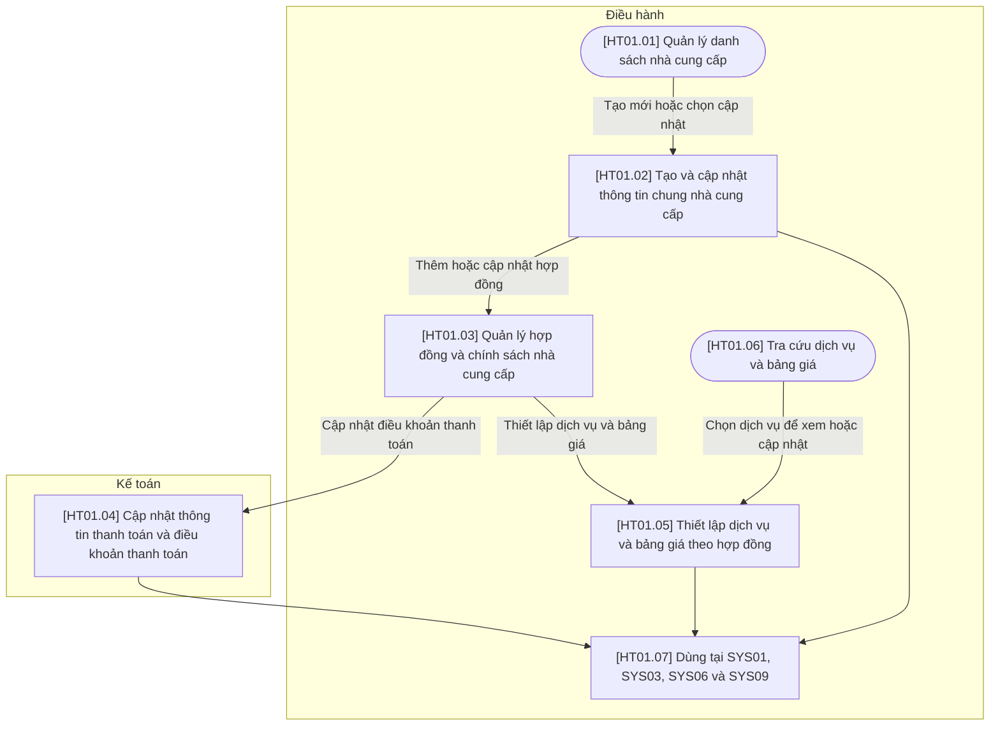
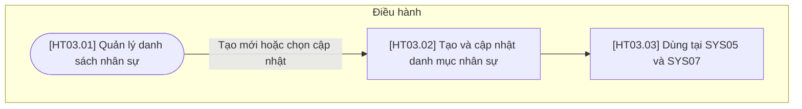
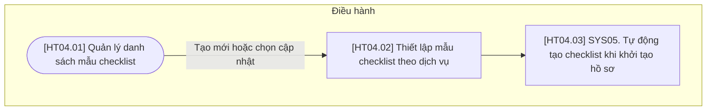
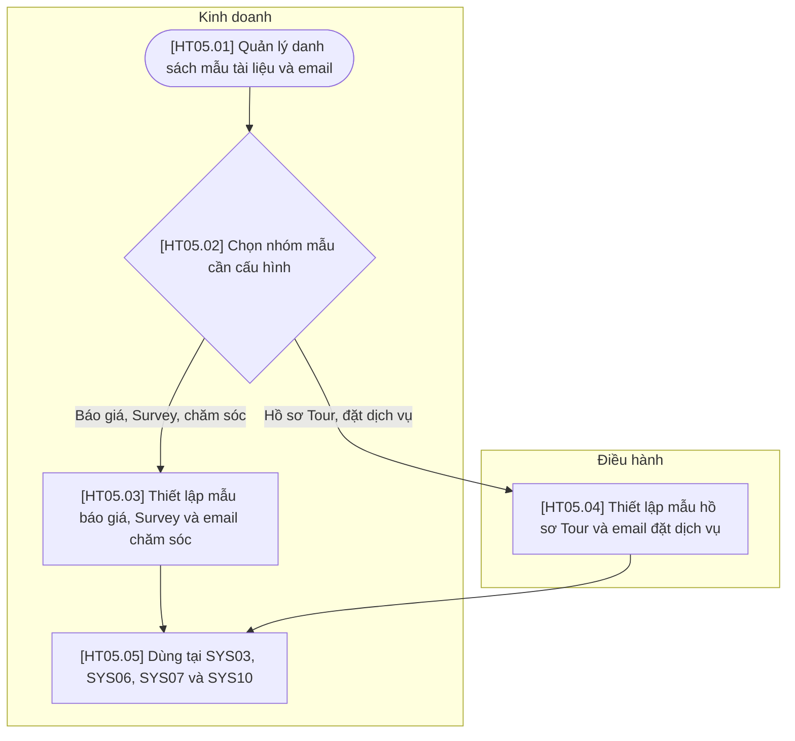

# Tổng hợp các luồng hỗ trợ Level 1

Gộp luồng Quản lý Dịch vụ và Bảng giá (HT02 cũ) vào HT01. Hồ sơ nhà cung cấp là nơi nhập liệu duy nhất cho thông tin NCC, hợp đồng, chính sách đổi hủy, chính sách trẻ em, điều khoản thanh toán, dịch vụ (bao gồm, không bao gồm) và bảng giá. Còn 4 luồng hỗ trợ (HT01, HT03, HT04, HT05) và 13 tính năng hỗ trợ. Mã HT02 không còn dùng; giữ nguyên mã HT03–HT05.

## HT01 — Quản lý Hồ sơ Nhà cung cấp

## Phạm vi và quy ước

- Chỉ có vai trò Kinh doanh, Điều hành, Kế toán; tự động/AI là xử lý trong bước của bộ phận phụ trách.
- Gộp các thao tác cùng mục đích; không có bước duyệt, chờ phản hồi hoặc công việc ngoài hệ thống.
- Số bước liên tục theo thứ tự bảng. Các phương án hoặc nhánh không bắt buộc đi qua tuần tự tất cả các bước.
- Mã tính năng trong bảng bên dưới đối chiếu trực tiếp với file danh sách tính năng hỗ trợ đi kèm. Điều kiện và liên kết không tạo tính năng trùng.
- Giữ mã CNHT01.01–CNHT01.03; CNHT01.04 là mã mới; CNHT01.05 thay CNHT02.02, CNHT01.06 thay CNHT02.01.

## Sơ đồ luồng

## Bảng mô tả sơ đồ

| Mã bước | Vai trò | Thao tác / điều kiện | Mô tả | Tính năng tương ứng | Chuyển tiếp |
| --- | --- | --- | --- | --- | --- |
| HT01.01 | Điều hành | Quản lý danh sách nhà cung cấp | Xem, tìm kiếm, lọc (tên, loại dịch vụ, cho phép sử dụng, tình trạng hợp đồng) và mở hồ sơ NCC; danh mục dùng chung cho dịch vụ, đặt dịch vụ và thanh toán. | CNHT01.01 | Tạo mới hoặc chọn cập nhật → HT01.02 |
| HT01.02 | Điều hành | Tạo và cập nhật thông tin chung nhà cung cấp | Khai báo tên, loại dịch vụ cung cấp, địa chỉ, đầu mối liên hệ, email đặt dịch vụ và việc cho phép sử dụng NCC. | CNHT01.02 | Thêm hoặc cập nhật hợp đồng → HT01.03; HT01.07 |
| HT01.03 | Điều hành | Quản lý hợp đồng và chính sách nhà cung cấp | Thêm/cập nhật hợp đồng của NCC: số hợp đồng, kỳ hiệu lực, loại tiền, file đính kèm. Trên cùng hợp đồng khai báo mùa giá, chính sách đổi hủy và chính sách trẻ em. Hệ thống tính chỉ báo Còn hiệu lực/Sắp hết hạn/Hết hạn từ kỳ hiệu lực. Hợp đồng mới điền sẵn chính sách từ hợp đồng gần nhất; Gia hạn hợp đồng sao chép mùa giá, chính sách, điều khoản và bảng giá sang kỳ mới. | CNHT01.04 | Cập nhật điều khoản thanh toán → HT01.04; Thiết lập dịch vụ và bảng giá → HT01.05 |
| HT01.04 | Kế toán | Cập nhật thông tin thanh toán và điều khoản thanh toán | Lưu thông tin nhận thanh toán của NCC và điều khoản thanh toán của từng hợp đồng (đặt cọc, các đợt, hạn trả). Dữ liệu được tham chiếu khi lập lịch trả theo dịch vụ, không tạo khoản phải trả ngay tại hồ sơ NCC. | CNHT01.03 | HT01.07 |
| HT01.05 | Điều hành | Thiết lập dịch vụ và bảng giá theo hợp đồng | Tạo/cập nhật dịch vụ của NCC, đơn vị tính, dịch vụ bao gồm và không bao gồm; khai báo bảng giá gắn với hợp đồng theo khoảng số khách, hạng phòng, giá/phụ thu phòng đơn, giá trẻ em theo nhóm tuổi của hợp đồng, mùa giá của hợp đồng (ngày thường/cuối tuần), phụ thu lễ Tết và loại tiền. Khai báo căn cứ tính giá và quy tắc ưu tiên/cộng dồn trên cùng bước. Nhập trên lưới (dán từ Excel, nhân bản dòng, giá trị mặc định theo hợp đồng); nhân bản dịch vụ kèm bảng giá. | CNHT01.05 | HT01.07 |
| HT01.06 | Điều hành | Tra cứu dịch vụ và bảng giá | Xem, tìm kiếm và lọc dịch vụ của mọi NCC theo dịch vụ, NCC, hợp đồng, thời gian áp dụng, khoảng số khách, hạng phòng và loại tiền; Kinh doanh được xem. Nhập ngày sử dụng và số khách để xem ngay giá áp dụng. Chỉ tra cứu; cập nhật thực hiện trong hồ sơ NCC. | CNHT01.06 | Chọn dịch vụ → HT01.05 |
| HT01.07 | Điều hành | Dùng tại SYS01, SYS03, SYS06 và SYS09 | Hồ sơ NCC cung cấp dịch vụ cho Tour mẫu, giá vốn và chính sách khi lập báo giá, thông tin và chính sách đổi hủy khi đặt dịch vụ, điều khoản thanh toán khi ghi công nợ và đối chiếu. | Điều hướng/điều kiện, không tính thành tính năng riêng | Liên kết nghiệp vụ dùng chung |

## Ghi chú nghiệp vụ

Điều hành quản lý thông tin chung, hợp đồng, chính sách, dịch vụ và bảng giá; Kế toán quản lý thông tin nhận thanh toán và điều khoản thanh toán của hợp đồng. Không có bước duyệt NCC hay duyệt hợp đồng. Bật/tắt sử dụng nằm trong cập nhật hồ sơ, không sinh nhiều trạng thái. Danh mục dịch vụ/bảng giá không phải lần đặt dịch vụ; giá tham chiếu không xác nhận tình trạng còn chỗ.

## Liên kết với nghiệp vụ chính

- Cung cấp dữ liệu cho: **SYS01, SYS03, SYS06, SYS09**.
- Phạm vi: Thông tin chung NCC, hợp đồng, chính sách đổi hủy, chính sách trẻ em, thông tin và điều khoản thanh toán, dịch vụ (bao gồm, không bao gồm) và bảng giá.

## Thông tin hồ sơ nhà cung cấp

| Nhóm thông tin | Dữ liệu | Cấp khai báo | Bước / tính năng |
| --- | --- | --- | --- |
| Thông tin chung | Tên, loại dịch vụ cung cấp, địa chỉ, đầu mối liên hệ, email đặt dịch vụ, cho phép sử dụng | NCC | HT01.02 / CNHT01.02 |
| Hợp đồng | Số hợp đồng, ngày ký, kỳ hiệu lực từ–đến, loại tiền, file đính kèm, ghi chú; chỉ báo Còn hiệu lực/Hết hạn (tính) | Hợp đồng | HT01.03 / CNHT01.04 |
| Mùa giá | Tên mùa, một hoặc nhiều khoảng ngày, tách ngày thường/cuối tuần (tùy chọn); xem mục *Mùa giá theo hợp đồng* | Hợp đồng | HT01.03 / CNHT01.04 |
| Chính sách đổi hủy | Xem bảng bên dưới | Hợp đồng | HT01.03 / CNHT01.04 |
| Chính sách trẻ em | Xem bảng bên dưới | Hợp đồng | HT01.03 / CNHT01.04 |
| Thông tin nhận thanh toán | Tên thụ hưởng, ngân hàng, số tài khoản, thông tin xuất hóa đơn | NCC | HT01.04 / CNHT01.03 |
| Điều khoản thanh toán | Tỷ lệ/số tiền đặt cọc, các đợt thanh toán, mốc tính hạn (trước ngày sử dụng, sau khi xác nhận, sau khi kết thúc Tour), số ngày, phương thức | Hợp đồng | HT01.04 / CNHT01.03 |
| Dịch vụ | Tên dịch vụ, loại dịch vụ, đơn vị tính, mô tả, cho phép sử dụng | Dịch vụ của NCC | HT01.05 / CNHT01.05 |
| Dịch vụ bao gồm | Danh sách hạng mục đã nằm trong giá (vd: ăn sáng, vé vào cửa, nước uống) | Dịch vụ của NCC | HT01.05 / CNHT01.05 |
| Dịch vụ không bao gồm | Danh sách hạng mục không nằm trong giá (vd: đồ uống, tip, chi phí cá nhân) | Dịch vụ của NCC | HT01.05 / CNHT01.05 |
| Bảng giá | Các dòng giá gắn với hợp đồng; tiêu chí xem mục *Cấu hình giá nhà cung cấp tại HT01.05* | Dịch vụ × hợp đồng | HT01.05 / CNHT01.05 |

## Chính sách theo hợp đồng tại HT01.03

Chính sách khai báo **theo từng hợp đồng**, không có chính sách mặc định ở cấp NCC hay ghi đè ở cấp dịch vụ. NCC có nhiều kỳ hợp đồng thì mỗi kỳ có chính sách riêng; hệ thống chọn hợp đồng có kỳ hiệu lực chứa ngày sử dụng dịch vụ.

| Chính sách | Dữ liệu cần thiết lập | Cách áp dụng |
| --- | --- | --- |
| Đổi hủy | Các mốc số ngày trước ngày sử dụng và mức phí tương ứng (tỷ lệ hoặc số tiền, căn cứ tính: trên tổng giá, đêm đầu, mỗi khách/phòng); phí no-show; điều kiện đổi ngày, đổi tên, giảm số lượng; ghi chú | Khi hủy đặt dịch vụ (SYS06.06), hệ thống gợi ý phí hủy theo mốc phù hợp với ngày hủy và ngày sử dụng; Điều hành sửa được theo phí NCC báo thực tế. |
| Trẻ em | Nhóm tuổi với cận tuổi rõ ràng; điều kiện chung giường, thêm giường, ăn sáng; số trẻ được miễn phí trên mỗi phòng hoặc mỗi người lớn; ghi chú | Bảng giá của hợp đồng dùng các nhóm tuổi này để khai giá trẻ em; khi tính giá (SYS03.09) áp theo số trẻ ở từng nhóm và điều kiện thực tế. |

- Hợp đồng hết hạn vẫn giữ để tra cứu; không tự xóa bảng giá hay chính sách đã dùng trong báo giá, Booking, đặt dịch vụ trước đó.
- Không có hợp đồng còn hiệu lực cho ngày sử dụng thì hiển thị cảnh báo khi chọn giá; không tự dùng chính sách của hợp đồng khác.

## Mùa giá theo hợp đồng tại HT01.03

Mùa giá được định nghĩa **một lần cho mỗi hợp đồng** và dùng chung cho mọi dịch vụ của hợp đồng đó. Dòng giá chỉ chọn mùa, không nhập lại ngày.

| Nội dung | Dữ liệu cần thiết lập | Cách áp dụng |
| --- | --- | --- |
| Mùa | Tên mùa (vd: Thấp điểm, Cao điểm, Lễ Tết), một hoặc nhiều khoảng ngày từ–đến trong kỳ hiệu lực hợp đồng, ghi chú | Một mùa có thể gồm nhiều khoảng ngày (vd: Cao điểm 01/06–31/08 và 20/12–05/01). Hợp đồng mới có sẵn một mùa "Cả kỳ hợp đồng" bằng kỳ hiệu lực; NCC không chia mùa thì không cần khai thêm. |
| Ngày cuối tuần | Các thứ được tính là cuối tuần (vd: thứ Sáu, thứ Bảy); bật/tắt tách giá ngày thường và cuối tuần cho từng mùa | Mùa có bật tách thì bảng giá có hai cột giá Ngày thường và Cuối tuần; mùa không bật chỉ có một giá. |
| Kiểm tra | Hệ thống tự kiểm tra khi lưu | Các khoảng ngày của các mùa không được chồng lấn (chặn lưu). Ngày trong kỳ hợp đồng chưa thuộc mùa nào được cảnh báo, vẫn cho lưu. |

- Đổi ngày của một mùa thì mọi dòng giá dùng mùa đó tự áp theo ngày mới; báo giá, Booking đã lưu không đổi vì đã lưu mùa và ngày đã dùng.
- Gia hạn hợp đồng sao chép các mùa và dời ngày sang kỳ mới theo cùng ngày/tháng; mùa có ngày lễ theo âm lịch được đánh dấu để người dùng kiểm tra lại.
- Kỳ lễ Tết có giá thay hẳn giá thường thì khai là một mùa riêng; kỳ lễ chỉ cộng thêm tiền thì dùng phụ thu lễ Tết trong bảng giá.

## Cấu hình giá nhà cung cấp tại HT01.05

Toàn bộ tiêu chí dưới đây nằm trong **một bước Thiết lập dịch vụ và bảng giá theo hợp đồng** và tính năng **CNHT01.05**; không tạo thêm nút xử lý hoặc trạng thái. Mỗi dòng giá thuộc một hợp đồng của NCC và một mùa giá của hợp đồng đó; thời gian áp dụng của dòng giá lấy theo mùa, không nhập riêng.

| Tiêu chí | Dữ liệu cần thiết lập | Cách áp dụng khi tính giá |
| --- | --- | --- |
| Theo số khách | Khoảng số khách từ–đến, mức giá, đối tượng được tính vào số khách và căn cứ tính giá: theo khách, phòng, đoàn hoặc đơn vị dịch vụ | Chọn đúng khoảng số khách theo quy định của bảng giá; không mặc định cùng một cách đếm người lớn/trẻ em cho mọi NCC. |
| Phòng đơn | Đơn giá phòng đơn hoặc phụ thu phòng đơn; đơn vị áp dụng theo khách/phòng/đêm và điều kiện áp dụng | Phân biệt giá phòng đơn trọn gói với giá cơ sở cộng phụ thu. Không cộng thêm phụ thu nếu giá được chọn đã bao gồm phòng đơn. |
| Trẻ em | Giá cố định hoặc tỷ lệ trên giá người lớn cho từng nhóm tuổi trong chính sách trẻ em của hợp đồng | Tính theo số trẻ em ở từng nhóm và điều kiện thực tế. Không mặc định mọi trẻ em cùng một tỷ lệ giá. |
| Theo mùa | Chọn mùa từ danh sách mùa giá của hợp đồng (không nhập ngày); mức giá của mùa, tách ngày thường/cuối tuần nếu mùa có bật | Xác định mùa và loại ngày theo ngày sử dụng dịch vụ; với lưu trú qua nhiều mùa hoặc gồm cả ngày thường và cuối tuần, tách tính theo từng đêm. Mùa chưa có giá thì báo thiếu, không lấy giá mùa khác. |
| Phụ thu lễ Tết | Ngày/khoảng ngày lễ Tết, mức tiền hoặc tỷ lệ, căn cứ tính, đơn vị và đối tượng áp dụng | Áp dụng đúng dịch vụ/ngày/đối tượng; xác định phụ thu được cộng thêm hay đã nằm trong mức giá của kỳ lễ. |
| Theo hạng phòng | Hạng phòng của dịch vụ lưu trú và mức giá tương ứng | Hạng phòng như Standard/Deluxe khác với hình thức ở đơn/đôi; chọn đồng thời hạng phòng và điều kiện phòng đơn khi có. |
| Loại tiền của giá | Mã tiền tệ của từng giá cơ sở và khoản phụ thu bằng tiền, ví dụ VND hoặc USD; mặc định theo loại tiền của hợp đồng | Giữ nguyên giá và loại tiền gốc; khi báo giá dùng loại tiền khác, quy đổi từng khoản theo tỷ giá được nhập/chọn và lưu cùng phiên bản. Không cộng trực tiếp các khoản khác loại tiền. |

## Quy tắc kết hợp và dữ liệu tính giá

- Mỗi mức giá gắn với NCC, hợp đồng, dịch vụ và mùa giá (thời gian hiệu lực lấy theo mùa), kèm đơn vị tính và các điều kiện phù hợp. Không yêu cầu mọi loại dịch vụ đều có hạng phòng hay giá phòng đơn.
- Giá phòng/đêm, giá khách, giá đoàn là các căn cứ khác nhau; số lượng tính phải tương ứng với đơn vị, không nhân lặp số khách và số phòng cho cùng một khoản.
- Với các điều kiện giao nhau, thiết lập rõ quy tắc ưu tiên/thay thế hoặc cộng dồn. Giá mùa có thể là giá cơ sở; phụ thu lễ chỉ cộng thêm nếu quy định NCC yêu cầu và chưa nằm trong giá kỳ lễ.
- Phụ thu phòng đơn, giá trẻ em và phụ thu lễ Tết phải có căn cứ tính rõ ràng. Khoản phụ thu theo tỷ lệ cần xác định giá cơ sở dùng tính tỷ lệ.
- Khi không có mức giá hoặc tỷ giá phù hợp, hiển thị phần thiếu để người dùng nhập/chọn; không tự dùng giá 0 hoặc tỷ giá mặc định không được ghi nhận.
- Lưu mức giá, hợp đồng, mùa giá và loại ngày đã áp, điều kiện áp dụng, số lượng, loại tiền gốc và tỷ giá đã dùng cùng phiên bản báo giá. Sửa bảng giá, hợp đồng hoặc chính sách NCC không tự thay đổi báo giá hoặc Booking đã lưu.

## Liên kết với SYS01, SYS03, SYS06 và SYS09

| Nghiệp vụ | Bước / tính năng | Dữ liệu sử dụng |
| --- | --- | --- |
| Tour mẫu | SYS01.05; TN01.03 | Chọn dịch vụ của NCC đang được phép sử dụng. |
| Thiết kế và báo giá | SYS03.09, SYS03.10; TN03.06, TN03.07 | Kinh doanh nhập/chọn số khách, cơ cấu tuổi trẻ em, hạng phòng, số phòng đơn, ngày sử dụng và loại tiền; hệ thống chọn hợp đồng hiệu lực theo ngày sử dụng, lấy giá phù hợp, áp nhóm tuổi trẻ em của hợp đồng, áp dụng phụ thu, quy đổi rồi tính Markup/giá bán. Báo giá tổng hợp dịch vụ bao gồm/không bao gồm từ các dịch vụ trong hành trình (đề xuất). |
| Đặt dịch vụ | SYS06.03 | Chọn NCC/dịch vụ, ngày sử dụng, số khách và yêu cầu phòng; email được hệ thống soạn sẵn từ các dữ liệu này và email đặt dịch vụ của NCC. Giá danh mục vẫn là giá tham chiếu, không xác nhận còn chỗ. |
| Cập nhật kết quả đặt | SYS06.04 | Ghi nhận thông tin và giá dịch vụ thực tế NCC xác nhận nếu khác mức tham chiếu; không tự sửa giá đã chốt với khách. |
| Hủy đặt dịch vụ | SYS06.06; TN06.04 | Gợi ý phí hủy theo chính sách đổi hủy của hợp đồng áp dụng; Điều hành sửa được. |
| Phải trả NCC | SYS06.07; TN06.05 | Lịch trả điền sẵn từ điều khoản thanh toán của hợp đồng áp dụng và thông tin nhận thanh toán của NCC. |
| Đối chiếu công nợ | SYS09.05; TN09.02 | NCC và hợp đồng làm căn cứ đối chiếu AP theo Tour. |

---

## HT03 — Quản lý Danh mục Nhân sự

## Phạm vi và quy ước

- Chỉ có vai trò Kinh doanh, Điều hành, Kế toán; tự động/AI là xử lý trong bước của bộ phận phụ trách.
- Gộp các thao tác cùng mục đích; không có bước duyệt, chờ phản hồi hoặc công việc ngoài hệ thống.
- Số bước liên tục theo thứ tự bảng. Các phương án hoặc nhánh không bắt buộc đi qua tuần tự tất cả các bước.
- Mã tính năng trong bảng bên dưới đối chiếu trực tiếp với file danh sách tính năng hỗ trợ đi kèm. Điều kiện và liên kết không tạo tính năng trùng.

## Sơ đồ luồng

## Bảng mô tả sơ đồ

| Mã bước | Vai trò | Thao tác / điều kiện | Mô tả | Tính năng tương ứng | Chuyển tiếp |
| --- | --- | --- | --- | --- | --- |
| HT03.01 | Điều hành | Quản lý danh sách nhân sự | Xem, tìm kiếm và lọc nhân sự có thể được phân công phụ trách hồ sơ, công việc hoặc phục vụ Tour. | CNHT03.01 | Tạo mới hoặc chọn cập nhật → HT03.02 |
| HT03.02 | Điều hành | Tạo và cập nhật danh mục nhân sự | Lưu thông tin nhân sự, liên hệ, nhóm công việc và việc cho phép nhận phân công. Đây là danh mục nghiệp vụ, không bổ sung vai trò đăng nhập ngoài ba vai trò đã thống nhất. | CNHT03.02 | HT03.03 |
| HT03.03 | Điều hành | Dùng tại SYS05 và SYS07 | Cung cấp danh sách chọn người phụ trách hồ sơ, người thực hiện công việc và nhân sự phục vụ Tour. | Điều hướng/điều kiện, không tính thành tính năng riêng | Liên kết nghiệp vụ dùng chung |

## Ghi chú nghiệp vụ

Danh mục nhân sự phục vụ phân công nghiệp vụ, không mở thêm vai trò đăng nhập hay quy trình quản trị tài khoản.

## Liên kết với nghiệp vụ chính

- Cung cấp dữ liệu cho: **SYS05, SYS07**.
- Phạm vi: Nhân sự có thể được phân công phụ trách hồ sơ, công việc và phục vụ Tour.

---

## HT04 — Quản lý Mẫu Checklist điều hành

## Phạm vi và quy ước

- Chỉ có vai trò Kinh doanh, Điều hành, Kế toán; tự động/AI là xử lý trong bước của bộ phận phụ trách.
- Gộp các thao tác cùng mục đích; không có bước duyệt, chờ phản hồi hoặc công việc ngoài hệ thống.
- Số bước liên tục theo thứ tự bảng. Các phương án hoặc nhánh không bắt buộc đi qua tuần tự tất cả các bước.
- Mã tính năng trong bảng bên dưới đối chiếu trực tiếp với file danh sách tính năng hỗ trợ đi kèm. Điều kiện và liên kết không tạo tính năng trùng.

## Sơ đồ luồng

## Bảng mô tả sơ đồ

| Mã bước | Vai trò | Thao tác / điều kiện | Mô tả | Tính năng tương ứng | Chuyển tiếp |
| --- | --- | --- | --- | --- | --- |
| HT04.01 | Điều hành | Quản lý danh sách mẫu checklist | Xem, tìm kiếm, chọn mẫu checklist điều hành để cập nhật hoặc áp dụng khi tạo hồ sơ. | CNHT04.01 | Tạo mới hoặc chọn cập nhật → HT04.02 |
| HT04.02 | Điều hành | Thiết lập mẫu checklist theo dịch vụ | Khai báo danh sách công việc, thứ tự và phạm vi áp dụng theo loại dịch vụ/Tour; hệ thống dùng mẫu này tự tạo checklist tại SYS05, không yêu cầu tạo tay cho từng Tour. | CNHT04.02 | HT04.03 |
| HT04.03 | Điều hành | SYS05. Tự động tạo checklist khi khởi tạo hồ sơ | Hệ thống áp dụng mẫu theo danh sách dịch vụ để tạo công việc cho hồ sơ mới. | Điều hướng/điều kiện, không tính thành tính năng riêng | Liên kết nghiệp vụ dùng chung |

## Ghi chú nghiệp vụ

Cấu hình mẫu không phải tạo checklist thủ công cho từng Tour. Checklist hồ sơ mới được hệ thống sinh tự động trong SYS05.

## Liên kết với nghiệp vụ chính

- Cung cấp dữ liệu cho: **SYS05**.
- Phạm vi: Mẫu công việc theo dịch vụ để hệ thống tự tạo checklist hồ sơ Tour.

---

## HT05 — Quản lý Mẫu Tài liệu và Email

## Phạm vi và quy ước

- Chỉ có vai trò Kinh doanh, Điều hành, Kế toán; tự động/AI là xử lý trong bước của bộ phận phụ trách.
- Gộp các thao tác cùng mục đích; không có bước duyệt, chờ phản hồi hoặc công việc ngoài hệ thống.
- Số bước liên tục theo thứ tự bảng. Các phương án hoặc nhánh không bắt buộc đi qua tuần tự tất cả các bước.
- Mã tính năng trong bảng bên dưới đối chiếu trực tiếp với file danh sách tính năng hỗ trợ đi kèm. Điều kiện và liên kết không tạo tính năng trùng.

## Sơ đồ luồng

## Bảng mô tả sơ đồ

| Mã bước | Vai trò | Thao tác / điều kiện | Mô tả | Tính năng tương ứng | Chuyển tiếp |
| --- | --- | --- | --- | --- | --- |
| HT05.01 | Kinh doanh | Quản lý danh sách mẫu tài liệu và email | Xem, tìm kiếm và chọn mẫu báo giá, Pax list, Rooming list, Survey, email remarketing hoặc email đặt dịch vụ theo phạm vi công việc. | CNHT05.01 | HT05.02 |
| HT05.02 | Kinh doanh | Chọn nhóm mẫu cần cấu hình | Lựa chọn nhóm mẫu theo phạm vi bộ phận thực hiện. | Điều hướng/điều kiện, không tính thành tính năng riêng | Báo giá, Survey, chăm sóc → HT05.03; Hồ sơ Tour, đặt dịch vụ → HT05.04 |
| HT05.03 | Kinh doanh | Thiết lập mẫu báo giá, Survey và email chăm sóc | Tạo/cập nhật bố cục hoặc nội dung mẫu, các trường dữ liệu tự điền và cho phép sử dụng. Cấu hình mẫu khác với gửi email cho từng yêu cầu hay chiến dịch. | CNHT05.02 | HT05.05 |
| HT05.04 | Điều hành | Thiết lập mẫu hồ sơ Tour và email đặt dịch vụ | Tạo/cập nhật mẫu Pax list, Rooming list và email đặt dịch vụ, cùng các trường tự điền từ Tour, khách, dịch vụ và NCC. Hệ thống dùng mẫu email để soạn sẵn nội dung ở SYS06. | CNHT05.03 | HT05.05 |
| HT05.05 | Kinh doanh | Dùng tại SYS03, SYS06, SYS07 và SYS10 | Hệ thống lấy mẫu để xuất tài liệu hoặc soạn/gửi nội dung tự động theo nghiệp vụ. | Điều hướng/điều kiện, không tính thành tính năng riêng | Liên kết nghiệp vụ dùng chung |

## Ghi chú nghiệp vụ

Đây là cấu hình mẫu dùng nhiều lần; email đặt dịch vụ thực tế vẫn được hệ thống tự soạn từ mẫu và dữ liệu hồ sơ tại SYS06, không yêu cầu người dùng soạn lại.

## Liên kết với nghiệp vụ chính

- Cung cấp dữ liệu cho: **SYS03, SYS06, SYS07, SYS10**.
- Phạm vi: Mẫu báo giá, hồ sơ trước Tour, Survey và nội dung email.
