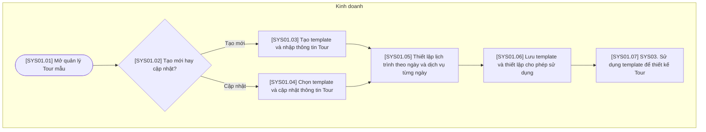

# SYS01 — Quản lý Sản phẩm

## Phạm vi và quy ước

- Chỉ thể hiện thao tác trên hệ thống hoặc xử lý tự động; không có bước phê duyệt hoặc thao tác ngoài hệ thống.
- Ba vai trò của hệ thống: Kinh doanh, Điều hành, Kế toán. Xử lý AI/tự động nằm trong luồng của vai trò phụ trách, không tạo vai trò thứ tư.
- Gộp thao tác cùng mục đích; không tạo thêm trạng thái chờ hoặc đã lưu. Hủy được ghi nhận trên đúng đối tượng cùng lý do.
- Mã trong ngoặc vuông trên sơ đồ tương ứng với mã bước trong bảng. Nút SYS là liên kết sang nghiệp vụ khác.
- Các mũi tên biểu diễn quan hệ xử lý trên hệ thống, không yêu cầu người dùng thao tác liên tục trong một phiên.

## Sơ đồ luồng

## Bảng mô tả sơ đồ

| Mã bước | Vai trò phụ trách | Thao tác / điều kiện | Mô tả và dữ liệu xử lý | Chuyển tiếp |
| --- | --- | --- | --- | --- |
| SYS01.01 | Kinh doanh | Mở quản lý Tour mẫu | Hiển thị danh sách template Tour để người dùng tạo hoặc sửa sản phẩm mẫu. | SYS01.02 |
| SYS01.02 | Kinh doanh | Tạo mới hay cập nhật? | Lựa chọn chức năng trên màn hình; không phát sinh trạng thái nghiệp vụ. | Tạo mới → SYS01.03; Cập nhật → SYS01.04 |
| SYS01.03 | Kinh doanh | Tạo template và nhập thông tin Tour | Nhập tên, mô tả và thông tin cơ bản của Tour mẫu. | SYS01.05 |
| SYS01.04 | Kinh doanh | Chọn template và cập nhật thông tin Tour | Nạp dữ liệu template được chọn và ghi nhận thay đổi thông tin cơ bản. | SYS01.05 |
| SYS01.05 | Kinh doanh | Thiết lập lịch trình theo ngày và dịch vụ từng ngày | Trong cùng một bước, thiết lập các ngày Tour và danh sách dịch vụ, số lượng hoặc cấu hình tương ứng từng ngày. | SYS01.06 |
| SYS01.06 | Kinh doanh | Lưu template và thiết lập cho phép sử dụng | Lưu cấu hình template; xác định template có được lựa chọn khi thiết kế Tour hay không. | SYS01.07 |
| SYS01.07 | Kinh doanh | SYS03. Sử dụng template để thiết kế Tour | Template là dữ liệu đầu vào tùy chọn cho SYS03; không bắt buộc tạo template mới cho mỗi yêu cầu. | Liên kết SYS03 |
