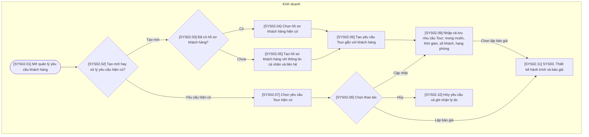

# SYS02 — Quản lý Yêu cầu Khách hàng

## Phạm vi và quy ước

- Chỉ thể hiện thao tác trên hệ thống hoặc xử lý tự động; không có bước phê duyệt hoặc thao tác ngoài hệ thống.
- Ba vai trò của hệ thống: Kinh doanh, Điều hành, Kế toán. Xử lý AI/tự động nằm trong luồng của vai trò phụ trách, không tạo vai trò thứ tư.
- Gộp thao tác cùng mục đích; không tạo thêm trạng thái chờ hoặc đã lưu. Hủy được ghi nhận trên đúng đối tượng cùng lý do.
- Mã trong ngoặc vuông trên sơ đồ tương ứng với mã bước trong bảng. Nút SYS là liên kết sang nghiệp vụ khác.
- Các mũi tên biểu diễn quan hệ xử lý trên hệ thống, không yêu cầu người dùng thao tác liên tục trong một phiên.

## Sơ đồ luồng

## Bảng mô tả sơ đồ

| Mã bước | Vai trò phụ trách | Thao tác / điều kiện | Mô tả và dữ liệu xử lý | Chuyển tiếp |
| --- | --- | --- | --- | --- |
| SYS02.01 | Kinh doanh | Mở quản lý yêu cầu khách hàng | Hiển thị danh sách yêu cầu Tour và chức năng tạo yêu cầu. | SYS02.02 |
| SYS02.02 | Kinh doanh | Tạo mới hay xử lý yêu cầu hiện có? | Chọn tạo một yêu cầu mới hoặc thao tác trên yêu cầu đã tồn tại. | Tạo mới → SYS02.03; Yêu cầu hiện có → SYS02.07 |
| SYS02.03 | Kinh doanh | Đã có hồ sơ khách hàng? | Phân nhánh theo kết quả tìm kiếm hồ sơ khách hàng trên hệ thống. | Có → SYS02.04; Chưa → SYS02.05 |
| SYS02.04 | Kinh doanh | Chọn hồ sơ khách hàng hiện có | Gắn khách hàng được chọn với yêu cầu, không tạo hồ sơ khách hàng trùng. | SYS02.06 |
| SYS02.05 | Kinh doanh | Tạo hồ sơ khách hàng với thông tin cá nhân và liên hệ | Nhập thông tin cá nhân và liên hệ để lưu hồ sơ khách hàng mới. | SYS02.06 |
| SYS02.06 | Kinh doanh | Tạo yêu cầu Tour gắn với khách hàng | Tạo hồ sơ yêu cầu có liên kết tới khách hàng đã chọn hoặc vừa tạo. | SYS02.09 |
| SYS02.07 | Kinh doanh | Chọn yêu cầu Tour hiện có | Nạp yêu cầu Tour để cập nhật nội dung, lập báo giá hoặc hủy. | SYS02.08 |
| SYS02.08 | Kinh doanh | Chọn thao tác | Lựa chọn một chức năng xử lý yêu cầu trên màn hình. | Cập nhật → SYS02.09; Hủy → SYS02.10; Lập báo giá → SYS02.11 |
| SYS02.09 | Kinh doanh | Nhập và lưu nhu cầu Tour: mong muốn, thời gian, số khách, hạng phòng | Lưu mong muốn, thời gian, số lượng khách và hạng phòng trên cùng hồ sơ yêu cầu. | Chọn lập báo giá → SYS02.11 |
| SYS02.10 | Kinh doanh | Hủy yêu cầu và ghi nhận lý do | Ghi nhận thao tác hủy và lý do trên yêu cầu; không tạo trạng thái dừng riêng. | Kết thúc thao tác này |
| SYS02.11 | Kinh doanh | SYS03. Thiết kế hành trình và báo giá | Sử dụng dữ liệu yêu cầu để mở nghiệp vụ thiết kế và báo giá. | Liên kết SYS03 |
