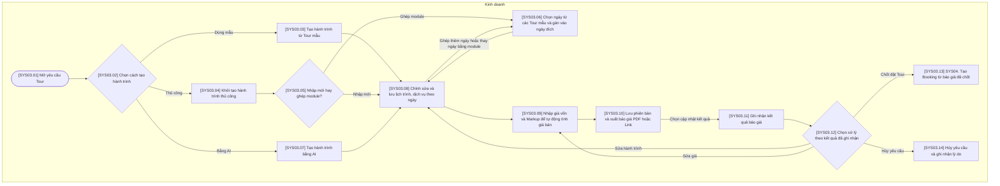

# SYS03 — Thiết kế Hành trình & Báo giá

## Phạm vi và quy ước

- Chỉ thể hiện thao tác trên hệ thống hoặc xử lý tự động; không có bước phê duyệt hoặc thao tác ngoài hệ thống.
- Ba vai trò của hệ thống: Kinh doanh, Điều hành, Kế toán. Xử lý AI/tự động nằm trong luồng của vai trò phụ trách, không tạo vai trò thứ tư.
- Gộp thao tác cùng mục đích; không tạo thêm trạng thái chờ hoặc đã lưu. Hủy được ghi nhận trên đúng đối tượng cùng lý do.
- Mã trong ngoặc vuông trên sơ đồ tương ứng với mã bước trong bảng. Nút SYS là liên kết sang nghiệp vụ khác.
- Mã bước đánh liên tục theo sơ đồ, tương ứng với bảng mô tả và cột Bước luồng trong bảng tính năng V6.
- Các mũi tên biểu diễn quan hệ xử lý trên hệ thống, không yêu cầu người dùng thao tác liên tục trong một phiên.

## Sơ đồ luồng

## Bảng mô tả sơ đồ

| Mã bước | Vai trò phụ trách | Thao tác / điều kiện | Mô tả và dữ liệu xử lý | Chuyển tiếp |
| --- | --- | --- | --- | --- |
| SYS03.01 | Kinh doanh | Mở yêu cầu Tour | Nạp thông tin khách hàng, nhu cầu, thời gian, số khách và hạng phòng của yêu cầu. | SYS03.02 |
| SYS03.02 | Kinh doanh | Chọn cách tạo hành trình | Có ba lựa chọn: dùng template, nhập thủ công hoặc tạo bằng AI. | Dùng mẫu → SYS03.03; Thủ công → SYS03.04; Bằng AI → SYS03.07 |
| SYS03.03 | Kinh doanh | Tạo hành trình từ Tour mẫu | Sao chép lịch trình và dịch vụ từ template SYS01 vào hành trình đang thiết kế. | SYS03.08 |
| SYS03.04 | Kinh doanh | Khởi tạo hành trình thủ công | Khởi tạo hành trình gắn với yêu cầu khách hàng; hỗ trợ nhập mới, ghép các ngày từ nhiều Tour mẫu hoặc kết hợp cả hai. | SYS03.05 |
| SYS03.05 | Kinh doanh | Nhập mới hay ghép module? | Chọn nhập lịch trình mới hoặc chọn các ngày từ Tour mẫu để ghép thành hành trình. Đây là lựa chọn thao tác, không phải trạng thái nghiệp vụ. | Nhập mới → SYS03.08; Ghép module → SYS03.06 |
| SYS03.06 | Kinh doanh | Chọn ngày từ các Tour mẫu và gán vào ngày đích | Chọn từng ngày nguồn cùng lịch trình và dịch vụ từ một hoặc nhiều Tour mẫu, gán vào ngày đích của hành trình. Ví dụ: ngày 2 Tour A → ngày 1; ngày 3 Tour B → ngày 2; ngày 3 Tour C → ngày 3. Sao chép nội dung vào hành trình hiện tại, không sửa Tour nguồn. | SYS03.08 |
| SYS03.07 | Kinh doanh | Tạo hành trình bằng AI | Kinh doanh chọn chức năng AI và nhập tiêu chí cần thiết; hệ thống dùng thông tin yêu cầu Tour để AI tạo đề xuất lịch trình và dịch vụ theo ngày. Toàn bộ được gộp thành một bước hỗ trợ tạo hành trình. | SYS03.08 |
| SYS03.08 | Kinh doanh | Chỉnh sửa và lưu lịch trình, dịch vụ theo ngày | Thêm, sửa, xóa hoặc sắp xếp ngày Tour và dịch vụ rồi lưu vào hồ sơ yêu cầu; có thể chọn ghép thêm hoặc thay ngày bằng module. Đây là bước dùng chung cho cả ba cách tạo hành trình. | Ghép thêm ngày hoặc thay ngày bằng module → SYS03.06; SYS03.09 |
| SYS03.09 | Kinh doanh | Nhập giá vốn và Markup để tự động tính giá bán | Ghi nhận giá vốn theo dữ liệu dịch vụ và cấu hình Markup; hệ thống tính tổng giá vốn và giá bán. Không mặc định sử dụng giá do AI tự sinh. | SYS03.10 |
| SYS03.10 | Kinh doanh | Lưu phiên bản và xuất báo giá PDF hoặc Link | Lưu phiên bản báo giá cùng hành trình và giá tương ứng; tạo PDF hoặc Link. | Chọn cập nhật kết quả → SYS03.11 |
| SYS03.11 | Kinh doanh | Ghi nhận kết quả báo giá | Người dùng nhập kết quả báo giá khi có dữ liệu; không thể hiện thời gian chờ hoặc việc trao đổi với khách. | SYS03.12 |
| SYS03.12 | Kinh doanh | Chọn xử lý theo kết quả đã ghi nhận | Lựa chọn chức năng theo kết quả đã nhập: sửa hành trình, sửa giá, tạo Booking hoặc hủy yêu cầu. | Sửa hành trình → SYS03.08; Sửa giá → SYS03.09; Chốt đặt Tour → SYS03.13; Hủy yêu cầu → SYS03.14 |
| SYS03.13 | Kinh doanh | SYS04. Tạo Booking từ báo giá đã chốt | Chuyển đúng hành trình và phiên bản báo giá đã chốt sang tạo Booking. | Liên kết SYS04 |
| SYS03.14 | Kinh doanh | Hủy yêu cầu và ghi nhận lý do | Hủy yêu cầu Tour và lưu lý do; không coi một lần sửa báo giá là hủy yêu cầu. | Kết thúc thao tác này |

## Ghi chú nghiệp vụ

Tạo hành trình bằng AI chỉ là một trong ba phương án tạo hành trình, ngang hàng với dùng Tour mẫu và tạo thủ công. Nhánh AI được gộp thành một bước ở Level 1. Tạo thủ công hỗ trợ nhập mới hoặc ghép các module ngày từ nhiều Tour mẫu, và có thể kết hợp cả hai. Ví dụ: lấy ngày 2 Tour A làm ngày 1, ngày 3 Tour B làm ngày 2, ngày 3 Tour C làm ngày 3. Module ngày gồm nội dung lịch trình và các dịch vụ của ngày nguồn; khi ghép, gán lại thứ tự/ngày sử dụng theo hành trình đích. Dữ liệu được sao chép vào hành trình hiện tại, không sửa Tour nguồn; giá vốn được thiết lập theo hành trình đích tại bước tính giá. Cả ba phương án đều đi vào luồng chung: chỉnh sửa và lưu hành trình, tính giá, xuất báo giá; có thể ghép thêm module tại bước chỉnh sửa. Không có bước phê duyệt hành trình. Giá vốn dùng để báo giá phải được nhập hoặc lấy từ dữ liệu dịch vụ của hệ thống; đề xuất AI không xác nhận giá hoặc tình trạng còn chỗ của nhà cung cấp. Sau khi xuất báo giá, người dùng có thể kết thúc thao tác và mở lại hồ sơ để ghi nhận kết quả sau.
