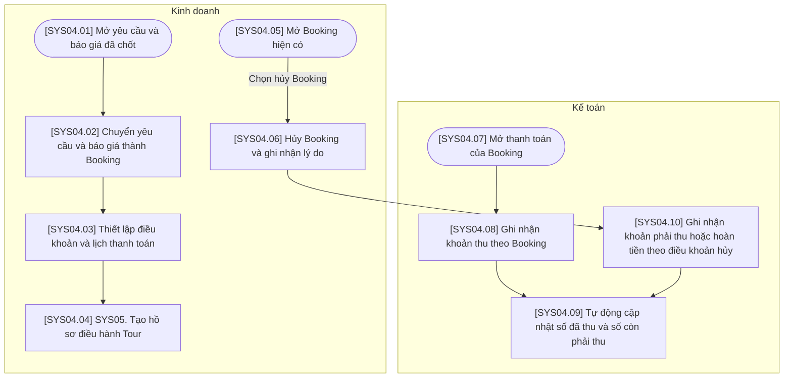

# SYS04 — Quản lý Đơn hàng & Thanh toán

## Phạm vi và quy ước

- Chỉ thể hiện thao tác trên hệ thống hoặc xử lý tự động; không có bước phê duyệt hoặc thao tác ngoài hệ thống.
- Ba vai trò của hệ thống: Kinh doanh, Điều hành, Kế toán. Xử lý AI/tự động nằm trong luồng của vai trò phụ trách, không tạo vai trò thứ tư.
- Gộp thao tác cùng mục đích; không tạo thêm trạng thái chờ hoặc đã lưu. Hủy được ghi nhận trên đúng đối tượng cùng lý do.
- Mã trong ngoặc vuông trên sơ đồ tương ứng với mã bước trong bảng. Nút SYS là liên kết sang nghiệp vụ khác.
- Các mũi tên biểu diễn quan hệ xử lý trên hệ thống, không yêu cầu người dùng thao tác liên tục trong một phiên.

## Sơ đồ luồng

## Bảng mô tả sơ đồ

| Mã bước | Vai trò phụ trách | Thao tác / điều kiện | Mô tả và dữ liệu xử lý | Chuyển tiếp |
| --- | --- | --- | --- | --- |
| SYS04.01 | Kinh doanh | Mở yêu cầu và báo giá đã chốt | Chọn yêu cầu cùng phiên bản báo giá đã ghi nhận kết quả chốt đặt Tour. | SYS04.02 |
| SYS04.02 | Kinh doanh | Chuyển yêu cầu và báo giá thành Booking | Tạo Booking kế thừa khách hàng, hành trình và giá trị của phiên bản báo giá được chọn. | SYS04.03 |
| SYS04.03 | Kinh doanh | Thiết lập điều khoản và lịch thanh toán | Nhập điều khoản, các đợt thanh toán, số tiền và thời hạn thanh toán. | SYS04.04 |
| SYS04.04 | Kinh doanh | SYS05. Tạo hồ sơ điều hành Tour | Dùng dữ liệu Booking để tạo hồ sơ điều hành; không mặc định phải thanh toán đủ trước. | Liên kết SYS05 |
| SYS04.05 | Kinh doanh | Mở Booking hiện có | Chọn Booking đã tồn tại trên hệ thống để thực hiện nghiệp vụ hủy. | Chọn hủy Booking → SYS04.06 |
| SYS04.06 | Kinh doanh | Hủy Booking và ghi nhận lý do | Ghi nhận hủy Booking và lý do. Hủy các đặt dịch vụ liên quan là nghiệp vụ riêng tại SYS06. | SYS04.10 |
| SYS04.07 | Kế toán | Mở thanh toán của Booking | Mở dữ liệu lịch thanh toán, các khoản đã thu và công nợ của Booking. | SYS04.08 |
| SYS04.08 | Kế toán | Ghi nhận khoản thu theo Booking | Nhập khoản thu thực tế và liên kết tới Booking hoặc đợt thanh toán tương ứng. | SYS04.09 |
| SYS04.09 | Kế toán | Tự động cập nhật số đã thu và số còn phải thu | Xử lý tự động: tổng hợp các giao dịch và nghĩa vụ thanh toán hiện hành để cập nhật số dư; không tạo thêm trạng thái thanh toán chi tiết. | Kết thúc thao tác này |
| SYS04.10 | Kế toán | Ghi nhận khoản phải thu hoặc hoàn tiền theo điều khoản hủy | Ghi nhận điều chỉnh nghĩa vụ thanh toán và khoản cần hoàn theo điều khoản hủy. Khoản hoàn phải được ghi nhận giao dịch thực tế khi thực hiện. | SYS04.09 |

## Ghi chú nghiệp vụ

Theo dõi thanh toán và điều hành diễn ra độc lập; không mặc định phải thu đủ tiền mới chuyển sang SYS05. Nếu Booking đã có dịch vụ đặt, hủy từng đặt dịch vụ tại SYS06; không mặc định tự động hủy toàn bộ dịch vụ khi hủy Booking.
