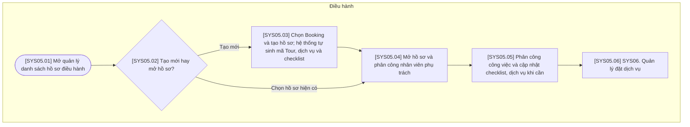

# SYS05 — Quản lý Hồ sơ Điều hành Tour

## Quy ước

- Chỉ có 3 vai trò: Kinh doanh, Điều hành, Kế toán. Xử lý tự động nằm trong bước nghiệp vụ của bộ phận phụ trách.
- Gộp thao tác cùng mục đích; không có bước phê duyệt, chờ phản hồi hoặc công việc ngoài hệ thống.
- Mã bước đánh liên tục theo sơ đồ, tương ứng với bảng mô tả và cột Bước luồng trong bảng tính năng V6.
- Có thể mở lại hồ sơ để cập nhật khi có dữ liệu; không bắt buộc hoàn thành tất cả thao tác trong một phiên.

## Sơ đồ luồng

## Bảng mô tả sơ đồ

| Mã bước | Vai trò phụ trách | Thao tác / điều kiện | Mô tả và dữ liệu xử lý | Chuyển tiếp |
| --- | --- | --- | --- | --- |
| SYS05.01 | Điều hành | Mở quản lý danh sách hồ sơ điều hành | Xem danh sách, tìm kiếm, lọc và chọn hồ sơ điều hành; đồng thời có chức năng tạo hồ sơ từ Booking. | SYS05.02 |
| SYS05.02 | Điều hành | Tạo mới hay mở hồ sơ? | Chọn tạo hồ sơ từ Booking chưa có hồ sơ điều hành hoặc mở hồ sơ đã tồn tại; không tạo trùng cho cùng Booking. | Tạo mới → SYS05.03; Chọn hồ sơ hiện có → SYS05.04 |
| SYS05.03 | Điều hành | Chọn Booking và tạo hồ sơ; hệ thống tự sinh mã Tour, dịch vụ và checklist | Điều hành chọn Booking để tạo hồ sơ. Trong cùng bước, hệ thống tự sinh Tour Code, bóc tách hành trình thành dịch vụ và tạo checklist công việc; không thực hiện bằng tay. | SYS05.04 |
| SYS05.04 | Điều hành | Mở hồ sơ và phân công nhân viên phụ trách | Mở hồ sơ mới tạo hoặc hồ sơ được chọn; gán hoặc thay đổi nhân viên Điều hành phụ trách toàn hồ sơ khi cần. Giữ nguyên phân công đã có nếu không thay đổi. | SYS05.05 |
| SYS05.05 | Điều hành | Phân công công việc và cập nhật checklist, dịch vụ khi cần | Trên dịch vụ/checklist hệ thống đã tạo, phân công người thực hiện từng công việc, cập nhật tiến độ và chỉnh sửa nội dung khi cần. Người thực hiện công việc có thể khác người phụ trách toàn hồ sơ. | SYS05.06 |
| SYS05.06 | Điều hành | SYS06. Quản lý đặt dịch vụ | Sử dụng danh sách dịch vụ của hồ sơ để mở nghiệp vụ đặt dịch vụ. | Liên kết SYS06 |

## Ghi chú nghiệp vụ

Danh sách → chọn hồ sơ → mở hồ sơ; hoặc chọn Booking → tạo hồ sơ với dữ liệu tự động → mở hồ sơ. Phân công người phụ trách toàn hồ sơ được gộp cùng bước mở; không bắt buộc phân công lại khi mở hồ sơ hiện có. Hệ thống tự bóc tách dịch vụ và tạo checklist, Điều hành chỉ phân công và cập nhật khi cần.
