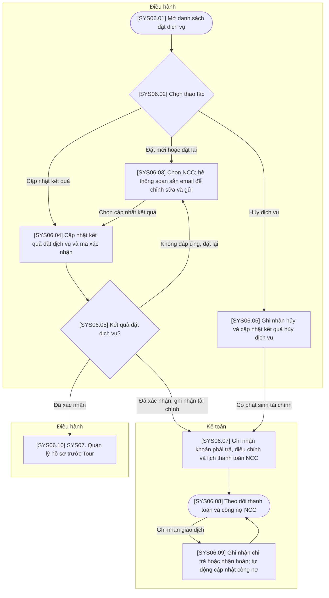

# SYS06 — Quản lý Đặt dịch vụ

## Quy ước

- Chỉ có 3 vai trò: Kinh doanh, Điều hành, Kế toán. Xử lý tự động nằm trong bước nghiệp vụ của bộ phận phụ trách.
- Gộp thao tác cùng mục đích; không có bước phê duyệt, chờ phản hồi hoặc công việc ngoài hệ thống.
- Mã bước đánh liên tục theo sơ đồ, tương ứng với bảng mô tả và cột Bước luồng trong bảng tính năng V6.
- Có thể mở lại hồ sơ để cập nhật khi có dữ liệu; không bắt buộc hoàn thành tất cả thao tác trong một phiên.

## Sơ đồ luồng

## Bảng mô tả sơ đồ

| Mã bước | Vai trò phụ trách | Thao tác / điều kiện | Mô tả và dữ liệu xử lý | Chuyển tiếp |
| --- | --- | --- | --- | --- |
| SYS06.01 | Điều hành | Mở danh sách đặt dịch vụ | Xem danh sách dịch vụ và các lần đặt theo Tour; tìm kiếm, lọc và mở đối tượng cần thao tác. | SYS06.02 |
| SYS06.02 | Điều hành | Chọn thao tác | Chọn đặt mới/đặt lại, cập nhật kết quả hoặc hủy lần đặt dịch vụ. | Đặt mới hoặc đặt lại → SYS06.03; Cập nhật kết quả → SYS06.04; Hủy dịch vụ → SYS06.06 |
| SYS06.03 | Điều hành | Chọn NCC; hệ thống soạn sẵn email để chỉnh sửa và gửi | Điều hành chọn dịch vụ và NCC. Hệ thống tự điền nội dung email đặt dịch vụ từ hồ sơ, gồm Tour Code, ngày sử dụng, số lượng và yêu cầu dịch vụ; người dùng chỉnh sửa khi cần rồi gửi trên hệ thống. Dùng chung khi đặt lại. | Chọn cập nhật kết quả → SYS06.04 |
| SYS06.04 | Điều hành | Cập nhật kết quả đặt dịch vụ và mã xác nhận | Nhập kết quả nhận được, thông tin dịch vụ đã xác nhận và mã xác nhận nếu có. Có thể mở lại hồ sơ để cập nhật sau; không vẽ bước chờ phản hồi. | SYS06.05 |
| SYS06.05 | Điều hành | Kết quả đặt dịch vụ? | Phân nhánh theo kết quả đã nhập. Xác nhận dịch vụ chuyển dữ liệu sang hồ sơ trước Tour và ghi nhận tài chính độc lập; không cần thanh toán đủ mới chuyển tiếp. | Không đáp ứng, đặt lại → SYS06.03; Đã xác nhận → SYS06.10; Đã xác nhận, ghi nhận tài chính → SYS06.07 |
| SYS06.06 | Điều hành | Ghi nhận hủy và cập nhật kết quả hủy dịch vụ | Trên cùng hồ sơ đặt dịch vụ, ghi nhận yêu cầu hủy, lý do, phí hủy và cập nhật kết quả hủy khi có dữ liệu; không tách thành nhiều bước chờ. | Có phát sinh tài chính → SYS06.07 |
| SYS06.07 | Kế toán | Ghi nhận khoản phải trả, điều chỉnh và lịch thanh toán NCC | Ghi nhận/điều chỉnh khoản phải trả theo NCC, dịch vụ và Tour, gồm phí hủy hoặc khoản cần hoàn; thiết lập điều khoản, các đợt thanh toán và hạn trả. Hệ thống cập nhật số dư khi giá trị nghĩa vụ thay đổi. | SYS06.08 |
| SYS06.08 | Kế toán | Theo dõi thanh toán và công nợ NCC | Mở danh sách thanh toán; tìm kiếm, lọc và xem tổng phải trả, đã trả, còn phải trả/phải nhận hoàn cùng các khoản sắp đến hạn hoặc quá hạn. Có thể truy cập trực tiếp, không phải đi lại toàn bộ luồng đặt dịch vụ. | Ghi nhận giao dịch → SYS06.09 |
| SYS06.09 | Kế toán | Ghi nhận chi trả hoặc nhận hoàn; tự động cập nhật công nợ | Ghi nhận giao dịch chi trả hoặc nhận hoàn thực tế và chứng từ; hệ thống tự cập nhật số dư công nợ trong cùng thao tác. Hỗ trợ nhiều lần thanh toán và giao dịch sau khi đóng Tour. | SYS06.08 |
| SYS06.10 | Điều hành | SYS07. Quản lý hồ sơ trước Tour | Dùng thông tin dịch vụ đã xác nhận để lập hồ sơ trước Tour; không chặn bởi trạng thái thanh toán NCC. | Liên kết SYS07 |

## Ghi chú nghiệp vụ

Email đặt dịch vụ được hệ thống soạn sẵn từ dữ liệu hồ sơ, không phải Điều hành soạn mới từ đầu. Soạn email tự động, chỉnh sửa và gửi là một bước. Khoản phải trả, lịch thanh toán và điều chỉnh dùng chung dữ liệu giữa đặt dịch vụ, hủy, phát sinh và quyết toán; không tạo lại sổ công nợ. Nhánh tài chính chạy độc lập với SYS07.
