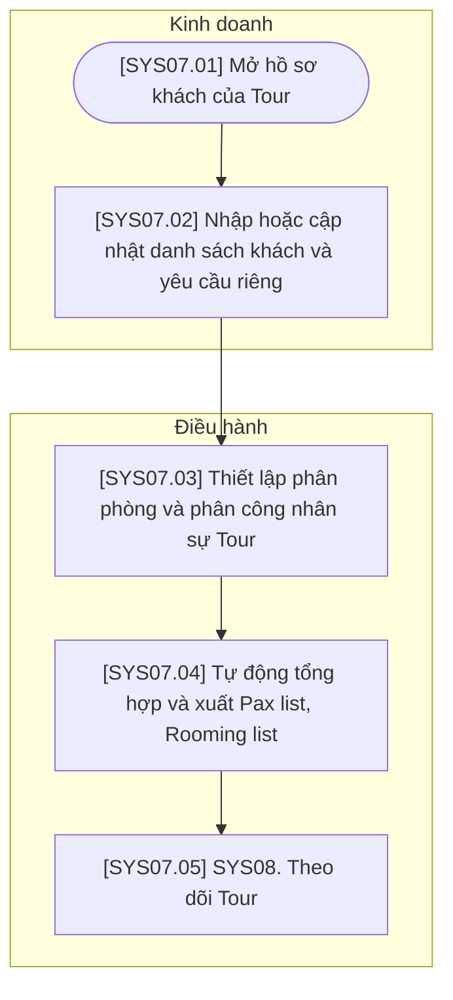

# SYS07 — Quản lý Hồ sơ Trước Tour

## Phạm vi và quy ước

- Chỉ thể hiện thao tác trên hệ thống hoặc xử lý tự động; không có bước phê duyệt hoặc thao tác ngoài hệ thống.
- Ba vai trò của hệ thống: Kinh doanh, Điều hành, Kế toán. Xử lý AI/tự động nằm trong luồng của vai trò phụ trách, không tạo vai trò thứ tư.
- Gộp thao tác cùng mục đích; không tạo thêm trạng thái chờ hoặc đã lưu. Hủy được ghi nhận trên đúng đối tượng cùng lý do.
- Mã trong ngoặc vuông trên sơ đồ tương ứng với mã bước trong bảng. Nút SYS là liên kết sang nghiệp vụ khác.
- Các mũi tên biểu diễn quan hệ xử lý trên hệ thống, không yêu cầu người dùng thao tác liên tục trong một phiên.

## Sơ đồ luồng

## Bảng mô tả sơ đồ

| Mã bước | Vai trò phụ trách | Thao tác / điều kiện | Mô tả và dữ liệu xử lý | Chuyển tiếp |
| --- | --- | --- | --- | --- |
| SYS07.01 | Kinh doanh | Mở hồ sơ khách của Tour | Mở danh sách khách gắn với Booking và Tour Code. | SYS07.02 |
| SYS07.02 | Kinh doanh | Nhập hoặc cập nhật danh sách khách và yêu cầu riêng | Nhập thông tin thành viên trong đoàn và các yêu cầu riêng cần dùng cho hồ sơ trước Tour. | SYS07.03 |
| SYS07.03 | Điều hành | Thiết lập phân phòng và phân công nhân sự Tour | Thiết lập khách theo phòng và nhân sự phục vụ trên hồ sơ Tour. | SYS07.04 |
| SYS07.04 | Điều hành | Tự động tổng hợp và xuất Pax list, Rooming list | Hệ thống tổng hợp dữ liệu đã nhập để tạo danh sách khách và danh sách phân phòng; người dùng xuất tài liệu. | SYS07.05 |
| SYS07.05 | Điều hành | SYS08. Theo dõi Tour | Sử dụng dữ liệu hồ sơ trước Tour trong nghiệp vụ theo dõi Tour. | Liên kết SYS08 |
