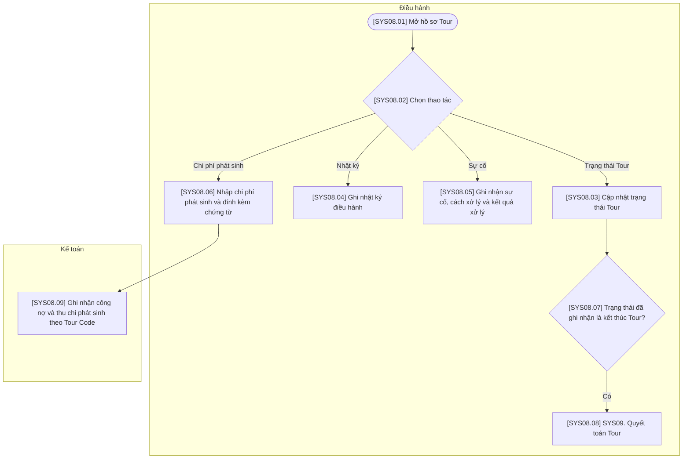

# SYS08 — Theo dõi & Xử lý sự cố

## Phạm vi và quy ước

- Chỉ thể hiện thao tác trên hệ thống hoặc xử lý tự động; không có bước phê duyệt hoặc thao tác ngoài hệ thống.
- Ba vai trò của hệ thống: Kinh doanh, Điều hành, Kế toán. Xử lý AI/tự động nằm trong luồng của vai trò phụ trách, không tạo vai trò thứ tư.
- Gộp thao tác cùng mục đích; không tạo thêm trạng thái chờ hoặc đã lưu. Hủy được ghi nhận trên đúng đối tượng cùng lý do.
- Mã trong ngoặc vuông trên sơ đồ tương ứng với mã bước trong bảng. Nút SYS là liên kết sang nghiệp vụ khác.
- Các mũi tên biểu diễn quan hệ xử lý trên hệ thống, không yêu cầu người dùng thao tác liên tục trong một phiên.

## Sơ đồ luồng

## Bảng mô tả sơ đồ

| Mã bước | Vai trò phụ trách | Thao tác / điều kiện | Mô tả và dữ liệu xử lý | Chuyển tiếp |
| --- | --- | --- | --- | --- |
| SYS08.01 | Điều hành | Mở hồ sơ Tour | Chọn Tour Code để mở chức năng cập nhật điều hành. | SYS08.02 |
| SYS08.02 | Điều hành | Chọn thao tác | Chọn một thao tác độc lập trên hồ sơ: trạng thái, nhật ký, sự cố hoặc chi phí. | Trạng thái Tour → SYS08.03; Nhật ký → SYS08.04; Sự cố → SYS08.05; Chi phí phát sinh → SYS08.06 |
| SYS08.03 | Điều hành | Cập nhật trạng thái Tour | Ghi nhận trạng thái thực tế của Tour, như đang diễn ra hoặc đã kết thúc. | SYS08.07 |
| SYS08.04 | Điều hành | Ghi nhật ký điều hành | Nhập nội dung nhật ký điều hành, gắn với Tour Code. | Kết thúc thao tác này |
| SYS08.05 | Điều hành | Ghi nhận sự cố, cách xử lý và kết quả xử lý | Nhập nội dung sự cố, cách xử lý và kết quả; không mô tả hành động xử lý ngoài hệ thống. | Kết thúc thao tác này |
| SYS08.06 | Điều hành | Nhập chi phí phát sinh và đính kèm chứng từ | Lưu khoản chi phí phát sinh và chứng từ kèm theo để Kế toán ghi nhận theo Tour. | SYS08.09 |
| SYS08.07 | Điều hành | Trạng thái đã ghi nhận là kết thúc Tour? | Phân nhánh theo giá trị trạng thái vừa ghi nhận. Nếu chưa kết thúc Tour thì không chuyển sang quyết toán. | Có → SYS08.08 |
| SYS08.08 | Điều hành | SYS09. Quyết toán Tour | Mở nghiệp vụ quyết toán theo mã Tour đã kết thúc. | Liên kết SYS09 |
| SYS08.09 | Kế toán | Ghi nhận công nợ và thu chi phát sinh theo Tour Code | Nhập khoản phải thu, phải trả và các giao dịch thu chi thực tế liên quan tới khoản phát sinh. | Kết thúc thao tác này |

## Ghi chú nghiệp vụ

Nhật ký, sự cố và chi phí là các thao tác độc lập trong hồ sơ Tour. Nếu Tour chưa kết thúc, thao tác cập nhật trạng thái kết thúc tại nút cập nhật; không tạo thêm bước hoặc trạng thái chờ. Chỉ ghi nhận cách xử lý sự cố trên hệ thống, không mô tả việc xử lý ngoài thực tế.
