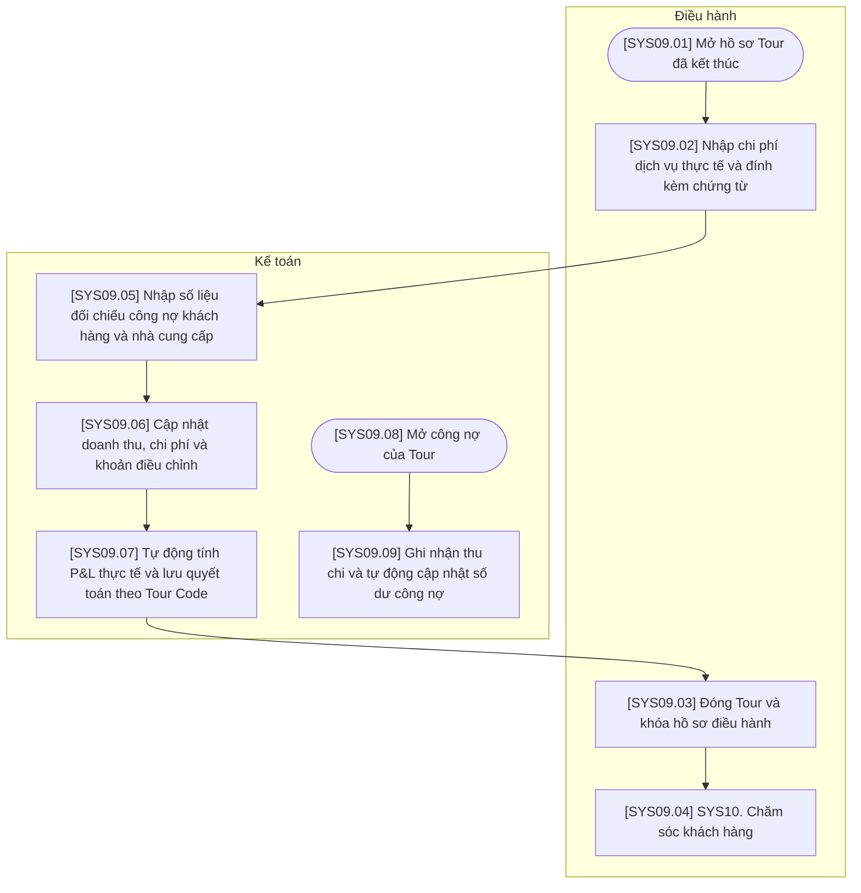

# SYS09 — Quyết toán & Đóng Tour

## Phạm vi và quy ước

- Chỉ thể hiện thao tác trên hệ thống hoặc xử lý tự động; không có bước phê duyệt hoặc thao tác ngoài hệ thống.
- Ba vai trò của hệ thống: Kinh doanh, Điều hành, Kế toán. Xử lý AI/tự động nằm trong luồng của vai trò phụ trách, không tạo vai trò thứ tư.
- Gộp thao tác cùng mục đích; không tạo thêm trạng thái chờ hoặc đã lưu. Hủy được ghi nhận trên đúng đối tượng cùng lý do.
- Mã trong ngoặc vuông trên sơ đồ tương ứng với mã bước trong bảng. Nút SYS là liên kết sang nghiệp vụ khác.
- Các mũi tên biểu diễn quan hệ xử lý trên hệ thống, không yêu cầu người dùng thao tác liên tục trong một phiên.

## Sơ đồ luồng

## Bảng mô tả sơ đồ

| Mã bước | Vai trò phụ trách | Thao tác / điều kiện | Mô tả và dữ liệu xử lý | Chuyển tiếp |
| --- | --- | --- | --- | --- |
| SYS09.01 | Điều hành | Mở hồ sơ Tour đã kết thúc | Chọn hồ sơ Tour đã ghi nhận kết thúc để lập dữ liệu quyết toán. | SYS09.02 |
| SYS09.02 | Điều hành | Nhập chi phí dịch vụ thực tế và đính kèm chứng từ | Ghi nhận giá trị dịch vụ thực tế và chứng từ theo từng Tour Code. | SYS09.05 |
| SYS09.03 | Điều hành | Đóng Tour và khóa hồ sơ điều hành | Thực hiện đóng Tour và khóa hồ sơ điều hành sau khi đã lưu kết quả quyết toán. | SYS09.04 |
| SYS09.04 | Điều hành | SYS10. Chăm sóc khách hàng | Sử dụng thông tin khách hàng và Tour đã đóng cho nghiệp vụ chăm sóc sau Tour. | Liên kết SYS10 |
| SYS09.05 | Kế toán | Nhập số liệu đối chiếu công nợ khách hàng và nhà cung cấp | Nhập kết quả đối chiếu AP và AR theo Tour; không vẽ việc đối chiếu chứng từ ngoài hệ thống. | SYS09.06 |
| SYS09.06 | Kế toán | Cập nhật doanh thu, chi phí và khoản điều chỉnh | Lưu số liệu doanh thu, chi phí thực tế và các khoản điều chỉnh phục vụ quyết toán. | SYS09.07 |
| SYS09.07 | Kế toán | Tự động tính P&L thực tế và lưu quyết toán theo Tour Code | Hệ thống tính P&L thực tế từ số liệu đã ghi nhận và lưu kết quả quyết toán theo Tour Code. | SYS09.03 |
| SYS09.08 | Kế toán | Mở công nợ của Tour | Mở các khoản công nợ của Tour, độc lập với thao tác đóng hồ sơ điều hành. | SYS09.09 |
| SYS09.09 | Kế toán | Ghi nhận thu chi và tự động cập nhật số dư công nợ | Ghi nhận giao dịch thu chi thực tế; hệ thống cập nhật số dư công nợ tương ứng. | Kết thúc thao tác này |

## Ghi chú nghiệp vụ

Đề xuất đóng hồ sơ điều hành sau khi lưu quyết toán. Công nợ còn lại tiếp tục được ghi nhận thanh toán theo Tour Code; không mặc định công nợ phải bằng 0 mới đóng được hồ sơ điều hành.
