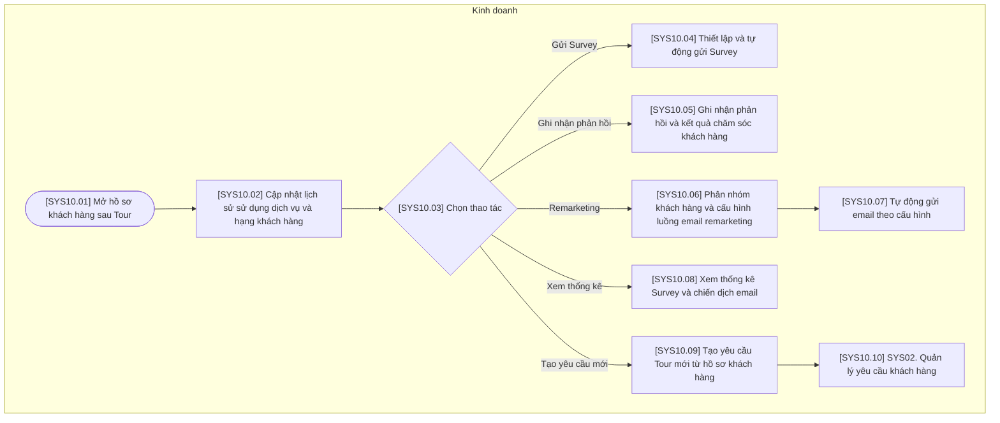

# SYS10 — Chăm sóc khách hàng

## Phạm vi và quy ước

- Chỉ thể hiện thao tác trên hệ thống hoặc xử lý tự động; không có bước phê duyệt hoặc thao tác ngoài hệ thống.
- Ba vai trò của hệ thống: Kinh doanh, Điều hành, Kế toán. Xử lý AI/tự động nằm trong luồng của vai trò phụ trách, không tạo vai trò thứ tư.
- Gộp thao tác cùng mục đích; không tạo thêm trạng thái chờ hoặc đã lưu. Hủy được ghi nhận trên đúng đối tượng cùng lý do.
- Mã trong ngoặc vuông trên sơ đồ tương ứng với mã bước trong bảng. Nút SYS là liên kết sang nghiệp vụ khác.
- Các mũi tên biểu diễn quan hệ xử lý trên hệ thống, không yêu cầu người dùng thao tác liên tục trong một phiên.

## Sơ đồ luồng

## Bảng mô tả sơ đồ

| Mã bước | Vai trò phụ trách | Thao tác / điều kiện | Mô tả và dữ liệu xử lý | Chuyển tiếp |
| --- | --- | --- | --- | --- |
| SYS10.01 | Kinh doanh | Mở hồ sơ khách hàng sau Tour | Chọn hồ sơ khách hàng có Tour đã đóng để thao tác chăm sóc sau Tour. | SYS10.02 |
| SYS10.02 | Kinh doanh | Cập nhật lịch sử sử dụng dịch vụ và hạng khách hàng | Gắn lịch sử sử dụng dịch vụ và cập nhật hạng khách hàng theo tiêu chí cấu hình. | SYS10.03 |
| SYS10.03 | Kinh doanh | Chọn thao tác | Chọn chức năng chăm sóc trên hồ sơ khách hàng; không tạo thêm trạng thái khách hàng. | Gửi Survey → SYS10.04; Ghi nhận phản hồi → SYS10.05; Remarketing → SYS10.06; Xem thống kê → SYS10.08; Tạo yêu cầu mới → SYS10.09 |
| SYS10.04 | Kinh doanh | Thiết lập và tự động gửi Survey | Thiết lập nội dung và điều kiện gửi; hệ thống gửi Survey tự động theo cấu hình. | Kết thúc thao tác này |
| SYS10.05 | Kinh doanh | Ghi nhận phản hồi và kết quả chăm sóc khách hàng | Lưu phản hồi nhận được và nội dung, kết quả chăm sóc vào hồ sơ khách hàng. | Kết thúc thao tác này |
| SYS10.06 | Kinh doanh | Phân nhóm khách hàng và cấu hình luồng email remarketing | Chọn phân nhóm mục tiêu, nội dung email, lịch gửi và luồng email remarketing. | SYS10.07 |
| SYS10.07 | Kinh doanh | Tự động gửi email theo cấu hình | Hệ thống thực hiện gửi email tự động theo cấu hình đã lưu. | Kết thúc thao tác này |
| SYS10.08 | Kinh doanh | Xem thống kê Survey và chiến dịch email | Hiển thị số liệu phản hồi Survey và kết quả chiến dịch được hệ thống ghi nhận. | Kết thúc thao tác này |
| SYS10.09 | Kinh doanh | Tạo yêu cầu Tour mới từ hồ sơ khách hàng | Khởi tạo yêu cầu Tour liên kết với hồ sơ khách hàng hiện có. | SYS10.10 |
| SYS10.10 | Kinh doanh | SYS02. Quản lý yêu cầu khách hàng | Tiếp tục nhập và xử lý nhu cầu Tour mới tại SYS02. | Liên kết SYS02 |
