# RSD DH01 · Mẫu checklist điều hành

**TOPAS · Module Điều hành · Phiên bản 1.5 · 12/11/2026**
Phần mềm cho doanh nghiệp lữ hành chuyên Tour Inbound và Tour Customized.

- **Nguồn nghiệp vụ.** `docs/flows/danh-sach-man-hinh-level1.md` (DH01, dòng Công việc checklist ở mục Vòng đời trạng thái), tính năng hỗ trợ CNHT04.01 và CNHT04.02, luồng HT04.01–HT04.03 trong `docs/flows/level 1/luonghotro.md`, mục DX04, RSD DH07 v1.7 (R01, R04, R05, R08), RSD DH08 v2.8 (R03, R19; đã đồng bộ với bản này), RSD KD06 v1.5 (loại Tour bắt buộc ở KD06.1), cùng các quyết định đã chốt với người dùng ngày 11/11/2026 và 12/11/2026 (`docs/rsd/BOI-CANH-DU-AN.md`, `docs/QUYET-DINH-PHASE-CODING.md`).
- **Thay đổi so với nguồn.** Nguồn ghi “phạm vi áp dụng theo loại dịch vụ hoặc Tour”. Bản này áp dụng quyết định ngày 11/11/2026: **mỗi loại Tour có một mẫu**. Trong mẫu, mỗi công việc được khai báo là việc **cả hồ sơ** (tạo một lần) hoặc việc **theo dịch vụ** (tạo cho từng hạng mục dịch vụ cùng loại). Loại Tour chưa có mẫu đang dùng thì hồ sơ dùng **Mẫu mặc định**. Đề xuất “sửa mẫu không đổi checklist đã tạo” của nguồn đã được chốt.
- **Thay đổi ở v1.5 (12/11/2026).** Cập nhật theo quyết định phase coding (`docs/QUYET-DINH-PHASE-CODING.md`), không dựng lại wireframe; hình chưa cập nhật có ghi chú dưới hình. (1) Q5: hồ sơ Tour và checklist tạo trong cùng giao dịch với việc lưu Booking (RSD DH07 R01, R05); bỏ mọi tham chiếu tới nhóm Tạo lỗi và nút Thử lại của DH07 (L4.1, L5.1, E5.6, E5.8, R08, AC15). (2) U2: tắt Đang dùng làm ngay, không hỏi xác nhận, thông báo ngắn nêu hậu quả và có Hoàn tác; hộp thoại W12 bỏ (2.6, 2.7, L4.1, R08, AC15). (3) Q1: mục 1.4 viết lại thành quyền mặc định theo vai trò, cấu hình ở QT02; Quản trị hệ thống xem được (Q25). (4) U5: trường và công tắc chỉ đọc hiện dạng chữ (1.4, 2.7, AC27). (5) U3: nhớ bộ lọc theo người dùng (1.2, 2.3). (6) Q2: không có thông báo nội bộ qua email (5.3). Nút Thử lại khi lỗi tải đổi thành Tải lại (E1.1, AC28).
- **Thay đổi ở v1.4 (12/11/2026).** Sửa theo rà soát lần ba: bỏ khái niệm “Booking đang chờ tạo hồ sơ”, vì hồ sơ Tour tự tạo ngay khi Booking được lưu (RSD DH07 R01). Booking chưa có hồ sơ chỉ còn Booking ở nhóm Tạo lỗi (RSD DH07 R05); khi tạo lại, hồ sơ dùng mẫu Đang dùng tại lúc đó (RSD DH07 R04), nên Booking cùng loại Tour ở nhóm Tạo lỗi sẽ nhận Mẫu mặc định. Sửa L4.1 bước 1, R08, AC15; sửa `captions.js` (W12) và dựng lại W12. Nguồn nghiệp vụ và mục 1.5 dẫn RSD DH07 v1.7, RSD DH08 v2.8, RSD KD06 v1.5.
- **Thay đổi ở v1.3 (12/11/2026).** Theo quyết định của người dùng ngày 12/11/2026 (không có luồng duyệt; Kế toán không làm chốt chặn cho Kinh doanh và Điều hành): hồ sơ Tour tự tạo ngay khi Booking được lưu ở KD08 (RSD DH07 v1.5 R01), không còn Tạo sớm. Sửa L5.1 (điều kiện và bước 3: bỏ hộp thoại Tạo sớm của DH07), E5.4 (hạn đã qua khi hồ sơ tạo sát ngày khởi hành), R05 (bỏ Tạo sớm khỏi các cách giao người phụ trách lần đầu), AC24 (viết lại: Booking tạo khi còn 3 ngày tới khởi hành); mục 1.5 và Nguồn nghiệp vụ dẫn RSD DH07 v1.5, RSD DH08 v2.5. Không đổi wireframe, không thêm, bỏ mã.
- **Thay đổi ở v1.2 (12/11/2026).** Chỉ cập nhật tham chiếu và ghi chú sau rà soát mâu thuẫn giữa các RSD, không đổi nghiệp vụ: Nguồn nghiệp vụ và bảng truy vết mục 1.5 dẫn RSD DH07 v1.4, RSD DH08 v2.4; E5.1, R11 (dòng Loại Tour trên Booking) và mục 5.1 ghi chú loại Tour bắt buộc ở KD06.1 (RSD KD06 v1.2 mục 5.2) nên nhánh “Booking chưa có loại Tour” chỉ còn cho dữ liệu cũ hoặc nhập ngoài; nhánh này giữ Mẫu mặc định. Không dựng lại hình.
- **Thay đổi ở v1.1.** Sắp xếp lại theo khung 6 mục, không đổi nghiệp vụ: đặc tả thao tác và phản hồi giao diện (mục 8 cũ) gộp vào từng bước luồng ở mục 3; bỏ mục Wireframe riêng (mục 6 cũ), mỗi ảnh chỉ nằm dưới bước hoặc ngoại lệ đầu tiên hiện màn đó; quy tắc dùng chung (8.1 cũ) gộp với xử lý dùng chung (4.3 cũ) thành mục 2.7; bảng Sự kiện tự động bỏ, phần chưa có đưa vào R01; Dữ liệu gửi ra ngoài chuyển về mục 5.3. Quy tắc R thành mục 4, Dữ liệu mục 5, Tiêu chí nghiệm thu mục 6. Mã L, E, R, W, AC giữ nguyên.
- **Cách đọc.** Mục 3 mô tả luồng. Mỗi bước ghi mã W, chỗ bấm, thao tác của người dùng và phản hồi của hệ thống; hình wireframe nằm ngay dưới bước. Mục 4 ghi quy tắc (mã R) mà các bước dẫn tới.
- **Wireframe.** Ảnh chụp từ khung HTML desktop, kích thước 1280 × 800 px. Tên màn khai báo trong `wireframes-src/captions.js`. Chụp lại ảnh bằng `node build.js`; đồng bộ tên hình bằng `node sync-md.js` trong `wireframes-src`.
- **Dữ liệu trên hình.** Tên, mã và ngày chỉ dùng để minh họa. Ngày hiện tại trên hình là 11/11/2026.

## Mục lục

1. Phạm vi và quyền
2. Khung màn, trạng thái và quy ước giao diện
3. Luồng thao tác kèm wireframe
4. Quy tắc triển khai chi tiết
5. Dữ liệu
6. Tiêu chí nghiệm thu

---

## 1. Phạm vi và quyền

### 1.1. Mục tiêu

DH01 là nơi Điều hành khai báo một lần các công việc phải làm cho mỗi loại Tour. Hệ thống dùng mẫu này để tự sinh checklist khi tạo hồ sơ Tour (DH07), nên Điều hành không phải tạo tay checklist cho từng Tour. Mục tiêu thiết kế:

- **Không bỏ sót loại Tour.** Danh sách cho biết loại Tour nào đang không có mẫu riêng và đang dùng Mẫu mặc định.
- **Không nhập lại.** Tạo mẫu mới bằng cách sao chép công việc từ mẫu có sẵn rồi sửa. Hạn hoàn tất khai báo theo khoảng ngày so với mốc, không nhập ngày cụ thể.
- **Sửa nhanh trên một lưới.** Mọi công việc của mẫu nằm trên một lưới, sửa tại chỗ, kéo để đổi thứ tự, một nút Lưu.
- **Thấy kết quả trước khi lưu.** Xem trước checklist mà mẫu đang sửa sẽ sinh ra trên một hồ sơ thật, kèm hạn và hạng mục gắn với từng việc.
- **An toàn khi sửa.** Mỗi lần lưu tạo một phiên bản mới. Hồ sơ đã tạo giữ nguyên checklist; chỉ hồ sơ tạo sau dùng phiên bản mới.
- **Giảm việc ở DH08.** Việc nào tự hoàn tất theo sự kiện (ví dụ hạng mục Đã xác nhận) và việc nào tự giao cho người phụ trách hồ sơ được khai báo sẵn trong mẫu.

### 1.2. Lối vào và lối ra

| Từ / đến | Hành vi |
|---|---|
| Menu Điều hành → Mẫu checklist | Mở DH01 ở chip Đang dùng, với bộ lọc lần trước, nhớ theo người dùng cả sau khi đăng xuất (W01; U3). |
| DH01 → DH01 bảng trượt | Bấm một dòng để mở bảng trượt sửa mẫu (W05). Bấm + Tạo mẫu để mở bảng trượt tạo mẫu (W03). |
| DH01 → DH07 (sự kiện) | Khi DH07 tạo hồ sơ Tour, hệ thống đọc phiên bản hiện hành của mẫu áp dụng cho loại Tour của Booking để sinh checklist (R07). DH01 không có nút sang DH07. |
| DH01 → DH08.2 (sự kiện) | Khi Điều hành thêm hạng mục dịch vụ ở DH08.2, hoặc áp dụng thay đổi chương trình (RSD DH08 R19), hệ thống sinh thêm việc theo dịch vụ từ mẫu (R07). |
| QT05 → DH01 | Danh mục Loại Tour và Loại dịch vụ ở QT05 cung cấp giá trị cho trường Loại Tour và cột Loại dịch vụ. Tắt một giá trị ở QT05 không xóa mẫu (E1.4, E2.4). |

### 1.3. Ranh giới

- DH01 **sở hữu** mẫu checklist: tên, loại Tour áp dụng, danh sách công việc mẫu và thuộc tính của từng công việc, trạng thái Đang dùng, các phiên bản và lịch sử.
- DH01 **không sở hữu** và chỉ đọc các dữ liệu sau: danh mục Loại Tour và Loại dịch vụ (QT05); hồ sơ Tour, hạng mục dịch vụ và lịch trình dùng để xem trước (DH07, DH08); số hồ sơ đã dùng từng phiên bản (tính từ checklist của DH08).
- Việc **sinh checklist** cho hồ sơ thuộc DH07 (khi tạo hồ sơ) và DH08 (khi thêm hạng mục). DH01 quy định cách chọn mẫu và cách tính (R07); DH07, DH08 thực hiện.
- Checklist của hồ sơ, sau khi đã sinh, thuộc DH08.2. Sửa mẫu không đổi checklist đã sinh (R06).
- DH01 không gửi gì ra ngoài hệ thống.

### 1.4. Quyền mặc định theo vai trò

Quyền là cặp (màn hoặc phần của màn, thao tác), gán cho vai trò và cấu hình ở QT02 (Q1). Hai thao tác của DH01 là Xem mẫu checklist và Quản lý mẫu checklist (tạo, sửa, bật tắt, xóa). Bảng dưới là giá trị mặc định; Quản trị đổi được ở QT02.

| Khu vực | Điều hành | Kinh doanh | Kế toán | Quản trị hệ thống |
|---|---|---|---|---|
| Danh sách, tìm, lọc, mở mẫu | Có | Không có menu | Không có menu | Có, chỉ xem (Q25; W16) |
| Tạo mẫu, sửa và lưu phiên bản mới | Có | Không | Không | Không |
| Bật hoặc tắt Đang dùng | Có, trừ Mẫu mặc định | Không | Không | Không |
| Xóa mẫu chưa dùng | Có, trừ Mẫu mặc định | Không | Không | Không |
| Xem trước, xem lịch sử phiên bản | Có | Không | Không | Có |

- **Mặc định.** Vai trò Điều hành được cấp Quản lý mẫu checklist. Vai trò chỉ được cấp Xem mẫu checklist thấy màn như W16. Quản trị hệ thống thu hồi hoặc cấp lại ở QT02. Mẫu không có người phụ trách nên không có bộ lọc Của tôi.
- **Ẩn và khóa.** Không có quyền thì ẩn nút; trường chỉ đọc hiện dạng chữ (U5). Người chỉ có quyền xem không thấy nút + Tạo mẫu, ô sửa trên lưới, nút Lưu và nút Xóa mẫu; cột Đang dùng hiện chữ “Đang dùng” hoặc “Ngừng dùng” thay cho công tắc (W16).
- **Kiểm tra lúc ghi.** Máy chủ kiểm tra quyền và phiên bản mẫu khi lưu, bật tắt và xóa (R10).
- **Dữ liệu cá nhân.** Mẫu không chứa dữ liệu cá nhân. Xem trước chỉ hiện Tour Code, tên khách hoặc tên đoàn và tên hạng mục, không hiện thông tin hộ chiếu.

### 1.5. Truy vết nguồn

| Mã nguồn | Nội dung | Luồng |
|---|---|---|
| CNHT04.01 · HT04.01 | Xem, tìm kiếm, chọn mẫu checklist để cập nhật; tạo mới từ danh sách | L1.1, L1.2, L2.1, L3.1 |
| CNHT04.02 · HT04.02 | Khai báo danh sách công việc, thứ tự, phạm vi áp dụng theo loại dịch vụ hoặc Tour; lưu | L2.1, L3.1, L3.2, R01, R02 |
| HT04.03 · SYS05.03 · TN05.02 | Hệ thống tự tạo checklist khi tạo hồ sơ, không tạo tay | L5.1, L5.2, R07 |
| DH01 (danh sách màn) · đề xuất | Sửa mẫu không đổi checklist đã tạo | L3.1, R06 |
| Dòng Công việc checklist (vòng đời trạng thái) | Checklist tạo tự động từ mẫu khi tạo hồ sơ | L5.1 |
| DX04 (một phần) | Mẫu checklist công việc | R01, R02 |
| RSD DH07 (v1.7) · R04 | Hạn công việc theo khoảng ngày so với ngày khởi hành | R03 |
| RSD DH08 (v2.8) · R03 | Thuộc tính Tự hoàn tất khi của từng công việc mẫu | R04 |
| Quyết định 11/11/2026 | Một mẫu cho mỗi loại Tour; sửa mẫu không đổi hồ sơ đã tạo; ngừng dùng, chỉ xóa mẫu chưa dùng | L2.1, L3.1, L4.1–L4.3, R01, R06, R08 |

---

## 2. Khung màn, trạng thái và quy ước giao diện

### 2.1. Bố cục danh sách (W01)

| Vùng | Nội dung | Nguồn |
|---|---|---|
| Tiêu đề | Mẫu checklist điều hành; nút + Tạo mẫu ở bên phải (chỉ người có quyền quản lý). Người chỉ xem thấy thêm chữ “Chỉ xem” | — |
| Dòng giải thích | Một câu nêu cách hệ thống chọn mẫu: theo loại Tour của Booking, không có thì dùng Mẫu mặc định | R01 |
| Thanh lọc | Ô tìm kiếm; bộ chọn Có việc theo dịch vụ; liên kết Xóa bộ lọc khi có bộ lọc khác mặc định | — |
| Chip | Đang dùng, Ngừng dùng, Tất cả, mỗi chip có số đếm theo các bộ lọc khác | Mẫu checklist |
| Bảng | Các cột ở mục 2.2. Không phân trang (số mẫu bằng số loại Tour cộng một) | Mẫu checklist |

- Chip Tất cả bằng tổng Đang dùng và Ngừng dùng.
- Mẫu mặc định luôn ở dòng đầu. Các mẫu còn lại xếp theo tên mẫu tăng dần.
- Màn không có dải cảnh báo riêng. Loại Tour đang không có mẫu riêng được liệt kê ngay trong ô Loại Tour của dòng Mẫu mặc định (“Đang áp dụng cho: …”), vì đó là nơi trả lời câu hỏi “loại Tour này đang dùng mẫu nào”.

### 2.2. Cột của bảng

| Cột | Nội dung | Ghi chú |
|---|---|---|
| Tên mẫu | Tên mẫu (đậm, màu liên kết); mô tả ở dòng dưới | Bấm bất kỳ đâu trên dòng, trừ công tắc, để mở bảng trượt |
| Loại Tour | Tên loại Tour. Mẫu mặc định hiện nhãn Mặc định và dòng “Đang áp dụng cho: …” | R01 |
| Công việc | Tổng số việc; dòng dưới: số việc cả hồ sơ, số việc theo dịch vụ và các loại dịch vụ có việc | — |
| Phiên bản hiện hành | Số phiên bản, ngày lưu, người lưu | R06 |
| Đã dùng cho | Số hồ sơ đã sinh checklist từ mẫu, mọi phiên bản cộng lại; 0 thì hiện “Chưa dùng” | R08 |
| Đang dùng | Công tắc tại chỗ. Mẫu mặc định: công tắc bật, mờ, ghi “Luôn dùng” | R08 |

### 2.3. Bộ lọc và sắp xếp

| Bộ lọc | Giá trị | Mặc định |
|---|---|---|
| Tìm kiếm | Tên mẫu, tên loại Tour, tên công việc trong phiên bản hiện hành; chuỗi con, không phân biệt hoa thường và dấu | Trống |
| Có việc theo dịch vụ | Tất cả, hoặc một loại dịch vụ đang dùng ở QT05 | Tất cả |
| Chip | Đang dùng, Ngừng dùng, Tất cả | Đang dùng |

Bộ lọc áp dụng ngay. Bộ lọc và chip được nhớ theo người dùng, cả sau khi đăng xuất (U3).

### 2.4. Bảng trượt mẫu (W03, W05)

Bảng trượt bên phải, rộng 1010 px, dùng chung cho tạo mới và sửa.

| Vùng | Nội dung |
|---|---|
| Tiêu đề | Tạo mới: “Tạo mẫu checklist”. Sửa: tên mẫu và nhãn phiên bản hiện hành; dòng dưới ghi loại Tour, số hồ sơ đã dùng, lần lưu cuối |
| Ba trường đầu | Tên mẫu, Loại Tour, Mô tả (mục 5.2) |
| Bắt đầu từ (chỉ khi tạo mới) | Ô chọn “Sao chép công việc từ mẫu có sẵn…” (W03) |
| Thẻ con | Công việc (n), Xem trước, Lịch sử phiên bản. Khi tạo mới chỉ có thẻ Công việc và Xem trước |
| Lưới công việc | Hai nhóm: Cả hồ sơ, Theo dịch vụ. Mỗi nhóm có liên kết + Thêm công việc ở cuối nhóm (mục 2.5) |
| Chân | Bên trái: nút Xóa mẫu (chỉ khi sửa; khóa kèm lý do nếu mẫu đã dùng) hoặc câu nêu hậu quả khi tạo. Bên phải: số thay đổi chưa lưu, Hủy, nút chính (Tạo mẫu hoặc Lưu phiên bản vN+1) |

Nút chính bị khóa khi chưa có thay đổi. Người chỉ xem thấy chân chỉ có nút Đóng và câu giải thích quyền (W16).

### 2.5. Lưới công việc

| Cột | Nội dung | Kiểu nhập |
|---|---|---|
| ⋮⋮ | Tay kéo để đổi thứ tự trong nhóm | Kéo thả |
| Công việc | Tên công việc | Ô chữ tại chỗ |
| Loại dịch vụ | Nhóm Cả hồ sơ: “—”. Nhóm Theo dịch vụ: loại dịch vụ đang dùng ở QT05 | Ô chọn tại chỗ |
| Hạn hoàn tất | Số ngày, trước hoặc sau, mốc (R03) | Ba ô chọn tại chỗ |
| Tự hoàn tất khi | Không, hoặc một sự kiện trong danh sách của R04 | Ô chọn tại chỗ |
| Giao người phụ trách | Ô tích; tích thì việc được giao cho người phụ trách hồ sơ (R05) | Ô tích |
| ✕ | Bỏ công việc khỏi mẫu; thông báo ngắn có Hoàn tác | Nút trên dòng |

Mỗi dòng có thêm vùng mở rộng Hướng dẫn thực hiện (không bắt buộc), mở bằng cách bấm vào tên công việc khi ô đang được chọn. Hướng dẫn được sao chép sang công việc của hồ sơ và hiện trong bảng trượt công việc ở DH08.2.

Dòng sao chép từ mẫu khác có nền xanh ngọc nhạt cho tới khi lưu (W04). Dòng mới thêm có nền xanh nhạt (W06). Dòng lỗi có nền đỏ nhạt và lỗi ghi ngay dưới ô (W07).

### 2.6. Trạng thái và vòng đời của mẫu

| Từ | Đến | Sự kiện và tác nhân | Điều kiện | Tác động | Ngoại lệ |
|---|---|---|---|---|---|
| (chưa có) | Đang dùng · v1 | Điều hành bấm Tạo mẫu (W03–W08) | Loại Tour chưa có mẫu; có ít nhất một công việc hợp lệ | Hồ sơ của loại Tour đó tạo từ nay dùng mẫu này | Lỗi kiểm tra: W07. Loại Tour vừa có mẫu ở phiên khác: E2.2 |
| Đang dùng · vN | Đang dùng · vN+1 | Điều hành bấm Lưu phiên bản (W05 → W08a) | Có thay đổi; phiên bản trên máy chủ vẫn là vN | Hồ sơ tạo sau dùng vN+1; hồ sơ đã tạo giữ nguyên (R06) | Phiên bản đã đổi: W11 |
| Ngừng dùng · vN | Ngừng dùng · vN+1 | Như trên | Như trên | Chỉ đổi nội dung; vẫn không được dùng | — |
| Đang dùng | Ngừng dùng | Điều hành tắt công tắc; lưu ngay, không hỏi xác nhận, có Hoàn tác (W13; U2) | Không phải Mẫu mặc định | Loại Tour chuyển sang Mẫu mặc định cho hồ sơ tạo sau | Lỗi lưu: công tắc trở về cũ (E4.5) |
| Ngừng dùng | Đang dùng | Điều hành bật công tắc (W13a) | — | Loại Tour thôi dùng Mẫu mặc định | — |
| Đang dùng hoặc Ngừng dùng | (đã xóa) | Điều hành bấm Xóa mẫu, xác nhận (W14 → W14a) | Chưa dùng cho hồ sơ nào; không phải Mẫu mặc định | Xóa mẫu và mọi phiên bản; loại Tour dùng Mẫu mặc định | Mẫu vừa được dùng: E4.3 |

- **Đang dùng** và **Ngừng dùng** là trạng thái do người dùng chọn. **Đã dùng** (số hồ sơ lớn hơn 0) là chỉ báo tính từ dữ liệu, quyết định có xóa được hay không.
- **Mẫu mặc định** được hệ thống tạo sẵn khi khởi tạo dự án, luôn Đang dùng, không xóa được, không gắn loại Tour. Nội dung của nó sửa được như mẫu thường.

### 2.7. Quy ước giao diện và xử lý dùng chung

- **Kiểu thao tác.**
  - *Trên bảng:* lọc và mở mẫu. Bấm bất kỳ đâu trên dòng, trừ công tắc, để mở bảng trượt.
  - *Ô chọn tại chỗ:* công tắc Đang dùng trên dòng. Bật hay tắt đều lưu ngay, kèm thông báo ngắn có Hoàn tác (U2); lỗi thì trả công tắc về giá trị cũ.
  - *Bảng trượt* (bên phải, rộng 1010 px): tạo, sửa, xem trước và lịch sử của một mẫu. Lưới công việc sửa tại chỗ, một nút Lưu cho cả mẫu.
  - *Hộp thoại:* chỉ dùng cho xóa mẫu (không hoàn tác được) và đóng bảng trượt khi còn thay đổi chưa lưu. Thao tác hoàn tác được thì làm ngay, kèm Hoàn tác (U2).
- **Một thao tác, một chỗ bấm.** Mở mẫu bằng dòng. Bật tắt bằng công tắc trên dòng; bảng trượt không lặp công tắc này. Xóa chỉ có ở chân bảng trượt. Tạo mẫu chỉ có nút + Tạo mẫu; tạo mẫu từ mẫu có sẵn dùng ô Bắt đầu từ trong bảng trượt, không có thao tác Nhân bản riêng trên dòng. Thêm việc chỉ bằng liên kết cuối mỗi nhóm; bỏ việc chỉ bằng ✕ trên dòng. Thông tin ở tiêu đề bảng trượt (loại Tour, số hồ sơ, lần lưu cuối) không lặp lại trong các thẻ.
- **Nút bị khóa có lý do.** Xóa mẫu khóa thì ghi lý do ngay cạnh; Lưu khóa khi chưa có thay đổi; + Tạo mẫu khóa khi mọi loại Tour đã có mẫu (E2.3).
- **Trường điền sẵn** có nhãn nhỏ màu xanh ngọc (Tự điền, Gợi ý). Trường chỉ đọc hiện dạng chữ (U5).
- **Tải.** Danh sách tải một lần (không phân trang). Bảng trượt tải phiên bản hiện hành khi mở; thẻ Xem trước và Lịch sử tải khi bấm vào. Khi đang tải, vùng tương ứng hiện khung xám.
- **Sửa tại chỗ trên lưới.** Thay đổi trên lưới chỉ nằm ở trình duyệt cho tới khi bấm Lưu. Bỏ dòng có Hoàn tác trong 10 giây hoặc tới khi bấm Lưu.
- **Lưu.** Một nút Lưu cho cả mẫu. Lưu là một giao dịch: thành công hết hoặc không đổi gì. Gửi kèm phiên bản dòng của mẫu (R10).
- **Thông báo ngắn** hiện ở góc phải dưới trong 5 giây; thông báo có Hoàn tác hiện 10 giây.
- **Ngày giờ.** Ngày hiển thị dd/mm/yyyy, múi giờ Asia/Ho_Chi_Minh. Khoảng ngày tính theo ngày lịch, không trừ ngày nghỉ.
- **Lịch sử.** Tạo, lưu phiên bản, bật tắt và xóa mẫu ghi vào nhật ký thao tác (QT03) kèm giá trị trước và sau. Lưu phiên bản còn ghi vào lịch sử phiên bản của mẫu (W15).

---

## 3. Luồng thao tác kèm wireframe

Mỗi luồng có mã L, ngoại lệ có mã E. Mỗi bước ghi theo dạng **mã W · chỗ bấm**, sau đó là thao tác của người dùng và phản hồi của hệ thống. Hình wireframe nằm ngay dưới bước.

### 3.1. Xem, tìm và lọc danh sách mẫu (CNHT04.01 · HT04.01)

**L1.1 Xem danh sách.** *Điều kiện:* người dùng có quyền xem DH01.

1. **W01 · Menu Điều hành → Mẫu checklist.** Điều hành mở Mẫu checklist từ menu. Danh sách tải ở chip Đang dùng, Mẫu mặc định ở dòng đầu. Mỗi dòng cho biết loại Tour, số công việc chia theo cả hồ sơ và theo dịch vụ, phiên bản hiện hành, số hồ sơ đã dùng và công tắc Đang dùng. Ô Loại Tour của Mẫu mặc định liệt kê các loại Tour đang rơi về mẫu này và “Booking chưa có loại Tour”.

   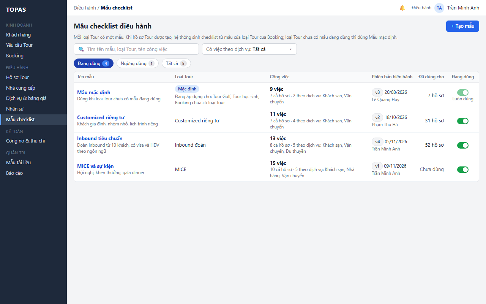

2. **W01 → W05 · Bấm dòng, hoặc nút + Tạo mẫu.** Điều hành bấm một dòng để mở bảng trượt của mẫu W05 (L3.1; người chỉ có quyền xem thấy W16, L3.4), hoặc bấm + Tạo mẫu (L2.1).

*Kết quả:* Điều hành thấy ngay mỗi loại Tour đang dùng mẫu nào và loại Tour nào cần tạo mẫu riêng.

**L1.2 Tìm và lọc.**

1. **W02 · Ô tìm kiếm, bộ chọn Có việc theo dịch vụ ở thanh lọc, chip.** Điều hành gõ tìm, chọn Có việc theo dịch vụ hoặc bấm chip. Bộ lọc áp dụng ngay; danh sách và số trên chip cập nhật; liên kết Xóa bộ lọc hiện ra. Không có dòng khớp ở chip đang xem thì vùng bảng ghi rõ, và nếu chip khác có dòng khớp thì nêu số dòng và tên chip đó.

   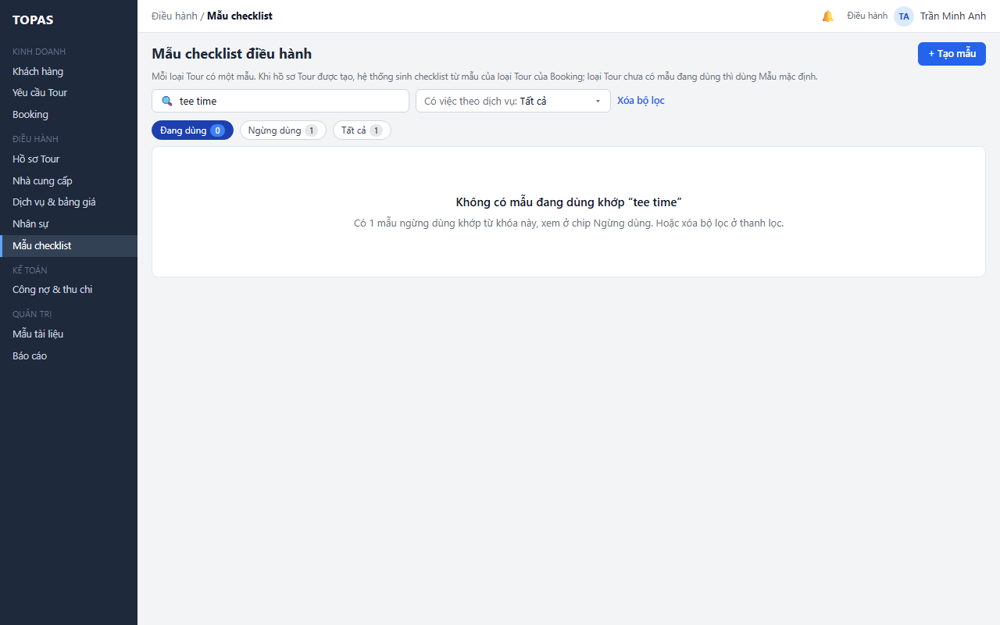

2. **W02 → W01 · Chip được nhắc tới, hoặc liên kết Xóa bộ lọc ở thanh lọc.** Điều hành bấm chip được nhắc tới, hoặc bấm Xóa bộ lọc ở thanh lọc để về mặc định.

*Kết quả:* người dùng tìm được mẫu theo tên, loại Tour hoặc tên một công việc trong mẫu.

**Ngoại lệ**

- **E1.1 · W17.** Không tải được danh sách: vùng bảng thay bằng thông báo lỗi và nút Tải lại; thanh lọc giữ nguyên giá trị. Bấm Tải lại thì tải lại với bộ lọc cũ.

  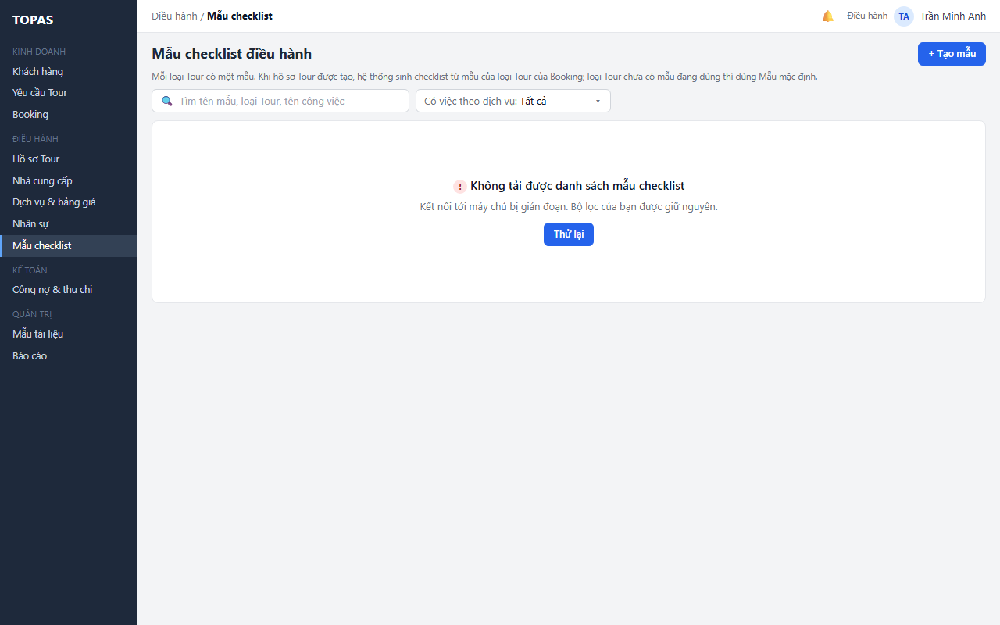

  > Hình chưa cập nhật: nút Thử lại nay là Tải lại.

- **E1.2.** Người dùng không có quyền xem DH01: menu không hiện mục Mẫu checklist; mở bằng đường dẫn thì hiện “Bạn không có quyền xem mẫu checklist” và nút Về trang chủ, không tải dữ liệu.
- **E1.3.** Tìm kiếm dưới 2 ký tự: chưa chạy tìm, ô tìm hiện gợi ý “Nhập ít nhất 2 ký tự”.
- **E1.4.** Loại Tour của một mẫu đã bị tắt ở QT05: dòng vẫn hiện, ô Loại Tour có chỉ báo “Loại Tour ngừng dùng”. Mẫu không bị đổi; không có Booking mới nào mang loại Tour đó nên mẫu không được dùng cho tới khi QT05 bật lại.
- **E1.5.** Danh sách không bao giờ rỗng hoàn toàn vì Mẫu mặc định luôn có. Trạng thái rỗng chỉ xảy ra khi không khớp bộ lọc (W02) hoặc ở chip Ngừng dùng khi không có mẫu ngừng dùng (W13a).

### 3.2. Tạo mẫu cho một loại Tour (CNHT04.02 · HT04.02 · quyết định 11/11/2026)

**L2.1 Tạo mẫu bằng cách sao chép rồi sửa.** *Điều kiện:* Điều hành có quyền quản lý; còn ít nhất một loại Tour đang dùng ở QT05 chưa có mẫu.

1. **W03 · Nút + Tạo mẫu → bảng trượt.** Điều hành bấm + Tạo mẫu. Bảng trượt mở. Loại Tour điền sẵn loại Tour đầu tiên chưa có mẫu (nhãn Gợi ý); danh sách chọn chỉ gồm loại Tour chưa có mẫu. Tên mẫu điền sẵn bằng tên loại Tour (nhãn Tự điền) và sửa được. Điều hành giữ hoặc đổi Loại Tour, Tên mẫu rồi mở ô Bắt đầu từ: danh sách mẫu có sẵn, mỗi mẫu kèm loại Tour, phiên bản và số việc; mẫu ngừng dùng vẫn được chọn để sao chép.

   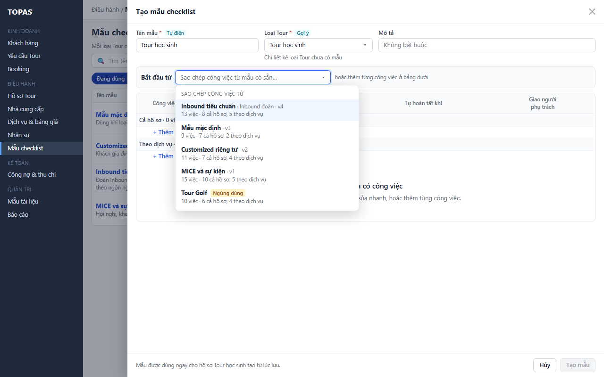

2. **W04 · Ô Bắt đầu từ.** Điều hành chọn một mẫu, ví dụ Inbound tiêu chuẩn v4. Hệ thống sao chép toàn bộ công việc của phiên bản hiện hành, gồm thứ tự, loại dịch vụ, hạn, tự hoàn tất, giao người phụ trách và hướng dẫn. Dòng sao chép có nền xanh ngọc nhạt; câu cạnh ô ghi số việc đã sao chép. Nếu không chọn mẫu, Điều hành thêm từng công việc ở bước 4.

   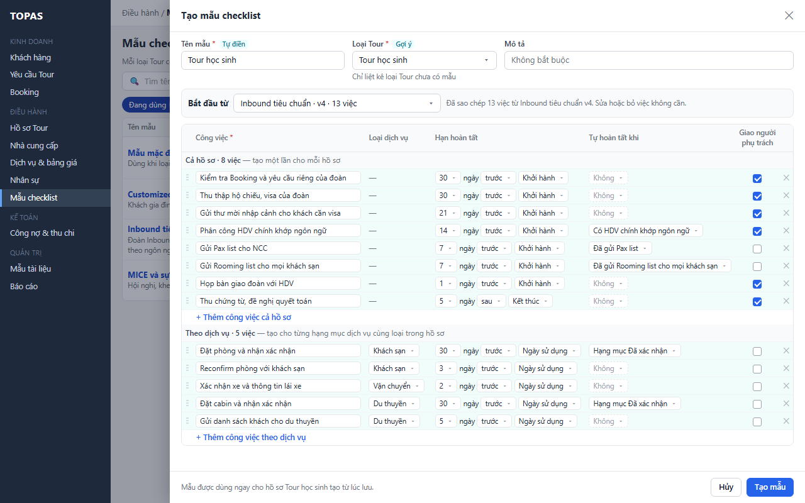

3. **W06 · Nút ✕ trên dòng.** Điều hành bỏ việc không cần bằng ✕ trên dòng. Dòng biến mất ngay; thông báo ngắn “Đã bỏ …” có Hoàn tác. Số việc trên tiêu đề nhóm giảm theo.
4. **W06 · Liên kết + Thêm công việc cuối nhóm → dòng mới, ô chọn tại chỗ.** Điều hành bấm + Thêm công việc theo dịch vụ (hoặc + Thêm công việc cả hồ sơ). Một dòng mới nền xanh nhạt hiện cuối nhóm, con trỏ ở ô Công việc. Hạn điền sẵn “7 ngày trước Khởi hành” cho việc cả hồ sơ và “3 ngày trước Ngày sử dụng” cho việc theo dịch vụ. Điều hành nhập tên, chọn loại dịch vụ từ danh sách loại dịch vụ đang dùng, sửa hạn, tự hoàn tất, giao người phụ trách ngay trên dòng.

   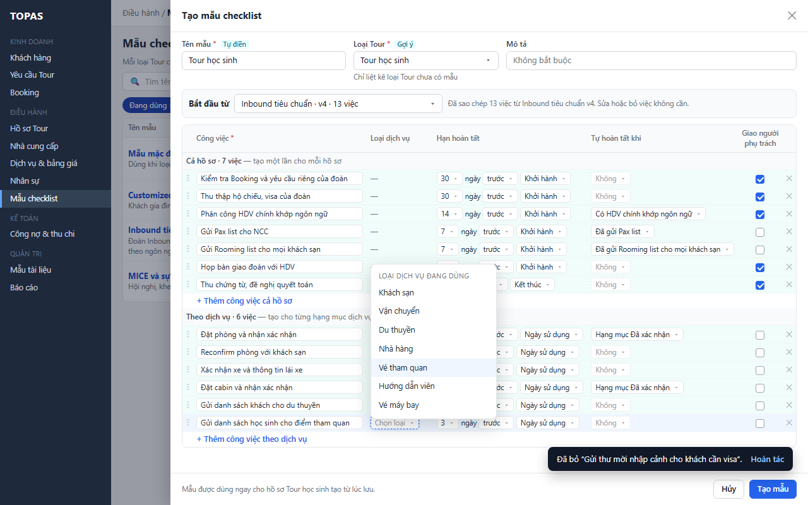

5. **W06 · Tay kéo ⋮⋮; thẻ Xem trước.** Điều hành kéo ⋮⋮ để đổi thứ tự trong nhóm nếu cần; hệ thống cập nhật thứ tự và không cho kéo sang nhóm khác. Điều hành có thể mở thẻ Xem trước như L3.2 (W09) để kiểm tra trên một hồ sơ cùng loại Tour.
6. **W07 · Nút Tạo mẫu ở chân bảng trượt.** Điều hành bấm Tạo mẫu. Hệ thống kiểm tra theo R02. Có lỗi thì không lưu; banner nêu số lỗi, dòng lỗi tô đỏ và lỗi ghi ngay dưới ô; dữ liệu đã nhập được giữ. Điều hành sửa rồi bấm lại.

   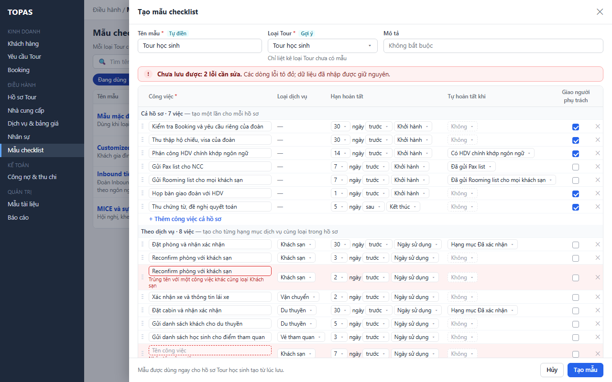

7. **W08 · Danh sách, thông báo ngắn.** Lưu thành công: bảng trượt đóng; mẫu mới (v1, Đang dùng, Chưa dùng) tô sáng 5 giây trong danh sách; chip Đang dùng và Tất cả tăng một; loại Tour vừa có mẫu rời dòng “Đang áp dụng cho” của Mẫu mặc định. Thông báo ngắn có liên kết Mở mẫu; Điều hành bấm nếu cần mở lại mẫu.

   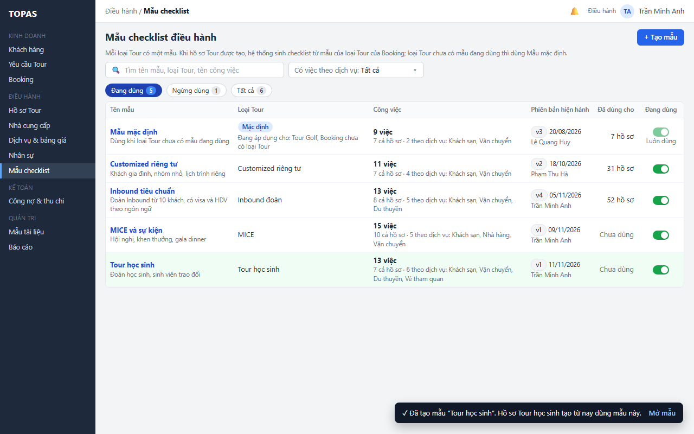

*Kết quả:* loại Tour có mẫu riêng ở phiên bản v1. Hồ sơ của loại Tour đó tạo từ lúc lưu dùng mẫu này (R07). Hồ sơ đã tạo trước đó giữ checklist cũ.

**Ngoại lệ**

- **E2.1 · W07.** Thiếu tên công việc, tên trùng trong cùng phạm vi, việc theo dịch vụ chưa chọn loại dịch vụ, số ngày ngoài khoảng 0–365, tên mẫu trùng, mẫu không có công việc nào: chặn lưu, lỗi cạnh ô, giữ dữ liệu (R02).
- **E2.2.** Loại Tour vừa được người khác tạo mẫu trong lúc bảng trượt đang mở: lưu bị từ chối; ô Loại Tour báo “Tour học sinh vừa có mẫu do … tạo lúc …”, danh sách chọn được tải lại. Điều hành chọn loại Tour khác hoặc đóng bảng trượt; công việc đã nhập được giữ.
- **E2.3.** Mọi loại Tour đang dùng đều đã có mẫu: nút + Tạo mẫu khóa, cạnh nút ghi “Mọi loại Tour đã có mẫu. Thêm loại Tour ở QT05.”
- **E2.4.** Một loại dịch vụ trong các dòng sao chép đã bị tắt ở QT05: dòng vẫn được sao chép, ô Loại dịch vụ có chỉ báo “Ngừng dùng” và gợi ý chọn loại khác. Không chặn lưu; công việc đó không sinh ra cho tới khi QT05 bật lại loại dịch vụ (R07).
- **E2.5.** Lỗi lưu (mất kết nối): bảng trượt giữ nguyên dữ liệu, hiện banner lỗi và cho bấm lại. Không có mẫu dở dang.
- **E2.6.** Bấm Tạo mẫu nhiều lần: nút khóa và hiện Đang lưu… ngay sau lần bấm đầu; máy chủ chỉ tạo một mẫu cho mỗi loại Tour (R10).
- **E2.7.** Thêm công việc thứ 101: liên kết + Thêm công việc khóa, ghi “Mỗi mẫu tối đa 100 công việc”.
- **E2.8 · W10.** Đóng bảng trượt khi còn thay đổi chưa lưu: hộp thoại xác nhận như E3.2.
- **E2.9.** Hoàn tác sau khi đã bấm Tạo mẫu: không có. Hoàn tác chỉ áp dụng cho việc bỏ dòng trong lúc đang sửa.

### 3.3. Sửa mẫu, xem trước và lịch sử (CNHT04.02 · HT04.02)

**L3.1 Sửa mẫu và lưu phiên bản mới.** *Điều kiện:* Điều hành có quyền quản lý.

1. **W05 · Bấm dòng trên W01 → bảng trượt.** Điều hành bấm dòng Inbound tiêu chuẩn. Bảng trượt mở ở thẻ Công việc với lưới của phiên bản hiện hành v4. Tiêu đề phụ ghi loại Tour, số hồ sơ đã dùng và lần lưu cuối. Nút Xóa mẫu khóa, cạnh nút ghi lý do “Đã dùng cho 52 hồ sơ nên không xóa được; tắt Đang dùng ở danh sách nếu không dùng nữa”.

   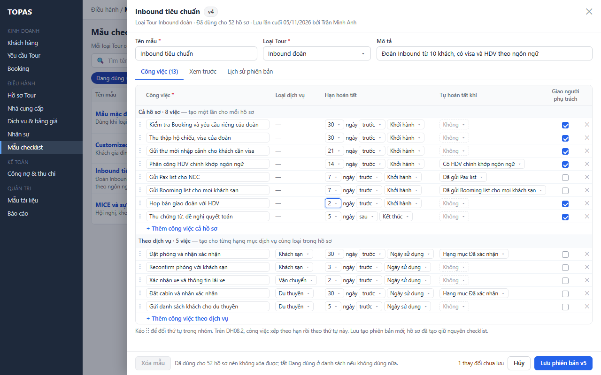

2. **W05 · Lưới trong bảng trượt, sửa tại chỗ.** Điều hành sửa ngay trên lưới, ví dụ đổi hạn “Họp bàn giao đoàn với HDV” từ 1 thành 2 ngày trước Khởi hành. Có thể thêm, bỏ, kéo đổi thứ tự như L2.1 bước 3–5 (W06). Chân bảng trượt ghi số thay đổi chưa lưu; nút chính đổi thành Lưu phiên bản v5.
3. **W08a · Nút Lưu phiên bản vN+1 ở chân bảng trượt.** Điều hành bấm Lưu phiên bản v5. Hệ thống kiểm tra như E2.1, ghi phiên bản v5 với bản chụp đầy đủ công việc và danh sách thay đổi so với v4 (R06). Bảng trượt đóng; dòng mẫu tô sáng, hiện v5, ngày và người lưu. Thông báo ngắn “Đã lưu … phiên bản v5. 52 hồ sơ đã tạo giữ nguyên checklist.”

   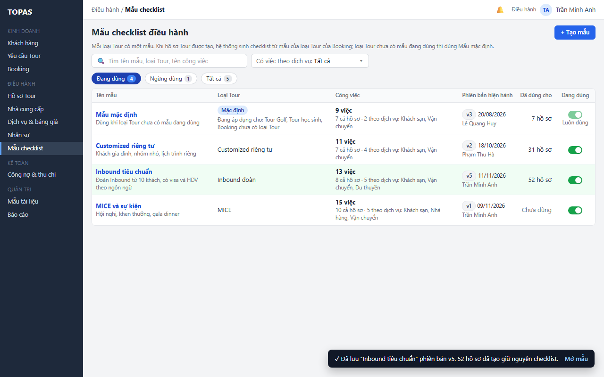

*Kết quả:* hồ sơ Inbound đoàn tạo từ nay dùng v5. 52 hồ sơ đã tạo, kể cả hồ sơ chưa khởi hành, giữ checklist sinh từ v1–v4.

**L3.2 Xem trước checklist trên hồ sơ mẫu.**

1. **W09 · Thẻ Xem trước trong bảng trượt.** Điều hành bấm thẻ Xem trước. Ô Hồ sơ mẫu điền sẵn hồ sơ đang mở cùng loại Tour có ngày khởi hành gần nhất; Điều hành giữ hoặc đổi sang hồ sơ khác, kể cả hồ sơ khác loại Tour.

   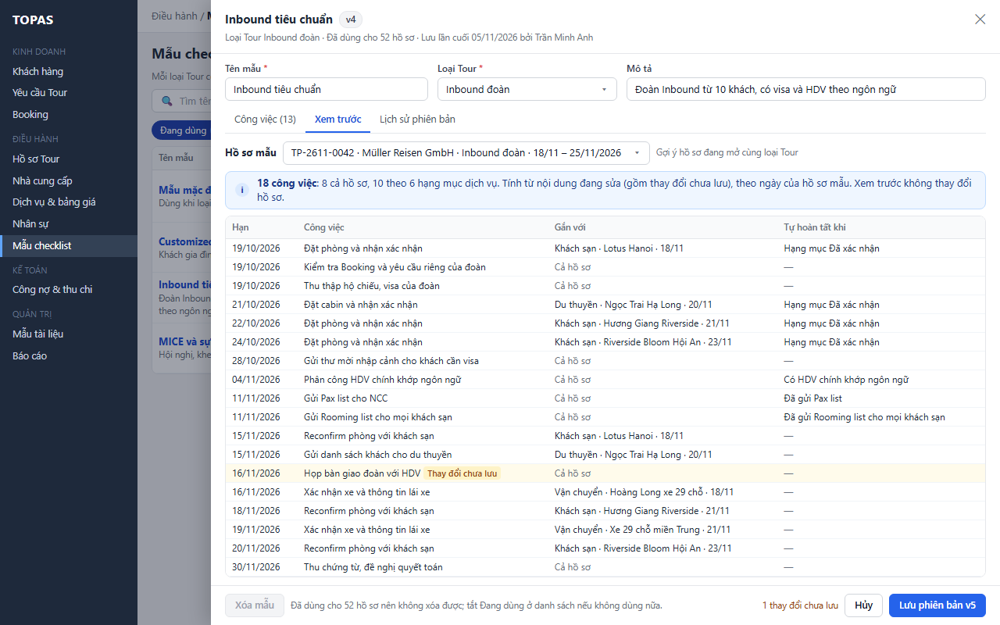

2. **W09 · Bảng xem trước.** Hệ thống sinh checklist từ nội dung đang sửa (gồm thay đổi chưa lưu) theo R07 và R09, với ngày và hạng mục của hồ sơ mẫu, rồi hiện bảng: Hạn, Công việc, Gắn với (Cả hồ sơ hoặc hạng mục cụ thể), Tự hoàn tất khi. Dòng do thay đổi chưa lưu có nhãn “Thay đổi chưa lưu”. Banner nêu tổng số việc, số việc cả hồ sơ và số việc theo bao nhiêu hạng mục.
3. **W05 · Thẻ Công việc.** Điều hành bấm thẻ Công việc để quay lại sửa. Xem trước không ghi gì vào hồ sơ mẫu.

*Kết quả:* Điều hành biết trước mẫu sẽ sinh bao nhiêu việc, hạn rơi vào ngày nào, trước khi lưu.

**L3.3 Xem lịch sử phiên bản.**

1. **W15 · Thẻ Lịch sử phiên bản trong bảng trượt.** Điều hành bấm thẻ Lịch sử phiên bản. Bảng liệt kê từng phiên bản, mới nhất ở trên: số phiên bản (phiên bản hiện hành có chữ Hiện hành), thời điểm lưu, người lưu, các thay đổi so với bản trước, số hồ sơ đã sinh checklist từ phiên bản đó. Dòng Tổng bằng số ở cột Đã dùng cho của danh sách.

   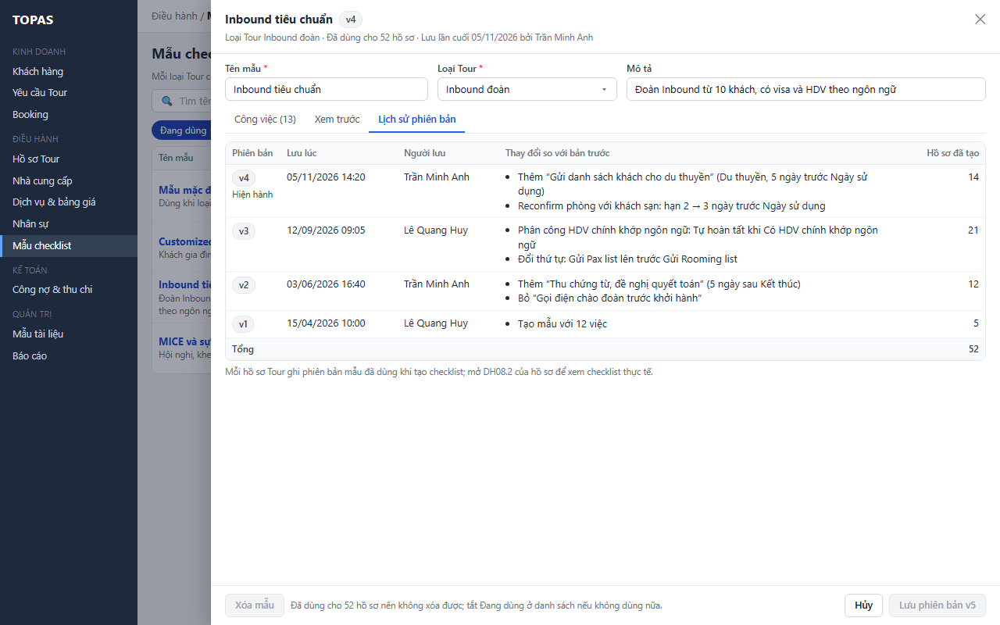

*Kết quả:* biết ai đổi gì, khi nào, và hồ sơ nào chạy theo phiên bản nào. Checklist thực tế của từng hồ sơ xem ở DH08.2.

**L3.4 Xem mẫu khi chỉ có quyền xem.**

1. **W16 · Bấm dòng trên W01 → bảng trượt chỉ đọc.** Người chỉ có quyền xem bấm một dòng. Bảng trượt mở ở chế độ chỉ đọc: trường có viền nét đứt, lưới không có ô sửa, tay kéo và ✕; không có công tắc, nút Lưu, Xóa mẫu. Người dùng xem và đổi thẻ: thẻ Xem trước và Lịch sử vẫn dùng được. Chân bảng trượt chỉ có nút Đóng và câu “Bạn chỉ có quyền xem mẫu checklist. Quyền sửa do Quản trị cấp ở QT02.”

   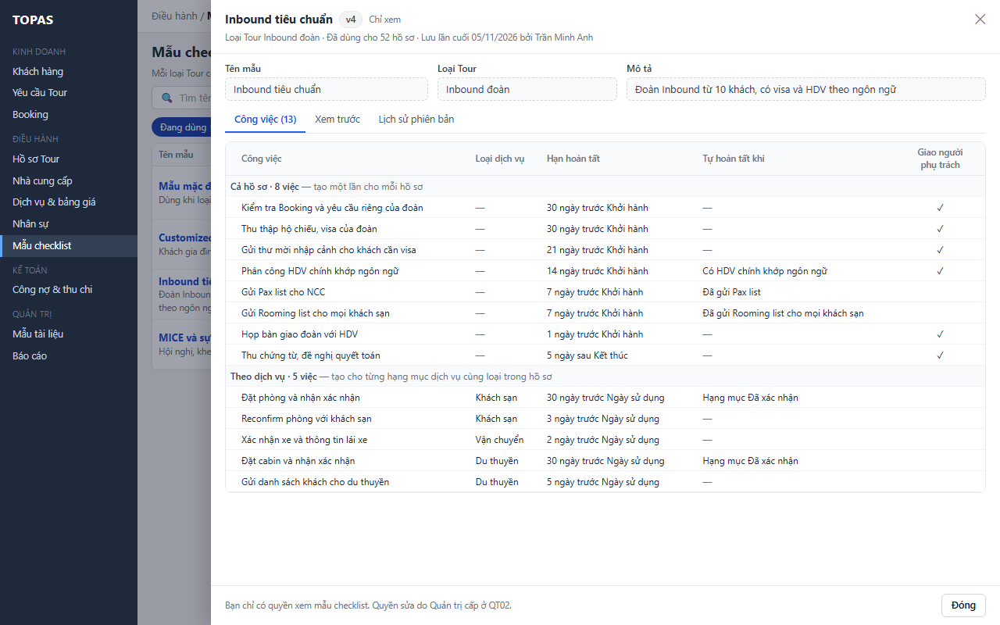

   > Hình chưa cập nhật: công tắc Đang dùng hiện mờ; nay người chỉ xem thấy chữ “Đang dùng” hoặc “Ngừng dùng” (U5).
**Ngoại lệ**

- **E3.1 · W11.** Mẫu đã được người khác lưu phiên bản mới trong lúc đang sửa: lưu bị từ chối, không ghi đè. Banner đỏ trong bảng trượt nêu người, phiên bản, thời điểm và tóm tắt thay đổi của họ, rồi liệt kê thay đổi chưa lưu của người đang sửa; nút duy nhất Tải phiên bản v5. Nút Lưu khóa. Bấm Tải phiên bản v5 thì hệ thống tải bản mới và bỏ các thay đổi chưa lưu đã liệt kê. Sau khi tải, Điều hành làm lại thay đổi của mình trên bản mới.

  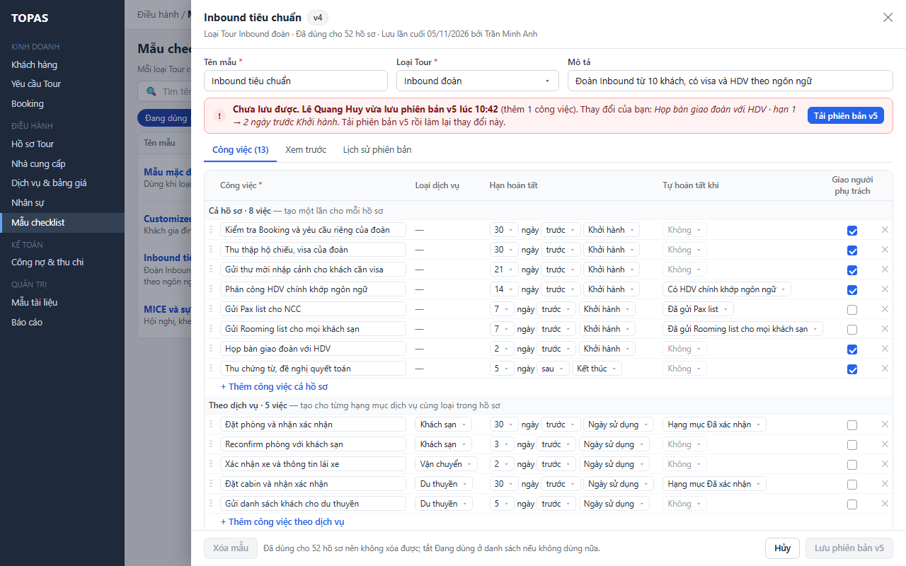

- **E3.2 · W10.** Đóng bảng trượt (✕, Hủy, phím Esc, bấm ra ngoài) khi còn thay đổi chưa lưu: hộp thoại liệt kê các thay đổi sẽ mất, nút Tiếp tục sửa (chính, giữ dữ liệu) và Bỏ thay đổi (đóng không lưu).

  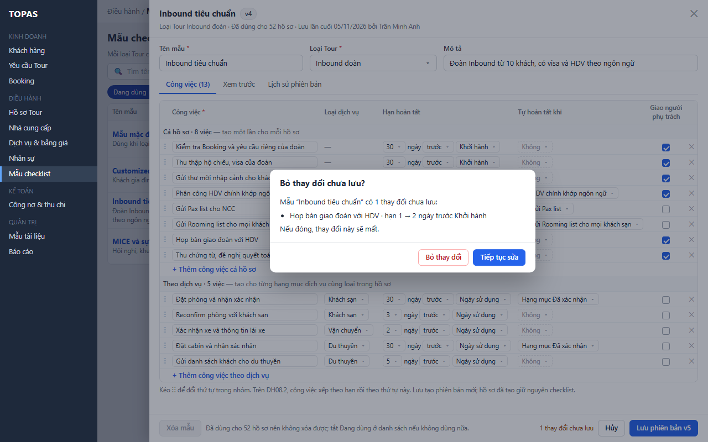

- **E3.3.** Đổi Loại Tour của mẫu: danh sách chọn chỉ gồm loại Tour chưa có mẫu. Đổi xong và lưu, loại Tour cũ chuyển sang Mẫu mặc định cho hồ sơ tạo sau; hệ thống nêu điều này trong câu cạnh nút Lưu trước khi bấm.
- **E3.4.** Mẫu mặc định: ô Loại Tour chỉ đọc, ghi “Mặc định · dùng khi loại Tour chưa có mẫu đang dùng”; không có nút Xóa mẫu.
- **E3.5.** Xem trước khi chưa có hồ sơ nào trong hệ thống: thẻ Xem trước hiện “Chưa có hồ sơ Tour để xem trước” và không có bảng. Hồ sơ mẫu không có hạng mục thuộc loại dịch vụ nào trong mẫu: bảng chỉ có việc cả hồ sơ, banner ghi “Hồ sơ này không có hạng mục Khách sạn, Du thuyền… nên không có việc theo dịch vụ”.
- **E3.6.** Lưu khi không có thay đổi: không xảy ra vì nút Lưu khóa khi chưa có thay đổi. Thay đổi rồi đổi lại như cũ cũng được tính là không có thay đổi.
- **E3.7.** Quyền quản lý bị thu hồi trong lúc đang sửa: máy chủ từ chối lưu, banner “Bạn không còn quyền sửa mẫu checklist”, dữ liệu không đổi; bảng trượt chuyển sang chỉ đọc (W16).
- **E3.8.** Lỗi lưu (mất kết nối): như E2.5.

### 3.4. Ngừng dùng, dùng lại và xóa mẫu (quyết định 11/11/2026)

**L4.1 Ngừng dùng mẫu.** *Điều kiện:* mẫu Đang dùng, không phải Mẫu mặc định.

1. **W12 · Công tắc Đang dùng trên dòng.** Điều hành tắt công tắc Đang dùng trên dòng Customized riêng tư. Hệ thống lưu ngay, không hỏi xác nhận vì thao tác hoàn tác được (U2; R08).

   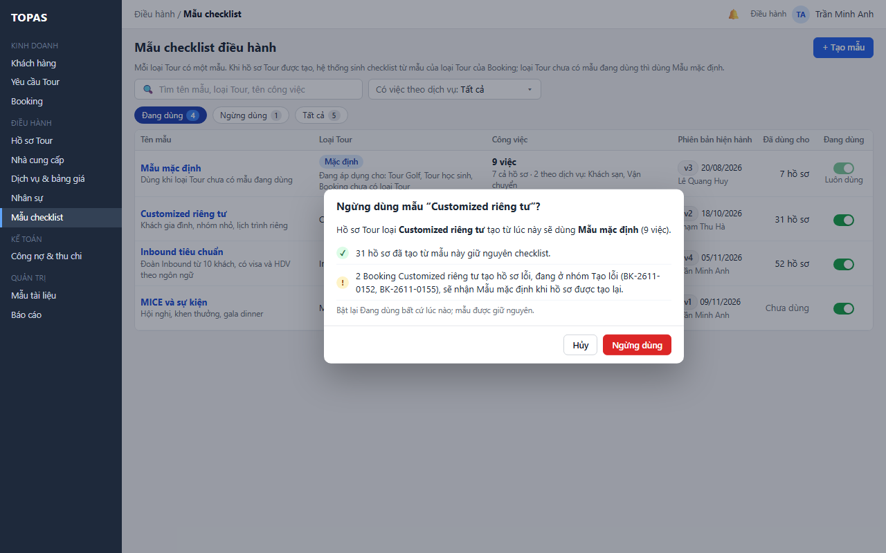

   > Hình chưa cập nhật: hộp thoại xác nhận không còn (U2); hậu quả nay nêu trong thông báo ngắn ở W13. Dòng “Booking … ở nhóm Tạo lỗi” không còn (Q5).

2. **W13 · Danh sách và thông báo ngắn.** Mẫu rời chip Đang dùng; chip Đang dùng giảm một, Ngừng dùng tăng một; dòng Mẫu mặc định thêm “Customized riêng tư” vào Đang áp dụng cho. Thông báo ngắn nêu hậu quả (hồ sơ Customized riêng tư tạo từ nay dùng Mẫu mặc định, kèm số việc; số hồ sơ đã tạo giữ nguyên checklist) và có Hoàn tác trong 10 giây; Điều hành bấm Hoàn tác nếu cần.

   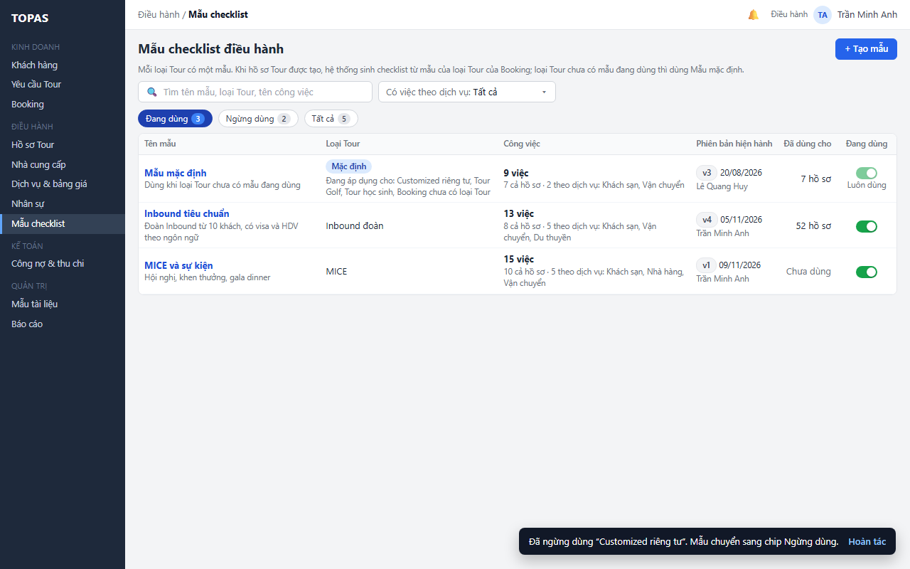

*Kết quả:* mẫu Ngừng dùng, nội dung và lịch sử giữ nguyên. Hoàn tác đưa mẫu về Đang dùng như L4.2.

**L4.2 Dùng lại mẫu.** *Điều kiện:* mẫu Ngừng dùng.

1. **W13a · Chip Ngừng dùng, công tắc trên dòng.** Điều hành bấm chip Ngừng dùng rồi bật công tắc trên dòng Tour Golf. Hệ thống lưu ngay, không có hộp thoại vì không mất dữ liệu. Mẫu rời chip Ngừng dùng; khi chip rỗng thì ghi “Không còn mẫu ngừng dùng”. Thông báo ngắn nêu loại Tour thôi dùng Mẫu mặc định, có Hoàn tác.

   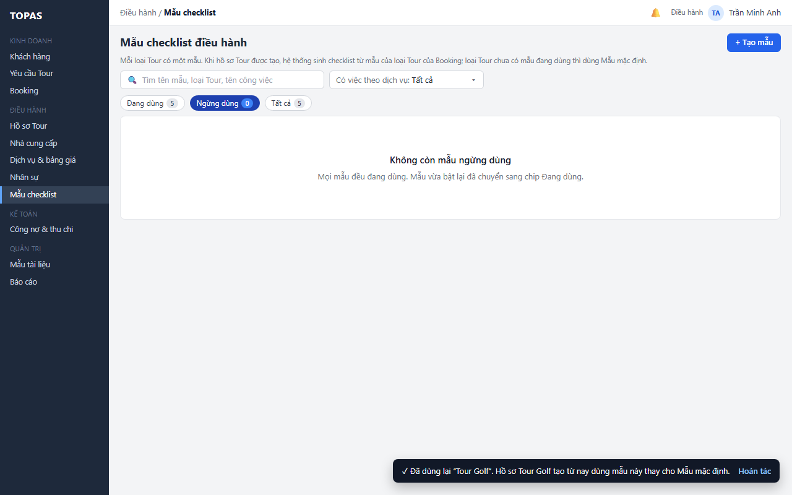

*Kết quả:* hồ sơ Tour Golf tạo từ nay dùng phiên bản hiện hành của mẫu Tour Golf.

**L4.3 Xóa mẫu chưa dùng.** *Điều kiện:* mẫu chưa dùng cho hồ sơ nào; không phải Mẫu mặc định.

1. **W14 · Nút Xóa mẫu ở chân bảng trượt → hộp thoại.** Điều hành mở mẫu MICE và sự kiện (Chưa dùng) rồi bấm Xóa mẫu ở chân bảng trượt. Hộp thoại nêu số việc, hậu quả (hồ sơ MICE tạo từ nay dùng Mẫu mặc định) và “Không khôi phục được sau khi xóa”.

   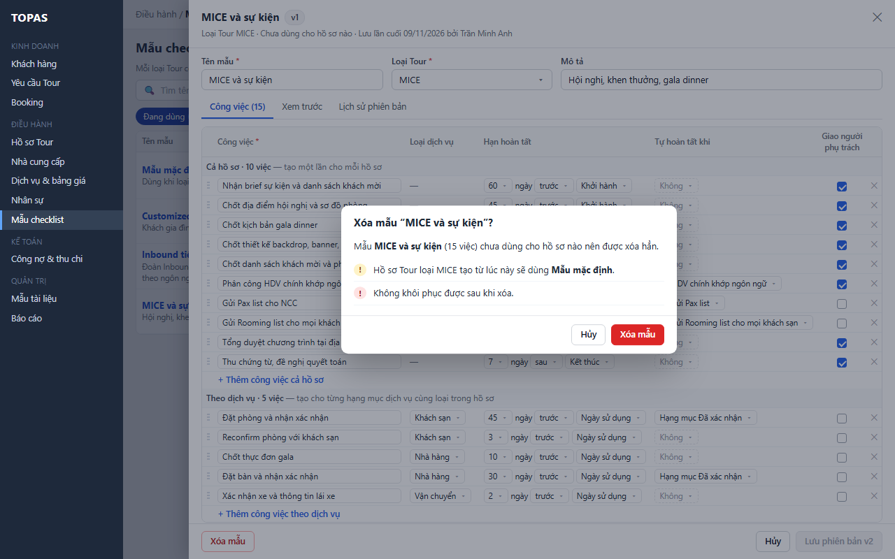

2. **W14a · Nút Xóa mẫu trong hộp thoại.** Điều hành bấm Xóa mẫu trong hộp thoại. Hệ thống kiểm tra lại số hồ sơ đã dùng bằng 0 (R08) rồi xóa mẫu cùng mọi phiên bản. Bảng trượt đóng; dòng biến mất; chip giảm một; dòng Mẫu mặc định thêm MICE vào Đang áp dụng cho. Thông báo ngắn không có Hoàn tác.

   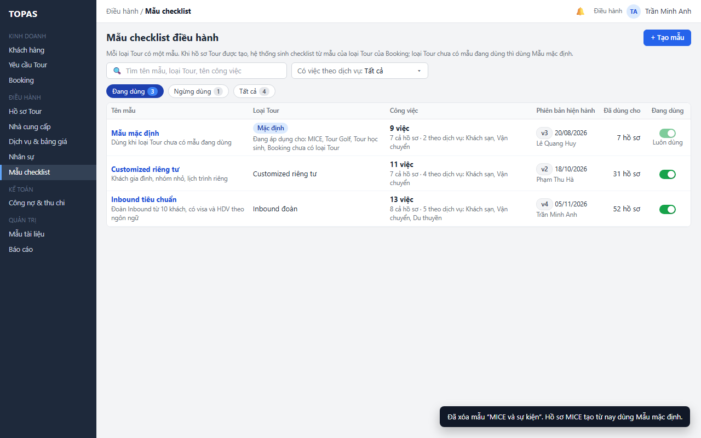

*Kết quả:* loại Tour MICE không còn mẫu và có thể tạo mẫu mới (L2.1).

**Ngoại lệ**

- **E4.1 · W01.** Mẫu mặc định: công tắc bật, mờ, ghi “Luôn dùng”; bấm vào hiện chú thích “Mẫu mặc định luôn được dùng cho loại Tour chưa có mẫu”. Không có nút Xóa mẫu.
- **E4.2 · W05.** Mẫu đã dùng cho ít nhất một hồ sơ: nút Xóa mẫu khóa, cạnh nút ghi lý do và cách thay thế (tắt Đang dùng).
- **E4.3.** Mẫu vừa được dùng để tạo hồ sơ trong lúc hộp thoại xóa đang mở: máy chủ từ chối; hộp thoại đổi thành “Mẫu vừa được dùng cho TP-… lúc …, chỉ ngừng dùng được”, nút chính đổi thành Đóng. Nút Xóa mẫu trong bảng trượt chuyển sang khóa.
- **E4.4.** Hai người cùng bật tắt một mẫu: công tắc gửi giá trị đích; nếu mẫu đã ở giá trị đó thì không đổi gì và không báo lỗi. Danh sách tải lại dòng đó.
- **E4.5.** Lỗi lưu khi bật tắt: công tắc trở về giá trị cũ, thông báo lỗi có nút Thử lại. Dữ liệu không đổi.
- **E4.6.** Dùng lại mẫu khi loại Tour đã tắt ở QT05: vẫn cho bật; dòng giữ chỉ báo “Loại Tour ngừng dùng” (E1.4).
- **E4.7.** Hoàn tác sau khi đã rời màn hoặc quá 10 giây: không còn nút Hoàn tác; người dùng bật hoặc tắt lại công tắc như L4.1, L4.2.

### 3.5. Hệ thống sinh checklist từ mẫu (HT04.03 · TN05.02 · liên kết DH07, DH08)

Luồng này do hệ thống chạy trong DH07 và DH08. Phần này quy định đầu vào lấy từ DH01; giao diện kết quả là tab DH08.2 của RSD DH08 và có cùng hình dạng với bảng Xem trước W09.

**L5.1 Sinh checklist khi tạo hồ sơ.** *Điều kiện:* DH07 tạo hồ sơ Tour trong cùng giao dịch khi Booking được lưu ở KD08 (RSD DH07 R01, Q5).

1. **W01 · Không có chỗ bấm ở DH01; dòng Mẫu mặc định phản ánh kết quả.** Hệ thống đọc loại Tour của Booking và chọn mẫu theo R01: mẫu Đang dùng của loại Tour đó, hoặc Mẫu mặc định nếu Booking chưa có loại Tour hay loại Tour chưa có mẫu đang dùng. Dòng “Đang áp dụng cho” của Mẫu mặc định trên W01 phản ánh đúng quy tắc này.
2. **W09 · Không có chỗ bấm; kết quả có cùng hình dạng với bảng Xem trước.** Hệ thống lấy phiên bản hiện hành của mẫu tại thời điểm giao dịch tạo hồ sơ bắt đầu, rồi sinh công việc theo R07: mỗi việc cả hồ sơ một lần; mỗi việc theo dịch vụ một lần cho từng hạng mục dịch vụ cùng loại; hạn tính theo R03; giao người theo R05.
3. **W15 · Cột Hồ sơ đã tạo ở Lịch sử phiên bản, cột Đã dùng cho trên W01.** Hồ sơ ghi ID mẫu và số phiên bản đã dùng; cột Hồ sơ đã tạo của phiên bản đó và cột Đã dùng cho trên danh sách tăng một.

*Kết quả:* hồ sơ mới có checklist đầy đủ ngay khi tạo. Không có thao tác tay ở DH01.

**L5.2 Sinh việc khi thêm hạng mục vào hồ sơ đã có.** *Điều kiện:* Điều hành thêm hạng mục ở DH08.2 (RSD DH08 L2.5), hoặc áp dụng thay đổi chương trình có thêm hoặc đổi dịch vụ (RSD DH08 R19).

1. **W09 · Ngoài DH01; kết quả có cùng hình dạng với bảng Xem trước.** Hệ thống lấy mẫu mà hồ sơ đã dùng khi tạo (cùng ID mẫu) ở **phiên bản hiện hành**, và sinh các việc theo dịch vụ của loại dịch vụ của hạng mục mới. Việc cả hồ sơ không sinh lại.
2. **W09 · Như bước 1.** Hạn tính theo ngày sử dụng của hạng mục mới (R03). Việc mới hiện ở DH08.2 như các việc khác.

*Kết quả:* hạng mục thêm sau cũng có đủ việc đi kèm, không phải nhớ thêm tay.

**Ngoại lệ**

- **E5.1.** Booking chưa có loại Tour: dùng Mẫu mặc định; nhật ký hồ sơ ghi “Booking chưa có loại Tour, dùng Mẫu mặc định”. Loại Tour bắt buộc khi lưu yêu cầu Tour ở KD06.1 (RSD KD06 mục 5.2) và Booking kế thừa từ yêu cầu, nên nhánh này chỉ xảy ra với dữ liệu cũ hoặc Booking nhập từ ngoài hệ thống; vẫn giữ để hồ sơ luôn có checklist.
- **E5.2.** Mẫu đã dùng khi tạo hồ sơ bị ngừng dùng hoặc bị đổi loại Tour trước khi thêm hạng mục: L5.2 vẫn dùng phiên bản hiện hành của chính mẫu đó, vì hồ sơ đã gắn với mẫu. Mẫu đó đã bị xóa thì không xảy ra, vì mẫu đã dùng không xóa được.
- **E5.3.** Hạng mục thuộc loại dịch vụ không có việc theo dịch vụ trong mẫu: không sinh việc nào; không báo lỗi.
- **E5.4.** Hạn tính ra đã qua ở thời điểm sinh (thường gặp khi Booking được tạo sát ngày khởi hành nên hồ sơ cũng tạo sát ngày, hoặc thêm hạng mục khi Tour đang chạy): hạn đặt bằng hôm nay, DH08.2 hiện chỉ báo Quá hạn (giữ quy tắc R04 của DH07).
- **E5.5.** Mẫu được lưu phiên bản mới đúng lúc hồ sơ đang được tạo: giao dịch tạo hồ sơ dùng phiên bản đọc được lúc bắt đầu; không trộn hai phiên bản.
- **E5.6.** Hồ sơ chưa có người phụ trách (hồ sơ tự tạo, RSD DH07 R03): việc có Giao người phụ trách được để trống người thực hiện; khi hồ sơ được giao người phụ trách lần đầu, hệ thống điền người đó vào các việc này nếu chúng vẫn chưa có người thực hiện (R05).
- **E5.7.** Loại dịch vụ của việc theo dịch vụ đã tắt ở QT05: việc đó không sinh ra; nhật ký hồ sơ ghi tên việc bị bỏ qua và lý do.
- **E5.8.** Lỗi khi sinh checklist làm giao dịch tạo hồ sơ thất bại: xử lý theo E1.1 của DH07 (hoàn tác cả giao dịch, Booking không được lưu; Q5).

**Số bước trước và sau khi tối ưu (cả mục 3)**

| Việc | Cách làm tay | Bản này |
|---|---|---|
| Lập checklist cho một hồ sơ mới | Mở DH08.2, thêm từng việc, nhập hạn từng việc (khoảng 15–20 việc) | 0 bước: sinh tự động khi tạo hồ sơ |
| Tạo mẫu cho loại Tour mới gần giống mẫu có sẵn | Nhập lại 13 việc, mỗi việc 4–5 trường | 3 thao tác chính: + Tạo mẫu, chọn mẫu để sao chép, Tạo mẫu; cộng phần sửa khác biệt |
| Đổi hạn một việc trong mẫu | Mở mẫu, mở form việc, sửa, lưu việc, lưu mẫu | 3 lần bấm: bấm dòng mẫu, đổi số ngày tại chỗ, Lưu phiên bản |
| Kiểm tra mẫu sinh đúng không | Lưu, tạo thử hồ sơ, mở DH08.2 | 1 lần bấm: thẻ Xem trước |

---

## 4. Quy tắc triển khai chi tiết

### R01. Một mẫu cho mỗi loại Tour và Mẫu mặc định (quyết định 11/11/2026)

- Mỗi loại Tour có **tối đa một** mẫu, kể cả mẫu Ngừng dùng. Ràng buộc duy nhất trên ID loại Tour được kiểm tra ở máy chủ.
- **Mẫu mặc định** là mẫu duy nhất không gắn loại Tour. Hệ thống tạo sẵn khi khởi tạo dự án với nội dung do Điều hành khai báo; luôn Đang dùng; không xóa được.
- **Chọn mẫu cho một hồ sơ** theo thứ tự:
  1. Booking có loại Tour, và loại Tour đó có mẫu Đang dùng: dùng mẫu đó.
  2. Các trường hợp còn lại (Booking chưa có loại Tour; loại Tour chưa có mẫu; mẫu của loại Tour đang Ngừng dùng): dùng Mẫu mặc định.
- **Không gộp mẫu.** Một hồ sơ chỉ dùng một mẫu. Việc theo dịch vụ nằm trong chính mẫu của loại Tour, không có mẫu riêng theo loại dịch vụ.
- Dòng “Đang áp dụng cho” của Mẫu mặc định liệt kê: các loại Tour đang dùng ở QT05 rơi vào trường hợp 2, theo tên tăng dần, rồi “Booking chưa có loại Tour”.
- **Khi QT05 đổi danh mục Loại Tour.** Tắt một loại Tour đã có mẫu: không đổi mẫu, dòng có chỉ báo Loại Tour ngừng dùng (E1.4). Thêm hoặc bật một loại Tour chưa có mẫu: không tự tạo mẫu; loại Tour hiện trong Đang áp dụng cho của Mẫu mặc định và trong danh sách chọn khi tạo mẫu.

### R02. Công việc mẫu và kiểm tra khi lưu

- **Hai nhóm.** *Cả hồ sơ*: sinh một lần cho mỗi hồ sơ. *Theo dịch vụ*: gắn một loại dịch vụ; sinh một lần cho mỗi hạng mục dịch vụ cùng loại trong hồ sơ.
- **Thứ tự.** Thứ tự kéo thả trong từng nhóm được lưu. Ở DH08.2, công việc xếp theo hạn tăng dần; cùng hạn thì việc cả hồ sơ trước, rồi theo thứ tự trong mẫu.
- **Kiểm tra khi lưu** (chặn lưu, lỗi cạnh ô, giữ dữ liệu):
  - tên mẫu thiếu, quá dài hoặc trùng mẫu khác;
  - loại Tour thiếu hoặc đã có mẫu khác (trừ Mẫu mặc định);
  - mẫu không có công việc nào, hoặc có quá 100 công việc;
  - công việc thiếu tên hoặc tên ngoài 3–200 ký tự;
  - tên trùng trong nhóm Cả hồ sơ, hoặc trùng trong cùng loại dịch vụ ở nhóm Theo dịch vụ (so sánh không phân biệt hoa thường, dấu và khoảng trắng thừa);
  - việc theo dịch vụ chưa chọn loại dịch vụ;
  - số ngày ngoài 0–365.
- **Cảnh báo không chặn:** loại dịch vụ đã tắt ở QT05 (E2.4).

### R03. Hạn hoàn tất

- Hạn = mốc ± số ngày (ngày lịch). Trước là trừ, sau là cộng.
- Mốc được chọn:
  - **Khởi hành:** ngày khởi hành của hồ sơ. Dùng cho mọi việc.
  - **Kết thúc:** ngày kết thúc của hồ sơ. Dùng cho mọi việc.
  - **Ngày sử dụng:** ngày bắt đầu sử dụng của hạng mục liên kết. Chỉ dùng cho việc theo dịch vụ.
- Hạn đã qua ở thời điểm sinh: đặt bằng hôm nay và có chỉ báo Quá hạn ở DH08.2 (E5.4).
- Khi ngày khởi hành, ngày kết thúc hoặc ngày sử dụng của hạng mục đổi sau khi áp dụng thay đổi chương trình, hạn của việc chưa Hoàn tất được tính lại theo cùng công thức (RSD DH08 R19). Hạn đã được sửa tay ở DH08.2 thì giữ nguyên.

### R04. Tự hoàn tất khi

Giá trị chọn được cho từng công việc mẫu (khớp RSD DH08 R03):

| Giá trị | Chọn được ở nhóm | Sự kiện làm việc tự Hoàn tất |
|---|---|---|
| Không | Cả hai | — |
| Hạng mục Đã xác nhận | Theo dịch vụ | Hạng mục liên kết chuyển Đã xác nhận ở DH08.3 |
| Đã gửi Pax list | Cả hồ sơ | Pax list được gửi cho NCC ở DH08.4 |
| Đã gửi Rooming list cho mọi khách sạn | Cả hồ sơ | Rooming list đã gửi cho mọi hạng mục khách sạn chưa hủy |
| Có HDV chính khớp ngôn ngữ | Cả hồ sơ | DH08.5 có HDV chính khớp ngôn ngữ phục vụ |

Hành vi khi sự kiện xảy ra, bị đảo ngược hoặc người dùng đổi tay theo RSD DH08 R03. Danh sách giá trị là cấu hình hệ thống; thêm giá trị mới cần cập nhật cả DH01 và DH08.

### R05. Giao người phụ trách

- Việc có ô Giao người phụ trách được tích nhận người phụ trách hồ sơ làm người thực hiện khi sinh.
- Hồ sơ chưa có người phụ trách: để trống. Khi hồ sơ được giao người phụ trách **lần đầu** (DH07 tại chỗ, hàng loạt, hoặc DH08.1), hệ thống điền người đó vào các việc có ô này mà vẫn chưa có người thực hiện.
- Đổi người phụ trách sau đó không tự đổi người thực hiện của công việc. Điều hành đổi ở DH08.2 nếu cần.
- Việc không tích để trống người thực hiện; Điều hành giao ở DH08.2.

### R06. Phiên bản và hồ sơ đã tạo (quyết định 11/11/2026)

- Mỗi lần lưu có thay đổi tạo một phiên bản mới, đánh số tăng dần từ v1. Phiên bản cũ không bị sửa hay xóa (trừ khi xóa cả mẫu chưa dùng).
- Hệ thống so sánh với bản trước để ghi danh sách thay đổi: thêm việc, bỏ việc, đổi tên, đổi loại dịch vụ, đổi hạn, đổi tự hoàn tất, đổi giao người phụ trách, đổi hướng dẫn, đổi thứ tự, đổi tên mẫu, đổi loại Tour, đổi mô tả.
- **Hồ sơ đã tạo giữ nguyên checklist**, kể cả hồ sơ chưa khởi hành. Không có thao tác áp dụng phiên bản mới cho hồ sơ cũ.
- Hồ sơ tạo sau dùng phiên bản hiện hành tại thời điểm tạo (E5.5). Việc sinh thêm theo L5.2 dùng phiên bản hiện hành tại thời điểm thêm hạng mục.
- Bật hoặc tắt Đang dùng không tạo phiên bản mới; chỉ ghi nhật ký thao tác.

### R07. Sinh checklist cho hồ sơ

- **Khi tạo hồ sơ (trong giao dịch tạo hồ sơ của DH07):**
  1. chọn mẫu theo R01;
  2. đọc phiên bản hiện hành;
  3. với mỗi việc cả hồ sơ: tạo một công việc;
  4. với mỗi việc theo dịch vụ: tạo một công việc cho từng hạng mục dịch vụ cùng loại, chưa hủy, của hồ sơ; gắn ID hạng mục;
  5. tính hạn (R03), gắn sự kiện tự hoàn tất (R04), giao người (R05);
  6. sao chép tên và hướng dẫn; ghi ID mẫu, số phiên bản, ID công việc mẫu.
- **Khi thêm hạng mục vào hồ sơ đã có** (DH08.2 hoặc áp dụng thay đổi chương trình): chỉ làm bước 4–6 cho hạng mục mới, với phiên bản hiện hành của mẫu hồ sơ đã dùng (L5.2, E5.2).
- **Khi bỏ hoặc hủy hạng mục:** theo RSD DH08 (công việc chỉ gắn với hạng mục đó bị bỏ khỏi mẫu số và giữ trong lịch sử).
- **Loại dịch vụ đã tắt ở QT05:** bỏ qua việc theo dịch vụ đó và ghi nhật ký hồ sơ (E5.7).
- **Loại Tour của Booking đổi sau khi đã có hồ sơ:** checklist giữ nguyên; không đổi mẫu.
- Xem trước (W09) dùng đúng các bước trên, với nội dung đang sửa thay cho phiên bản hiện hành và không ghi dữ liệu.

### R08. Đang dùng, ngừng dùng và xóa (quyết định 11/11/2026)

- Tắt Đang dùng lưu ngay, không hỏi xác nhận, vì hoàn tác được (U2). Thông báo ngắn nêu: mẫu thay thế (Mẫu mặc định) và số việc của nó; số hồ sơ đã tạo giữ nguyên. Hồ sơ tạo trong cùng giao dịch khi Booking được lưu (RSD DH07 R01, Q5), nên không có Booking nào chờ tạo hồ sơ.
- Bật Đang dùng lưu ngay, không xác nhận.
- Hoàn tác trong thông báo ngắn có hiệu lực 10 giây và chỉ đảo đúng thao tác vừa làm.
- **Xóa** chỉ được khi số hồ sơ đã dùng (mọi phiên bản) bằng 0 và không phải Mẫu mặc định. Máy chủ kiểm tra lại lúc xóa (E4.3). Xóa là xóa hẳn mẫu và mọi phiên bản; nhật ký thao tác vẫn giữ bản ghi xóa.
- Mẫu đã dùng không xóa được dưới mọi hình thức; muốn thôi dùng thì tắt Đang dùng.

### R09. Xem trước

- Hồ sơ mẫu mặc định: hồ sơ chưa đóng cùng loại Tour, ngày khởi hành gần hôm nay nhất; không có thì hồ sơ chưa đóng bất kỳ có khởi hành gần nhất.
- Hạn tính theo ngày của hồ sơ mẫu, **không** áp dụng quy tắc hạn đã qua (E5.4), để người dùng thấy đúng khoảng cách ngày.
- Bảng xếp theo hạn tăng dần. Dòng có thay đổi chưa lưu có nhãn “Thay đổi chưa lưu”.
- Không ghi dữ liệu, không gửi thông báo.

### R10. Đồng thời và chống lặp

- Mọi thao tác ghi gửi kèm phiên bản dòng của mẫu. Máy chủ từ chối khi phiên bản đã đổi (E3.1). Không có cơ chế gộp tự động.
- Tạo mẫu: ràng buộc duy nhất trên loại Tour bảo đảm một loại Tour chỉ có một mẫu (E2.2, E2.6).
- Nút Lưu, Tạo mẫu, Xóa mẫu khóa ngay sau lần bấm đầu cho tới khi có kết quả.
- Bật tắt gửi giá trị đích, không gửi “đảo trạng thái” (E4.4).
- Giao dịch tạo hồ sơ đọc mẫu ở mức cô lập đủ để không đọc phiên bản đang lưu dở (E5.5).

### R11. Cấu hình phụ thuộc

| Cấu hình | Chủ sở hữu | Dùng ở | Khi thiếu |
|---|---|---|---|
| Danh mục Loại Tour | QT05 (Quản trị hệ thống, Kinh doanh) | R01, trường Loại Tour | Chỉ có Mẫu mặc định; nút + Tạo mẫu khóa (E2.3) |
| Loại Tour trên Booking | KD06.1 (bắt buộc), KD08 | R01 | Chỉ với dữ liệu cũ hoặc nhập ngoài: Booking dùng Mẫu mặc định (E5.1) |
| Danh mục Loại dịch vụ | QT05 (Quản trị hệ thống, Điều hành) | Cột Loại dịch vụ, R07 | Không thêm được việc theo dịch vụ |
| Nội dung Mẫu mặc định | Điều hành (DH01) | R01 | Không thể thiếu: hệ thống tạo sẵn và bắt buộc ít nhất một việc |
| Quyền Quản lý mẫu checklist | QT02 | Mục 1.4 | Vai trò Điều hành có quyền này mặc định |
| Danh sách giá trị Tự hoàn tất khi | Hệ thống | R04 | — |

---

## 5. Dữ liệu

### 5.1. Đối tượng dữ liệu

| Đối tượng | Khóa và dữ liệu chính | Nguồn hoặc tác động |
|---|---|---|
| Mẫu checklist | ID; tên (duy nhất); mô tả; ID loại Tour (duy nhất trong các mẫu, trống với Mẫu mặc định); là Mẫu mặc định; Đang dùng; số phiên bản hiện hành; phiên bản dòng (để chống ghi đè) | DH01 sở hữu |
| Phiên bản mẫu | ID mẫu, số phiên bản (v1, v2…); bản chụp đầy đủ danh sách công việc; thời điểm lưu; người lưu; danh sách thay đổi so với bản trước | Tạo khi lưu (R06); chỉ đọc sau khi tạo |
| Công việc mẫu | ID (giữ nguyên qua các phiên bản khi chỉ sửa); ID phiên bản; nhóm (Cả hồ sơ, Theo dịch vụ); ID loại dịch vụ; thứ tự trong nhóm; tên; hướng dẫn; số ngày; trước hoặc sau; mốc; tự hoàn tất khi; giao người phụ trách | Thuộc phiên bản mẫu |
| Loại Tour (đọc) | ID, tên, đang dùng | QT05 sở hữu (nhóm danh mục mới) |
| Loại dịch vụ (đọc) | ID, tên, đang dùng | QT05 sở hữu |
| Loại Tour của Booking (đọc) | ID Booking, ID loại Tour (trống chỉ với dữ liệu cũ hoặc nhập ngoài, E5.1) | KD06.1 nhập (bắt buộc); KD08 kế thừa |
| Công việc checklist của hồ sơ (ghi bởi DH07, DH08) | Tour Code; ID mẫu; số phiên bản; ID công việc mẫu; ID hạng mục liên kết (việc theo dịch vụ); tên; hướng dẫn; hạn; sự kiện tự hoàn tất; người thực hiện; tiến độ | DH08.2 sở hữu sau khi sinh |
| Số hồ sơ đã dùng (tính) | Theo ID mẫu và số phiên bản: số Tour Code khác nhau có công việc sinh từ đó | Tính từ công việc checklist của hồ sơ |

### 5.2. Trường nhập

| Form | Trường | Bắt buộc | Mặc định hoặc điền sẵn | Kiểm tra |
|---|---|---|---|---|
| Bảng trượt mẫu | Tên mẫu | Có | Tạo mới: tên loại Tour (Tự điền) | 3–100 ký tự; duy nhất, không phân biệt hoa thường và dấu |
| Bảng trượt mẫu | Loại Tour | Có, trừ Mẫu mặc định | Tạo mới: loại Tour đầu tiên chưa có mẫu (Gợi ý) | Loại Tour đang dùng ở QT05 và chưa có mẫu khác (R01) |
| Bảng trượt mẫu | Mô tả | Không | — | Tối đa 300 ký tự |
| Bảng trượt mẫu | Bắt đầu từ | Không | Trống | Một mẫu có sẵn bất kỳ, kể cả mẫu ngừng dùng |
| Lưới công việc | Công việc (tên) | Có | — | 3–200 ký tự; không trùng trong nhóm Cả hồ sơ; không trùng trong cùng loại dịch vụ ở nhóm Theo dịch vụ |
| Lưới công việc | Loại dịch vụ | Có với nhóm Theo dịch vụ | — | Loại dịch vụ đang dùng ở QT05 |
| Lưới công việc | Số ngày | Có | 7 (cả hồ sơ), 3 (theo dịch vụ) | Số nguyên 0–365 |
| Lưới công việc | Trước hoặc sau | Có | Trước | — |
| Lưới công việc | Mốc | Có | Khởi hành (cả hồ sơ), Ngày sử dụng (theo dịch vụ) | Ngày sử dụng chỉ có ở nhóm Theo dịch vụ (R03) |
| Lưới công việc | Tự hoàn tất khi | Không | Không | Giá trị theo nhóm (R04) |
| Lưới công việc | Giao người phụ trách | Không | Bỏ tích | — |
| Lưới công việc | Hướng dẫn thực hiện | Không | — | Tối đa 1.000 ký tự |
| Thẻ Xem trước | Hồ sơ mẫu | Không | Hồ sơ đang mở cùng loại Tour, khởi hành gần nhất | Hồ sơ người dùng có quyền xem |
| Thanh lọc | Tìm kiếm | Không | Trống | Từ 2 ký tự |
| Toàn mẫu | Số công việc | — | — | 1–100 việc (E2.1, E2.7) |

### 5.3. Dữ liệu gửi ra ngoài

DH01 không gửi email hay tài liệu ra ngoài hệ thống, và không gửi thông báo.

---

## 6. Tiêu chí nghiệm thu

| Mã | Điều kiện và thao tác | Kết quả mong đợi |
|---|---|---|
| AC01 | Có 5 loại Tour đang dùng ở QT05; mẫu Inbound đoàn, Customized riêng tư, MICE Đang dùng; Tour Golf Ngừng dùng; Tour học sinh chưa có mẫu. Mở DH01 | Chip Đang dùng 4, Ngừng dùng 1, Tất cả 5. Mẫu mặc định ở dòng đầu, Đang áp dụng cho “Tour Golf, Tour học sinh, Booking chưa có loại Tour” |
| AC02 | Gõ “tee time” khi chỉ mẫu Tour Golf (Ngừng dùng) có việc chứa cụm này | Chip Đang dùng 0; vùng bảng ghi không có mẫu đang dùng khớp và nêu 1 mẫu ngừng dùng khớp; Xóa bộ lọc hiện ở thanh lọc |
| AC03 | Bấm + Tạo mẫu | Loại Tour điền sẵn Tour học sinh; danh sách chọn không có loại Tour đã có mẫu; Tên mẫu điền “Tour học sinh” |
| AC04 | Chọn Bắt đầu từ: Inbound tiêu chuẩn v4 | Lưới có đúng 13 việc (8 cả hồ sơ, 5 theo dịch vụ) với cùng hạn, tự hoàn tất, giao người phụ trách và thứ tự như v4 |
| AC05 | Bỏ một việc rồi bấm Hoàn tác trong 10 giây | Việc trở lại đúng vị trí cũ với đủ thuộc tính |
| AC06 | Lưu khi có một dòng trống tên và hai việc “Reconfirm phòng với khách sạn” cùng loại Khách sạn | Không lưu; banner “2 lỗi”; hai dòng tô đỏ với đúng lỗi; dữ liệu còn nguyên |
| AC07 | Lưu hai việc cùng tên nhưng khác loại dịch vụ, hoặc một ở Cả hồ sơ và một ở Theo dịch vụ | Lưu được |
| AC08 | Tạo mẫu hợp lệ cho Tour học sinh | Mẫu v1 Đang dùng, Chưa dùng; chip Đang dùng 5, Tất cả 6; Mẫu mặc định không còn Tour học sinh trong Đang áp dụng cho |
| AC09 | Hai người cùng tạo mẫu cho Tour học sinh, người thứ hai bấm Tạo mẫu sau | Chỉ một mẫu được tạo; người thứ hai nhận lỗi ở ô Loại Tour, dữ liệu lưới được giữ |
| AC10 | Mẫu Inbound tiêu chuẩn v4 đã dùng cho 52 hồ sơ; đổi hạn một việc và Lưu | Phiên bản v5; lịch sử có dòng v5 với thay đổi; 52 hồ sơ cũ giữ hạn cũ; hồ sơ Inbound đoàn tạo sau có hạn mới |
| AC11 | Mở mẫu, không sửa gì | Nút Lưu phiên bản khóa; đóng bảng trượt không hỏi xác nhận |
| AC12 | Sửa rồi bấm ✕ đóng bảng trượt | Hộp thoại liệt kê thay đổi sẽ mất; Tiếp tục sửa giữ nguyên dữ liệu; Bỏ thay đổi đóng và không lưu |
| AC13 | A và B cùng mở v4; A lưu v5; B lưu | B bị từ chối; banner nêu A, v5, thời điểm và thay đổi của B; không có phiên bản nào bị ghi đè |
| AC14 | Xem trước Inbound tiêu chuẩn trên TP-2611-0042 (khởi hành 18/11/2026, 3 khách sạn, 2 xe, 1 du thuyền) | 18 việc: 8 cả hồ sơ và 10 theo 6 hạng mục; “Kiểm tra Booking…” hạn 19/10/2026; “Thu chứng từ…” hạn 30/11/2026; hồ sơ không bị thay đổi |
| AC15 | Ngừng dùng Customized riêng tư (31 hồ sơ đã dùng) | Không có hộp thoại; lưu ngay; thông báo ngắn nêu Mẫu mặc định thay thế và 31 hồ sơ giữ nguyên, có Hoàn tác 10 giây; mẫu ở chip Ngừng dùng, Mẫu mặc định áp dụng thêm Customized riêng tư (U2, R08) |
| AC16 | Booking Customized riêng tư được tạo hồ sơ sau AC15 | Checklist sinh từ Mẫu mặc định |
| AC17 | Bật lại Tour Golf | Không có hộp thoại; mẫu về Đang dùng; hồ sơ Tour Golf tạo sau dùng mẫu Tour Golf |
| AC18 | Mẫu mặc định | Công tắc không tắt được; không có Xóa mẫu; Loại Tour chỉ đọc |
| AC19 | Mở mẫu đã dùng cho 52 hồ sơ | Nút Xóa mẫu khóa và có lý do bên cạnh |
| AC20 | Xóa MICE (chưa dùng) | Hộp thoại cảnh báo không khôi phục được; sau khi xóa, dòng biến mất, Mẫu mặc định áp dụng thêm MICE, chip giảm một |
| AC21 | DH07 tạo hồ sơ cho MICE đúng lúc hộp thoại xóa MICE đang mở, rồi bấm Xóa mẫu | Xóa bị từ chối, hộp thoại nêu Tour Code vừa tạo; mẫu còn nguyên |
| AC22 | Tạo hồ sơ cho Booking Inbound đoàn có 3 hạng mục khách sạn | Mỗi việc theo dịch vụ loại Khách sạn sinh 3 lần, mỗi lần gắn đúng hạng mục và có hạn theo ngày sử dụng của hạng mục đó |
| AC23 | Tạo hồ sơ cho Booking chưa có loại Tour | Checklist sinh từ Mẫu mặc định; nhật ký hồ sơ ghi lý do |
| AC24 | Kinh doanh lưu Booking khi còn 3 ngày tới khởi hành; hệ thống tự tạo hồ sơ ngay | Việc có hạn tính ra đã qua (ví dụ hạn Khởi hành − 7 ngày) được đặt hạn hôm nay và hiện Quá hạn ở DH08.2 (E5.4) |
| AC25 | Hồ sơ tự tạo chưa có người phụ trách; sau đó giao Trần Minh Anh ở DH07 | Việc có Giao người phụ trách và chưa có người thực hiện được điền Trần Minh Anh; việc đã có người khác giữ nguyên |
| AC26 | Thêm hạng mục Du thuyền ở DH08.2 cho hồ sơ tạo từ Inbound tiêu chuẩn v4, khi mẫu đã ở v5 | Sinh 2 việc Du thuyền theo v5, hạn theo ngày sử dụng của hạng mục mới; việc cả hồ sơ không sinh lại |
| AC27 | Người chỉ có quyền xem (ví dụ Quản trị hệ thống) mở DH01 | Không có + Tạo mẫu; cột Đang dùng hiện chữ, không có công tắc; bảng trượt chỉ đọc, chỉ có nút Đóng; Xem trước và Lịch sử dùng được (U5) |
| AC28 | Không tải được danh sách | Vùng bảng hiện lỗi và Tải lại; bộ lọc giữ nguyên |
