# RSD DH02 · Danh sách nhà cung cấp

**TOPAS · Module Điều hành · Phiên bản 1.3 · 12/11/2026**
Phần mềm cho doanh nghiệp lữ hành chuyên Tour Inbound và Tour Customized.

- **Nguồn nghiệp vụ.** `luồng/danh-sach-man-hinh-level1.md` (DH02, DH03 và vòng đời Nhà cung cấp, Hợp đồng NCC), `luồng/level 1/luonghotro.md` (luồng HT01, bước HT01.01–HT01.03, HT01.07), `luồng/danh-sach-tinh-nang-ho-tro-level1.md` (CNHT01.01, CNHT01.02, CNHT01.04), RSD DH03 v1.4 (R01, R22), RSD DH04 v1.3, RSD DH06 v1.3 (R03), RSD DH07 v1.7, RSD DH08 v2.8, RSD KD06 v1.5 (R10), RSD QT05 v1.2 (mục 1.5), các quyết định đã chốt với người dùng ngày 11/11/2026 và quyết định sau rà soát mâu thuẫn ngày 12/11/2026 (`rsd/BOI-CANH-DU-AN.md`).
- **Bổ sung so với nguồn (quyết định 11/11/2026).** Ngừng sử dụng NCC đang được dùng thì cảnh báo rồi cho ngừng; ngưỡng hợp đồng sắp hết hạn là 30 ngày, Quản trị cấu hình được; thêm bật/tắt hàng loạt, nhập NCC từ Excel và nhắc hợp đồng sắp hết hạn.
- **Thay đổi ở v1.3 (12/11/2026).** Bổ sung sau kiểm tra chéo cuối đợt: 1.4, E3.6: người nhận nhắc hợp đồng có vai trò Điều hành (RSD DH06 v1.3 R03). Theo rà soát mâu thuẫn lần ba, không đổi luồng: R04 và L2.2 bước 3 thêm Chờ Kinh doanh vào hạng mục dịch vụ chưa gửi (khớp RSD DH08); R01 dùng “hợp đồng kế tiếp” với một nghĩa (hợp đồng nối liền), trường hợp Hết hạn mà có hợp đồng bắt đầu sau hôm nay (có khoảng trống) ghi nhãn riêng “HĐ mới từ dd/mm” (mục 2.2, R01); R07 và mục 5.1 ghi NCC nhập từ Excel được điền sẵn Ngôn ngữ giao dịch Tiếng Việt (RSD DH03 R22); R10 sửa chủ sở hữu danh mục Địa điểm, Loại dịch vụ theo RSD QT05 mục 1.5. Không dựng lại hình (không hình nào có nhãn “HĐ mới từ”).
- **Thay đổi ở v1.2 (12/11/2026).** Sửa sau rà soát mâu thuẫn giữa các RSD, không đổi luồng chính: E4.9 sửa theo R07 (email sai định dạng thì bỏ qua dòng; email trống thì nhập kèm cảnh báo); R07 kiểm tra điện thoại 8–15 chữ số như RSD DH03 mục 5.2; R04, L2.2 và hộp thoại W07 nêu tác động lên yêu cầu Tour đang dở (khóa Tính giá ở KD06 tới khi đổi dịch vụ, RSD KD06 R10); nơi ẩn khi chọn mới thêm DH08.2 (R04, AC21); mục 1.2 ghi liên kết Mở danh sách NCC (DH02) của DH04; người nhận thông báo nhóm Điều hành ở mục 1.4, E3.6, R08, R10 theo RSD DH06 R03; nhãn “Có HĐ kế tiếp từ dd/mm” đổi thành “HĐ kế tiếp từ dd/mm” (mục 2.2, L3.1, R01, AC06) cho khớp RSD DH03 R01 và DH04. Hình đổi: W07 (khung thông tin), nhãn trên dòng Mekong Eyes Cruise ở W01, W03, W07, W08, W13, W13a, W14, W17. Mã L, E, R, W, AC giữ nguyên, không thêm mã mới.
- **Thay đổi ở v1.1.** Sắp xếp lại theo khung 6 mục, không đổi nghiệp vụ: wireframe đặt ngay dưới bước luồng, bỏ mục Wireframe riêng (mục 6 cũ); đặc tả thao tác và phản hồi giao diện (mục 8 cũ) gộp vào từng bước; quy tắc dùng chung (8.1 cũ) và xử lý dùng chung (4.3 cũ) gộp thành mục 2.6; bỏ bảng Sự kiện tự động (đã có trong luồng và quy tắc R); quy tắc sang mục 4, dữ liệu sang mục 5 (thêm 5.3 Dữ liệu gửi ra ngoài), nghiệm thu sang mục 6. Mã L, E, R, W, AC giữ nguyên.
- **Cách đọc.** Mục 2 ghi khung màn, trạng thái và quy ước dùng chung. Mục 3 mô tả luồng. Mỗi bước ghi mã W, chỗ bấm, thao tác của người dùng và phản hồi của hệ thống; hình wireframe nằm ngay dưới bước. Mục 4 ghi quy tắc (mã R) mà các bước dẫn tới.
- **Wireframe.** Ảnh chụp từ khung HTML desktop, 1280 × 800 px. Chụp lại bằng `node build.js` trong `wireframes-src`; tên ảnh lấy từ `wireframes-src/captions.js`, đồng bộ bằng `node sync-md.js`.
- **Dữ liệu trên hình.** Tên, mã và số liệu chỉ dùng để minh họa. Ngày hiện tại trên hình là 11/11/2026; ngưỡng sắp hết hạn là 30 ngày.

## Mục lục

1. Phạm vi và quyền
2. Khung màn, trạng thái và quy ước giao diện
3. Luồng thao tác kèm wireframe
4. Quy tắc triển khai chi tiết
5. Dữ liệu
6. Tiêu chí nghiệm thu

---

## 1. Phạm vi và quyền

### 1.1. Mục tiêu

DH02 là điểm vào của hồ sơ nhà cung cấp. Màn liệt kê mọi NCC, cho biết NCC nào dùng được và NCC nào đang thiếu điều kiện để báo giá, đặt dịch vụ hoặc thanh toán. Mục tiêu thiết kế:

- **Biết ngay NCC nào cần xử lý.** Bộ lọc nhanh Cần xử lý gom NCC đang dùng mà hợp đồng hết hạn, sắp hết hạn, chưa có hợp đồng hoặc thiếu thông tin thanh toán. Mỗi dòng có hợp đồng hiện hành, ngày hết hạn và số ngày còn lại, nên không cần mở hồ sơ để biết vì sao.
- **Không để hợp đồng hết hạn mà không biết.** Hệ thống nhắc Điều hành khi hợp đồng của NCC đang dùng bước vào ngưỡng 30 ngày và khi hết hạn. NCC đã có hợp đồng kế tiếp thì không bị nhắc.
- **Bật, tắt nhanh mà vẫn an toàn.** Công tắc Cho phép ngay trên dòng. Ngừng sử dụng NCC đang được dùng thì hiện nơi đang dùng trước khi xác nhận; có Hoàn tác. Chọn nhiều dòng để bật, tắt một lần.
- **Khởi tạo dữ liệu nhanh.** Nhập danh sách NCC từ Excel, xem trước dòng mới, dòng trùng và dòng lỗi trước khi nhập.
- **Mở thẳng đúng chỗ.** Bấm dòng mở hồ sơ NCC ở đúng tab cần xử lý: tab Hợp đồng khi hợp đồng có vấn đề, phần thanh toán với Kế toán.

### 1.2. Lối vào và lối ra

| Từ / đến | Hành vi |
|---|---|
| Menu Điều hành → Nhà cung cấp | Mở DH02 với bộ lọc lần trước trong phiên; lần đầu là chip Đang dùng, sắp theo tên. |
| Thông báo nhắc hợp đồng → DH02 hoặc DH03.2 | Bấm một NCC trong thông báo mở DH03.2 của NCC đó; bấm Xem nhà cung cấp cần xử lý mở DH02 ở chip Cần xử lý (R08). |
| DH02 → DH03 | Bấm một dòng mở hồ sơ NCC; tab đích theo R09. Bấm Tạo nhà cung cấp mở DH03 ở chế độ tạo mới. |
| DH03 → DH02 | Nút Về danh sách nhà cung cấp và nút quay lại của trình duyệt trả về DH02 với bộ lọc, trang và vị trí cuộn giữ nguyên. NCC vừa tạo được tô sáng (W17). |
| DH02 → tệp Excel | Tải tệp mẫu nhập NCC; tải tệp các dòng bị bỏ qua sau khi nhập. |
| DH04 → DH02 | Khi hệ thống chưa có dịch vụ nào, Điều hành thấy liên kết Mở danh sách NCC (DH02) trên bảng rỗng của DH04 (RSD DH04 E1.4); DH02 mở với bộ lọc mặc định. DH02 không có liên kết sang DH04; muốn sửa dịch vụ thì mở DH03.3 từ DH04. |

### 1.3. Ranh giới

- DH02 **sở hữu**: danh sách và bộ lọc NCC; thao tác bật, tắt cho phép sử dụng trên dòng và hàng loạt; nhập NCC mới từ Excel; nhắc hợp đồng sắp hết hạn.
- DH02 **không sở hữu** và chỉ đọc: thông tin chung, đầu mối, email (DH03.1); thông tin nhận thanh toán (DH03.1, Kế toán); hợp đồng, kỳ hiệu lực, chính sách (DH03.2); dịch vụ và bảng giá (DH03.3, DH05); nơi NCC đang được dùng (KD02.2, KD06, DH08). Muốn sửa thì mở DH03.
- Trường Cho phép sử dụng được ghi ở cả DH02 (dòng, hàng loạt) và phần đầu DH03. Hai nơi dùng chung R04 và một lịch sử.
- Nhập Excel chỉ tạo NCC mới với thông tin chung. Không cập nhật NCC đã có, không tạo hợp đồng, dịch vụ, bảng giá hay thông tin thanh toán.
- Ngừng sử dụng NCC không sửa dữ liệu ở màn khác. Tour mẫu, hành trình, hạng mục dịch vụ, lần đặt và công nợ giữ nguyên; các màn đó chỉ ẩn NCC khi chọn mới (R04).
- DH02 không gửi gì ra ngoài hệ thống. Nhắc hợp đồng là thông báo nội bộ.

### 1.4. Quyền theo khu vực

| Khu vực | Điều hành | Kế toán | Kinh doanh |
|---|---|---|---|
| Danh sách, tìm, lọc, mở hồ sơ NCC | Mọi NCC | Mọi NCC | Không có mục DH02; tra cứu dịch vụ ở DH04 |
| Tạo nhà cung cấp (mở DH03 tạo mới) | Có | Không | — |
| Bật, tắt cho phép sử dụng (dòng, hàng loạt) | Có | Không, chỉ xem | — |
| Nhập NCC từ Excel | Có | Không | — |
| Nhận nhắc hợp đồng sắp hết hạn | Nhân sự thuộc nhóm Điều hành, Đang nhận phân công, có tài khoản liên kết đang hoạt động và có vai trò Điều hành (RSD DH06 R03) | Không | — |

- **Ẩn và khóa.** Kế toán không thấy ô chọn dòng, công tắc, nút Tạo nhà cung cấp và Nhập Excel; cột Cho phép hiện chữ Đang dùng hoặc Ngừng sử dụng (W16).
- **Kiểm tra lúc ghi.** Máy chủ kiểm tra quyền và phiên bản dòng khi bật, tắt và khi nhập Excel.
- **Dữ liệu cá nhân.** Danh sách chỉ hiện tên đầu mối và email công việc của NCC. Số tài khoản ngân hàng không hiện trên DH02; cột Thanh toán chỉ cho biết đủ hay thiếu.

### 1.5. Truy vết nguồn

| Mã nguồn | Nội dung | Luồng |
|---|---|---|
| CNHT01.01 · HT01.01 | Xem, tìm (tên, đầu mối, email), lọc (loại dịch vụ, cho phép sử dụng, tình trạng hợp đồng) và mở hồ sơ NCC | L1.1, L1.3 |
| CNHT01.01 · HT01.01 | Từ danh sách chọn tạo mới hoặc cập nhật | L1.3, L1.4 |
| DH02 (danh sách màn) · Bộ lọc nhanh Cần xử lý | NCC đang dùng mà hợp đồng sắp hết hạn, chưa có hợp đồng hoặc thiếu thông tin thanh toán | L1.2, L1.5, R03 |
| DH02 (danh sách màn) · Cột trên dòng | Hợp đồng hiện hành, ngày hết hạn, số dịch vụ | L1.1, R01 |
| CNHT01.02 · Vòng đời Nhà cung cấp | Bật, tắt cho phép sử dụng ngay trên dòng, không có bước duyệt; NCC đã tắt không hiện khi chọn NCC mới | L2.1, L2.2, L2.3, R04 |
| CNHT01.04 · Vòng đời Hợp đồng NCC | Chỉ báo Còn hiệu lực, Sắp hết hạn, Hết hạn tính từ kỳ hiệu lực | R01 |
| DH02 (danh sách màn) · Giữ bộ lọc | Bộ lọc được giữ khi quay lại từ DH03 | L1.3, R09 |
| Quyết định 11/11/2026 | Cảnh báo rồi cho ngừng; ngưỡng 30 ngày; hàng loạt; nhập Excel; nhắc hợp đồng | L2.2, L2.4, L3.1, L4.1, R05–R08 |

---

## 2. Khung màn, trạng thái và quy ước giao diện

### 2.1. Bố cục (W01)

| Vùng | Nội dung | Nguồn |
|---|---|---|
| Tiêu đề | Nhà cung cấp; bên phải là Nhập Excel và Tạo nhà cung cấp (chỉ Điều hành). Với Kế toán ghi thêm “Chỉ xem · thông tin thanh toán sửa trong hồ sơ NCC” | — |
| Thanh lọc | Ô tìm kiếm; bộ chọn Loại dịch vụ, Hợp đồng, Thanh toán; chip Lần nhập khi đang xem kết quả nhập; liên kết Xóa bộ lọc khi có bộ lọc khác mặc định | — |
| Chip | Đang dùng, Ngừng sử dụng, Tất cả; tách bằng một vạch là chip Cần xử lý (nền vàng). Mỗi chip có số đếm theo các bộ lọc khác. Bên phải ghi số dòng đang hiện và cách sắp xếp | NCC |
| Banner kết quả | Chỉ hiện sau thao tác hàng loạt hoặc nhập Excel | — |
| Thanh hàng loạt | Hiện khi chọn ít nhất một dòng; thay cho công tắc trên dòng | — |
| Bảng | Các cột ở mục 2.2; 20 dòng mỗi trang | NCC, DH03 |

- Đang dùng + Ngừng sử dụng = Tất cả. Cần xử lý là tập con của Đang dùng nên đứng riêng sau vạch ngăn.
- Màn không có thao tác xóa NCC. NCC không còn hợp tác thì chuyển Ngừng sử dụng.

### 2.2. Cột của bảng

| Cột | Nội dung | Ghi chú |
|---|---|---|
| Ô chọn | Chọn dòng để bật, tắt hàng loạt | Chỉ Điều hành |
| Nhà cung cấp | Tên NCC (đậm, màu liên kết); địa điểm ở dòng dưới; nhãn Mới, nhãn Ngừng sử dụng khi có | Bấm bất kỳ đâu trên dòng (trừ ô chọn và công tắc) để mở DH03 |
| Loại dịch vụ | Một hoặc nhiều loại, cách nhau bằng dấu phẩy; quá hai loại thì hiện hai loại đầu và “+n” | DH03.1 |
| Đầu mối liên hệ | Tên người liên hệ; email đặt dịch vụ ở dòng dưới. Chưa có email thì hiện “Chưa có email đặt dịch vụ” màu cam | DH03.1 |
| Hợp đồng hiện hành | Số hợp đồng và nhãn tình trạng (R01). Không có hợp đồng nào thì chỉ có nhãn Chưa có hợp đồng | DH03.2 |
| Hết hạn | Ngày kết thúc của hợp đồng hiện hành; dòng dưới “còn n ngày”, “đã hết n ngày” (màu cam khi Sắp hết hạn hoặc Hết hạn), “HĐ kế tiếp từ dd/mm” (Còn hiệu lực, có hợp đồng kế tiếp) hoặc “HĐ mới từ dd/mm” (Hết hạn, có hợp đồng bắt đầu sau hôm nay) | R01; sắp xếp được |
| Dịch vụ | Số dịch vụ đang cho phép sử dụng của NCC | DH03.3 |
| Thanh toán | “✓ Đủ” hoặc “Thiếu thông tin” (cam, đậm) theo R02 | DH03.1 |
| Cho phép | Công tắc (Điều hành) hoặc chữ (Kế toán) | R04 |

### 2.3. Bộ lọc và sắp xếp

| Bộ lọc | Giá trị | Mặc định |
|---|---|---|
| Tìm kiếm | Tên NCC, tên đầu mối, email đặt dịch vụ; tìm theo chuỗi con, không phân biệt hoa thường và dấu | Trống |
| Loại dịch vụ | Tất cả hoặc chọn nhiều loại từ danh mục QT05; NCC khớp khi có ít nhất một loại đã chọn | Tất cả |
| Hợp đồng | Tất cả, Còn hiệu lực, Sắp hết hạn, Hết hạn, Chưa có hợp đồng | Tất cả |
| Thanh toán | Tất cả, Đủ thông tin, Thiếu thông tin | Tất cả |
| Chip | Đang dùng, Ngừng sử dụng, Tất cả, Cần xử lý | Đang dùng |
| Lần nhập | Chỉ có khi mở từ banner kết quả nhập; bỏ bằng dấu ✕ | — |

- Bộ lọc áp dụng ngay, không cần bấm nút. Số trên chip tính theo tìm kiếm và các bộ lọc còn lại.
- Sắp xếp mặc định theo tên A–Z (bỏ dấu khi so sánh). Bấm tiêu đề Nhà cung cấp hoặc Hết hạn để đổi. Chip Cần xử lý luôn sắp theo mức cần xử lý (R03).
- Bộ lọc, trang và vị trí cuộn được giữ trong phiên khi người dùng mở DH03 rồi quay lại (R09).

### 2.4. Trạng thái và chỉ báo trên dòng

| Loại | Giá trị | Cách có giá trị |
|---|---|---|
| Cho phép sử dụng | Đang dùng, Ngừng sử dụng | Điều hành bật, tắt (R04). Đây là trạng thái duy nhất của NCC; không có bước duyệt |
| Tình trạng hợp đồng | Còn hiệu lực, Sắp hết hạn, Hết hạn, Chưa có hợp đồng | Tính từ kỳ hiệu lực của các hợp đồng so với hôm nay (R01); người dùng không chọn |
| Thông tin thanh toán | Đủ, Thiếu thông tin | Tính từ phần thanh toán ở DH03.1 (R02) |
| Cần xử lý | Có, Không | Tính từ ba chỉ báo trên (R03) |
| Chỉ báo Mới | NCC được tạo trong 24 giờ qua | Thời điểm tạo |

Màu nhãn hợp đồng: Còn hiệu lực xanh lá, Sắp hết hạn vàng, Hết hạn đỏ, Chưa có hợp đồng xám. Dòng Ngừng sử dụng chữ xám và có nhãn đỏ Ngừng sử dụng cạnh tên.

### 2.5. Vòng đời Cho phép sử dụng

| Từ | Đến | Sự kiện và tác nhân | Điều kiện | Tác động | Ngoại lệ |
|---|---|---|---|---|---|
| (chưa có) | Đang dùng | Điều hành tạo ở DH03, hoặc nhập Excel với cột Cho phép trống hoặc Có | Có tên và loại dịch vụ | NCC hiện ở mọi nơi chọn NCC | Nhập Excel cột Cho phép là Không: tạo ở Ngừng sử dụng |
| Đang dùng | Ngừng sử dụng | Điều hành tắt công tắc, chọn Ngừng sử dụng trên thanh hàng loạt, hoặc tắt ở phần đầu DH03 | Không đang dùng ở đâu: lưu ngay. Đang dùng: xác nhận ở W07 hoặc W11 | NCC và dịch vụ ẩn khi chọn mới; dữ liệu đã có giữ nguyên (R04) | Dòng đã đổi ở phiên khác: E2.1 |
| Ngừng sử dụng | Đang dùng | Điều hành bật công tắc, chọn Cho phép sử dụng trên thanh, hoặc bật ở DH03 | Không | NCC hiện lại khi chọn mới | — |
| Bất kỳ | Giá trị trước | Điều hành bấm Hoàn tác trong thông báo ngắn hoặc banner | Trong 10 giây và chưa có ai đổi tiếp | Ghi một dòng lịch sử mới | Đã có thay đổi khác: E2.6 |

### 2.6. Quy ước giao diện và xử lý dùng chung

- **Kiểu thao tác.**
  - *Trên bảng:* lọc, chọn dòng và mở hồ sơ NCC. Bấm bất kỳ đâu trên dòng (trừ ô chọn và công tắc) để mở DH03. Chip có số đếm và áp dụng ngay.
  - *Công tắc tại chỗ:* dùng cho Cho phép sử dụng; bấm là lưu ngay, trừ khi tắt NCC đang được dùng; lỗi thì trả về giá trị cũ.
  - *Hộp thoại:* chỉ dùng cho ngừng sử dụng NCC đang được dùng, ngừng sử dụng hàng loạt và nhập Excel, vì các thao tác này ảnh hưởng tới nhiều nơi hoặc tạo nhiều dữ liệu.
- **Một thao tác, một chỗ bấm.** Ở mỗi trạng thái màn hình, mỗi thao tác chỉ có một điểm bấm. Mở hồ sơ bằng dòng; đổi cho phép sử dụng bằng công tắc; tạo NCC bằng nút trên tiêu đề. Khi người dùng chọn nhiều dòng, công tắc trên dòng tạm ẩn; thanh hàng loạt là nơi thao tác duy nhất. Liên kết Xóa bộ lọc chỉ có ở thanh lọc, kể cả khi bảng rỗng. Banner kết quả chỉ có một nút. Tình trạng hợp đồng chỉ hiện ở cột Hợp đồng hiện hành; Cần xử lý không lặp lại lý do ở cột riêng.
- **Nút bị khóa** có lý do bên cạnh (ví dụ Xem trước khóa ở W13a).
- **Tải.** Danh sách tải theo trang 20 dòng. Khi đang tải hiện khung xám ở vùng bảng; thanh lọc vẫn thao tác được. Số trên chip tải cùng lượt.
- **Cột tính toán.** Tình trạng hợp đồng, ngày còn lại, thông tin thanh toán, số dịch vụ và Cần xử lý tính lúc tải theo ngày hiện tại và dữ liệu mới nhất của DH03. Người dùng không cần bấm làm mới.
- **Lưu tại chỗ.** Công tắc lưu ngay khi bấm (trừ khi phải xác nhận theo R04), gửi kèm phiên bản dòng. Lỗi thì trả công tắc về giá trị cũ.
- **Thông báo ngắn** hiện ở góc phải dưới trong 5 giây; có Hoàn tác thì 10 giây. Khi dòng vừa lưu ra khỏi bộ lọc, thông báo có liên kết Xem dòng.
- **Đồng thời.** Mọi thao tác ghi gửi kèm phiên bản dòng; máy chủ từ chối (tại chỗ) hoặc bỏ qua (hàng loạt) khi phiên bản đã đổi.
- **Ngày giờ.** Ngày hiển thị dạng dd/mm/yyyy theo múi giờ Asia/Ho_Chi_Minh. Số ngày còn lại tính theo ngày lịch: ngày kết thúc trừ hôm nay.
- **Lịch sử.** Bật, tắt, Hoàn tác và nhập Excel ghi vào nhật ký thao tác (QT03) và lịch sử của NCC.

---

## 3. Luồng thao tác kèm wireframe

Mỗi luồng có mã L, ngoại lệ có mã E. Mỗi bước ghi theo dạng **mã W · chỗ bấm**, sau đó là thao tác của người dùng và phản hồi của hệ thống. Hình wireframe nằm ngay dưới bước.

### 3.1. Xem, tìm, lọc và mở hồ sơ NCC (CNHT01.01 · HT01.01)

**L1.1 Xem và lọc danh sách.** *Điều kiện:* Điều hành hoặc Kế toán.

1. **W01 · Menu Điều hành → Nhà cung cấp.** Người dùng mở màn. Hệ thống tải danh sách ở chip Đang dùng, sắp theo tên, cùng số trên chip. Mỗi dòng cho biết loại dịch vụ, đầu mối, hợp đồng hiện hành và ngày hết hạn, số dịch vụ, thông tin thanh toán và cho phép sử dụng.

   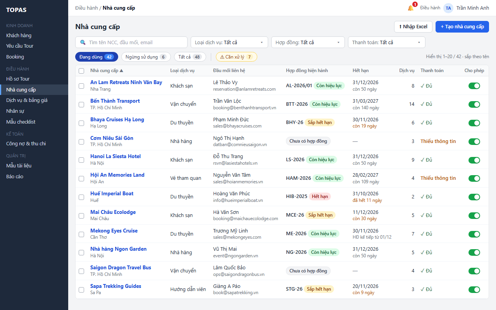

2. **W04 · Thanh lọc và chip.** Người dùng chọn giá trị ở các bộ lọc hoặc gõ tìm kiếm. Danh sách và số trên chip cập nhật ngay; liên kết Xóa bộ lọc hiện ra.

   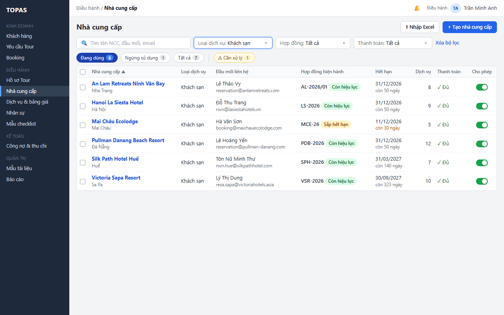

3. **W05 · Vùng bảng không có dòng khớp.** Bảng hiện “Không có nhà cung cấp khớp bộ lọc” và gợi ý tạo mới hoặc nhập Excel. Người dùng bấm Xóa bộ lọc ở thanh lọc để về mặc định.

   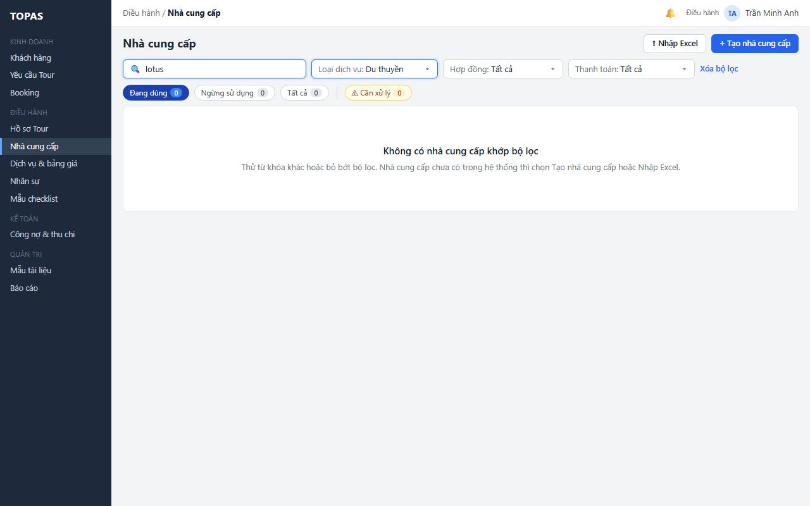

*Kết quả:* người dùng thấy đúng tập NCC cần xem. Khi hệ thống chưa có NCC nào, bảng hiện “Chưa có nhà cung cấp. Chọn Tạo nhà cung cấp hoặc Nhập Excel để bắt đầu” thay cho W05 (Kế toán: “Chưa có nhà cung cấp”).

**L1.2 Xử lý NCC cần xử lý.** *Điều kiện:* Điều hành.

1. **W02 · Chip Cần xử lý.** Điều hành bấm chip Cần xử lý. Danh sách chỉ còn NCC đang dùng có vấn đề, sắp theo R03: hợp đồng hết hạn, chưa có hợp đồng, sắp hết hạn (ngày gần nhất trước), rồi chỉ thiếu thông tin thanh toán. Ô có vấn đề nổi màu (nhãn hợp đồng, “còn n ngày”, “Thiếu thông tin”).

   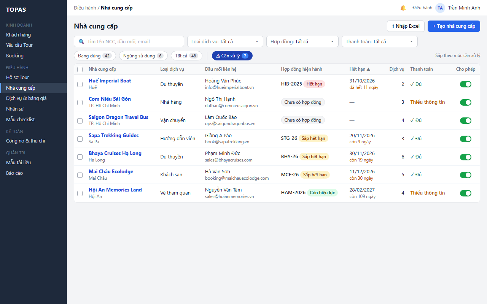

2. **W02 · Bấm dòng.** Với dòng có vấn đề hợp đồng, DH03 mở thẳng tab DH03.2 Hợp đồng và chính sách để thêm hoặc gia hạn hợp đồng; dòng chỉ thiếu thông tin thanh toán mở DH03.1 (R09).
3. **W02 · Quay lại sau khi lưu ở DH03.** Chỉ báo trên dòng được tính lại. NCC đã hết vấn đề rời khỏi chip Cần xử lý; số trên chip giảm theo.

*Kết quả:* mỗi NCC đang dùng đều có hợp đồng còn hiệu lực hoặc đã có hợp đồng kế tiếp. NCC chỉ thiếu thông tin thanh toán thì chờ Kế toán bổ sung (L1.5).

**L1.3 Mở hồ sơ NCC và quay lại.**

1. **W01 · Bấm dòng trên bảng.** DH03 mở ở tab đích theo R09.
2. **W01 · Nút Về danh sách nhà cung cấp trong DH03, hoặc nút quay lại.** DH02 hiện lại với bộ lọc, trang và vị trí cuộn như trước khi mở; dữ liệu của dòng vừa mở được tải lại.

**L1.4 Tạo nhà cung cấp.** *Điều kiện:* Điều hành.

1. **W01 · Nút Tạo nhà cung cấp ở góc phải tiêu đề.** DH03 mở ở chế độ tạo mới (nhập tên và loại dịch vụ rồi Lưu; DH03 mở tiếp tab Hợp đồng và chính sách). Đặc tả thuộc RSD DH03.
2. **W17 · Danh sách khi quay về DH02.** NCC vừa tạo nằm đúng vị trí theo tên, tô nền xanh nhạt trong 5 giây, có nhãn Mới. Số trên chip tăng. NCC mới chưa có thông tin thanh toán nên nằm trong Cần xử lý cho tới khi Kế toán bổ sung.

   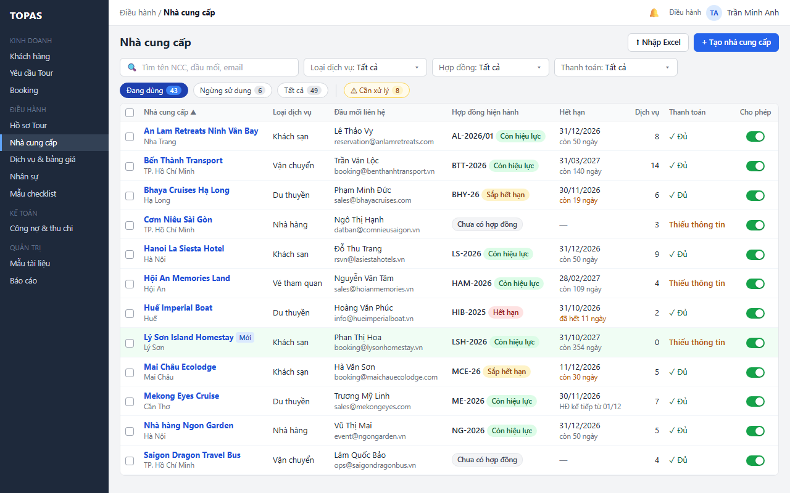

*Kết quả:* NCC mới ở trạng thái Đang dùng, dùng được ngay khi chọn NCC ở các màn khác.

**L1.5 Kế toán bổ sung thông tin thanh toán.** *Điều kiện:* Kế toán.

1. **W16 · Danh sách chỉ xem, bộ lọc Thanh toán và chip Tất cả.** Kế toán mở DH02, chọn Thanh toán: Thiếu thông tin và chip Tất cả. Danh sách hiện mọi NCC thiếu thông tin nhận thanh toán, kể cả NCC Ngừng sử dụng (vẫn có thể còn công nợ). Không có ô chọn, công tắc hay nút tạo.

   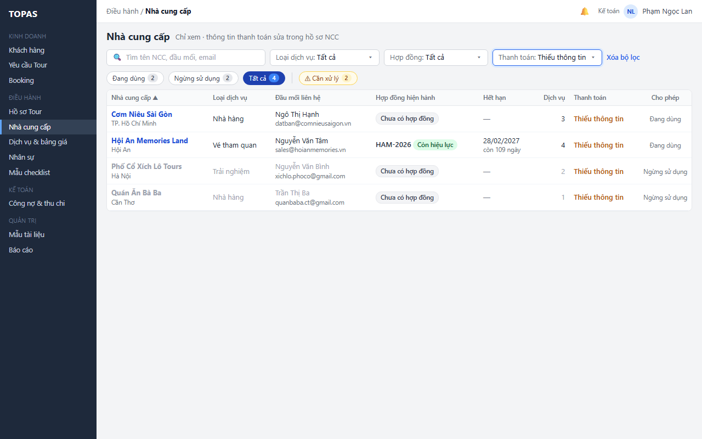

2. **W16 · Bấm dòng.** DH03.1 mở và cuộn tới phần Thông tin nhận thanh toán (R09). Kế toán nhập rồi Lưu ở DH03; quay lại thì dòng rời bộ lọc Thiếu thông tin.

*Kết quả:* NCC có đủ thông tin để Kế toán lập lịch trả ở KT01.2.

**Ngoại lệ**

- **E1.1 · W06.** Không tải được danh sách: vùng bảng thay bằng thông báo lỗi và nút Thử lại; thanh lọc giữ nguyên giá trị; số trên chip hiện “–”. Bấm Thử lại thì tải lại với bộ lọc cũ.

  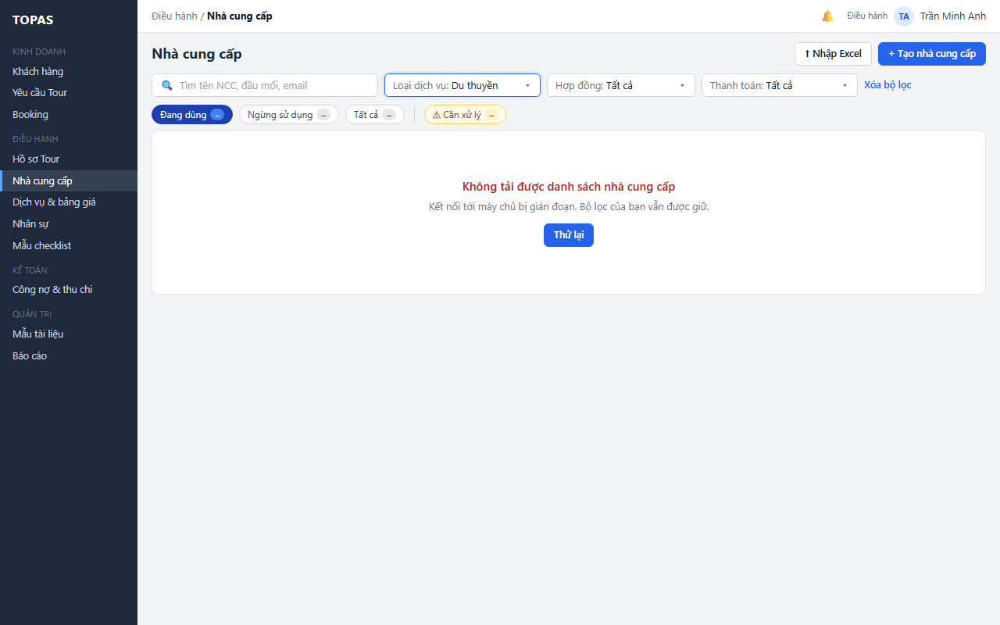

- **E1.2.** Người dùng không có quyền xem DH02 (Kinh doanh): menu không hiện mục Nhà cung cấp; mở bằng đường dẫn thì hiện “Bạn không có quyền xem danh sách nhà cung cấp” và nút Về trang chủ, không tải dữ liệu.
- **E1.3.** Tìm kiếm dưới 2 ký tự: chưa chạy tìm, ô tìm hiện gợi ý “Nhập ít nhất 2 ký tự”.
- **E1.4.** NCC đổi dữ liệu ở phiên khác khi danh sách đang mở (ví dụ người khác vừa thêm hợp đồng): danh sách không tự nhảy dòng. Dữ liệu được tải lại khi đổi bộ lọc, đổi trang hoặc quay lại từ DH03. Bấm dòng luôn mở hồ sơ theo dữ liệu mới nhất.
- **E1.5.** Bộ lọc đã lưu trong phiên có loại dịch vụ vừa bị tắt ở QT05: bộ lọc vẫn áp dụng; giá trị hiện kèm chữ “(ngừng dùng)”.
- **E1.6.** Quay lại DH02 khi NCC vừa mở đã ra khỏi bộ lọc (ví dụ đã thêm hợp đồng nên rời chip Cần xử lý): dòng không còn trong bảng; thông báo ngắn “… đã ra khỏi bộ lọc” kèm liên kết Xem dòng.
- **E1.7.** Kế toán mở dòng NCC Ngừng sử dụng: DH03 vẫn mở để sửa thông tin thanh toán; trạng thái cho phép sử dụng chỉ đọc.
- **E1.8.** Bấm Tạo nhà cung cấp rồi hủy ở DH03 (không lưu): quay về DH02 không đổi gì.

### 3.2. Bật, tắt cho phép sử dụng (CNHT01.02 · quyết định 11/11/2026)

**L2.1 Ngừng sử dụng NCC chưa được dùng ở đâu.** *Điều kiện:* Điều hành; NCC Đang dùng; không có nơi đang dùng theo R05.

1. **W01 · Công tắc Cho phép trên dòng.** Điều hành tắt công tắc. Hệ thống kiểm tra nơi đang dùng (R05); không có thì lưu ngay, không hỏi (có thì mở W07, xem L2.2).
2. **W08 · Dòng và thông báo ngắn.** Dòng mờ đi, công tắc tắt, nhãn Ngừng sử dụng hiện cạnh tên. Dòng giữ tại chỗ đến khi người dùng đổi bộ lọc, đổi trang hoặc tải lại. Số trên chip cập nhật. Thông báo ngắn “Đã ngừng sử dụng … Dòng rời bộ lọc Đang dùng khi tải lại” kèm Hoàn tác trong 10 giây; người dùng bấm Hoàn tác nếu cần.

   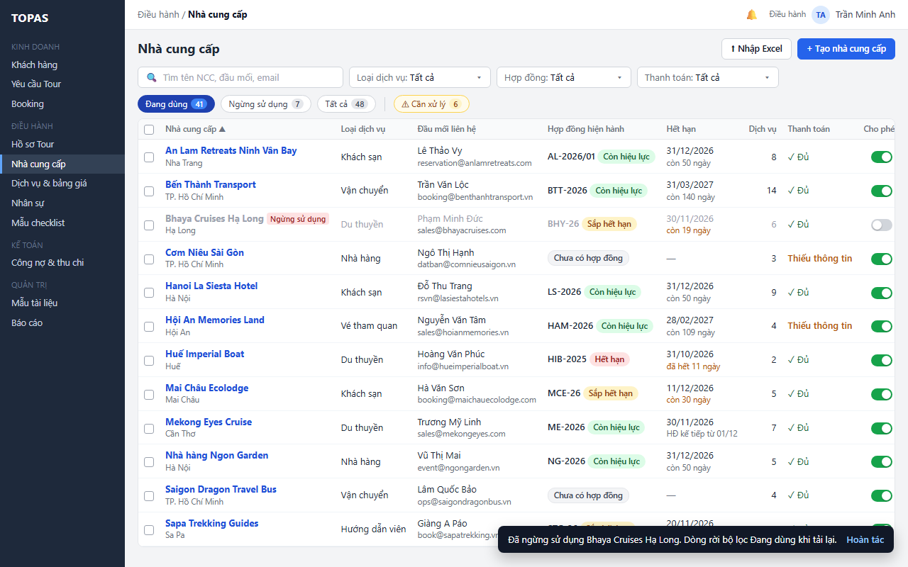

*Kết quả:* NCC Ngừng sử dụng, không hiện khi chọn NCC mới. Lịch sử ghi người, thời điểm, giá trị cũ và mới.

**L2.2 Ngừng sử dụng NCC đang được dùng.** *Điều kiện:* Điều hành; NCC có nơi đang dùng theo R05.

1. **W07 · Công tắc Cho phép trên dòng → hộp thoại.** Điều hành tắt công tắc trên dòng. Công tắc giữ nguyên, hộp thoại “Ngừng sử dụng nhà cung cấp?” mở. Hộp thoại liệt kê hồ sơ Tour chưa đóng có dịch vụ chưa sử dụng của NCC (Tour Code, khách, ngày dùng, dịch vụ, tình trạng hạng mục), và đếm Tour mẫu, yêu cầu Tour đang dùng NCC. Khung thông tin nêu điều gì xảy ra sau khi ngừng (R04): hạng mục Cần đặt nào sẽ cần chọn NCC khác, và yêu cầu Tour đang dở sẽ bị khóa Tính giá ở KD06 tới khi đổi dịch vụ.

   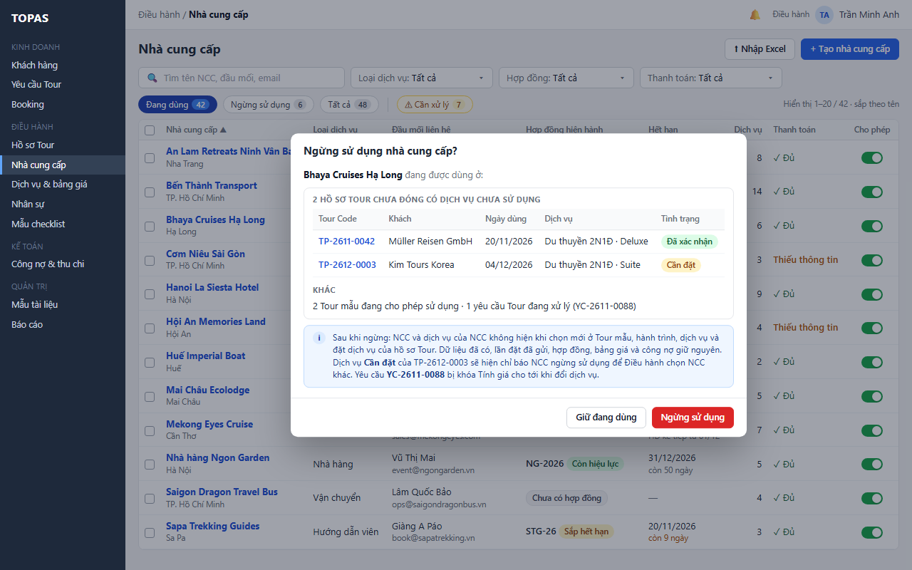

2. **W07 · Nút Ngừng sử dụng (đỏ) hoặc Giữ đang dùng.** Điều hành bấm Ngừng sử dụng. Bấm Tour Code trong hộp thoại mở DH08.3 ở thẻ mới để xem trước khi quyết định. Bấm Giữ đang dùng thì không đổi gì.
3. **W08 · Dòng và thông báo ngắn.** Hệ thống lưu, đóng hộp thoại và hiển thị như L2.1 bước 2. Hạng mục Cần đặt, Cần đặt lại, Chờ Kinh doanh của NCC ở các hồ sơ Tour được gắn chỉ báo NCC ngừng sử dụng (R04).

*Kết quả:* NCC Ngừng sử dụng. Hạng mục đã gửi, đã xác nhận và công nợ không đổi; Điều hành phụ trách các hồ sơ có hạng mục chưa gửi nhận một thông báo để chọn NCC khác.

**L2.3 Cho phép sử dụng lại.** *Điều kiện:* Điều hành; NCC Ngừng sử dụng.

1. **W09 · Chip Ngừng sử dụng → công tắc trên dòng.** Điều hành bấm chip Ngừng sử dụng rồi bật công tắc trên dòng. Hệ thống lưu ngay, không hỏi. Dòng hết mờ, tô sáng, giữ tại chỗ đến khi tải lại; số trên chip cập nhật; thông báo ngắn kèm Hoàn tác.

   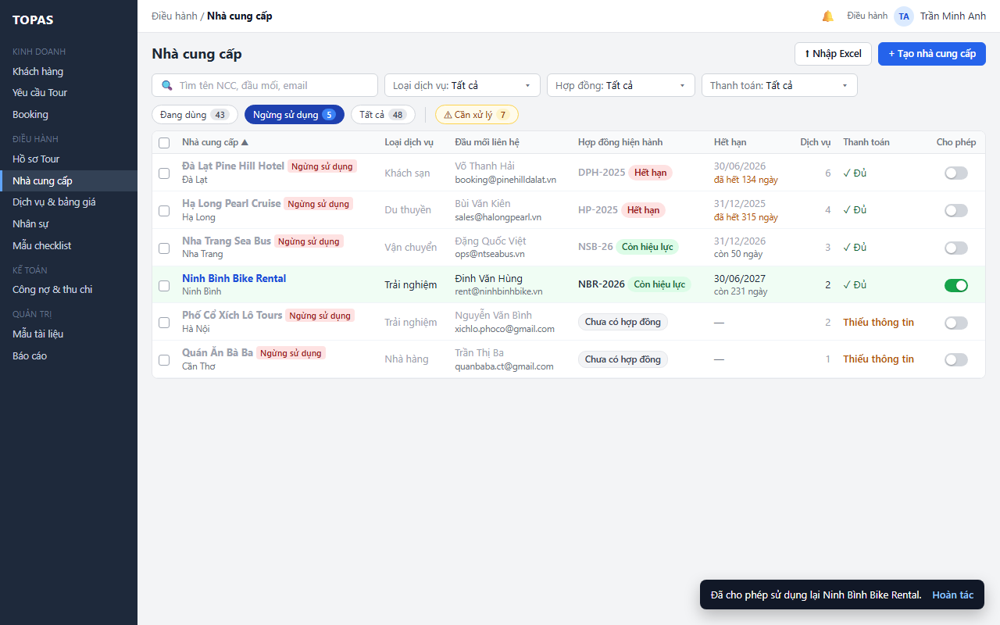

*Kết quả:* NCC Đang dùng, hiện lại khi chọn NCC mới. Chỉ báo NCC ngừng sử dụng trên các hạng mục chưa gửi tự mất. Nếu NCC có vấn đề hợp đồng hoặc thanh toán thì vào lại Cần xử lý.

**L2.4 Bật, tắt hàng loạt.** *Điều kiện:* Điều hành.

1. **W10 · Ô chọn dòng → thanh hàng loạt.** Điều hành tích ô chọn của nhiều dòng, hoặc ô ở tiêu đề bảng để chọn mọi dòng trong trang đang xem. Thanh hàng loạt hiện số NCC đã chọn và hai nút Cho phép sử dụng, Ngừng sử dụng. Công tắc trên các dòng tạm ẩn, chỉ hiện chữ.

   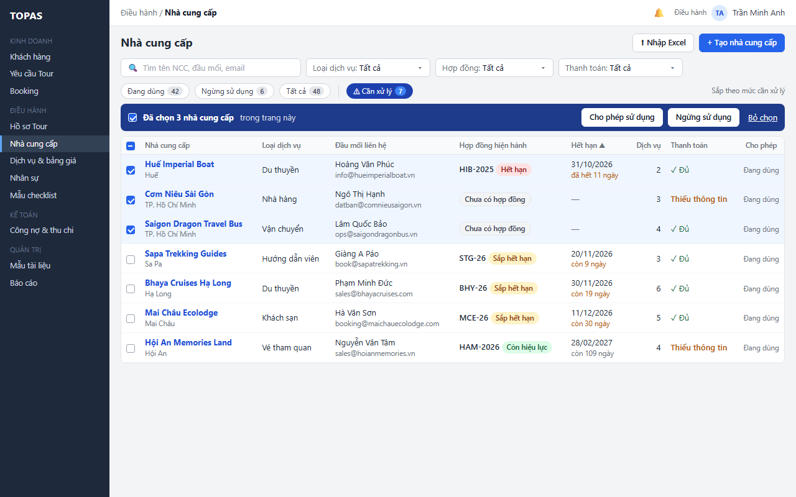

2. **W11 · Nút Ngừng sử dụng trên thanh → hộp thoại.** Điều hành bấm Ngừng sử dụng. Nếu có NCC đang được dùng, hộp thoại liệt kê từng NCC và nơi đang dùng, và nêu các NCC không được dùng ở đâu. Nếu không NCC nào đang được dùng thì vẫn mở hộp thoại ngắn “Ngừng sử dụng n nhà cung cấp?” vì thao tác áp dụng cho nhiều dòng. Điều hành bấm Ngừng sử dụng n NCC để xác nhận. Bấm Cho phép sử dụng trên thanh thì áp dụng ngay, không hỏi.

   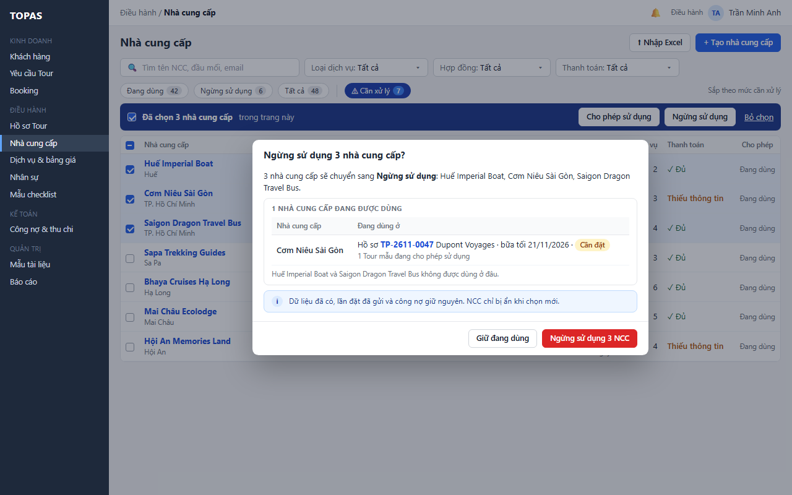

3. **W12 · Banner kết quả trên bảng.** Hệ thống áp dụng cho từng dòng trong một lần gửi và trả kết quả theo từng dòng (R06). Banner nêu số NCC đã đổi và từng NCC bị bỏ qua kèm lý do, cùng một nút Hoàn tác n NCC (Thử lại phần lỗi khi có lỗi, E2.2). Các dòng đã đổi giữ tại chỗ đến khi tải lại.

   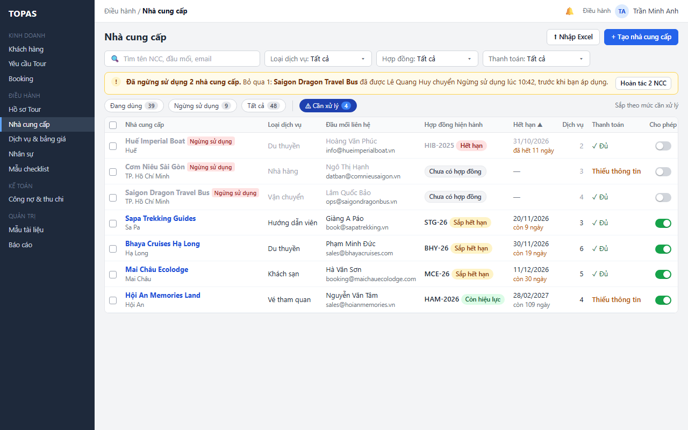

*Kết quả:* các NCC đã chọn có cùng trạng thái cho phép sử dụng; mỗi NCC có một dòng lịch sử ghi nguồn “DH02 hàng loạt”.

**Ngoại lệ**

- **E2.1.** Bật, tắt tại chỗ khi NCC vừa được đổi ở phiên khác: máy chủ từ chối vì phiên bản dòng đã đổi; công tắc trả về giá trị mới nhất; thông báo ngắn “… đã được … chuyển … lúc …”. Muốn đổi tiếp thì bấm lại.
- **E2.2.** Lỗi lưu (mất kết nối): công tắc trả về giá trị cũ, thông báo lỗi có nút Thử lại. Với hàng loạt, dòng lỗi giữ trạng thái đã chọn và banner có một nút Thử lại phần lỗi thay cho Hoàn tác.
- **E2.3.** Nơi đang dùng thay đổi trong lúc hộp thoại W07 hoặc W11 đang mở (ví dụ có hồ sơ Tour mới dùng NCC): ngừng sử dụng vẫn được thực hiện vì đây là cảnh báo, không phải điều kiện chặn. Thông báo cho Điều hành phụ trách tính theo dữ liệu lúc lưu.
- **E2.4.** NCC có dịch vụ chưa sử dụng trong hồ sơ Tour Đang diễn ra: hộp thoại W07 đặt dòng đó lên đầu, kèm nhãn đỏ Đang diễn ra. Vẫn cho ngừng.
- **E2.5.** Người dùng bị thu hồi quyền giữa chừng: máy chủ từ chối, công tắc trả về giá trị cũ, thông báo “Bạn không có quyền đổi cho phép sử dụng”.
- **E2.6.** Bấm Hoàn tác khi đã có người đổi tiếp NCC đó: không hoàn tác dòng đó; thông báo nêu NCC không hoàn tác được. Hết 10 giây thì thông báo ngắn biến mất; muốn đổi lại thì bấm công tắc.
- **E2.7.** Hàng loạt có dòng đã ở trạng thái đích (ví dụ người khác vừa ngừng): dòng đó bị bỏ qua và nêu trong banner kết quả (W12), không tính là lỗi.
- **E2.8.** Chọn dòng rồi chuyển trang hoặc đổi bộ lọc: lựa chọn bị bỏ, thanh hàng loạt ẩn. “Chọn tất cả” chỉ áp dụng cho trang đang xem.
- **E2.9.** Bấm Ngừng sử dụng hoặc công tắc nhiều lần liên tiếp: nút và công tắc khóa ngay sau lần bấm đầu cho tới khi có kết quả; máy chủ chỉ xử lý một yêu cầu cho mỗi dòng.
- **E2.10.** Không tải được nơi đang dùng khi mở W07: hộp thoại hiện “Chưa kiểm tra được nơi đang dùng” kèm Thử lại, và nút Vẫn ngừng sử dụng. Không lưu khi người dùng chưa chọn.

### 3.3. Nhắc hợp đồng sắp hết hạn (quyết định 11/11/2026)

**L3.1 Nhận nhắc và xử lý.** *Điều kiện:* NCC Đang dùng; hợp đồng hiện hành bước vào ngưỡng sắp hết hạn (mặc định 30 ngày) hoặc vừa hết hạn, và không có hợp đồng kế tiếp (R01).

1. **W03 · Biểu tượng chuông ở thanh trên.** Lúc 08:00, hệ thống gửi một thông báo nội bộ cho nhóm Điều hành cho mỗi NCC vừa vào ngưỡng hoặc vừa hết hạn trong ngày, nêu số hợp đồng, ngày hết hạn và số ngày còn lại (R08). Chuông có số chưa đọc.

   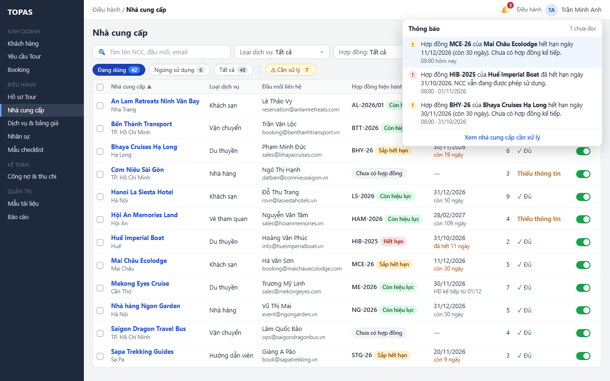

2. **W03 · Bấm một thông báo, hoặc liên kết Xem nhà cung cấp cần xử lý ở cuối danh sách thông báo.** Bấm một thông báo thì DH03.2 của NCC đó mở để gia hạn hoặc thêm hợp đồng. Bấm liên kết cuối danh sách thì DH02 mở ở chip Cần xử lý (W02).
3. **W02 · Dòng NCC sau khi có hợp đồng kế tiếp.** Dòng NCC rời Cần xử lý; cột Hết hạn ghi “HĐ kế tiếp từ dd/mm”. Không có nhắc tiếp cho hợp đồng đó.

*Kết quả:* Điều hành biết trước ít nhất 30 ngày để đàm phán gia hạn, và biết ngay khi NCC đang dùng không còn hợp đồng.

**Ngoại lệ**

- **E3.1.** Hợp đồng kế tiếp được thêm trước khi tới ngưỡng: không nhắc (R08).
- **E3.2.** NCC Ngừng sử dụng: không nhắc. Bật lại khi hợp đồng đã trong ngưỡng hoặc đã hết hạn thì nhắc vào 08:00 hôm sau.
- **E3.3.** Ngày kết thúc hợp đồng bị sửa sau khi đã nhắc: mốc nhắc của hợp đồng được tính lại; hợp đồng vào ngưỡng lần nữa thì nhắc lại.
- **E3.4.** Quản trị đổi ngưỡng: áp dụng từ lần tính 08:00 kế tiếp. Hợp đồng đã ở trong ngưỡng mới mà chưa được nhắc thì được nhắc trong lần đó.
- **E3.5.** Nhiều NCC vào ngưỡng cùng ngày: mỗi NCC một thông báo; trên 5 NCC thì gộp một thông báo “n nhà cung cấp có hợp đồng sắp hết hạn”, bấm mở DH02 ở chip Cần xử lý.
- **E3.6.** Không có người nhận theo RSD DH06 R03 (nhân sự nhóm Điều hành, Đang nhận phân công, tài khoản liên kết đang hoạt động và có vai trò Điều hành): không gửi; nhật ký hệ thống ghi lại. DH02 vẫn hiện đúng chỉ báo.
- **E3.7.** Thông báo mở NCC mà người dùng vừa bị thu hồi quyền: DH03 hiện màn không có quyền, không lộ dữ liệu.

### 3.4. Nhập NCC từ Excel (quyết định 11/11/2026)

**L4.1 Nhập danh sách NCC mới.** *Điều kiện:* Điều hành.

1. **W13 · Nút Nhập Excel ở tiêu đề → hộp thoại.** Hộp thoại mở ở bước Chọn tệp, có liên kết Tải tệp mẫu và danh sách cột. Điều hành chọn hoặc kéo tệp vào. Hệ thống kiểm tra định dạng, dung lượng và tên cột ngay khi chọn; tệp đúng mẫu hiện số dòng dữ liệu và dấu ✓.

   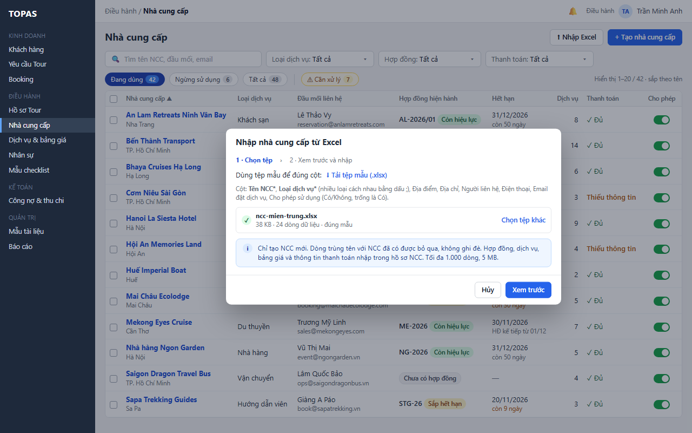

2. **W14 · Nút Xem trước → hộp thoại rộng.** Hệ thống đọc từng dòng theo R07 và hiện bảng kết quả: dòng bị bỏ qua (lỗi dữ liệu, trùng NCC đã có, trùng dòng khác trong tệp) đứng đầu, rồi dòng có cảnh báo, rồi dòng sẽ nhập. Chip trên bảng đếm Tất cả, Sẽ nhập, Bỏ qua, Cảnh báo; bấm chip để lọc. Muốn đổi tệp thì bấm Chọn tệp khác.

   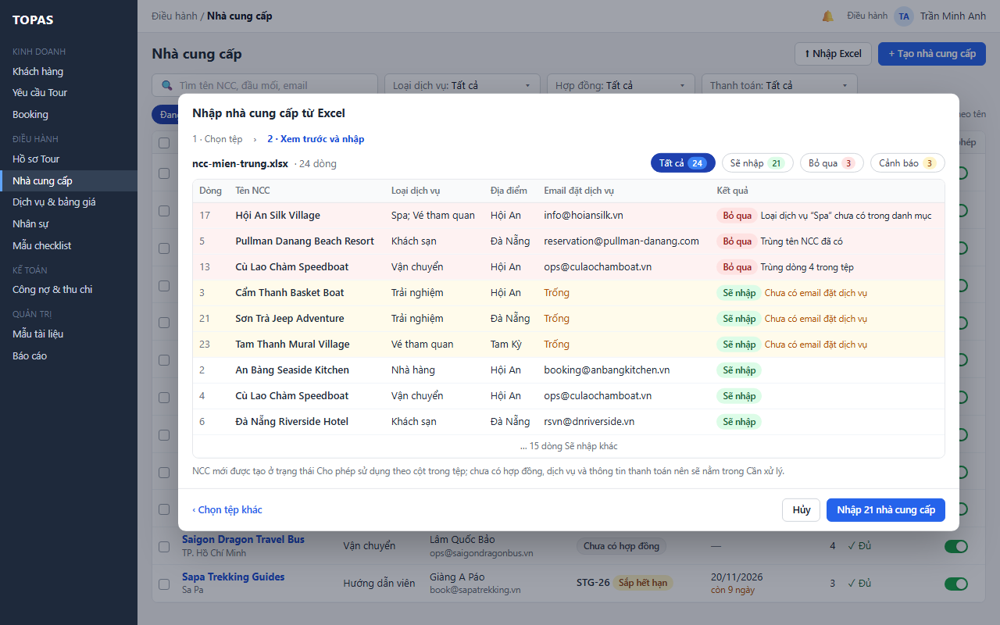

3. **W14 · Nút Nhập n nhà cung cấp.** Điều hành bấm Nhập n nhà cung cấp. Hệ thống tạo mọi dòng Sẽ nhập trong một giao dịch.
4. **W15 · Banner và danh sách lọc theo Lần nhập.** Hộp thoại đóng. DH02 lọc theo Lần nhập vừa xong, có banner “Đã nhập n nhà cung cấp … Bỏ qua m dòng” và nút Tải các dòng bị bỏ qua (tệp Excel gồm dòng gốc và cột Lý do). Các NCC mới có nhãn Mới, Chưa có hợp đồng, Thiếu thông tin thanh toán. Bỏ chip Lần nhập bằng dấu ✕ để về danh sách đầy đủ.

   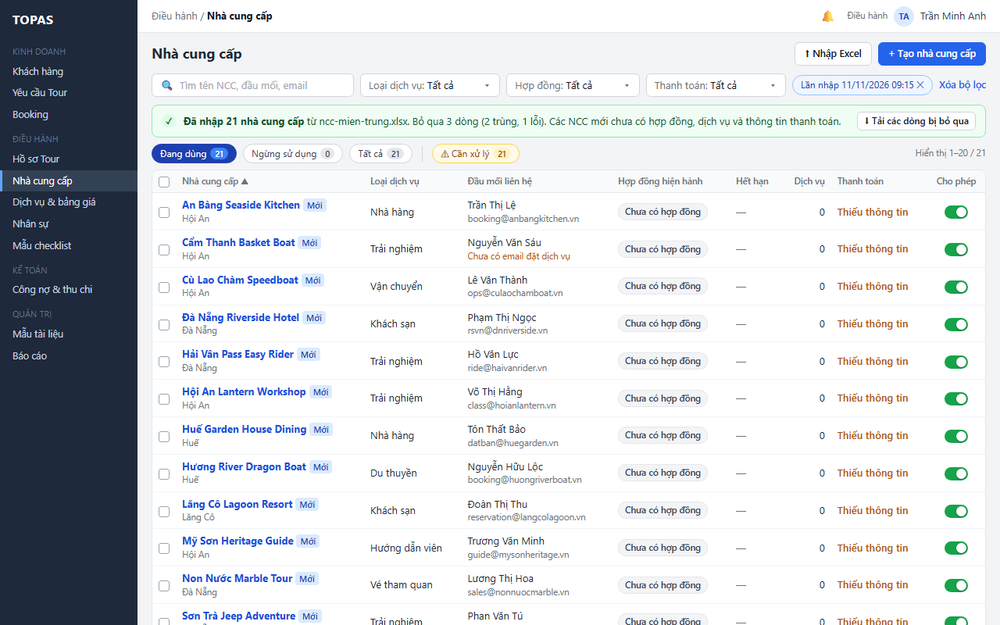

*Kết quả:* các NCC mới được tạo với thông tin chung, ở trạng thái theo cột Cho phép sử dụng, nằm trong Cần xử lý cho tới khi có hợp đồng và thông tin thanh toán. Lần nhập được lưu kèm tệp gốc và tệp các dòng bị bỏ qua.

**Ngoại lệ**

- **E4.1 · W13a.** Tệp không phải `.xlsx`, không đúng mẫu (thiếu cột bắt buộc) hoặc không có dòng dữ liệu: tệp hiện viền đỏ kèm lý do trong khung tệp; nút Xem trước khóa, cạnh đó ghi “Chọn tệp hợp lệ để xem trước”; có liên kết Chọn tệp khác.

  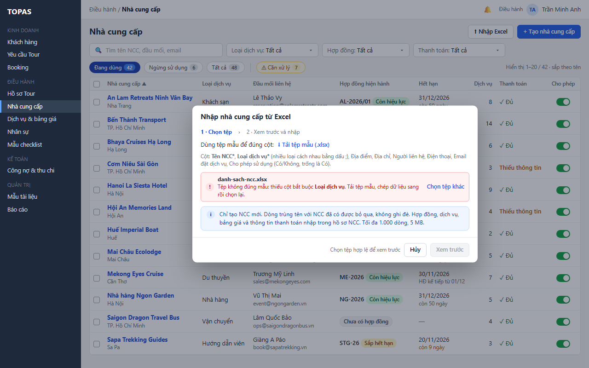

- **E4.2.** Tệp quá 5 MB hoặc quá 1.000 dòng dữ liệu: báo lỗi như W13a, nêu giới hạn, gợi ý chia tệp.
- **E4.3.** Mọi dòng đều bị bỏ qua: nút Nhập khóa, ghi “Không có dòng nào để nhập”; vẫn tải được tệp các dòng bị bỏ qua từ hộp thoại.
- **E4.4.** Có NCC trùng tên được tạo ở phiên khác trong lúc đang xem trước: khi bấm Nhập, máy chủ kiểm tra lại trùng; dòng đó chuyển sang Bỏ qua và được nêu trong banner kết quả. Các dòng khác vẫn được nhập.
- **E4.5.** Lỗi lưu khi nhập: giao dịch hoàn tác, không NCC nào được tạo. Hộp thoại giữ bảng xem trước, hiện banner lỗi và cho bấm Nhập lại.
- **E4.6.** Bấm Nhập nhiều lần: nút khóa và hiện Đang nhập… ngay sau lần bấm đầu; máy chủ dùng mã lần nhập để chỉ tạo một lần.
- **E4.7.** Đóng hộp thoại ở bước xem trước: hỏi “Bỏ lần nhập này?”. Không có gì được tạo.
- **E4.8.** Dòng có loại dịch vụ chưa có hoặc đã tắt ở QT05: dòng bị bỏ qua với lý do nêu tên loại; không tự thêm loại mới vào danh mục.
- **E4.9.** Email đặt dịch vụ sai định dạng: dòng bị bỏ qua, lý do “Email sai định dạng”. Email đặt dịch vụ trống: dòng vẫn được nhập, kèm cảnh báo (cột đầu mối hiện “Chưa có email đặt dịch vụ”) (R07). Email trùng với NCC khác chỉ cảnh báo, vì nhiều NCC có thể dùng chung bộ phận đặt phòng.
- **E4.10.** Mất kết nối khi tải tệp lên: tệp hiện lỗi “Tải tệp chưa xong” và nút Thử lại; không chuyển sang xem trước.

**Số bước trước và sau khi tối ưu (cả mục 3)**

| Việc | Cách làm thông thường | Bản này |
|---|---|---|
| Biết NCC nào sắp hết hợp đồng | Mở từng hồ sơ NCC, xem tab hợp đồng | 1 lần bấm chip Cần xử lý; hoặc nhận nhắc lúc 08:00 |
| Gia hạn hợp đồng sắp hết hạn | Tìm NCC, mở hồ sơ, chuyển tab Hợp đồng | Bấm thông báo hoặc bấm dòng: mở thẳng DH03.2 |
| Ngừng sử dụng một NCC | Mở hồ sơ, tắt, Lưu, quay lại | 1 lần bấm công tắc (2 khi NCC đang được dùng) |
| Ngừng sử dụng n NCC | 4 × n bước | n + 2 lần bấm: chọn n dòng, Ngừng sử dụng, xác nhận |
| Khởi tạo 20 NCC | 20 lần Tạo, nhập, Lưu | 4 lần bấm: Nhập Excel, chọn tệp, Xem trước, Nhập |

---

## 4. Quy tắc triển khai chi tiết

### R01. Hợp đồng hiện hành và tình trạng hợp đồng (CNHT01.04 · quyết định 11/11/2026)

- **Hợp đồng hiện hành** là hợp đồng có kỳ hiệu lực chứa hôm nay. DH03.2 chặn kỳ chồng lấn (RSD DH03 R06), nên mỗi ngày có tối đa một hợp đồng như vậy. Không có thì lấy hợp đồng có ngày kết thúc gần nhất trong quá khứ, để vẫn hiện được số hợp đồng và ngày đã hết hạn.
- **Hợp đồng kế tiếp** là hợp đồng có ngày bắt đầu không muộn hơn ngày kết thúc của hợp đồng hiện hành cộng 1 ngày, và kết thúc sau hợp đồng hiện hành (hợp đồng nối liền, không có khoảng trống). Mọi chỗ dùng “hợp đồng kế tiếp” và nhãn “HĐ kế tiếp từ dd/mm” ở DH02, DH03, DH04 theo nghĩa này (RSD DH03 R01).
- **Hợp đồng để xem giá** là hợp đồng mặc định khi xem giá ở ô chọn hợp đồng của DH03.3 và cột Hợp đồng của DH04. Lấy theo thứ tự: hợp đồng chứa hôm nay; nếu không có thì hợp đồng bắt đầu sớm nhất sau hôm nay; nếu vẫn không có thì hợp đồng hiện hành. Cột Hợp đồng hiện hành của DH02 không dùng khái niệm này.
- **Tình trạng**, xét theo thứ tự, lấy giá trị đầu tiên khớp (n = ngày kết thúc − hôm nay, N = ngưỡng, mặc định 30):
  1. **Chưa có hợp đồng:** NCC không có hợp đồng nào.
  2. **Hết hạn:** không có hợp đồng nào chứa hôm nay. Nếu có hợp đồng bắt đầu sau hôm nay (có khoảng trống nên không là hợp đồng kế tiếp), cột Hết hạn ghi thêm “HĐ mới từ dd/mm”, nhưng tình trạng vẫn là Hết hạn vì hôm nay không có giá áp dụng.
  3. **Sắp hết hạn:** có hợp đồng hiện hành, 0 ≤ n ≤ N, và không có hợp đồng kế tiếp.
  4. **Còn hiệu lực:** các trường hợp còn lại. Khi có hợp đồng kế tiếp và n ≤ N, cột Hết hạn ghi “HĐ kế tiếp từ dd/mm” thay cho “còn n ngày”.
- Ngày kết thúc là ngày cuối còn hiệu lực. Hợp đồng kết thúc 11/11/2026 thì hôm đó n = 0, vẫn là Sắp hết hạn; ngày 12/11/2026 là Hết hạn.
- Tình trạng chỉ để hiển thị và nhắc. Việc chọn hợp đồng khi tính giá, đặt và hủy dịch vụ theo ngày sử dụng do KD06.3, DH08.3 quy định.

### R02. Thông tin thanh toán đủ hay thiếu

- **Đủ** khi phần Thông tin nhận thanh toán ở DH03.1 có đủ ba trường: tên thụ hưởng, ngân hàng, số tài khoản.
- Thông tin xuất hóa đơn và điều khoản thanh toán theo hợp đồng (DH03.2) không tính vào điều kiện này.
- DH02 không hiện số tài khoản; chỉ hiện Đủ hoặc Thiếu thông tin.

### R03. Cần xử lý

- NCC thuộc Cần xử lý khi **đang dùng** và có ít nhất một điều kiện: tình trạng hợp đồng Hết hạn, Chưa có hợp đồng hoặc Sắp hết hạn (R01); thông tin thanh toán thiếu (R02).
- NCC Ngừng sử dụng không bao giờ thuộc Cần xử lý.
- **Thứ tự** trong chip Cần xử lý (lấy mức đầu tiên khớp của từng NCC): 1. Hết hạn, theo ngày kết thúc tăng dần; 2. Chưa có hợp đồng, theo tên; 3. Sắp hết hạn, theo ngày kết thúc tăng dần; 4. chỉ thiếu thông tin thanh toán, theo tên.
- Cần xử lý được tính lại mỗi lần tải danh sách. Không có trạng thái lưu riêng.

### R04. Cho phép sử dụng (CNHT01.02 · quyết định 11/11/2026)

- Chỉ Điều hành bật, tắt. Không có bước duyệt. DH02 (dòng, hàng loạt) và phần đầu DH03 dùng cùng quy tắc này.
- **Bật:** lưu ngay, không hỏi.
- **Tắt:** hệ thống kiểm tra nơi đang dùng (R05).
  - Không có nơi nào: lưu ngay, không hỏi.
  - Có: mở hộp thoại W07 (một NCC) hoặc W11 (hàng loạt). Chỉ lưu khi người dùng xác nhận. Đây là cảnh báo, không chặn.
- **Hoàn tác:** thông báo ngắn hoặc banner kết quả có Hoàn tác trong 10 giây. Hoàn tác ghi giá trị cũ như một lần đổi mới (nguồn Hoàn tác), kiểm tra phiên bản dòng như mọi lần ghi.
- **Tác động khi Ngừng sử dụng:**
  - NCC và dịch vụ của NCC không hiện trong danh sách chọn NCC hoặc dịch vụ mới ở KD02.2, KD06.2, DH08.2, DH08.3; DH04 mặc định ẩn.
  - Tour mẫu, hành trình, phiên bản báo giá, Booking, hạng mục dịch vụ, lần đặt, hợp đồng, bảng giá và công nợ giữ nguyên.
  - Yêu cầu Tour đang dở (Đang xử lý) có dịch vụ của NCC này trong hành trình: dòng dịch vụ có nhãn ngừng sử dụng và nút Tính giá ở KD06 bị khóa cho tới khi người phụ trách yêu cầu đổi dịch vụ (RSD KD06 R10). Phiên bản báo giá đã lưu không đổi.
  - Hạng mục dịch vụ chưa gửi (Cần đặt, Cần đặt lại, Chờ Kinh doanh; RSD DH08) của hồ sơ Tour chưa đóng có NCC này được gắn chỉ báo “NCC ngừng sử dụng”. Điều hành phụ trách mỗi hồ sơ nhận một thông báo nội bộ. Lần đặt đã gửi hoặc đã xác nhận không bị đổi; muốn hủy thì làm ở DH08.3.
  - Khi tạo hồ sơ Tour từ Booking, hạng mục của NCC này được tạo với NCC để trống (RSD DH07 R03).
  - KT01.2 vẫn ghi phải trả, chi trả và nhận hoàn cho NCC.
- **Tác động khi bật lại:** NCC hiện lại khi chọn mới; chỉ báo “NCC ngừng sử dụng” trên hạng mục chưa gửi tự mất.
- Mỗi lần đổi ghi lịch sử theo mục 5.1.

### R05. Nơi đang dùng

NCC được coi là đang dùng khi có ít nhất một trong các mục sau:

| Nơi | Điều kiện tính | Hiển thị trong hộp thoại |
|---|---|---|
| Hồ sơ Tour (DH08) | Hồ sơ chưa đóng, có hạng mục của NCC chưa Đã hủy và ngày dùng từ hôm nay trở đi | Từng dòng: Tour Code, khách, ngày dùng, dịch vụ, tình trạng hạng mục; dòng đang diễn ra đứng đầu (E2.4) |
| Yêu cầu Tour (KD06.2) | Yêu cầu Đang xử lý, chưa có Booking, hành trình có dịch vụ của NCC | Số yêu cầu và mã yêu cầu |
| Tour mẫu (KD02.2) | Tour mẫu đang cho phép sử dụng có dịch vụ của NCC | Số Tour mẫu |

Hộp thoại hiện tối đa 10 hồ sơ Tour; nhiều hơn thì ghi “và n hồ sơ khác”. Bấm Tour Code mở DH08.3 ở thẻ mới.

### R06. Hàng loạt

- Chọn dòng trong trang đang xem; “Chọn tất cả” chỉ áp dụng cho trang đó. Đổi trang hoặc bộ lọc thì bỏ chọn.
- Khi có dòng được chọn, công tắc trên mọi dòng tạm ẩn; thanh hàng loạt là nơi thao tác duy nhất.
- **Cho phép sử dụng:** áp dụng ngay, không hỏi. **Ngừng sử dụng:** luôn mở hộp thoại xác nhận nêu số NCC; liệt kê NCC đang được dùng theo R05.
- Hệ thống gửi một yêu cầu, xử lý từng dòng độc lập và trả kết quả theo dòng: Đã đổi, Bỏ qua (đã ở trạng thái đích; phiên bản đã đổi), Lỗi.
- Banner kết quả nêu số đã đổi, từng dòng bỏ qua hoặc lỗi kèm lý do. Chỉ một nút: Hoàn tác n NCC khi không có lỗi; Thử lại phần lỗi khi có lỗi.
- Thông báo cho Điều hành phụ trách hồ sơ Tour (R04) gộp theo người nhận: một người nhận một thông báo liệt kê các NCC và hồ sơ.

### R07. Nhập NCC từ Excel (quyết định 11/11/2026)

**Tệp mẫu** (một sheet, dòng 1 là tên cột):

| Cột | Bắt buộc | Kiểm tra | Khi sai |
|---|---|---|---|
| Tên NCC | Có | 2–200 ký tự | Bỏ qua dòng |
| Loại dịch vụ | Có | Một hoặc nhiều loại cách nhau bằng dấu `;`; mỗi loại phải đang dùng ở QT05 (không phân biệt hoa thường) | Bỏ qua dòng, nêu tên loại sai |
| Địa điểm | Không | Một giá trị trong danh mục địa điểm (điểm đến, có Toàn quốc); so khớp không phân biệt hoa thường và dấu | Bỏ qua dòng, nêu giá trị sai |
| Địa chỉ | Không | Tối đa 300 ký tự | Bỏ qua dòng |
| Người liên hệ | Không | Tối đa 100 ký tự | Bỏ qua dòng |
| Điện thoại | Không | 8–15 chữ số; cho phép dấu cách, `+`, `-`, `()` (cùng kiểm tra với RSD DH03 mục 5.2) | Bỏ qua dòng |
| Email đặt dịch vụ | Không | Định dạng email | Sai định dạng: bỏ qua dòng. Trống: nhập kèm cảnh báo |
| Cho phép sử dụng | Không | Có, Không hoặc trống | Giá trị khác: bỏ qua dòng |

- **Chống trùng.** Tên chuẩn hóa = tên bỏ dấu tiếng Việt, đổi chữ thường, gộp khoảng trắng liên tiếp, bỏ khoảng trắng đầu cuối. Dòng có tên chuẩn hóa trùng NCC đã có (cả Đang dùng và Ngừng sử dụng) thì bỏ qua với lý do “Trùng tên NCC đã có”. Hai dòng trùng nhau trong tệp thì dòng đầu được nhập, dòng sau bỏ qua với lý do “Trùng dòng n trong tệp”. Không ghi đè NCC đã có.
- Email trùng NCC khác: nhập kèm cảnh báo.
- **Giới hạn.** `.xlsx`, tối đa 5 MB và 1.000 dòng dữ liệu. Dòng trống hoàn toàn bị bỏ, không tính.
- **Giao dịch.** Mọi dòng Sẽ nhập được tạo trong một giao dịch, sau khi máy chủ kiểm tra lại trùng (E4.4). Lỗi thì không tạo gì (E4.5). Mỗi lần nhập có mã để chống tạo lặp.
- **Dữ liệu tạo ra.** Chỉ thông tin chung và trạng thái cho phép sử dụng; Ngôn ngữ giao dịch điền sẵn Tiếng Việt (tệp mẫu không có cột này; RSD DH03 R22); mã NCC cấp theo R19 của RSD DH03 (`NCC-NNNN`). Cách tạo ghi Nhập Excel kèm ID lần nhập. Không tạo hợp đồng, dịch vụ, bảng giá, thông tin thanh toán.
- **Kết quả.** Tệp các dòng bị bỏ qua gồm các cột gốc, số dòng gốc và cột Lý do, để sửa rồi nhập lại. Lần nhập lưu tệp gốc và tệp này trong 12 tháng.

### R08. Nhắc hợp đồng sắp hết hạn (quyết định 11/11/2026)

| Mốc | Điều kiện | Người nhận | Nội dung | Mở tới |
|---|---|---|---|---|
| Vào ngưỡng | NCC Đang dùng; hợp đồng hiện hành có n ≤ N lần đầu; không có hợp đồng kế tiếp | Nhóm Điều hành (RSD DH06 R03) | Số hợp đồng, tên NCC, ngày kết thúc, số ngày còn lại | DH03.2 của NCC |
| Hết hạn | NCC Đang dùng; ngày đầu tiên sau ngày kết thúc mà không có hợp đồng chứa hôm nay | Nhóm Điều hành (RSD DH06 R03) | Số hợp đồng, tên NCC, ngày đã hết hạn; “NCC vẫn đang được phép sử dụng” | DH03.2 của NCC |

- Hệ thống chạy lúc 08:00 mỗi ngày. Mỗi hợp đồng nhận mỗi mốc một lần; mốc được lưu kèm ngày kết thúc lúc tính để biết khi nào phải tính lại (E3.3).
- Trên 5 NCC cùng một mốc trong ngày thì gộp một thông báo, mở DH02 ở chip Cần xử lý (E3.5).
- Thông báo đã đọc không hiện lại. Thông báo tự đánh dấu đã xử lý khi NCC có hợp đồng kế tiếp hoặc chuyển Ngừng sử dụng.
- Cuối danh sách thông báo có liên kết Xem nhà cung cấp cần xử lý, mở W02.

### R09. Mở hồ sơ NCC và giữ ngữ cảnh

- **Tab đích khi bấm dòng:**
  - Điều hành, NCC có tình trạng hợp đồng Hết hạn, Chưa có hợp đồng hoặc Sắp hết hạn → DH03.2 Hợp đồng và chính sách;
  - Điều hành, các trường hợp khác → DH03.1;
  - Kế toán → DH03.1, cuộn tới phần Thông tin nhận thanh toán.
- Tình trạng dùng để chọn tab là tình trạng mới nhất lúc mở, không phải tình trạng đang hiện trên dòng.
- Bộ lọc, trang và vị trí cuộn được giữ trong phiên khi mở DH03 rồi quay lại. Phiên mới dùng mặc định ở mục 2.3.
- Dòng vừa đổi (bật, tắt, hàng loạt) giữ tại chỗ, kể cả khi đã không còn khớp bộ lọc, cho tới khi người dùng đổi bộ lọc, đổi trang hoặc tải lại. Dòng ra khỏi bộ lọc sau khi quay lại từ DH03 thì có thông báo kèm Xem dòng (E1.6).

### R10. Cấu hình phụ thuộc

| Cấu hình | Chủ sở hữu | Dùng ở | Khi thiếu |
|---|---|---|---|
| Ngưỡng hợp đồng sắp hết hạn (ngày) | Quản trị | R01, R03, R08 | 30 ngày |
| Giờ chạy nhắc hằng ngày | Quản trị | R08 | 08:00 |
| Danh mục loại dịch vụ (QT05) | Điều hành (RSD QT05 mục 1.5; Quản trị hệ thống sửa được mọi nhóm) | Bộ lọc, R07 | Bộ lọc Loại dịch vụ rỗng; mọi dòng nhập bị bỏ qua vì sai loại |
| Danh mục địa điểm (QT05; điểm đến, có Toàn quốc), dùng chung với DH03.1 và bộ lọc Địa điểm của DH04 | Điều hành (RSD QT05 mục 1.5) | R07 | Mọi dòng có Địa điểm bị bỏ qua; dòng để trống Địa điểm vẫn nhập |
| Tệp mẫu nhập NCC | Hệ thống (theo R07) | R07 | — |
| Nhóm Điều hành, Nhận phân công và liên kết tài khoản (DH06, QT01); người nhận theo RSD DH06 R03 | Điều hành, Quản trị hệ thống | R04, R08 | Không gửi thông báo; ghi nhật ký hệ thống (E3.6) |

---

## 5. Dữ liệu

### 5.1. Đối tượng dữ liệu

| Đối tượng | Khóa và dữ liệu chính | Nguồn hoặc tác động |
|---|---|---|
| Nhà cung cấp | ID NCC, tên, tên chuẩn hóa (R07), loại dịch vụ (một hoặc nhiều), địa điểm, địa chỉ, ngôn ngữ giao dịch (Tiếng Việt khi nhập Excel; RSD DH03 R22), đầu mối, điện thoại, email đặt dịch vụ, cho phép sử dụng, phiên bản dòng, thời điểm tạo, cách tạo (DH03, Nhập Excel), ID lần nhập | DH03 sở hữu; DH02 ghi cho phép sử dụng và tạo NCC khi nhập Excel |
| Hợp đồng NCC (đọc) | ID hợp đồng, ID NCC, số hợp đồng, ngày bắt đầu, ngày kết thúc | DH03.2 sở hữu; DH02 tính R01 |
| Thông tin nhận thanh toán (đọc) | ID NCC, tên thụ hưởng, ngân hàng, số tài khoản, thông tin xuất hóa đơn | DH03.1 (Kế toán); DH02 chỉ tính R02 |
| Dịch vụ của NCC (đọc) | ID dịch vụ, ID NCC, cho phép sử dụng | DH03.3, DH05; DH02 đếm số dịch vụ |
| Nơi đang dùng (đọc) | Tour mẫu (KD02.2), yêu cầu Tour đang xử lý (KD06.2), hạng mục dịch vụ của hồ sơ Tour chưa đóng (DH08) có NCC này | R05 |
| Lịch sử cho phép sử dụng | ID NCC, giá trị cũ, giá trị mới, người, thời điểm, nguồn (DH02 dòng, DH02 hàng loạt, DH03, Hoàn tác), số nơi đang dùng lúc đổi | Hiện trong lịch sử của DH03; nhật ký QT03 |
| Lần nhập Excel | ID lần nhập, người, thời điểm, tên tệp, tệp gốc, số dòng, số đã nhập, số bỏ qua, tệp các dòng bị bỏ qua | R07 |
| Mốc nhắc hợp đồng | ID hợp đồng, loại mốc (Vào ngưỡng, Hết hạn), ngày kết thúc lúc tính, ngày đã nhắc | R08; chống nhắc lặp |

### 5.2. Trường nhập

| Form | Trường | Bắt buộc | Mặc định hoặc điền sẵn | Kiểm tra |
|---|---|---|---|---|
| Công tắc trên dòng | Cho phép sử dụng | Có | Giá trị hiện tại | Quyền Điều hành; phiên bản dòng (R04) |
| Thanh hàng loạt | Cho phép sử dụng hoặc Ngừng sử dụng | Có | — | Ít nhất một dòng đã chọn |
| Thanh lọc | Tìm kiếm | Không | Trống | Từ 2 ký tự |
| Thanh lọc | Loại dịch vụ, Hợp đồng, Thanh toán | Không | Tất cả | Giá trị trong danh sách |
| Nhập Excel | Tệp | Có | — | `.xlsx`, tối đa 5 MB, 1.000 dòng, đúng tên cột của mẫu |
| Nhập Excel · từng dòng | Các cột của mẫu | Theo R07 | Cho phép sử dụng trống là Có | Theo R07 |

### 5.3. Dữ liệu gửi ra ngoài

DH02 không gửi email hay tài liệu ra ngoài hệ thống. Nhắc hợp đồng là thông báo nội bộ trong trung tâm thông báo của TOPAS. Tệp mẫu và tệp các dòng bị bỏ qua chỉ được tải về máy người dùng đang thao tác.

---

## 6. Tiêu chí nghiệm thu

| Mã | Điều kiện và thao tác | Kết quả mong đợi |
|---|---|---|
| AC01 | Điều hành mở DH02 lần đầu trong phiên | Chip Đang dùng; sắp theo tên A–Z; Đang dùng + Ngừng sử dụng = Tất cả |
| AC02 | Tìm “bhaya”, “Phạm Minh Đức” hoặc “sales@bhaya” | Mỗi lần đều hiện Bhaya Cruises Hạ Long; số trên chip tính theo kết quả tìm |
| AC03 | Chọn Loại dịch vụ: Khách sạn | Chỉ NCC có loại Khách sạn; hiện Xóa bộ lọc; số chip đổi theo (W04) |
| AC04 | Tìm chuỗi không khớp | Hiện W05, không hiện thông báo “Chưa có nhà cung cấp” |
| AC05 | Hôm nay 11/11/2026; hợp đồng 01/01–30/11/2026, không có hợp đồng kế tiếp | Nhãn Sắp hết hạn, “còn 19 ngày”, NCC ở chip Cần xử lý |
| AC06 | Hợp đồng kết thúc 30/11/2026; có hợp đồng từ 01/12/2026 | Nhãn Còn hiệu lực; cột Hết hạn ghi “HĐ kế tiếp từ 01/12”; không ở Cần xử lý |
| AC07 | Hợp đồng kết thúc 11/12/2026 (còn 30 ngày); ngưỡng 30 | Sắp hết hạn |
| AC08 | Hợp đồng kết thúc 31/10/2026, không có hợp đồng khác | Hết hạn, “đã hết 11 ngày”, đứng đầu chip Cần xử lý |
| AC09 | NCC chưa có hợp đồng nào | Nhãn Chưa có hợp đồng; cột Hết hạn “—” |
| AC10 | NCC đủ tên thụ hưởng, ngân hàng, số tài khoản nhưng chưa có thông tin xuất hóa đơn | Thanh toán “✓ Đủ” |
| AC11 | NCC thiếu số tài khoản | Thanh toán “Thiếu thông tin”; NCC Đang dùng thì ở Cần xử lý |
| AC12 | NCC Ngừng sử dụng có hợp đồng hết hạn | Không ở Cần xử lý |
| AC13 | Bấm chip Cần xử lý | Thứ tự: Hết hạn, Chưa có hợp đồng, Sắp hết hạn theo ngày hết hạn tăng dần, chỉ thiếu thanh toán (W02) |
| AC14 | Điều hành bấm dòng Sắp hết hạn | DH03.2 mở |
| AC15 | Kế toán bấm một dòng | DH03.1 mở, cuộn tới Thông tin nhận thanh toán |
| AC16 | Quay lại từ DH03 | Bộ lọc, trang, vị trí cuộn giữ nguyên |
| AC17 | Tạo NCC ở DH03 rồi quay lại | Dòng mới đúng vị trí theo tên, tô sáng, nhãn Mới (W17) |
| AC18 | Tắt công tắc NCC không được dùng ở đâu | Lưu ngay, không hộp thoại; dòng mờ, giữ tại chỗ; thông báo có Hoàn tác (W08) |
| AC19 | Tắt công tắc NCC có trong 2 hồ sơ Tour chưa đóng và 2 Tour mẫu | Hộp thoại W07 liệt kê đúng 2 hồ sơ và đếm 2 Tour mẫu; Giữ đang dùng thì không đổi gì |
| AC20 | Xác nhận ngừng ở W07 | NCC Ngừng sử dụng; hạng mục Cần đặt của NCC có chỉ báo NCC ngừng sử dụng; lần đặt đã gửi, đã xác nhận không đổi; Điều hành phụ trách hồ sơ nhận thông báo |
| AC21 | Sau khi ngừng, mở chọn NCC ở KD02.2, KD06.2, DH08.2, DH08.3 | NCC không có trong danh sách chọn |
| AC22 | Bấm Hoàn tác trong 10 giây | NCC trở lại Đang dùng; lịch sử có hai dòng |
| AC23 | Bật lại NCC ở chip Ngừng sử dụng | Lưu ngay; NCC hiện lại khi chọn mới; chỉ báo NCC ngừng sử dụng trên hạng mục chưa gửi mất |
| AC24 | Chọn 3 dòng | Công tắc trên dòng ẩn; thanh hàng loạt là nơi thao tác duy nhất (W10) |
| AC25 | Ngừng hàng loạt 3 NCC, 1 NCC đã bị người khác ngừng trước đó | 2 NCC đổi; banner nêu NCC bị bỏ qua và lý do; nút Hoàn tác 2 NCC (W12) |
| AC26 | Tắt công tắc khi NCC vừa được đổi ở phiên khác | Bị từ chối; công tắc về giá trị mới nhất; thông báo nêu người và thời điểm |
| AC27 | Kế toán mở DH02 | Không có ô chọn, công tắc, Tạo nhà cung cấp, Nhập Excel; cột Cho phép là chữ (W16) |
| AC28 | Kinh doanh mở đường dẫn DH02 | Thông báo không có quyền; không tải dữ liệu |
| AC29 | 08:00 ngày hợp đồng của NCC Đang dùng còn đúng 30 ngày, chưa có hợp đồng kế tiếp | Nhóm Điều hành nhận một thông báo; bấm mở DH03.2 của NCC (W03) |
| AC30 | Cùng hợp đồng đó, các ngày sau | Không nhắc lại cho tới mốc Hết hạn |
| AC31 | Thêm hợp đồng kế tiếp trước ngày vào ngưỡng | Không có nhắc |
| AC32 | 08:00 ngày sau ngày kết thúc, không có hợp đồng kế tiếp | Thông báo hợp đồng đã hết hạn |
| AC33 | Chọn tệp `.xlsx` thiếu cột Loại dịch vụ | W13a; Xem trước khóa có lý do |
| AC34 | Tệp 24 dòng: 1 loại dịch vụ không có trong QT05, 1 trùng tên NCC đã có (khác dấu, khác hoa thường), 1 trùng dòng khác trong tệp, 3 thiếu email | Xem trước: Sẽ nhập 21, Bỏ qua 3, Cảnh báo 3 (W14) |
| AC35 | Bấm Nhập 21 nhà cung cấp | 21 NCC được tạo; DH02 lọc Lần nhập; banner có Tải các dòng bị bỏ qua; tệp tải về có 3 dòng kèm cột Lý do (W15) |
| AC36 | Lỗi lưu khi đang nhập | Không NCC nào được tạo; bảng xem trước còn; bấm Nhập lại được |
| AC37 | Dòng nhập có cột Cho phép sử dụng = Không | NCC được tạo ở Ngừng sử dụng |
| AC38 | Lỗi tải danh sách | W06; Thử lại tải lại với bộ lọc cũ |
