# RSD DH03 · Hồ sơ nhà cung cấp

**TOPAS · Module Điều hành · Phiên bản 1.4 · 12/11/2026**
Phần mềm cho doanh nghiệp lữ hành chuyên Tour Inbound và Tour Customized.

- **Phạm vi.** Màn DH03 gồm ba tab DH03.1 Thông tin chung và thanh toán, DH03.2 Hợp đồng và chính sách, DH03.3 Dịch vụ và bảng giá. Tài liệu đặc tả luôn bảng trượt DH05 · Dịch vụ và bảng giá (DH05.1, DH05.2), vì DH05 thuộc hồ sơ NCC và mở từ DH03.3.
- **Nguồn nghiệp vụ.** `luồng/danh-sach-man-hinh-level1.md` (DH02–DH05, vòng đời NCC và Hợp đồng NCC), `luồng/level 1/luonghotro.md` luồng HT01 (HT01.01–HT01.07), tính năng hỗ trợ CNHT01.01–CNHT01.06, tính năng chính TN03.06, TN03.07, TN06.04, TN06.05, kế hoạch gộp HT02 vào HT01, RSD DH02 v1.3 và RSD DH04 v1.3 (đã thống nhất định nghĩa hợp đồng, Giá từ, cách tính theo đêm, Địa điểm và thứ tự dòng giá), RSD DH08 v2.8 (loại tiền khoản phải trả theo lần đặt, nhập email cho lần gửi), RSD KT01 v1.5, RSD QT04 v1.3 (R07 tự khớp ngôn ngữ mẫu email theo ngôn ngữ giao dịch của NCC), RSD QT05 v1.2 (danh mục Ngôn ngữ, quyền sửa danh mục theo phòng, số lẻ thập phân của loại tiền), các quyết định đã chốt với người dùng ngày 11/11/2026 và quyết định sau rà soát mâu thuẫn ngày 12/11/2026 (`rsd/BOI-CANH-DU-AN.md`).
- **Thay đổi ở v1.4 (12/11/2026).** Theo rà soát mâu thuẫn lần ba, không đổi luồng chính: E3.5 sửa theo RSD DH08 E3.1 (thiếu email đặt dịch vụ thì người dùng nhập email cho lần gửi đó ở DH08.3, DH08 không ghi email vào DH03, có liên kết mở DH03.1); R14 ghi rõ Thứ tự chỉ áp trong cùng hạng phòng, khác hạng phòng thì DH04 hiện mức thấp nhất kèm “+ n hạng khác”, KD06.3 tính theo hạng phòng của điều kiện tính (quyết định của người dùng 12/11/2026); R10 thêm ghi chú đợt Số tiền khi khoản phải trả khác loại tiền hợp đồng (quyết định của người dùng 12/11/2026, xử lý ở KT01.2); mục 2.5 và 5.2 ghi số lẻ thập phân theo loại tiền (RSD QT05 R11: VND, JPY 0, ngoại tệ khác 2); mục 1.3 và R21 sửa chủ sở hữu danh mục theo RSD QT05 mục 1.5 (câu báo thiếu loại dịch vụ không còn “liên hệ Quản trị”); mục 2.4 thêm điều kiện “không có hợp đồng kế tiếp” cho chuyển Còn hiệu lực → Sắp hết hạn (khớp R01); E4.16 sửa theo R03 (NCC Ngừng sử dụng thì không hiện việc cần xử lý nào); L5.5 bước 2 và W42a, W42 ghi đủ đối tượng “đã dùng” theo R13 (thêm hành trình yêu cầu Tour, Booking). Dựng lại W42, W42a. Không thêm mã mới.
- **Thay đổi ở v1.3 (12/11/2026).** Theo rà soát lần hai: thêm trường **Ngôn ngữ giao dịch** của NCC ở phần Thông tin chung (Điều hành nhập; giá trị từ danh mục Ngôn ngữ của QT05; mặc định Tiếng Việt; không bắt buộc) để DH08 tự khớp bản ngôn ngữ của mẫu email đặt dịch vụ (RSD QT04 R07). Sửa L1.1 bước 2, L3.1 bước 1 và 3, R21, mục 5.1, 5.2; thêm R22 (cách xử lý ngôn ngữ bị tắt ở QT05 là suy ra, chờ xác nhận), AC63. Dựng lại W01, W02, W04, W05, W06, W07, W08, W09, W43 (form Thông tin chung có ô Ngôn ngữ giao dịch). Không đổi nghiệp vụ khác.
- **Thay đổi ở v1.2 (12/11/2026).** Sửa sau rà soát mâu thuẫn giữa các RSD, không đổi luồng chính: R13, mục 1.3 và 5.1 thêm hành trình yêu cầu Tour (KD06.2) vào điều kiện “đã dùng” của dịch vụ; vị trí nút Gia hạn ở mục 2.5 và L4.1 thống nhất theo R12 (nút trên dòng khi Sắp hết hạn hoặc Hết hạn, trong menu ⋯ khi Còn hiệu lực hoặc Sắp áp dụng), AC09 sửa theo; ngày cuối tuần mặc định ở L4.4 sửa theo R11; dòng giá có trường **Thứ tự** (R14, mục 5.1, 5.2) để RSD DH04 R04 và KD06.3 chọn dòng; R14, E4.9 ghi rõ loại tiền riêng của dòng giá và là loại tiền điền sẵn khi đặt dịch vụ ở DH08.3 (quyết định 12/11/2026); E3.4 bỏ “lệnh chi” (KT01 không có lệnh chi); R02 thống nhất câu báo “Không có hợp đồng cho …” với RSD DH04 R08; R05, L2.2 (Kết quả), AC10 thêm DH08.2 vào nơi ẩn NCC, dịch vụ ngừng sử dụng khi chọn mới và nêu tác động lên yêu cầu Tour đang dở (RSD KD06 R10); AC36 dùng “hợp đồng để xem giá”. Hình W20, W21, W21a sửa nhãn “HĐ kế tiếp từ …” cho khớp R01. Mã L, E, R, W, AC giữ nguyên, không thêm mã mới.
- **Thay đổi ở v1.1.** Sắp xếp lại theo khung 6 mục, không đổi nghiệp vụ: wireframe nằm ngay dưới bước luồng, mỗi ảnh nhúng một lần (W45 chuyển xuống E2.6); đặc tả thao tác và phản hồi giao diện (mục 8 cũ) gộp vào từng bước; bỏ mục Wireframe riêng (mục 6 cũ) và bảng Sự kiện tự động (phần chưa có được ghi vào R03, R07, R09, R14 và L2.2); quy tắc dùng chung (8.1 cũ) và xử lý dùng chung (4.3 cũ) gộp thành mục 2.5; Dữ liệu gửi ra ngoài (8.7 cũ) thành 5.3. Quy tắc thành mục 4, dữ liệu mục 5, nghiệm thu mục 6. Mã L, E, R, W, AC giữ nguyên.
- **Thay đổi so với nguồn.** Theo quyết định ngày 11/11/2026: (1) Điều hành nhập điều khoản thanh toán ngay khi tạo hợp đồng, Kế toán vẫn sửa được phần này; thông tin nhận thanh toán vẫn do Kế toán nhập. (2) Kỳ hiệu lực chồng lấn bị **chặn** (nguồn ghi cảnh báo). (3) Có thao tác **xóa** hợp đồng và dịch vụ chưa được dùng. (4) Có **nhập file Excel** bảng giá kèm xem trước. (5) Kinh doanh không thấy thông tin và điều khoản thanh toán. Ngoài ra, tài liệu thêm chỉ báo **Sắp áp dụng** cho hợp đồng có kỳ bắt đầu sau hôm nay (R01).
- **Dùng chung với RSD DH02.** Trạng thái NCC Đang dùng, Ngừng sử dụng và quy tắc bật tắt (RSD DH02 R04, R05); tình trạng hợp đồng cấp NCC (RSD DH02 R01); thông báo nhắc hợp đồng sắp hết hạn (RSD DH02 R08); tab đích khi mở từ DH02 (RSD DH02 R09). Tài liệu này dẫn chiếu, không viết lại các quy tắc đó.
- **Cách đọc.** Mục 3 mô tả luồng theo tab. Mỗi bước ghi mã W, chỗ bấm, thao tác của người dùng và phản hồi của hệ thống; hình wireframe nằm ngay dưới bước. Mục 4 ghi quy tắc (mã R) mà các bước dẫn tới.
- **Wireframe.** Ảnh chụp từ khung HTML desktop, 1280 × 800 px. Tên màn khai báo trong `wireframes-src/captions.js`. Chụp lại bằng `node build.js` trong `wireframes-src`; xem nhanh toàn bộ ảnh ở `wireframes/index.html`.
- **Dữ liệu trên hình.** Tên, mã, giá chỉ dùng để minh họa. Ngày hiện tại trên hình là 11/11/2026. NCC chính trên hình là Khách sạn Lotus Hanoi (NCC-0118), dùng chung với RSD DH08.

## Mục lục

1. Phạm vi và quyền
2. Khung màn, trạng thái và quy ước giao diện
3. Luồng thao tác kèm wireframe
4. Quy tắc triển khai chi tiết
5. Dữ liệu
6. Tiêu chí nghiệm thu

---

## 1. Phạm vi và quyền

### 1.1. Mục tiêu

DH03 là **nơi nhập liệu duy nhất** cho mọi thông tin của một NCC: thông tin chung, thông tin nhận thanh toán, hợp đồng theo kỳ (mùa giá, chính sách đổi hủy, chính sách trẻ em, điều khoản thanh toán), dịch vụ (bao gồm, không bao gồm) và bảng giá. Báo giá (KD06.3), đặt dịch vụ (DH08.3) và công nợ phải trả (KT01.2) chỉ đọc từ đây. Mục tiêu thiết kế:

- **Biết ngay NCC còn thiếu gì.** Phần đầu liệt kê việc chưa đạt (chưa có hợp đồng còn hiệu lực, hợp đồng sắp hết hạn, thiếu email đặt dịch vụ, thiếu thông tin nhận thanh toán), mỗi việc một nút đi thẳng tới nơi xử lý. Số trên tab là số việc của tab.
- **Nhập một lần, dùng cho mọi dịch vụ.** Mùa giá, chính sách trẻ em và chính sách đổi hủy khai một lần cho hợp đồng; mọi dịch vụ của hợp đồng dùng chung. Đổi ngày một mùa thì mọi dòng giá theo mùa đó tự theo.
- **Ít gõ lại mỗi kỳ.** Hợp đồng mới điền sẵn từ hợp đồng gần nhất. **Gia hạn** sao chép cả bảng giá, có điều chỉnh theo tỷ lệ. Bảng giá nhập dạng ma trận như bảng tính, dán được từ Excel, nhập được file Excel. **Nhân bản dịch vụ** cho các hạng phòng tương tự.
- **Không phá dữ liệu đã dùng.** Sửa hoặc tắt không đổi báo giá, Booking, lần đặt dịch vụ, công nợ đã lưu. Chỉ xóa được thứ chưa dùng ở đâu.
- **Inbound, Customized.** Đa tiền tệ theo hợp đồng; mùa có ngày lễ theo âm lịch (Tết) được đánh dấu để kiểm tra khi gia hạn; nhóm tuổi trẻ em theo từng hợp đồng.

### 1.2. Lối vào và lối ra

| Từ / đến | Hành vi |
|---|---|
| DH02 → DH03 | Bấm Tạo nhà cung cấp: mở DH03 ở chế độ tạo (W01). Bấm một dòng: mở DH03 ở tab đích theo R09 của RSD DH02 (Điều hành, NCC có vấn đề hợp đồng: DH03.2; Kế toán: DH03.1, phần thanh toán). |
| DH03 → DH02 | Bấm “Nhà cung cấp” trên đường dẫn (Về danh sách nhà cung cấp) hoặc nút quay lại của trình duyệt: về DH02 với bộ lọc, trang và vị trí cuộn giữ nguyên; NCC vừa tạo được tô sáng. |
| Thông báo nhắc hợp đồng → DH03.2 | Thông báo theo R08 của RSD DH02 mở DH03.2 của NCC. |
| DH03 → KT01.2 | Nút Xem công nợ ở phần đầu (Điều hành, Kế toán): mở KT01.2 lọc theo NCC này. |
| DH04 → DH05, DH03 | DH04 mở bảng trượt DH05 chỉ đọc ngay trên DH04 (RSD DH04). Điều hành bấm Sửa trong hồ sơ NCC: mở DH03.3 với đúng hợp đồng và mở sẵn DH05 của dịch vụ đó ở chế độ sửa; bảng trượt DH05 có banner “Mở từ Tra cứu dịch vụ và bảng giá” với liên kết Về Tra cứu dịch vụ (RSD DH04 W08). Bấm Xem hợp đồng và chính sách: mở DH03.2 với bảng trượt hợp đồng đang chọn, theo quyền của DH03. |
| QT11 → DH03 | Báo cáo hiệu suất NCC: bấm dòng NCC mở DH03.1. |
| DH08.3, KD06.3, KT01.2 (đọc) | Đọc email đặt dịch vụ, hợp đồng áp dụng cho ngày sử dụng (R02), mùa và dòng giá, chính sách đổi hủy, chính sách trẻ em, thông tin và điều khoản thanh toán. Không có thao tác ghi ngược vào DH03. |
| DH03 → DH08 | Trong hộp thoại Ngừng sử dụng (W08), bấm Tour Code mở DH08.3 của hồ sơ đó. |

### 1.3. Ranh giới

- DH03 **sở hữu**: NCC, đầu mối, thông tin nhận thanh toán, hợp đồng, mùa giá, chính sách đổi hủy, chính sách trẻ em, điều khoản thanh toán, dịch vụ, bao gồm và không bao gồm, dòng giá và phụ thu, công tắc cho phép sử dụng của NCC và dịch vụ.
- DH03 **không sở hữu** và chỉ đọc: danh mục loại dịch vụ, đơn vị tính, hạng phòng, thẻ gợi ý bao gồm và không bao gồm, địa điểm, ngôn ngữ, loại tiền, ngân hàng (QT05), số lần dùng của hợp đồng và dịch vụ (đếm từ Tour mẫu KD02, hành trình yêu cầu Tour KD06.2, báo giá KD06.3, Booking KD08, hồ sơ Tour DH08, công nợ KT01).
- DH03 **không** tạo khoản phải trả, không gửi email cho NCC, không tính giá bán. Giá trong DH03 là giá tham chiếu, không xác nhận còn chỗ.
- Thay đổi ở DH03 **không chảy ngược** vào dữ liệu đã lưu ở màn khác (R18). Không có luồng “thay đổi từ module khác” vào DH03, vì DH03 là nguồn.
- DH04 chỉ tra cứu; mọi sửa đổi dịch vụ và bảng giá làm ở DH03.3 qua DH05.

### 1.4. Quyền theo khu vực

| Khu vực | Điều hành | Kế toán | Kinh doanh |
|---|---|---|---|
| Tạo NCC | Có | Không | Không |
| Phần đầu: công tắc Cho phép sử dụng | Bật, tắt | Xem | Xem |
| Phần đầu: Xem công nợ | Có | Có | Ẩn |
| DH03.1 Thông tin chung, đầu mối, email đặt dịch vụ | Sửa | Xem | Xem |
| DH03.1 Thông tin nhận thanh toán | Xem | Sửa | Ẩn |
| DH03.2 Hợp đồng, mùa giá, chính sách đổi hủy, trẻ em | Thêm, sửa, gia hạn, xóa (R13) | Xem | Xem |
| DH03.2 Điều khoản thanh toán của hợp đồng | Sửa | Sửa | Ẩn |
| DH03.3 và DH05 | Thêm, sửa, bật tắt, nhân bản, xóa (R13), nhập Excel | Xem | Xem |

- **Phạm vi bản ghi.** Ba vai trò thấy mọi NCC (danh mục dùng chung). Kinh doanh không có quyền xem DH02 (RSD DH02 E1.2); Kinh doanh vào DH03 từ DH04.
- **Ẩn và khóa.** Phần không được sửa hiện chỉ đọc (viền nét đứt, ghi “Chỉ đọc · … cập nhật”). Phần bị ẩn với Kinh doanh không hiện cả tiêu đề, cột tóm tắt Thanh toán ở DH03.2 cũng ẩn (W43, W44). Kế toán thấy phần mình sửa được đặt lên đầu form (W05, W23).
- **Kiểm tra lúc ghi.** Máy chủ kiểm tra quyền theo từng phần ở R04, kể cả khi người dùng gửi dữ liệu của phần không được sửa.
- **Dữ liệu nhạy cảm.** Số tài khoản ngân hàng và mã số thuế chỉ Điều hành và Kế toán thấy. Mọi thay đổi số tài khoản được ghi lịch sử (R20).

### 1.5. Truy vết nguồn

| Mã nguồn | Nội dung | Luồng |
|---|---|---|
| CNHT01.01 · HT01.01 | Danh sách NCC; mở hồ sơ, giữ bộ lọc khi quay lại | Lối vào ở 1.2 (DH02 có RSD riêng) |
| CNHT01.02 · HT01.02 | Tạo, cập nhật thông tin chung; cho phép sử dụng | L1.1, L2.1, L2.2, L3.1 |
| CNHT01.03 · HT01.04 | Thông tin nhận thanh toán; điều khoản thanh toán theo hợp đồng | L3.2, L4.6 |
| CNHT01.04 · HT01.03 | Hợp đồng, mùa giá, chính sách đổi hủy, chính sách trẻ em; điền sẵn; gia hạn | L4.1–L4.9 |
| CNHT01.05 · HT01.05 | Dịch vụ, bao gồm và không bao gồm, bảng giá ma trận, phụ thu, nhân bản | L5.1–L5.5, L6.1–L6.6 |
| CNHT01.06 · HT01.06 | Tra cứu ở DH04, mở DH05 chỉ đọc, Sửa trong hồ sơ NCC | L6.1 (lối vào), 1.2 |
| HT01.07 | Dùng tại SYS01, SYS03, SYS06, SYS09 | R02, R08, R10, R18 |
| DH03 (danh sách màn) · phần đầu | Cảnh báo hợp đồng, Xem công nợ, giữ tab và vị trí sau khi lưu | L2.1, L2.3, R03 |
| Quyết định 11/11/2026 | Phạm vi DH03 + DH05; 30 ngày, chặn chồng lấn, xóa khi chưa dùng; Kinh doanh không thấy thanh toán; tắt chỉ chặn chọn mới; nhập Excel; Điều hành nhập điều khoản thanh toán | L2.2, L4.6, L4.9, L5.5, L6.5, R01, R04–R06, R13 |

---

## 2. Khung màn, trạng thái và quy ước giao diện

### 2.1. Phần đầu (W04)

| Vùng | Nội dung | Nguồn |
|---|---|---|
| Dòng tên | Tên NCC; các loại dịch vụ cung cấp; công tắc Cho phép sử dụng với nhãn Đang dùng hoặc Ngừng sử dụng (Điều hành), hoặc nhãn (vai trò khác); khi Ngừng sử dụng: thời điểm và người đổi | NCC |
| Nút | Xem công nợ (Điều hành, Kế toán) | — |
| Dòng thông tin | Mã NCC, địa điểm; hợp đồng hiện hành và ngày hết hạn kèm tình trạng cấp NCC (R01); số dịch vụ và số đang dùng; đầu mối chính và điện thoại | NCC, hợp đồng, dịch vụ |
| Việc cần xử lý | Mỗi việc chưa đạt một dòng theo R03: câu có số liệu và **một** nút đi thẳng tới nơi xử lý. Không có việc thì vùng này không hiện | R03 |
| Tab | Thông tin chung & thanh toán · Hợp đồng & chính sách · Dịch vụ & bảng giá, kèm số việc (R03) | — |

- Nội dung trong tab không lặp lại tên NCC, hợp đồng hiện hành hay đầu mối của phần đầu.
- Nút của một việc ẩn khi nơi xử lý việc đó đang hiện trên màn (ví dụ ở DH03.2, việc Gia hạn không có nút vì nút Gia hạn nằm ngay trên dòng hợp đồng, W10). Nút cũng ẩn với vai trò không có quyền xử lý; câu ghi thêm ai xử lý (W05).
- Ở chế độ tạo (W01), phần đầu chỉ có tiêu đề “Nhà cung cấp mới”; tab DH03.2 và DH03.3 khóa kèm biểu tượng 🔒 cho tới khi lưu NCC.

### 2.2. Số trên tab

| Tab | Số | Màu |
|---|---|---|
| DH03.1 | 1 khi thiếu email đặt dịch vụ hoặc thiếu thông tin nhận thanh toán; đếm số việc | Vàng |
| DH03.2 | “!” khi không có hợp đồng còn hiệu lực; 1 khi hợp đồng hiện hành Sắp hết hạn mà chưa có hợp đồng kế tiếp | Đỏ; vàng |
| DH03.3 | Số dịch vụ đang cho phép sử dụng mà hợp đồng để xem giá (R01 của RSD DH02) chưa có giá hoặc thiếu ô giá (R14) | Vàng |

### 2.3. Trạng thái và chỉ báo

| Đối tượng | Giá trị | Cách có giá trị |
|---|---|---|
| NCC | Đang dùng, Ngừng sử dụng | Điều hành bật hoặc tắt ở phần đầu hoặc ở DH02 (R05, R04 của RSD DH02). Không có bước duyệt |
| Tình trạng hợp đồng cấp NCC | Chưa có hợp đồng, Hết hạn, Sắp hết hạn, Còn hiệu lực | R01 của RSD DH02; hiện ở phần đầu cạnh hợp đồng hiện hành |
| Hợp đồng (từng dòng ở DH03.2) | Sắp áp dụng, Còn hiệu lực, Sắp hết hạn, Hết hạn | Tính từ kỳ hiệu lực so với hôm nay (R01). Người dùng không chọn |
| Hợp đồng · chỉ báo phụ | HĐ kế tiếp từ dd/mm | Hợp đồng còn ≤ 30 ngày hoặc đã hết hạn mà ngày sau ngày kết thúc thuộc một hợp đồng khác (R01) |
| Mùa giá · chỉ báo phụ | Cần kiểm tra ngày | Mùa theo âm lịch vừa được dời ngày khi gia hạn hoặc thêm hợp đồng (R12); mất khi sửa khoảng ngày hoặc chọn Đã kiểm tra |
| Dịch vụ | Đang dùng, Ngừng sử dụng | Điều hành bật hoặc tắt trên dòng DH03.3 hoặc trong DH05.1 (R05) |
| Dịch vụ · giá trong hợp đồng | Đủ giá, Thiếu n ô giá, Chưa có giá | Tính theo hợp đồng đang chọn (R14) |
| Dịch vụ, hợp đồng · đã dùng | Có hoặc không | Tính từ số lần dùng ở module khác (R13); quyết định có xóa được hay không |

### 2.4. Vòng đời

| Từ | Đến | Sự kiện và tác nhân | Điều kiện | Tác động | Ngoại lệ |
|---|---|---|---|---|---|
| — | NCC Đang dùng | Điều hành bấm Tạo nhà cung cấp (W01); hoặc nhập Excel ở DH02 | Có tên, ít nhất một loại dịch vụ; tên chuẩn hóa không trùng (R19) | Cấp mã NCC; mở DH03.2 (W03) | Lỗi nhập: W02 |
| NCC Đang dùng | NCC Ngừng sử dụng | Điều hành tắt công tắc | Không đang dùng ở đâu: lưu ngay. Đang dùng: xác nhận ở W08 | Không hiện khi chọn mới (R05) | Đổi ở phiên khác: E2.3 |
| NCC Ngừng sử dụng | NCC Đang dùng | Điều hành bật công tắc, hoặc Hoàn tác | — | Hiện lại khi chọn mới | — |
| — | Hợp đồng (tính R01) | Điều hành lưu hợp đồng mới hoặc gia hạn | Kỳ không chồng lấn (R06); mùa hợp lệ (R07) | Có mùa, chính sách, điều khoản; gia hạn có thêm dòng giá | W13, W15a, W16 |
| Sắp áp dụng | Còn hiệu lực | Hệ thống, 00:00 ngày bắt đầu | — | Thành hợp đồng hiện hành; DH03.3 đổi mặc định | — |
| Còn hiệu lực | Sắp hết hạn | Hệ thống, 00:00 khi còn ≤ 30 ngày | Ngưỡng cấu hình (R21); không có hợp đồng kế tiếp (R01) | Việc cần xử lý; DH02 Cần xử lý | Có hợp đồng kế tiếp: giữ Còn hiệu lực, ghi “HĐ kế tiếp từ dd/mm” |
| Sắp hết hạn | Hết hạn | Hệ thống, 00:00 ngày sau ngày kết thúc | — | Giữ để tra cứu. Vẫn là hợp đồng hiện hành theo R01 của RSD DH02 (hợp đồng hết hạn gần nhất) cho tới khi có hợp đồng chứa hôm nay | Không có hợp đồng chứa hôm nay: việc “Chưa có hợp đồng còn hiệu lực” |
| Hợp đồng bất kỳ | (đã xóa) | Điều hành xóa (W21) | Chưa dùng (R13) | Xóa kèm mùa, chính sách, điều khoản, dòng giá | Đã dùng: mục Xóa khóa (W21a) |
| Dịch vụ Đang dùng | Ngừng sử dụng, và ngược lại | Điều hành bấm công tắc (W26) | — | Lưu ngay; R05 | Lỗi lưu: trả về giá trị cũ |
| Dịch vụ bất kỳ | (đã xóa) | Điều hành xóa (W42) | Chưa dùng (R13) | Xóa kèm bao gồm, không bao gồm, dòng giá | Đã dùng: mục Xóa khóa (W42a) |

### 2.5. Quy ước giao diện và xử lý dùng chung

- **Kiểu thao tác.**
  - *Trên bảng:* xem, lọc chip, chọn hợp đồng, mở dòng.
  - *Công tắc tại chỗ:* Cho phép sử dụng của dịch vụ; lưu ngay, lỗi thì trả về.
  - *Form tại tab:* DH03.1, với thanh lưu dính dưới màn: “● Có thay đổi chưa lưu”, Hủy thay đổi, Lưu.
  - *Bảng trượt:* hợp đồng (rộng 880 px, thanh mục lục năm phần, một màn cuộn, một nút Lưu) và DH05 ở chế độ sửa (rộng 1.060 px, hai tab, một nút Lưu). DH05 chế độ chỉ xem theo RSD DH04 mục 2.5.
  - *Hộp thoại:* chỉ cho thao tác có hậu quả lớn: ngừng sử dụng NCC, gia hạn, xóa, xóa mùa có giá, nhập file, đóng hoặc chuyển khi chưa lưu, nhân bản.
- **Một thao tác, một chỗ bấm.** Ở mỗi trạng thái màn hình, mỗi thao tác chỉ có một điểm bấm. Mở hợp đồng hoặc dịch vụ bằng cách bấm dòng (không có thêm nút Sửa hay Xem). Gia hạn chỉ có trên dòng hợp đồng có Hiệu lực đến muộn nhất (R12): là nút trên dòng khi hợp đồng Sắp hết hạn hoặc Hết hạn, nằm trong menu ⋯ của dòng khi hợp đồng Còn hiệu lực hoặc Sắp áp dụng; nút Gia hạn hợp đồng ở phần đầu chỉ hiện khi đang ở tab khác. Nhân bản và Xóa nằm trong menu ⋯ của dòng. Nút Thêm dịch vụ ở đầu bảng; khi bảng rỗng, nút chuyển vào vùng bảng. Phần đầu không lặp lại trong nội dung tab.
- **Trường điền sẵn** có nhãn nhỏ màu xanh ngọc (Mặc định, Nối tiếp, Từ HĐ trước, Theo NCC, Gia hạn). **Trường chỉ đọc** viền nét đứt. **Ô thiếu giá** sọc vàng. **Ô vừa nhập hoặc dán** nền xanh nhạt cho tới khi lưu. **Ô lỗi** viền đỏ, lý do dưới dòng.
- **Nút bị khóa có lý do:** Thêm dịch vụ khi chưa có hợp đồng, Xóa khi đã dùng, Lưu khi chưa có thay đổi (thanh dưới ghi thời điểm lưu cuối).
- **Tải.** Phần đầu và tab đang mở tải cùng lượt; tab khác tải khi chọn. Đang tải hiện khung xám; lỗi tải hiện W45 (E2.6).
- **Lưu theo phần.** Mỗi form gửi kèm phiên bản của từng phần đang sửa; máy chủ chỉ ghi phần người dùng có quyền và đã đổi (R04).
- **Giữ ngữ cảnh.** Sau khi lưu: giữ tab, vị trí cuộn, ô chọn hợp đồng, bộ lọc chip ở DH03.3, dịch vụ đang mở trong DH05 (nguồn danh sách màn).
- **Chống lặp.** Nút lưu khóa khi đang lưu và hiện “Đang lưu…”; mỗi yêu cầu tạo (NCC, hợp đồng, gia hạn, nhân bản) có mã yêu cầu để không tạo hai lần.
- **Thông báo ngắn** ở góc phải dưới, 5 giây (10 giây khi có Hoàn tác); có liên kết đi tiếp khi việc tiếp theo gần như chắc chắn (Nhập bảng giá, Xem bảng giá, Dịch vụ tiếp theo, Hoàn tác).
- **Tiền.** Giá lưu theo loại tiền gốc của dòng giá, không quy đổi trong DH03. Số chữ số thập phân theo số lẻ thập phân của loại tiền (RSD QT05 R11): VND, JPY 0; ngoại tệ khác 2. Hiển thị dấu chấm ngăn cách nghìn.
- **Ngày.** dd/mm/yyyy, múi giờ công ty (Asia/Ho_Chi_Minh). Kỳ hiệu lực và khoảng mùa tính trọn ngày, gồm cả hai đầu. Số ngày còn lại tính theo ngày lịch.
- **Lịch sử.** Mọi tạo, sửa, xóa, bật tắt, gia hạn, nhập file ghi vào lịch sử của NCC (R20) và nhật ký thao tác QT03.

---

## 3. Luồng thao tác kèm wireframe

Mỗi luồng có mã L, ngoại lệ có mã E. Mỗi bước ghi theo dạng **mã W · chỗ bấm**, sau đó là thao tác của người dùng và phản hồi của hệ thống. Hình wireframe nằm ngay dưới bước.

### 3.1. Tạo nhà cung cấp (CNHT01.02 · HT01.02)

**L1.1 Tạo NCC mới.** *Điều kiện:* Điều hành, đang ở DH02.

1. **W01 · Nút Tạo nhà cung cấp ở DH02 → form tại tab.** DH03 mở ở chế độ tạo: form Thông tin chung với ô Tên được đặt con trỏ sẵn; tab Hợp đồng và Dịch vụ khóa. Dải thông tin ghi chỉ cần Tên và Loại dịch vụ. Phần thanh toán không hiện ở chế độ tạo.

   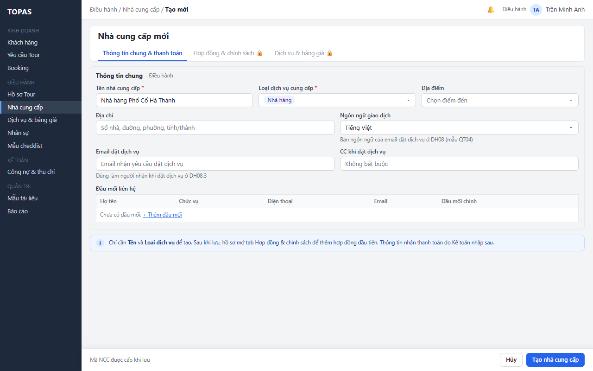

2. **W01 · Nút Tạo nhà cung cấp trên form.** Điều hành nhập Tên, chọn một hoặc nhiều Loại dịch vụ; có thể nhập luôn địa điểm, địa chỉ, ngôn ngữ giao dịch (điền sẵn Tiếng Việt, R22), email đặt dịch vụ, đầu mối. Bấm Tạo nhà cung cấp.
3. **W02 · Lỗi cạnh trường, banner vàng trùng tên.** Hệ thống kiểm tra trường (mục 5.2) và tìm NCC trùng (R19). Lỗi hiện cạnh trường, dữ liệu đã nhập giữ nguyên, chặn lưu tới khi hợp lệ. Tên trùng hẳn NCC đã có (sau chuẩn hóa) thì chặn; tên gần giống thì hiện cảnh báo vàng kèm liên kết mở NCC đó, vẫn cho lưu. Điều hành sửa trường, hoặc bấm liên kết để mở NCC trùng.

   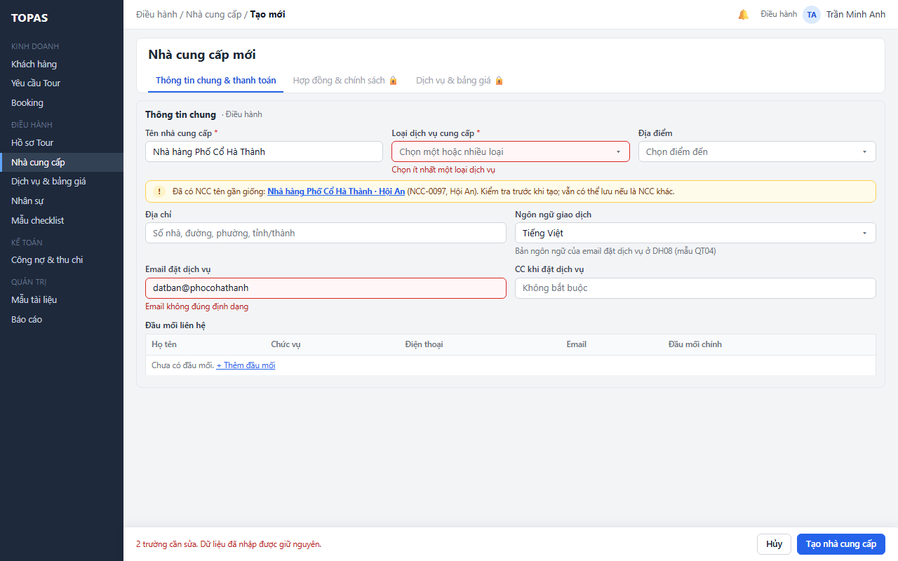

4. **W03 · DH03.2 rỗng sau khi tạo.** Lưu thành công: hệ thống cấp mã NCC (R19), đặt trạng thái Đang dùng, rồi mở thẳng tab Hợp đồng & chính sách với một nút **Thêm hợp đồng đầu tiên** (bấm nút này mở W11, L4.2). Phần đầu liệt kê việc còn thiếu: Chưa có hợp đồng còn hiệu lực, Thiếu thông tin nhận thanh toán (Kế toán nhập). Thông báo ngắn “Đã tạo nhà cung cấp NCC-0131 · …”.

   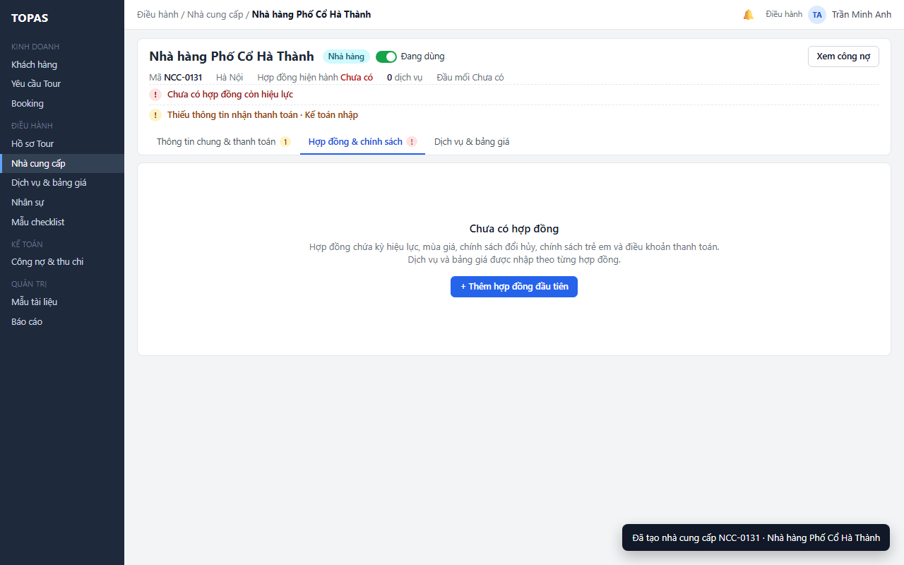

*Kết quả:* NCC có mã, ở trạng thái Đang dùng, chưa có hợp đồng và dịch vụ. Điều hành đi tiếp L4.2. NCC chưa có hợp đồng còn hiệu lực thì báo giá và đặt dịch vụ hiện cảnh báo thiếu hợp đồng (R02).

**Ngoại lệ**

- **E1.1 · W02.** Thiếu Tên hoặc Loại dịch vụ, email sai định dạng: chặn lưu, lỗi cạnh trường, giữ dữ liệu. Sửa rồi bấm lại.
- **E1.2 · W02.** Tên trùng hẳn NCC đã có (R19): chặn, lỗi cạnh ô Tên kèm liên kết mở NCC đó. Tên gần giống: cảnh báo, không chặn. Điều hành bấm liên kết để mở NCC cũ (dữ liệu đang nhập được hỏi giữ hay bỏ), hoặc lưu tiếp nếu là NCC khác. Mã số thuế trùng thì chặn ở phần thanh toán (E3.3).
- **E1.3.** Rời màn khi đã nhập mà chưa tạo: hỏi xác nhận Bỏ hoặc Ở lại (cùng mẫu W37).
- **E1.4.** Lỗi lưu hoặc mất kết nối: thông báo đỏ trên thanh lưu “Chưa tạo được NCC. Thử lại”, giữ dữ liệu. Bấm lặp chỉ tạo một NCC (khóa nút khi đang lưu, mã yêu cầu chống lặp).
- **E1.5.** Người không có quyền tạo (Kế toán, Kinh doanh): DH02 không có nút Tạo nhà cung cấp; gọi thẳng đường dẫn tạo thì máy chủ từ chối và mở DH02.

### 3.2. Phần đầu hồ sơ: xem, cho phép sử dụng, công nợ (CNHT01.02)

**L2.1 Mở hồ sơ và xem việc cần xử lý.** *Điều kiện:* NCC đã có.

1. **W04 · Lối vào ở 1.2 → phần đầu và tab đích.** Người dùng mở hồ sơ NCC (từ DH02 thì tab đích theo R09 của RSD DH02; W04 là tab DH03.1 của Điều hành). Phần đầu hiện tên, loại, công tắc, hợp đồng hiện hành LH-2025/HĐ-07 đến 30/11/2026 kèm Sắp hết hạn, 6 dịch vụ (5 đang dùng), đầu mối chính. Dòng việc: “Hợp đồng LH-2025/HĐ-07 hết hạn 30/11/2026 (còn 19 ngày), chưa có hợp đồng kế tiếp” với nút Gia hạn hợp đồng.

   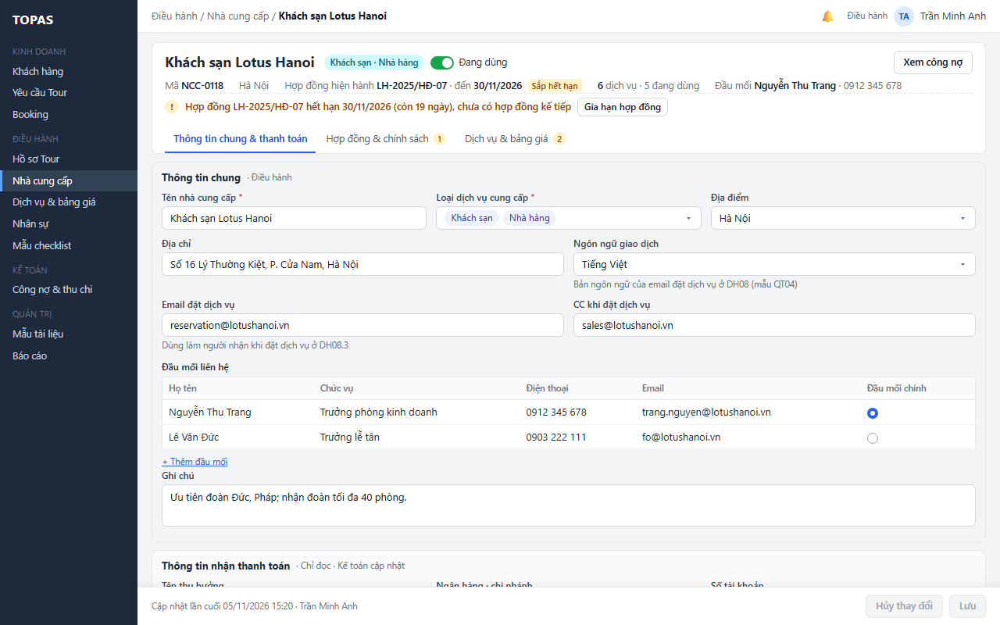

2. **W04 → W18 · Nút của dòng việc ở phần đầu.** Điều hành bấm Gia hạn hợp đồng ở phần đầu: hệ thống chuyển sang DH03.2 và mở ngay hộp thoại Gia hạn của hợp đồng đó (L4.8 bước 1). Các việc khác cũng mở thẳng nơi xử lý theo R03.

*Kết quả:* người dùng biết NCC còn thiếu gì và đi tới đúng chỗ bằng một lần bấm.

**L2.2 Ngừng sử dụng hoặc dùng lại NCC (RSD DH02 R04, R05).** *Điều kiện:* Điều hành.

1. **W08 · Công tắc Cho phép sử dụng ở phần đầu → hộp thoại (chỉ khi NCC đang được dùng).** Điều hành bấm công tắc để tắt. Hệ thống kiểm tra nơi đang dùng theo R05 của RSD DH02. Không đang dùng ở đâu: lưu ngay, không hỏi (sang bước 3). Đang dùng: hộp thoại liệt kê hồ sơ Tour có hạng mục của NCC (Tour Code bấm được để mở DH08.3), số yêu cầu Tour, số Tour mẫu, và nói rõ điều gì xảy ra sau khi ngừng.

   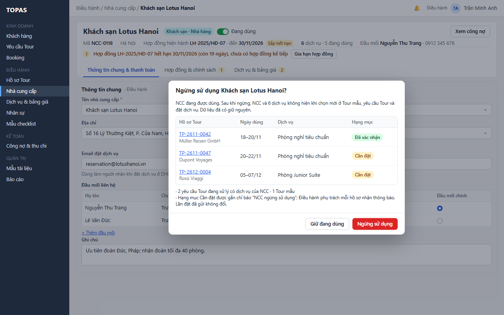

2. **W08 · Nút Ngừng sử dụng hoặc Giữ đang dùng trong hộp thoại.** Điều hành xem nơi đang dùng, bấm Ngừng sử dụng để xác nhận, hoặc Giữ đang dùng để thôi.
3. **W09 · Phần đầu và thông báo ngắn.** Hệ thống lưu trạng thái, người và thời điểm (lịch sử dùng chung với DH02). Phần đầu hiện Ngừng sử dụng kèm thời điểm và người đổi; việc cần xử lý bị ẩn (R03). Hạng mục chưa gửi của hồ sơ Tour được gắn chỉ báo “NCC ngừng sử dụng”, Điều hành phụ trách mỗi hồ sơ nhận thông báo nội bộ, bấm vào mở DH08.3 của hồ sơ đó. Thông báo ngắn có Hoàn tác trong 10 giây.

   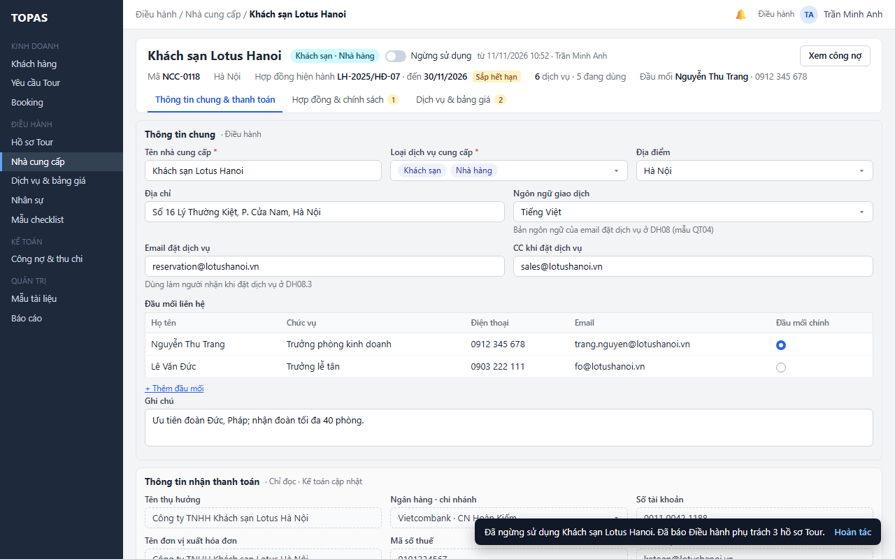

4. **W09 · Nút Hoàn tác trên thông báo, hoặc công tắc ở phần đầu.** Dùng lại: Điều hành bấm công tắc (hoặc Hoàn tác); lưu ngay, không hỏi, ghi lịch sử; chỉ báo trên hạng mục chưa gửi tự mất.

*Kết quả:* NCC và mọi dịch vụ của NCC không hiện khi chọn mới ở Tour mẫu, yêu cầu Tour, báo giá, thêm dịch vụ và đặt dịch vụ của hồ sơ Tour; dữ liệu đã lưu không đổi (R05).

**L2.3 Xem công nợ.** *Điều kiện:* Điều hành hoặc Kế toán.

1. **W04 · Nút Xem công nợ ở phần đầu.** Hệ thống mở KT01.2 lọc theo NCC này. Quay lại thì về đúng tab và vị trí trong DH03.

**Ngoại lệ**

- **E2.1 · W08.** Điều hành bấm Giữ đang dùng hoặc đóng hộp thoại: không đổi gì, công tắc trở về Đang dùng.
- **E2.2.** NCC đang có hồ sơ Tour mở hoặc lần đặt chờ kết quả: không chặn tắt, chỉ xác nhận. Lần đặt đã gửi hoặc đã xác nhận không đổi; muốn hủy thì làm ở DH08.3. Hộp thoại hiện tối đa 10 hồ sơ, nhiều hơn thì ghi “và n hồ sơ khác”.
- **E2.3.** Công tắc được đổi ở phiên khác ngay trước đó: máy chủ từ chối, công tắc trả về giá trị hiện tại, thông báo “NCC vừa được … bởi …”.
- **E2.4.** Lỗi lưu công tắc: trả về giá trị cũ, thông báo đỏ có Thử lại.
- **E2.5.** Người không phải Điều hành: không có công tắc, chỉ thấy nhãn Đang dùng hoặc Ngừng sử dụng (W05, W43). Kinh doanh không có nút Xem công nợ.
- **E2.6 · W45.** Không tải được hồ sơ (lỗi mạng, NCC đã bị xóa ở phiên khác): khung lỗi thay vùng nội dung, có Thử lại và Về danh sách NCC; không hiện dữ liệu dở dang. NCC đã bị xóa thì ghi “NCC không còn tồn tại”. Bấm Thử lại thì tải lại đúng tab; bấm Về danh sách NCC thì về DH02 giữ bộ lọc.

  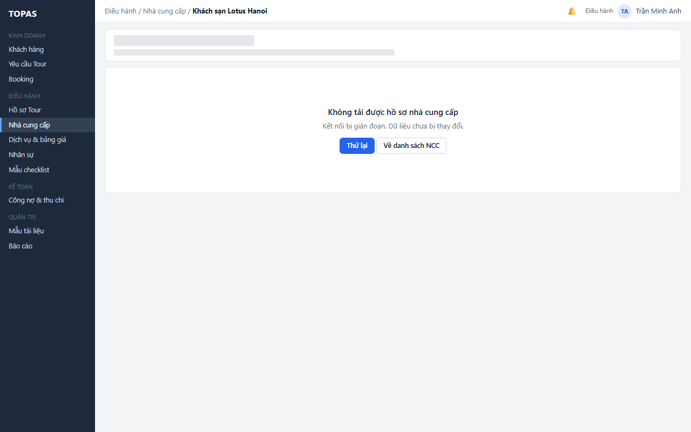

### 3.3. DH03.1 Thông tin chung và thanh toán (CNHT01.02, CNHT01.03)

**L3.1 Điều hành sửa thông tin chung.** *Điều kiện:* Điều hành.

1. **W04 · Tab Thông tin chung & thanh toán, form tại tab.** Tab DH03.1 là một form có hai phần. Phần Thông tin chung sửa được: tên, loại dịch vụ, địa điểm, địa chỉ, ngôn ngữ giao dịch (R22), email đặt dịch vụ, CC, danh sách đầu mối (chọn một đầu mối chính), ghi chú. Phần Thông tin nhận thanh toán chỉ đọc, ghi “Kế toán cập nhật”.
2. **W04 · Nút Lưu trên thanh lưu dính dưới màn.** Điều hành sửa; thanh lưu đổi thành “● Có thay đổi chưa lưu” và nút Lưu sáng lên. Bấm Lưu. Hệ thống chỉ ghi phần Thông tin chung (R04).
3. **W06 · Thông báo ngắn và thanh lưu.** Lưu xong: ở lại đúng tab và vị trí cuộn, thông báo ngắn, dòng “Cập nhật lần cuối …” đổi, việc cần xử lý ở phần đầu tính lại (R03). Đổi email đặt dịch vụ thì lần đặt dịch vụ mới ở DH08.3 dùng email mới; lần đặt đã gửi giữ email cũ (R18). Đổi ngôn ngữ giao dịch thì email đặt dịch vụ soạn mới ở DH08.3 dùng bản ngôn ngữ mới của mẫu; email đã gửi giữ nguyên (R18, R22). Đổi đầu mối chính thì phần đầu cập nhật.

*Kết quả:* thông tin chung mới dùng ngay cho các lần chọn và đặt dịch vụ mới.

**L3.2 Kế toán nhập thông tin nhận thanh toán.** *Điều kiện:* Kế toán.

1. **W05 · Phần Thông tin nhận thanh toán, đặt đầu form.** Kế toán mở DH03 (từ DH02 lọc Cần xử lý “Thiếu thông tin thanh toán”, hoặc từ KT01.2). Với Kế toán, phần Thông tin nhận thanh toán đặt lên đầu form và sửa được; phần Thông tin chung chỉ đọc. Kế toán nhập tên thụ hưởng, ngân hàng và chi nhánh, số tài khoản, thông tin xuất hóa đơn (tên đơn vị, mã số thuế, email nhận hóa đơn).

   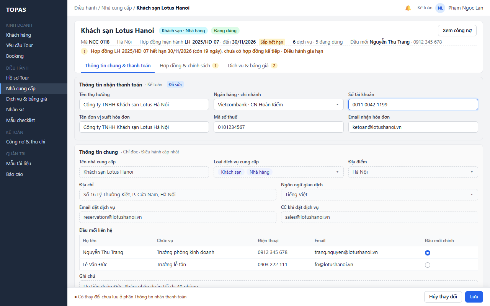

2. **W06 · Nút Lưu trên thanh lưu.** Kế toán bấm Lưu. Hệ thống kiểm tra (mục 5.2), ghi phần thanh toán, ghi lịch sử thay đổi số tài khoản (R20). Thông báo ngắn, dấu thời gian cập nhật mới. Việc “Thiếu thông tin nhận thanh toán” biến khỏi phần đầu và khỏi bộ lọc Cần xử lý của DH02.

   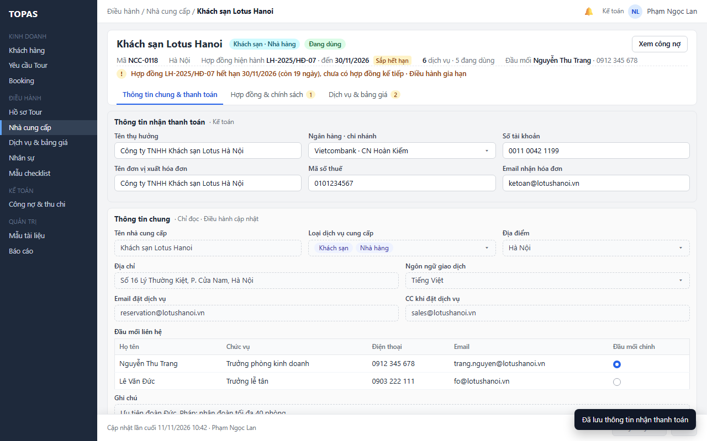

*Kết quả:* KT01.2 dùng thông tin nhận thanh toán mới cho các lần ghi chi trả mới.

**Ngoại lệ**

- **E3.1 · W07.** Cùng phần vừa được người khác lưu ở phiên khác: chặn lưu, banner đỏ trên form nêu người và thời điểm, giữ dữ liệu đang nhập, nút Xem bản mới hiện giá trị mới cạnh giá trị của mình để chọn; người dùng chọn giá trị rồi bấm Lưu lại, không ghi đè thay đổi của người khác. Phần khác (do vai trò khác sửa) được lưu đồng thời không gây xung đột (R04).

  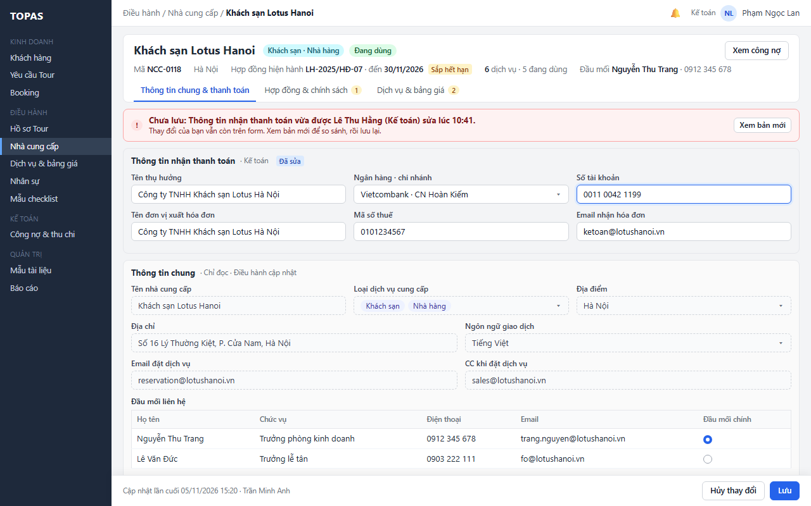

- **E3.2.** Email sai định dạng, số tài khoản có ký tự không phải số hoặc dấu cách, mã số thuế không đủ 10 hoặc 13 số: lỗi cạnh trường, giữ dữ liệu.
- **E3.3.** Mã số thuế trùng NCC khác: chặn, lỗi cạnh trường kèm liên kết mở NCC kia (R19).
- **E3.4.** Đổi số tài khoản khi đang có khoản phải trả chưa trả hết ở KT01.2: cho lưu; thông báo “Các lần chi trả mới dùng tài khoản mới. Kiểm tra lại khoản phải trả còn số chưa trả ở KT01.2.”
- **E3.5.** Bỏ trống email đặt dịch vụ: cho lưu; phần đầu có việc “Thiếu email đặt dịch vụ” (R03). Khi soạn email cho NCC này ở DH08.3, người dùng nhập email cho lần gửi đó; DH08 không ghi email vào DH03, người có quyền sửa hồ sơ NCC có liên kết mở DH03.1 để cập nhật (RSD DH08 E3.1).
- **E3.6.** Rời tab hoặc đóng trình duyệt khi còn thay đổi chưa lưu: hỏi xác nhận (cùng mẫu W37).
- **E3.7.** Lỗi lưu: thanh lưu báo lỗi đỏ có Thử lại; dữ liệu giữ nguyên.

### 3.4. DH03.2 Hợp đồng và chính sách (CNHT01.04, CNHT01.03)

**L4.1 Xem danh sách hợp đồng.** *Điều kiện:* NCC đã có.

1. **W10 · Tab Hợp đồng & chính sách, bảng hợp đồng.** Tab DH03.2 liệt kê mọi hợp đồng, kỳ bắt đầu muộn nhất ở trên. Mỗi dòng: số hợp đồng, ngày ký, kỳ hiệu lực, tình trạng (R01) kèm số ngày còn lại khi Sắp hết hạn, loại tiền, số mùa giá, tóm tắt chính sách (số mốc hủy, no-show, số nhóm tuổi), tóm tắt thanh toán, số dịch vụ có giá trên tổng số dịch vụ. Bấm dòng để mở bảng trượt hợp đồng. Gia hạn theo R12, mở hộp thoại W18: hợp đồng có Hiệu lực đến muộn nhất mà Sắp hết hạn hoặc Hết hạn có nút Gia hạn trên dòng (như LH-2025/HĐ-07 trên hình); Còn hiệu lực hoặc Sắp áp dụng thì Gia hạn nằm trong menu ⋯. Menu ⋯ chứa Xóa hợp đồng.

   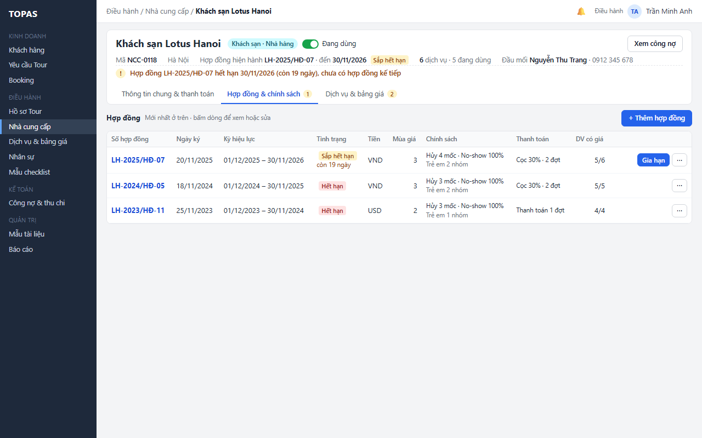

**L4.2 Thêm hợp đồng đầu tiên.** *Điều kiện:* Điều hành; NCC chưa có hợp đồng.

1. **W11 · Nút Thêm hợp đồng đầu tiên (W03) → bảng trượt.** Bảng trượt hợp đồng mở với thanh mục lục năm phần (Hợp đồng · Mùa giá · Chính sách đổi hủy · Chính sách trẻ em · Điều khoản thanh toán), cùng một màn cuộn và một nút Lưu. Điền sẵn: kỳ hiệu lực từ hôm nay đến hết 12 tháng, loại tiền VND, mùa “Cả kỳ hợp đồng” bằng cả kỳ, ngày cuối tuần Thứ Bảy và Chủ nhật (R11).

   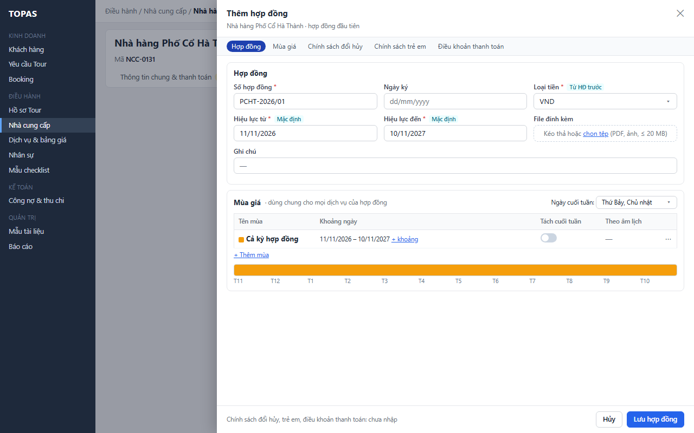

2. **W11 · Phần Hợp đồng trên bảng trượt.** Điều hành nhập số hợp đồng, ngày ký, đính kèm file; nếu NCC không chia mùa thì giữ mùa mặc định. Nhập chính sách và điều khoản theo L4.5, L4.6 (có thể để trống và bổ sung sau).
3. **W11 → W10 · Nút Lưu hợp đồng.** Hệ thống kiểm tra R06, R07, R09, R10; lưu; bảng trượt đóng; danh sách có hợp đồng mới tô sáng; phần đầu cập nhật hợp đồng hiện hành; việc “Chưa có hợp đồng còn hiệu lực” biến mất nếu kỳ chứa hôm nay. Thông báo ngắn có liên kết **Nhập bảng giá** mở DH03.3 với hợp đồng này.

*Kết quả:* NCC có hợp đồng; DH03.3 dùng hợp đồng này làm mặc định.

**L4.3 Thêm hợp đồng khi đã có hợp đồng trước.** *Điều kiện:* Điều hành; NCC có ít nhất một hợp đồng.

1. **W17 · Nút + Thêm hợp đồng (W10) → bảng trượt điền sẵn.** Bảng trượt mở với banner “Đã điền sẵn … từ LH-2025/HĐ-07”: kỳ nối tiếp kỳ có ngày kết thúc muộn nhất, loại tiền, mùa giá đã dời ngày sang kỳ mới, chính sách đổi hủy, chính sách trẻ em và điều khoản thanh toán (R11). Mùa theo âm lịch có nhãn Cần kiểm tra ngày. Bảng giá không sao chép; muốn chép cả giá thì dùng Gia hạn (L4.8). Con trỏ đặt ở ô Số hợp đồng.

   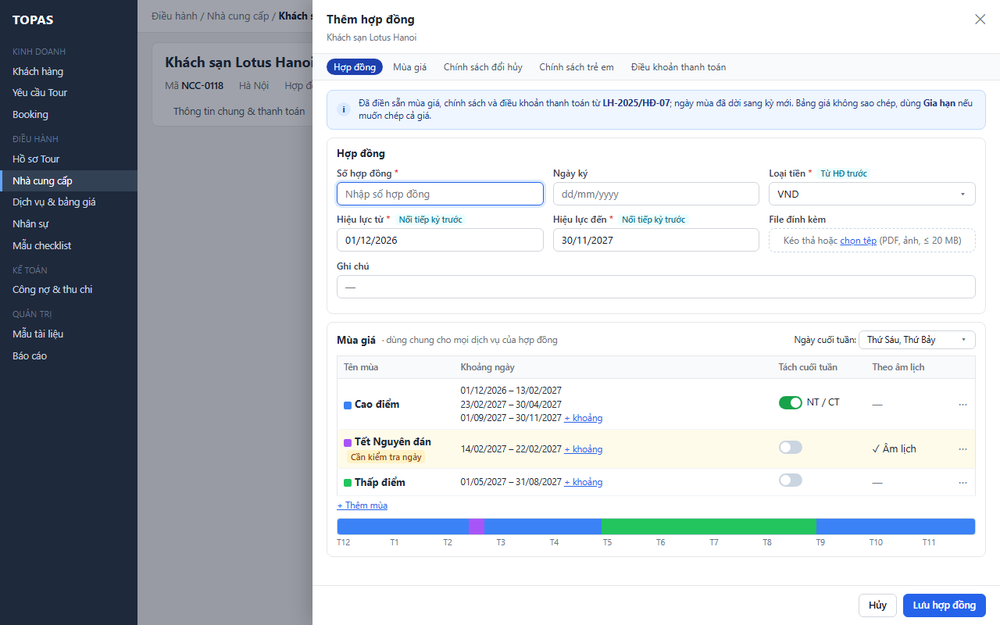

2. **W17 · Nút Lưu hợp đồng.** Điều hành nhập số hợp đồng, kiểm tra ngày của mùa âm lịch, sửa phần khác nếu cần, bấm Lưu hợp đồng. Kết quả như L4.2 bước 3.

**L4.4 Khai báo mùa giá.** *Điều kiện:* Điều hành; đang mở bảng trượt hợp đồng.

1. **W12 · Mục Mùa giá trên thanh mục lục.** Điều hành bấm Mùa giá trên thanh mục lục. Mỗi mùa có tên, một hoặc nhiều khoảng ngày (+ khoảng), công tắc Tách cuối tuần, đánh dấu Theo âm lịch. Ngày cuối tuần chọn một lần cho hợp đồng (R11: hợp đồng đầu tiên mặc định Thứ Bảy, Chủ nhật; hợp đồng sau sao chép từ hợp đồng nguồn; Điều hành đổi được, ví dụ Thứ Sáu, Thứ Bảy cho khách sạn). Thanh lịch dưới bảng tô màu cả kỳ theo mùa, mỗi tháng một nhãn.

   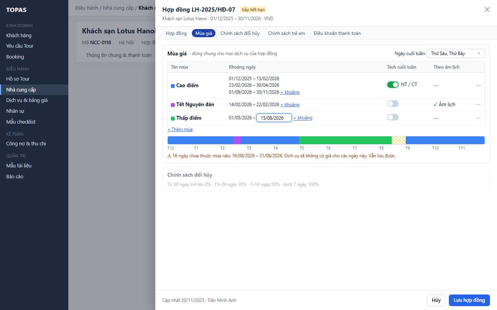

2. **W12 · Thêm mùa, + khoảng, ô ngày.** Điều hành thêm mùa, thêm khoảng hoặc sửa khoảng ngày. Thanh lịch cập nhật ngay; ngày chưa thuộc mùa nào tô sọc vàng và có câu cảnh báo nêu khoảng ngày; vẫn lưu được (R07).
3. **W13 · Nút Lưu hợp đồng khi hai mùa chồng lấn.** Khi bấm Lưu, hệ thống chặn, banner đỏ nêu hai mùa và các ngày trùng, ô ngày lỗi viền đỏ, đoạn trùng tô đỏ trên thanh lịch, mục Mùa giá trên thanh mục lục có dấu “!”. Điều hành sửa khoảng ngày rồi lưu lại.

   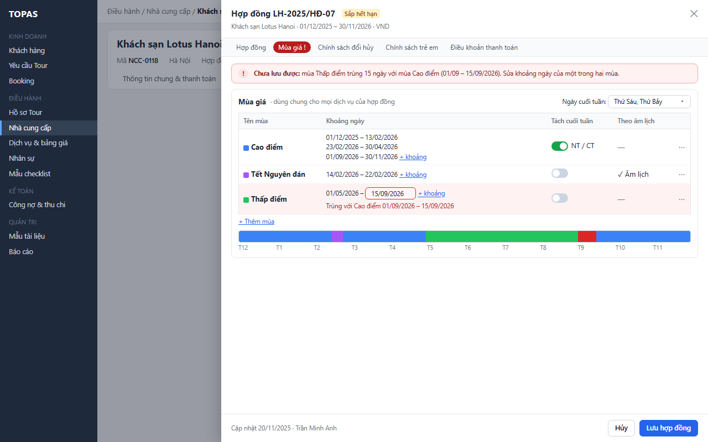

4. **W12 · Công tắc Tách cuối tuần của mùa.** Bật Tách cuối tuần cho một mùa đã có giá: mỗi dòng giá của mùa được tách thành hai cột Ngày thường và Cuối tuần, cả hai lấy giá cũ; tắt tách thì giữ giá Ngày thường, giá Cuối tuần bị bỏ sau khi xác nhận (R07).
5. **W22 · Menu ⋯ của mùa → Xóa mùa → hộp thoại.** Xóa một mùa đã có giá: hộp thoại nêu số dòng giá và số dịch vụ bị mất giá của mùa, các ngày sẽ chưa thuộc mùa nào. Điều hành bấm Giữ mùa để thôi, hoặc Xóa mùa: mùa bị bỏ khỏi form; giá bị xóa khi lưu hợp đồng.

   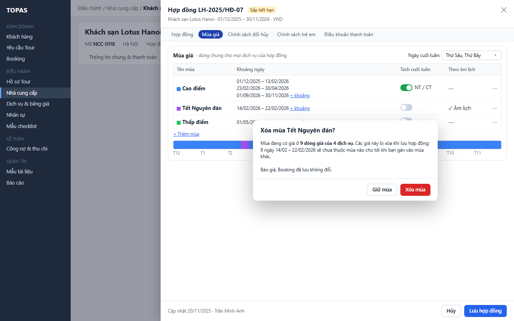

*Kết quả:* mọi dịch vụ của hợp đồng dùng chung danh sách mùa; DH05.2 có một cột giá cho mỗi mùa (hai cột nếu tách cuối tuần).

**L4.5 Chính sách đổi hủy và chính sách trẻ em.** *Điều kiện:* Điều hành; đang mở bảng trượt hợp đồng.

1. **W14 · Mục Chính sách đổi hủy trên thanh mục lục.** Bảng mốc “Hủy trước ngày sử dụng từ X ngày trở lên” → mức phí (tỷ lệ hoặc số tiền) → căn cứ tính (tổng giá dịch vụ, đêm đầu, mỗi khách, mỗi phòng). Điều hành thêm mốc; hệ thống tự hiện khoảng “Từ 15 đến 29 ngày” từ các mốc. Điều hành nhập phí no-show, điều kiện đổi ngày, đổi tên khách, giảm số lượng.

   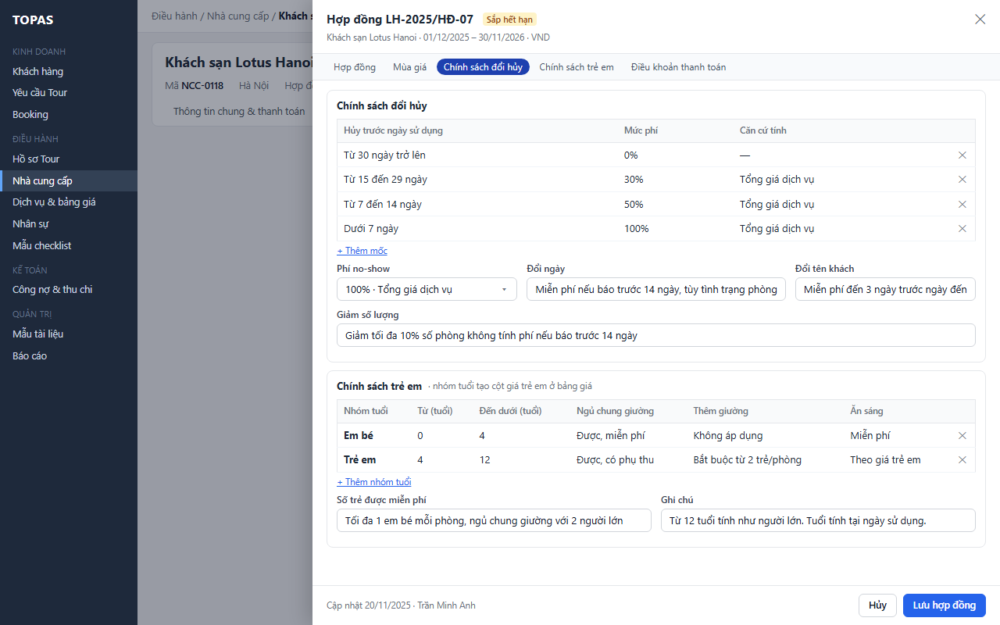

2. **W14 · Mục Chính sách trẻ em.** Điều hành thêm các nhóm tuổi với “từ” và “đến dưới” (R09), điều kiện ngủ chung giường, thêm giường, ăn sáng; số trẻ được miễn phí; ghi chú. Mỗi nhóm tuổi tạo một cột giá trẻ em ở DH05.2. Hệ thống kiểm tra R08, R09 khi lưu hợp đồng.

*Kết quả:* DH08.3 dùng chính sách đổi hủy để gợi ý phí hủy (R08); KD06.3 dùng nhóm tuổi để tính giá trẻ em (R09).

**L4.6 Điều khoản thanh toán.** *Điều kiện:* Điều hành hoặc Kế toán (quyết định 11/11/2026).

1. **W15 · Mục Điều khoản thanh toán trên thanh mục lục.** Điều hành nhập ngay khi tạo hợp đồng: bấm Thêm đợt để thêm các đợt (đặt cọc, đợt 2…), mỗi đợt có tỷ lệ hoặc số tiền, mốc tính hạn (sau khi NCC xác nhận, trước ngày sử dụng, sau khi kết thúc Tour) và số ngày; phương thức; ghi chú. Dòng Tổng cập nhật ngay khi nhập.

   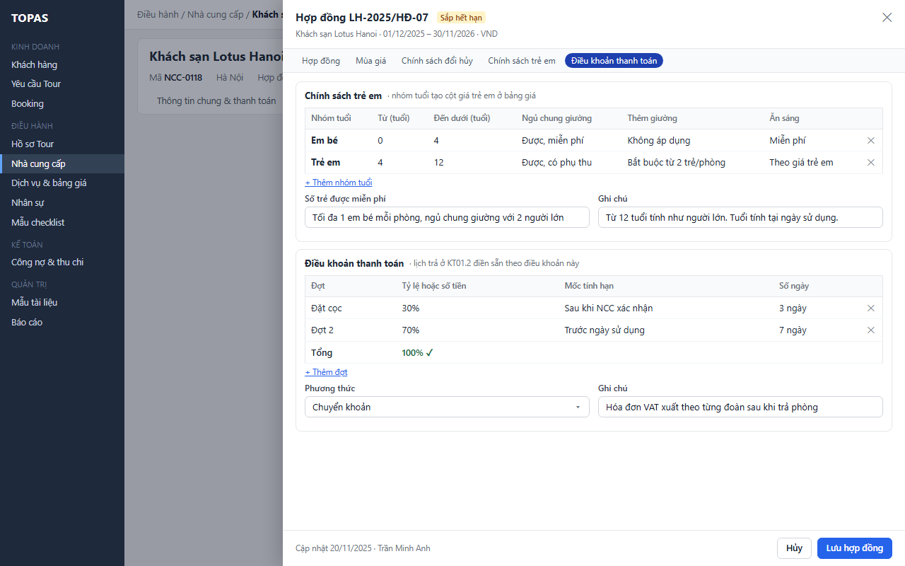

2. **W23 · Bấm dòng hợp đồng (Kế toán) → bảng trượt, phần Điều khoản thanh toán đặt đầu.** Kế toán mở cùng hợp đồng: phần Điều khoản thanh toán đặt lên đầu và sửa được; các phần khác chỉ đọc. Kế toán sửa rồi bấm Lưu điều khoản; hệ thống chỉ ghi phần này (R04).

   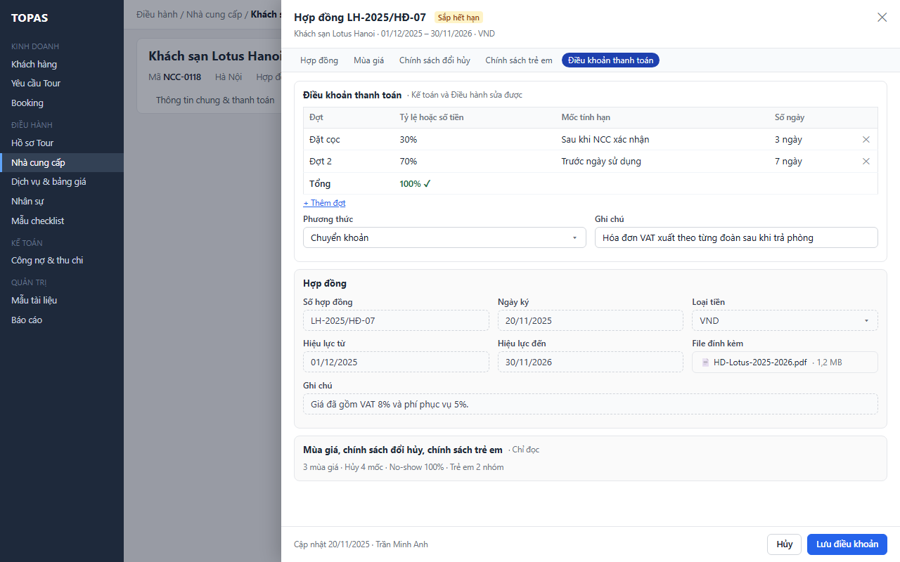

*Kết quả:* KT01.2 điền sẵn lịch trả theo điều khoản của hợp đồng áp dụng cho ngày sử dụng dịch vụ (R10).

**L4.7 Sửa hợp đồng đang dùng.** *Điều kiện:* Điều hành.

1. **W10 → W12 · Bấm dòng hợp đồng → bảng trượt.** Điều hành sửa bất kỳ phần nào (ví dụ dời ngày mùa Thấp điểm), bấm Lưu hợp đồng. Không có bước duyệt.
2. **W10 · Danh sách và thông báo ngắn.** Hệ thống lưu; mọi dòng giá dùng mùa đó tự áp theo ngày mới; báo giá, Booking, lần đặt dịch vụ, công nợ đã lưu không đổi (R18). Thông báo ngắn ghi rõ “Dữ liệu đã lưu ở báo giá và Booking không đổi”.

**L4.8 Gia hạn hợp đồng.** *Điều kiện:* Điều hành; hợp đồng có ngày kết thúc muộn nhất của NCC (R12).

1. **W18 · Nút Gia hạn trên dòng (hoặc nút ở phần đầu, L2.1) → hộp thoại.** Hộp thoại có kỳ mới điền sẵn (nối tiếp, 12 tháng), Điều chỉnh giá (tùy chọn, có thể âm), Làm tròn sau điều chỉnh (mặc định đến 1.000 ₫ với VND). Khung “Sẽ sao chép” nêu số mùa, mùa âm lịch cần kiểm tra, chính sách, điều khoản, số dòng giá và số dịch vụ, kèm một ví dụ giá trước và sau điều chỉnh. Điều hành giữ hoặc sửa kỳ, nhập tỷ lệ điều chỉnh và làm tròn. Hộp thoại chưa ghi dữ liệu.

   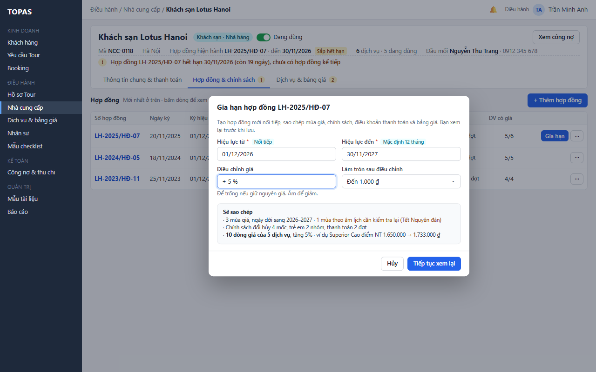

2. **W19 · Nút Tiếp tục xem lại → bảng trượt Chưa lưu.** Bảng trượt hợp đồng mới mở ở trạng thái Chưa lưu, điền sẵn theo R12; số hợp đồng gợi ý theo mẫu của số cũ. Mùa Tết Nguyên đán có nhãn Cần kiểm tra ngày và banner vàng giải thích.

   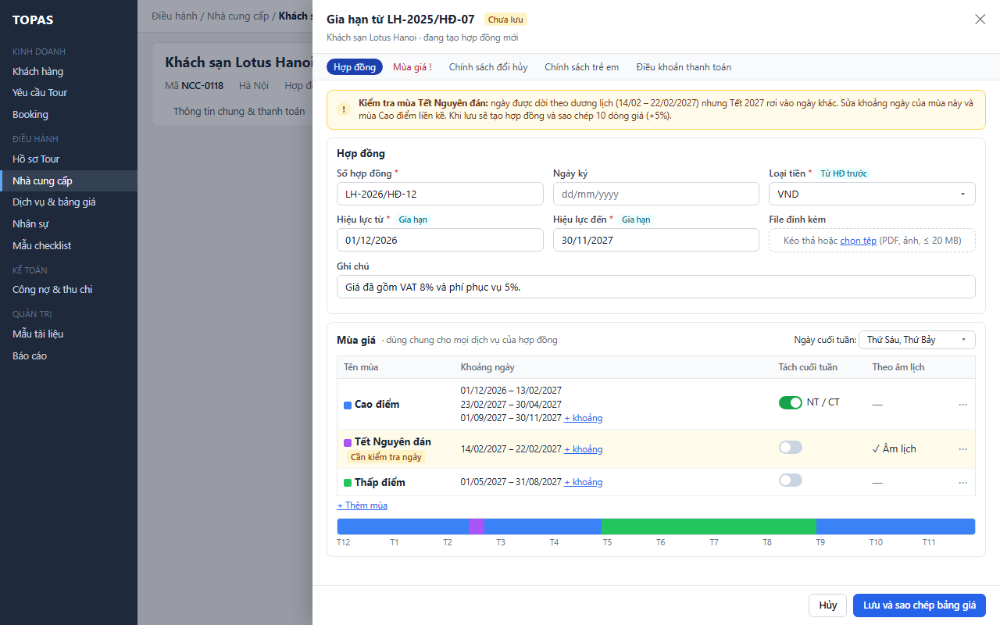

3. **W19 · Nút Lưu và sao chép bảng giá.** Điều hành sửa khoảng ngày của mùa Tết và các khoảng Cao điểm liền kề; nhãn Cần kiểm tra ngày mất khi sửa (hoặc chọn Đã kiểm tra trong menu ⋯ của mùa). Bấm Lưu và sao chép bảng giá.
4. **W20 · Danh sách và thông báo ngắn.** Hệ thống tạo hợp đồng và sao chép toàn bộ dòng giá đã điều chỉnh trong một giao dịch (R12). Danh sách hiện LH-2026/HĐ-12 Sắp áp dụng trên cùng, tô sáng; hợp đồng cũ chuyển Còn hiệu lực kèm “HĐ kế tiếp từ 01/12”, phần đầu cũng vậy; việc gia hạn biến khỏi phần đầu; số trên tab DH03.2 mất. Thông báo ngắn có liên kết Xem bảng giá mở DH03.3 với hợp đồng mới được chọn (W25).

   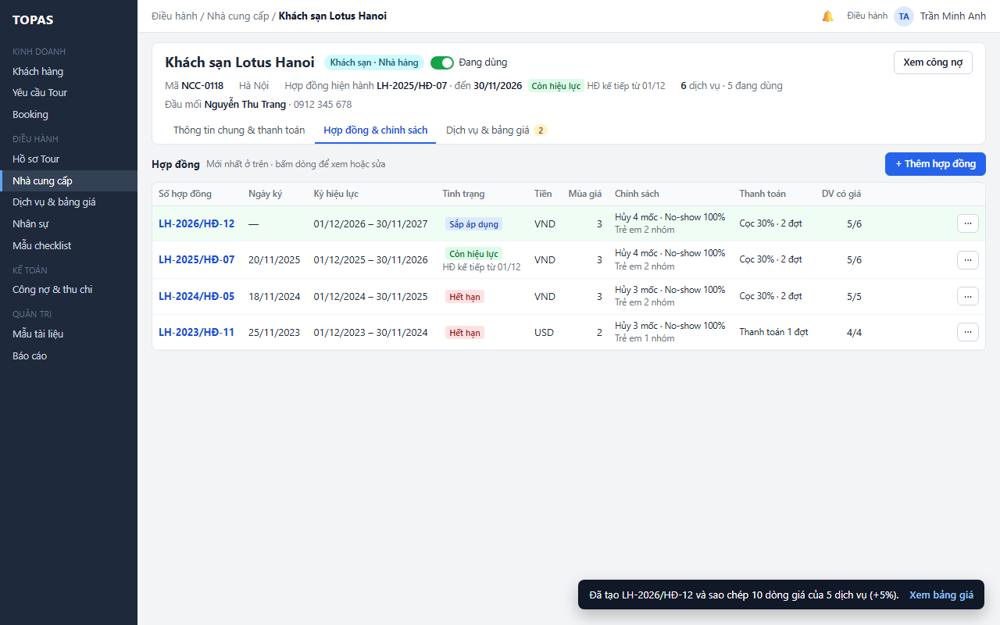

*Kết quả:* NCC có hợp đồng kỳ sau với mùa, chính sách, điều khoản và 10 dòng giá của 5 dịch vụ. Từ 01/12/2026, hợp đồng mới thành hợp đồng hiện hành (R01).

**L4.9 Xóa hợp đồng.** *Điều kiện:* Điều hành; hợp đồng chưa dùng (R13; quyết định 11/11/2026).

1. **W21 · Menu ⋯ trên dòng → Xóa hợp đồng → hộp thoại.** Hộp thoại nêu những gì bị xóa kèm (mùa, chính sách, điều khoản, số dòng giá) và không hoàn tác được.

   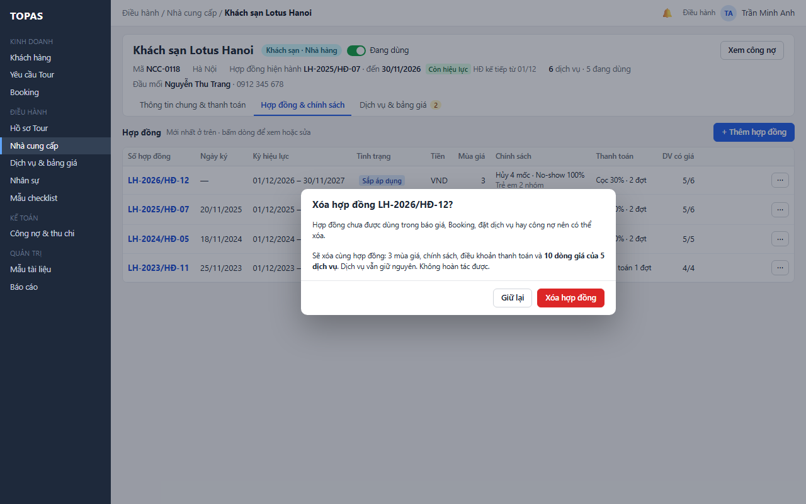

2. **W21 → W10 · Nút Xóa hợp đồng trong hộp thoại.** Điều hành bấm Xóa hợp đồng (hoặc Giữ lại để thôi). Hệ thống kiểm tra lại R13 lúc ghi; dòng biến mất; thông báo ngắn. Phần đầu tính lại hợp đồng hiện hành và việc cần xử lý.
3. **W21a · Menu ⋯ của hợp đồng đã dùng.** Mục Xóa trong menu ⋯ bị khóa, ghi lý do và số chứng từ đang dùng.

   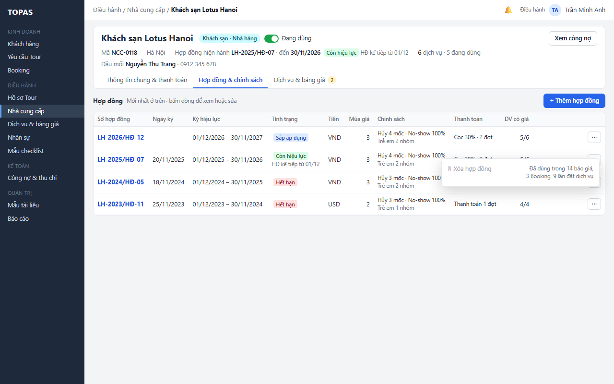

**Ngoại lệ**

- **E4.1 · W16.** Kỳ hiệu lực trùng một hợp đồng khác của cùng NCC (kể cả một ngày): chặn lưu, lỗi cạnh ô Hiệu lực từ, đến nêu hợp đồng bị trùng, số ngày trùng và ngày bắt đầu hợp lệ gần nhất (R06). Điều hành sửa ngày theo gợi ý; lưu bị chặn tới khi hết trùng.

  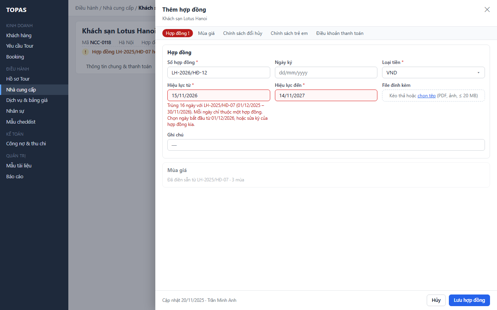

- **E4.2 · W13.** Mùa chồng lấn: chặn lưu (L4.4 bước 3).
- **E4.3 · W12.** Ngày trong kỳ chưa thuộc mùa nào: cảnh báo, vẫn lưu được; dịch vụ không có giá cho các ngày đó, báo giá sẽ báo thiếu giá (R07).
- **E4.4.** Khoảng ngày của mùa nằm ngoài kỳ hiệu lực, ngày đầu sau ngày cuối, kỳ hiệu lực có ngày kết thúc trước ngày bắt đầu: lỗi cạnh ô, chặn lưu.
- **E4.5 · W15a.** Tổng các đợt thanh toán khác 100% (khi mọi đợt là tỷ lệ), hoặc có đợt số tiền mà thiếu đợt “Phần còn lại”: khi bấm Lưu, hệ thống chặn, ô lỗi viền đỏ, nêu số còn thiếu (R10). Điều hành sửa tỷ lệ rồi lưu lại.

  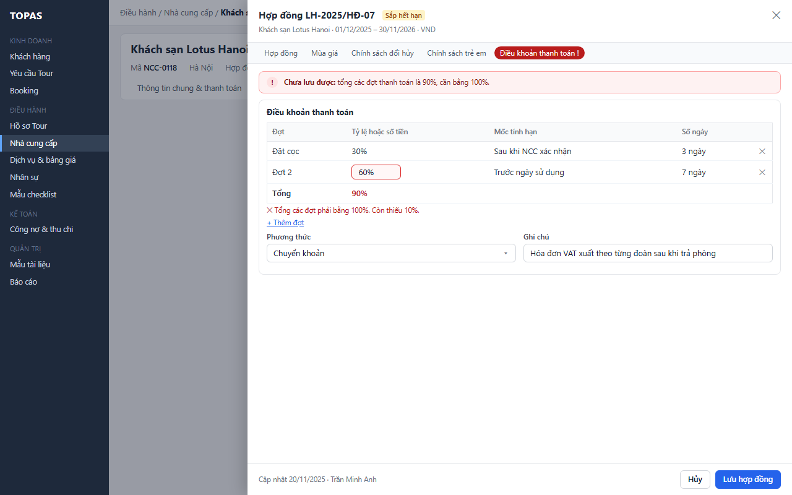

- **E4.6.** Mốc hủy trùng số ngày; mức phí tỷ lệ ngoài 0–100%; nhóm tuổi trẻ em chồng lấn hoặc “từ” không nhỏ hơn “đến dưới”: chặn lưu, lỗi cạnh ô (R08, R09). Bảng mốc không có mốc 0 ngày: cảnh báo “Không gợi ý được phí hủy khi hủy sát ngày”, vẫn lưu.
- **E4.7.** Xóa một nhóm tuổi đang có giá trẻ em ở dòng giá: hộp thoại cùng mẫu W22 nêu số dòng giá mất cột đó; thêm nhóm tuổi mới thì DH05.2 có cột mới, ô trống được tính thiếu giá (R14).
- **E4.8.** Đổi kỳ hiệu lực của hợp đồng đã dùng làm một số ngày sử dụng đã báo giá nằm ngoài kỳ: cho lưu sau khi xác nhận; dữ liệu đã lưu không đổi (R18); lần tính giá mới cho các ngày đó sẽ dùng hợp đồng khác hoặc báo thiếu hợp đồng (R02).
- **E4.9.** Đổi loại tiền của hợp đồng đã có dòng giá: dòng giá giữ loại tiền riêng (dòng giá được có loại tiền khác hợp đồng, R14); hệ thống hỏi “Đổi loại tiền của n dòng giá sang … (không quy đổi số)?” với hai lựa chọn Giữ nguyên và Đổi; chỉ đổi mã tiền, không quy đổi giá.
- **E4.10 · W21a.** Xóa hợp đồng đã dùng: không cho (R13). Muốn ngừng dùng thì sửa kỳ hiệu lực hoặc tắt NCC.
- **E4.11.** Gia hạn khi đã có hợp đồng kỳ sau: nút Gia hạn không hiện trên dòng cũ (R12). Kỳ mới do người dùng sửa trùng hợp đồng khác: E4.1.
- **E4.12.** Gia hạn lỗi giữa chừng (lỗi hệ thống, hết thời gian): giao dịch hoàn tác, không có hợp đồng hay dòng giá dở dang; bảng trượt giữ dữ liệu và báo “Chưa tạo được hợp đồng. Thử lại”. Bấm lặp chỉ tạo một hợp đồng (mã yêu cầu).
- **E4.13.** File đính kèm sai định dạng (không phải PDF, JPG, PNG) hoặc quá 20 MB, tải lên lỗi: thẻ file đỏ có lý do và nút Thử lại; hợp đồng vẫn lưu được không kèm file.
- **E4.14.** Hợp đồng bị sửa ở phiên khác khi đang mở bảng trượt: chặn lưu theo R04, giữ dữ liệu, cho xem bản mới (cùng mẫu W07). Kế toán và Điều hành sửa hai phần khác nhau thì không xung đột.
- **E4.15.** Đóng bảng trượt khi còn thay đổi chưa lưu: hỏi xác nhận (cùng mẫu W37).
- **E4.16.** NCC Ngừng sử dụng: vẫn thêm, sửa, gia hạn hợp đồng được; phần đầu không hiện việc cần xử lý nào (R03 chỉ tính khi NCC Đang dùng).
- **E4.17.** Mở hợp đồng bằng đường dẫn mà hợp đồng đã bị xóa ở phiên khác: thông báo “Hợp đồng không còn tồn tại”, tải lại danh sách.

### 3.5. DH03.3 Dịch vụ và bảng giá (CNHT01.05)

**L5.1 Xem dịch vụ theo hợp đồng.** *Điều kiện:* NCC đã có.

1. **W24 · Tab Dịch vụ & bảng giá: ô chọn hợp đồng, chip lọc, bảng.** Tab DH03.3 có ô chọn hợp đồng ở đầu (mặc định hợp đồng để xem giá theo R01 của RSD DH02: hợp đồng chứa hôm nay; không có thì hợp đồng bắt đầu sớm nhất sau hôm nay; không có nữa thì hợp đồng hết hạn gần nhất. DH04 dùng cùng hợp đồng này), chip lọc Tất cả, Thiếu giá, Ngừng sử dụng có số đếm (bấm chip là lọc ngay), nút + Thêm dịch vụ. Mỗi dòng: tên, loại, đơn vị tính, giá từ (R14), số dòng giá, tình trạng giá (R14), công tắc Cho phép sử dụng, menu ⋯. Dịch vụ ngừng sử dụng hiện mờ.

   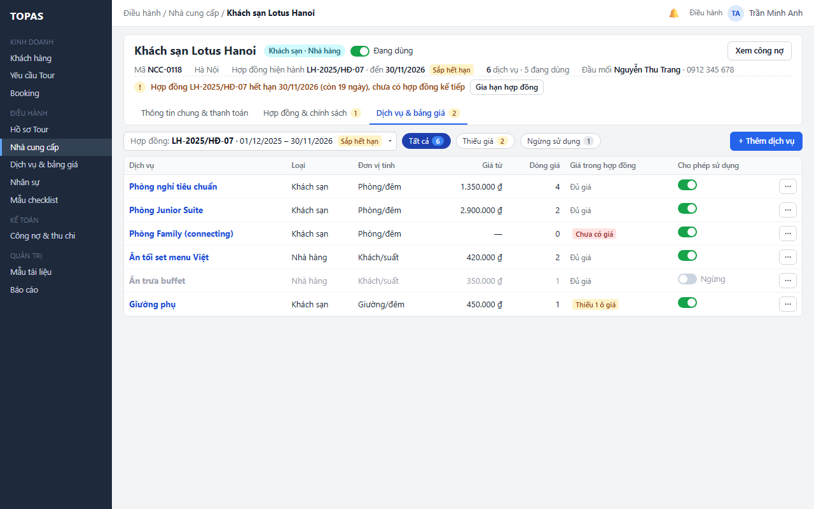

2. **W25 · Ô chọn hợp đồng → danh sách hợp đồng.** Điều hành bấm ô chọn hợp đồng; danh sách hợp đồng hiện kèm kỳ và tình trạng. Chọn hợp đồng khác: cột giá, số dòng giá, tình trạng giá và chip tính lại theo hợp đồng đó. Lựa chọn được giữ khi chuyển tab trong phiên.

   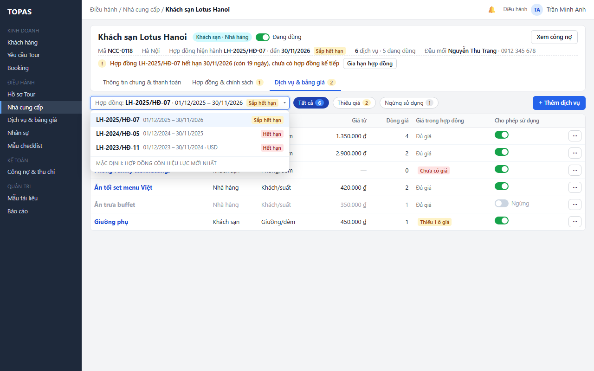

3. **W24 → W27 · Bấm dòng → bảng trượt DH05.** Mở bảng trượt DH05 của dịch vụ đó, cùng hợp đồng đang chọn (L6.1).

**L5.2 Bật hoặc tắt dịch vụ ngay trên dòng.** *Điều kiện:* Điều hành.

1. **W26 · Công tắc Cho phép sử dụng trên dòng.** Điều hành bấm công tắc. Hệ thống lưu ngay, không mở form: dòng mờ đi, số trên chip Ngừng sử dụng và số “đang dùng” ở phần đầu đổi. Thông báo ngắn có Hoàn tác trong 10 giây. Tác động theo R05.

   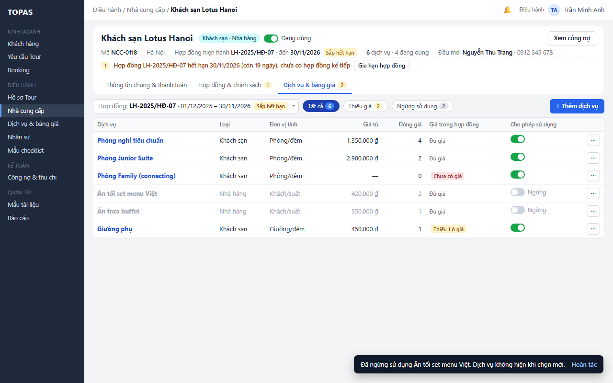

**L5.3 Thêm dịch vụ.** *Điều kiện:* Điều hành; NCC có ít nhất một hợp đồng (chưa có thì nút Thêm dịch vụ bị khóa, chú thích “Thêm hợp đồng trước”).

1. **W29 · Nút + Thêm dịch vụ → DH05 trống.** DH05 mở trống ở tab Thông tin dịch vụ: NCC lấy theo hồ sơ, hợp đồng lấy theo ô chọn ở DH03.3, loại dịch vụ mặc định là loại đầu tiên của NCC, đơn vị tính mặc định theo loại dịch vụ. Con trỏ ở ô Tên.

   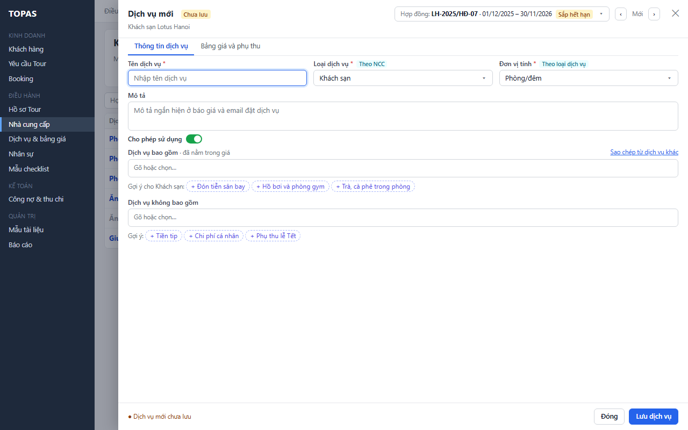

2. **W30 · Nút Lưu dịch vụ.** Điều hành nhập thông tin (L6.2), chuyển sang tab Bảng giá nhập giá (L6.3), bấm Lưu dịch vụ một lần cho cả hai tab. Hệ thống tạo dịch vụ và dòng giá; dịch vụ mới hiện ở DH03.3, tô sáng.

**L5.4 Nhân bản dịch vụ.** *Điều kiện:* Điều hành.

1. **W40 · Menu ⋯ của dòng → Nhân bản dịch vụ → hộp thoại.** Hộp thoại có tên mới (con trỏ sẵn), lựa chọn sao chép: loại, đơn vị tính, mô tả; bao gồm và không bao gồm; bảng giá và phụ thu của hợp đồng đang chọn (mặc định) hoặc của mọi hợp đồng. Điều hành đặt tên và chọn phần sao chép.

   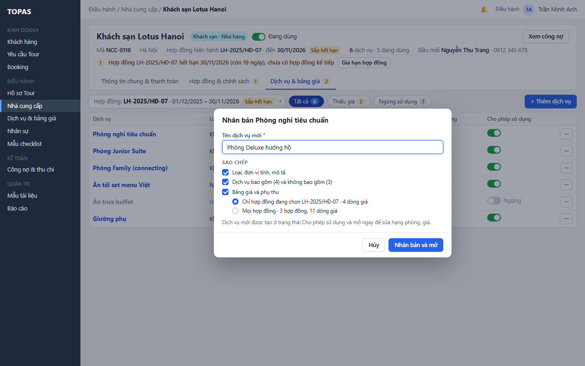

2. **W41 · Nút Nhân bản và mở.** Hệ thống tạo dịch vụ mới (Đang dùng) và các dòng giá đã chọn trong một giao dịch (R17), rồi mở DH05 của dịch vụ mới ở tab Bảng giá; banner xanh nêu nguồn và số dòng giá đã sao chép; ô Hạng phòng của dòng đầu được chọn để sửa. Điều hành sửa hạng phòng, giá rồi bấm Lưu (L6.6).

   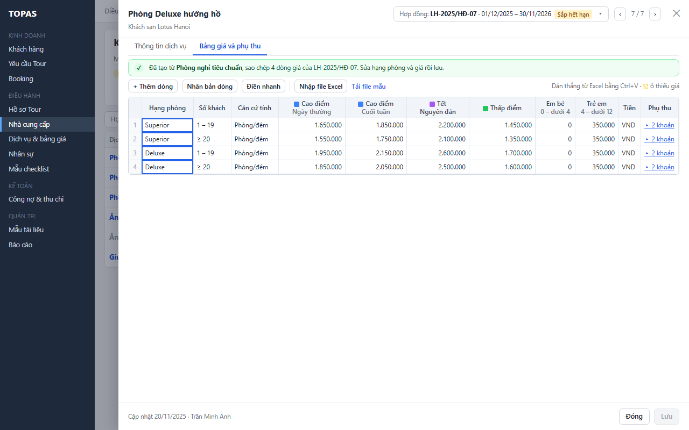

**L5.5 Xóa dịch vụ.** *Điều kiện:* Điều hành; dịch vụ chưa dùng (R13; quyết định 11/11/2026).

1. **W42 · Menu ⋯ → Xóa dịch vụ → hộp thoại.** Hộp thoại nêu những gì bị xóa kèm và không hoàn tác được. Điều hành bấm Xóa dịch vụ (hoặc Giữ lại để thôi); hệ thống kiểm tra lại R13 lúc ghi; dòng biến mất; số dịch vụ ở phần đầu giảm.

   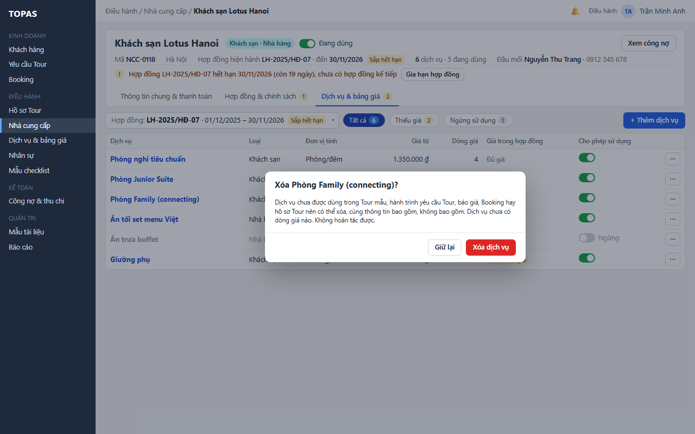

2. **W42a · Menu ⋯ của dịch vụ đã dùng.** Mục Xóa bị khóa, ghi số Tour mẫu, hành trình yêu cầu Tour, báo giá, Booking, hồ sơ Tour đang dùng (R13) và gợi ý tắt Cho phép sử dụng.

   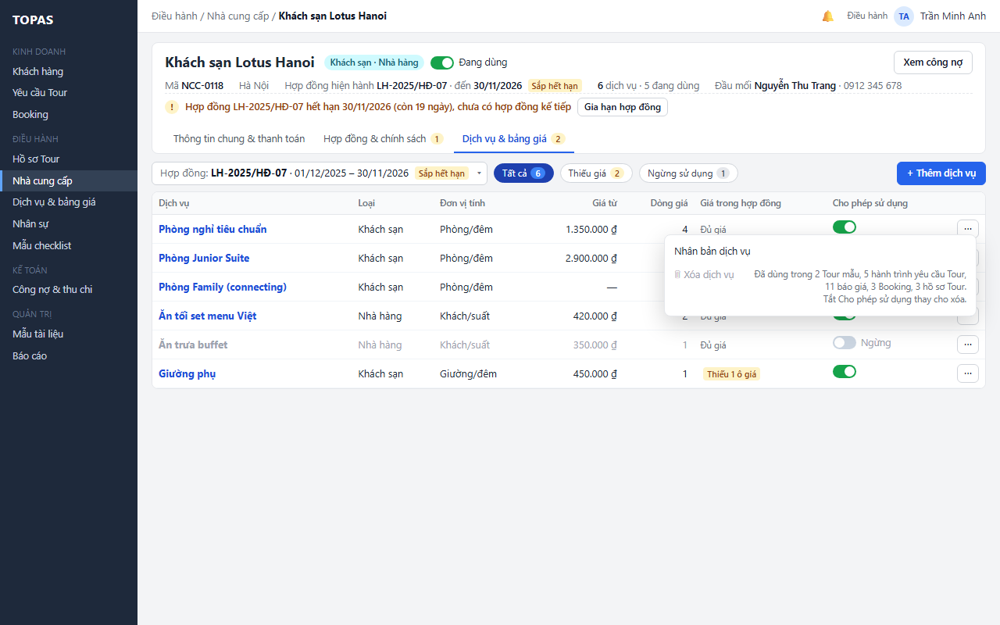

**Ngoại lệ**

- **E5.1.** NCC chưa có dịch vụ: bảng rỗng ghi “Chưa có dịch vụ” với nút Thêm dịch vụ trong vùng bảng (nút đầu bảng ẩn để giữ một chỗ bấm). Lọc Thiếu giá không có dòng: ghi “Mọi dịch vụ đã đủ giá trong hợp đồng này”, khác với chưa có dịch vụ.
- **E5.2.** NCC chưa có hợp đồng: ô chọn hợp đồng ghi “Chưa có hợp đồng”, cột giá trống, nút Thêm dịch vụ khóa kèm chú thích và liên kết sang DH03.2.
- **E5.3.** Lỗi lưu công tắc dịch vụ: trả công tắc về giá trị cũ, thông báo đỏ có Thử lại. Bấm Hoàn tác sau khi dịch vụ đã đổi ở phiên khác: thông báo không hoàn tác được.
- **E5.4.** Tên dịch vụ mới trùng tên dịch vụ khác của cùng NCC (không phân biệt hoa thường, dấu cách thừa): chặn lưu, lỗi cạnh ô Tên (R14).
- **E5.5.** Nhân bản lỗi: không tạo gì, hộp thoại giữ dữ liệu và báo Thử lại. Bấm lặp chỉ tạo một bản sao.
- **E5.6 · W42a.** Xóa dịch vụ đã dùng: không cho (R13).
- **E5.7.** Dịch vụ bị xóa hoặc đổi ở phiên khác khi đang xem danh sách: bấm dòng thì thông báo và tải lại danh sách.
- **E5.8.** Kế toán và Kinh doanh: không có công tắc, menu ⋯, nút Thêm dịch vụ; bấm dòng mở DH05 chỉ đọc.

### 3.6. Bảng trượt DH05 · Dịch vụ và bảng giá (CNHT01.05, CNHT01.06)

**L6.1 Mở, chuyển dịch vụ và đổi hợp đồng.** *Điều kiện:* mở từ DH03.3 (sửa theo quyền) hoặc DH04 (chỉ đọc).

1. **W27 · Bảng trượt rộng bên phải.** Bảng trượt mở bên phải, không rời hồ sơ NCC. Phần đầu: tên dịch vụ, tên NCC, ô chọn hợp đồng (đổi được ngay), nút ‹ › và vị trí “1 / 6” để chuyển dịch vụ trước, sau theo thứ tự danh sách đang lọc ở DH03.3. Hai tab Thông tin dịch vụ và Bảng giá và phụ thu; một nút Lưu cho cả hai tab.
2. **W39 · Ô chọn hợp đồng hoặc nút ‹ › khi còn thay đổi chưa lưu → hộp thoại.** Hộp thoại có Lưu và chuyển, Bỏ thay đổi và chuyển, Ở lại; hệ thống làm theo lựa chọn.

   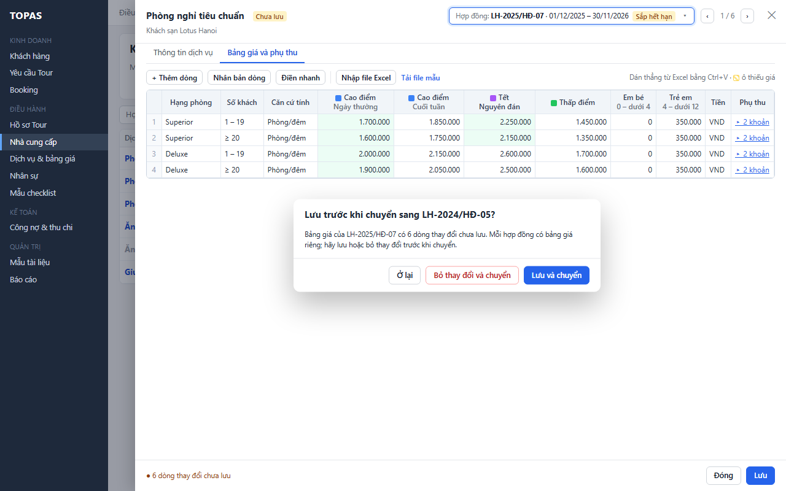

3. **W30 · Mở từ DH04: chế độ chỉ xem.** Chế độ này do RSD DH04 mục 2.5 đặc tả (bố cục, tab mặc định, ô Giá áp dụng, nút Sửa trong hồ sơ NCC); tài liệu này không đặc tả lại. Nút Sửa trong hồ sơ NCC (Điều hành) mở DH03.3 của NCC với đúng hợp đồng và dịch vụ, DH05 ở chế độ sửa như hình (1.2).

**L6.2 Thông tin dịch vụ, bao gồm và không bao gồm.** *Điều kiện:* Điều hành.

1. **W27 · Tab Thông tin dịch vụ, ô thẻ.** Tab gồm tên, loại dịch vụ (trong các loại của NCC), đơn vị tính, mô tả, công tắc Cho phép sử dụng. Dịch vụ bao gồm và không bao gồm nhập dạng thẻ: gõ rồi Enter để tạo thẻ, hoặc bấm thẻ gợi ý theo loại dịch vụ (QT05); thẻ đã có không hiện trong gợi ý.

   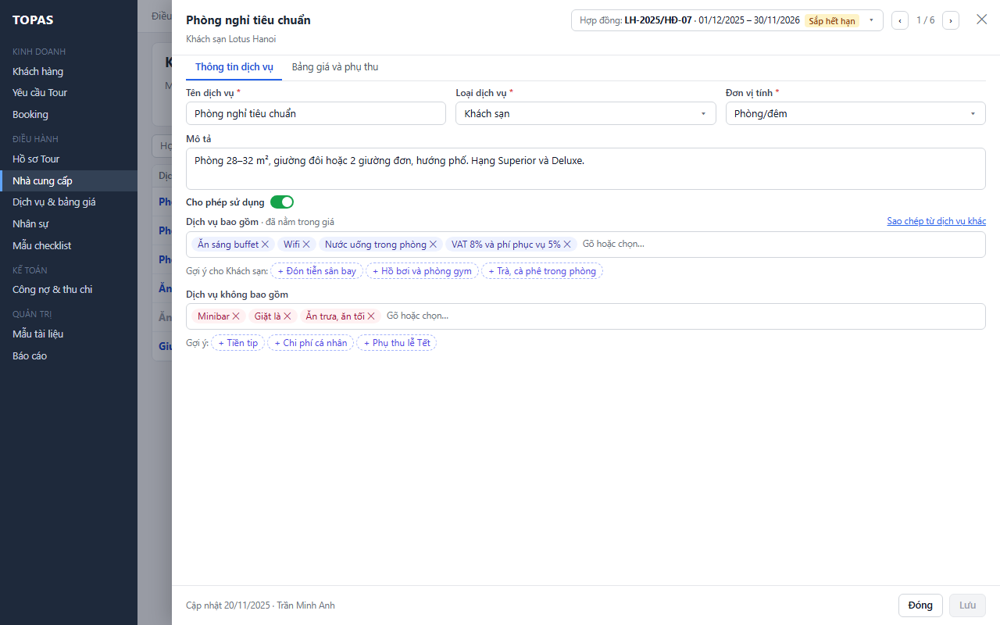

2. **W28 · Liên kết Sao chép từ dịch vụ khác → menu.** Menu liệt kê dịch vụ khác của NCC kèm số thẻ. Chọn một dịch vụ: các thẻ bao gồm và không bao gồm của dịch vụ đó được thêm vào (không tạo thẻ trùng, thẻ mới tô xanh cho tới khi lưu).

   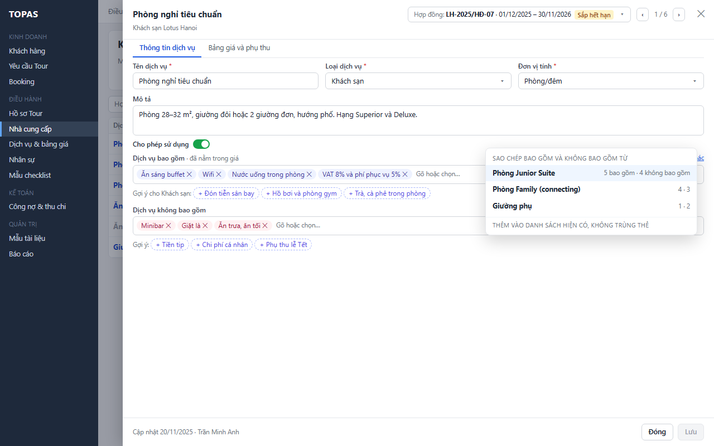

**L6.3 Nhập bảng giá dạng ma trận.** *Điều kiện:* Điều hành; dịch vụ có hợp đồng đang chọn.

1. **W30 · Tab Bảng giá và phụ thu, lưới giá.** Tab là lưới kiểu bảng tính của hợp đồng đang chọn. Mỗi dòng là một tổ hợp hạng phòng × khoảng số khách × căn cứ tính; mỗi cột giá là một mùa của hợp đồng (mùa tách cuối tuần thành hai cột Ngày thường, Cuối tuần); tiếp theo là các cột trẻ em theo nhóm tuổi của chính sách trẻ em, cột loại tiền, cột Phụ thu. Điều hành chỉ gõ giá vào ô, không nhập ngày; di chuyển giữa các ô bằng Tab, Enter, mũi tên. Hệ thống kiểm tra ô ngay khi rời ô. Rê chuột trên tiêu đề cột mùa hiện các khoảng ngày và thứ được tính là ngày thường.

   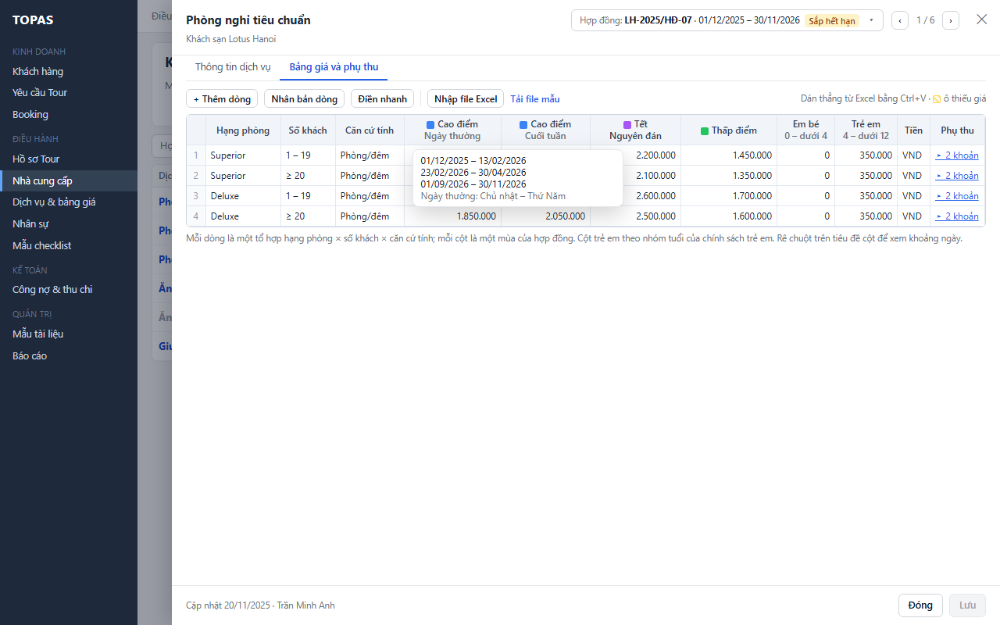

2. **W31 · Nút + Thêm dòng, Nhân bản dòng; chọn vùng → Điền nhanh → khung nổi.** Điều hành bấm + Thêm dòng (dòng mới lấy căn cứ tính, loại tiền, giá trẻ em của dòng đang chọn; ô giá mùa để trống và tô sọc thiếu giá) hoặc Nhân bản dòng. Chọn một vùng ô (kéo chuột hoặc Shift+mũi tên), bấm Điền nhanh: khung nổi cho nhập một giá cho mọi ô, hoặc chọn một dòng nguồn cộng chênh lệch, rồi bấm Điền n ô. Hệ thống điền và cập nhật số ô thiếu giá.

   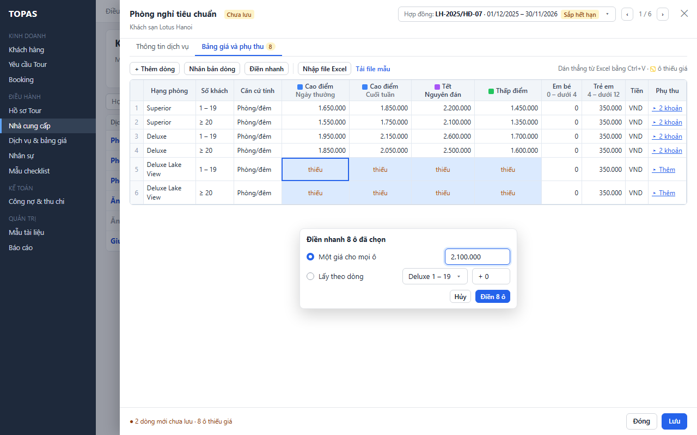

3. **W32 · Ctrl+V vào ô bất kỳ.** Dán từ Excel: dữ liệu điền từ ô đó sang phải và xuống dưới, tự thêm dòng khi cần. Ô hợp lệ nhận giá ngay (tô xanh nhạt); ô sai và dòng trùng tổ hợp tô đỏ, lý do hiện dưới dòng; banner nêu số dòng đã dán và số lỗi (R16). Lưu bị chặn tới khi sửa hết ô đỏ.

   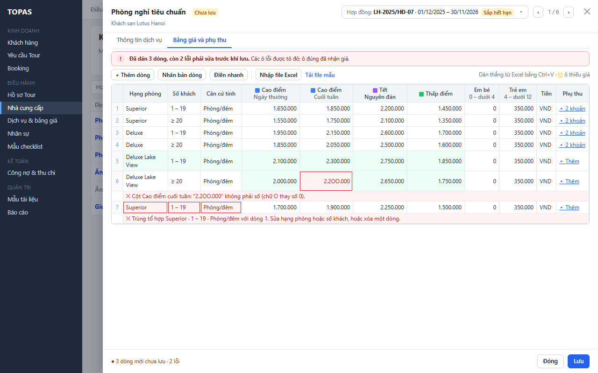

4. **W38 · Nút Lưu.** Điều hành sửa hết lỗi rồi bấm Lưu. Kết quả theo L6.6.

**L6.4 Phụ thu và quy tắc kết hợp.** *Điều kiện:* Điều hành.

1. **W33 · “▸ n khoản” (hoặc “▸ Thêm”) ở cột Phụ thu → phần mở rộng dưới dòng.** Phần mở rộng của dòng mở ngay dưới dòng, gồm phụ thu lễ Tết (ngày, mức, căn cứ, đối tượng, kết hợp), phụ thu phòng đơn, giá cơ sở cho phụ thu theo tỷ lệ, điều kiện áp dụng, quy tắc kết hợp với giá mùa (R15). Điều hành thêm ngày lễ, chọn kiểu phòng đơn, giá cơ sở, cách kết hợp; hệ thống kiểm tra R15 khi lưu. Bấm lại để thu gọn.

   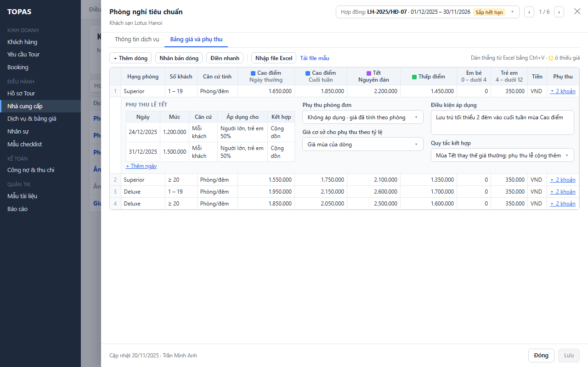

**L6.5 Nhập bảng giá từ file Excel (quyết định 11/11/2026).** *Điều kiện:* Điều hành.

1. **W34 · Nút Nhập file Excel (W30) → hộp thoại.** Hộp thoại có liên kết Tải file mẫu (sinh theo hợp đồng đang chọn: cột là các mùa và nhóm tuổi của hợp đồng), ô chọn file, lựa chọn xử lý dòng trùng tổ hợp: Cập nhật giá của dòng đã có và thêm dòng mới (mặc định), hoặc Thay toàn bộ bảng giá của dịch vụ trong hợp đồng này.

   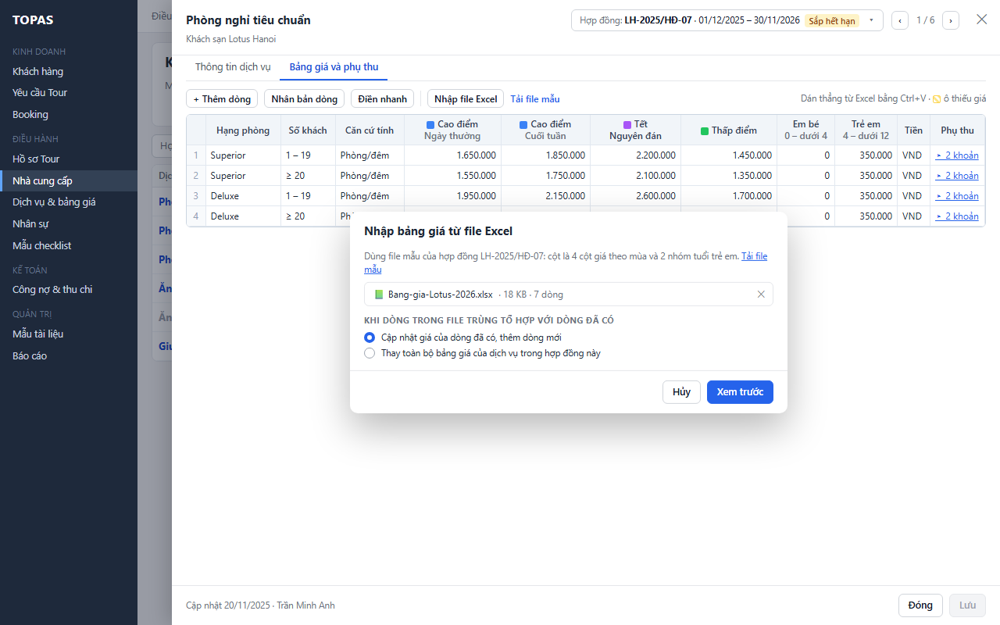

2. **W35 · Nút Xem trước.** Hệ thống đọc file, đối chiếu từng dòng (R16) và hiện số dòng Cập nhật, Mới, Lỗi; mỗi nhóm có chi tiết và ví dụ thay đổi; dòng lỗi có lý do. Liên kết Tải danh sách dòng lỗi.

   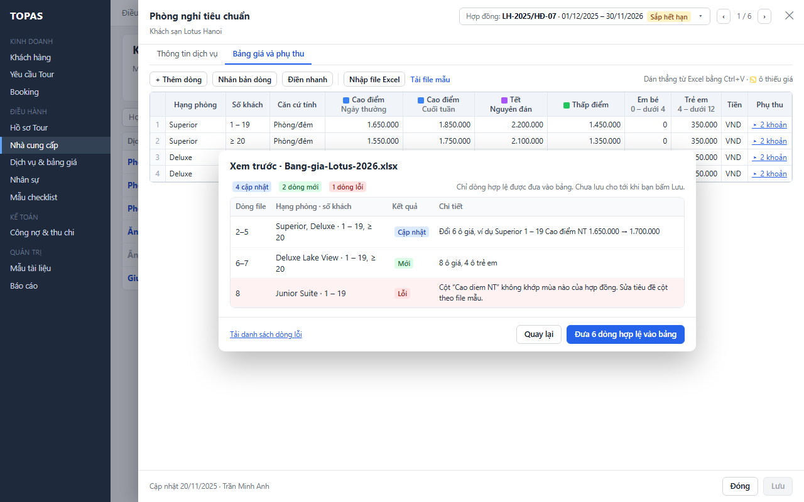

3. **W36 · Nút Đưa 6 dòng hợp lệ vào bảng.** Chỉ dòng hợp lệ vào lưới. Lưới hiện ô vừa nhập tô xanh; banner nêu số dòng đã đưa và số dòng lỗi bị bỏ qua. Dữ liệu **chưa lưu**; thanh dưới ghi “● 6 dòng thay đổi chưa lưu”.

   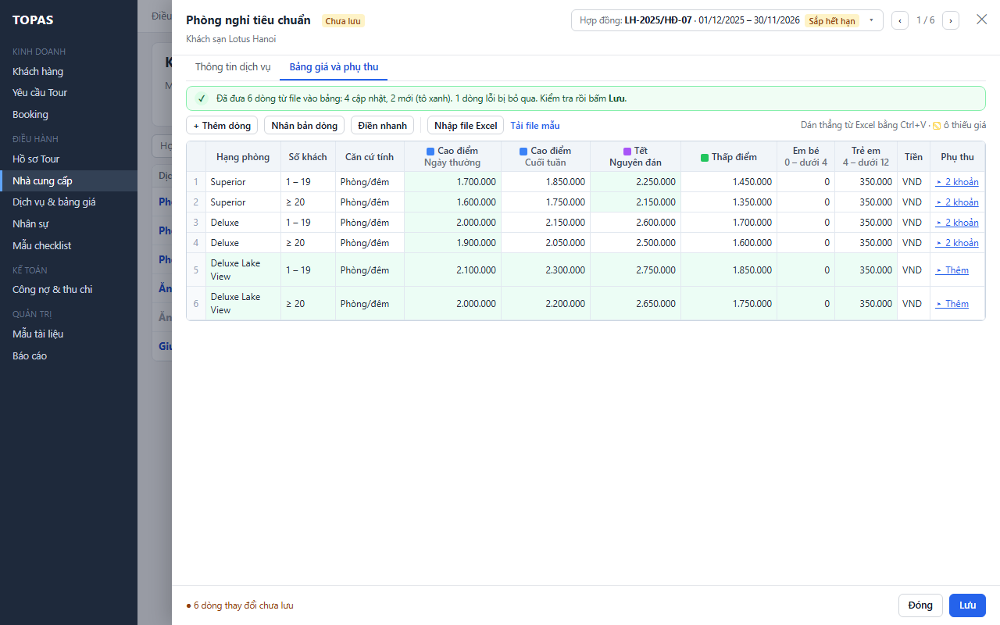

4. **W38 · Nút Lưu.** Điều hành kiểm tra rồi bấm Lưu (L6.6).

**L6.6 Lưu và đóng.** *Điều kiện:* Điều hành; có thay đổi.

1. **W38 · Nút Lưu ở thanh dưới.** Hệ thống kiểm tra cả hai tab (mục 5.2, R14, R15), lưu dịch vụ và toàn bộ dòng giá của hợp đồng đang chọn trong một giao dịch. Bảng trượt **ở lại**, thanh dưới ghi thời điểm lưu; thông báo ngắn có nút Dịch vụ tiếp theo ›, bấm thì mở dịch vụ kế tiếp theo thứ tự đang lọc ở DH03.3. Danh sách DH03.3 phía sau cập nhật giá từ, số dòng giá, tình trạng giá; số trên tab DH03.3 tính lại.

   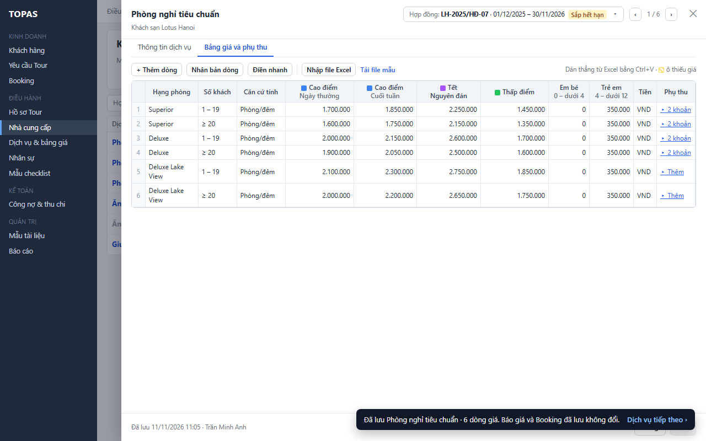

2. **W37 · Nút Đóng hoặc ✕ khi còn thay đổi chưa lưu → hộp thoại.** Hộp thoại có Lưu và đóng, Bỏ thay đổi, Ở lại; hệ thống làm theo lựa chọn.

   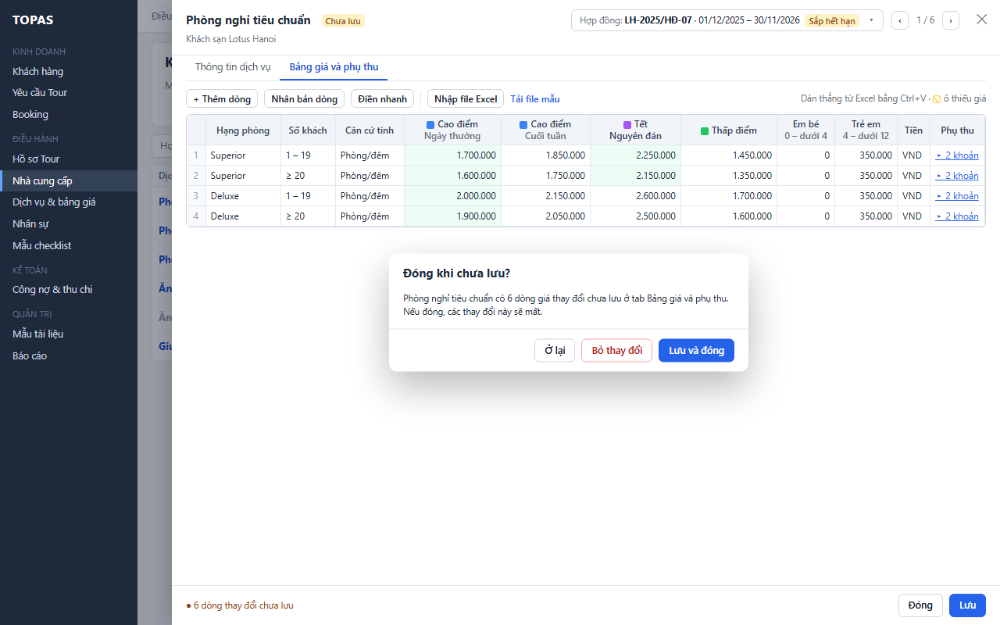

*Kết quả:* bảng giá mới dùng ngay cho lần tính giá mới ở KD06.3 và giá tham chiếu mới ở DH08.3; dữ liệu đã lưu ở các màn đó không đổi (R18).

**Ngoại lệ**

- **E6.1 · W32.** Ô giá không phải số, số âm, hoặc quá 15 chữ số: ô đỏ, chặn lưu. Dòng trùng tổ hợp (R14): ba ô khóa của dòng đỏ, chặn lưu.
- **E6.2.** Dòng thiếu loại tiền, thiếu căn cứ tính, khoảng số khách sai (từ > đến, chồng lấn với dòng cùng hạng phòng và căn cứ tính): lỗi trên ô, chặn lưu (R14).
- **E6.3.** Ô giá còn trống khi lưu: cho lưu; ô giữ sọc thiếu giá; dịch vụ có tình trạng Thiếu n ô giá (R14); báo giá sẽ báo thiếu giá cho ngày thuộc mùa đó, không dùng giá 0.
- **E6.4.** Dán vượt số cột của lưới: phần thừa bị bỏ, banner nêu “Bỏ qua n cột thừa”. Dán vào dịch vụ chỉ đọc: không làm gì.
- **E6.5 · W35.** File sai định dạng (không phải .xlsx), quá 5 MB hoặc quá 2.000 dòng, không có dòng tiêu đề khớp mẫu: hộp thoại báo lỗi, không đọc tiếp. Cột mùa không khớp mùa nào của hợp đồng, ô không phải số, dòng trùng tổ hợp trong chính file: dòng lỗi, bị bỏ qua khi đưa vào bảng.
- **E6.6.** Chọn Thay toàn bộ bảng giá: Xem trước nêu thêm số dòng hiện có sẽ bị xóa; nút đổi thành “Thay bảng giá bằng n dòng”.
- **E6.7 · W39.** Đổi hợp đồng hoặc chuyển dịch vụ khi chưa lưu: hỏi trước (L6.1 bước 2).
- **E6.8.** Dịch vụ hoặc bảng giá bị sửa ở phiên khác: chặn lưu, giữ dữ liệu, banner cho xem bản mới (cùng mẫu W07). Không ghi đè từng ô.
- **E6.9.** Lỗi lưu: giao dịch hoàn tác, không lưu dở một phần; thanh dưới báo lỗi có Thử lại; dữ liệu trong lưới giữ nguyên.
- **E6.10.** Hợp đồng đang chọn Hết hạn: vẫn sửa được (dùng để tra lại giá cũ); banner xanh “Hợp đồng đã hết hạn. Sửa giá không ảnh hưởng báo giá, Booking đã lưu.”
- **E6.11.** Hợp đồng chưa có chính sách trẻ em: không có cột trẻ em; dòng gợi ý “Thêm nhóm tuổi ở DH03.2 để nhập giá trẻ em” kèm liên kết mở bảng trượt hợp đồng ở mục Chính sách trẻ em.
- **E6.12.** Dịch vụ không phải lưu trú (nhà hàng, vận chuyển): cột Hạng phòng ẩn; phụ thu phòng đơn không hiện (R14).

### 3.7. Góc nhìn theo vai trò

**L7.1 Kinh doanh xem hồ sơ NCC.** *Điều kiện:* Kinh doanh.

1. **W43 · Xem hợp đồng và chính sách ở DH04, hoặc đường dẫn được chia sẻ.** Kinh doanh mở DH03 từ DH04 hoặc từ đường dẫn được chia sẻ; Kinh doanh không có quyền xem DH02. Tiêu đề có “Chỉ xem”; không có công tắc, nút Xem công nợ; phần Thông tin nhận thanh toán không hiện.

   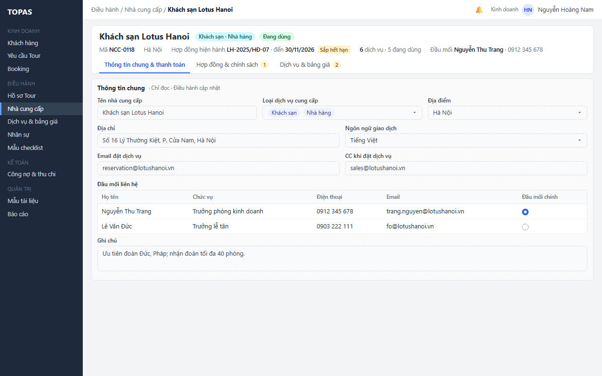

2. **W44 · Bấm dòng hợp đồng ở DH03.2 → bảng trượt chỉ xem.** Kinh doanh xem kỳ hiệu lực, mùa giá, chính sách đổi hủy và trẻ em khi tư vấn khách; chuyển mục trên thanh mục lục, bấm Đóng để đóng. Thanh mục lục không có mục Điều khoản thanh toán; danh sách không có cột Thanh toán.

   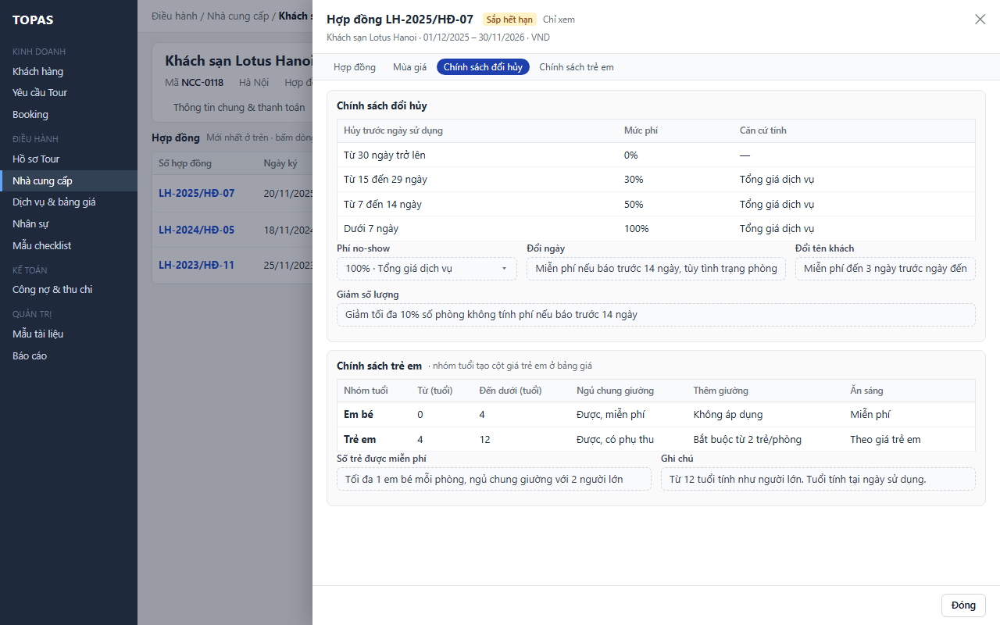

3. **W24 · Bấm dòng ở DH03.3 → DH05 chỉ xem.** Kinh doanh xem dịch vụ và bấm dòng để xem DH05 ở chế độ chỉ xem theo RSD DH04 mục 2.5, nhưng không có ô Giá áp dụng và nút Sửa trong hồ sơ NCC.

**Ngoại lệ**

- **E7.1.** Kinh doanh gọi thẳng API phần thanh toán: máy chủ không trả các trường thanh toán (R04).
- **E7.2.** Quyền của người dùng bị đổi khi đang mở hồ sơ: lần lưu tiếp theo bị từ chối với thông báo “Bạn không còn quyền sửa phần này”; tải lại hồ sơ theo quyền mới.

---

## 4. Quy tắc triển khai chi tiết

### R01. Tình trạng hợp đồng và hợp đồng hiện hành

- **Cấp NCC** (phần đầu DH03, DH02, DH04): hợp đồng hiện hành, hợp đồng kế tiếp và tình trạng Chưa có hợp đồng, Hết hạn, Sắp hết hạn, Còn hiệu lực theo **R01 của RSD DH02**. Vì kỳ không chồng lấn (R06), mỗi ngày có tối đa một hợp đồng chứa ngày đó.
- **Từng hợp đồng** (dòng ở DH03.2, ô chọn hợp đồng ở DH03.3, DH05), tính theo ngày hiện tại, xét theo thứ tự (n = Hiệu lực đến − hôm nay, N = ngưỡng, mặc định 30, cấu hình R21):
  1. Hôm nay < Hiệu lực từ → **Sắp áp dụng**.
  2. Hôm nay > Hiệu lực đến → **Hết hạn**.
  3. 0 ≤ n ≤ N và không có hợp đồng kế tiếp → **Sắp hết hạn**, kèm “còn n ngày”.
  4. Còn lại → **Còn hiệu lực**. Khi n ≤ N và có hợp đồng kế tiếp, ghi “HĐ kế tiếp từ dd/mm” thay cho “còn n ngày” (cùng cách ghi với DH02).
- Cập nhật lúc 00:00 và mỗi khi lưu hợp đồng. Tình trạng không phải trạng thái người dùng chọn, không có bước duyệt. Hợp đồng hết hạn vẫn giữ để tra cứu.

### R02. Hợp đồng áp dụng cho ngày sử dụng

- Hợp đồng áp dụng cho một dịch vụ vào ngày D là hợp đồng của NCC có kỳ chứa D. DH03 cung cấp quy tắc này cho KD06.3 (tính giá), DH08.3 (giá tham chiếu, gợi ý phí hủy) và KT01.2 (lịch trả).
- Không có hợp đồng chứa D: màn dùng hiển thị cảnh báo “Không có hợp đồng cho …” kèm ngày hoặc khoảng ngày thiếu (cùng câu với RSD DH04 R08), không tự lấy hợp đồng khác.
- Dịch vụ kéo dài nhiều ngày (lưu trú) qua hai hợp đồng: mỗi đêm lấy giá theo hợp đồng và mùa của đêm đó; chính sách đổi hủy và điều khoản thanh toán lấy theo hợp đồng của ngày sử dụng đầu tiên.

### R03. Việc cần xử lý của NCC và số trên tab

Danh sách việc, theo thứ tự hiển thị. Chỉ tính khi NCC Đang dùng.

| Thứ tự | Việc | Điều kiện | Nút | Mở tới |
|---|---|---|---|---|
| 1 | Chưa có hợp đồng còn hiệu lực (đỏ) | Không có hợp đồng chứa hôm nay (tình trạng Chưa có hợp đồng hoặc Hết hạn theo R01 của RSD DH02) | Thêm hợp đồng (Điều hành) | DH03.2, mở bảng trượt thêm hợp đồng (điền sẵn R11) |
| 2 | Hợp đồng … hết hạn …, chưa có hợp đồng kế tiếp (vàng) | Hợp đồng hiện hành Sắp hết hạn, chưa có HĐ kế tiếp | Gia hạn hợp đồng (Điều hành) | DH03.2, mở hộp thoại Gia hạn |
| 3 | Thiếu email đặt dịch vụ (vàng) | Email đặt dịch vụ trống | Nhập email (Điều hành) | DH03.1, đặt con trỏ ở ô Email đặt dịch vụ |
| 4 | Thiếu thông tin nhận thanh toán (vàng) | Tên thụ hưởng, ngân hàng hoặc số tài khoản trống | Nhập thông tin thanh toán (Kế toán) | DH03.1, phần thanh toán |

- Nút ẩn khi người dùng không có quyền xử lý việc đó (câu ghi thêm “· … nhập”), hoặc khi nơi xử lý đang hiện trên màn (việc 1, 2 khi đang ở DH03.2).
- Số trên tab theo mục 2.2. Dịch vụ thiếu giá chỉ hiện ở số trên tab DH03.3, không thành dòng việc ở phần đầu.
- Việc 1 tương ứng tình trạng Chưa có hợp đồng hoặc Hết hạn, việc 2 tương ứng Sắp hết hạn, việc 4 tương ứng Thiếu thông tin thanh toán trong R03 của RSD DH02. Việc 3 chỉ hiện trong DH03.
- **Thời điểm tính lại.** Lúc 00:00 hằng ngày (cùng R01) và ngay sau khi lưu hợp đồng, gia hạn, xóa hợp đồng, lưu email đặt dịch vụ hoặc thông tin nhận thanh toán. Lưu, gia hạn, xóa hợp đồng còn tính lại số trên tab DH03.3 theo hợp đồng để xem giá. Nhãn tình trạng, phần đầu, số trên tab và bộ lọc Cần xử lý ở DH02 cập nhật theo; đủ thông tin thanh toán thì NCC ra khỏi Cần xử lý ở DH02 (thiếu email không thuộc Cần xử lý của DH02).
- **Thông báo.** Thông báo nhắc lúc 08:00 hằng ngày khi hợp đồng vào ngưỡng hoặc vừa hết hạn và NCC Đang dùng do RSD DH02 R08 sinh ra, gửi nhóm Điều hành, mở DH03.2 của NCC. Thông báo khi tắt NCC đang được dùng theo R05 (RSD DH02 R04), mở DH08.3. DH03 là nơi người nhận đến xử lý; ngoài hai thông báo này DH03 không gửi thông báo nào khác.

### R04. Quyền theo phần, lưu theo phần và đồng thời

- Hồ sơ chia thành các phần ghi độc lập, mỗi phần có phiên bản riêng: Thông tin chung (gồm đầu mối); Thông tin nhận thanh toán; Cho phép sử dụng NCC; mỗi hợp đồng gồm phần Hợp đồng và chính sách (hợp đồng, mùa, đổi hủy, trẻ em) và phần Điều khoản thanh toán; mỗi dịch vụ gồm thông tin dịch vụ và bảng giá theo từng hợp đồng.
- Một nút Lưu gửi mọi phần đã đổi mà người dùng có quyền sửa. Máy chủ bỏ qua và ghi cảnh báo nhật ký nếu nhận dữ liệu của phần không có quyền.
- Phiên bản của phần đã đổi so với lúc mở: từ chối cả lượt lưu, giữ dữ liệu trên form, hiện banner W07 với Xem bản mới. Hai người sửa hai phần khác nhau: cả hai lưu được.
- Trường thanh toán (thông tin nhận thanh toán, điều khoản thanh toán) không được trả về cho vai trò Kinh doanh ở mọi API của DH03, DH04, DH05.

### R05. Cho phép sử dụng NCC và dịch vụ (quyết định 11/11/2026)

- **NCC:** theo R04 và R05 của RSD DH02 (dùng chung cho DH02 và phần đầu DH03): bật lưu ngay; tắt khi NCC không được dùng ở đâu thì lưu ngay, đang được dùng thì xác nhận ở W08; Hoàn tác 10 giây; tác động lên hạng mục chưa gửi và thông báo cho Điều hành phụ trách hồ sơ Tour; một lịch sử chung.
- **Dịch vụ:** bật hoặc tắt lưu ngay trên dòng DH03.3 hoặc trong DH05.1, không hỏi, có Hoàn tác 10 giây (W26).
- **Tác động chung** của NCC Ngừng sử dụng hoặc dịch vụ Ngừng sử dụng: không hiện trong danh sách chọn mới ở Tour mẫu (KD02.2), yêu cầu Tour và báo giá (KD06), thêm dịch vụ của hồ sơ Tour (DH08.2), đặt dịch vụ và đặt lại (DH08.3); DH04 mặc định ẩn. Tour mẫu, hành trình, báo giá, Booking, hạng mục và lần đặt của hồ sơ Tour, hợp đồng, bảng giá và công nợ giữ nguyên. Yêu cầu Tour đang dở có dịch vụ đó bị khóa Tính giá ở KD06 cho tới khi đổi dịch vụ (RSD KD06 R10). Hồ sơ Tour tạo sau khi tắt thì hạng mục để trống NCC (RSD DH07 R03).
- Tắt NCC không đổi công tắc của từng dịch vụ; bật lại NCC thì dịch vụ trở về trạng thái riêng của mình.
- Hồ sơ NCC Ngừng sử dụng vẫn sửa được ở mọi tab (Kế toán vẫn cập nhật thanh toán, RSD DH02 E1.7). KT01.2 vẫn ghi phải trả, chi trả cho NCC.

### R06. Kỳ hiệu lực hợp đồng (quyết định 11/11/2026)

- Hai hợp đồng của cùng NCC không được có ngày chung (tính cả hai đầu). Vi phạm thì chặn lưu (W16).
- Lỗi nêu hợp đồng bị trùng, số ngày trùng và gợi ý: ngày bắt đầu hợp lệ gần nhất = ngày kết thúc của hợp đồng trùng + 1, hoặc sửa kỳ của hợp đồng kia.
- Được để khoảng trống giữa hai hợp đồng. Khoảng trống làm phần đầu hiện việc Chưa có hợp đồng còn hiệu lực khi hôm nay rơi vào đó.
- Thu ngắn kỳ của hợp đồng đã có mùa: khoảng mùa vượt ra ngoài kỳ mới bị cắt theo kỳ, hệ thống báo số ngày bị cắt trước khi lưu.

### R07. Mùa giá

- Mỗi hợp đồng có ít nhất một mùa. Mùa có tên (không trùng trong hợp đồng), một hoặc nhiều khoảng ngày nằm trong kỳ, màu tự gán theo thứ tự.
- Các khoảng của mọi mùa không chồng lấn: chặn lưu (W13). Ngày trong kỳ chưa thuộc mùa nào: cảnh báo, cho lưu (W12).
- Ngày cuối tuần khai một lần cho hợp đồng. Mùa bật Tách cuối tuần có hai loại ngày: Cuối tuần (các thứ đã khai) và Ngày thường (các thứ còn lại); DH05.2 có hai cột giá. Với lưu trú, loại ngày tính theo đêm (ngày nhận phòng của đêm đó).
- Bật tách khi đã có giá: ô Cuối tuần lấy bằng ô cũ. Tắt tách: giữ giá Ngày thường, xóa giá Cuối tuần sau khi xác nhận nếu hai giá khác nhau.
- Đổi ngày mùa: mọi dòng giá dùng mùa tự theo ngày mới; chú thích khoảng ngày trên tiêu đề cột mùa ở DH05.2 đổi theo. Xóa mùa đã có giá: xác nhận (W22); giá của mùa bị xóa khi lưu.
- Kỳ lễ có giá thay hẳn giá thường thì khai là mùa riêng (ví dụ Tết Nguyên đán); kỳ lễ chỉ cộng thêm tiền thì dùng phụ thu lễ Tết ở dòng giá (R15).

### R08. Chính sách đổi hủy và gợi ý phí hủy

- Bảng mốc: mỗi mốc là “hủy trước ngày sử dụng từ X ngày trở lên”, X không trùng. Hệ thống sắp X giảm dần và hiển thị khoảng (X đến mốc trên − 1).
- **Gợi ý phí hủy ở DH08.3:** số ngày trước = ngày sử dụng đầu tiên − ngày ghi yêu cầu hủy (ngày lịch). Chọn mốc có X lớn nhất mà X ≤ số ngày trước. Phí = mức × căn cứ (tổng giá của lần đặt, đêm đầu, mỗi khách hoặc mỗi phòng); với căn cứ là giá, dùng giá NCC xác nhận nếu có, nếu không dùng giá tham chiếu. Không có mốc phù hợp: không gợi ý. Không đến (no-show): dùng mức no-show. Điều hành sửa được phí gợi ý (nguồn TN06.04).
- Hợp đồng dùng để gợi ý: hợp đồng áp dụng cho ngày sử dụng (R02), không phải hợp đồng hiện hành.
- Điều kiện đổi ngày, đổi tên, giảm số lượng là văn bản hiển thị ở DH08.3 khi Điều hành gửi điều chỉnh; không tự tính phí.

### R09. Chính sách trẻ em

- Nhóm tuổi có “từ” và “đến dưới”: trẻ thuộc nhóm khi từ ≤ tuổi < đến dưới. Các nhóm không chồng lấn; được có khoảng trống (tuổi ngoài mọi nhóm tính như người lớn).
- Tuổi tính tại ngày sử dụng đầu tiên của dịch vụ, theo ngày sinh của khách (KD06.3 dùng cơ cấu tuổi nhập khi tính giá).
- Mỗi nhóm tạo một cột giá trẻ em ở DH05.2 cho mọi dòng giá của hợp đồng. Thêm nhóm: cột mới trống (ô sọc thiếu giá), số trên tab DH03.3 tính lại. Xóa nhóm đã có giá: xác nhận như W22. Sửa tuổi của nhóm không đổi giá đã nhập.
- Điều kiện ngủ chung giường, thêm giường, ăn sáng và số trẻ miễn phí là dữ liệu cho KD06.3 áp khi tính giá (TN03.06); DH03 không tự tính.

### R10. Điều khoản thanh toán (quyết định 11/11/2026)

- Điều hành nhập khi tạo hoặc sửa hợp đồng; Kế toán sửa được phần này (W23). Không nhập vẫn lưu được hợp đồng; khi đó KT01.2 không điền sẵn lịch trả.
- Mỗi đợt có loại: Tỷ lệ (% tổng giá trị phải trả của dịch vụ), Số tiền (theo loại tiền của hợp đồng) hoặc Phần còn lại. Mốc tính hạn: Sau khi NCC xác nhận, Trước ngày sử dụng, Sau khi kết thúc Tour; số ngày nguyên ≥ 0.
- Mọi đợt là Tỷ lệ: tổng phải bằng 100% (W15a). Có đợt Số tiền: phải có đúng một đợt Phần còn lại, đặt cuối.
- KT01.2 tính hạn từng đợt theo mốc của dịch vụ cụ thể và điền sẵn; Kế toán sửa ở KT01.2. Sửa điều khoản ở DH03 không đổi lịch trả đã ghi.
- **Đợt Số tiền khi khoản phải trả khác loại tiền.** Khoản phải trả theo loại tiền của lần đặt (R14), có thể khác loại tiền của hợp đồng. Khi đó KT01.2 không điền sẵn số tiền của đợt Số tiền, Kế toán nhập, có cảnh báo; đợt Tỷ lệ vẫn điền sẵn; đợt Phần còn lại tính lại sau khi Kế toán nhập số tiền đợt Số tiền (quyết định của người dùng 12/11/2026, rà soát lần ba; RSD KT01 R08, R11).

### R11. Điền sẵn khi thêm hợp đồng

- Hợp đồng đầu tiên của NCC: kỳ từ hôm nay, đến hôm nay + 12 tháng − 1 ngày; loại tiền VND; một mùa “Cả kỳ hợp đồng” bằng cả kỳ; cuối tuần Thứ Bảy, Chủ nhật; các bảng chính sách và điều khoản trống.
- Đã có hợp đồng: nguồn là hợp đồng có Hiệu lực đến muộn nhất. Kỳ mới từ (Hiệu lực đến của nguồn + 1) và dài bằng kỳ của nguồn (tối đa 12 tháng). Sao chép loại tiền, cuối tuần, mùa (dời ngày theo R12), chính sách đổi hủy, chính sách trẻ em, điều khoản thanh toán. Không sao chép số hợp đồng, ngày ký, file, dòng giá.
- Mọi trường điền sẵn có nhãn nhỏ (Mặc định, Nối tiếp kỳ trước, Từ HĐ trước) cho tới khi người dùng sửa.

### R12. Gia hạn hợp đồng

- Chỉ có trên hợp đồng có Hiệu lực đến muộn nhất của NCC. Là nút chính trên dòng khi hợp đồng Sắp hết hạn hoặc Hết hạn; với hợp đồng Còn hiệu lực hoặc Sắp áp dụng, Gia hạn nằm trong menu ⋯.
- **Dời ngày mùa:** mỗi khoảng ngày được dời cùng ngày/tháng sang năm tương ứng trong kỳ mới; khoảng vượt ra ngoài kỳ mới bị cắt; 29/02 thành 28/02. Mùa có đánh dấu Theo âm lịch được gắn nhãn **Cần kiểm tra ngày**; nhãn mất khi người dùng sửa khoảng ngày của mùa hoặc chọn Đã kiểm tra.
- **Sao chép bảng giá:** mọi dòng giá, giá trẻ em và phụ thu của mọi dịch vụ (kể cả dịch vụ đang ngừng sử dụng) sang hợp đồng mới, ô giá gắn với mùa tương ứng đã sao chép. Phụ thu theo ngày cụ thể được dời ngày như mùa.
- **Điều chỉnh giá:** giá mới = làm tròn(giá cũ × (1 + p%), đơn vị làm tròn), làm tròn nửa lên. Áp cho ô giá mùa, giá trẻ em kiểu cố định và phụ thu kiểu số tiền. Giá trẻ em và phụ thu kiểu tỷ lệ giữ nguyên tỷ lệ. Ví dụ 1.650.000 × 1,05 = 1.732.500 → 1.733.000.
- **Giao dịch:** hợp đồng, mùa, chính sách, điều khoản và mọi dòng giá được tạo trong một giao dịch khi bấm Lưu và sao chép bảng giá; lỗi thì không tạo gì (E4.12). Hộp thoại W18 không tạo dữ liệu.
- Lưu ID hợp đồng nguồn và tỷ lệ điều chỉnh vào hợp đồng mới để tra cứu.

### R13. Xóa và điều kiện “đã dùng” (quyết định 11/11/2026)

| Đối tượng | Đã dùng khi có ít nhất một | Chưa dùng | Đã dùng |
|---|---|---|---|
| Hợp đồng | Báo giá (bất kỳ phiên bản) có khoản giá lấy từ hợp đồng; Booking; lần đặt dịch vụ có hợp đồng áp dụng; khoản phải trả có lịch trả lấy từ điều khoản của hợp đồng | Xóa sau xác nhận, kèm mùa, chính sách, điều khoản, dòng giá (W21) | Mục Xóa khóa, ghi lý do và số lượng (W21a) |
| Dịch vụ | Tour mẫu; hành trình yêu cầu Tour (KD06.2); báo giá; Booking; hạng mục hồ sơ Tour | Xóa sau xác nhận, kèm thẻ và dòng giá (W42) | Mục Xóa khóa, gợi ý tắt (W42a) |
| NCC | — | Không có thao tác xóa NCC trong DH03 | Tắt Cho phép sử dụng |
| Mùa, nhóm tuổi, dòng giá, phụ thu | — | Xóa trong form, có xác nhận khi đang có giá; lưu mới có hiệu lực | Như cột trái; dữ liệu đã lưu ở module khác không đổi vì đã lưu bản chụp (R18) |

- Kiểm tra “đã dùng” lại lúc ghi trên máy chủ; nếu vừa được dùng ở phiên khác thì từ chối xóa và hiện lý do.

### R14. Dòng giá, tổ hợp và tình trạng giá

- **Khóa tổ hợp** của dòng trong một dịch vụ và một hợp đồng: hạng phòng (nếu có) + khoảng số khách + căn cứ tính. Hai dòng cùng hạng phòng và căn cứ tính không được có khoảng số khách giao nhau (trùng hoặc chồng lấn đều chặn lưu).
- **Căn cứ tính:** theo khách, phòng, đoàn hoặc đơn vị dịch vụ; mặc định theo đơn vị tính của dịch vụ (Phòng/đêm → phòng; Khách/suất → khách). Số lượng tính ở KD06.3 phải tương ứng căn cứ, không nhân lặp số khách và số phòng.
- **Tính theo đêm:** dịch vụ có đơn vị tính theo đêm (Phòng/đêm, Cabin/đêm…; cờ “theo đêm” của đơn vị tính ở QT05, R21) được tính giá cho từng đêm, loại ngày lấy theo ngày nhận phòng của đêm đó (R07). Đơn vị tính khác được tính theo ngày sử dụng. KD06.3 và DH04 (RSD DH04 R03) dùng cờ này.
- **Dòng chính** của dịch vụ trong một hợp đồng là các dòng có căn cứ tính trùng căn cứ mặc định theo đơn vị tính. Dòng có căn cứ khác (ví dụ thêm giường theo khách), giá trẻ em và phụ thu không phải dòng chính.
- **Cột Hạng phòng** chỉ có với dịch vụ thuộc loại lưu trú (khách sạn, du thuyền theo cấu hình loại dịch vụ). Loại khác ẩn cột.
- **Loại tiền** từng dòng: mỗi dòng giá có loại tiền riêng, mặc định loại tiền của hợp đồng; được chọn loại tiền khác hợp đồng (ví dụ phụ phí USD trong hợp đồng VND). Không cộng trực tiếp các khoản khác loại tiền. Loại tiền của dòng giá là loại tiền điền sẵn của giá tham chiếu và của khoản phải trả khi đặt dịch vụ ở DH08.3; Điều hành sửa được khi ghi giá xác nhận hoặc phí hủy ở DH08.3 (quyết định 12/11/2026; RSD DH08, RSD KT01 R04).
- **Thứ tự** của dòng trong một dịch vụ và một hợp đồng là vị trí dòng trong lưới DH05.2, số nguyên tăng dần từ 1. Hệ thống tự cấp: dòng thêm mới ở cuối, dòng nhân bản ngay dưới dòng nguồn, dán và nhập file theo thứ tự dòng trong file; Điều hành đổi bằng cách kéo dòng lên, xuống trong lưới. Gia hạn (R12) và nhân bản dịch vụ (R17) giữ thứ tự. Thứ tự chỉ áp trong cùng hạng phòng: khi nhiều dòng chính cùng hạng phòng cùng khớp, DH04 (RSD DH04 R04) và KD06.3 lấy dòng có thứ tự nhỏ nhất. Khác hạng phòng thì không so thứ tự: DH04 khi chưa lọc hạng phòng hiện mức thấp nhất kèm “+ n hạng khác”; KD06.3 tính theo hạng phòng của điều kiện tính, chưa có hạng phòng thì lấy hạng phòng có giá thấp nhất (RSD KD06 R13) (quyết định 12/11/2026, rà soát lần ba).
- **Thiếu giá:** ô giá mùa hoặc ô trẻ em trống. Tình trạng giá của dịch vụ trong một hợp đồng: Chưa có giá (không có dòng nào), Thiếu n ô giá (có ô trống), Đủ giá. Giá 0 là giá hợp lệ (miễn phí), khác ô trống.
- **Giá từ** (dùng chung cho DH03.3 và DH04): giá nhỏ nhất trong các ô giá mùa (mọi mùa, mọi loại ngày) của **dòng chính** trong hợp đồng đang xem, theo loại tiền của hợp đồng; dịch vụ có dòng chính loại tiền khác thì ghi thêm “và giá USD”. Hợp đồng đang xem là hợp đồng đang chọn ở DH03.3, hoặc hợp đồng để xem giá ở DH04. Giá từ và tình trạng giá tính lại mỗi khi lưu bảng giá; DH03.3 và DH04 hiện giá trị mới.
- **Tên dịch vụ** không trùng trong cùng NCC (so sánh không phân biệt hoa thường, bỏ dấu cách thừa).

### R15. Phụ thu và quy tắc kết hợp

- Phụ thu lễ Tết theo ngày hoặc khoảng ngày (trong kỳ hợp đồng), mức là số tiền hoặc tỷ lệ, căn cứ (mỗi khách, mỗi phòng, mỗi đêm, mỗi đơn vị), đối tượng (người lớn, trẻ em theo nhóm, tỷ lệ cho trẻ em), kết hợp **Cộng dồn** (cộng vào giá mùa) hoặc **Thay thế** (dùng thay giá mùa ngày đó).
- Phụ thu phòng đơn: Không áp dụng (giá đã theo phòng), Giá phòng đơn trọn gói, hoặc Phụ thu thêm (số tiền hoặc tỷ lệ, theo khách, phòng, đêm). Không cộng phụ thu khi giá đã gồm phòng đơn.
- Phụ thu theo tỷ lệ phải chọn giá cơ sở (giá mùa của dòng, hoặc giá ngày thường của mùa).
- Quy tắc kết hợp và điều kiện áp dụng là dữ liệu cho KD06.3 tính giá (TN03.06); DH03 chỉ kiểm tra đủ trường. Ngày phụ thu trùng một mùa có giá thay thế (ví dụ ngày trong mùa Tết) mà kết hợp là Cộng dồn: cảnh báo “Phụ thu sẽ cộng vào giá mùa Tết”, vẫn cho lưu.

### R16. Dán và nhập file Excel (quyết định 11/11/2026)

- **Dán:** dữ liệu dạng bảng (tab và xuống dòng) điền từ ô đang chọn; tự thêm dòng; số dạng “1.650.000”, “1,650,000”, “1650000” đều được hiểu theo cài đặt loại tiền; ô không hiểu được thì đỏ (E6.1). Dán không tự lưu.
- **File mẫu** sinh theo hợp đồng đang chọn: cột Hạng phòng (nếu có), Số khách từ, Số khách đến, Căn cứ tính, một cột cho mỗi mùa và loại ngày (tên đúng như tiêu đề cột ở DH05.2), một cột cho mỗi nhóm tuổi, Loại tiền.
- **Đối chiếu:** dòng file khớp khóa tổ hợp (R14) với dòng đã có thì Cập nhật (chỉ các ô khác giá trị), không khớp thì Mới. Lỗi dòng: tiêu đề cột không khớp mùa, ô không phải số, khóa thiếu, trùng khóa trong file. Chế độ Thay toàn bộ: mọi dòng hiện có không có trong file sẽ bị xóa.
- Giới hạn: .xlsx, ≤ 5 MB, ≤ 2.000 dòng. Đưa vào bảng không lưu; người dùng bấm Lưu (L6.5). Danh sách dòng lỗi tải về dạng .xlsx kèm cột Lý do.

### R17. Nhân bản dịch vụ

- Tạo dịch vụ mới cùng NCC với tên người dùng nhập (không trùng, R14), trạng thái Đang dùng.
- Sao chép theo lựa chọn: thông tin (loại, đơn vị tính, mô tả), thẻ bao gồm và không bao gồm, bảng giá (dòng, ô giá, giá trẻ em, phụ thu) của hợp đồng đang chọn hoặc của mọi hợp đồng. Không sao chép lịch sử và số lần dùng.
- Tạo trong một giao dịch rồi mở DH05 của dịch vụ mới (W41). Dịch vụ mới ghi ID dịch vụ nguồn.

### R18. Không làm đổi dữ liệu đã lưu ở module khác

- Báo giá (KD06.3) lưu bản chụp mức giá, hợp đồng, mùa và loại ngày, điều kiện, loại tiền, tỷ giá đã dùng (nguồn HT01). Booking, lần đặt dịch vụ (nội dung email, email người nhận), khoản phải trả và lịch trả đều giữ giá trị lúc ghi.
- Sửa, tắt, xóa ở DH03 không cập nhật các bản ghi đó và không tạo thông báo cho các màn đó. Lần tính giá, đặt dịch vụ, ghi phải trả **mới** dùng dữ liệu mới.

### R19. Mã NCC và chống trùng

- Mã NCC dạng `NCC-NNNN`, cấp tăng dần khi tạo (kể cả NCC nhập Excel ở DH02), không dùng lại, không sửa được.
- **Tên trùng hẳn:** tên chuẩn hóa (bỏ dấu tiếng Việt, chữ thường, gộp khoảng trắng, bỏ khoảng trắng đầu cuối, cùng cách với R07 của RSD DH02) trùng NCC đã có, kể cả NCC Ngừng sử dụng: chặn, kèm liên kết mở NCC đó.
- **Tên gần giống:** sau khi chuẩn hóa và bỏ tiền tố loại (Khách sạn, Nhà hàng, Công ty…), tên này chứa tên kia: cảnh báo, không chặn (chuỗi khách sạn có thể cùng tên ở nhiều tỉnh).
- **Email đặt dịch vụ** trùng NCC khác: cảnh báo, không chặn. **Mã số thuế** trùng NCC khác: chặn.

### R20. Lịch sử thay đổi

- Ghi theo trường: giá trị trước, sau, người, thời điểm, nguồn (form, công tắc ở DH03 hoặc DH02, hàng loạt ở DH02, Hoàn tác, nhập NCC từ Excel ở DH02, gia hạn, nhập file bảng giá, nhân bản). Với bảng giá, ghi theo dòng giá (thêm, sửa ô, xóa) kèm hợp đồng.
- Xem lịch sử ở menu ⋯ cạnh dòng “Cập nhật lần cuối …” (DH03.1, bảng trượt hợp đồng, DH05); Kinh doanh không thấy lịch sử của phần thanh toán.

### R21. Cấu hình phụ thuộc

| Cấu hình | Chủ sở hữu | Dùng ở | Khi thiếu |
|---|---|---|---|
| Ngưỡng Sắp hết hạn (ngày); khai ở RSD DH02 R10, dùng chung DH02, DH03, DH04 | Quản trị | R01, R03 | 30 ngày |
| Danh mục loại dịch vụ (QT05), đơn vị tính mặc định và cờ theo đêm, loại lưu trú | Điều hành (QT05 mục 1.5; Quản trị hệ thống sửa được mọi nhóm) | DH03.1, DH05.1, R14 | Không tạo được NCC hoặc dịch vụ; thông báo thêm loại dịch vụ ở QT05, kèm liên kết mở QT05. Đơn vị tính chưa có cờ theo đêm: tính theo ngày |
| Danh mục địa điểm (QT05; điểm đến, có Toàn quốc), dùng chung với RSD DH02 R07 và RSD DH04 | Điều hành | DH03.1 | Ô Địa điểm để trống; không chặn lưu |
| Danh mục hạng phòng (QT05) | Điều hành | DH05.2 | Ô Hạng phòng cho gõ tự do, cảnh báo “chưa có trong danh mục” |
| Thẻ gợi ý bao gồm, không bao gồm theo loại (QT05) | Điều hành | DH05.1 | Không hiện gợi ý; vẫn gõ được |
| Danh mục loại tiền, số lẻ thập phân (QT05) | Kế toán | Hợp đồng, R12, mục 2.5 | VND; làm tròn 1.000 ₫ |
| Danh mục ngân hàng (QT05) | Kế toán | DH03.1 | Cho gõ tự do |
| Danh mục Ngôn ngữ (QT05) | Điều hành | DH03.1 Ngôn ngữ giao dịch (R22) | Chỉ có Tiếng Việt để chọn |

### R22. Ngôn ngữ giao dịch của NCC (rà soát lần hai, 12/11/2026)

- Một ngôn ngữ cho mỗi NCC, chọn từ danh mục Ngôn ngữ đang dùng ở QT05; Điều hành nhập ở phần Thông tin chung (quyền và lưu theo R04, lịch sử theo R20). Không bắt buộc; NCC mới (kể cả nhập Excel ở DH02) điền sẵn Tiếng Việt.
- Dùng ở DH08.3: hệ thống tự khớp bản ngôn ngữ của mẫu email đặt dịch vụ theo trường này; mẫu không có bản đó, hoặc trường trống, thì dùng bản Tiếng Việt (RSD QT04 R03, R07). Không dùng cho Pax list, Rooming list (ngôn ngữ do mẫu quyết định).
- Ngôn ngữ bị tắt ở QT05: NCC giữ giá trị, ô hiện kèm “Đã tắt ở QT05”; khi sửa phải chọn ngôn ngữ đang dùng (suy ra, chờ xác nhận). Đổi trường này không đổi email đã gửi (R18).

---

## 5. Dữ liệu

### 5.1. Đối tượng dữ liệu

| Đối tượng | Khóa và dữ liệu chính | Nguồn hoặc tác động |
|---|---|---|
| NCC | Mã NCC (duy nhất), tên, tên chuẩn hóa, các loại dịch vụ, địa điểm, địa chỉ, ngôn ngữ giao dịch (ID ngôn ngữ QT05), email đặt dịch vụ, CC, ghi chú, cho phép sử dụng, phiên bản, cách tạo (DH03, Nhập Excel) | DH03; đọc ở DH02, DH04, DH08.3 (ngôn ngữ email, RSD QT04 R07), KD06.3, KT01.2 |
| Đầu mối | ID NCC, họ tên, chức vụ, điện thoại, email, là đầu mối chính | DH03.1 |
| Thông tin nhận thanh toán | ID NCC, tên thụ hưởng, ngân hàng, chi nhánh, số tài khoản, tên đơn vị xuất hóa đơn, mã số thuế (duy nhất nếu có), email nhận hóa đơn | DH03.1 (Kế toán); KT01.2 |
| Hợp đồng | ID, ID NCC, số hợp đồng, ngày ký, hiệu lực từ, hiệu lực đến, loại tiền, file, ghi chú, các thứ cuối tuần, ID hợp đồng nguồn (khi điền sẵn hoặc gia hạn), tỷ lệ điều chỉnh khi gia hạn | DH03.2; R01, R02 |
| Mùa giá | ID, ID hợp đồng, tên, màu, các khoảng ngày, tách cuối tuần, theo âm lịch, cần kiểm tra ngày | DH03.2; cột giá ở DH05.2 |
| Mốc đổi hủy | ID hợp đồng, từ X ngày, loại phí (tỷ lệ, số tiền), mức, căn cứ tính; no-show; điều kiện đổi ngày, đổi tên, giảm số lượng | DH03.2; DH08.3 (R08) |
| Nhóm tuổi trẻ em | ID, ID hợp đồng, tên, từ tuổi, đến dưới tuổi, ngủ chung giường, thêm giường, ăn sáng; số trẻ miễn phí; ghi chú | DH03.2; cột trẻ em ở DH05.2; KD06.3 |
| Đợt thanh toán | ID hợp đồng, thứ tự, tên, loại (tỷ lệ, số tiền, phần còn lại), giá trị, mốc tính hạn, số ngày; phương thức | DH03.2; KT01.2 (R10) |
| Dịch vụ | ID, ID NCC, tên, loại dịch vụ, đơn vị tính, mô tả, cho phép sử dụng, ID dịch vụ nguồn (khi nhân bản) | DH03.3, DH05.1 |
| Thẻ bao gồm, không bao gồm | ID dịch vụ, loại (bao gồm, không bao gồm), nội dung, thứ tự | DH05.1; báo giá KD06.3 tổng hợp |
| Dòng giá | ID, ID dịch vụ, ID hợp đồng, thứ tự (duy nhất trong dịch vụ và hợp đồng), hạng phòng, số khách từ, đến, căn cứ tính, loại tiền | DH05.2 (R14); DH04 R04, KD06.3 chọn dòng theo thứ tự; DH08.3 điền sẵn loại tiền |
| Ô giá | ID dòng giá, ID mùa, loại ngày (cả mùa, ngày thường, cuối tuần), giá | DH05.2 |
| Giá trẻ em của dòng | ID dòng giá, ID nhóm tuổi, kiểu (cố định, tỷ lệ trên giá người lớn), giá trị | DH05.2 |
| Phụ thu của dòng | ID dòng giá, loại (lễ Tết, phòng đơn), ngày hoặc khoảng ngày, mức, kiểu, căn cứ, đối tượng, kết hợp (thay thế, cộng dồn), giá cơ sở cho tỷ lệ; điều kiện áp dụng, quy tắc ưu tiên | DH05.2 (R15) |
| Số lần dùng (đọc) | ID hợp đồng hoặc dịch vụ, số Tour mẫu, hành trình yêu cầu Tour, báo giá, Booking, hạng mục hồ sơ Tour, lần đặt, khoản công nợ | Tổng hợp từ KD02, KD06, KD08, DH08, KT01 (R13) |
| Lịch sử thay đổi | Đối tượng, trường, giá trị trước, sau, người, thời điểm | R20; QT03 |

### 5.2. Trường nhập

| Form | Trường | Bắt buộc | Mặc định hoặc điền sẵn | Kiểm tra |
|---|---|---|---|---|
| DH03.1 | Tên NCC | Có | — | 2–200 ký tự; trùng hẳn thì chặn, gần giống thì cảnh báo (R19) |
| DH03.1 | Loại dịch vụ | Có, ít nhất một | — | Thuộc danh mục loại dịch vụ đang dùng |
| DH03.1 | Địa điểm, địa chỉ, ghi chú | Không | — | Địa điểm chọn một giá trị trong danh mục địa điểm (điểm đến, có Toàn quốc; R21), dùng chung với nhập Excel ở DH02 và bộ lọc Địa điểm của DH04; địa chỉ ≤ 300, ghi chú ≤ 1.000 ký tự |
| DH03.1 | Ngôn ngữ giao dịch | Không | Tiếng Việt (cả NCC nhập Excel ở DH02) | Một giá trị trong danh mục Ngôn ngữ đang dùng ở QT05 (R22) |
| DH03.1 | Email đặt dịch vụ, CC | Không (thiếu thì có việc cần xử lý) | — | Đúng định dạng email; CC nhiều địa chỉ cách nhau dấu phẩy |
| DH03.1 | Đầu mối | Không | Đầu mối đầu tiên là chính | Họ tên bắt buộc nếu có dòng; điện thoại 8–15 chữ số; email đúng định dạng |
| DH03.1 · Thanh toán | Tên thụ hưởng, ngân hàng, số tài khoản | Có nếu nhập phần này | — | Số tài khoản 6–20 chữ số, cho phép dấu cách |
| DH03.1 · Thanh toán | Mã số thuế | Không | — | 10 hoặc 13 chữ số; không trùng NCC khác |
| Hợp đồng | Số hợp đồng | Có | Gia hạn: gợi ý theo số cũ | ≤ 50 ký tự; không trùng trong cùng NCC |
| Hợp đồng | Hiệu lực từ, đến | Có | Hợp đồng đầu: hôm nay, +12 tháng − 1 ngày; sau đó: nối tiếp (R11) | Đến ≥ từ; không chồng lấn (R06) |
| Hợp đồng | Loại tiền | Có | VND; hoặc theo hợp đồng trước | Thuộc danh mục loại tiền |
| Hợp đồng | Ngày ký, file, ghi chú | Không | — | File PDF, JPG, PNG ≤ 20 MB, tối đa 5 file |
| Mùa giá | Tên mùa, khoảng ngày | Có, ít nhất một mùa | Cả kỳ hợp đồng | Tên không trùng trong hợp đồng; khoảng nằm trong kỳ; không chồng lấn (R07) |
| Mùa giá | Ngày cuối tuần | Có nếu có mùa tách | Thứ Bảy, Chủ nhật; hoặc theo hợp đồng trước | Ít nhất một thứ |
| Đổi hủy | Mốc từ X ngày, mức, căn cứ | Không (bảng có thể trống) | Theo hợp đồng trước | X nguyên ≥ 0, không trùng; tỷ lệ 0–100%; số tiền ≥ 0 |
| Trẻ em | Tên nhóm, từ tuổi, đến dưới tuổi | Không (bảng có thể trống) | Theo hợp đồng trước | 0 ≤ từ < đến ≤ 18; không chồng lấn (R09) |
| Điều khoản thanh toán | Đợt: loại, giá trị, mốc, số ngày | Không (thiếu thì KT01.2 không điền sẵn lịch trả) | Theo hợp đồng trước | R10 |
| Gia hạn | Kỳ mới | Có | Nối tiếp, 12 tháng | R06 |
| Gia hạn | Điều chỉnh giá, làm tròn | Không | Trống; 1.000 ₫ (VND), 1 (USD, EUR) | −50% đến +100% |
| DH05.1 | Tên dịch vụ | Có | Nhân bản: tên dịch vụ nguồn | 2–150 ký tự; không trùng trong NCC |
| DH05.1 | Loại dịch vụ, đơn vị tính | Có | Loại đầu tiên của NCC; đơn vị mặc định của loại | Loại thuộc các loại của NCC |
| DH05.1 | Mô tả, thẻ bao gồm, không bao gồm | Không | Gợi ý theo loại (QT05) | Mô tả ≤ 1.000; mỗi thẻ ≤ 80 ký tự; không trùng thẻ |
| DH05.2 | Hạng phòng | Có với dịch vụ lưu trú | Dòng đang chọn | Thuộc danh mục hạng phòng |
| DH05.2 | Số khách từ, đến | Có | 1 – không giới hạn | Nguyên ≥ 1; từ ≤ đến; R14 |
| DH05.2 | Căn cứ tính, loại tiền | Có | Theo đơn vị tính của dịch vụ; loại tiền của hợp đồng | Thuộc danh mục; loại tiền được khác hợp đồng (R14) |
| DH05.2 | Thứ tự | Có (hệ thống tự cấp) | Vị trí dòng trong lưới: dòng mới ở cuối, dòng nhân bản ngay dưới dòng nguồn | Nguyên ≥ 1, không trùng trong dịch vụ và hợp đồng; đổi bằng kéo dòng (R14) |
| DH05.2 | Ô giá mùa, ô trẻ em | Không (trống là thiếu giá) | Trống; trẻ em lấy theo dòng đang chọn | Số ≥ 0, số chữ số thập phân theo số lẻ thập phân của loại tiền (RSD QT05 R11): VND, JPY 0, ngoại tệ khác 2; trẻ em tỷ lệ 0–100% |

### 5.3. Dữ liệu gửi ra ngoài

DH03 không gửi email hay tài liệu ra ngoài hệ thống. File mẫu Excel và danh sách dòng lỗi chỉ tải về máy người dùng. Email đặt dịch vụ của NCC được dùng ở DH08.3, nơi Điều hành kiểm tra rồi mới gửi (RSD DH08).

---

## 6. Tiêu chí nghiệm thu

| Mã | Điều kiện và thao tác | Kết quả mong đợi |
|---|---|---|
| AC01 | Điều hành tạo NCC chỉ với Tên và Loại dịch vụ | NCC được tạo, có mã, Đang dùng; DH03.2 mở với nút Thêm hợp đồng đầu tiên; phần đầu có việc Chưa có hợp đồng còn hiệu lực và Thiếu thông tin nhận thanh toán (W03) |
| AC02 | Tạo NCC thiếu Loại dịch vụ, email sai | Không tạo; lỗi cạnh hai trường; dữ liệu giữ nguyên (W02) |
| AC03 | Tạo NCC tên gần giống NCC đã có; rồi tạo NCC tên “khach san lotus  hanoi” | Lần đầu: cảnh báo kèm liên kết, vẫn tạo được. Lần sau: chặn vì trùng hẳn Khách sạn Lotus Hanoi sau chuẩn hóa |
| AC04 | Kế toán mở DH02 | Không có nút Tạo nhà cung cấp; gọi thẳng đường dẫn tạo bị từ chối |
| AC05 | Hợp đồng kết thúc 30/11/2026, hôm nay 11/11/2026, chưa có hợp đồng kế tiếp | Tình trạng Sắp hết hạn, “còn 19 ngày”; phần đầu có việc Gia hạn; tab DH03.2 có số 1; NCC vào bộ lọc Cần xử lý của DH02 |
| AC06 | Như AC05 nhưng đã có hợp đồng bắt đầu 01/12/2026 | Hợp đồng cũ và phần đầu hiện Còn hiệu lực kèm “HĐ kế tiếp từ 01/12”; không có việc Gia hạn; hợp đồng mới là Sắp áp dụng |
| AC07 | Đến 01/12/2026 | Hợp đồng mới thành Còn hiệu lực và là hợp đồng hiện hành; DH03.3 mặc định hợp đồng mới; hợp đồng cũ Hết hạn |
| AC08 | Bấm Gia hạn hợp đồng ở phần đầu khi đang ở DH03.1 | Chuyển DH03.2 và mở hộp thoại Gia hạn của đúng hợp đồng |
| AC09 | Ở DH03.2 | Dòng việc Gia hạn ở phần đầu không có nút; nút Gia hạn có trên dòng LH-2025/HĐ-07 (Sắp hết hạn, Hiệu lực đến muộn nhất). Sau khi gia hạn, LH-2026/HĐ-12 (Sắp áp dụng) có Gia hạn trong menu ⋯, dòng LH-2025/HĐ-07 không còn Gia hạn (R12) |
| AC10 | Điều hành tắt NCC đang được dùng ở 3 hồ sơ Tour, 2 yêu cầu Tour, 1 Tour mẫu | Hộp thoại W08 liệt kê 3 hồ sơ và số yêu cầu, Tour mẫu; sau khi xác nhận, NCC và dịch vụ không hiện khi chọn mới ở KD02.2, KD06, DH08.2, DH08.3; hạng mục Cần đặt có chỉ báo NCC ngừng sử dụng; lần đặt đã gửi giữ nguyên; Điều hành phụ trách nhận thông báo |
| AC11 | Tắt NCC không được dùng ở đâu; rồi bấm Hoàn tác trong 10 giây | Lưu ngay, không hộp thoại; Hoàn tác đưa về Đang dùng; lịch sử có hai dòng |
| AC12 | Kế toán mở DH03.1 | Phần thanh toán ở đầu và sửa được; phần thông tin chung chỉ đọc; không có công tắc; có Xem công nợ |
| AC13 | Kế toán và Điều hành cùng mở DH03.1; Điều hành lưu thông tin chung, Kế toán lưu thanh toán | Cả hai lưu thành công, không ghi đè nhau |
| AC14 | Hai Kế toán cùng sửa thông tin nhận thanh toán; người sau lưu | Người sau bị chặn (W07), dữ liệu đang nhập giữ nguyên; Xem bản mới hiện giá trị của người trước |
| AC15 | Nhập mã số thuế đã có ở NCC khác | Chặn, lỗi cạnh trường kèm liên kết NCC kia |
| AC16 | Bấm Xem công nợ | KT01.2 mở lọc theo NCC; quay lại giữ tab và vị trí |
| AC17 | Thêm hợp đồng đầu tiên, giữ mặc định | Kỳ từ hôm nay 12 tháng; một mùa Cả kỳ hợp đồng; lưu được khi chưa nhập chính sách và điều khoản |
| AC18 | Thêm hợp đồng khi đã có LH-2025/HĐ-07 | Kỳ 01/12/2026 – 30/11/2027; mùa dời ngày; chính sách và điều khoản giống hợp đồng cũ; không có dòng giá; mùa Tết có nhãn Cần kiểm tra ngày |
| AC19 | Lưu hợp đồng có kỳ trùng một ngày với hợp đồng khác | Chặn; lỗi nêu hợp đồng trùng, số ngày trùng và ngày bắt đầu hợp lệ (W16) |
| AC20 | Mùa Thấp điểm 01/05 – 15/09 trùng Cao điểm 01/09 – 30/11 | Chặn; banner nêu 15 ngày trùng; đoạn trùng đỏ trên thanh lịch (W13) |
| AC21 | Mùa Thấp điểm sửa thành 01/05 – 15/08, để trống 16/08 – 31/08 | Lưu được; cảnh báo 16 ngày chưa thuộc mùa; báo giá cho ngày 20/08/2026 báo thiếu giá, không dùng giá 0 |
| AC22 | Dời mùa Thấp điểm của hợp đồng đã có giá | Mọi dòng giá dùng mùa theo ngày mới; báo giá và Booking đã lưu không đổi giá, mùa, ngày |
| AC23 | Bật Tách cuối tuần cho mùa đã có giá 1.450.000 | DH05.2 có hai cột; cả hai ô là 1.450.000 |
| AC24 | Xóa mùa Tết đang có giá ở 9 dòng của 4 dịch vụ | Hộp thoại nêu 9 dòng, 4 dịch vụ, 9 ngày; Giữ mùa thì không đổi; Xóa mùa rồi lưu thì các ô giá Tết bị xóa |
| AC25 | Mốc hủy 30, 15, 7, 0 ngày; hủy dịch vụ ngày sử dụng 20/11 vào ngày 11/11 (9 ngày) | DH08.3 gợi ý phí 50% theo căn cứ Tổng giá dịch vụ |
| AC26 | Hai nhóm tuổi 0–4 và 3–12 | Chặn lưu; lỗi cạnh nhóm thứ hai |
| AC27 | Điều khoản: cọc 30%, đợt 2 60% | Chặn lưu; báo thiếu 10% (W15a) |
| AC28 | Điều hành nhập điều khoản thanh toán khi tạo hợp đồng | Lưu được; KT01.2 điền sẵn lịch trả theo các đợt cho dịch vụ có ngày sử dụng trong kỳ |
| AC29 | Kế toán mở hợp đồng | Chỉ phần Điều khoản thanh toán sửa được, đặt đầu; nút Lưu điều khoản; các phần khác chỉ đọc (W23) |
| AC30 | Gia hạn LH-2025/HĐ-07 với +5%, làm tròn 1.000 ₫ | Hộp thoại nêu 10 dòng giá của 5 dịch vụ; Superior Cao điểm NT 1.650.000 → 1.733.000; sau khi lưu có LH-2026/HĐ-12 Sắp áp dụng với 10 dòng giá đã điều chỉnh, mùa và chính sách được sao chép (W20) |
| AC31 | Gia hạn bị lỗi khi đang sao chép | Không có hợp đồng mới, không có dòng giá dở dang; bảng trượt giữ dữ liệu |
| AC32 | Dòng hợp đồng cũ khi đã có hợp đồng kỳ sau | Không có nút Gia hạn |
| AC33 | Xóa LH-2026/HĐ-12 chưa dùng | Xóa cùng mùa, chính sách, điều khoản, 10 dòng giá; dịch vụ còn nguyên |
| AC34 | Mở menu ⋯ của LH-2025/HĐ-07 đã dùng | Mục Xóa khóa, ghi 14 báo giá, 3 Booking, 9 lần đặt dịch vụ (W21a) |
| AC35 | Kinh doanh mở hợp đồng | Thấy hợp đồng, mùa, đổi hủy, trẻ em; không có mục và cột Thanh toán; không có nút sửa (W44) |
| AC36 | Mở DH03.3 | Mặc định hợp đồng để xem giá (RSD DH02 R01); chip Tất cả 6 = số dòng; Thiếu giá 2; Ngừng 1; số trên tab DH03.3 là 2 |
| AC37 | Đổi sang LH-2024/HĐ-05 ở DH03.3 | Giá từ, số dòng giá, tình trạng giá tính theo hợp đồng đó; chuyển tab rồi quay lại vẫn giữ lựa chọn |
| AC38 | Tắt Ăn tối set menu Việt trên dòng | Lưu ngay; dòng mờ; chip Ngừng 2; phần đầu “4 đang dùng”; Hoàn tác trong 10 giây khôi phục |
| AC39 | NCC chưa có hợp đồng | Nút Thêm dịch vụ khóa kèm chú thích |
| AC40 | Thêm dịch vụ | DH05 mở trống; NCC, hợp đồng, loại, đơn vị tính điền sẵn; Lưu một lần lưu cả hai tab |
| AC41 | Tên dịch vụ trùng dịch vụ khác của cùng NCC | Chặn lưu, lỗi cạnh ô Tên |
| AC42 | Nhân bản Phòng nghỉ tiêu chuẩn, chỉ hợp đồng đang chọn | Có dịch vụ mới với 4 dòng giá của LH-2025/HĐ-07, thẻ bao gồm và không bao gồm; DH05 mở ở bảng giá (W41) |
| AC43 | Xóa Phòng Family chưa dùng | Xóa sau xác nhận; số dịch vụ ở phần đầu giảm |
| AC44 | Mở menu ⋯ của dịch vụ đã dùng | Mục Xóa khóa kèm lý do và gợi ý tắt (W42a) |
| AC45 | Mở DH05 của Phòng nghỉ tiêu chuẩn | Lưới có 4 cột mùa (Cao điểm NT, CT, Tết, Thấp điểm) và 2 cột trẻ em; rê chuột trên Cao điểm NT hiện 3 khoảng ngày (W30) |
| AC46 | Bấm › trong DH05 | Mở dịch vụ kế tiếp theo thứ tự đang lọc ở DH03.3; còn thay đổi chưa lưu thì hỏi trước |
| AC47 | Bấm Sao chép từ dịch vụ khác, chọn Junior Suite | Thẻ của Junior Suite được thêm, không trùng thẻ đã có |
| AC48 | Dán 3 dòng từ Excel, một ô “2.2OO.000”, một dòng trùng tổ hợp dòng 1 | Ô đúng nhận giá; ô sai và 3 ô khóa của dòng trùng đỏ, có lý do; Lưu bị chặn tới khi sửa (W32) |
| AC49 | Chọn 8 ô trống, Điền nhanh 2.100.000 | Cả 8 ô có 2.100.000; số trên tab Bảng giá về 0 |
| AC50 | Lưu khi còn ô giá trống | Lưu được; dịch vụ có tình trạng Thiếu n ô giá; tab DH03.3 tính lại |
| AC51 | Nhập file 7 dòng: 4 cập nhật, 2 mới, 1 cột mùa sai tên | Xem trước đúng 4, 2, 1; đưa 6 dòng vào lưới tô xanh, chưa lưu; Lưu thì ghi 6 dòng (W35, W36, W38) |
| AC52 | Nhập file .csv hoặc file 8 MB | Báo lỗi trong hộp thoại; không đọc |
| AC53 | Chọn Thay toàn bộ bảng giá | Xem trước nêu số dòng hiện có sẽ bị xóa; sau khi lưu chỉ còn dòng từ file |
| AC54 | Đóng DH05 khi còn thay đổi | Hộp thoại Lưu và đóng, Bỏ thay đổi, Ở lại (W37) |
| AC55 | Đổi hợp đồng trong DH05 khi còn thay đổi | Hộp thoại W39; Lưu và chuyển lưu rồi mở bảng giá hợp đồng kia |
| AC56 | Lưu bảng giá | Bảng trượt ở lại; DH03.3 phía sau cập nhật giá từ, số dòng; báo giá đã lưu ở KD06.3 không đổi |
| AC57 | Lưu bảng giá bị lỗi giữa chừng | Không dòng nào được lưu; lưới giữ dữ liệu |
| AC58 | Mở DH05 từ DH04 | Chỉ đọc; Điều hành có Sửa trong hồ sơ NCC mở DH03.3 với đúng hợp đồng và dịch vụ |
| AC59 | Kinh doanh mở DH03.1 | Không thấy phần thanh toán, công tắc, Xem công nợ; API không trả trường thanh toán (W43) |
| AC60 | Mất kết nối khi mở hồ sơ | W45; Thử lại tải lại đúng tab |
| AC61 | Sửa email đặt dịch vụ | Lần đặt mới ở DH08.3 dùng email mới; lần đặt đã gửi giữ email cũ trong nội dung đã lưu |
| AC62 | Mỗi thay đổi số tài khoản, công tắc, gia hạn, xóa | Có dòng lịch sử với giá trị trước, sau, người, thời điểm |
| AC63 | Tạo NCC không đổi Ngôn ngữ giao dịch; sau đó Điều hành đổi Khách sạn Lotus Hanoi sang English rồi soạn đặt dịch vụ ở DH08.3, mẫu khớp có bản English | NCC mới lưu Tiếng Việt (W01); email soạn mới cho Lotus dùng bản English; email đã gửi trước đó không đổi; lịch sử ghi giá trị trước, sau (R22, RSD QT04 R07) |

