# RSD DH04 · Tra cứu dịch vụ và bảng giá

**TOPAS · Module Điều hành · Phiên bản 1.4 · 12/11/2026**
Phần mềm cho doanh nghiệp lữ hành chuyên Tour Inbound và Tour Customized.

- **Nguồn nghiệp vụ.** `docs/flows/danh-sach-man-hinh-level1.md` (DH04, bảng trượt DH05, DH05.1, DH05.2, DH03.2, DH03.3 và dòng vòng đời Nhà cung cấp, Hợp đồng NCC), `docs/flows/danh-sach-tinh-nang-ho-tro-level1.md` (CNHT01.06), `docs/flows/level 1/luonghotro.md` (HT01.06, mục Mùa giá theo hợp đồng, Cấu hình giá nhà cung cấp, Quy tắc kết hợp), RSD DH02 v1.3 (R01), RSD DH03 v1.4 (R07, R11, R14, R15, mục 5.2), RSD QT05 v1.2 (mục 1.5, R11), các quyết định đã chốt với người dùng ngày 11/11/2026 và quyết định sau rà soát mâu thuẫn ngày 12/11/2026 (`docs/rsd/BOI-CANH-DU-AN.md`).
- **Quyết định 11/11/2026.** (1) Tính giá áp dụng nhận **khoảng ngày sử dụng và số khách người lớn**; giá trẻ em xem trong bảng trượt DH05, tính đầy đủ ở KD06.3. (2) Giá luôn hiện theo **loại tiền gốc** của dòng giá, không quy đổi. (3) **Mọi vai trò** được bật xem thêm dịch vụ đang bị ẩn (ngừng dùng, hết hạn hợp đồng).
- **Thay đổi ở v1.4 (12/11/2026).** Cập nhật theo quyết định phase coding (`docs/QUYET-DINH-PHASE-CODING.md`): giá áp dụng tính bằng bộ tính giá dùng chung với KD02, KD06, có tính phụ thu (Q11): R06 bỏ câu “không cộng vào giá chính và tổng”, phụ thu kết hợp theo RSD DH03 R15 (Q15); 1.3, R04, L2.1, AC10 sửa theo; R04 và R06 ghi giá trẻ em theo nhóm tuổi của hợp đồng của dòng giá (Q12) và phụ thu phòng đơn (Q14) trong bảng trượt. Mục 1.4 viết lại thành quyền mặc định theo vai trò, có cột Quản trị, cấu hình ở QT02 (Q1, Q25); R10 sửa theo; điều khoản thanh toán ở DH03.2 theo thao tác Xem thông tin thanh toán NCC (L3.4). Trường chỉ đọc hiện dạng chữ (U5). “Ngừng sử dụng”, “cho phép sử dụng” đổi thành Ngừng dùng, Đang dùng (K6). R01 ghi chỉ báo tính lúc đọc (Q6). Không đổi số hiệu L, E, R, W, AC. Hình chưa dựng lại; chỗ hình khác văn bản có ghi chú dưới hình.
- **Thay đổi ở v1.4 (bổ sung 12/11/2026 · dịch vụ đi kèm).** Theo quyết định của người dùng ngày 12/11/2026 (BOI-CANH-DU-AN, thuật ngữ Dịch vụ đi kèm, Giường phụ; RSD DH03 R23). Dịch vụ đi kèm **không đứng riêng** trong danh sách tra cứu: không có dòng, không tính vào chip; dòng dịch vụ chính ghi “+ n dịch vụ đi kèm”; tìm theo tên đi kèm thì hiện dòng dịch vụ chính (R12). Bảng trượt DH05 của dịch vụ chính có khối **Dịch vụ đi kèm** ở tab Bảng giá và phụ thu: mỗi đi kèm một dòng với giá theo mùa của hợp đồng đang chọn và, khi đã tính giá, giá áp dụng của đi kèm theo cùng hợp đồng áp dụng (R12). Ô Giá áp dụng trên danh sách vẫn chỉ là giá của dịch vụ chính. R04 thay ví dụ “thêm giường theo khách” bằng giường phụ khai là dịch vụ đi kèm. Sửa 1.3, 2.2, 2.3, 2.5, L3.1, R01, R04, 5.1; thêm E1.8, E3.8, R12, AC26–AC29. Không dựng lại hình.
- **Thay đổi ở v1.3 (12/11/2026).** Theo rà soát mâu thuẫn lần ba, không đổi luồng: R04 và E2.10 ghi rõ Thứ tự chỉ áp trong cùng hạng phòng, khác hạng phòng vẫn hiện mức thấp nhất kèm “+ n hạng khác” (quyết định của người dùng 12/11/2026, RSD DH03 R14); R04 và E2.7 bỏ trường hợp “dòng giá không khai khoảng số khách”, thay bằng khoảng mặc định 1 – không giới hạn (RSD DH03 mục 5.2 bắt buộc khai); mục đầu (quyết định 11/11/2026) và 1.1 ghi giá theo loại tiền gốc của dòng giá (RSD DH03 R14; R07 của tài liệu này); mục 2.6 ghi số chữ số thập phân theo loại tiền (RSD QT05 R11: VND, JPY 0, ngoại tệ khác 2); R11 sửa chủ sở hữu danh mục theo RSD QT05 mục 1.5. Không dựng lại hình.
- **Thay đổi ở v1.2 (12/11/2026).** Sửa sau rà soát mâu thuẫn giữa các RSD, không đổi luồng: L1.1 dùng “hợp đồng để xem giá” (khớp R02); R06 và mục 5.1 gọi kiểu phụ thu là **Cộng dồn** và **Thay thế** như RSD DH03 R15; bỏ E3.7 (RSD DH03 bắt buộc khai ngày cuối tuần khi có mùa tách cuối tuần, R11 điền sẵn Thứ Bảy, Chủ nhật), R11 sửa theo, mã E3.7 không dùng lại; R04 dẫn trường Thứ tự của dòng giá (RSD DH03 R14, mục 5.2). Hình W05, W07, W08, W09, W15 sửa bảng Phụ thu trong bảng trượt (cột Kết hợp, giá trị Cộng dồn).
- **Thay đổi ở v1.1.** Sắp xếp lại theo khung 6 mục, không đổi nghiệp vụ: vị trí, kiểu thao tác và phản hồi giao diện (mục 8 cũ) gộp vào từng bước luồng; bỏ mục Wireframe riêng (mục 6 cũ), mỗi hình chỉ nhúng một lần dưới bước hoặc ngoại lệ; quy tắc giao diện dùng chung (8.1 cũ) gộp với xử lý dùng chung (4.3 cũ) thành mục 2.6; bỏ bảng Sự kiện tự động, phần chưa có đưa vào R01 và bước L2.1; dữ liệu gửi ra ngoài chuyển về mục 5.3. Mục 2.1–2.5 giữ nguyên số (RSD DH03 dẫn tới mục 2.5). Mã L, E, R, W, AC giữ nguyên.
- **Cách đọc.** Mục 3 mô tả luồng. Mỗi bước ghi mã W, chỗ bấm, thao tác của người dùng và phản hồi của hệ thống; hình wireframe nằm ngay dưới bước. Mục 4 ghi quy tắc (mã R) mà các bước dẫn tới.
- **Wireframe.** Ảnh chụp từ khung HTML desktop, 1280 × 800 px. Tên hình khai báo trong `wireframes-src/captions.js`. Chụp lại ảnh bằng `node build.js`; đồng bộ tên hình bằng `node sync-md.js`.
- **Dữ liệu trên hình.** Tên, mã và số tiền chỉ dùng để minh họa. Ngày hiện tại trên hình là 11/11/2026 (thứ Tư). Ví dụ tính giá dùng khoảng 18/12 – 22/12/2026 (thứ Sáu – thứ Ba, 4 đêm) và 12 khách.

## Mục lục

1. Phạm vi và quyền
2. Khung màn, trạng thái và quy ước giao diện
3. Luồng thao tác kèm wireframe
4. Quy tắc triển khai chi tiết
5. Dữ liệu
6. Tiêu chí nghiệm thu

---

## 1. Phạm vi và quyền

### 1.1. Mục tiêu

DH04 là màn **tra cứu** dịch vụ và bảng giá của mọi NCC. Màn không tạo, không sửa dữ liệu: mọi cập nhật nằm trong hồ sơ NCC (DH03). Mục tiêu thiết kế:

- **Trả lời “giá bao nhiêu” trong một lần nhập.** Nhập khoảng ngày và số khách một lần, mọi dòng hiện ngay giá áp dụng kèm tên mùa, ngày thường hoặc cuối tuần, khoảng số khách và phụ thu. Không phải mở từng bảng giá.
- **Không che giấu phần thiếu.** Thiếu giá mùa, không có hợp đồng cho một phần khoảng ngày, không có mức cho số khách đều được ghi rõ trên dòng. Không hiển thị giá 0 và không lấy giá của mùa hay hợp đồng khác.
- **Giữ đúng loại tiền.** Giá luôn ở loại tiền gốc của dòng giá; không cộng, không quy đổi.
- **Từ tra cứu sang sửa bằng một lần bấm.** Điều hành bấm Sửa trong hồ sơ NCC để mở đúng dịch vụ, đúng hợp đồng ở DH03.3.
- **Inbound và Tour Customized.** Kinh doanh tra nhanh giá theo ngày đi của đoàn để tư vấn hoặc dựng hành trình; Điều hành tra NCC thay thế khi đặt dịch vụ.

### 1.2. Lối vào và lối ra

| Từ / đến | Hành vi |
|---|---|
| Menu Điều hành → Dịch vụ & bảng giá | Mở DH04 với bộ lọc, ngày sử dụng và số khách lần trước trong phiên; lần đầu là mặc định ở mục 2.3 (W01). |
| Đường dẫn có tham số | Bộ lọc, ngày sử dụng và số khách được ghi vào đường dẫn; mở đường dẫn được chia sẻ thì DH04 hiện đúng trạng thái đó (R09). |
| DH04 → bảng trượt DH05 (chỉ xem) | Bấm một dòng (W05). Bảng trượt mở ngay trên DH04, không rời màn. |
| Bảng trượt DH05 → DH03.2 | Liên kết Xem hợp đồng và chính sách mở DH03.2 tại hợp đồng đang chọn, theo quyền xem của DH03. |
| Bảng trượt DH05 → DH03.3 (Điều hành) | Nút Sửa trong hồ sơ NCC mở DH03.3 với dịch vụ và hợp đồng đang xem, bảng trượt DH05 ở chế độ sửa (W08). |
| DH03 → DH04 | Liên kết Về Tra cứu dịch vụ trên banner của DH03.3 (W08), hoặc nút quay lại của trình duyệt, trả về DH04 với bộ lọc, ngày, số khách và vị trí cuộn giữ nguyên. |

### 1.3. Ranh giới

- DH04 **không sở hữu** dữ liệu nào. Màn chỉ đọc: thông tin chung và trạng thái Đang dùng / Ngừng dùng của NCC (DH03.1), hợp đồng, mùa giá và chính sách (DH03.2), dịch vụ, dịch vụ bao gồm và không bao gồm, bảng giá và phụ thu (DH05.1, DH05.2), quan hệ dịch vụ đi kèm và dấu Giường phụ (RSD DH03 R23).
- DH04 **dùng** bộ tính giá dùng chung với KD02 (giá vốn tham khảo) và KD06 (báo giá), có tính phụ thu (Q11). R02–R08 mô tả đầu vào và cách hiển thị của DH04. Kết quả tính không được lưu và không phải báo giá. Báo giá chính thức tính ở KD06.3 với cơ cấu trẻ em, phòng đơn, tỷ giá và Markup.
- Giá trên DH04 là **giá tham chiếu**, không xác nhận còn chỗ. Xác nhận chỗ và giá thực tế ghi ở DH08.3.
- Bảng trượt DH05 thuộc hồ sơ NCC. RSD này chỉ đặc tả **chế độ chỉ xem** khi mở từ DH04. Chế độ sửa thuộc RSD của DH03 và DH05.
- Thay đổi ở DH03, DH05 đi vào DH04 khi tải lại danh sách hoặc qua banner trong bảng trượt (W15). DH04 không gửi gì ra ngoài hệ thống.

### 1.4. Quyền mặc định theo vai trò

Quyền là cặp (màn hoặc phần của màn, thao tác), gán cho vai trò ở QT02; bảng dưới là giá trị mặc định, Quản trị đổi được ở QT02 (Q1). Chữ “Điều hành”, “Kinh doanh” ở điều kiện luồng và AC là vai trò có quyền theo mặc định.

| Phần × thao tác | Điều hành | Kinh doanh | Kế toán | Quản trị |
|---|---|---|---|---|
| Xem DH04: danh sách, tìm, lọc, tính giá áp dụng, công tắc Gồm cả ngừng dùng, hết hạn (quyết định 11/11/2026), bảng trượt DH05 chỉ xem | Có | Có | Không | Có (Q25) |
| Xem hợp đồng và chính sách (DH03.2) | Theo quyền của DH03 | Theo quyền của DH03 | Theo quyền của DH03 | Theo quyền của DH03 |
| Sửa trong hồ sơ NCC (quyền Sửa dịch vụ và bảng giá của DH03) | Có | Không | Không | Không |

- **Không có phạm vi bản ghi.** Mọi NCC, mọi dịch vụ. Không có giới hạn theo người phụ trách.
- **Ẩn và chỉ đọc (U5).** Người không có quyền sửa DH03.3 không thấy nút Sửa trong hồ sơ NCC (W09). Không có nút bị khóa trên màn này. Trường trong bảng trượt hiện dạng chữ.
- **Dữ liệu nhạy cảm.** Màn không hiện thông tin thanh toán của NCC (tài khoản, ngân hàng) và không hiện công nợ.

### 1.5. Truy vết nguồn

| Mã nguồn | Nội dung | Luồng |
|---|---|---|
| CNHT01.06 · HT01.06 | Xem, tìm kiếm và lọc dịch vụ của mọi NCC; Kinh doanh được xem | L1.1, L1.2, L5.1 |
| CNHT01.06 · DH04 | Mặc định chỉ hiện NCC, dịch vụ đang dùng và có hợp đồng còn hiệu lực | L1.1, L1.3, R01 |
| CNHT01.06 · DH04 | Lọc theo loại dịch vụ, địa điểm, hạng phòng, loại tiền; tìm theo dịch vụ hoặc NCC | L1.2 |
| CNHT01.06 · DH04 | Nhập ngày sử dụng và số khách để thấy giá áp dụng kèm tên mùa, ngày thường/cuối tuần, khoảng số khách, phụ thu lễ Tết | L2.1, R02–R07 |
| DH04 | Lưu trú qua nhiều mùa: giá từng đêm khi rê chuột | L2.2, R05 |
| DH04, DH05 | Chọn dòng mở bảng trượt DH05 chỉ đọc; đổi hợp đồng; dịch vụ trước/sau | L3.1, L3.2, L3.3 |
| CNHT01.06 · DH04 | Điều hành chuyển sang sửa trong hồ sơ NCC bằng một thao tác (DH03.3) | L4.1 |
| DH04 | Không tạo mới tại đây; bộ lọc được giữ khi quay lại | L4.2, R09 |
| HT01 · Quy tắc kết hợp | Không dùng giá 0; không lấy giá mùa khác; giữ loại tiền gốc | R06, R07, E2.2–E2.4 |
| Quyết định 11/11/2026 | Khoảng ngày + số khách người lớn; giữ tiền gốc; mọi vai trò xem thêm | L2.1, L1.3, R07 |

---

## 2. Khung màn, trạng thái và quy ước giao diện

### 2.1. Bố cục (W01)

| Vùng | Nội dung | Nguồn |
|---|---|---|
| Tiêu đề | Dịch vụ & bảng giá, kèm dòng phụ “Tra cứu dịch vụ của mọi nhà cung cấp · giá tham chiếu, không xác nhận còn chỗ” | — |
| Thanh Tính giá áp dụng | Từ ngày, Đến ngày, Số khách. Khi có dữ liệu: số đêm, số ngày, thứ đầu và cuối, liên kết Bỏ tính giá. Khi trống: một câu hướng dẫn | Người dùng nhập |
| Thanh lọc | Ô tìm kiếm; bộ chọn Địa điểm, Hạng phòng, Loại tiền; công tắc Gồm cả ngừng dùng, hết hạn; liên kết Xóa bộ lọc khi có bộ lọc khác mặc định | DH03.1, DH05.2 |
| Chip loại dịch vụ | Tất cả và từng loại dịch vụ, mỗi chip có số đếm theo các bộ lọc khác; bộ chọn Sắp xếp ở cuối hàng | Loại dịch vụ |
| Bảng | Các cột ở mục 2.2; 50 dòng mỗi trang | DH03, DH05 |

- Màn không có nút Tạo, Sửa, Xóa hay Xuất. Bấm dòng là thao tác duy nhất trên bảng.
- Chip Tất cả bằng tổng các chip loại dịch vụ (W01: 128 = 46 + 22 + 25 + 18 + 7 + 10).

### 2.2. Cột của bảng

| Cột | Khi chưa tính giá | Khi đã nhập ngày sử dụng |
|---|---|---|
| Dịch vụ | Tên dịch vụ (đậm, màu liên kết); đơn vị tính ở dòng dưới; chỉ báo bị ẩn khi công tắc bật (R01); dịch vụ chính có đi kèm ghi thêm “+ n dịch vụ đi kèm” (ví dụ “+ Giường phụ”) ở dòng dưới (R12) | Như bên trái |
| Loại | Loại dịch vụ | Như bên trái |
| Nhà cung cấp | Tên NCC; địa điểm ở dòng dưới | Như bên trái |
| Hợp đồng / Hợp đồng áp dụng | Hợp đồng để xem giá (R02), ngày hết hạn, chỉ báo Sắp hết hạn hoặc “HĐ kế tiếp từ dd/mm” | Hợp đồng áp dụng cho ngày sử dụng (R02); hợp đồng bắt đầu sau hôm nay ghi “từ dd/mm/yyyy” |
| Giá từ / Giá áp dụng | “từ” + Giá từ theo R14 của RSD DH03, tính trên hợp đồng đang hiện ở cột Hợp đồng; đơn vị theo căn cứ tính | Giá áp dụng theo R05, dòng phụ ghi mùa, khoảng số khách hoặc tổng số đêm; phụ thu (R06); chỉ báo thiếu (R08). Tiêu đề cột ghi khoảng ngày và số khách đang tính |

### 2.3. Bộ lọc, sắp xếp và mặc định

| Bộ lọc | Giá trị | Mặc định |
|---|---|---|
| Tìm kiếm | Tên dịch vụ, tên NCC; tìm theo chuỗi con, không phân biệt hoa thường và dấu. Tên dịch vụ đi kèm khớp thì hiện dòng dịch vụ chính của nó (R12) | Trống |
| Chip loại dịch vụ | Tất cả và các loại dịch vụ trong danh mục | Tất cả |
| Địa điểm | Tất cả và các giá trị của danh mục địa điểm (điểm đến; Toàn quốc) đang có ở NCC. Địa điểm chọn từ danh mục ở DH03.1 (RSD DH03 mục 5.2) | Tất cả |
| Hạng phòng | Tất cả và các hạng phòng trong danh mục | Tất cả |
| Loại tiền | Tất cả và các loại tiền đang dùng trong hợp đồng | Tất cả |
| Gồm cả ngừng dùng, hết hạn | Tắt, Bật | Tắt (R01) |
| Sắp xếp | NCC, dịch vụ; Giá thấp → cao; Giá cao → thấp; Hợp đồng hết hạn sớm nhất | NCC, dịch vụ |

- Bộ lọc và thanh Tính giá áp dụng có hiệu lực ngay, không cần nút áp dụng. Số trên chip tính theo tìm kiếm và các bộ lọc còn lại.
- Bộ lọc Hạng phòng chỉ giữ dịch vụ có dòng giá thuộc hạng phòng đã chọn; dịch vụ không có hạng phòng bị loại (số chip của các loại không lưu trú về 0, W04).
- Sắp xếp theo giá tuân theo R07: nhóm theo loại tiền, dòng không có giá xếp cuối.

### 2.4. Trạng thái và chỉ báo trên dòng

DH04 không có vòng đời riêng. Các chỉ báo đều được tính từ dữ liệu của DH03, DH05 tại thời điểm tải.

| Chỉ báo | Khi nào hiện | Nguồn |
|---|---|---|
| Sắp hết hạn | Tình trạng hợp đồng cấp NCC là Sắp hết hạn theo R01 của RSD DH02: hợp đồng hiện hành còn 0 đến N ngày (N là ngưỡng, mặc định 30, tính cả ngày thứ N) và chưa có hợp đồng kế tiếp. Có hợp đồng kế tiếp thì cột Hợp đồng ghi “HĐ kế tiếp từ dd/mm”, không có chỉ báo | DH03.2; R01 của RSD DH02 |
| NCC ngừng dùng | Công tắc bật; NCC đang Ngừng dùng | DH03 |
| Dịch vụ ngừng dùng | Công tắc bật; dịch vụ đang Ngừng dùng | DH05.1 |
| Không còn hợp đồng | Công tắc bật; NCC có hợp đồng nhưng không còn hợp đồng nào kết thúc từ hôm nay trở đi. Khác tình trạng Hết hạn của RSD DH02: NCC chỉ có hợp đồng kỳ sau là Hết hạn ở DH02 nhưng vẫn hiện bình thường ở DH04 (R01) | DH03.2 |
| Chưa có hợp đồng | Công tắc bật; NCC chưa có hợp đồng nào | DH03.2 |
| ⚠ Thiếu giá mùa … | Đã tính giá; một phần ngày rơi vào mùa chưa có giá | R08 |
| ⛔ Không có hợp đồng cho … | Đã tính giá; một phần hoặc toàn bộ khoảng ngày không thuộc hợp đồng nào | R08 |
| Không có mức giá cho n khách | Đã tính giá; số khách nằm ngoài mọi khoảng số khách của dịch vụ | R08 |

Một dòng bị ẩn vì nhiều lý do chỉ hiện lý do đầu tiên theo thứ tự: NCC ngừng dùng, Dịch vụ ngừng dùng, Chưa có hợp đồng, Không còn hợp đồng.

### 2.5. Bảng trượt DH05 ở chế độ chỉ xem (W05, W06)

| Vùng | Nội dung |
|---|---|
| Tiêu đề | Tên dịch vụ, nhãn loại dịch vụ, nhãn Chỉ xem; dòng phụ: NCC, địa điểm, đơn vị tính, loại tiền của hợp đồng |
| Hợp đồng | Ô chọn hợp đồng của NCC kèm kỳ hiệu lực và chỉ báo; liên kết Xem hợp đồng và chính sách |
| Điều hướng | ‹ Trước, vị trí hiện tại trên tổng số dòng của danh sách đang lọc, Sau › |
| Tab | Thông tin dịch vụ (DH05.1), Bảng giá và phụ thu (DH05.2). Mở mặc định ở tab Bảng giá và phụ thu |
| Bảng giá | Ô Giá áp dụng (khi đã tính giá), dòng mùa giá và ngày cuối tuần, ma trận giá theo mùa, bảng phụ thu. Ô được dùng để tính giá tô xanh. Dịch vụ chính có đi kèm: khối **Dịch vụ đi kèm** cuối tab (bổ sung 12/11/2026, R12) |
| Chân | Câu “Giá tham chiếu, không xác nhận còn chỗ.”; Đóng; Sửa trong hồ sơ NCC (chỉ người có quyền sửa DH03.3) |

Mọi trường hiển thị dạng chữ (U5); không có ô nhập, không có nút Lưu.

### 2.6. Quy ước giao diện và xử lý dùng chung

- **Kiểu thao tác.**
  - *Trên bảng* dùng cho lọc và mở chi tiết. Bấm bất kỳ đâu trên dòng để mở bảng trượt DH05. Không có nút trên dòng, ô chọn dòng hay thanh hàng loạt, vì màn chỉ xem.
  - *Thanh nhập tại chỗ* dùng cho Tính giá áp dụng: nhập xong là áp dụng, không có nút Tính.
  - *Bảng trượt* (bên phải, rộng 760 px) dùng để xem chi tiết dịch vụ ở chế độ chỉ xem.
  - *Khung nổi khi rê chuột* chỉ dùng cho giá từng đêm, từng ngày. Trên thiết bị cảm ứng, chạm biểu tượng ⓘ để mở.
  - *Không có hộp thoại.* Màn không có thao tác có hậu quả.
- **Một thao tác, một chỗ bấm.** Mở chi tiết bằng dòng; sửa bằng một nút Sửa trong hồ sơ NCC ở chân bảng trượt; xem hợp đồng bằng một liên kết cạnh ô Hợp đồng; Xóa bộ lọc chỉ có ở thanh lọc, kể cả khi bảng rỗng. Lọc loại dịch vụ chỉ bằng chip, không có thêm bộ chọn Loại dịch vụ. Thông tin đã có ở tiêu đề bảng trượt (NCC, đơn vị, loại tiền) không lặp trong tab.
- **Trường chỉ đọc** hiện dạng chữ (U5). Ô giá được dùng để tính tô xanh.
- **Thông báo ngắn** hiện ở góc phải dưới trong 5 giây.
- **Tải.** Danh sách tải theo trang 50 dòng. Khi đang tải hiện khung xám ở vùng bảng; thanh lọc vẫn thao tác được. Số trên chip tải cùng lượt.
- **Tính giá.** Giá được tính ở máy chủ cho các dòng của trang đang xem, cùng lượt tải với danh sách. Nhập liên tục thì chỉ gửi yêu cầu sau khi người dùng ngừng gõ 400 ms; yêu cầu cũ bị bỏ khi có yêu cầu mới.
- **Sắp xếp theo giá.** Máy chủ tính giá cho toàn bộ kết quả lọc khi người dùng chọn sắp xếp theo giá, để thứ tự đúng trên mọi trang.
- **Ngày giờ.** Ngày hiển thị dd/mm/yyyy theo múi giờ Asia/Ho_Chi_Minh. “Hôm nay” dùng để xét hợp đồng còn hiệu lực và chỉ báo Sắp hết hạn tính theo múi giờ này.
- **Tiền.** Hiển thị theo loại tiền gốc. Số chữ số thập phân theo số lẻ thập phân của loại tiền (RSD QT05 R11): VND, JPY 0; ngoại tệ khác 2. VND có ký hiệu ₫; ngoại tệ hiện mã tiền (USD, EUR).
- **Lịch sử.** DH04 không ghi dữ liệu nên không ghi nhật ký thao tác nghiệp vụ. Việc mở màn có thể ghi ở nhật ký truy cập của hệ thống.

---

## 3. Luồng thao tác kèm wireframe

Mỗi luồng có mã L, ngoại lệ có mã E. Mỗi bước ghi theo dạng **mã W · chỗ bấm**, sau đó là thao tác của người dùng và phản hồi của hệ thống. Hình wireframe nằm ngay dưới bước.

### 3.1. Xem, tìm và lọc dịch vụ (CNHT01.06 · HT01.06)

**L1.1 Xem danh sách mặc định.** *Điều kiện:* người dùng có quyền xem DH04.

1. **W01 · Menu Điều hành → Dịch vụ & bảng giá.** Người dùng mở màn từ menu. Hệ thống tải trang 1 (50 dòng): dịch vụ Đang dùng của NCC Đang dùng, có hợp đồng còn hiệu lực (R01), sắp theo NCC rồi tên dịch vụ. Cột Giá từ hiện giá cơ sở thấp nhất của hợp đồng để xem giá (R02). Hợp đồng sắp hết hạn có chỉ báo màu vàng.

   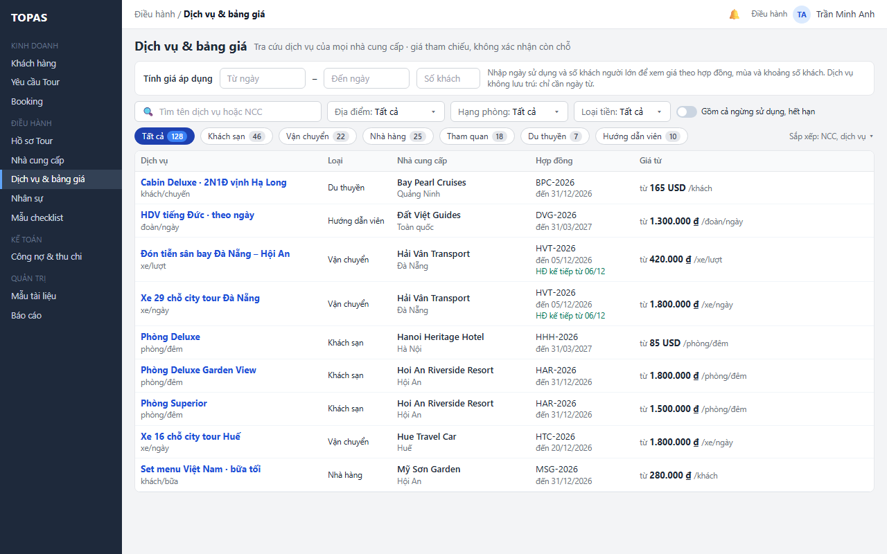

   > Hình chưa cập nhật: công tắc trên thanh lọc còn ghi “Gồm cả ngừng sử dụng, hết hạn”; nay là “Gồm cả ngừng dùng, hết hạn” (K6).

*Kết quả:* người dùng thấy toàn bộ dịch vụ đang dùng được, ai cung cấp, hợp đồng nào đang áp dụng và mức giá thấp nhất.

**L1.2 Tìm và lọc.**

1. **W04 · Ô tìm, bộ chọn ở thanh lọc, chip loại dịch vụ.** Người dùng gõ tên dịch vụ hoặc NCC, chọn chip loại dịch vụ, chọn Địa điểm, Hạng phòng, Loại tiền. Bộ lọc áp dụng ngay: danh sách và số trên chip cập nhật; liên kết Xóa bộ lọc hiện ra.

   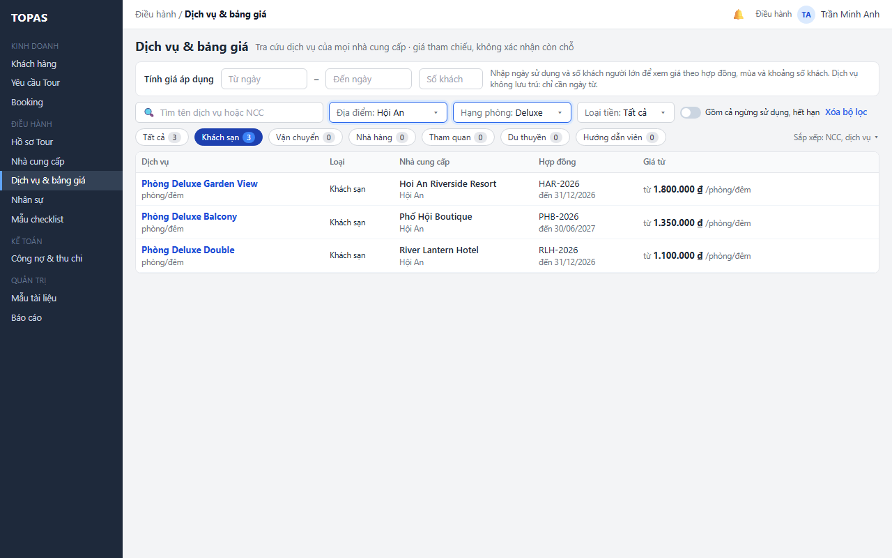

2. **W13 · Vùng bảng khi không có dòng khớp.** Bảng hiện “Không có dịch vụ đang dùng được khớp …”. Nếu có dịch vụ khớp nhưng đang bị ẩn, câu thứ hai nêu số dịch vụ đó và chỉ tới công tắc ở thanh lọc. Người dùng bấm Xóa bộ lọc ở thanh lọc để về mặc định, hoặc bật công tắc để hiện các dòng ẩn khớp (L1.3).

   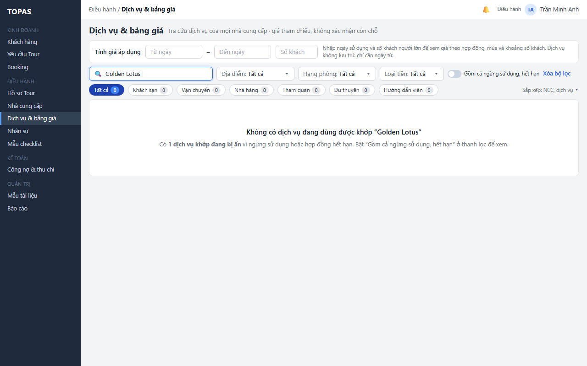

*Kết quả:* danh sách chỉ còn các dịch vụ cần xem. Bộ lọc được giữ trong phiên (R09).

**L1.3 Xem cả dịch vụ đang bị ẩn (quyết định 11/11/2026).** *Điều kiện:* mọi vai trò có quyền xem DH04.

1. **W10 · Công tắc Gồm cả ngừng dùng, hết hạn trên thanh lọc.** Người dùng bật công tắc. Các dịch vụ bị ẩn xuất hiện ở đúng vị trí sắp xếp, chữ mờ, có chỉ báo lý do (mục 2.4). Số trên chip tăng tương ứng (W10: 141 = 128 + 13 dịch vụ đang ẩn).

   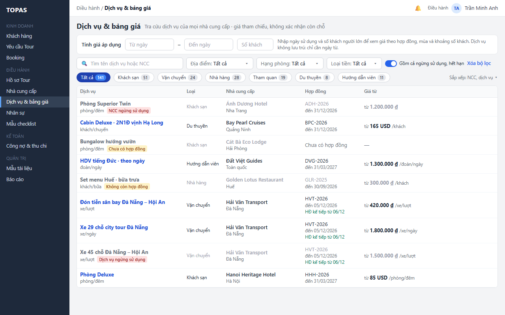

   > Hình chưa cập nhật: công tắc trên thanh lọc còn ghi “Gồm cả ngừng sử dụng, hết hạn”; nay là “Gồm cả ngừng dùng, hết hạn” (K6). Chỉ báo trên dòng còn ghi “NCC ngừng sử dụng”, “Dịch vụ ngừng sử dụng”; nay là “ngừng dùng”.

2. **W10 · Bấm dòng mờ.** Người dùng bấm dòng mờ để xem chi tiết trong bảng trượt như L3.1. Giá từ của dòng hợp đồng hết hạn lấy theo hợp đồng gần nhất; dòng chưa có hợp đồng hiện “—”.

*Kết quả:* người dùng tra được giá cũ hoặc NCC tạm ngừng mà không phải vào từng hồ sơ NCC. Công tắc được giữ trong phiên và được tính là bộ lọc khác mặc định (Xóa bộ lọc đưa về Tắt).

**Ngoại lệ**

- **E1.1 · W14.** Không tải được danh sách: vùng bảng thay bằng thông báo lỗi và nút Thử lại; thanh Tính giá áp dụng và thanh lọc giữ nguyên giá trị. Bấm Thử lại thì tải lại với ngày, số khách và bộ lọc cũ.

  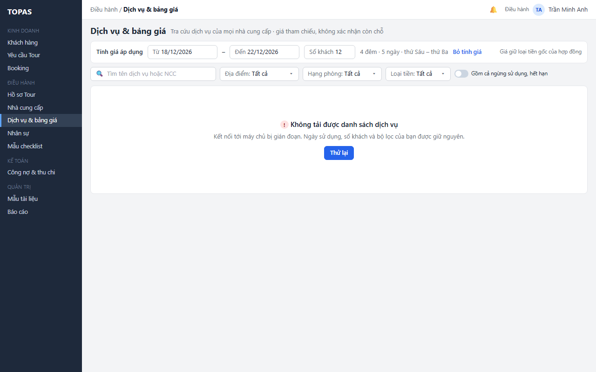

- **E1.2.** Người dùng không có quyền xem DH04: menu không hiện mục Dịch vụ & bảng giá; mở bằng đường dẫn thì hiện “Bạn không có quyền xem danh mục dịch vụ và bảng giá” và nút Về trang chủ, không tải dữ liệu.
- **E1.3.** Tìm kiếm dưới 2 ký tự: chưa chạy tìm, ô tìm hiện gợi ý “Nhập ít nhất 2 ký tự”.
- **E1.4.** Hệ thống chưa có dịch vụ nào: bảng hiện “Chưa có dịch vụ nào. Dịch vụ được thêm trong hồ sơ nhà cung cấp.”, không hiện liên kết Xóa bộ lọc. Điều hành thấy thêm liên kết Mở danh sách NCC (DH02).
- **E1.5.** Dữ liệu đổi ở phiên khác khi danh sách đang mở (Điều hành vừa tắt dịch vụ, sửa giá): danh sách không tự nhảy dòng. Dữ liệu được tải lại khi người dùng đổi bộ lọc, đổi trang, đổi ngày hoặc số khách, hay quay lại từ DH03. Bảng trượt đang mở xử lý theo E3.1.
- **E1.6.** Danh mục địa điểm, hạng phòng hoặc loại tiền trống (chưa cấu hình): bộ chọn tương ứng chỉ có Tất cả và hiện gợi ý “Chưa có dữ liệu”, các bộ lọc khác vẫn dùng được.
- **E1.7.** Quyền xem bị thu hồi giữa phiên: lần tải tiếp theo nhận lỗi quyền và hiện như E1.2.
- **E1.8 (bổ sung 12/11/2026).** Tìm theo tên dịch vụ đi kèm (ví dụ “giường phụ”): danh sách hiện các dòng dịch vụ chính có đi kèm khớp, dòng phụ “+ Giường phụ” tô vàng đoạn khớp; không có dòng riêng cho đi kèm. Dịch vụ chính bị ẩn theo R01 (ví dụ Ngừng dùng) thì chỉ hiện khi bật công tắc, như mọi dòng. Đi kèm Ngừng dùng của dịch vụ chính Đang dùng vẫn làm dòng chính khớp; trong bảng trượt đi kèm đó ghi Ngừng dùng (R12).

### 3.2. Xem giá áp dụng theo ngày và số khách (CNHT01.06 · quyết định 11/11/2026)

**L2.1 Nhập ngày sử dụng và số khách.** *Điều kiện:* danh sách đã tải.

1. **W02 · Thanh Tính giá áp dụng: Từ ngày, Đến ngày, Số khách.** Người dùng nhập Từ ngày 18/12/2026, Đến ngày 22/12/2026 và Số khách 12. Thanh ghi “4 đêm · 5 ngày · thứ Sáu – thứ Ba”. Hệ thống kiểm tra dữ liệu; khi dữ liệu hợp lệ và người dùng ngừng gõ 400 ms, giá được tính cho các dòng của trang đang xem (R02–R08), không cần bấm nút. Cột Giá từ đổi thành Giá áp dụng, tiêu đề cột ghi khoảng ngày và số khách đang tính; cột Hợp đồng đổi thành Hợp đồng áp dụng.

   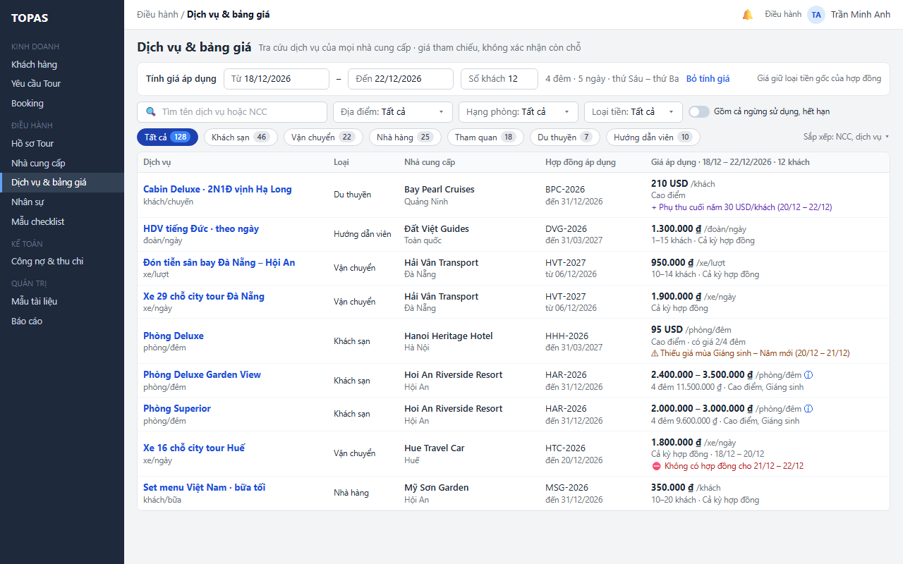

   > Hình chưa cập nhật: dòng Bay Pearl Cruises còn hiện 210 USD /khách chưa tính phụ thu; theo Q11 giá áp dụng tính cả phụ thu Cộng dồn cho 20/12 – 22/12 (R06, AC10).

2. **W02 · Ô Giá áp dụng trên từng dòng.** Với từng dịch vụ, hệ thống chọn hợp đồng có kỳ hiệu lực chứa từng ngày (R02), xác định mùa và loại ngày (R03), chọn dòng giá theo số khách và hạng phòng (R04), rồi hiển thị theo R05:
   - Lưu trú (Hoi An Riverside Resort · Phòng Deluxe Garden View): khoảng giá mỗi đêm “2.400.000 – 3.500.000 ₫ /phòng/đêm”, dòng phụ “4 đêm 11.500.000 ₫ · Cao điểm, Giáng sinh”, biểu tượng ⓘ để xem từng đêm.
   - Dịch vụ theo khoảng số khách (Hải Vân Transport · Đón tiễn sân bay): “950.000 ₫ /xe/lượt · 10–14 khách · Cả kỳ hợp đồng”. Hợp đồng áp dụng là HVT-2027 (từ 06/12/2026) vì HVT-2026 hết hạn 05/12/2026.
   - Phụ thu trong khoảng ngày (Bay Pearl Cruises): giá áp dụng đã tính phụ thu cho các ngày có phụ thu (R06, Q11), dòng tím “+ Phụ thu cuối năm 30 USD/khách (20/12 – 22/12)” giải thích phần cộng thêm.
   - Phần thiếu (Hanoi Heritage Hotel, Hue Travel Car): hiện giá cho phần có giá và chỉ báo phần thiếu (R08, E2.2, E2.3).
3. **W02 · Chip, bộ lọc, bộ chọn Sắp xếp.** Người dùng có thể đổi bộ lọc, chip hoặc sắp xếp mà không mất ngày và số khách. Khi chọn Sắp xếp Giá thấp → cao, dòng được nhóm theo loại tiền (R07).

*Kết quả:* người dùng thấy giá áp dụng của mọi dịch vụ cho cùng một khoảng ngày và số khách. Không có dữ liệu nào được ghi.

**L2.2 Xem giá từng đêm.** *Điều kiện:* đã tính giá; dịch vụ tính theo đêm, hoặc giá thay đổi trong khoảng ngày (có biểu tượng ⓘ).

1. **W03 · Biểu tượng ⓘ trong ô Giá áp dụng → khung nổi.** Người dùng rê chuột vào ô Giá áp dụng (trên thiết bị cảm ứng, chạm ⓘ). Khung nổi liệt kê từng đêm (hoặc từng ngày): ngày và thứ, mùa, loại ngày (ngày thường, cuối tuần), giá; dòng cuối là tổng. Khung ghi phụ thu nếu có và câu “Giá tham chiếu, không xác nhận còn chỗ”.

   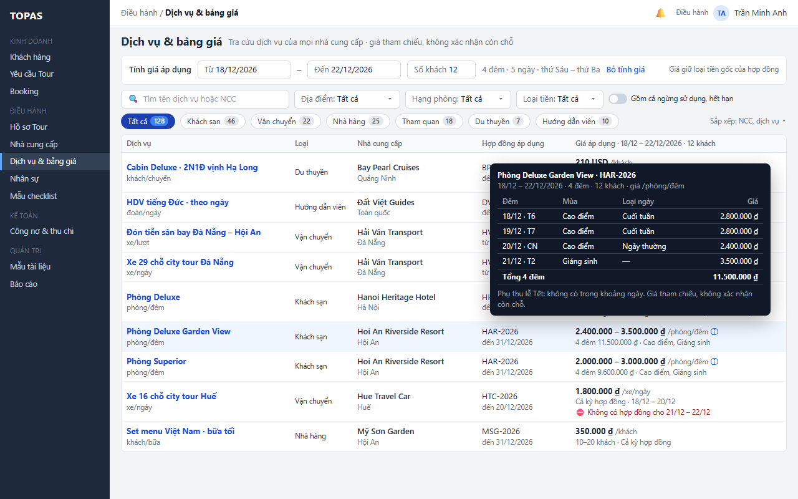

*Kết quả:* người dùng hiểu vì sao giá thay đổi (W03: 18/12 và 19/12 là cuối tuần mùa Cao điểm 2.800.000 ₫; 20/12 ngày thường 2.400.000 ₫; 21/12 mùa Giáng sinh 3.500.000 ₫; tổng 11.500.000 ₫) mà không mở bảng giá.

**L2.3 Bỏ tính giá.**

1. **W01 · Liên kết Bỏ tính giá trên thanh.** Người dùng bấm Bỏ tính giá, hoặc xóa Từ ngày. Ba ô nhập trở về trống, cột trở lại Giá từ và Hợp đồng; bộ lọc và chip giữ nguyên.

**Ngoại lệ**

- **E2.1 · W12.** Dữ liệu nhập không hợp lệ: Đến ngày trước Từ ngày; số khách không phải số nguyên từ 1 đến 999; khoảng dài hơn 31 ngày. Ô sai viền đỏ, câu lỗi hiện ngay trên thanh, cột giá giữ nguyên Giá từ cho tới khi người dùng sửa xong ô viền đỏ. Không gửi yêu cầu tính.

  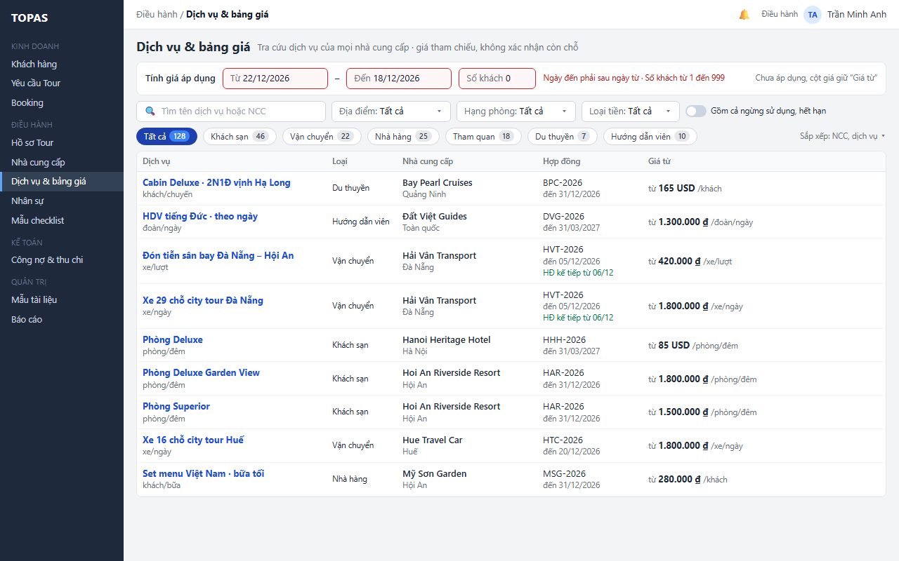

- **E2.2 · W02.** Một phần ngày rơi vào mùa chưa có giá (Hanoi Heritage Hotel: mùa Giáng sinh – Năm mới từ 20/12): ô hiện giá của phần có giá, dòng phụ “Cao điểm · có giá 2/4 đêm” và chỉ báo vàng “Thiếu giá mùa Giáng sinh – Năm mới (20/12 – 21/12)”. Không có tổng tiền. Điều hành bổ sung giá ở DH03.3 (L4.1).
- **E2.3 · W11.** Không có hợp đồng cho một phần khoảng ngày (Hue Travel Car: HTC-2026 hết hạn 20/12): ô hiện giá cho 18/12 – 20/12 và chỉ báo đỏ “Không có hợp đồng cho 21/12 – 22/12”. Không có hợp đồng cho toàn bộ khoảng: ô chỉ hiện chỉ báo đỏ “Không có hợp đồng cho dd/mm – dd/mm”; cột Hợp đồng áp dụng ghi “—”. Có phần thiếu thì không hiện tổng (R08); người dùng bấm dòng để xem chi tiết trong bảng trượt.

  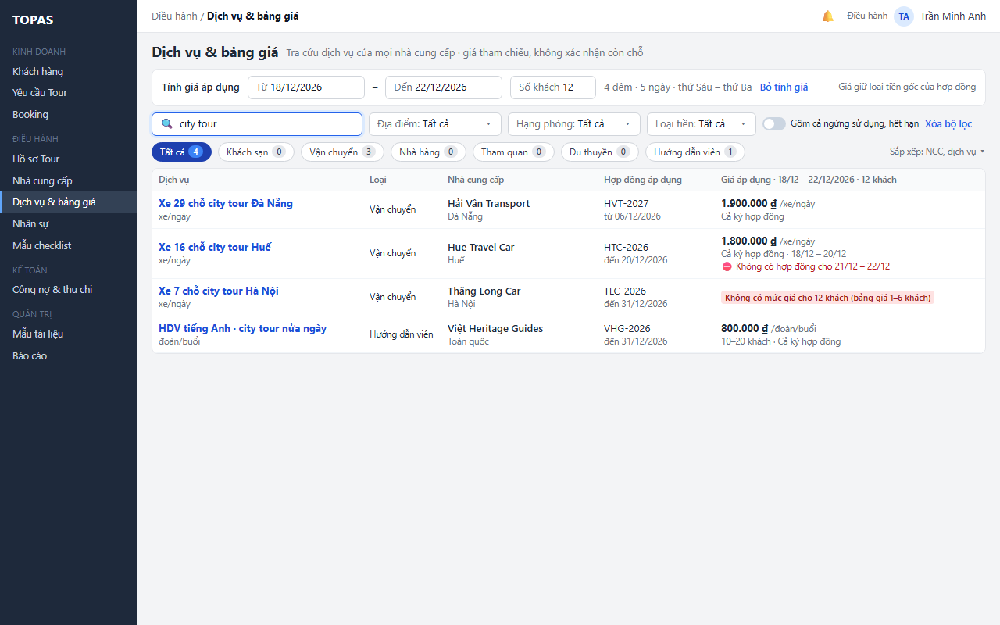

- **E2.4 · W11.** Số khách nằm ngoài mọi khoảng số khách của dịch vụ (Thăng Long Car: bảng giá 1–6 khách, nhập 12 khách): ô hiện nhãn đỏ “Không có mức giá cho 12 khách (bảng giá 1–6 khách)”, không hiện giá.
- **E2.5.** Ngày sử dụng đã qua: vẫn tính để tra cứu lịch sử; thanh hiện thêm chữ “Ngày đã qua” màu xám.
- **E2.6.** Chỉ nhập Từ ngày: dịch vụ tính theo đêm tính 1 đêm bắt đầu từ Từ ngày; dịch vụ tính theo ngày tính đúng Từ ngày. Chỉ nhập số khách mà chưa có ngày: chưa tính; thanh nhắc “Nhập ngày sử dụng để tính giá”.
- **E2.7.** Không nhập số khách: dịch vụ có dòng giá chia theo khoảng số khách hiện “từ” + mức thấp nhất của các khoảng, dòng phụ “Chưa nhập số khách”; dòng giá có khoảng mặc định 1 – không giới hạn (RSD DH03 mục 5.2) tính bình thường.
- **E2.8.** Khoảng ngày nằm trên hai hợp đồng của cùng NCC: tính từng ngày theo hợp đồng chứa ngày đó; cột Hợp đồng áp dụng ghi cả hai mã, ví dụ “HAR-2026 → HAR-2027”; khung từng đêm ghi hợp đồng cho mỗi đêm.
- **E2.9.** Lỗi khi tính giá một số dòng (lỗi hệ thống): các dòng đó hiện “Không tính được giá” kèm nút Thử lại nhỏ trong ô; các dòng khác vẫn hiện. Lỗi toàn bộ: như E1.1.
- **E2.10.** Dịch vụ có nhiều dòng giá khớp (nhiều hạng phòng khi chưa lọc Hạng phòng): ô hiện mức thấp nhất kèm tên hạng phòng và “+ n hạng khác”; rê chuột để xem đủ. Trong cùng một hạng phòng có nhiều dòng chính khớp thì lấy dòng có Thứ tự nhỏ nhất (R04).

### 3.3. Xem chi tiết dịch vụ trong bảng trượt DH05 (DH04 · DH05)

**L3.1 Mở bảng trượt.**

1. **W05 · Bấm dòng trên bảng → bảng trượt DH05 chỉ xem (mục 2.5).** Người dùng bấm dòng Phòng Deluxe Garden View. Bảng trượt mở ở tab Bảng giá và phụ thu với hợp đồng áp dụng cho Từ ngày (HAR-2026); khi chưa tính giá thì là hợp đồng để xem giá (R02). Nếu đã tính giá, ô xanh đầu tab ghi “Giá áp dụng 18/12 – 22/12/2026 · 12 khách: 4 đêm, 11.500.000 ₫/phòng” kèm số đêm theo từng mùa, và các ô giá được dùng tô xanh trên ma trận. Dòng tương ứng trên danh sách được đánh dấu là đang chọn. Dịch vụ có đi kèm (bổ sung 12/11/2026): cuối tab có khối **Dịch vụ đi kèm**, mỗi đi kèm một dòng gồm tên (nhãn Giường phụ nếu có), đơn vị tính, giá theo từng mùa của hợp đồng đang chọn, trạng thái Đang dùng hay Ngừng dùng; khi đã tính giá thì có thêm cột Giá áp dụng của đi kèm cho cùng khoảng ngày, cùng hợp đồng áp dụng (R12). Giường phụ có dòng chú thích “Trẻ em cần thêm giường tính theo chính sách trẻ em của hợp đồng”.

   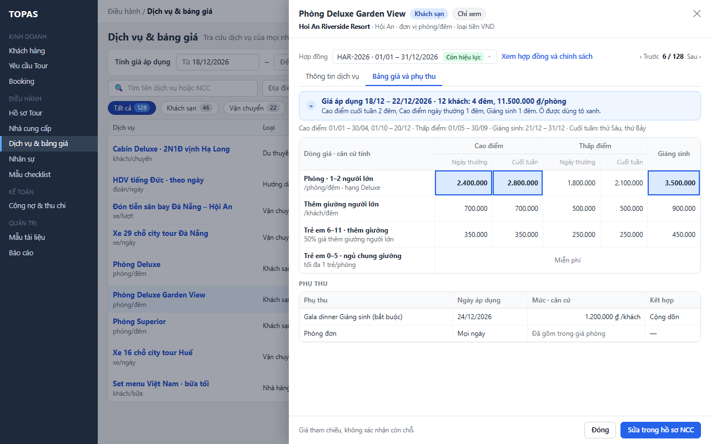

   > Hình chưa cập nhật (12/11/2026): chưa có khối Dịch vụ đi kèm cuối tab (ví dụ Giường phụ của Phòng Deluxe Garden View).

2. **W06 · Tab Thông tin dịch vụ trong bảng trượt.** Người dùng bấm tab Thông tin dịch vụ để xem mô tả, đơn vị tính, trạng thái Đang dùng / Ngừng dùng, dịch vụ bao gồm (thẻ xanh) và không bao gồm (thẻ đỏ). Mọi trường hiện dạng chữ (U5).

   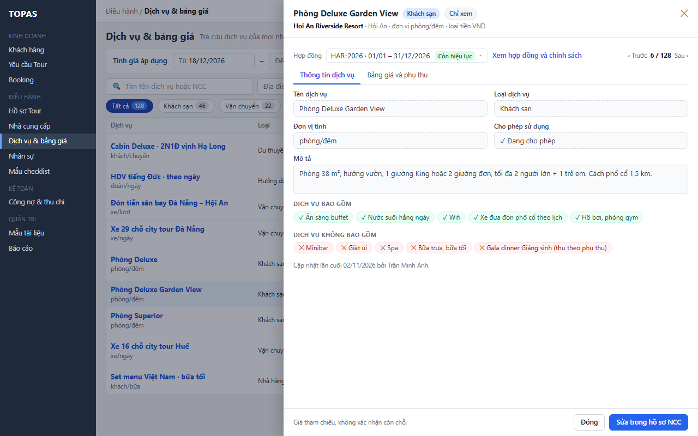

   > Hình chưa cập nhật: trường còn vẽ viền nét đứt và ô “Cho phép sử dụng · Đang cho phép”; theo U5 hiện dạng chữ, theo K6 là trạng thái Đang dùng.

*Kết quả:* người dùng có đủ giá theo mùa, giá trẻ em theo nhóm tuổi của hợp đồng, phụ thu và phạm vi dịch vụ để tư vấn hoặc chọn NCC.

**L3.2 Xem dịch vụ trước hoặc sau.**

1. **W05 · Nút ‹ Trước, Sau › ở góc phải phần đầu bảng trượt.** Người dùng bấm Sau › (hoặc ‹ Trước). Bảng trượt chuyển sang dịch vụ kế tiếp trong danh sách đang lọc và sắp xếp, giữ tab đang mở; vị trí “6 / 128” cập nhật. Hợp đồng chọn lại theo quy tắc của bước L3.1 cho dịch vụ mới. Danh sách phía sau đánh dấu dòng tương ứng; sang trang khác thì danh sách chuyển trang theo.

**L3.3 Đổi hợp đồng trong bảng trượt.**

1. **W07 · Ô chọn tại chỗ Hợp đồng.** Người dùng bấm ô Hợp đồng. Danh sách hợp đồng của NCC hiện mới nhất ở trên, mỗi hợp đồng có kỳ hiệu lực, loại tiền, số mùa giá và chỉ báo theo từng hợp đồng (Sắp áp dụng, Còn hiệu lực, Sắp hết hạn, Hết hạn; R01 của RSD DH03).

   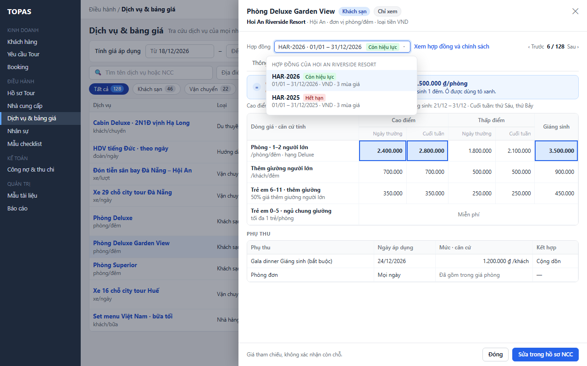

2. **W05 · Chọn một hợp đồng trong danh sách.** Người dùng chọn hợp đồng khác. Ma trận, dòng mùa giá và phụ thu tải theo hợp đồng mới. Nếu hợp đồng mới không chứa khoảng ngày đã nhập, ô Giá áp dụng đổi thành “Hợp đồng này không áp dụng cho 18/12 – 22/12/2026” và không tô ô nào. Danh sách phía sau không đổi.

**L3.4 Xem hợp đồng và chính sách.**

1. **W05 · Liên kết Xem hợp đồng và chính sách cạnh ô Hợp đồng.** Người dùng bấm liên kết. DH03.2 của NCC mở với bảng trượt hợp đồng đang chọn (chính sách đổi hủy, chính sách trẻ em; điều khoản thanh toán chỉ hiện với người có quyền Xem thông tin thanh toán NCC) theo quyền của DH03. Quay lại bằng nút quay lại của trình duyệt; DH04 giữ ngữ cảnh (R09).

*Kết quả:* bảng trượt chỉ dùng để xem; mọi thay đổi đi qua L4.1.

**Ngoại lệ**

- **E3.1 · W15.** Dịch vụ, bảng giá hoặc hợp đồng đang xem vừa được lưu ở DH03, DH05 (phiên khác): bảng trượt hiện banner vàng “Bảng giá vừa được cập nhật bởi … lúc …. Bảng trượt đang hiện dữ liệu trước khi cập nhật.” kèm nút Tải lại. Bấm Tải lại thì tải dữ liệu mới, giữ tab và hợp đồng (nếu còn). Hệ thống kiểm tra phiên bản khi người dùng chuyển tab, đổi hợp đồng, chuyển dịch vụ và mỗi 60 giây khi bảng trượt mở.

  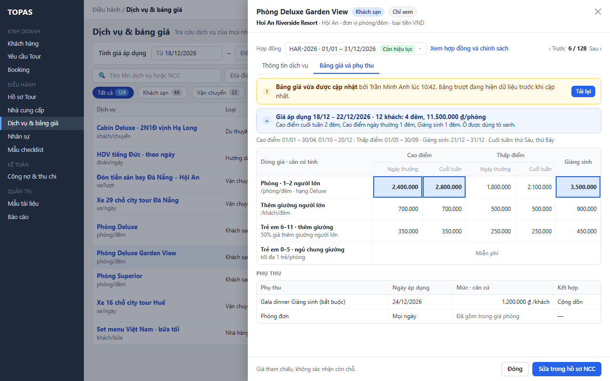

- **E3.2.** Dịch vụ hoặc NCC vừa chuyển Ngừng dùng: banner E3.1 ghi thêm “Dịch vụ đã ngừng dùng từ …”. Dịch vụ vẫn xem được; sau khi tải lại danh sách, dòng chỉ hiện khi công tắc bật.
- **E3.3.** Dịch vụ không còn tồn tại (bị xóa ở DH03.3): bảng trượt hiện “Dịch vụ này không còn trong hồ sơ NCC”, chỉ còn nút Đóng; đóng xong danh sách tải lại.
- **E3.4.** Hợp đồng đang chọn chưa có dòng giá cho dịch vụ: tab Bảng giá hiện “Dịch vụ chưa có giá trong hợp đồng HAR-2026”; Điều hành thấy thêm câu “Thêm giá bằng Sửa trong hồ sơ NCC”.
- **E3.5.** Lỗi tải bảng trượt: thân bảng trượt hiện lỗi và nút Thử lại; tiêu đề vẫn hiện tên dịch vụ và NCC lấy từ dòng.
- **E3.6.** Đang ở dòng đầu hoặc cuối danh sách: nút ‹ Trước hoặc Sau › mờ, chú thích khi rê chuột “Đây là dịch vụ đầu tiên / cuối cùng của danh sách”.
- **E3.8 (bổ sung 12/11/2026; mã E3.7 không dùng lại).** Đường dẫn (R09) mang ID của một dịch vụ đi kèm: bảng trượt mở dịch vụ chính của nó, ở tab Bảng giá và phụ thu, cuộn tới khối Dịch vụ đi kèm và tô dòng đi kèm đó. Đi kèm thiếu giá ở hợp đồng áp dụng (ô mùa trống, chưa có dòng giá): dòng đi kèm ghi chỉ báo như R08 (“Thiếu giá mùa …”, “Chưa có giá trong hợp đồng …”), không dùng giá 0; ô Giá áp dụng của dịch vụ chính không bị ảnh hưởng.

### 3.4. Chuyển sang sửa trong hồ sơ NCC (CNHT01.06 · Điều hành)

**L4.1 Sửa dịch vụ hoặc bảng giá.** *Điều kiện:* người dùng có quyền sửa DH03.3 (Điều hành).

1. **W05 · Nút chính Sửa trong hồ sơ NCC ở chân bảng trượt.** Trong bảng trượt chỉ xem, Điều hành bấm Sửa trong hồ sơ NCC. Hệ thống mở DH03.3 với NCC, dịch vụ, hợp đồng và tab đang xem.
2. **W08 · DH03.3, bảng trượt DH05 chế độ sửa có banner.** DH03 của Hoi An Riverside Resort mở ở tab Dịch vụ và bảng giá, dòng dịch vụ được chọn và bảng trượt DH05 mở ở chế độ sửa, cùng tab và cùng hợp đồng đang xem ở DH04. Banner xanh trong bảng trượt ghi “Mở từ Tra cứu dịch vụ và bảng giá” kèm liên kết Về Tra cứu dịch vụ. Lưu, kiểm tra và hủy thay đổi theo RSD của DH03 và DH05.

   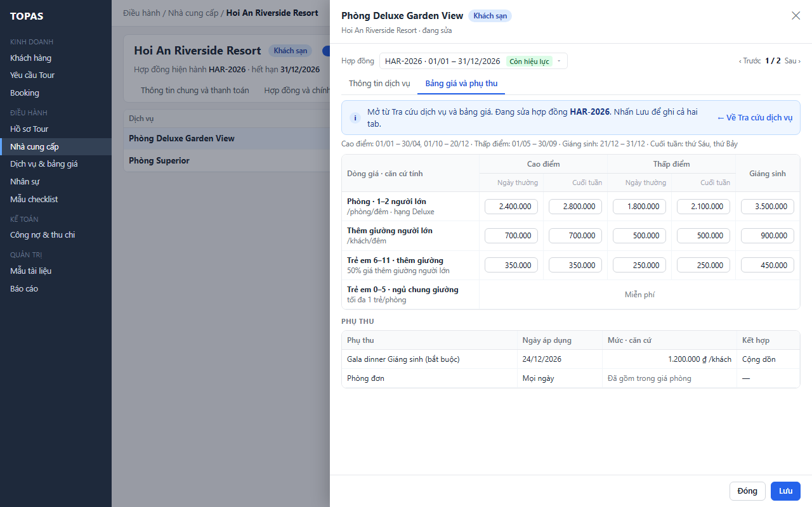

   > Hình chưa cập nhật: phần đầu DH03 còn công tắc “Cho phép sử dụng”; nay là công tắc Đang dùng / Ngừng dùng (K6).

**L4.2 Quay lại tra cứu.**

1. **W02 · Liên kết Về Tra cứu dịch vụ trên banner W08 (hoặc nút quay lại của trình duyệt).** Điều hành bấm Về Tra cứu dịch vụ. DH04 hiện lại với ngày sử dụng, số khách, bộ lọc, trang và vị trí cuộn như trước (R09); danh sách được tải lại nên giá vừa lưu đã hiện.

*Kết quả:* từ tra cứu đến sửa mất một lần bấm, quay lại không phải nhập lại.

**Ngoại lệ**

- **E4.1.** Người dùng không có quyền sửa DH03.3: nút Sửa trong hồ sơ NCC không hiện (W09). Mở đường dẫn sửa thủ công thì DH03 hiện ở chế độ xem theo quyền của DH03.
- **E4.2.** Bảng trượt DH05 ở DH03.3 còn thay đổi chưa lưu khi bấm Về Tra cứu dịch vụ: DH05 hỏi xác nhận rời đi (quy tắc của DH05); chọn ở lại thì không quay về DH04.
- **E4.3.** Dịch vụ bị xóa trước khi DH03.3 mở: DH03.3 mở ở tab Dịch vụ và bảng giá, không mở bảng trượt và hiện thông báo “Dịch vụ không còn trong hồ sơ NCC”.
- **E4.4.** Quay lại DH04 khi dịch vụ vừa sửa đã ra khỏi bộ lọc (ví dụ vừa bị tắt): thông báo ngắn “Dịch vụ … không còn khớp bộ lọc” kèm liên kết Xem dịch vụ, mở bảng trượt của dịch vụ đó.

### 3.5. Kinh doanh tra cứu giá (CNHT01.06 · Kinh doanh được xem)

**L5.1 Kinh doanh tra cứu để tư vấn và báo giá.** *Điều kiện:* Kinh doanh.

1. **W09 · Bảng trượt khi Kinh doanh mở; nút Đóng ở chân bảng trượt.** Kinh doanh mở DH04, dùng các luồng L1.1–L3.4 như Điều hành, kể cả công tắc xem thêm và đổi hợp đồng. Bảng trượt chỉ có nút Đóng, không có Sửa trong hồ sơ NCC. Bấm Đóng thì bảng trượt đóng, dòng trên danh sách vẫn được đánh dấu.

   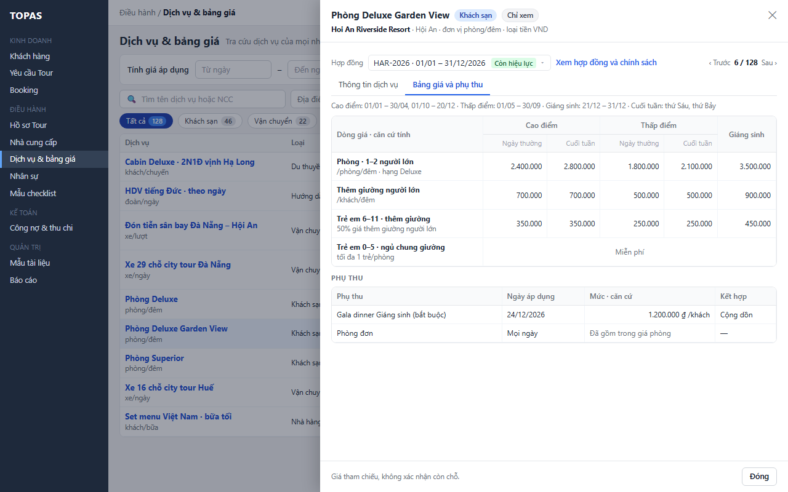

2. **W09 · Ngoài màn này.** Khi cần giá chính thức cho khách, Kinh doanh lập báo giá ở KD06.3. DH04 không chuyển dữ liệu sang báo giá.

*Kết quả:* Kinh doanh tự tra giá tham chiếu, dịch vụ bao gồm và chính sách của hợp đồng mà không phải hỏi Điều hành.

**Ngoại lệ**

- **E5.1.** Kinh doanh mở đường dẫn DH03.3 ở chế độ sửa (được chia sẻ từ Điều hành): DH03 hiện ở chế độ xem theo quyền của người dùng ở DH03 (mặc định Kinh doanh chỉ xem).
- **E5.2.** Kinh doanh thấy chỉ báo thiếu giá hoặc không có hợp đồng (E2.2–E2.4): DH04 không có thao tác yêu cầu bổ sung; Kinh doanh báo Điều hành qua kênh nội bộ.

**Số bước trước và sau khi tối ưu (cả mục 3)**

| Việc | Theo cách tra từng bảng giá | Bản này |
|---|---|---|
| Biết giá 9 dịch vụ cho cùng khoảng ngày và số khách | 9 × (mở hồ sơ NCC, chọn hợp đồng, mở dịch vụ, dò mùa theo từng đêm) | 3 lần nhập (Từ, Đến, Số khách); đọc trên một màn |
| Hiểu giá lưu trú qua 2 mùa | Mở bảng giá, dò lịch mùa, cộng tay từng đêm | Rê chuột vào ô giá |
| Sửa giá vừa thấy thiếu | Mở menu NCC, tìm NCC, mở tab Dịch vụ, tìm dịch vụ, chọn hợp đồng | 2 lần bấm: dòng, Sửa trong hồ sơ NCC |

---

## 4. Quy tắc triển khai chi tiết

### R01. Phạm vi mặc định và công tắc xem thêm

- **Mặc định** một dịch vụ hiện khi đủ cả ba điều kiện: NCC Đang dùng; dịch vụ Đang dùng; NCC có ít nhất một hợp đồng có ngày kết thúc từ hôm nay trở đi (gồm cả hợp đồng kỳ sau chưa bắt đầu).
- Điều kiện hợp đồng xét theo **hôm nay**, không theo ngày sử dụng đã nhập. Hôm nay đổi lúc 00:00 Asia/Ho_Chi_Minh; hợp đồng còn hiệu lực và chỉ báo Sắp hết hạn tính lúc đọc, ở lần tải tiếp theo (Q6), nên dịch vụ của hợp đồng vừa hết hạn bị ẩn khi công tắc tắt. Dịch vụ không có hợp đồng cho ngày sử dụng vẫn hiện, kèm chỉ báo ở cột giá (E2.3), để người dùng biết cần bổ sung.
- **Công tắc Gồm cả ngừng dùng, hết hạn** (mọi vai trò có quyền xem, quyết định 11/11/2026) bỏ cả ba điều kiện. Dòng không đạt điều kiện hiện chữ mờ kèm một chỉ báo theo thứ tự ở mục 2.4.
- Công tắc không mở thêm quyền: dòng mờ vẫn chỉ xem; nút Sửa trong hồ sơ NCC theo quyền như dòng thường.
- **Dịch vụ đi kèm** không bao giờ là một dòng của danh sách, kể cả khi bật công tắc; không tính vào chip, số dòng, sắp xếp (R12).

### R02. Chọn hợp đồng áp dụng

- Với mỗi ngày (hoặc đêm) trong khoảng đã nhập, hợp đồng áp dụng là hợp đồng của NCC có kỳ hiệu lực chứa ngày đó. DH03.2 chặn kỳ hiệu lực chồng lấn (RSD DH03 R06), nên mỗi ngày có tối đa một hợp đồng áp dụng.
- Không có hợp đồng chứa ngày đó thì ngày đó thiếu hợp đồng (R08). Không dùng hợp đồng gần nhất thay thế.
- Khi chưa tính giá, cột Hợp đồng hiện **hợp đồng để xem giá** theo R01 của RSD DH02: hợp đồng chứa hôm nay; không có thì hợp đồng bắt đầu sớm nhất sau hôm nay, ghi “từ dd/mm/yyyy” để dịch vụ vẫn tra được giá; không có nữa thì hợp đồng hết hạn gần nhất (dòng chỉ hiện khi bật công tắc). Ô chọn hợp đồng mặc định của DH03.3 dùng cùng hợp đồng này. Cột Giá từ lấy theo hợp đồng đang hiện.

### R03. Mùa và loại ngày

- Mỗi ngày thuộc đúng một mùa của hợp đồng áp dụng (DH03.2 chặn mùa chồng lấn). Ngày không thuộc mùa nào là thiếu giá (R08).
- Mùa có bật tách ngày thường, cuối tuần: ngày có thứ nằm trong danh sách “cuối tuần” của hợp đồng dùng giá Cuối tuần, còn lại dùng giá Ngày thường. Mùa không tách dùng một giá.
- **Dịch vụ tính theo đêm** (đơn vị tính theo đêm, R14 của RSD DH03): các đêm là Từ ngày đến ngày trước Đến ngày. Ví dụ 18/12 – 22/12 là 4 đêm 18, 19, 20, 21.
- **Dịch vụ tính theo ngày, lượt, khách, đoàn:** các ngày là Từ ngày đến Đến ngày, tính cả hai đầu. Ví dụ 18/12 – 22/12 là 5 ngày.

### R04. Chọn dòng giá

- Lọc các dòng giá của dịch vụ trong hợp đồng áp dụng theo: hạng phòng (khi đã chọn bộ lọc Hạng phòng); khoảng số khách chứa số khách đã nhập (mọi dòng giá có khoảng số khách, bắt buộc theo RSD DH03 mục 5.2; khoảng mặc định 1 – không giới hạn áp cho mọi số khách).
- **Dòng giá chính** theo R14 của RSD DH03 (căn cứ tính trùng căn cứ mặc định theo đơn vị tính); trong **cùng hạng phòng** có nhiều dòng như vậy thì lấy dòng có giá trị trường **Thứ tự** nhỏ nhất (vị trí dòng trong lưới DH05.2; RSD DH03 R14, mục 5.2). Thứ tự không dùng để chọn giữa các hạng phòng khác nhau (quyết định 12/11/2026, rà soát lần ba). Dòng có căn cứ khác, giá trẻ em và phụ thu không đưa vào ô Giá áp dụng; xem trong bảng trượt. Giường phụ cho người lớn là dịch vụ đi kèm của dịch vụ phòng (RSD DH03 R14, R23), không phải dòng của dịch vụ phòng; giá giường phụ xem ở khối Dịch vụ đi kèm của bảng trượt (R12; sửa 12/11/2026, thay ví dụ “thêm giường theo khách”).
- Còn nhiều dòng chính khớp thuộc các hạng phòng khác nhau (khi chưa lọc Hạng phòng; mỗi hạng phòng đã chọn một dòng như trên): chọn mức thấp nhất cho ngày đầu, ghi tên hạng phòng và “+ n hạng khác” (E2.10).
- Số khách là số khách người lớn. Đầu vào của DH04 chỉ có khoảng ngày và số khách người lớn (quyết định 11/11/2026), nên ô Giá áp dụng không tính giá trẻ em, phòng đơn hay số phòng; các khoản này tính ở KD06.3 bằng cùng bộ tính giá (Q11). Bảng trượt hiện giá trẻ em theo nhóm tuổi của hợp đồng của chính dòng giá (Q12) và phụ thu phòng đơn đã khai (Q14).

### R05. Hiển thị Giá từ và Giá áp dụng

| Trường hợp | Ô hiển thị | Dòng phụ |
|---|---|---|
| Chưa tính giá | “từ” + Giá từ theo R14 của RSD DH03 (giá thấp nhất trong mọi dòng chính, mọi mùa, mọi loại ngày) của hợp đồng để xem giá (R02); đơn vị theo căn cứ tính | — |
| Tính theo đêm, mọi đêm cùng giá | Giá mỗi đêm | “n đêm [tổng] · [mùa]” |
| Tính theo đêm, giá khác nhau | “[thấp nhất] – [cao nhất]” mỗi đêm và biểu tượng ⓘ | “n đêm [tổng] · [các mùa]” |
| Tính theo ngày, lượt, khách, đoàn, cùng giá | Giá đơn vị | “[khoảng số khách nếu có] · [mùa]” |
| Tính theo ngày, giá khác nhau giữa các ngày | “[thấp nhất] – [cao nhất]” và ⓘ | “tùy ngày · [các mùa]” |

- Tổng chỉ có với dịch vụ tính theo đêm và khi mọi đêm đều có giá. Dịch vụ tính theo ngày không có tổng, vì số lần sử dụng trong khoảng ngày chưa biết.
- Khung ⓘ (rê chuột, W03) liệt kê từng đêm hoặc từng ngày: ngày và thứ, hợp đồng (khi khác nhau), mùa, loại ngày, giá; dòng tổng; phụ thu trong khoảng.
- Tên mùa hiển thị đúng tên khai ở DH03.2. Mùa mặc định “Cả kỳ hợp đồng” hiện đúng tên đó.

### R06. Phụ thu

- Giá áp dụng tính bằng bộ tính giá dùng chung, có tính phụ thu lễ Tết (Q11). Kiểu kết hợp theo RSD DH03 R15: **Cộng dồn** hoặc **Thay thế**; nhiều phụ thu cùng áp một ngày thì lấy mức cao nhất trong các phụ thu Thay thế, rồi cộng mọi phụ thu Cộng dồn (Q15).
- Phụ thu lễ Tết kiểu **Cộng dồn** có ngày nằm trong khoảng đã nhập: được cộng vào giá của những ngày đó (trong khoảng giá, tổng và khung ⓘ); dưới giá có một dòng riêng màu tím gồm tên, mức, căn cứ và các ngày áp dụng để giải thích phần cộng thêm.
- Phụ thu kiểu **Thay thế**: giá thay thế được dùng làm giá của những ngày đó (trong khoảng giá, tổng và khung ⓘ); khung ⓘ ghi “thay thế bởi phụ thu …”.
- Phụ thu phòng đơn và giá trẻ em không hiện ở danh sách (R04); xem trong bảng trượt. Giá phòng đơn = giá phòng đơn trọn gói nếu dòng giá khai trọn gói, ngược lại giá phòng + phụ thu phòng đơn đã khai (RSD DH03 R15); “phần vượt nửa giá phòng đôi” chỉ để hiển thị (Q14).

### R07. Loại tiền và sắp xếp (quyết định 11/11/2026)

- Mọi giá hiện theo loại tiền của dòng giá (mặc định loại tiền của hợp đồng). Không quy đổi, không hiện giá quy đổi, không cộng các khoản khác loại tiền.
- Bộ lọc Loại tiền lọc theo loại tiền của hợp đồng để xem giá (khi chưa tính giá) hoặc hợp đồng áp dụng (khi đã tính giá).
- Sắp xếp theo giá: nhóm VND trước, sau đó các loại tiền khác theo mã A → Z; trong mỗi nhóm sắp theo giá (giá dạng khoảng dùng mức thấp nhất). Dòng không có giá (E2.3 toàn bộ, E2.4, dòng chưa có hợp đồng) xếp cuối. Dòng có giá một phần (E2.2, E2.3 một phần) xếp theo phần có giá.

### R08. Thiếu dữ liệu

| Tình huống | Hiển thị | Không làm |
|---|---|---|
| Ngày thuộc mùa chưa có giá, hoặc không thuộc mùa nào | Chỉ báo vàng “Thiếu giá mùa [tên] ([ngày])”; dòng phụ “có giá k/n đêm” | Không lấy giá mùa khác; không coi là 0 |
| Ngày không thuộc hợp đồng nào | Chỉ báo đỏ “Không có hợp đồng cho [ngày]” | Không lấy hợp đồng gần nhất |
| Số khách ngoài mọi khoảng | Nhãn đỏ “Không có mức giá cho n khách (bảng giá a–b khách)” | Không lấy khoảng gần nhất |
| Hợp đồng chưa có dòng giá cho dịch vụ | “Chưa có giá trong hợp đồng [mã]” | Không hiện Giá từ của hợp đồng khác |

- Có phần thiếu thì không hiện tổng. Phần có giá vẫn hiện để người dùng tham khảo.
- Các ngày thiếu được gộp thành khoảng liên tiếp khi hiển thị (ví dụ 20/12 – 21/12).

### R09. Giữ ngữ cảnh và đường dẫn

- Từ ngày, Đến ngày, Số khách, tìm kiếm, bộ lọc, chip, công tắc, sắp xếp, trang và vị trí cuộn được giữ trong phiên khi mở DH03 rồi quay lại. Phiên mới dùng mặc định ở mục 2.3 (ngày và số khách trống).
- Các giá trị trên (trừ trang và vị trí cuộn) được ghi vào tham số đường dẫn. Mở đường dẫn có tham số thì dùng giá trị trong đường dẫn thay cho giá trị của phiên.
- Bảng trượt đang mở được ghi bằng ID dịch vụ và ID hợp đồng trong đường dẫn; mở lại đường dẫn thì mở lại đúng bảng trượt nếu người dùng có quyền xem.

### R10. Quyền và chế độ chỉ xem

- Quyền xem DH04 cấp theo vai trò ở QT02: mặc định Điều hành, Kinh doanh và Quản trị (Q25). Kế toán không có mặc định (mục 1.4).
- Nút Sửa trong hồ sơ NCC chỉ hiện khi người dùng có quyền sửa DH03.3. Máy chủ kiểm tra quyền khi mở DH03.3, không dựa vào việc nút có hiện hay không.
- Bảng trượt mở từ DH04 luôn ở chế độ chỉ xem, kể cả với Điều hành.

### R11. Cấu hình phụ thuộc

| Cấu hình | Chủ sở hữu | Dùng ở | Khi thiếu |
|---|---|---|---|
| Ngưỡng Sắp hết hạn của hợp đồng (ngày); khai ở RSD DH02 R10, dùng chung DH02, DH03 | Quản trị | Chỉ báo Sắp hết hạn, sắp xếp Hợp đồng hết hạn sớm nhất | 30 ngày (chốt 11/11/2026, RSD DH02) |
| Thứ tính là cuối tuần của hợp đồng | Điều hành (DH03.2) | R03 | Không xảy ra: RSD DH03 bắt buộc khai khi hợp đồng có mùa tách cuối tuần (mục 5.2, R11 điền sẵn Thứ Bảy, Chủ nhật) |
| Danh mục loại dịch vụ (QT05) | Điều hành (RSD QT05 mục 1.5; Quản trị hệ thống sửa được mọi nhóm) | Chip loại dịch vụ | Chỉ có chip Tất cả |
| Địa điểm của NCC, chọn từ danh mục địa điểm (RSD DH03 mục 5.2 và R21) | Điều hành (DH03.1); danh mục Địa điểm ở QT05 do Điều hành sửa (RSD QT05 mục 1.5) | Bộ lọc Địa điểm, cột NCC | NCC không có địa điểm chỉ hiện khi Địa điểm là Tất cả; giá trị bộ lọc là các địa điểm khác nhau đang có |
| Danh mục hạng phòng (QT05) | Điều hành (RSD QT05 mục 1.5) | Bộ lọc Hạng phòng, R04 | Bộ lọc chỉ có Tất cả (E1.6) |
| Quyền xem DH04, quyền sửa DH03.3 | Quản trị hệ thống (QT02) | R10 | Theo mặc định ở R10 |

### R12. Dịch vụ đi kèm (người dùng chốt 12/11/2026; RSD DH03 R23)

- **Không đứng riêng.** Dịch vụ đi kèm chỉ bán kèm dịch vụ chính (BOI-CANH-DU-AN), nên DH04 không có dòng cho đi kèm (R01). Tìm theo tên đi kèm thì hiện dòng dịch vụ chính (E1.8). Cột Dịch vụ của dòng chính ghi “+ n dịch vụ đi kèm”; chỉ có một đi kèm thì ghi tên, ví dụ “+ Giường phụ”. Không dùng cách hiện đi kèm thành dòng riêng có nhãn “Đi kèm <dịch vụ chính>”, vì người dùng tra giá theo dịch vụ chính và đi kèm không chọn riêng ở KD06, DH08.
- **Khối Dịch vụ đi kèm trong bảng trượt** (L3.1). Liệt kê mọi đi kèm của dịch vụ chính, kể cả đi kèm Ngừng dùng (ghi Ngừng dùng, chữ mờ). Mỗi dòng: tên, nhãn Giường phụ, đơn vị tính, giá từng mùa (và loại ngày) của **hợp đồng đang chọn trong bảng trượt**, căn cứ tính, loại tiền gốc. Đổi hợp đồng (L3.3) thì khối tải lại theo hợp đồng mới.
- **Giá áp dụng của đi kèm** (khi đã nhập ngày): bộ tính giá dùng chung tính như R02–R06 với hợp đồng áp dụng của dịch vụ chính cho từng ngày (cùng NCC nên là cùng hợp đồng, RSD DH03 R23), mùa và loại ngày của ngày đó, dòng giá chính của đi kèm theo số khách đã nhập, có tính phụ thu lễ Tết của đi kèm. Đi kèm theo đêm (ví dụ Giường/đêm) tính theo đêm như R03. Thiếu giá, thiếu hợp đồng hiện như R08. Giá áp dụng của đi kèm không cộng vào ô Giá áp dụng của dịch vụ chính trên danh sách, vì số lượng đi kèm do người dùng chọn ở KD06.
- **Giường phụ** không có giá trẻ em (RSD DH03 R23); khối ghi chú trẻ em cần thêm giường tính theo chính sách trẻ em của hợp đồng (xem ở mục Chính sách trẻ em, L3.4).
- **Sửa.** Bảng trượt không có nút sửa riêng cho đi kèm; Điều hành bấm Sửa trong hồ sơ NCC rồi mở đi kèm ở khối Dịch vụ đi kèm của DH05.1 (RSD DH03 L5.6).

---

## 5. Dữ liệu

### 5.1. Đối tượng dữ liệu (DH04 chỉ đọc)

| Đối tượng | Khóa và dữ liệu dùng ở DH04 | Màn sở hữu |
|---|---|---|
| Nhà cung cấp | ID NCC, tên, địa điểm, trạng thái dùng (Đang dùng, Ngừng dùng) | DH03.1 |
| Hợp đồng | ID hợp đồng, số hợp đồng, kỳ hiệu lực từ–đến, loại tiền, chỉ báo (tính), thứ tính là cuối tuần | DH03.2 |
| Mùa giá | ID mùa, ID hợp đồng, tên mùa, các khoảng ngày, tách ngày thường/cuối tuần | DH03.2 |
| Chính sách trẻ em | ID hợp đồng, nhóm tuổi, điều kiện | DH03.2 (chỉ hiện trong bảng trượt) |
| Dịch vụ | ID dịch vụ, ID NCC, tên, loại dịch vụ, đơn vị tính, mô tả, trạng thái dùng (Đang dùng, Ngừng dùng), dịch vụ bao gồm, không bao gồm, phiên bản, ID dịch vụ chính (với dịch vụ đi kèm), là giường phụ (bổ sung 12/11/2026) | DH05.1 (RSD DH03 R23) |
| Dòng giá | ID dòng, ID dịch vụ, ID hợp đồng, hạng phòng, khoảng số khách, căn cứ tính, giá theo từng mùa (và loại ngày), giá trẻ em theo nhóm tuổi, thứ tự | DH05.2 |
| Phụ thu | ID dòng giá hoặc dịch vụ, loại (phòng đơn, lễ Tết), ngày hoặc khoảng ngày, mức, căn cứ, kiểu kết hợp (Cộng dồn, Thay thế; RSD DH03 R15) | DH05.2 |
| Kết quả tính giá | Không lưu. Tính theo yêu cầu cho mỗi dòng: hợp đồng, mùa, loại ngày, giá từng đêm hoặc từng ngày, tổng, phụ thu, phần thiếu | DH04 (R02–R08) |

### 5.2. Trường nhập

| Form | Trường | Bắt buộc | Mặc định hoặc điền sẵn | Kiểm tra |
|---|---|---|---|---|
| Tính giá áp dụng | Từ ngày | Có, để tính giá | Giá trị lần trước trong phiên | Ngày hợp lệ dd/mm/yyyy |
| Tính giá áp dụng | Đến ngày | Không | Trống (1 đêm hoặc 1 ngày theo E2.6) | Sau Từ ngày; khoảng tối đa 31 ngày |
| Tính giá áp dụng | Số khách | Không | Giá trị lần trước trong phiên | Số nguyên 1–999; là số khách người lớn |
| Thanh lọc | Tìm kiếm | Không | Trống | Từ 2 ký tự |
| Thanh lọc | Địa điểm, Hạng phòng, Loại tiền | Không | Tất cả | Giá trị trong danh mục |
| Thanh lọc | Gồm cả ngừng dùng, hết hạn | Không | Tắt | — |
| Bảng trượt | Hợp đồng | Có | Theo L3.1 | Hợp đồng của NCC đang xem |

### 5.3. Dữ liệu gửi ra ngoài

DH04 không gửi email, tệp hay dữ liệu nào ra ngoài hệ thống. Màn không có thao tác xuất tệp.

---

## 6. Tiêu chí nghiệm thu

| Mã | Điều kiện và thao tác | Kết quả mong đợi |
|---|---|---|
| AC01 | Điều hành mở DH04 lần đầu trong phiên | Chỉ hiện dịch vụ Đang dùng của NCC Đang dùng, có hợp đồng ngày kết thúc từ 11/11/2026 trở đi; sắp theo NCC rồi dịch vụ; chip Tất cả bằng tổng các chip loại |
| AC02 | Hợp đồng HVT-2026 hết hạn 05/12/2026, ngưỡng 30 ngày, đã có HVT-2027 từ 06/12/2026 | Dòng của Hải Vân Transport ghi “đến 05/12/2026”, dòng dưới “HĐ kế tiếp từ 06/12” (W01), không có chỉ báo Sắp hết hạn (R01 của RSD DH02) |
| AC03 | Tìm “city tour” | Chỉ còn 4 dịch vụ có chuỗi “city tour”; chip Vận chuyển 3, Hướng dẫn viên 1; liên kết Xóa bộ lọc hiện |
| AC04 | Chọn Khách sạn, Địa điểm Hội An, Hạng phòng Deluxe | Chỉ còn dịch vụ khách sạn ở Hội An có dòng giá hạng Deluxe; chip các loại khác về 0 |
| AC05 | Tìm “Golden Lotus” khi công tắc tắt (NCC chỉ có hợp đồng hết hạn) | Hiện W13, nêu có 1 dịch vụ khớp đang bị ẩn; không hiện “Chưa có dịch vụ nào” |
| AC06 | Kinh doanh bật công tắc Gồm cả ngừng dùng, hết hạn | Dòng ẩn xuất hiện, chữ mờ, có chỉ báo lý do; số chip tăng; bấm dòng mở bảng trượt chỉ xem |
| AC07 | Nhập 18/12 – 22/12/2026, 12 khách | Thanh ghi 4 đêm · 5 ngày; cột đổi thành Giá áp dụng và Hợp đồng áp dụng; không cần bấm nút |
| AC08 | Như AC07, dòng Phòng Deluxe Garden View (HAR-2026) | Hiện 2.400.000 – 3.500.000 ₫ /phòng/đêm, 4 đêm 11.500.000 ₫; rê chuột thấy 18/12 và 19/12 Cao điểm cuối tuần 2.800.000, 20/12 Cao điểm ngày thường 2.400.000, 21/12 Giáng sinh 3.500.000 |
| AC09 | Như AC07, dòng Đón tiễn sân bay (HVT-2026 hết 05/12, HVT-2027 từ 06/12) | Hợp đồng áp dụng HVT-2027; giá 950.000 ₫ /xe/lượt của khoảng 10–14 khách |
| AC10 | Như AC07, dòng Bay Pearl Cruises có phụ thu Cộng dồn cuối năm 30 USD/khách từ 20/12 | Giá áp dụng tính cả phụ thu (Q11): 210 USD /khách cho 18/12 – 19/12, 240 USD /khách cho 20/12 – 22/12, ô hiện “210 – 240 USD /khách” kèm ⓘ (R05); dòng tím “+ 30 USD/khách (20/12 – 22/12)” giải thích phần cộng thêm |
| AC11 | Như AC07, Hanoi Heritage Hotel chưa có giá mùa Giáng sinh – Năm mới | Hiện 95 USD cho 2/4 đêm và chỉ báo thiếu giá mùa cho 20/12 – 21/12; không có tổng; không có giá 0 |
| AC12 | Như AC07, Hue Travel Car hợp đồng hết 20/12 | Hiện giá cho 18/12 – 20/12 và chỉ báo “Không có hợp đồng cho 21/12 – 22/12” |
| AC13 | Như AC07, Thăng Long Car có bảng giá 1–6 khách | Nhãn “Không có mức giá cho 12 khách (bảng giá 1–6 khách)”; không hiện giá |
| AC14 | Nhập Đến ngày trước Từ ngày, hoặc số khách 0, hoặc khoảng 40 ngày | Ô sai viền đỏ, có câu lỗi; cột giữ Giá từ; không gửi yêu cầu tính |
| AC15 | Chọn Sắp xếp Giá thấp → cao khi có cả VND và USD | Dòng VND xếp trước theo giá tăng dần, rồi nhóm USD; dòng không có giá ở cuối; không quy đổi tiền |
| AC16 | Bấm dòng khi đã tính giá | Bảng trượt mở ở tab Bảng giá với hợp đồng áp dụng; ô Giá áp dụng đúng với cột trên danh sách; các ô được dùng tô xanh |
| AC17 | Bấm Sau › trong bảng trượt ở dòng 6 / 128 | Chuyển sang dịch vụ thứ 7 của danh sách đang lọc; giữ tab; dòng trên danh sách được đánh dấu |
| AC18 | Đổi sang hợp đồng HAR-2025 trong bảng trượt | Ma trận theo HAR-2025; ô Giá áp dụng báo hợp đồng không áp dụng cho khoảng ngày; danh sách không đổi |
| AC19 | Điều hành bấm Sửa trong hồ sơ NCC | DH03.3 mở đúng NCC, đúng dịch vụ, đúng hợp đồng, bảng trượt DH05 ở chế độ sửa, có liên kết Về Tra cứu dịch vụ |
| AC20 | Sau AC19, Điều hành lưu giá rồi bấm Về Tra cứu dịch vụ | DH04 giữ ngày, số khách, bộ lọc, trang, vị trí cuộn; giá mới hiện trên dòng |
| AC21 | Kinh doanh mở bảng trượt | Không có nút Sửa trong hồ sơ NCC; có Xem hợp đồng và chính sách |
| AC22 | Bảng trượt đang mở, Điều hành khác lưu bảng giá của dịch vụ đó | Trong 60 giây hoặc khi chuyển tab, banner W15 hiện; Tải lại hiện giá mới |
| AC23 | Lỗi tải danh sách | Hiện W14; Thử lại tải lại với ngày, số khách và bộ lọc cũ |
| AC24 | Mở đường dẫn DH04 được chia sẻ có ngày, số khách và bộ lọc | Màn hiện đúng các giá trị trong đường dẫn |
| AC25 | Người không có quyền xem mở đường dẫn DH04 | Hiện thông báo không có quyền; không tải dữ liệu |
| AC26 | Phòng Deluxe Garden View (HAR-2026) có đi kèm Giường phụ Đang dùng; mở DH04 mặc định, chip Khách sạn | Không có dòng Giường phụ; dòng Phòng Deluxe Garden View có dòng phụ “+ Giường phụ”; số chip Khách sạn và Tất cả không đổi so với trước khi khai Giường phụ (R01, R12) |
| AC27 | Tìm “giường phụ” | Chỉ hiện các dòng dịch vụ chính có đi kèm tên chứa “giường phụ”, trong đó có Phòng Deluxe Garden View; đoạn khớp ở dòng phụ tô vàng (E1.8) |
| AC28 | Nhập 18/12 – 22/12/2026, 12 khách; Giường phụ của HAR-2026 có Cao điểm 700.000 ₫ (không tách cuối tuần), Giáng sinh 900.000 ₫; bấm dòng Phòng Deluxe Garden View | Ô Giá áp dụng trên danh sách vẫn 2.400.000 – 3.500.000 ₫ /phòng/đêm, không cộng giường phụ. Khối Dịch vụ đi kèm có Giường phụ: giá theo mùa của HAR-2026; Giá áp dụng 700.000 – 900.000 ₫ /giường/đêm, 4 đêm 3.000.000 ₫ (18, 19, 20/12 Cao điểm 700.000; 21/12 Giáng sinh 900.000); chú thích trẻ em theo chính sách trẻ em (R12) |
| AC29 | Mở đường dẫn có ID dịch vụ của Giường phụ; trường hợp khác: Giường phụ chưa có giá mùa Giáng sinh | Bảng trượt của Phòng Deluxe Garden View mở ở tab Bảng giá, cuộn tới khối Dịch vụ đi kèm, dòng Giường phụ tô sáng. Thiếu giá: dòng Giường phụ ghi “Thiếu giá mùa Giáng sinh (21/12)”, không có tổng; ô Giá áp dụng của dịch vụ chính không đổi (E3.8) |
