# RSD DH06 · Danh mục nhân sự

**TOPAS · Module Điều hành · Phiên bản 1.4 · 12/11/2026**
Phần mềm cho doanh nghiệp lữ hành chuyên Tour Inbound và Tour Customized.

- **Nguồn nghiệp vụ.** `docs/flows/danh-sach-man-hinh-level1.md` (DH06; các tab dùng nhân sự DH08.1, DH08.2, DH08.5; QT01, QT05), `docs/flows/level 1/luonghotro.md` (luồng HT03, bước HT03.01–HT03.03), `docs/flows/danh-sach-tinh-nang-ho-tro-level1.md` (CNHT03.01, CNHT03.02), `docs/flows/level 1/sys05.md` (SYS05.04, SYS05.05), `docs/flows/level 1/sys07.md` (SYS07.03), RSD DH07 v1.7 (R08), RSD DH08 v2.8 (L5.2, R12), RSD DH01 v1.4 (R05), RSD DH02 v1.3 (R08), RSD QT01 v1.2 (R03, R04, R06: trạng thái tài khoản, vai trò, khóa tài khoản), `docs/rsd/BOI-CANH-DU-AN.md` (Ngừng hoạt động) và các quyết định đã chốt với người dùng ngày 11/11/2026.
- **Thay đổi ở v1.4 (12/11/2026).** Cập nhật theo quyết định phase coding (`docs/QUYET-DINH-PHASE-CODING.md`): công tắc Nhận phân công có hai giá trị **Đang dùng / Ngừng dùng**, thay “Đang nhận phân công”, “Không nhận phân công” (K6); chip, trạng thái, vòng đời, R03, R05, AC sửa theo; chỉ báo cạnh tên ở DH07, DH08 giữ chữ “Không nhận phân công”. Mục 1.4 viết lại thành quyền mặc định theo vai trò, có cột Quản trị, cấu hình ở QT02 (Q1, Q25); R05, R09, R10, 5.2 sửa theo. Tác động khi tắt (chỉ báo, thông báo in-app) ghi ngay trong cùng giao dịch, bỏ chờ 10 giây; chỉ báo tính lúc đọc; Hoàn tác gỡ thông báo vừa tạo (Q2, Q5, Q6; L4.2, R05, 2.4, AC21, AC24). Lưu bị từ chối vì phiên khác chỉ có nút Tải lại (Q8; E3.1, AC18). Trường chỉ đọc hiện dạng chữ (U5). Mã nhân sự cho phép thủng số (Q7). Không đổi số hiệu L, E, R, W, AC. Hình chưa dựng lại; chỗ hình khác văn bản có ghi chú dưới hình.
- **Thay đổi ở v1.4 (bổ sung 12/11/2026 · vai trò HDV).** Người dùng chốt thêm vai trò đăng nhập HDV cho người dẫn đoàn (BOI-CANH-DU-AN “Vai trò HDV”, ADR 0007, RSD HD01 v1.0): **Cộng tác viên được liên kết tài khoản, nhưng tài khoản đó chỉ có vai trò thuộc phòng HDV; Nội bộ liên kết với tài khoản có mọi vai trò.** Sửa R01, R06 (dòng đổi Loại), 1.2 (QT01 ↔ DH06), 2.1 và 2.3 (cột, giá trị Tài khoản của Cộng tác viên), L1.2 (trường Tài khoản đăng nhập), L2.1 bước 2, E3.2, 5.1; thêm E3.9, AC35–AC38; AC17 viết lại cho khớp E3.2. R03 không đổi: Cộng tác viên có tài khoản vẫn chỉ được chọn ở phục vụ Tour (DH08.5). Hình W01, W05, W08 chưa cập nhật.
- **Thay đổi ở v1.4 (bổ sung 12/11/2026 · sau rà soát HD01).** Mục 1.4 (Nguồn quyền, Dữ liệu cá nhân): thêm ngoại lệ HDV thấy điện thoại của Điều hành phụ trách hồ sơ được phân công qua HD01 (RSD HD01 R12). AC36: “vai trò phục vụ” thay “vai trò”. Không đổi số hiệu, không đổi hình.
- **Thay đổi ở v1.3 (12/11/2026).** Bổ sung sau kiểm tra chéo cuối đợt: E2.7: câu báo hướng thêm nhóm công việc ở QT05 (Điều hành sửa nhóm này), bỏ “liên hệ Quản trị”. Sửa theo rà soát lần ba:
  - **R03 · Người phụ trách hồ sơ:** tài khoản liên kết đang hoạt động **và có vai trò Điều hành** (RSD QT01 R03, R06; BOI-CANH-DU-AN “Ngừng hoạt động”). Nhân sự có tài khoản liên kết mất vai trò Điều hành không còn trong danh sách chọn người phụ trách và không nhận thông báo nhóm Điều hành.
  - **R03 · Người thực hiện công việc checklist:** loại nhân sự có tài khoản liên kết Bị khóa (RSD QT01 R06: tài khoản bị khóa không có trong danh sách chọn người thực hiện); nhân sự Nội bộ chưa có tài khoản vẫn chọn được.
  - Sửa R03 (dòng người phụ trách, người thực hiện, người nhận thông báo nhóm Điều hành), R10 (dòng Liên kết tài khoản), kết quả L2.1, AC14; thêm AC33, AC34. Không dựng lại hình.
  - Nguồn nghiệp vụ dẫn RSD DH07 v1.7, DH08 v2.8, DH01 v1.4, DH02 v1.3, thêm QT01 v1.2.
- **Thay đổi ở v1.2 (12/11/2026).** Chỉ cập nhật tham chiếu sau rà soát mâu thuẫn giữa các RSD, không đổi nghiệp vụ: Nguồn nghiệp vụ dẫn phiên bản mới của RSD DH01, DH02, DH07, DH08; R03 dẫn thứ tự gợi ý nhân sự phục vụ Tour về RSD DH08 L5.2 (bước chọn nhân sự) thay cho R12. Không dựng lại hình, không thêm mã.
- **Thay đổi ở v1.1.** Sắp xếp lại theo khung 6 mục, không đổi nghiệp vụ: wireframe nằm ngay dưới bước luồng, mỗi hình nhúng một lần; đặc tả thao tác và phản hồi giao diện (mục 8 cũ) gộp vào từng bước; bỏ mục Wireframe riêng (mục 6 cũ) và bảng Sự kiện tự động (nội dung đã có ở luồng và quy tắc R, phần còn thiếu bổ sung vào R01, R02, R05 và L4.2); bố cục danh sách và bố cục bảng trượt nhân sự chuyển vào bước mở màn (L1.1, L1.2); quy tắc giao diện dùng chung gộp với xử lý dùng chung (mục 2.5); Dữ liệu gửi ra ngoài chuyển vào mục 5.3. Mã L, E, R, W, AC giữ nguyên.
- **Bổ sung so với nguồn (quyết định 11/11/2026).** (1) Danh mục gồm cả **nhân viên nội bộ** và **cộng tác viên** (hướng dẫn viên, trưởng đoàn tự do). Chỉ nhân viên nội bộ được liên kết tài khoản đăng nhập ở QT01 (sửa 12/11/2026: Cộng tác viên được liên kết tài khoản chỉ có vai trò thuộc phòng HDV, R01). (2) Tắt **Nhận phân công** của người đang được giao việc thì cảnh báo nơi đang giao rồi cho tắt. Các phân công đã có giữ nguyên; người đó chỉ bị ẩn khi chọn người mới. (3) Bảng trượt nhân sự có tab **Lịch phân công** (chỉ xem) để biết người đó đang phụ trách gì. Ngoài ra tài liệu thêm trường **Ngôn ngữ phục vụ** mà RSD DH08 R12 yêu cầu.
- **Cách đọc.** Mục 3 mô tả luồng. Mỗi bước ghi mã W, chỗ bấm, thao tác của người dùng và phản hồi của hệ thống; hình wireframe nằm ngay dưới bước. Mục 4 ghi quy tắc (mã R) mà các bước dẫn tới.
- **Wireframe.** Ảnh chụp từ khung HTML desktop, 1280 × 800 px. Chụp lại bằng `node build.js` trong `wireframes-src`. Tên, mã, số điện thoại và số liệu trên hình chỉ dùng để minh họa. Ngày hiện tại trên hình là 11/11/2026. Hồ sơ Tour, công việc và phân công trên hình khớp với dữ liệu minh họa của RSD DH07, DH08.

## Mục lục

1. Phạm vi và quyền
2. Khung màn, trạng thái và quy ước giao diện
3. Luồng thao tác kèm wireframe
4. Quy tắc triển khai chi tiết
5. Dữ liệu
6. Tiêu chí nghiệm thu

---

## 1. Phạm vi và quyền

### 1.1. Mục tiêu

DH06 là nơi nhập liệu duy nhất cho danh mục người có thể được phân công trong Điều hành: phụ trách hồ sơ Tour (DH07, DH08.1), thực hiện công việc checklist (DH08.2) và phục vụ Tour (DH08.5). Đây là danh mục nghiệp vụ. DH06 không tạo tài khoản đăng nhập và không đổi vai trò. Mục tiêu thiết kế:

- **Chọn đúng người nhanh.** Mỗi dòng cho biết nhóm công việc, ngôn ngữ phục vụ, khu vực, liên hệ và việc người đó đang được giao. Lọc theo nhóm công việc và ngôn ngữ là ra ngay danh sách hướng dẫn viên phù hợp cho một đoàn.
- **Thêm người mới trong một lần nhập.** Bảng trượt mở ngay trên danh sách. Khu vực phục vụ và Nhận phân công có sẵn giá trị mặc định. Lưu xong là người đó có ngay trong danh sách chọn ở DH07, DH08.
- **Ngừng giao việc mà không làm hỏng việc đang chạy.** Công tắc Nhận phân công nằm ngay trên dòng. Nếu người đó đang được giao việc, hệ thống liệt kê hồ sơ, công việc và lịch phục vụ trước khi tắt. Phân công cũ giữ nguyên và được gắn chỉ báo để Điều hành giao lại. Có Hoàn tác.
- **Biết người đó đang bận gì.** Cột Đang được giao và tab Lịch phân công cho thấy hồ sơ phụ trách, công việc chưa xong và lịch phục vụ Tour từ hôm nay. Không phải mở từng hồ sơ để tìm.
- **Inbound, Customized.** Nhân sự phục vụ đoàn nước ngoài theo ngôn ngữ. Ngôn ngữ phục vụ của nhân sự được DH07 và DH08.5 dùng để gợi ý người khớp với ngôn ngữ của đoàn, và DH08.5 dùng để cảnh báo khi phân công lệch ngôn ngữ.

### 1.2. Lối vào và lối ra

| Từ / đến | Hành vi |
|---|---|
| Menu Điều hành → Nhân sự | Mở DH06 với bộ lọc lần trước trong phiên. Lần đầu mở ở chip Đang dùng (Nhận phân công), sắp theo tên (W01). |
| DH07, DH08 → DH06 | Khi không còn ai đủ điều kiện để chọn (RSD DH07 E4.7), câu “Cấu hình ở DH06” mở DH06 lọc sẵn theo nhóm công việc liên quan. |
| DH06 → DH08 | Bấm Tour Code ở tab Lịch phân công (W10) hoặc trong hộp thoại tắt nhận phân công (W12) để mở hồ sơ ở thẻ mới. Với hồ sơ đang phụ trách, mở DH08.1; với công việc, mở DH08.2; với phục vụ Tour, mở DH08.5. |
| QT01 ↔ DH06 | Quản trị hệ thống liên kết tài khoản đăng nhập với một nhân sự ở QT01: nhân sự Nội bộ với tài khoản có mọi vai trò; Cộng tác viên với tài khoản chỉ có vai trò thuộc phòng HDV (R01). DH06 chỉ hiện kết quả liên kết, không có thao tác liên kết. |
| QT05 → DH06 | Danh mục Nhóm công việc, Ngôn ngữ phục vụ và Địa điểm ở QT05 cung cấp giá trị để chọn. |

### 1.3. Ranh giới

- DH06 **sở hữu** các dữ liệu sau: nhân sự (họ tên, mã, loại, nhóm công việc, ngôn ngữ phục vụ, khu vực phục vụ, điện thoại, email, ghi chú), trạng thái Nhận phân công và lịch sử của các trường này.
- DH06 **không sở hữu** và chỉ đọc các dữ liệu sau:
  - tài khoản đăng nhập và trạng thái khóa (QT01);
  - danh mục nhóm công việc, ngôn ngữ phục vụ, địa điểm (QT05);
  - người phụ trách hồ sơ (DH07, DH08.1), người thực hiện công việc (DH08.2) và phân công phục vụ Tour (DH08.5).

  Phân công được tạo, đổi và bỏ ở chính các màn đó.
- Tắt Nhận phân công, đổi nhóm công việc hay đổi ngôn ngữ **không sửa** phân công đã có. Người phụ trách, người thực hiện và lịch phục vụ giữ nguyên. Hệ thống chỉ gắn chỉ báo và ẩn người đó khi chọn người mới (R05, R06).
- DH06 không gửi gì ra ngoài hệ thống. Cộng tác viên không nhận email hay tin nhắn từ DH06.

### 1.4. Quyền mặc định theo vai trò

Quyền là cặp (màn hoặc phần của màn, thao tác), gán cho vai trò ở QT02; bảng dưới là giá trị mặc định, Quản trị đổi được ở QT02 (Q1). Chữ “Điều hành” ở điều kiện luồng, ngoại lệ và AC là vai trò có quyền theo mặc định.

| Phần × thao tác | Điều hành | Kinh doanh | Kế toán | Quản trị |
|---|---|---|---|---|
| Xem DH06: danh sách, tìm, lọc, bảng trượt, lịch phân công | Có | Không | Không | Có (Q25) |
| Thêm, sửa nhân sự | Có | Không | Không | Không |
| Bật, tắt Nhận phân công | Có | Không | Không | Không |
| Xóa nhân sự chưa từng được phân công | Có | Không | Không | Không |

- **Không có phạm vi bản ghi.** Người có quyền thì thao tác được trên mọi nhân sự.
- **Nguồn quyền.** Danh sách màn chỉ ghi vai trò Điều hành; Quản trị xem được mọi màn (Q25). Kinh doanh và Kế toán vẫn thấy tên nhân sự ở các màn có phân công (ví dụ người phụ trách hồ sơ ở DH08), nhưng không thấy liên hệ và ghi chú. Ngoại lệ: HDV (vai trò thuộc phòng HDV) thấy và gọi được điện thoại của Điều hành phụ trách hồ sơ mình được phân công, qua HD01 (người dùng chốt 12/11/2026; RSD HD01 R12); không thấy liên hệ, ghi chú của nhân sự khác.
- **Ẩn và chỉ đọc (U5).** Không có quyền thì ẩn nút Thêm nhân sự, Lưu, Xóa và công tắc (công tắc hiện chữ Đang dùng hoặc Ngừng dùng); trường hiện dạng chữ.
- **Kiểm tra lúc ghi.** Máy chủ kiểm tra quyền và phiên bản bản ghi mỗi lần lưu, bật, tắt hoặc xóa.
- **Dữ liệu cá nhân.** Điện thoại, email và ghi chú của nhân sự, nhất là cộng tác viên, chỉ hiện ở DH06 cho người có quyền; ngoại lệ duy nhất là điện thoại của Điều hành phụ trách hiện ở HD01 cho HDV được phân công (RSD HD01 R12). Danh sách chọn ở DH07, DH08 chỉ hiện tên, mã, ngôn ngữ, khu vực và tình trạng lịch. DH06 không lưu số giấy tờ tùy thân.

### 1.5. Truy vết nguồn

| Mã nguồn | Nội dung | Luồng |
|---|---|---|
| CNHT03.01 · HT03.01 | Xem, tìm kiếm và lọc nhân sự có thể được phân công phụ trách hồ sơ, thực hiện công việc hoặc phục vụ Tour; từ danh sách chọn tạo mới hoặc cập nhật | L1.1, L2.1, L3.1 |
| DH06 (danh sách màn) | Lọc theo nhóm công việc và cho phép nhận phân công | L1.1 |
| CNHT03.02 · HT03.02 | Lưu thông tin nhân sự, liên hệ, nhóm công việc và cho phép nhận phân công; không tạo tài khoản, vai trò đăng nhập | L2.1, L3.1, L3.2, L4.1–L4.3 |
| HT03.03 · SYS05.04, SYS05.05, SYS07.03 | Cung cấp danh sách chọn người phụ trách hồ sơ, người thực hiện công việc và nhân sự phục vụ Tour | R03; kết quả của L2.1, L4.2 |
| QT01 (danh sách màn) | Liên kết tài khoản với nhân sự DH06 nếu cần | R01; L3.1 |
| RSD DH08 R12 | Danh mục nhân sự cần trường Ngôn ngữ (chọn nhiều) | L2.1, R02 |
| Quyết định 11/11/2026 | Gồm nội bộ và cộng tác viên; tắt khi đang được giao thì cảnh báo rồi cho tắt; xem lịch phân công | R01, R05, L1.2, L4.2 |

---

## 2. Khung màn, trạng thái và quy ước giao diện

### 2.1. Cột của bảng

| Cột | Nội dung | Ghi chú |
|---|---|---|
| Nhân sự | Họ tên (đậm, màu liên kết); nhãn Cộng tác viên, nhãn Mới (tạo trong 24 giờ qua), chỉ báo “Cần giao lại …” khi có. Dòng dưới ghi mã và khu vực phục vụ | Bấm bất kỳ đâu trên dòng, trừ công tắc, để mở bảng trượt |
| Nhóm công việc | Các nhóm, cách nhau bằng dấu phẩy | QT05 |
| Ngôn ngữ | Ngôn ngữ phục vụ, cách nhau bằng dấu phẩy; “—” khi trống | QT05 |
| Liên hệ | Điện thoại; email ở dòng dưới | — |
| Tài khoản | “✓ Đã liên kết”, “Chưa có” (màu cam đậm khi nhân sự Nội bộ thuộc nhóm Điều hành) hoặc “Bị khóa” (đỏ); áp cho cả Nội bộ và Cộng tác viên (R01) | QT01; R01 |
| Đang được giao | “n hồ sơ · m việc · k Tour · từ dd/mm”, chỉ ghi phần khác 0; “—” khi không có việc nào | R04 |
| Nhận phân công | Công tắc Đang dùng / Ngừng dùng (người có quyền Bật, tắt Nhận phân công) hoặc chữ (người khác) | R05 |

### 2.2. Bộ lọc và sắp xếp

| Bộ lọc | Giá trị | Mặc định |
|---|---|---|
| Tìm kiếm | Họ tên, mã, điện thoại, email. Tìm theo chuỗi con, không phân biệt hoa thường và dấu. Với điện thoại, bỏ dấu cách và ký tự không phải số trước khi so | Trống |
| Nhóm công việc | Tất cả, hoặc chọn nhiều nhóm từ QT05. Nhân sự khớp khi có ít nhất một nhóm đã chọn | Tất cả |
| Loại | Tất cả, Nội bộ, Cộng tác viên | Tất cả |
| Ngôn ngữ | Tất cả, hoặc chọn nhiều ngôn ngữ. Nhân sự khớp khi có ít nhất một ngôn ngữ đã chọn | Tất cả |
| Chip | Đang dùng, Ngừng dùng (theo Nhận phân công), Tất cả | Đang dùng |

- Bộ lọc áp dụng ngay, không cần bấm nút. Số trên chip tính theo tìm kiếm và các bộ lọc còn lại.
- Danh sách sắp theo họ tên A–Z, so theo thứ tự chữ cái tiếng Việt trên cả chuỗi họ tên. Bấm tiêu đề Nhân sự để đảo thứ tự.
- Bộ lọc, trang và vị trí cuộn được giữ trong phiên. Phiên mới dùng các giá trị mặc định ở bảng trên.

### 2.3. Trạng thái và chỉ báo

| Loại | Giá trị | Cách có giá trị |
|---|---|---|
| Nhận phân công | Đang dùng, Ngừng dùng | Điều hành bật, tắt (R05). Đây là trạng thái duy nhất của nhân sự; không có bước duyệt |
| Tài khoản | Đã liên kết, Chưa có, Bị khóa (Nội bộ và Cộng tác viên) | Đọc từ QT01 (R01) |
| Đang được giao | Số hồ sơ, việc, Tour | Tính lúc tải từ DH07, DH08 (R04) |
| Chỉ báo Cần giao lại | “Cần giao lại n hồ sơ · m việc · k Tour” | Nhận phân công Ngừng dùng và vẫn còn việc đang được giao (R05) |
| Chỉ báo Mới | Nhân sự được tạo trong 24 giờ qua | Thời điểm tạo |

Dòng Ngừng dùng có chữ xám và công tắc tắt. Chỉ báo Cần giao lại màu vàng.

### 2.4. Vòng đời Nhận phân công

| Từ | Đến | Sự kiện và tác nhân | Điều kiện | Tác động | Ngoại lệ |
|---|---|---|---|---|---|
| (chưa có) | Đang dùng | Điều hành lưu ở bảng trượt Thêm nhân sự, giữ Nhận phân công là Đang dùng | Đủ trường bắt buộc, không trùng điện thoại (R07) | Cấp mã; hiện trong danh sách chọn theo R03 | Lỗi nhập: W06 |
| (chưa có) | Ngừng dùng | Như trên, nhưng tắt Nhận phân công trước khi lưu | Như trên | Có trong danh mục nhưng không hiện khi chọn người | — |
| Đang dùng | Ngừng dùng | Điều hành tắt công tắc trên dòng hoặc ở phần đầu bảng trượt | Không có việc đang được giao: lưu ngay. Có việc: xác nhận ở W12 | Ẩn khi chọn người mới; phân công đã có giữ nguyên và gắn chỉ báo (R05) | Bản ghi đổi ở phiên khác: E4.1 |
| Ngừng dùng | Đang dùng | Điều hành bật công tắc | Không | Hiện lại khi chọn người mới; chỉ báo trên phân công cũ mất | — |
| Bất kỳ | Giá trị trước | Điều hành bấm Hoàn tác trong thông báo ngắn | Trong 10 giây và chưa có ai đổi tiếp | Ghi một dòng lịch sử mới; gỡ thông báo vừa tạo khi tắt (R05) | E4.5 |
| Nhân sự bất kỳ | (đã xóa) | Điều hành xóa (W15) | Chưa từng được dùng (R08) | Xóa khỏi danh mục; mã không dùng lại | Đã dùng: nút Xóa khóa (W15a) |

### 2.5. Quy ước giao diện và xử lý dùng chung

- **Kiểu thao tác.**
  - *Trên bảng:* lọc và mở bảng trượt. Bấm bất kỳ đâu trên dòng (trừ công tắc) để mở nhân sự. Chip có số đếm và áp dụng ngay.
  - *Công tắc tại chỗ:* Nhận phân công. Bấm là lưu ngay, trừ khi tắt người đang được giao việc. Lỗi thì trả về giá trị cũ.
  - *Bảng trượt* (rộng 760 px, mở bên phải, để danh sách phía sau): thêm, sửa và xem lịch phân công của một nhân sự. Tab Thông tin có một nút Lưu.
  - *Hộp thoại:* chỉ dùng cho tắt nhận phân công khi đang được giao việc, xóa nhân sự, và đóng khi chưa lưu, vì các thao tác này có hậu quả lớn.
- **Một thao tác, một chỗ bấm.**
  - Mỗi trạng thái màn hình chỉ có một điểm bấm cho mỗi thao tác: thêm bằng nút trên tiêu đề, mở bằng dòng, bật hoặc tắt bằng công tắc. Khi bảng trượt mở, công tắc nằm ở phần đầu bảng trượt; danh sách phía sau bị phủ nên không bấm được.
  - Xóa nhân sự chỉ có ở chân bảng trượt. Liên kết Xóa bộ lọc chỉ có ở thanh lọc, kể cả khi bảng rỗng.
  - Thông tin ở phần đầu bảng trượt (họ tên, loại, nhận phân công) không lặp lại ở tab Lịch phân công.
- **Trường điền sẵn** có nhãn nhỏ màu xanh ngọc (Mặc định). **Trường chỉ đọc** hiện dạng chữ (U5). **Ô lỗi** có viền đỏ, lý do nằm dưới trường.
- **Nút bị khóa có lý do:** Lưu khi chưa có thay đổi (cạnh nút ghi “Chưa có thay đổi”); Xóa nhân sự khi đã được dùng (ghi lý do, W15a).
- **Tải.** Danh sách tải theo trang 20 dòng. Khi đang tải, vùng bảng hiện khung xám; thanh lọc vẫn thao tác được. Số trên chip tải cùng lượt. Cột Đang được giao tính lúc tải (R04).
- **Lưu.** Bảng trượt lưu mọi trường của tab Thông tin trong một lần. Công tắc lưu ngay, trừ khi cần xác nhận theo R05. Mọi lần ghi gửi kèm phiên bản bản ghi.
- **Thông báo ngắn** hiện ở góc phải dưới trong 5 giây; có Hoàn tác thì 10 giây.
- **Giữ ngữ cảnh.** Sau khi lưu, bảng trượt ở lại đúng tab. Đóng bảng trượt thì danh sách giữ bộ lọc, trang, vị trí cuộn; dòng vừa lưu được tải lại. Dòng vừa đổi giữ tại chỗ đến khi đổi bộ lọc, đổi trang hoặc tải lại. Nếu dòng vừa sửa không còn khớp bộ lọc, thông báo ngắn có liên kết Xem dòng.
- **Ngày giờ.** Ngày hiển thị dd/mm/yyyy theo múi giờ Asia/Ho_Chi_Minh. “Từ hôm nay” ở R04 tính theo múi giờ này.
- **Lịch sử.** Mọi lần thêm, sửa, bật, tắt, Hoàn tác và xóa đều ghi vào nhật ký QT03. Chân bảng trượt ghi lần cập nhật cuối.

---

## 3. Luồng thao tác kèm wireframe

Mỗi luồng có mã L, ngoại lệ có mã E. Mỗi bước ghi theo dạng **mã W · chỗ bấm**, sau đó là thao tác của người dùng và phản hồi của hệ thống. Hình wireframe nằm ngay dưới bước.

### 3.1. Xem, tìm và lọc nhân sự (CNHT03.01 · HT03.01)

**L1.1 Xem và lọc danh sách.** *Điều kiện:* Điều hành.

1. **W01 · Menu Điều hành → Nhân sự.** Điều hành mở màn. Danh sách mở ở chip Đang dùng, sắp theo tên; cột Đang được giao tính theo R04 lúc tải. Màn gồm:
   - **Tiêu đề:** Nhân sự, kèm dòng phụ “Danh mục để phân công phụ trách hồ sơ, công việc và phục vụ Tour · không tạo tài khoản đăng nhập”. Bên phải là nút Thêm nhân sự.
   - **Thanh lọc:** ô tìm kiếm; bộ chọn Nhóm công việc, Loại, Ngôn ngữ (QT05, mục 2.2); liên kết Xóa bộ lọc khi có bộ lọc khác mặc định.
   - **Chip:** Đang dùng, Ngừng dùng (theo Nhận phân công), Tất cả. Mỗi chip có số đếm theo các bộ lọc khác; Đang dùng + Ngừng dùng = Tất cả (W01: 24 + 3 = 27). Bên phải ghi số dòng đang hiện và cách sắp xếp.
   - **Bảng:** các cột ở mục 2.1; 20 dòng mỗi trang (nguồn: nhân sự, DH07, DH08). Mỗi dòng cho biết nhóm công việc, ngôn ngữ, liên hệ, tài khoản, việc đang được giao và công tắc Nhận phân công.
   - Không có thao tác hàng loạt. Danh mục thường dưới 100 người, và mỗi lần tắt cần xem việc đang giao của từng người.

   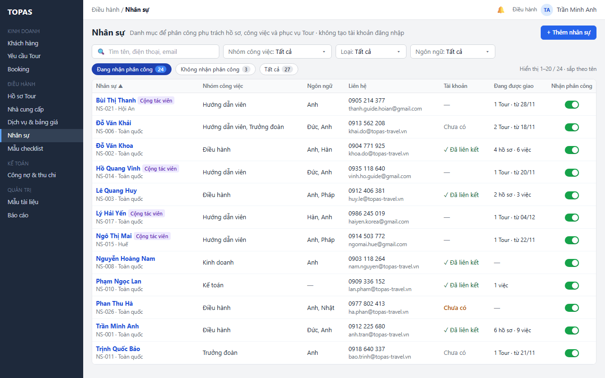

   > Hình chưa cập nhật: chip “Đang nhận phân công”, “Không nhận phân công”; nay là chip Đang dùng, Ngừng dùng của Nhận phân công (K6). Cột Tài khoản của Cộng tác viên ghi “—”; nay hiện Đã liên kết, Chưa có hoặc Bị khóa như Nội bộ (R01).

2. **W02 · Thanh lọc và chip.** Điều hành chọn giá trị hoặc gõ tìm, ví dụ Nhóm công việc: Hướng dẫn viên và Ngôn ngữ: Đức. Bộ lọc áp dụng ngay; danh sách và số trên chip cập nhật; liên kết Xóa bộ lọc hiện ra. Cột Đang được giao cho biết ai đã có lịch phục vụ và từ ngày nào.

   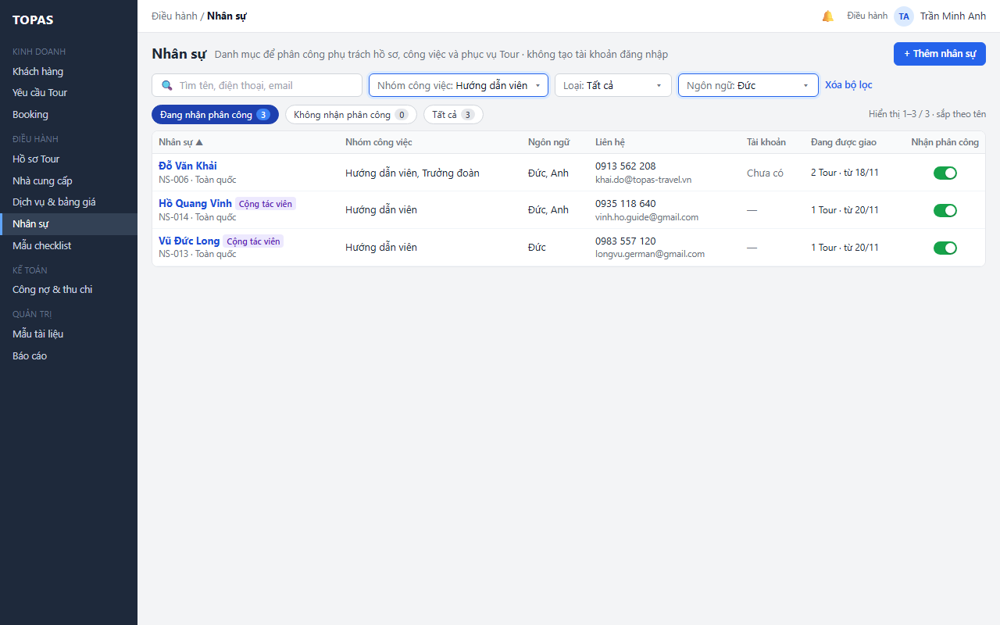

3. **W03 · Vùng bảng khi không có dòng khớp.** Bảng hiện “Không có nhân sự khớp bộ lọc” và gợi ý Thêm nhân sự ở góc phải. Điều hành bấm Xóa bộ lọc ở thanh lọc; danh sách về bộ lọc mặc định.

   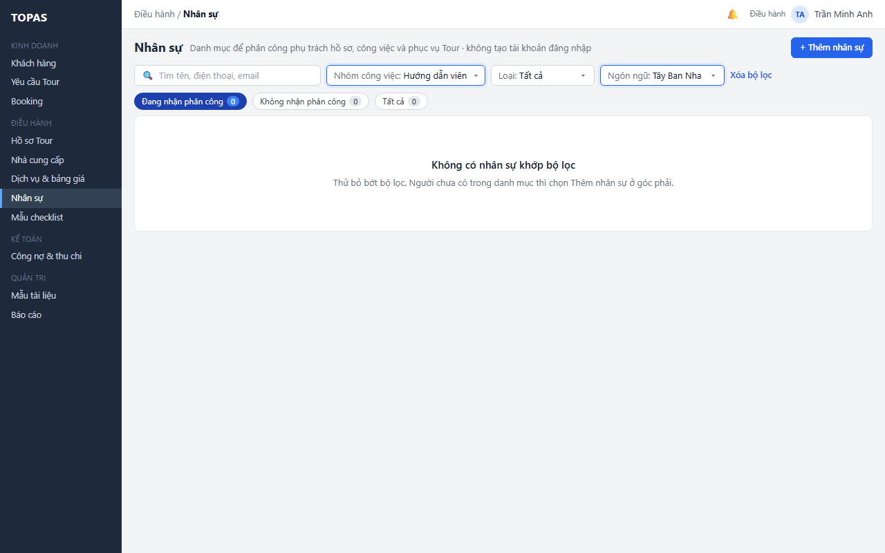

*Kết quả:* Điều hành thấy đúng tập nhân sự cần xem. Khi danh mục chưa có ai, bảng hiện “Chưa có nhân sự. Chọn Thêm nhân sự để bắt đầu” thay cho W03.

**L1.2 Xem lịch phân công của một người (quyết định 11/11/2026).** *Điều kiện:* Điều hành; nhân sự đã có.

1. **W08 · Bấm dòng trên bảng → bảng trượt.** Bảng trượt nhân sự mở ở tab Thông tin (hình W08 ở L3.1; chế độ thêm W05 ở L2.1). Bảng trượt gồm:
   - **Phần đầu:** chế độ thêm: tiêu đề “Thêm nhân sự”. Chế độ sửa: họ tên, nhãn Nội bộ hoặc Cộng tác viên, công tắc Nhận phân công (lưu ngay theo R05); dòng phụ ghi mã và ngày tạo.
   - **Tab:** chỉ có ở chế độ sửa: **Thông tin** (form, một nút Lưu) và **Lịch phân công** (chỉ xem, R04).
   - **Form Thông tin:** Họ tên, Mã nhân sự (dạng chữ), Loại, Khu vực phục vụ, Nhóm công việc, Ngôn ngữ phục vụ, Điện thoại, Email, Tài khoản đăng nhập (dạng chữ; với Cộng tác viên ghi thêm “chỉ vai trò thuộc phòng HDV”, R01), Ghi chú. Ở chế độ thêm có thêm trường Nhận phân công (mặc định Đang dùng).
   - **Chân:** chế độ thêm: Hủy, Lưu nhân sự. Chế độ sửa: Xóa nhân sự (bên trái, khóa kèm lý do khi đã được dùng, R08); “● Có thay đổi chưa lưu” hoặc thời điểm cập nhật cuối; Đóng (hoặc Hủy thay đổi khi đang sửa); Lưu.
2. **W10 · Tab Lịch phân công.** Điều hành chọn tab. Tab gồm ba phần, mỗi phần có số đếm: Phụ trách hồ sơ (hồ sơ chưa đóng), Công việc chưa hoàn tất (5 việc có hạn gần nhất, việc quá hạn tô đỏ, cuối bảng ghi số việc còn lại) và Phục vụ Tour (phân công chưa kết thúc). Số liệu khớp cột Đang được giao (R04).

   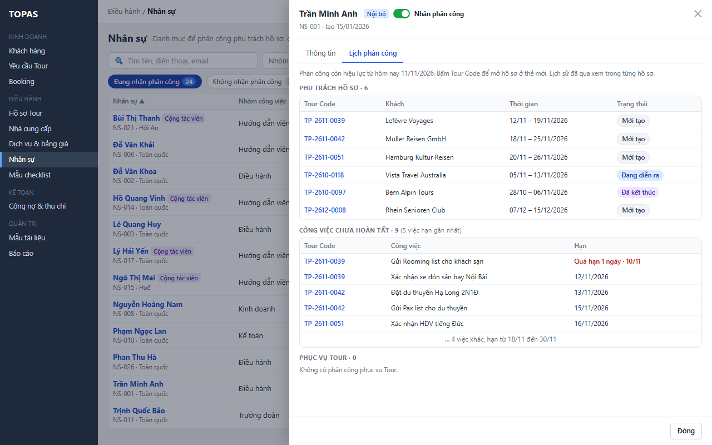

3. **W10 · Tour Code trong tab Lịch phân công.** Điều hành bấm Tour Code; hệ thống mở hồ sơ ở thẻ mới, đúng tab chứa phân công đó (mục 1.2). Bảng trượt và danh sách giữ nguyên.

*Kết quả:* Điều hành biết người đó đang bận gì mà không phải mở từng hồ sơ. Tab chỉ để xem; muốn đổi phân công thì làm ở DH07 hoặc DH08.

**Ngoại lệ**

- **E1.1 · W04.** Không tải được danh sách: vùng bảng thay bằng thông báo lỗi và nút Thử lại; thanh lọc giữ nguyên giá trị; số trên chip hiện “–”. Bấm Thử lại thì tải lại với bộ lọc cũ.

  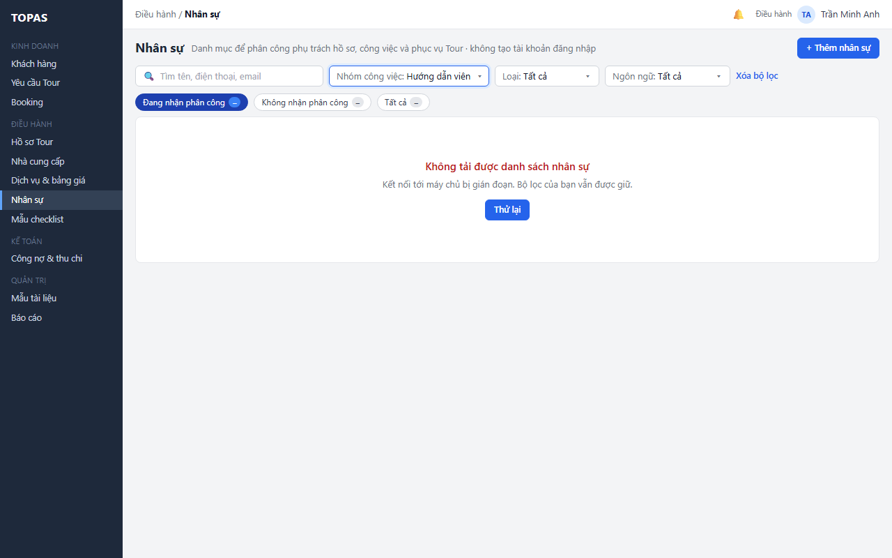

- **E1.2.** Người không có quyền xem DH06 (mặc định là Kinh doanh, Kế toán): menu không có mục Nhân sự. Mở bằng đường dẫn thì hiện “Bạn không có quyền xem danh mục nhân sự” và nút Về trang chủ; dữ liệu không được tải.
- **E1.3.** Tìm kiếm dưới 2 ký tự: chưa chạy tìm, ô tìm hiện gợi ý “Nhập ít nhất 2 ký tự”.
- **E1.4.** Bộ lọc trong phiên có nhóm công việc hoặc ngôn ngữ vừa bị tắt ở QT05: bộ lọc vẫn áp dụng; giá trị hiện kèm chữ “(ngừng dùng)”.
- **E1.5.** Không tải được tab Lịch phân công: tab hiện lỗi kèm Thử lại; tab Thông tin vẫn dùng được.
- **E1.6.** Nhân sự không có việc nào đang được giao: mỗi phần của tab Lịch phân công hiện “Không có …” (ví dụ “Không có phân công phục vụ Tour”, W10).
- **E1.7.** Phân công đổi ở DH07, DH08 trong lúc DH06 đang mở: cột Đang được giao và tab Lịch phân công không tự nhảy số; dữ liệu mới hiện khi đổi bộ lọc, đổi trang, mở lại bảng trượt hoặc chuyển tab.
- **E1.8.** Bấm Tour Code của hồ sơ mà người dùng không còn quyền xem: DH08 hiện màn không có quyền, không lộ dữ liệu.

### 3.2. Thêm nhân sự (CNHT03.02 · HT03.02)

**L2.1 Thêm một nhân sự.** *Điều kiện:* Điều hành.

1. **W05 · Nút Thêm nhân sự ở góc phải tiêu đề → bảng trượt.** Bảng trượt mở ở chế độ thêm với Loại là Nội bộ, Khu vực phục vụ là Toàn quốc và Nhận phân công là Đang dùng. Hai trường có nhãn Mặc định. Mã nhân sự ghi “Cấp khi lưu”.

   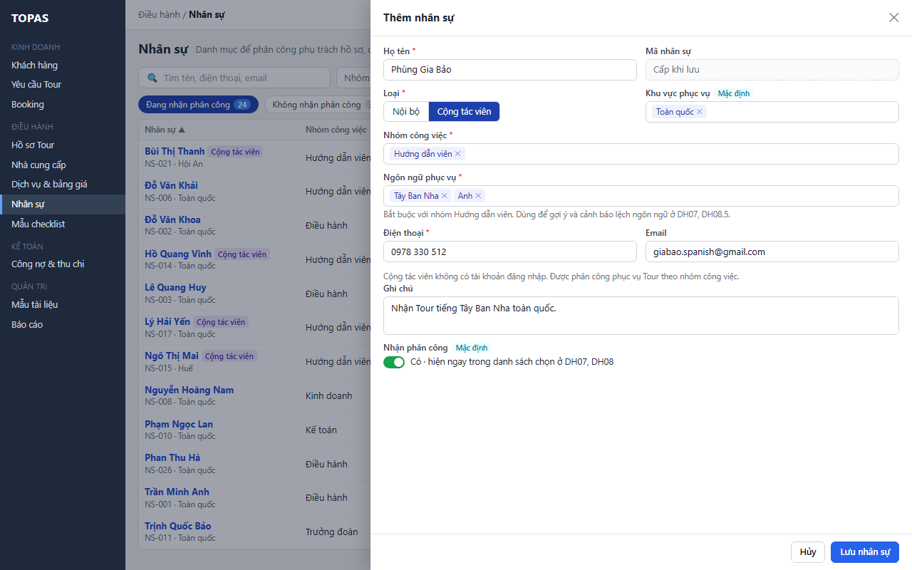

   > Hình chưa cập nhật: công tắc Nhận phân công ghi “Có”; nay là Đang dùng (K6). Ô Mã nhân sự, Tài khoản đăng nhập vẽ viền nét đứt; theo U5 hiện dạng chữ. Câu “Cộng tác viên không có tài khoản đăng nhập” nay đổi như bước 2 (R01).

2. **W05 · Các trường của form.** Điều hành nhập họ tên, chọn loại, chọn một hoặc nhiều nhóm công việc. Nếu có nhóm Hướng dẫn viên thì chọn ngôn ngữ phục vụ (bắt buộc). Sau đó nhập điện thoại, email và ghi chú nếu có. Với Cộng tác viên, chỗ của trường Tài khoản đăng nhập ghi “Chưa có · Cộng tác viên chỉ được liên kết tài khoản có vai trò thuộc phòng HDV (QT01)” (R01).
3. **W05 · Nút Lưu nhân sự ở chân bảng trượt.** Điều hành bấm Lưu nhân sự. Hệ thống kiểm tra theo mục 5.2 và R07, cấp mã `NS-NNN`, rồi lưu.
4. **W07 · Danh sách và thông báo ngắn.** Bảng trượt đóng. Nhân sự mới nằm đúng vị trí theo tên, tô nền xanh nhạt trong 5 giây, có nhãn Mới. Số trên chip tăng (W07: 25 + 3 = 28). Thông báo ngắn “Đã thêm … (NS-028)”.

   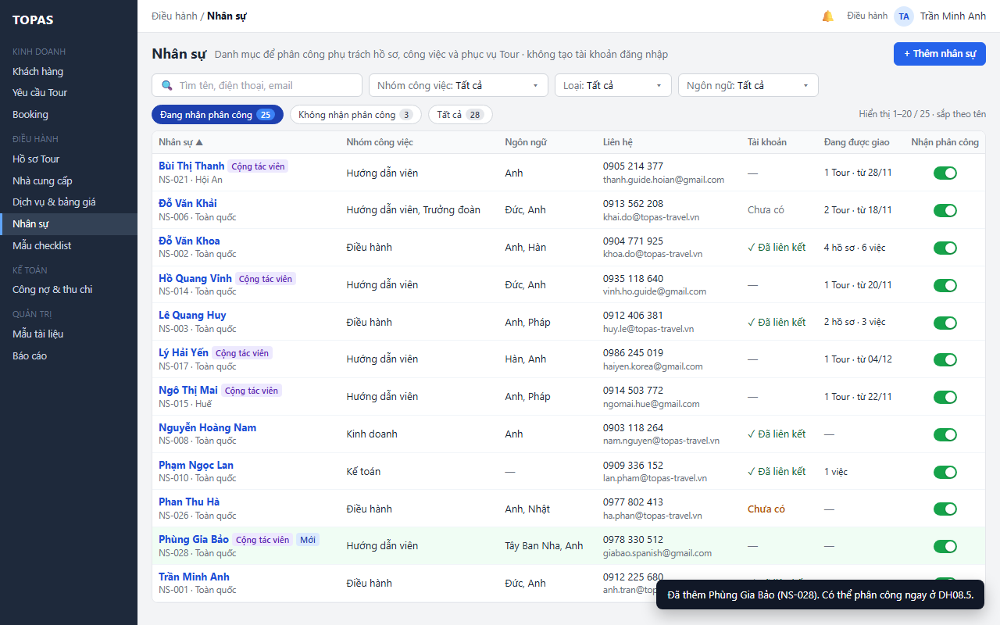

*Kết quả:* nhân sự mới có trong danh mục. Nếu Nhận phân công là Đang dùng, người đó hiện ngay trong danh sách chọn ở DH07, DH08 theo R03. Nhân sự Nội bộ thuộc nhóm Điều hành chỉ được chọn làm phụ trách hồ sơ sau khi Quản trị hệ thống liên kết tài khoản đang hoạt động có vai trò Điều hành ở QT01 (R03).

**Ngoại lệ**

- **E2.1 · W06.** Thiếu trường bắt buộc, sai định dạng, hoặc điện thoại trùng với nhân sự khác: hệ thống không lưu. Banner đầu form nêu số lỗi; mỗi lỗi hiện cạnh trường. Dữ liệu đã nhập được giữ. Điều hành sửa trường rồi lưu lại. Lỗi trùng điện thoại có liên kết Mở nhân sự này (R07).

  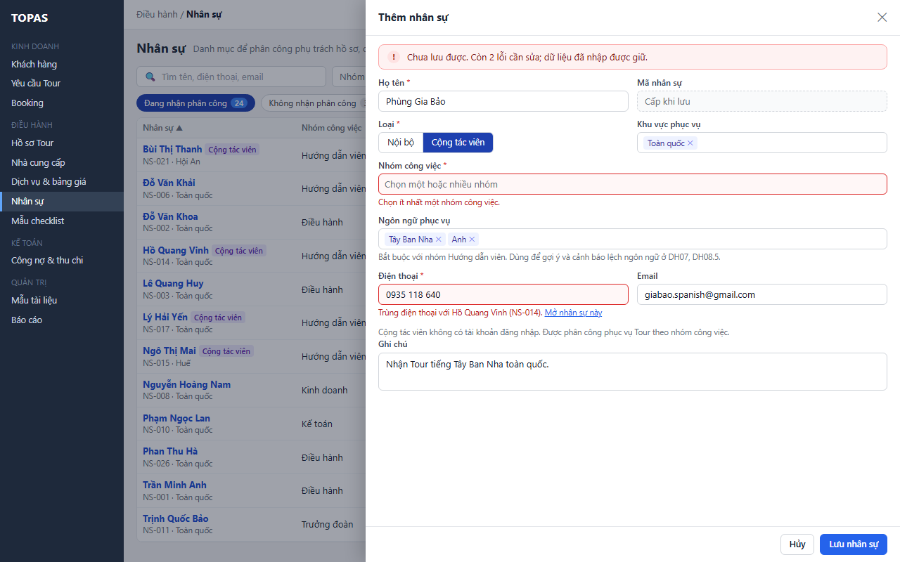

- **E2.2.** Họ tên trùng với một nhân sự khác (sau khi chuẩn hóa): cảnh báo vàng cạnh trường “Đã có Ngô Thị Mai (NS-015) · Mở”, vẫn cho lưu, vì hai người có thể trùng tên.
- **E2.3.** Email trùng với nhân sự khác: cảnh báo, vẫn cho lưu.
- **E2.4.** Nhóm công việc hoặc ngôn ngữ vừa bị tắt ở QT05 trong lúc đang nhập: khi lưu, trường đó báo lỗi “… đã ngừng dùng”; người dùng bỏ giá trị đó rồi lưu lại.
- **E2.5.** Đóng bảng trượt hoặc bấm Hủy khi đã nhập: hộp thoại “Bỏ thông tin đang nhập?” với hai nút Bỏ và Ở lại.
- **E2.6.** Lỗi lưu (mất kết nối): banner đỏ trong bảng trượt có Thử lại; dữ liệu giữ nguyên. Nút Lưu khóa ngay sau lần bấm đầu. Máy chủ dùng mã yêu cầu để chỉ tạo một nhân sự.
- **E2.7.** Danh mục Nhóm công việc ở QT05 chưa có giá trị nào đang dùng: không lưu được; trường Nhóm công việc ghi “Chưa có nhóm công việc. Thêm nhóm công việc ở QT05.” kèm liên kết mở QT05 (Điều hành sửa nhóm này, RSD QT05 mục 1.5)

### 3.3. Sửa nhân sự (CNHT03.02 · HT03.02)

**L3.1 Sửa thông tin.** *Điều kiện:* Điều hành.

1. **W08 · Bấm dòng → bảng trượt, tab Thông tin.** Bảng trượt mở với dữ liệu hiện tại. Nhân sự Nội bộ thuộc nhóm Điều hành mà chưa liên kết tài khoản có banner vàng: chưa được chọn làm phụ trách hồ sơ, chưa nhận thông báo của nhóm Điều hành, và Quản trị hệ thống liên kết ở QT01.

   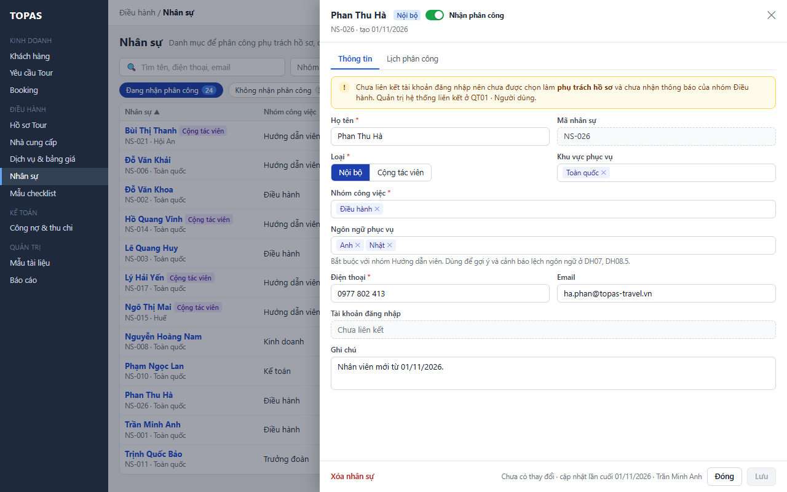

   > Hình chưa cập nhật: ô Mã nhân sự, Tài khoản đăng nhập còn vẽ viền nét đứt; theo U5 hiện dạng chữ. Nhãn cạnh công tắc ở phần đầu ghi “Nhận phân công”; giá trị nay là Đang dùng / Ngừng dùng (K6).

2. **W08 · Các trường của form.** Điều hành sửa các trường. Chân bảng trượt hiện “● Có thay đổi chưa lưu”; nút Đóng đổi thành Hủy thay đổi; nút Lưu mở khóa.
3. **W08 · Nút Lưu ở chân bảng trượt.** Điều hành bấm Lưu. Hệ thống kiểm tra như L2.1 bước 3 và R06, rồi ghi một lần. Bảng trượt ở lại tab Thông tin. Chân ghi thời điểm cập nhật mới; thông báo ngắn “Đã lưu”. Dòng trên danh sách phía sau cập nhật.

*Kết quả:* thông tin mới hiện ở mọi nơi có tên nhân sự, vì các màn đều tham chiếu theo ID. Phân công đã có không đổi.

**L3.2 Bỏ nhóm công việc khi đang được giao việc thuộc nhóm đó.** *Điều kiện:* Điều hành; nhân sự có phân công đang hiệu lực cần nhóm công việc bị bỏ (R06).

1. **W09 · Trường Nhóm công việc và nút Lưu → banner vàng trong bảng trượt.** Điều hành bỏ nhóm Hướng dẫn viên của Đỗ Văn Khải rồi bấm Lưu. Hệ thống chưa lưu. Banner vàng liệt kê các phân công đang dùng nhóm này (Tour Code, khách, vai trò, thời gian) và nói rõ hậu quả: các phân công này giữ nguyên, từ nay không chọn được người này cho vai trò thuộc nhóm đó. Dưới trường Nhóm công việc ghi “Đã bỏ: Hướng dẫn viên”. Nút chính đổi thành Vẫn lưu.

   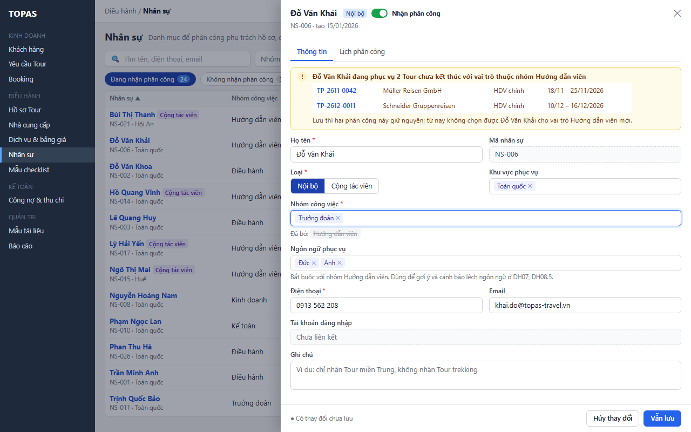

2. **W09 · Nút Vẫn lưu hoặc Hủy thay đổi.** Điều hành bấm Vẫn lưu để lưu (phân công giữ nguyên, R06), hoặc Hủy thay đổi để trả về như cũ.

*Kết quả:* nhóm công việc được cập nhật. Phân công đang có giữ nguyên, không gắn chỉ báo, vì người đó vẫn nhận phân công. Điều hành tự đổi người ở DH08.5 nếu cần.

**Ngoại lệ**

- **E3.1 · W11.** Nhân sự vừa được người khác sửa ở phiên khác: máy chủ từ chối vì phiên bản đã đổi. Banner đỏ trong bảng trượt nêu người và thời điểm sửa, chỉ có nút Tải lại; dữ liệu đang nhập còn trên form để người dùng xem lại cho tới khi bấm Tải lại, rồi nhập lại thay đổi và lưu. Không có nút ghi đè (Q8).

  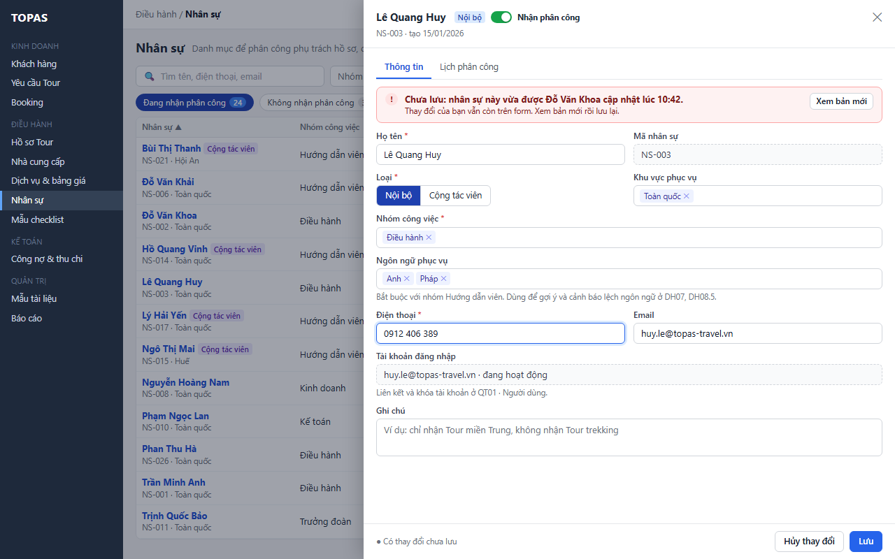

  > Hình chưa cập nhật: banner còn nút “Xem bản mới” và câu “Xem bản mới để so sánh”; nay chỉ có nút Tải lại (Q8).

- **E3.2.** Đổi Loại từ Nội bộ sang Cộng tác viên khi tài khoản liên kết có vai trò ngoài phòng HDV (R01): chặn lưu, lỗi cạnh trường “Tài khoản liên kết có vai trò ngoài phòng HDV · bỏ các vai trò đó hoặc gỡ liên kết ở QT01 trước khi đổi sang Cộng tác viên”. Tài khoản liên kết chỉ có vai trò thuộc phòng HDV thì đổi được, liên kết giữ nguyên.
- **E3.3.** Đổi Loại từ Nội bộ sang Cộng tác viên khi còn công việc checklist chưa hoàn tất: cảnh báo như W09, liệt kê các công việc đó, rồi cho lưu (R06). Công việc giữ người thực hiện cũ.
- **E3.4.** Bỏ hết ngôn ngữ khi còn nhóm Hướng dẫn viên: lỗi cạnh trường “Hướng dẫn viên cần ít nhất một ngôn ngữ phục vụ”.
- **E3.5.** Đổi ngôn ngữ của hướng dẫn viên đang có phân công: lưu ngay, không cảnh báo. DH08.5 chỉ kiểm tra lệch ngôn ngữ lúc phân công (RSD DH08 R12); lý do lệch ngôn ngữ đã ghi được giữ.
- **E3.6.** Tài khoản bị khóa ở QT01 trong lúc bảng trượt đang mở: trường Tài khoản cập nhật khi lưu hoặc mở lại. Không chặn việc sửa thông tin.
- **E3.7.** Đóng bảng trượt hoặc chuyển tab khi có thay đổi chưa lưu: hộp thoại Lưu và đóng, Bỏ thay đổi, Ở lại.
- **E3.8.** Lỗi lưu: như E2.6; dữ liệu trên form giữ nguyên.
- **E3.9.** Đổi Loại từ Cộng tác viên sang Nội bộ khi đã liên kết tài khoản: lưu bình thường; tài khoản giữ vai trò đang có, Quản trị gán thêm vai trò khác ở QT01 nếu cần (R01). Nhân sự từ nay có thể hiện ở danh sách chọn người thực hiện, người phụ trách theo R03.

### 3.4. Bật, tắt nhận phân công (CNHT03.02 · quyết định 11/11/2026)

**L4.1 Tắt nhận phân công của người không có việc đang được giao.** *Điều kiện:* Điều hành; nhân sự có Nhận phân công Đang dùng; cột Đang được giao là “—”.

1. **W01 · Công tắc trên dòng (hoặc ở phần đầu bảng trượt).** Điều hành tắt công tắc. Hệ thống kiểm tra việc đang được giao theo R04. Không có việc nào thì lưu ngay, không hỏi.
2. **W13 · Dòng và thông báo ngắn.** Giao diện như W13: dòng mờ đi, giữ tại chỗ đến khi người dùng đổi bộ lọc, đổi trang hoặc tải lại; số trên chip cập nhật; thông báo ngắn kèm Hoàn tác trong 10 giây. Khác W13 ở chỗ dòng không có chỉ báo Cần giao lại, vì người này không còn việc nào.

*Kết quả:* nhân sự có Nhận phân công Ngừng dùng, không hiện khi chọn người mới ở DH07, DH08.

**L4.2 Tắt nhận phân công của người đang được giao việc.** *Điều kiện:* Điều hành; nhân sự có ít nhất một việc đang được giao theo R04.

1. **W12 · Công tắc trên dòng → hộp thoại.** Điều hành tắt công tắc của Lê Quang Huy. Công tắc chưa đổi; hộp thoại “Tắt nhận phân công của …?” mở. Hộp thoại liệt kê các hồ sơ chưa đóng người này đang phụ trách, các công việc chưa hoàn tất và lịch phục vụ Tour chưa kết thúc. Khung thông tin nói rõ điều gì xảy ra sau khi tắt.

   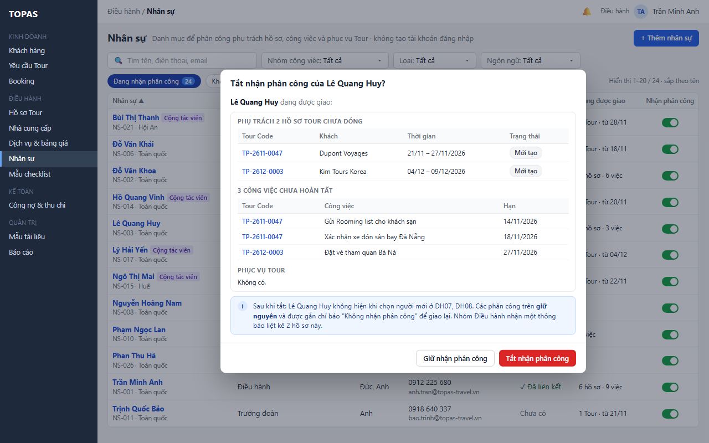

2. **W12 · Nút Tắt nhận phân công hoặc Giữ nhận phân công.** Điều hành bấm Tắt nhận phân công (nút đỏ); hệ thống lưu và đóng hộp thoại. Nếu bấm Giữ nhận phân công thì không đổi gì. Bấm Tour Code trong hộp thoại để mở hồ sơ ở thẻ mới và xem trước khi quyết định.
3. **W13 · Dòng và thông báo ngắn.** Hệ thống lưu; trong cùng giao dịch ghi các tác động ở bước 4 (Q5). Dòng mờ, giữ tại chỗ, có chỉ báo “Cần giao lại 2 hồ sơ · 3 việc”. Số trên chip cập nhật (23 + 4 = 27). Thông báo ngắn kèm Hoàn tác trong 10 giây; Điều hành bấm Hoàn tác nếu cần.

   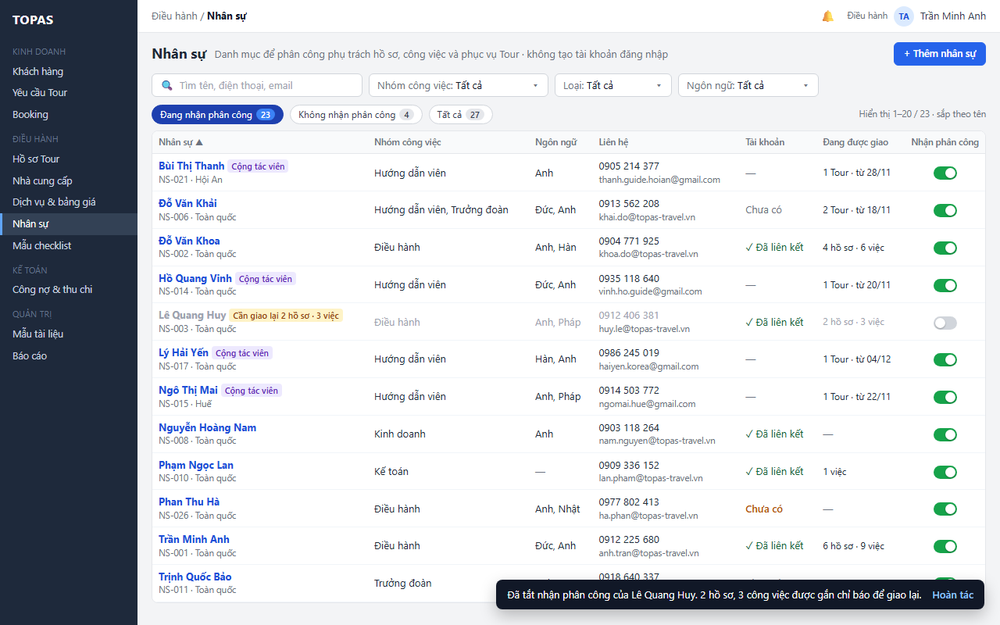

   > Hình chưa cập nhật: chip “Đang nhận phân công”, “Không nhận phân công”; nay là chip Đang dùng, Ngừng dùng của Nhận phân công (K6).

4. **W13 · Ngoài màn này; dòng vẫn như W13.** Ngay sau khi lưu, cạnh tên người này ở các phân công đang hiệu lực (DH07 cột Phụ trách, DH08.1, DH08.2, DH08.5) hiện chỉ báo “Không nhận phân công” (tính lúc đọc từ Nhận phân công, Q6), và người nhận theo R05 có thông báo in-app; chuông thông báo của người nhận hiện số. Bấm Hoàn tác thì chỉ báo mất và thông báo vừa tạo được gỡ.

*Kết quả:* người này không còn được chọn mới. Hồ sơ, công việc và lịch phục vụ đã giao giữ nguyên người cũ, có chỉ báo để Điều hành giao lại ở DH07 hoặc DH08. Chỉ báo Cần giao lại trên DH06 tự mất khi không còn việc nào được giao cho người này.

**L4.3 Bật lại nhận phân công.** *Điều kiện:* Điều hành; nhân sự có Nhận phân công Ngừng dùng.

1. **W14 · Chip Ngừng dùng → công tắc trên dòng.** Điều hành bấm chip Ngừng dùng rồi bật công tắc trên dòng. Hệ thống lưu ngay, không hỏi. Dòng hết mờ, tô sáng, giữ tại chỗ đến khi tải lại. Số trên chip cập nhật (25 + 2 = 27). Thông báo ngắn kèm Hoàn tác.

   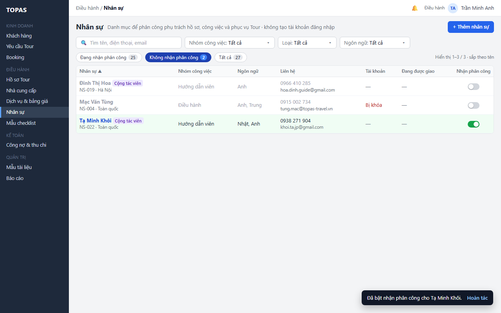

   > Hình chưa cập nhật: chip “Đang nhận phân công”, “Không nhận phân công”; nay là chip Đang dùng, Ngừng dùng của Nhận phân công (K6).

*Kết quả:* nhân sự hiện lại khi chọn người mới. Chỉ báo “Không nhận phân công” trên các phân công cũ tự mất.

**Ngoại lệ**

- **E4.1.** Bật, tắt khi nhân sự vừa được đổi ở phiên khác: máy chủ từ chối; công tắc trả về giá trị mới nhất; thông báo ngắn “… đã được … đổi lúc …”. Muốn đổi tiếp thì bấm lại.
- **E4.2.** Lỗi lưu (mất kết nối): công tắc trả về giá trị cũ, thông báo lỗi có nút Thử lại.
- **E4.3.** Việc đang được giao thay đổi trong lúc hộp thoại W12 đang mở (ví dụ có người vừa giao thêm một hồ sơ cho người này): việc tắt vẫn được thực hiện, vì đây là cảnh báo chứ không phải điều kiện chặn. Chỉ báo và thông báo được tính theo dữ liệu lúc lưu.
- **E4.4.** Không tải được danh sách việc đang được giao khi mở W12: hộp thoại hiện “Chưa kiểm tra được việc đang được giao” kèm Thử lại và nút Vẫn tắt. Hệ thống không lưu khi người dùng chưa chọn.
- **E4.5.** Bấm Hoàn tác khi đã có người đổi tiếp nhân sự đó: không hoàn tác; thông báo nêu lý do. Hết 10 giây thì thông báo ngắn biến mất; muốn đổi lại thì bấm công tắc.
- **E4.6.** Bấm công tắc nhiều lần liên tiếp: công tắc khóa ngay sau lần bấm đầu cho tới khi có kết quả; máy chủ chỉ xử lý một yêu cầu.
- **E4.7.** Tắt người phụ trách hồ sơ đang Đang diễn ra: hộp thoại W12 đặt hồ sơ đó lên đầu với nhãn Đang diễn ra; vẫn cho tắt.
- **E4.8.** Người dùng tự tắt nhận phân công của chính mình: hộp thoại W12 có thêm dòng “Bạn sẽ không còn nhận thông báo của nhóm Điều hành”. Vẫn cho tắt.
- **E4.9.** Tắt người cuối cùng thuộc nhóm Điều hành đang nhận phân công: hộp thoại W12 có thêm cảnh báo đỏ “Sau khi tắt sẽ không còn ai để giao phụ trách hồ sơ (DH07)”. Vẫn cho tắt.
- **E4.10.** Người dùng bị thu hồi quyền giữa chừng: máy chủ từ chối, công tắc trả về giá trị cũ, thông báo “Bạn không có quyền đổi nhận phân công”.

### 3.5. Xóa nhân sự tạo nhầm

**L5.1 Xóa nhân sự chưa từng được dùng.** *Điều kiện:* Điều hành; nhân sự chưa từng được dùng theo R08.

1. **W15 · Nút Xóa nhân sự ở góc trái chân bảng trượt → hộp thoại.** Điều hành bấm Xóa nhân sự. Hộp thoại xác nhận nói rõ nhân sự chưa từng được phân công và xóa không hoàn tác được, đồng thời gợi ý tắt Nhận phân công nếu chỉ tạm ngừng hợp tác.

   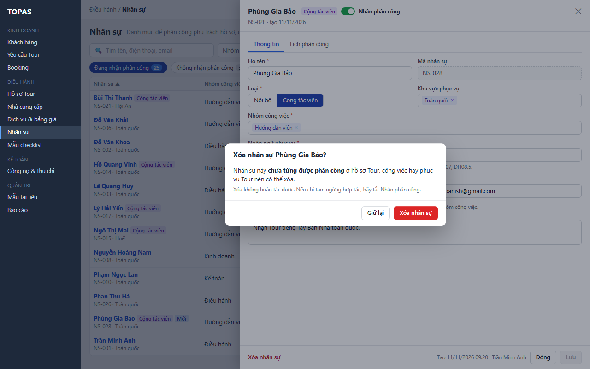

2. **W15 · Nút Xóa nhân sự hoặc Giữ lại trong hộp thoại.** Điều hành bấm Xóa nhân sự (Giữ lại thì không đổi gì). Hệ thống kiểm tra lại R08 rồi xóa. Bảng trượt đóng. Dòng biến mất khỏi danh sách, số trên chip giảm, thông báo ngắn “Đã xóa …”.

*Kết quả:* nhân sự không còn trong danh mục. Mã của người đó không được cấp lại. Nhật ký QT03 ghi lần xóa kèm dữ liệu trước khi xóa.

**Ngoại lệ**

- **E5.1 · W15a.** Nhân sự đã từng được dùng (phụ trách hồ sơ, thực hiện công việc, phục vụ Tour, kể cả ở hồ sơ đã đóng) hoặc đã liên kết tài khoản: nút Xóa nhân sự ở chân bảng trượt khóa; cạnh nút ghi lý do và gợi ý tắt Nhận phân công.

  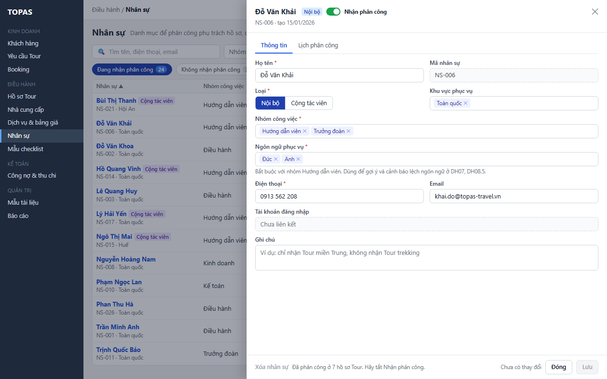

- **E5.2.** Nhân sự vừa được phân công ở phiên khác trong lúc hộp thoại W15 đang mở: máy chủ từ chối xóa. Thông báo “Nhân sự vừa được phân công ở … nên không xóa được”; nút Xóa chuyển sang trạng thái khóa như W15a.
- **E5.3.** Lỗi khi xóa: hộp thoại giữ nguyên, hiện lỗi kèm Thử lại; không có gì bị xóa.

**Số bước trước và sau khi tối ưu (cả mục 3)**

| Việc | Cách làm thông thường | Bản này |
|---|---|---|
| Tìm hướng dẫn viên tiếng Đức còn trống | Mở danh sách, mở từng người, đối chiếu lịch ở từng hồ sơ | 2 lần chọn bộ lọc; cột Đang được giao cho biết ngày bận gần nhất |
| Thêm một cộng tác viên | Mở form, nhập, Lưu, quay lại danh sách | Nhập trong bảng trượt, 1 lần bấm Lưu; khu vực và nhận phân công đã có sẵn |
| Ngừng giao việc cho người nghỉ việc | Rà DH07, DH08 tìm việc của người đó rồi mới tắt | 2 lần bấm (công tắc, xác nhận); hệ thống liệt kê việc và gắn chỉ báo để giao lại |
| Biết một người đang bận gì | Lọc DH07 theo người phụ trách, mở từng hồ sơ để xem công việc và lịch phục vụ | 1 tab Lịch phân công |

---

## 4. Quy tắc triển khai chi tiết

### R01. Loại nhân sự và tài khoản (quyết định 11/11/2026)

- **Nội bộ** là nhân viên của công ty. Quản trị hệ thống có thể liên kết một tài khoản đăng nhập ở QT01; tài khoản đó có vai trò bất kỳ. Một tài khoản liên kết tối đa một nhân sự, và một nhân sự liên kết tối đa một tài khoản.
- **Cộng tác viên** là hướng dẫn viên, trưởng đoàn hoặc người phục vụ tự do. Quản trị hệ thống có thể liên kết một tài khoản đăng nhập ở QT01, nhưng tài khoản đó **chỉ có vai trò thuộc phòng HDV** (vai trò hệ thống HDV hoặc vai trò tự tạo thuộc phòng HDV) (người dùng chốt 12/11/2026; ADR 0007). Tài khoản này dùng màn Tour của tôi (RSD HD01) và chỉ thấy hồ sơ mình được phân công. QT01 kiểm tra ràng buộc vai trò khi liên kết và khi đổi vai trò của tài khoản. Cùng giới hạn một tài khoản – một nhân sự như Nội bộ.
- Có tài khoản không đổi nơi Cộng tác viên được chọn: vẫn chỉ ở phục vụ Tour (R03).
- DH06 không tạo, khóa hay gỡ tài khoản. Trạng thái tài khoản đọc từ QT01: Đã liên kết (đang hoạt động), Bị khóa, Chưa có.
- Khóa tài khoản ở QT01 không đổi Nhận phân công. Tắt Nhận phân công ở DH06 không khóa tài khoản. Liên kết, gỡ liên kết hoặc khóa tài khoản ở QT01 hiện ở cột Tài khoản từ lần tải sau; danh sách chọn ở DH07 áp dụng theo R03.

### R02. Nhóm công việc, vai trò phục vụ và ngôn ngữ

- Nhóm công việc là danh mục QT05. Mỗi nhân sự có ít nhất một nhóm. Giá trị minh họa: Điều hành, Kinh doanh, Kế toán, Hướng dẫn viên, Trưởng đoàn. Nhóm **Điều hành** là giá trị hệ thống: không xóa, không tắt được, vì DH07, DH02 và DH03 dùng nhóm này để chọn người phụ trách và gửi thông báo.
- Mỗi nhóm công việc khai ở QT05 các **vai trò phục vụ Tour** mà nhóm đó được nhận ở DH08.5. Ví dụ: Hướng dẫn viên nhận HDV chính, HDV điểm; Trưởng đoàn nhận Trưởng đoàn.
- **Ngôn ngữ phục vụ** chọn nhiều, từ cùng danh mục với ngôn ngữ phục vụ của Booking. Nhân sự thuộc nhóm Hướng dẫn viên phải có ít nhất một ngôn ngữ. Với nhóm khác, ngôn ngữ dùng để gợi ý (RSD DH07 R08).
- **Khu vực phục vụ** chọn nhiều từ danh mục địa điểm (điểm đến, có Toàn quốc), dùng chung với Địa điểm NCC. DH08.5 hiện khu vực bên cạnh tên trong danh sách chọn để Điều hành ưu tiên hướng dẫn viên địa phương.
- Nhóm công việc, ngôn ngữ hoặc địa điểm bị tắt ở QT05 vẫn giữ trên nhân sự đang dùng, hiện kèm “(ngừng dùng)”; không chọn mới được giá trị đó.

### R03. Nơi nhân sự được chọn (HT03.03)

| Nơi chọn | Điều kiện để hiện trong danh sách chọn | Thứ tự gợi ý |
|---|---|---|
| Người phụ trách hồ sơ (DH07, DH08.1) | Nhận phân công Đang dùng; thuộc nhóm Điều hành; Nội bộ; tài khoản liên kết đang hoạt động và có vai trò Điều hành (RSD QT01 R03) | Theo RSD DH07 R08 (khớp ngôn ngữ, số hồ sơ đang mở) |
| Người thực hiện công việc checklist (DH08.2; điền theo RSD DH01 R05) | Nhận phân công Đang dùng; Nội bộ; không có tài khoản liên kết Bị khóa (nhân sự chưa có tài khoản vẫn chọn được; RSD QT01 R06) | Người phụ trách hồ sơ đứng đầu, rồi theo tên |
| Nhân sự phục vụ Tour (DH08.5) | Nhận phân công Đang dùng; có nhóm công việc nhận vai trò phục vụ đã chọn (R02); Nội bộ hoặc Cộng tác viên | Theo RSD DH08 L5.2 (khớp ngôn ngữ và trống lịch, khớp ngôn ngữ nhưng bận, rồi các trường hợp còn lại) |
| Người nhận thông báo của nhóm Điều hành (RSD DH02 R08, RSD DH07) | Nhận phân công Đang dùng; thuộc nhóm Điều hành; tài khoản liên kết đang hoạt động và có vai trò Điều hành | — |

- Danh sách chọn ở các màn trên luôn đọc dữ liệu mới nhất của DH06. Máy chủ của màn đó kiểm tra lại điều kiện khi lưu (RSD DH07 E4.3, RSD DH08 E2.2).
- Người không còn đủ điều kiện nhưng đang được giao vẫn hiện ở phân công đã có, kèm chỉ báo theo R05 nếu Nhận phân công Ngừng dùng.

### R04. Việc đang được giao

| Phần | Tính khi | Hiển thị |
|---|---|---|
| Hồ sơ phụ trách | Hồ sơ Tour chưa đóng (Mới tạo, Đang diễn ra, Đã kết thúc chưa đóng) có người phụ trách là nhân sự này | “n hồ sơ”; tab Lịch phân công: Tour Code, khách, thời gian, trạng thái; hồ sơ Đang diễn ra đứng đầu, rồi theo ngày khởi hành |
| Công việc chưa hoàn tất | Công việc checklist của hồ sơ chưa đóng, tiến độ khác Hoàn tất, người thực hiện là nhân sự này | “m việc”; tab: 5 việc hạn gần nhất (quá hạn đỏ), dòng cuối “… k việc khác, hạn từ … đến …” |
| Phục vụ Tour | Phân công DH08.5 của hồ sơ chưa đóng, có thời điểm kết thúc từ hôm nay trở đi | “k Tour · từ dd/mm”, với dd/mm là ngày bắt đầu gần nhất; tab: Tour Code, khách, vai trò, từ–đến |

- Tính lúc tải danh sách, lúc mở tab Lịch phân công và lúc mở hộp thoại W12. Không có trạng thái lưu riêng.
- “Đã từng được dùng” (R08) khác “đang được giao”: tính cả hồ sơ đã đóng và phân công đã qua.

### R05. Nhận phân công (CNHT03.02 · quyết định 11/11/2026)

- Người có quyền Bật, tắt Nhận phân công (mặc định Điều hành; QT02) bật, tắt. Không có bước duyệt. Công tắc trên dòng và công tắc ở phần đầu bảng trượt dùng chung quy tắc này.
- **Bật:** lưu ngay, không hỏi.
- **Tắt:** hệ thống tính việc đang được giao (R04).
  - Không có việc nào: lưu ngay, không hỏi.
  - Có việc: mở hộp thoại W12. Chỉ lưu khi người dùng xác nhận. Đây là cảnh báo, không chặn.
- **Hoàn tác:** thông báo ngắn có Hoàn tác trong 10 giây. Hoàn tác ghi giá trị cũ như một lần đổi mới (nguồn Hoàn tác) và kiểm tra phiên bản như mọi lần ghi; trong cùng giao dịch đó gỡ các thông báo in-app vừa tạo khi tắt.
- **Tác động khi tắt** (ghi trong cùng giao dịch với thao tác tắt, Q5):
  - nhân sự không hiện trong danh sách chọn người mới ở mọi nơi trong R03;
  - phân công đang có giữ nguyên người cũ. Cạnh tên người đó có chỉ báo vàng “Không nhận phân công” (tính lúc đọc, Q6) ở DH07 (cột Phụ trách), DH08.1, DH08.2 (người thực hiện) và DH08.5 (thanh phân công);
  - thông báo in-app (Q2), gộp theo người nhận:
    - nhóm Điều hành (trừ người vừa bị tắt) nhận một thông báo liệt kê các hồ sơ có người phụ trách là người này;
    - Điều hành phụ trách từng hồ sơ có công việc hoặc phân công phục vụ của người này nhận một thông báo liệt kê các mục đó. Người nào đã nhận thông báo nhóm cho cùng hồ sơ thì không nhận thêm;
  - người bị tắt không còn nhận thông báo của nhóm Điều hành (R03).
- **Tác động khi bật lại:** nhân sự hiện lại khi chọn người mới; chỉ báo “Không nhận phân công” tự mất. Hệ thống không gửi thông báo.
- **Chỉ báo Cần giao lại trên DH06** hiện khi nhân sự có Nhận phân công Ngừng dùng mà vẫn còn việc đang được giao. Chỉ báo tự mất khi các việc đó đã được giao cho người khác, đã hoàn tất hoặc hồ sơ đã đóng; số trên chỉ báo giảm hoặc chỉ báo mất ở lần tải sau.
- Mỗi lần đổi ghi lịch sử theo mục 5.1, kèm số việc đang được giao lúc đổi.

### R06. Sửa nhân sự đang được giao việc

| Thay đổi | Khi có việc đang được giao liên quan | Phân công đã có |
|---|---|---|
| Bỏ nhóm công việc | Cảnh báo trong bảng trượt (W09), liệt kê phân công cần nhóm đó. Ví dụ: hồ sơ phụ trách cần nhóm Điều hành; phục vụ Tour cần nhóm nhận vai trò đó. Bấm Vẫn lưu để lưu | Giữ nguyên, không gắn chỉ báo |
| Đổi Nội bộ sang Cộng tác viên | Chặn khi tài khoản liên kết có vai trò ngoài phòng HDV (E3.2). Còn công việc chưa hoàn tất thì cảnh báo như W09 | Giữ nguyên |
| Đổi Cộng tác viên sang Nội bộ | Không cảnh báo (E3.9) | Giữ nguyên |
| Đổi ngôn ngữ, khu vực | Không cảnh báo | Giữ nguyên; lý do lệch ngôn ngữ đã ghi ở DH08.5 được giữ |
| Đổi họ tên, liên hệ, ghi chú | Không cảnh báo | Hiện thông tin mới ở mọi màn vì tham chiếu theo ID. Tài liệu đã gửi ra ngoài (ví dụ email đặt dịch vụ có tên hướng dẫn viên) giữ bản đã gửi |

### R07. Mã nhân sự và chống trùng

- Mã dạng `NS-NNN`, cấp tăng dần khi tạo, không dùng lại kể cả sau khi xóa, không sửa được; được phép thủng số (Q7). Vượt 999 thì tự thêm chữ số (`NS-1000`).
- **Điện thoại** chuẩn hóa bằng cách bỏ mọi ký tự không phải số và đổi `84` ở đầu thành `0`. Trùng với nhân sự khác (kể cả nhân sự có Nhận phân công Ngừng dùng) thì chặn lưu, kèm liên kết mở người đó. Máy chủ kiểm tra lại khi lưu.
- **Họ tên** chuẩn hóa bằng cách bỏ dấu, đổi sang chữ thường, gộp khoảng trắng. Trùng thì cảnh báo, không chặn.
- **Email** trùng nhân sự khác thì cảnh báo, không chặn.

### R08. Xóa nhân sự

- Chỉ xóa được nhân sự **chưa từng được dùng**: chưa từng là người phụ trách hồ sơ, người thực hiện công việc hay người được phân công phục vụ Tour (kể cả ở hồ sơ đã đóng và phân công đã bị bỏ), và chưa liên kết tài khoản.
- Đã được dùng thì nút Xóa khóa, kèm lý do (W15a). Người dùng tắt Nhận phân công thay cho xóa.
- Hệ thống kiểm tra lại khi xóa. Xóa không hoàn tác được; nhật ký QT03 lưu dữ liệu trước khi xóa.

### R09. Đồng thời và lịch sử

- Mỗi nhân sự có một phiên bản bản ghi. Mọi lần lưu, bật, tắt, Hoàn tác và xóa đều gửi kèm phiên bản. Phiên bản đã đổi thì máy chủ từ chối: bảng trượt hiện W11 với nút Tải lại (Q8), công tắc trả về giá trị mới nhất (E4.1).
- Lịch sử ghi theo trường: giá trị trước, sau, người, thời điểm, nguồn. Lịch sử xem ở QT03, lọc theo đối tượng Nhân sự; mặc định chỉ Quản trị hệ thống có quyền xem QT03 (QT02), Điều hành không có lịch sử trong DH06 (người dùng chốt 12/11/2026, RSD QT03).

### R10. Cấu hình phụ thuộc

| Cấu hình | Chủ sở hữu | Dùng ở | Khi thiếu |
|---|---|---|---|
| Danh mục Nhóm công việc và vai trò phục vụ của từng nhóm (QT05) | Quản trị hệ thống, Điều hành | Bộ lọc, form, R02, R03 | Không lưu được nhân sự (E2.7). Nhóm chưa khai vai trò phục vụ thì người thuộc nhóm đó không hiện ở DH08.5 |
| Danh mục Ngôn ngữ phục vụ (QT05) | Quản trị hệ thống, Điều hành | Bộ lọc, form, R02 | Không lưu được nhân sự thuộc nhóm Hướng dẫn viên; lỗi nêu cần cấu hình QT05 |
| Danh mục địa điểm (điểm đến, có Toàn quốc), dùng chung với RSD DH02 R07 | Quản trị | Khu vực phục vụ | Chỉ có giá trị Toàn quốc |
| Liên kết tài khoản và vai trò (QT01) | Quản trị hệ thống | Cột Tài khoản, R01, R03 | Nhân sự Nội bộ hiện “Chưa có”; không được chọn làm phụ trách hồ sơ. Tài khoản không có vai trò Điều hành: không được chọn làm phụ trách hồ sơ. Tài khoản Bị khóa: không được chọn làm phụ trách hồ sơ, người thực hiện |
| Quyền DH06 (QT02) | Quản trị hệ thống | Mục 1.4 | Mặc định theo mục 1.4: Điều hành xem và ghi, Quản trị xem |

---

## 5. Dữ liệu

### 5.1. Đối tượng dữ liệu

| Đối tượng | Khóa và dữ liệu chính | Nguồn hoặc tác động |
|---|---|---|
| Nhân sự | ID, mã `NS-NNN`, họ tên, họ tên chuẩn hóa, loại (Nội bộ, Cộng tác viên), nhóm công việc (một hoặc nhiều), ngôn ngữ phục vụ (không hoặc nhiều), khu vực phục vụ (một hoặc nhiều), điện thoại, điện thoại chuẩn hóa, email, ghi chú, nhận phân công, phiên bản bản ghi, thời điểm và người tạo | DH06 sở hữu |
| Liên kết tài khoản (đọc) | ID nhân sự, ID tài khoản, trạng thái tài khoản (hoạt động, bị khóa) | QT01 sở hữu; một tài khoản liên kết tối đa một nhân sự (Nội bộ, hoặc Cộng tác viên với tài khoản chỉ có vai trò thuộc phòng HDV, R01) |
| Nhóm công việc (đọc) | ID, tên, đang dùng, các vai trò phục vụ Tour nhóm đó được nhận | QT05 sở hữu (R02) |
| Ngôn ngữ phục vụ (đọc) | ID, tên, đang dùng | QT05 sở hữu; cùng danh mục với ngôn ngữ phục vụ của Booking |
| Địa điểm (đọc) | ID, tên điểm đến, Toàn quốc | QT05 sở hữu; cùng danh mục với Địa điểm NCC (RSD DH02 R07) |
| Việc đang được giao (đọc) | Người phụ trách hồ sơ (DH07, DH08.1); người thực hiện công việc (DH08.2); phân công phục vụ (DH08.5) | R04 |
| Lịch sử nhân sự | ID nhân sự, trường, giá trị cũ, giá trị mới, người, thời điểm, nguồn (DH06 dòng, DH06 bảng trượt, Hoàn tác), số việc đang được giao lúc tắt | Nhật ký QT03 |

### 5.2. Trường nhập

| Form | Trường | Bắt buộc | Mặc định hoặc điền sẵn | Kiểm tra |
|---|---|---|---|---|
| Bảng trượt | Họ tên | Có | — | 2–100 ký tự; trùng tên thì cảnh báo, không chặn (R07) |
| Bảng trượt | Mã nhân sự | — | Hệ thống cấp khi lưu | Chỉ đọc |
| Bảng trượt | Loại | Có | Nội bộ | Nội bộ, Cộng tác viên; đổi theo R06 |
| Bảng trượt | Khu vực phục vụ | Có | Toàn quốc | Một hoặc nhiều địa điểm đang dùng ở QT05. Chọn Toàn quốc thì bỏ các giá trị khác, và ngược lại |
| Bảng trượt | Nhóm công việc | Có | — | Ít nhất một nhóm đang dùng ở QT05 |
| Bảng trượt | Ngôn ngữ phục vụ | Có khi thuộc nhóm Hướng dẫn viên | — | Ngôn ngữ đang dùng ở QT05 |
| Bảng trượt | Điện thoại | Có | — | Chỉ số, dấu cách, `+`, `-`, `()`; 8–15 chữ số; không trùng nhân sự khác (R07) |
| Bảng trượt | Email | Không | — | Định dạng email; trùng thì cảnh báo |
| Bảng trượt | Ghi chú | Không | — | Tối đa 1.000 ký tự |
| Bảng trượt (thêm) | Nhận phân công | Có | Đang dùng | Đang dùng, Ngừng dùng |
| Công tắc trên dòng, phần đầu bảng trượt | Nhận phân công | Có | Giá trị hiện tại | Quyền Bật, tắt Nhận phân công; phiên bản bản ghi (R05) |
| Thanh lọc | Tìm kiếm | Không | Trống | Từ 2 ký tự |

### 5.3. Dữ liệu gửi ra ngoài

DH06 không gửi email, tin nhắn hay tài liệu ra ngoài hệ thống. Thông báo khi tắt nhận phân công là thông báo in-app trong trung tâm thông báo của TOPAS (Q2), chỉ gửi cho người có tài khoản. Cộng tác viên không nhận thông báo từ DH06.

---

## 6. Tiêu chí nghiệm thu

| Mã | Điều kiện và thao tác | Kết quả mong đợi |
|---|---|---|
| AC01 | Điều hành mở DH06 lần đầu trong phiên | Chip Đang dùng; sắp theo tên A–Z; Đang dùng + Ngừng dùng = Tất cả (W01) |
| AC02 | Tìm “0935118640”, “0935 118 640” hoặc “vinh.ho” | Mỗi lần đều hiện Hồ Quang Vinh |
| AC03 | Chọn Nhóm công việc: Hướng dẫn viên, Ngôn ngữ: Đức | Chỉ còn Đỗ Văn Khải, Hồ Quang Vinh, Vũ Đức Long; số chip 3/0/3; hiện Xóa bộ lọc (W02) |
| AC04 | Lọc ra không có dòng nào | Hiện W03, không hiện “Chưa có nhân sự” |
| AC05 | Trần Minh Anh phụ trách 6 hồ sơ chưa đóng và có 9 công việc chưa hoàn tất | Cột Đang được giao “6 hồ sơ · 9 việc”; tab Lịch phân công có 6 hồ sơ, 9 việc (hiện 5 việc hạn gần nhất), 0 Tour (W10) |
| AC06 | Một hồ sơ của Trần Minh Anh được đóng | Lần tải sau, cột ghi “5 hồ sơ …”; hồ sơ đó không còn trong tab Lịch phân công |
| AC07 | Thêm Phùng Gia Bảo, Cộng tác viên, Hướng dẫn viên, Tây Ban Nha và Anh, giữ mặc định | Mã NS-028; dòng mới tô sáng, có nhãn Mới; chip 25/3/28 (W07) |
| AC08 | Sau AC07, mở phân công Hướng dẫn viên ở DH08.5 | Phùng Gia Bảo có trong danh sách chọn |
| AC09 | Thêm nhân sự không chọn nhóm công việc, điện thoại trùng Hồ Quang Vinh | Không lưu; hai lỗi cạnh trường; có liên kết mở NS-014; dữ liệu giữ nguyên (W06) |
| AC10 | Thêm người trùng họ tên với nhân sự có sẵn, khác điện thoại | Cảnh báo trùng tên; lưu được |
| AC11 | Chọn nhóm Hướng dẫn viên, không chọn ngôn ngữ, bấm Lưu | Lỗi “Hướng dẫn viên cần ít nhất một ngôn ngữ phục vụ” |
| AC12 | Nhân sự Nội bộ nhóm Điều hành chưa liên kết tài khoản | Cột Tài khoản “Chưa có” màu cam; bảng trượt có banner (W08); không có trong danh sách chọn Phụ trách ở DH07 |
| AC13 | Quản trị liên kết tài khoản cho nhân sự ở AC12 ở QT01 | Lần tải sau cột ghi “✓ Đã liên kết”; người này có trong danh sách chọn Phụ trách ở DH07 |
| AC14 | Tài khoản của Mạc Văn Tùng bị khóa ở QT01 | Cột Tài khoản “Bị khóa”; không được chọn làm phụ trách hồ sơ, người thực hiện công việc ở DH08.2; không nhận thông báo nhóm Điều hành |
| AC15 | Bỏ nhóm Hướng dẫn viên của Đỗ Văn Khải (đang HDV chính ở 2 Tour), bấm Lưu | Chưa lưu; banner liệt kê 2 Tour; bấm Vẫn lưu thì lưu; 2 phân công giữ nguyên (W09) |
| AC16 | Sau AC15, mở phân công Hướng dẫn viên ở DH08.5 | Không có Đỗ Văn Khải; vẫn chọn được ông Khải cho vai trò Trưởng đoàn |
| AC17 | Đổi Loại sang Cộng tác viên cho nhân sự đã liên kết tài khoản có vai trò Điều hành | Chặn lưu, lỗi nêu cần bỏ vai trò ngoài phòng HDV hoặc gỡ liên kết ở QT01 (E3.2) |
| AC18 | Lưu khi nhân sự vừa được sửa ở phiên khác | Bị từ chối; banner nêu người và thời điểm, chỉ có nút Tải lại, không có nút ghi đè (W11; Q8) |
| AC19 | Tắt công tắc của Phan Thu Hà (không có việc đang được giao) | Lưu ngay, không hộp thoại; dòng mờ, giữ tại chỗ; thông báo có Hoàn tác |
| AC20 | Tắt công tắc của Lê Quang Huy (phụ trách 2 hồ sơ, 3 việc) | Hộp thoại liệt kê đúng 2 hồ sơ, 3 việc; bấm Giữ nhận phân công thì không đổi gì (W12) |
| AC21 | Xác nhận tắt ở AC20, không Hoàn tác | Chip 23/4/27; dòng có chỉ báo Cần giao lại 2 hồ sơ · 3 việc (W13); ngay sau khi lưu, DH07 và DH08 hiện chỉ báo Không nhận phân công cạnh tên; người phụ trách hồ sơ vẫn là Lê Quang Huy |
| AC22 | Sau AC21, nhóm Điều hành | Nhận một thông báo liệt kê TP-2611-0047, TP-2612-0003; Lê Quang Huy không nhận thông báo này |
| AC23 | Sau AC21, mở chọn người phụ trách ở DH07 và người thực hiện ở DH08.2 | Không có Lê Quang Huy |
| AC24 | Tắt rồi bấm Hoàn tác trong 10 giây | Nhận phân công trở lại Đang dùng; thông báo in-app vừa tạo được gỡ, người nhận không còn thấy; lịch sử có hai dòng |
| AC25 | Giao lại cả 2 hồ sơ và 3 việc của Lê Quang Huy cho người khác | Chỉ báo Cần giao lại trên DH06 mất |
| AC26 | Bật lại Tạ Minh Khôi ở chip Ngừng dùng | Lưu ngay; chip 25/2/27; dòng tô sáng; có Hoàn tác (W14) |
| AC27 | Tắt nhân sự đang phụ trách hồ sơ Đang diễn ra | Hồ sơ đó đứng đầu hộp thoại, kèm nhãn Đang diễn ra; vẫn cho tắt |
| AC28 | Xóa Phùng Gia Bảo (chưa từng được phân công) | Hộp thoại W15; xác nhận thì dòng biến mất; chip 24/3/27; mã NS-028 không được cấp lại |
| AC29 | Mở bảng trượt của Đỗ Văn Khải | Nút Xóa nhân sự khóa, cạnh nút có lý do (W15a) |
| AC30 | Kinh doanh mở đường dẫn DH06 | Thông báo không có quyền; dữ liệu không được tải |
| AC31 | Lỗi tải danh sách | W04; bấm Thử lại thì tải lại với bộ lọc cũ |
| AC32 | Nhóm công việc Trưởng đoàn bị tắt ở QT05 | Nhân sự đang có nhóm này vẫn hiện giá trị kèm “(ngừng dùng)”; không chọn mới được giá trị này |
| AC33 | Nhân sự Nội bộ nhóm Điều hành có tài khoản đang hoạt động nhưng Quản trị bỏ vai trò Điều hành ở QT01 | Không có trong danh sách chọn Phụ trách ở DH07, DH08.1; không nhận thông báo nhóm Điều hành; hồ sơ đang phụ trách giữ nguyên, tên kèm “(ngừng hoạt động)” (R03, RSD QT01 R03) |
| AC34 | Mở ô Người thực hiện ở DH08.2: có nhân sự Nội bộ chưa có tài khoản và nhân sự có tài khoản Bị khóa, cả hai có Nhận phân công Đang dùng | Người chưa có tài khoản có trong danh sách; người có tài khoản Bị khóa không có (R03) |
| AC35 | Quản trị liên kết tài khoản chỉ có vai trò HDV với Cộng tác viên Vũ Đức Long ở QT01; Điều hành tải lại DH06 | Cột Tài khoản của Long “✓ Đã liên kết”; bảng trượt ghi tài khoản kèm “chỉ vai trò thuộc phòng HDV”; trước khi liên kết cột ghi “Chưa có”, không còn “—” (R01, 2.1) |
| AC36 | Sau AC35, mở chọn nhân sự cho vai trò phục vụ HDV suốt tuyến ở DH08.5, chọn người thực hiện ở DH08.2, chọn người phụ trách ở DH07 | Long có ở DH08.5; không có ở DH08.2 và DH07 (R03 không đổi) |
| AC37 | Nhân sự Nội bộ có tài khoản chỉ có vai trò HDV; đổi Loại sang Cộng tác viên | Lưu được; liên kết tài khoản giữ nguyên (E3.2) |
| AC38 | Cộng tác viên có tài khoản (vai trò HDV) đổi Loại sang Nội bộ | Lưu được, không cảnh báo; tài khoản giữ vai trò HDV; nhân sự hiện ở danh sách chọn người thực hiện DH08.2 (E3.9, R03) |
