# RSD DH07 · Danh sách hồ sơ Tour

**TOPAS · Module Điều hành · Phiên bản 1.8 · 12/11/2026**
Phần mềm cho doanh nghiệp lữ hành chuyên Tour Inbound và Tour Customized.

- **Nguồn nghiệp vụ.** `docs/flows/danh-sach-man-hinh-level1.md` (DH07 và vòng đời trạng thái), tính năng TN05.01 và TN05.02, luồng `SYS04.04`, `SYS05.01`–`SYS05.03`, `SYS07.05`, `SYS08.01`, `SYS08.08`, `SYS09.01`, mục DX04, RSD DH08 v2.8, RSD DH01 v1.4, RSD DH06 v1.3, RSD KD07 v1.3, RSD KD08 v1.5, RSD KT01 v1.5, RSD QT01 v1.2, RSD QT05 v1.2, `docs/rsd/BOI-CANH-DU-AN.md`, `docs/QUYET-DINH-PHASE-CODING.md` và các quyết định đã chốt với người dùng ngày 11/11/2026 và 12/11/2026.
- **Thay đổi so với nguồn.** Nguồn ghi Điều hành bấm “Tạo từ Booking” và không yêu cầu thanh toán. Bản này áp dụng quyết định ngày 12/11/2026: **hệ thống tự tạo hồ sơ trong cùng giao dịch khi Booking được lưu** ở KD08 (Q5), không yêu cầu thanh toán, không có nút tạo tay. Hồ sơ tự tạo chưa có người phụ trách và được giao tại DH07. (Quyết định 11/11/2026 “tự tạo khi Booking đạt điều kiện thanh toán; Điều hành được tạo sớm” đã bị thay ở v1.5.)
- **Thay đổi ở v1.8 (12/11/2026).** Cập nhật theo quyết định phase coding (`docs/QUYET-DINH-PHASE-CODING.md`), không dựng lại wireframe; hình chưa cập nhật có ghi chú dưới hình. (1) Q5: hồ sơ tạo trong cùng giao dịch với việc lưu Booking; lỗi thì Booking không được lưu. Bỏ tình trạng Tạo lỗi, tự thử lại, nút Thử lại, dải và bảng trượt Booking chờ (W08), trường cách tạo, số đã thu. Bỏ L2.1, L2.3, E1.3, E2.2, E2.6–E2.9, AC07, AC15, AC43; viết lại 1.1–1.5, 2.1, 2.5, 2.7, E1.1, E1.2, R01, R05, R09, R11, 5.1, AC01, AC06, AC08. (2) Q1: quyền mặc định theo vai trò, cấu hình ở QT02; bỏ phạm vi bản ghi (Kinh doanh thấy mọi hồ sơ, bộ lọc Phụ trách mặc định Của tôi). Mở lại Tour theo quyền, có thể chọn người phụ trách mới (RSD DH08 R16). Sửa 1.2, 1.4, 2.1–2.3, L3.4, L5.4, E3.3 (bỏ), E4.5, R08, R10, AC16, AC25, AC38, AC45, AC46. (3) Q7: Tour Code cho phép thủng số; tiền tố là tham số chung QT05, mặc định TP (R02, R12). (4) Q2: thông báo trong ứng dụng, không có thông báo nội bộ qua email (1.3, L1.1, 5.3); cấu hình không có màn ở tệp cấu hình hoặc dữ liệu khởi tạo (R12). (5) Q3: bỏ nhãn “suy ra, chờ xác nhận” (R10, AC44). (6) U3: nhớ bộ lọc theo người dùng (1.2, 2.3, R10). U2: giao người làm ngay, thông báo ngắn có Hoàn tác (2.7). K6: “NCC ngừng sử dụng” → “NCC ngừng dùng”. Nút Thử lại khi lỗi tải đổi thành Tải lại (E3.1, E5.2, AC27).
- **Thay đổi ở v1.8 (bổ sung 12/11/2026).** Sửa sau rà chéo, theo quyết định của người dùng 12/11/2026. (1) Thêm bộ lọc **Việc cần xử lý** (chọn nhiều: Thay đổi chương trình, Đặt dịch vụ, Chờ NCC phản hồi quá hạn), định nghĩa theo trạng thái và chỉ báo của RSD DH08 (2.1, 2.3, R02, R04, R19), để RSD CH03 có thẻ VT-DH-04 đến 06. Sửa 1.5, 2.1, 2.3, 5.2; thêm AC48, AC49. (2) R09 viết lại theo RSD CH02 R04: nhắc hồ sơ chưa giao mỗi ngày trên cùng một dòng thông báo, mỗi ngày quay về Chưa đọc; giờ nhắc là tham số chung Giờ chạy nhắc hằng ngày ở QT05 (RSD QT05 R17), dùng chung cho mọi loại nhắc định kỳ. Sửa L4.3, R09, R12. Không đổi luồng, trạng thái, quyền; không dựng lại hình.
- **Thay đổi ở v1.7 (12/11/2026).** Bổ sung sau kiểm tra chéo cuối đợt: 1.4, R09: người nhận thông báo nhóm Điều hành có vai trò Điều hành (RSD DH06 v1.3 R03). Đồng bộ sau rà soát lần ba, không đổi wireframe:
  - Hồ sơ Đã kết thúc (kể cả hồ sơ vừa Mở lại Tour) chỉ giao người phụ trách ở DH07, vì header DH08 ở Đã kết thúc không có nút Thông tin điều hành (RSD DH08 mục 2.1). DH08.1 chỉ dùng cho hồ sơ Mới tạo, Đang diễn ra. Sửa E4.5, R08.
  - Danh sách chọn người phụ trách ghi đủ điều kiện tài khoản liên kết đang hoạt động và có vai trò Điều hành, theo RSD DH06 v1.3 R03. Sửa R08, mục 5.2.
  - Cột Phụ trách và ô Phụ trách trên thẻ Kanban có chỉ báo vàng “Không nhận phân công” cạnh tên khi người phụ trách đã tắt nhận phân công ở DH06 (RSD DH06 R05, AC21). Sửa mục 2.2, 2.6 (Kanban); thêm AC47.
  - Thời gian và số khách của hồ sơ đổi khi Điều hành áp dụng thay đổi chương trình ở DH08, không đổi ngay khi Booking lên phiên bản mới (người dùng chốt 12/11/2026, rà soát lần ba; RSD DH08 v2.8). R03, R11 đã khớp; cột Khách, Thời gian ở mục 2.2 ghi nguồn là hồ sơ Tour thay cho “Từ Booking”.
  - Nguồn nghiệp vụ và mục 2.4 dẫn RSD DH08 v2.8 và phiên bản mới của DH01, DH06, KD07, KD08, KT01, QT01, QT05.
- **Thay đổi ở v1.6 (12/11/2026).** Đồng bộ sau rà soát lần hai, không đổi wireframe:
  - Đóng Tour và Mở lại Tour là nút ở header DH08, không còn ở tab DH08.8 (RSD DH08 R16). Bắt đầu Tour, Kết thúc Tour cũng là nút ở header. Sửa mục 2.4 (nguồn chỉ báo Đã mở lại), E4.5, E5.1, R14.
  - Tab đích khi mở hồ sơ thống nhất theo R10 ở mọi chỗ: Đã kết thúc → DH08.8; Đã đóng → DH08.1 chỉ đọc, riêng Kế toán mở hồ sơ Đã đóng chưa quyết toán → DH08.8. Sửa mục 1.2, L3.2, AC19.
  - Người phụ trách ngừng hoạt động (tài khoản Bị khóa hoặc không còn vai trò Điều hành, RSD QT01 R03): ô Phụ trách hiện tên kèm “(ngừng hoạt động)”. Hồ sơ chưa đóng: Điều hành giao lại ở DH07 như giao thường. Hồ sơ Đã đóng: không giao lại ở DH07; Quản trị hệ thống Mở lại Tour ở DH08 kèm chọn người phụ trách mới (người dùng chốt 12/11/2026, rà soát lần hai; RSD DH08 R16). Quản trị vẫn chỉ xem ở DH07. Sửa mục 2.2, E4.5, R08; thêm AC45, AC46.
  - Trường cách tạo (Tự động hoặc Thử lại) của hồ sơ: DH07 ghi khi tạo, DH08 sở hữu và hiện (RSD DH08 mục 5.1). Sửa mục 5.1.
  - Ngưỡng nhắc hồ sơ chưa giao là tham số chung ở QT05 (RSD QT05 R17). Sửa R09, R12.
  - Số đã thu ở W08 giữ, chỉ để tham khảo; KT01 v1.4 ghi DH07 trong danh sách màn đọc số liệu.
- **Thay đổi ở v1.5 (12/11/2026).** Áp dụng hai yêu cầu riêng của doanh nghiệp do người dùng chốt: không có luồng duyệt; Kế toán không làm chốt chặn cho Kinh doanh và Điều hành.
  - Hồ sơ tự tạo ngay khi Booking được lưu ở KD08 (Booking Hiệu lực), không chờ thanh toán. Bỏ điều kiện tạo hồ sơ (Không chờ thanh toán / Thu đủ đến đợt n) và cấu hình mặc định của Quản trị; KT01 (ghi, hủy khoản thu, phân bổ, Dùng tiền thừa) và KD08.2 (lưu lịch thanh toán) không còn kích hoạt việc tạo hồ sơ. Sửa mục 1.1, 1.2, 1.3, 1.5, 2.1, 2.5, 2.7, L1.1 (còn 2 bước; ảnh W08 chuyển xuống L2.1), E1.1, E1.2, E1.3, E1.6, L3.1 (câu bảng rỗng, W13), R01, R11, R12 (bỏ dòng điều kiện mặc định), mục 5.1 (bỏ dòng điều kiện; số đã thu chỉ để tham khảo).
  - Bỏ Tạo sớm: nút, hộp thoại, lý do, quyền, thông báo cho Kế toán, chỉ báo Tạo sớm. Bỏ L2.2, E2.1, E2.3, E2.4, E2.5, R06 (giữ dòng “Bỏ ở v1.5”, mã không dùng lại); bỏ W09, W09a, W10 (ảnh đã xóa). Sửa mục 1.4, 2.4, 2.7 (bỏ hộp thoại và trường điền sẵn), 3.2, 5.1, 5.2, R02, R03, R04, R05, R08, R09 (bỏ dòng hồ sơ tạo sớm), bảng số bước cuối mục 3.
  - Dải và bảng trượt Booking chưa có hồ sơ chỉ còn nhóm Tạo lỗi; bỏ nhóm Chờ đủ điều kiện và cột điều kiện. Số đã thu từ KT01 giữ trên W08, chỉ để tham khảo. Sửa L2.1, L2.3 (bước 2 dẫn W01 thay W10), E2.2, E2.6, E2.7, E2.8 (đổi sang Thử lại); thêm E2.9 (Thử lại khi Booking đã có hồ sơ).
  - Quyết toán không chặn Đóng Tour (RSD DH08 v2.5 R16): hồ sơ Đã kết thúc có Cần xử lý “Chờ đóng Tour”; thêm chỉ báo Chưa quyết toán cho hồ sơ Đã kết thúc hoặc Đã đóng chưa có phiên bản quyết toán hiện hành; bộ lọc Quyết toán áp cho cả Đã đóng. Sửa mục 1.1, 2.3, 2.4, L3.3 (thêm bước 3), L5.1, R07, R10 (Kế toán mở hồ sơ Đã đóng chưa quyết toán vào DH08.8, suy ra, chờ xác nhận).
  - Nghiệm thu: viết lại AC01, AC02, AC08, AC15; bỏ AC03, AC04, AC09, AC10, AC11, AC12; thêm AC42–AC44.
  - Dựng lại W01–W08, W11, W13, W15–W17; sửa `captions.js` (W01, W02, W08; bỏ W09, W09a, W10).
- **Thay đổi ở v1.1.** Đồng bộ với RSD DH01 v1.0: checklist sinh từ **một** mẫu theo loại Tour của Booking, không có mẫu thì dùng Mẫu mặc định (R04, E1.5, AC14); công việc ghi phiên bản mẫu (mục 5.1); giao người phụ trách lần đầu thì điền người đó vào các việc có Giao người phụ trách (R08); ví dụ ở W09 dùng mẫu Customized riêng tư.
- **Thay đổi ở v1.2 (quyết định 11/11/2026).** Thêm hai dạng xem bên cạnh Bảng: **Kanban** bốn cột theo trạng thái hồ sơ, và **Lịch** gồm dòng thời gian theo người phụ trách và lịch tháng (mục 2.6, luồng 3.5, R13–R15, AC30–AC41, W15–W18). Kanban không kéo thả: đổi trạng thái vẫn làm ở DH08. Ảnh W01–W14 có thêm bộ chuyển dạng xem ở cuối hàng chip; nội dung khác không đổi.
- **Thay đổi ở v1.3.** Sắp xếp lại theo khung 6 mục, không đổi nghiệp vụ: wireframe đặt ngay dưới bước luồng, bỏ mục Wireframe riêng (mục 6 cũ); đặc tả thao tác và phản hồi giao diện (mục 8 cũ) gộp vào từng bước; quy tắc dùng chung (8.1 cũ) và xử lý dùng chung (4.3 cũ) gộp thành mục 2.7; bỏ bảng Sự kiện tự động (đã có trong luồng và quy tắc R); quy tắc sang mục 4, dữ liệu sang mục 5 (thêm 5.3 Dữ liệu gửi ra ngoài), nghiệm thu sang mục 6. Mã L, E, R, W, AC giữ nguyên.
- **Thay đổi ở v1.4 (12/11/2026).** Đồng bộ sau rà soát mâu thuẫn giữa các RSD, không đổi wireframe:
  - Sự kiện kiểm tra điều kiện tạo hồ sơ theo KT01 (giao dịch thu chỉ lưu hoặc hủy, không sửa số tiền, không xóa) và KD08 (sửa lịch thanh toán); thêm phân bổ lại và Dùng tiền thừa (mục 1.2, R01, E1.6).
  - Phiên bản chương trình mang số phiên bản báo giá của Booking, không đánh lại từ v1 (R03, R07, mục 5.1).
  - Cần xử lý “Gửi hủy n NCC”: hồ sơ Đang diễn ra chỉ tính dịch vụ chưa dùng, theo RSD DH08 R14 (R07, AC28).
  - Thay đổi Booking diễn đạt theo Chuyển sang Điều hành: Kinh doanh tính giá lại ở KD06 chế độ điều chỉnh rồi bấm Chuyển sang Điều hành ở KD08 (mục 1.3, R11).
  - Nhãn “Không nhận phân công” và người nhận thông báo nhóm Điều hành theo RSD DH06 R03 (mục 1.4, E5.7, R09).
  - Quản trị hệ thống xem danh sách, chỉ xem (mục 1.4, R10, R13).
  - Tham chiếu RSD DH08 đổi sang v2.4 (mục 2.4); Booking tạo ở KD08, không phải KD06.3 (mục 2.5, L1.1).
- **Cách đọc.** Mục 2 ghi khung màn, trạng thái và quy ước dùng chung. Mục 3 mô tả luồng. Mỗi bước ghi mã W, chỗ bấm, thao tác của người dùng và phản hồi của hệ thống; hình wireframe nằm ngay dưới bước. Mục 4 ghi quy tắc (mã R) mà các bước dẫn tới.
- **Wireframe.** Ảnh chụp từ khung HTML desktop, 1280 × 800 px. Chụp lại bằng `node build.js` trong `wireframes-src`; tên ảnh lấy từ `wireframes-src/captions.js`, đồng bộ bằng `node sync-md.js`.
- **Dữ liệu trên hình.** Tên, mã và số tiền chỉ dùng để minh họa. Ngày hiện tại trên hình là 11/11/2026.

## Mục lục

1. Phạm vi và quyền
2. Khung màn, trạng thái và quy ước giao diện
3. Luồng thao tác kèm wireframe
4. Quy tắc triển khai chi tiết
5. Dữ liệu
6. Tiêu chí nghiệm thu

---

## 1. Phạm vi và quyền

### 1.1. Mục tiêu

DH07 là điểm vào của module Điều hành. Màn liệt kê mọi hồ sơ Tour, và là nơi hồ sơ được sinh ra từ Booking. Mục tiêu thiết kế:

- **Không phải tạo tay.** Hồ sơ được tạo tự động trong cùng giao dịch khi Booking được lưu ở KD08, không chờ thanh toán. Tour Code, hạng mục dịch vụ và checklist được sinh cùng lúc; lỗi thì Booking không được lưu, nên không có Booking Hiệu lực nào thiếu hồ sơ (Q5).
- **Không bỏ sót hồ sơ chưa có người lo.** Hồ sơ mới chưa có người phụ trách thì hiện ô Chọn người viền nét đứt; sắp khởi hành thì viền đỏ và được nhắc. Giao ngay trên dòng hoặc giao hàng loạt.
- **Biết ngay hồ sơ nào cần xử lý.** Mỗi dòng có cột Cần xử lý, tính từ dữ liệu của DH08 (việc trước khởi hành, sự cố, chờ đóng Tour, Booking đã hủy). Hồ sơ chưa quyết toán có chỉ báo riêng, không chặn Đóng Tour.
- **Inbound.** Ngôn ngữ phục vụ hiện trên dòng; danh sách người được giao xếp người khớp ngôn ngữ lên trước.
- **Thấy tải việc và lịch đoàn.** Kanban cho thấy số hồ sơ ở từng trạng thái; dòng thời gian theo người phụ trách cho thấy ai đang giữ nhiều đoàn, đoàn nào chồng ngày, đoàn nào sắp đi mà chưa có người lo. Kinh doanh, Kế toán xem lịch tháng của các đoàn.

### 1.2. Lối vào và lối ra

| Từ / đến | Hành vi |
|---|---|
| Menu Điều hành → DH07 | Mở danh sách với bộ lọc và dạng xem người dùng dùng lần cuối, nhớ theo người dùng cả sau khi đăng xuất (R13, U3); lần đầu là dạng Bảng, Đang mở, Phụ trách: Của tôi (Q1; mục 2.3). |
| Thông báo → DH07 | Thông báo hồ sơ mới hoặc hồ sơ sắp khởi hành chưa giao mở DH07 ở dạng Bảng, lọc Chưa có người phụ trách (W03). |
| KD08 → DH07 (sự kiện) | Booking được lưu ở KD08 (Booking Hiệu lực): hệ thống tạo hồ sơ trong cùng giao dịch (R01, Q5). Thao tác ở KT01 và lịch thanh toán ở KD08.2 không kích hoạt việc tạo hồ sơ. |
| DH07 → DH08 | Bấm một dòng để mở hồ sơ. Tab đích theo trạng thái (R10): Mới tạo, Đang diễn ra mở DH08.1; Đã kết thúc mở DH08.8; Đã đóng mở DH08.1 chỉ đọc, riêng Kế toán mở hồ sơ Đã đóng chưa quyết toán thì vào DH08.8. |
| DH08 → DH07 | Nút Về danh sách hồ sơ Tour (DH08 W07) và nút quay lại của trình duyệt trả về DH07 với dạng xem, bộ lọc, khoảng ngày đang xem ở Lịch và vị trí cuộn giữ nguyên. |
| KD08.1 → DH08 | Không qua DH07. KD08.1 hiện Tour Code ngay sau khi hồ sơ được tạo (theo RSD KD08). |

### 1.3. Ranh giới

- DH07 **sở hữu** việc tạo hồ sơ Tour: sinh Tour Code, bóc tách hành trình thành hạng mục dịch vụ, tạo checklist, và giao người phụ trách từ danh sách.
- DH07 **không sở hữu** và chỉ đọc các dữ liệu sau: Booking và hành trình đã chốt (KD08); trạng thái và việc cần làm của hồ sơ (DH08); mẫu checklist (DH01); nhân sự (DH06).
- Việc tạo hồ sơ không phụ thuộc thanh toán hay bất kỳ thao tác nào ở KT01. Số liệu thu tiền chỉ hiện để tham khảo (nguyên tắc Kế toán không làm chốt chặn cho Kinh doanh và Điều hành, người dùng chốt 12/11/2026).
- Sau khi hồ sơ đã có, mọi thay đổi Booking đi vào DH08 theo R14 và R19 của RSD DH08: thay đổi chương trình khi Kinh doanh bấm Chuyển sang Điều hành ở KD08 (sau khi tính giá lại ở KD06), hủy khi Kinh doanh hủy Booking. DH07 chỉ cập nhật chỉ báo trên dòng.
- DH07 không gửi gì ra ngoài hệ thống. Mọi thông báo là thông báo trong ứng dụng (Q2).

### 1.4. Quyền mặc định theo vai trò

Quyền là cặp (màn hoặc phần của màn, thao tác), gán cho vai trò và cấu hình ở QT02 (Q1). Bảng dưới là giá trị mặc định của ma trận quyền; Quản trị đổi được ở QT02.

| Khu vực | Điều hành | Kinh doanh | Kế toán | Quản trị hệ thống |
|---|---|---|---|---|
| Danh sách, tìm, lọc, mở hồ sơ | Mọi hồ sơ | Mọi hồ sơ, chỉ xem | Mọi hồ sơ, chỉ xem | Mọi hồ sơ, chỉ xem (Q25) |
| Giao người phụ trách (tại chỗ, hàng loạt; thao tác Chuyển phụ trách ở QT02) | Có, với hồ sơ chưa đóng | Không | Không | Không |
| Nhận thông báo hồ sơ mới, nhắc chưa giao | Nhân sự nhóm Điều hành Nhận phân công Đang dùng, có tài khoản liên kết đang hoạt động và có vai trò Điều hành (RSD DH06 R03) | Thông báo khi hồ sơ của Booking mình được tạo | Không | Không ai nhận thông báo; hồ sơ vẫn hiện trong danh sách hồ sơ chưa giao |
| Dạng xem Bảng, Kanban, Lịch | Cả ba; giao tại chỗ trên thẻ Kanban | Cả ba, chỉ xem | Cả ba, chỉ xem | Cả ba, chỉ xem |

- **Không giới hạn theo bản ghi.** Ai có quyền xem DH07 thì thấy mọi hồ sơ; ai có quyền giao người phụ trách thì giao được mọi hồ sơ chưa đóng (Q1). Bộ lọc Phụ trách mặc định Của tôi chỉ để tiện, tắt được (mục 2.3).
- **Ẩn và khóa.** Không có quyền thì ẩn nút; trường chỉ đọc hiện dạng chữ (U5). Người không có quyền giao không thấy ô chọn dòng và ô Chọn người; cột Phụ trách hiện tên dạng chữ. Họ vẫn mở được hồ sơ (W11, W12).
- **Kiểm tra lúc ghi.** Máy chủ kiểm tra quyền, trạng thái hồ sơ và phiên bản dòng khi giao người phụ trách.
- **Dữ liệu cá nhân.** Danh sách chỉ hiện tên khách hoặc tên đoàn và số khách, không hiện thông tin hộ chiếu.

### 1.5. Truy vết nguồn

| Mã nguồn | Nội dung | Luồng |
|---|---|---|
| TN05.01 · SYS05.01 | Xem, tìm, lọc danh sách hồ sơ điều hành | L3.1 |
| SYS05.02 | Tạo mới hay mở hồ sơ; không tạo trùng cho cùng Booking | L1.1, L3.2, R05 |
| TN05.02 · SYS05.03, SYS04.04 | Tạo hồ sơ từ Booking; sinh Tour Code, dịch vụ, checklist | L1.1 |
| SYS08.01, SYS07.05 | Mở hồ sơ Tour theo Tour Code để theo dõi | L3.2 |
| SYS09.01, SYS08.08 | Mở hồ sơ Đã kết thúc để quyết toán | L3.3 |
| DX04 | Quy tắc sinh Tour Code | R02 |
| DH07 (danh sách màn) · Lọc người phụ trách | Lọc theo người phụ trách | L3.1, L4.1 |
| Quyết định 11/11/2026 | Hồ sơ tự tạo chưa có người phụ trách; giao tại DH07 | L1.1, L4.1, L4.2 |
| Quyết định 12/11/2026 | Tự tạo ngay khi lưu Booking, không chờ thanh toán, không tạo tay; Kế toán không làm chốt chặn; quyết toán không chặn Đóng Tour | L1.1, L3.3, R01, R07 |
| Quyết định 11/11/2026 · dạng xem | Bảng, Kanban theo trạng thái (không kéo thả), Lịch | 2.6, L5.1–L5.4, R13–R15 |
| Quyết định phase coding 12/11/2026 | Q1 quyền theo vai trò, Của tôi bật sẵn; Q5 tạo trong cùng giao dịch, bỏ Tạo lỗi; Q7 cho phép thủng số Tour Code | 1.4, 2.3, R01, R02, R05, R10 |
| Người dùng chốt 12/11/2026; RSD DH08 2.1, 2.3, R02, R04, R19 | Lọc hồ sơ theo việc cần xử lý ở DH08 (lối vào thẻ VT-DH-04 đến 06 của RSD CH03) | 2.3 |

---

## 2. Khung màn, trạng thái và quy ước giao diện

### 2.1. Bố cục (W01)

| Vùng | Nội dung | Nguồn |
|---|---|---|
| Tiêu đề | Hồ sơ Tour. Với người chỉ có quyền xem (mặc định Kinh doanh, Kế toán, Quản trị), ghi thêm “Chỉ xem” | — |
| Thanh lọc | Ô tìm kiếm; bộ chọn Khởi hành, Phụ trách (mặc định Của tôi), Quyết toán, Việc cần xử lý; liên kết Xóa bộ lọc khi có bộ lọc khác mặc định | — |
| Chip trạng thái | Đang mở, Mới tạo, Đang diễn ra, Đã kết thúc, Đã đóng, mỗi chip có số đếm theo các bộ lọc khác; cuối hàng là bộ chuyển dạng xem Bảng · Kanban · Lịch. Ở Kanban hàng chip ẩn, chỉ còn dòng ghi chú và bộ chuyển | Hồ sơ Tour, R13 |
| Thanh hàng loạt | Hiện khi chọn ít nhất một dòng; thay cho ô Chọn người trên dòng | — |
| Bảng, Kanban hoặc Lịch | Bảng: các cột ở mục 2.2, 20 dòng mỗi trang. Kanban, Lịch: mục 2.6 | Hồ sơ Tour, DH08 |

- Chip Đang mở bằng tổng ba chip Mới tạo, Đang diễn ra và Đã kết thúc. Đã đóng tách riêng để danh sách hằng ngày không bị lẫn hồ sơ cũ.
- Màn không có nút Tạo hồ sơ. Hồ sơ chỉ sinh ra theo R01, trong cùng giao dịch lưu Booking. Không có dải hay bảng trượt Booking chờ (Q5).

### 2.2. Cột của bảng

| Cột | Nội dung | Ghi chú |
|---|---|---|
| Ô chọn | Chọn dòng để giao hàng loạt | Chỉ người có quyền giao người phụ trách (mặc định Điều hành); dòng Đã đóng không có ô chọn |
| Tour Code · Booking | Tour Code (đậm, màu liên kết), mã Booking ở dòng dưới | Bấm bất kỳ đâu trên dòng (trừ ô chọn và ô Phụ trách) để mở DH08 |
| Khách | Tên khách hoặc tên đoàn; số khách | Hồ sơ Tour: sao chép từ Booking khi tạo (R03), đổi khi Điều hành áp dụng thay đổi chương trình ở DH08 (R11) |
| Thời gian | Ngày khởi hành – ngày kết thúc; số ngày đêm | Hồ sơ Tour, như cột Khách (R11). Sắp xếp mặc định tăng dần |
| Ngôn ngữ | Ngôn ngữ phục vụ | Hồ sơ Tour; mặc định từ Booking |
| Trạng thái | Nhãn trạng thái chính; các chỉ báo phụ ở dòng dưới | Mục 2.4 |
| Cần xử lý | Một câu ngắn theo R07, ví dụ “3 việc · Đặt DV, Giấy tờ, HDV” | Tính từ DH08 |
| Phụ trách | Ô chọn tại chỗ (người có quyền giao, hồ sơ chưa đóng) hoặc tên dạng chữ (chỉ xem). Chưa có thì là ô Chọn người viền nét đứt; viền đỏ kèm “Khởi hành sau n ngày” khi trong ngưỡng nhắc (R09). Người phụ trách ngừng hoạt động thì tên kèm “(ngừng hoạt động)” (RSD QT01 R03). Người phụ trách đã tắt nhận phân công ở DH06 thì tên kèm chỉ báo vàng “Không nhận phân công” (RSD DH06 R05); hồ sơ chưa đóng thì Điều hành giao lại như L4.1 | R08 |

### 2.3. Bộ lọc và sắp xếp

| Bộ lọc | Giá trị | Mặc định |
|---|---|---|
| Tìm kiếm | Tour Code, mã Booking, tên khách; tìm theo chuỗi con, không phân biệt hoa thường và dấu | Trống |
| Khởi hành | Tất cả, 7 ngày tới, 14 ngày tới, 30 ngày tới, Tháng này, Khoảng ngày… | Tất cả |
| Phụ trách | Tất cả, Của tôi, Chưa có người phụ trách, từng người thuộc nhóm Điều hành | Của tôi (Q1). Điều hành: hồ sơ mình phụ trách và hồ sơ Chưa có người phụ trách, để thấy hồ sơ mới chưa giao (người dùng chốt 12/11/2026); Kinh doanh: hồ sơ của Booking mình phụ trách. Vai trò không phụ trách bản ghi nào ở màn này (Kế toán, Quản trị) mặc định Tất cả |
| Quyết toán | Tất cả, Chưa quyết toán, Đã quyết toán | Tất cả |
| Việc cần xử lý | Chọn nhiều: Thay đổi chương trình, Đặt dịch vụ, Chờ NCC phản hồi quá hạn; không chọn giá trị nào là Tất cả | Tất cả |
| Chip trạng thái | Đang mở, Mới tạo, Đang diễn ra, Đã kết thúc, Đã đóng | Đang mở |

- Bộ lọc áp dụng ngay, không cần bấm nút. Số trên chip tính theo tìm kiếm và các bộ lọc còn lại.
- Bộ lọc Quyết toán xét hồ sơ Đã kết thúc và Đã đóng: Chưa quyết toán là hồ sơ chưa có phiên bản quyết toán hiện hành, Đã quyết toán là hồ sơ có. Hồ sơ Mới tạo, Đang diễn ra không khớp hai giá trị này. Kế toán chọn chip Đã đóng với Chưa quyết toán để thấy hồ sơ đã đóng mà chưa quyết toán.
- Bộ lọc **Việc cần xử lý** (người dùng chốt 12/11/2026) đọc trạng thái và chỉ báo do DH08 sở hữu, DH07 không tự đặt điều kiện riêng. Các giá trị chọn nhiều kết hợp theo HOẶC; kết hợp với bộ lọc khác theo VÀ (CGD K2.05):
  - **Thay đổi chương trình:** hồ sơ có thay đổi chương trình ở trạng thái **Chờ áp dụng** (RSD DH08 2.3, R19), cùng điều kiện với chỉ báo Chương trình có thay đổi ở mục 2.4.
  - **Đặt dịch vụ:** hồ sơ có ít nhất một hạng mục dịch vụ ở trạng thái Cần đặt, Cần đặt lại, Xác nhận một phần, Cần điều chỉnh hoặc Cần hủy (RSD DH08 R02), tức số trên tab Đặt dịch vụ của DH08 lớn hơn 0 (RSD DH08 2.1). Hạng mục Chờ Kinh doanh, Chờ kết quả, Đã xác nhận, Đã hủy không tính.
  - **Chờ NCC phản hồi quá hạn:** hồ sơ có ít nhất một hạng mục mang chỉ báo “n ngày chưa phản hồi”, tức có lần đặt Đã gửi chưa có kết quả quá ngưỡng chờ phản hồi NCC (mặc định 48 giờ, giờ lịch; RSD DH08 2.3, R04). Tính lúc đọc từ thời điểm gửi (Q6), không theo dữ liệu tổng hợp lưu sẵn ở mục 2.7.
- Sắp xếp mặc định theo ngày khởi hành tăng dần; bấm tiêu đề cột Thời gian hoặc Tour Code để đổi chiều. Với chip Đã đóng, mặc định sắp theo ngày khởi hành giảm dần.
- Hệ thống nhớ bộ lọc theo người dùng, cả sau khi đăng xuất (U3). Trang và vị trí cuộn được giữ trong phiên khi người dùng mở DH08 rồi quay lại.

### 2.4. Trạng thái và chỉ báo trên dòng

| Loại | Giá trị | Cách có giá trị |
|---|---|---|
| Trạng thái hồ sơ | Mới tạo, Đang diễn ra, Đã kết thúc, Đã đóng | Theo vòng đời ở RSD DH08 v2.8 mục 2.2. DH07 chỉ tạo hồ sơ ở trạng thái Mới tạo |
| Chỉ báo Mới | Hồ sơ được tạo trong 24 giờ qua | Tính từ thời điểm tạo |
| Chỉ báo Booking đã hủy | Booking của hồ sơ đã hủy | Từ KD08 (RSD DH08 R14) |
| Chỉ báo Đã quyết toán | Có phiên bản quyết toán hiện hành | Từ DH08.8 |
| Chỉ báo Chưa quyết toán | Hồ sơ Đã kết thúc hoặc Đã đóng chưa có phiên bản quyết toán hiện hành | Từ DH08.8. Chỉ để thông tin; không chặn Đóng Tour (RSD DH08 R16) |
| Chỉ báo Đã mở lại | Hồ sơ đã đóng rồi được mở lại | Từ DH08 (nút Mở lại Tour ở header, RSD DH08 R16) |
| Chỉ báo Chương trình có thay đổi | Có thay đổi chương trình chờ áp dụng | Từ DH08 (R19 của DH08) |

Nhãn trạng thái chính dùng cùng màu với DH08. Chỉ báo phụ là nhãn nhỏ đặt dưới nhãn chính; nhiều chỉ báo thì xếp theo thứ tự trong bảng.

### 2.5. Tạo hồ sơ cùng Booking (Q5)

| Từ | Đến | Sự kiện và tác nhân | Điều kiện | Tác động | Ngoại lệ |
|---|---|---|---|---|---|
| (KD08) | Đã có hồ sơ | Kinh doanh lưu Booking mới ở KD08 | Booking Hiệu lực, chưa có hồ sơ (R01); không xét thanh toán | Trong cùng giao dịch lưu Booking: tạo hồ sơ theo R02–R05; thông báo (R09) | Lỗi: cả giao dịch hoàn tác, Booking không được lưu (E1.1) |

Không có tình trạng “Tạo lỗi”, tự thử lại hay nút Thử lại: mọi Booking Hiệu lực đều có hồ sơ (Q5). Booking vẫn chỉ có hai trạng thái Hiệu lực và Đã hủy.

### 2.6. Dạng xem (quyết định 11/11/2026)

| Dạng | Dùng khi | Cách trình bày | Khác với Bảng |
|---|---|---|---|
| Bảng (mặc định) | Rà danh sách, lọc, giao hàng loạt | Mục 2.2 | — |
| Kanban (W15, W16) | Thấy hồ sơ theo trạng thái trên một màn | Bốn cột Mới tạo · Đang diễn ra · Đã kết thúc · Đã đóng, mỗi cột có số đếm; Đã đóng mặc định thu gọn. Thẻ ghi Tour Code, mã Booking, chỉ báo (mục 2.4), khách và số khách, thời gian, số ngày đêm, ngôn ngữ, Cần xử lý (R07) và ô Phụ trách như trên dòng (kể cả “(ngừng hoạt động)” và chỉ báo “Không nhận phân công”, mục 2.2) | Không có hàng chip (cột thay chip); không có ô chọn và thanh hàng loạt; không kéo thả (R14) |
| Lịch · Theo người phụ trách (W17) | Điều hành chia việc: ai đang giữ đoàn nào, đoàn nào chồng ngày, đoàn nào chưa có người | Dòng thời gian 2 tuần hoặc 5 tuần. Mỗi hàng là một người phụ trách, kèm ngôn ngữ và số hồ sơ đang mở; hàng Chưa có người phụ trách nền đỏ nhạt ở trên cùng. Mỗi hồ sơ là một thanh từ ngày khởi hành đến ngày kết thúc, màu theo trạng thái; hồ sơ chưa giao viền đỏ nét đứt | Giữ hàng chip và bộ lọc; không có ô chọn, không giao người (R15) |
| Lịch · Tháng (W18) | Kinh doanh, Kế toán xem đoàn theo ngày đi | Lịch tháng như RSD KD05 R14: thanh từ ngày khởi hành đến ngày kết thúc, màu theo trạng thái, tối đa 3 hàng mỗi tuần rồi “+n” | Như trên |

- Bộ lọc và ô tìm dùng chung cho cả ba dạng; đổi dạng không mất bộ lọc.
- Bấm thẻ ở Kanban hoặc thanh ở Lịch giống bấm dòng: mở DH08 ở tab đích theo R10.
- Màu trạng thái trên Lịch: Mới tạo xám, Đang diễn ra xanh dương, Đã kết thúc tím, Đã đóng xám nhạt gạch ngang; cùng màu nhãn với DH08.

### 2.7. Quy ước giao diện và xử lý dùng chung

- **Kiểu thao tác.**
  - *Trên bảng:* lọc, chọn dòng và mở hồ sơ. Bấm bất kỳ đâu trên dòng (trừ ô chọn và ô Phụ trách) để mở DH08. Chip trạng thái có số đếm và áp dụng ngay.
  - *Ô chọn tại chỗ:* dùng cho Phụ trách; chọn xong lưu ngay; lỗi thì trả về giá trị cũ.
  - *Bảng trượt:* DH07 không dùng bảng trượt (bảng trượt Booking chờ bỏ theo Q5).
  - *Hộp thoại:* DH07 không dùng hộp thoại.
- **Một thao tác, một chỗ bấm.** Ở mỗi trạng thái màn hình, mỗi thao tác chỉ có một điểm bấm. Mở hồ sơ bằng dòng; giao người bằng ô Phụ trách. Màn không có nút Tạo hồ sơ riêng. Khi người dùng chọn nhiều dòng, ô Chọn người trên dòng tạm ẩn; thanh hàng loạt là nơi thao tác duy nhất. Liên kết Xóa bộ lọc chỉ có ở thanh lọc, kể cả khi bảng rỗng.
- **Một dữ liệu, ba cách nhìn.** Dạng xem chỉ đổi cách trình bày; bộ lọc, quyền và đích khi bấm giống nhau. Thao tác ghi duy nhất ngoài Bảng là ô Phụ trách trên thẻ Kanban.
- **Tải.** Danh sách tải theo trang 20 dòng. Khi đang tải hiện khung xám ở vùng bảng; thanh lọc vẫn thao tác được. Số trên chip tải cùng lượt.
- **Tải theo dạng xem.** Kanban tải 20 thẻ đầu của mỗi cột song song, cuộn tới cuối cột thì tải tiếp. Lịch tải mọi hồ sơ có thời gian giao với khoảng đang hiện, cùng danh sách nhân sự Điều hành (dòng thời gian). Số đếm cột và chip tính ở máy chủ như mục 2.3.
- **Cột tính toán.** Cột Cần xử lý và các chỉ báo lấy từ dữ liệu tổng hợp của DH08, cập nhật mỗi khi DH08 lưu. Người dùng không cần bấm làm mới; dòng đang hiện nhận giá trị mới khi danh sách tải lại (E3.4).
- **Lưu tại chỗ.** Ô Phụ trách lưu ngay khi chọn, gửi kèm phiên bản dòng. Lỗi thì trả ô về giá trị cũ (R08).
- **Thông báo ngắn** hiện ở góc phải dưới trong 5 giây. Khi dòng vừa lưu ra khỏi bộ lọc, thông báo có liên kết Xem dòng. Giao người phụ trách (tại chỗ, hàng loạt) làm ngay, không hỏi xác nhận; thông báo ngắn có nút Hoàn tác (U2).
- **Đồng thời.** Mọi thao tác ghi gửi kèm phiên bản dòng hoặc ID Booking; máy chủ từ chối khi phiên bản đã đổi (E4.1, E4.2); không có nút ghi đè (Q8).
- **Ngày giờ.** Ngày hiển thị dạng dd/mm/yyyy theo múi giờ của công ty (Asia/Ho_Chi_Minh). Số ngày tới khởi hành tính theo ngày lịch.
- **Lịch sử.** Tạo hồ sơ và giao người phụ trách đều ghi vào nhật ký thao tác (QT03) và lịch sử hồ sơ.

---

## 3. Luồng thao tác kèm wireframe

Mỗi luồng có mã L, ngoại lệ có mã E. Mỗi bước ghi theo dạng **mã W · chỗ bấm**, sau đó là thao tác của người dùng và phản hồi của hệ thống. Hình wireframe nằm ngay dưới bước.

### 3.1. Tự tạo hồ sơ từ Booking (TN05.02 · SYS04.04, SYS05.02, SYS05.03)

**L1.1 Hệ thống tự tạo hồ sơ khi Booking được lưu.** *Điều kiện:* Kinh doanh lưu Booking mới ở KD08 (Booking Hiệu lực), Booking chưa có hồ sơ. Không xét thanh toán (R01).

1. **W01 · Kinh doanh lưu Booking ở KD08 từ phiên bản Chốt; hồ sơ hiện trên danh sách.** Trong cùng giao dịch lưu Booking, hệ thống tạo hồ sơ: cấp Tour Code (R02), sao chép dữ liệu khởi tạo và bóc tách hành trình thành hạng mục dịch vụ (R03), tạo checklist từ DH01 (R04). Hồ sơ ở trạng thái Mới tạo, chưa có người phụ trách, có chỉ báo Mới và ô Chọn người. Không cần khoản thu nào ở KT01.

   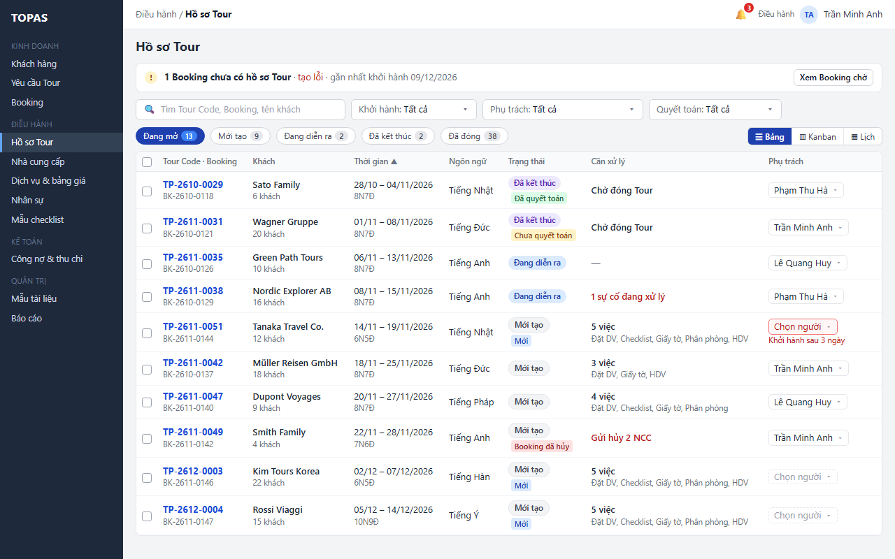

   > Hình chưa cập nhật: dải “Booking chờ · tạo lỗi” không còn (Q5); bộ lọc Phụ trách mặc định nay là Của tôi (Q1).

2. **W02 · Trung tâm thông báo.** Hệ thống gửi thông báo trong ứng dụng cho nhóm Điều hành “… được tạo tự động … Chưa có người phụ trách”, và cho Kinh doanh phụ trách Booking (R09). KD08.1 hiện Tour Code của hồ sơ.

   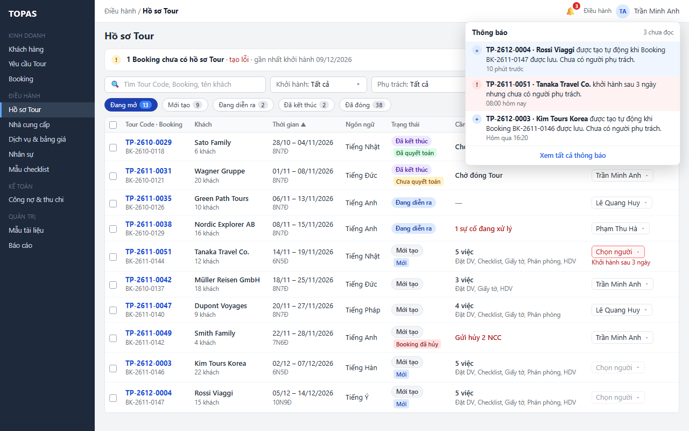

   > Hình chưa cập nhật: dải Booking chờ phía sau không còn (Q5).

*Kết quả:* mỗi Booking Hiệu lực có đúng một hồ sơ Mới tạo, đã có Tour Code, hạng mục dịch vụ Cần đặt và checklist. Điều hành chỉ còn việc giao người phụ trách (L4.1).

**Ngoại lệ**

- **E1.1.** Lỗi khi tạo hồ sơ (lỗi hệ thống, hết thời gian chờ): cả giao dịch được hoàn tác, Booking không được lưu và không có hồ sơ dở dang (Q5). KD08 báo lỗi, giữ dữ liệu đã nhập để Kinh doanh lưu lại. Số Tour Code đã cấp trong giao dịch lỗi có thể bị thủng (R02, Q7). Không có tự thử lại, nhóm Tạo lỗi hay nút Thử lại.
- **E1.2.** Yêu cầu lưu Booking đến lặp: ràng buộc một Booking một hồ sơ (R05) bảo đảm chỉ một hồ sơ được tạo. Yêu cầu sau không tạo gì và nhận Tour Code đã có.
- **E1.3.** Bỏ theo Q5 (Booking bị hủy khi đang ở nhóm Tạo lỗi). Booking đã có hồ sơ mà bị hủy thì xử lý ở DH08 (R11).
- **E1.4.** Một dịch vụ trong hành trình thuộc NCC hoặc dịch vụ đã tắt ở DH03, DH05: vẫn tạo hạng mục, để trống NCC và gắn chỉ báo “NCC ngừng dùng” để Điều hành chọn NCC khác ở DH08.3 (R03).
- **E1.5.** Booking chưa có loại Tour, hoặc loại Tour chưa có mẫu đang dùng ở DH01: checklist sinh từ Mẫu mặc định. Nhật ký hồ sơ ghi lý do (R04). Không có trường hợp checklist rỗng vì Mẫu mặc định luôn đang dùng và có ít nhất một việc.
- **E1.6.** Sau khi hồ sơ đã tạo, thanh toán của Booking thay đổi (khoản thu được ghi hoặc bị hủy, phân bổ lại, Dùng tiền thừa ở KT01; lịch thanh toán sửa ở KD08.2) hoặc khách chưa trả đợt nào: hồ sơ giữ nguyên, không bị xóa, khóa hay chặn chuyển trạng thái. Không tạo thêm hồ sơ. Kế toán xử lý công nợ ở KT01.
- **E1.7.** (Bỏ: tiền tố Tour Code là tham số chung ở QT05, luôn có giá trị, mặc định `TP`; không có trường hợp thiếu cấu hình.)

### 3.2. Booking chưa có hồ sơ vì tạo lỗi: thử lại (bỏ theo Q5)

Hồ sơ tạo trong cùng giao dịch với việc lưu Booking (R01, Q5), nên không còn Booking Hiệu lực nào chưa có hồ sơ. Mục này chỉ giữ mã để tham chiếu chéo không gãy; W08 không còn dùng.

**L2.1** Bỏ theo Q5 (xem Booking tạo hồ sơ lỗi ở dải và bảng trượt Booking chờ, W08).

**L2.2** Bỏ ở v1.5 (luồng tạo hồ sơ sớm; hồ sơ nay tự tạo ngay khi Booking được lưu).

**L2.3** Bỏ theo Q5 (Thử lại khi tạo lỗi).

**Ngoại lệ**

- **E2.1.** Bỏ ở v1.5 (hộp thoại tạo sớm bị chặn; thay bằng E2.9).
- **E2.2.** Bỏ theo Q5.
- **E2.3, E2.4, E2.5.** Bỏ ở v1.5 (lý do, người phụ trách và lỗi lưu của hộp thoại tạo sớm).
- **E2.6, E2.7, E2.8, E2.9.** Bỏ theo Q5 (bấm Thử lại nhiều lần, Booking tạo lỗi đã qua ngày khởi hành, mất quyền khi Thử lại, Thử lại khi Booking vừa có hồ sơ).

### 3.3. Xem, tìm, lọc và mở hồ sơ (TN05.01 · SYS05.01, SYS07.05, SYS08.01, SYS08.08, SYS09.01)

**L3.1 Xem và lọc danh sách.** *Điều kiện:* người dùng có quyền xem DH07.

1. **W01 · Menu Điều hành → Hồ sơ Tour.** Người dùng mở DH07 từ menu. Hệ thống tải danh sách mặc định ở chip Đang mở, sắp theo ngày khởi hành tăng dần, bộ lọc Phụ trách mặc định Của tôi (mục 2.3). Mỗi dòng cho biết trạng thái, việc cần xử lý và người phụ trách.
2. **W03 · Thanh lọc và chip.** Người dùng chọn giá trị ở các bộ lọc hoặc gõ tìm kiếm. Danh sách và số trên chip cập nhật ngay; liên kết Xóa bộ lọc hiện ra.

   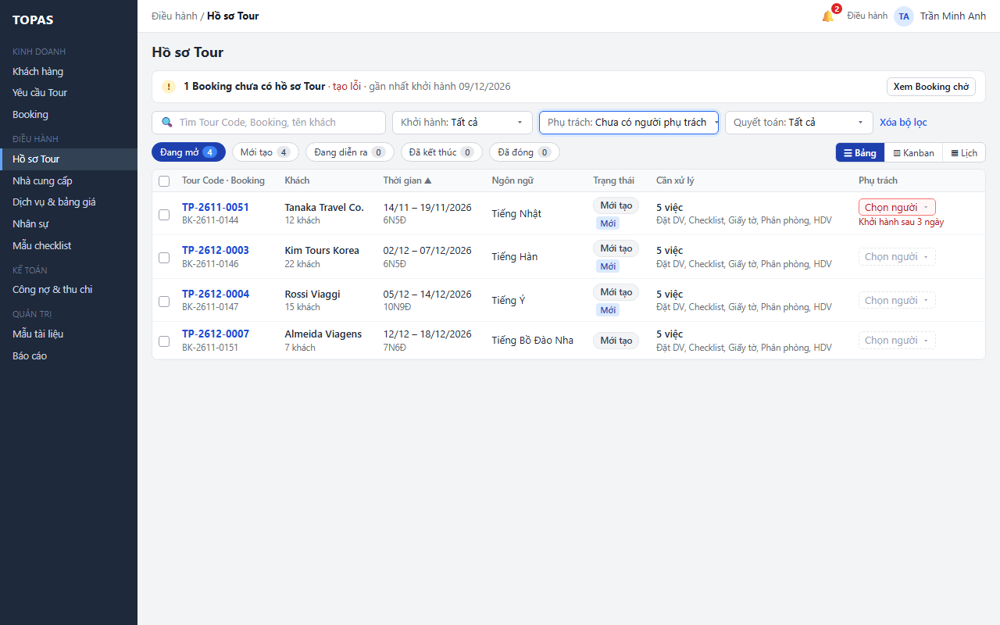

   > Hình chưa cập nhật: dải Booking chờ không còn (Q5).

3. **W13 · Vùng bảng không có dòng khớp.** Bảng hiện “Không có hồ sơ khớp …”. Người dùng bấm Xóa bộ lọc ở thanh lọc để về mặc định.

   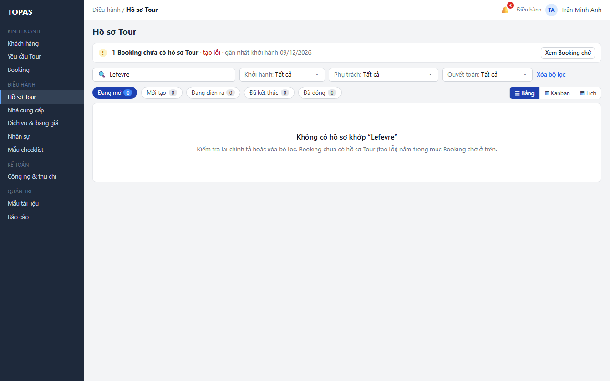

   > Hình chưa cập nhật: dải Booking chờ và câu nhắc Booking tạo lỗi ở mục Booking chờ không còn (Q5).

*Kết quả:* người dùng thấy đúng tập hồ sơ cần làm. Khi chưa có hồ sơ nào trong hệ thống, bảng hiện “Chưa có hồ sơ Tour. Hồ sơ được tạo tự động khi Booking được lưu” thay cho W13.

**L3.2 Mở hồ sơ.**

1. **W01 · Bấm dòng trên bảng.** DH08 mở ở tab đích theo R10: Mới tạo và Đang diễn ra mở Tổng quan, Đã kết thúc mở Quyết toán, Đã đóng mở Tổng quan ở chế độ chỉ đọc; riêng Kế toán bấm hồ sơ Đã đóng chưa quyết toán thì mở Quyết toán (L3.3 bước 3).
2. **W01 · Nút Về danh sách hồ sơ Tour trong DH08, hoặc nút quay lại.** DH07 hiện lại với bộ lọc, trang và vị trí cuộn như trước khi mở.

**L3.3 Kế toán vào quyết toán.** *Điều kiện:* Kế toán.

1. **W11 · Chip Đã kết thúc.** Kế toán bấm chip Đã kết thúc (có thể chọn thêm Quyết toán: Chưa quyết toán). Cột Cần xử lý ghi Chờ đóng Tour (R07); hồ sơ chưa có phiên bản quyết toán hiện hành có chỉ báo Chưa quyết toán, hồ sơ đã có thì có chỉ báo Đã quyết toán. Quyết toán không chặn Đóng Tour (RSD DH08 R16).

   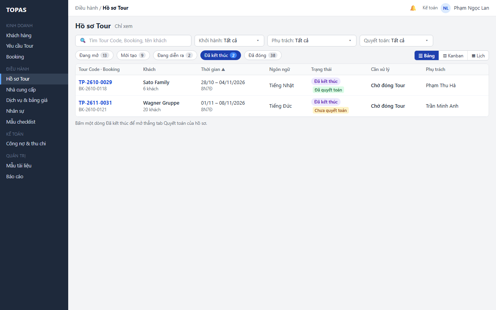

2. **W11 · Bấm dòng.** DH08.8 mở thẳng để đối chiếu và lưu quyết toán.
3. **W11 · Chip Đã đóng với Quyết toán: Chưa quyết toán.** Kế toán thấy hồ sơ đã đóng mà chưa quyết toán. Bấm dòng mở DH08.8 (R10) để lưu quyết toán, không cần Mở lại Tour (RSD DH08 R16).

**L3.4 Kinh doanh xem hồ sơ của mình.**

1. **W12 · Danh sách chỉ đọc.** Kinh doanh mở DH07. Bộ lọc Phụ trách mặc định Của tôi nên danh sách gồm hồ sơ của Booking mình phụ trách; chọn Tất cả thì thấy mọi hồ sơ (Q1). Danh sách chỉ đọc, không có ô chọn và ô Chọn người. Cột Phụ trách hiện tên Điều hành hoặc Chưa có.

   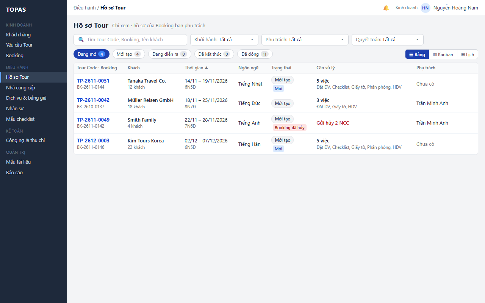

2. **W12 · Bấm dòng.** DH08 mở ở chế độ xem theo quyền của RSD DH08 mục 1.4.

**Ngoại lệ**

- **E3.1 · W14.** Không tải được danh sách: vùng bảng thay bằng thông báo lỗi và nút Tải lại; thanh lọc giữ nguyên giá trị. Bấm Tải lại thì tải lại với bộ lọc cũ.

  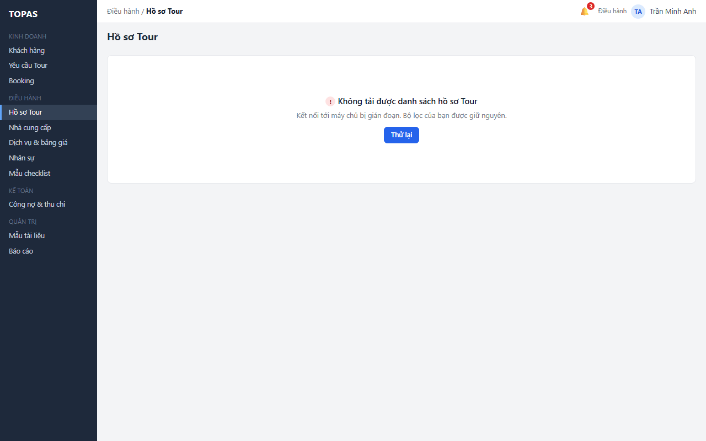

  > Hình chưa cập nhật: nút Thử lại nay là Tải lại.

- **E3.2.** Người dùng không có quyền xem DH07: menu không hiện mục Hồ sơ Tour; mở bằng đường dẫn thì hiện “Bạn không có quyền xem danh sách hồ sơ Tour” và nút Về trang chủ, không tải dữ liệu.
- **E3.3.** Bỏ theo Q1 (không có phạm vi bản ghi; Kinh doanh mở được mọi hồ sơ theo quyền ở RSD DH08 mục 1.4).
- **E3.4.** Hồ sơ đổi trạng thái ở phiên khác khi danh sách đang mở (ví dụ vừa Bắt đầu Tour): danh sách không tự nhảy dòng. Khi người dùng đổi bộ lọc, đổi trang hoặc quay lại từ DH08, dữ liệu được tải lại. Bấm dòng luôn mở theo trạng thái mới nhất (R10).
- **E3.5.** Tìm kiếm dưới 2 ký tự: chưa chạy tìm, ô tìm hiện gợi ý “Nhập ít nhất 2 ký tự”.
- **E3.6.** Khoảng ngày khởi hành không hợp lệ (ngày đầu sau ngày cuối): báo lỗi trong bộ chọn, không áp dụng.

### 3.4. Giao người phụ trách (quyết định 11/11/2026 · lọc theo người phụ trách)

**L4.1 Giao một hồ sơ ngay trên dòng.** *Điều kiện:* Điều hành; hồ sơ chưa đóng.

1. **W02 → W03 · Biểu tượng chuông ở thanh trên, hoặc bộ lọc Phụ trách.** Điều hành bấm thông báo hồ sơ mới, hoặc chọn Phụ trách: Chưa có người phụ trách. DH07 mở với bộ lọc đó; danh sách chỉ còn các hồ sơ chưa giao. Ô Chọn người viền nét đứt; hồ sơ trong ngưỡng nhắc có viền đỏ và dòng “Khởi hành sau n ngày”.
2. **W04 · Ô Phụ trách trên dòng → danh sách thả xuống.** Điều hành bấm ô Chọn người trên dòng. Danh sách thả xuống ghi ngôn ngữ phục vụ của đoàn và liệt kê nhân sự nhóm Điều hành đang cho phép nhận phân công, mỗi người kèm ngôn ngữ và số hồ sơ đang mở. Người khớp ngôn ngữ đứng trước và có nhãn Khớp ngôn ngữ; sau đó xếp theo số hồ sơ đang mở tăng dần (R08).

   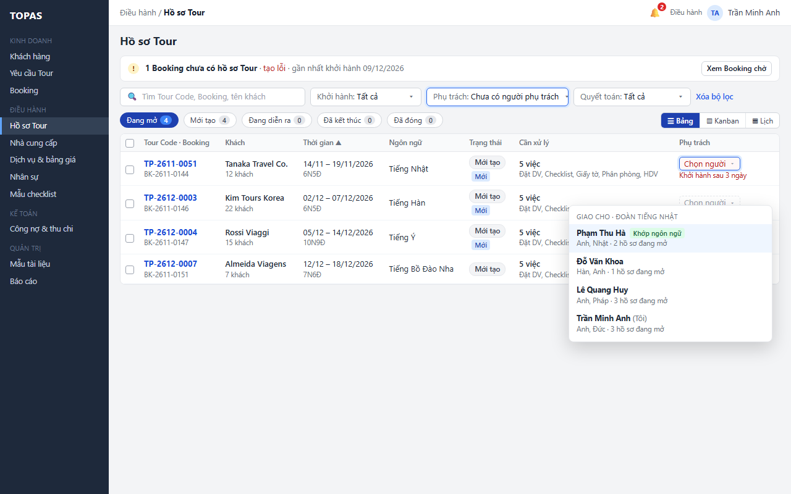

   > Hình chưa cập nhật: dải Booking chờ không còn (Q5).

3. **W05 · Chọn một người.** Hệ thống lưu ngay, không cần nút Lưu (R08); lỗi thì ô trả về giá trị cũ (E4.4). Dòng ra khỏi bộ lọc Chưa có người phụ trách; thông báo ngắn “Đã giao … cho … Hồ sơ đã ra khỏi bộ lọc” kèm liên kết Xem dòng. Người được giao nhận thông báo; lịch sử hồ sơ ghi người giao, người nhận và thời điểm.

   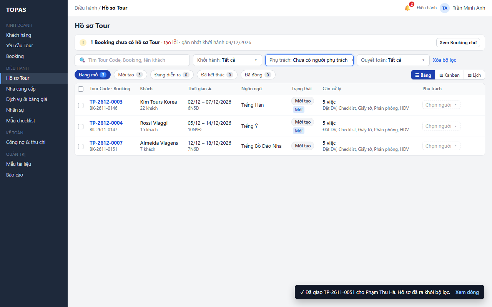

   > Hình chưa cập nhật: dải Booking chờ không còn (Q5).

*Kết quả:* hồ sơ có người phụ trách. Header DH08 hiện người mới. Với lần giao đầu, các công việc checklist có Giao người phụ trách được điền người này (R08). Ô Phụ trách trên dòng cũng dùng để đổi người cho hồ sơ đã có người, theo cùng cách.

**L4.2 Giao hàng loạt.** *Điều kiện:* Điều hành.

1. **W06 · Ô chọn dòng → thanh hàng loạt.** Điều hành tích ô chọn của nhiều dòng, hoặc ô ở tiêu đề bảng để chọn mọi dòng trong trang đang xem. Thanh hàng loạt hiện số hồ sơ đã chọn và các ngôn ngữ phục vụ của chúng. Ô Chọn người trên các dòng tạm ẩn, chỉ hiện chữ.

   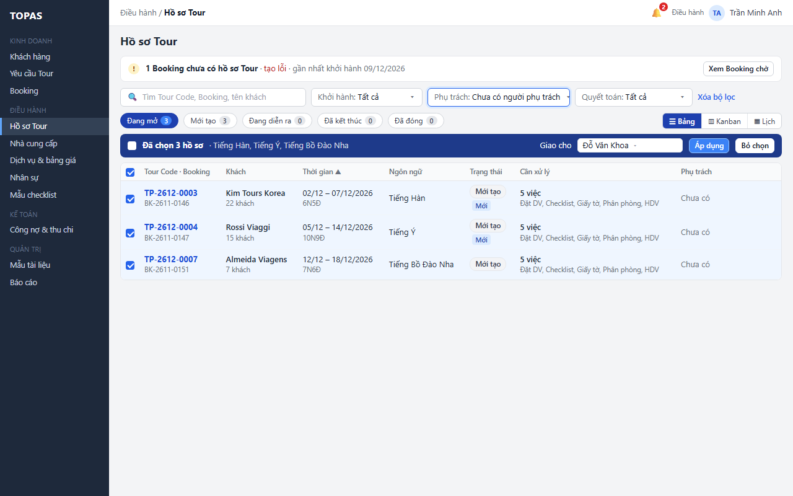

   > Hình chưa cập nhật: dải Booking chờ không còn (Q5).

2. **W06 · Ô Giao cho và nút Áp dụng trên thanh.** Điều hành chọn người ở ô Giao cho (cùng danh sách và thứ tự như W04, tính theo ngôn ngữ chiếm nhiều nhất trong các dòng đã chọn), rồi bấm Áp dụng.
3. **W07 · Banner kết quả trên bảng.** Hệ thống giao cho từng dòng hợp lệ trong một lần gửi và trả kết quả theo từng dòng (R08). Banner nêu số hồ sơ đã giao và từng hồ sơ bị bỏ qua kèm lý do; nút Xem n hồ sơ vừa xử lý mở danh sách đúng các hồ sơ đó. Nếu bộ lọc trở nên rỗng, bảng hiện “✓ Mọi hồ sơ đang mở đã có người phụ trách”.

   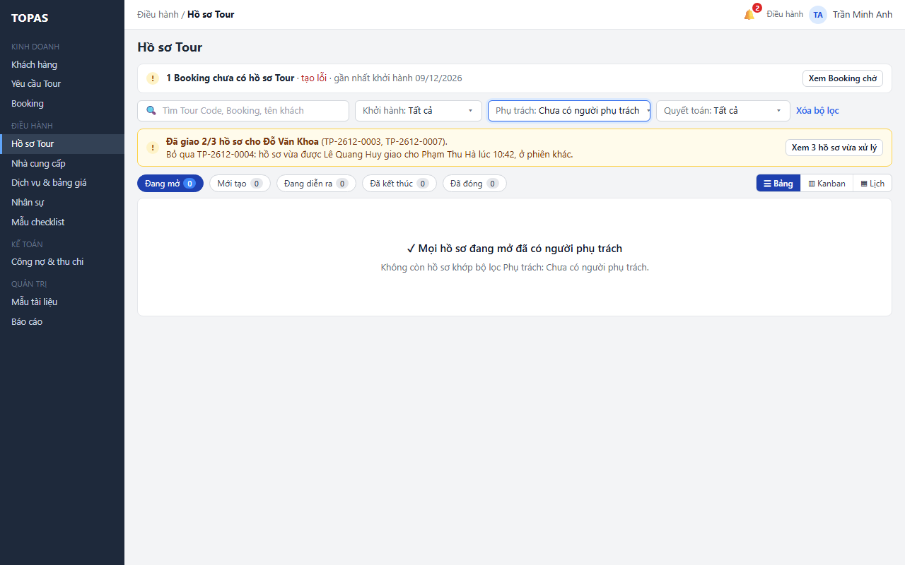

   > Hình chưa cập nhật: dải Booking chờ không còn (Q5).

*Kết quả:* các hồ sơ đã chọn có người phụ trách; người được giao nhận một thông báo gộp cho mọi hồ sơ vừa giao.

**L4.3 Nhắc hồ sơ chưa giao.** *Điều kiện:* hồ sơ Mới tạo chưa có người phụ trách và khởi hành trong ngưỡng nhắc (mặc định 7 ngày).

1. **W02 · Trung tâm thông báo.** Vào giờ chạy nhắc hằng ngày (mặc định 08:00) mỗi ngày, mỗi người nhóm Điều hành có một thông báo nhắc cho từng hồ sơ trong ngưỡng, trên cùng một dòng qua các ngày (R09); chuông có số. Trên DH07, ô Chọn người của hồ sơ đó viền đỏ (W01).
2. **W03 · Bấm thông báo.** DH07 mở với bộ lọc Chưa có người phụ trách, rồi Điều hành giao theo L4.1.

**Ngoại lệ**

- **E4.1 · W07.** Một dòng đã được giao ở phiên khác sau khi người dùng chọn: dòng đó bị bỏ qua và được nêu trong banner kết quả. Không ghi đè người đã được giao.
- **E4.2.** Giao tại chỗ khi hồ sơ vừa được người khác giao: hệ thống từ chối và trả ô về giá trị mới nhất. Thông báo ngắn “TP-… đã được … giao cho … lúc …”. Nếu vẫn muốn đổi, người dùng chọn lại.
- **E4.3.** Người được chọn vừa bị tắt quyền nhận phân công ở DH06: lưu bị từ chối, ô trở về giá trị cũ, thông báo lỗi nêu lý do. Danh sách thả xuống được tải lại.
- **E4.4.** Lỗi lưu tại chỗ (mất kết nối): ô trở về giá trị cũ, thông báo lỗi có nút Thử lại. Với hàng loạt, dòng lỗi giữ trạng thái đã chọn và banner có một nút Thử lại phần lỗi.
- **E4.5.** Hồ sơ Đã đóng: không có ô chọn và ô Chọn người; cột Phụ trách chỉ hiện tên, kèm “(ngừng hoạt động)” khi người đó ngừng hoạt động. DH07 không giao lại người cho hồ sơ Đã đóng. Muốn đổi người thì người có quyền Mở lại Tour (mặc định Điều hành và Quản trị hệ thống) mở lại bằng nút ở header DH08 và có thể chọn Điều hành phụ trách mới ngay trong hộp thoại (RSD DH08 R16); hoặc mở lại rồi giao ở DH07, vì hồ sơ về Đã kết thúc và header DH08 ở Đã kết thúc không có Thông tin điều hành (RSD DH08 mục 2.1). Hồ sơ chưa đóng có người phụ trách ngừng hoạt động thì Điều hành giao lại theo L4.1 hoặc L4.2 (R08).
- **E4.6.** Hồ sơ có Booking đã hủy vẫn được giao người phụ trách, vì Điều hành vẫn phải gửi hủy cho NCC (RSD DH08 R14).
- **E4.7.** Không còn ai thuộc nhóm Điều hành được phép nhận phân công: danh sách thả xuống hiện “Chưa có nhân sự Điều hành được phép nhận phân công. Cấu hình ở DH06”, không cho chọn.
- **E4.8.** Chọn dòng rồi chuyển trang hoặc đổi bộ lọc: lựa chọn bị bỏ, thanh hàng loạt ẩn. “Chọn tất cả” chỉ áp dụng cho trang đang xem.

### 3.5. Dạng xem Kanban và Lịch (quyết định 11/11/2026)

**L5.1 Xem hồ sơ dạng Kanban.** *Điều kiện:* người dùng có quyền xem DH07.

1. **W15 · Nút Kanban ở bộ chuyển dạng xem cuối hàng chip.** Điều hành bấm Kanban. Hệ thống đổi cách trình bày ngay, giữ bộ lọc, ghi nhớ dạng xem (R13) và bỏ lựa chọn dòng nếu có. Hàng chip ẩn; bốn cột Mới tạo (9), Đang diễn ra (2), Đã kết thúc (2), Đã đóng (38, thu gọn). Ba cột đầu sắp theo ngày khởi hành tăng dần. Thẻ hồ sơ chưa giao sắp khởi hành có viền trái đỏ và ô Chọn người viền đỏ kèm “Khởi hành sau 3 ngày”, như trên dòng.

   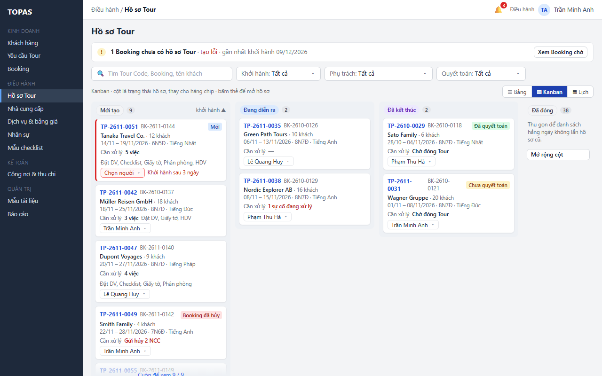

   > Hình chưa cập nhật: dải Booking chờ không còn (Q5).

2. **W15 · Cuộn trong cột, hoặc nút Mở rộng cột ở Đã đóng.** Người dùng cuộn trong cột để xem thêm thẻ (20 thẻ mỗi đợt), hoặc bấm Mở rộng cột ở Đã đóng: hệ thống tải 20 thẻ Đã đóng, sắp theo ngày khởi hành giảm dần; nút đổi thành Thu gọn.
3. **W15 → W01 · Bấm thẻ (trừ ô Phụ trách).** DH08 mở ở tab theo R10.

*Kết quả:* Điều hành thấy ngay bao nhiêu hồ sơ chờ khởi hành, đang chạy, chờ đóng Tour.

**L5.2 Giao người phụ trách trên thẻ Kanban.** *Điều kiện:* Điều hành; hồ sơ chưa đóng.

1. **W16 · Ô Phụ trách trên thẻ → danh sách thả xuống.** Điều hành bấm ô Chọn người trên thẻ TP-2611-0051. Danh sách thả xuống giống W04 (người khớp ngôn ngữ trước, rồi ít hồ sơ đang mở). Chọn Phạm Thu Hà: lưu ngay theo R08; thẻ giữ chỗ trong cột, ô hiện tên mới; thông báo ngắn như W05. Lỗi thì ô trả về giá trị cũ (E5.4).

   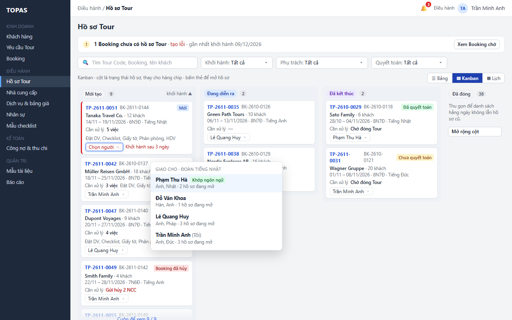

   > Hình chưa cập nhật: dải Booking chờ không còn (Q5).

*Kết quả:* giao được người mà không phải về Bảng. Giao hàng loạt vẫn chỉ ở Bảng.

**L5.3 Xem dòng thời gian theo người phụ trách.** *Điều kiện:* Điều hành (mặc định của dạng Lịch); Kinh doanh, Kế toán chọn được.

1. **W17 · Nút Lịch ở bộ chuyển dạng xem.** Điều hành bấm Lịch. Dòng thời gian mở ở 5 tuần quanh hôm nay (02/11 – 06/12/2026), cột hôm nay tô xanh. Hàng Chưa có người phụ trách ở trên cùng với 3 hồ sơ trong khoảng và ghi “1 sau 06/12”. Người dùng thấy Trần Minh Anh có hai đoàn chồng ngày 22/11 – 25/11 (Müller Reisen GmbH và Smith Family, Booking đã hủy), Đỗ Văn Khoa chỉ có một đoàn đầu tháng 12, và Tanaka Travel Co. khởi hành 14/11 chưa có người.

   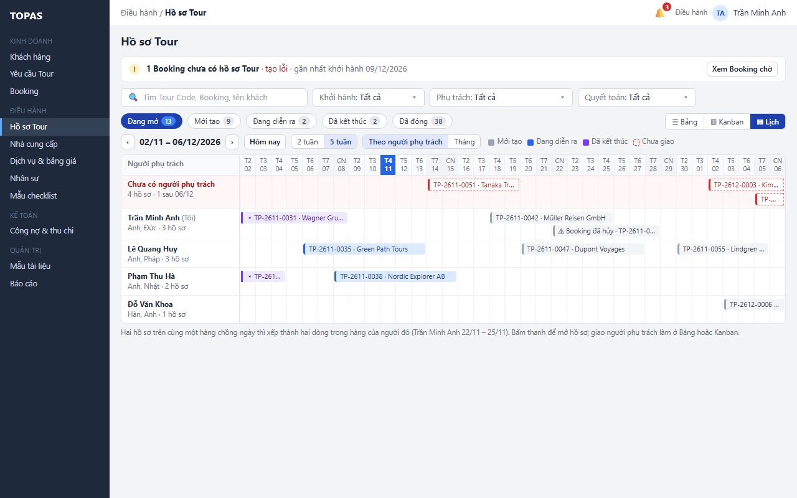

   > Hình chưa cập nhật: dải Booking chờ không còn (Q5).

2. **W17 · Nút ‹ ›, Hôm nay, 2 tuần, 5 tuần ở đầu lịch; nhóm nút Theo người phụ trách · Tháng.** Người dùng bấm ‹ › để lùi, tiến một tuần, Hôm nay để về khoảng hiện tại, 2 tuần hoặc 5 tuần để đổi độ rộng. Hệ thống tải hồ sơ của khoảng mới và giữ bộ lọc; đổi khoảng không đổi bộ lọc Khởi hành. Nhóm nút Theo người phụ trách · Tháng đổi giữa dòng thời gian và lịch tháng (W18); lựa chọn được ghi nhớ (R13).
3. **W17 → W04 · Bấm thanh, hoặc chuyển về Bảng, Kanban.** Muốn giao Tanaka Travel Co., Điều hành bấm thanh để mở DH08 ở tab theo R10, hoặc chuyển về Bảng hoặc Kanban và giao tại chỗ. Dòng thời gian không có thao tác giao (R15).

*Kết quả:* Điều hành chia việc dựa trên lịch thực tế của từng người.

**L5.4 Kinh doanh, Kế toán xem lịch tháng.** *Điều kiện:* Kinh doanh hoặc Kế toán.

1. **W18 · Nút Lịch ở bộ chuyển dạng xem.** Kinh doanh bấm Lịch; dạng Tháng mở sẵn ở tháng hiện tại. Bộ lọc Phụ trách mặc định Của tôi nên lịch có hồ sơ của Booking mình phụ trách (mục 2.3): Tanaka Travel Co. 14/11 – 19/11, Müller Reisen GmbH 18/11 – 25/11, Smith Family (⚠ Booking đã hủy) 22/11 – 28/11, Kim Tours Korea từ 02/12. Không có ô chọn hay ô Phụ trách.

   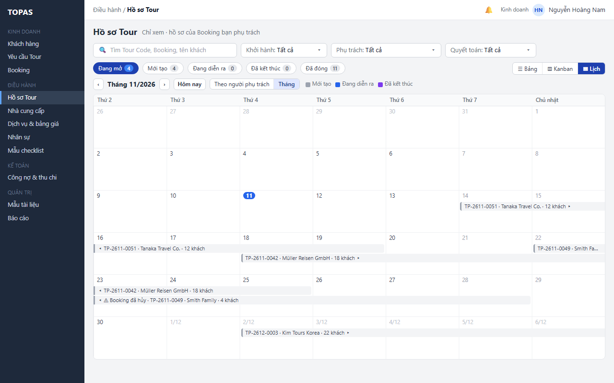

2. **W18 · Bấm thanh trên Lịch.** DH08 mở ở chế độ xem, ở tab theo R10. Kế toán dùng như Kinh doanh với mọi hồ sơ; chọn chip Đã kết thúc để thấy đoàn vừa về cần quyết toán.

*Kết quả:* Kinh doanh, Kế toán biết đoàn nào đang chạy, sắp đi theo ngày.

**Ngoại lệ**

- **E5.1 Kéo thẻ hoặc thanh.** Không có tác dụng; con trỏ không đổi thành kéo. Đổi trạng thái bằng nút ở header DH08 (R14).
- **E5.2 Một cột Kanban không tải được.** Cột ghi “Không tải được cột này”, số đếm “–”, nút Tải lại; các cột khác vẫn dùng được (cùng cách trình bày với cột lỗi ở RSD KD05). Cả màn không tải được thì như E3.1.
- **E5.3 Cột hoặc khoảng ngày không có hồ sơ.** Cột Kanban rỗng ghi “Không có hồ sơ … khớp bộ lọc”. Dòng thời gian vẫn hiện hàng của từng người (hàng trống cho thấy người còn rảnh); không có hồ sơ nào trong khoảng thì giữa vùng ghi “Không có đoàn trong 02/11 – 06/12/2026” kèm liên kết tới đoàn gần nhất. Lịch tháng rỗng như RSD KD05 E6.3.
- **E5.4 Giao trên thẻ bị từ chối.** Như E4.2, E4.3, E4.4: ô trên thẻ trở về giá trị mới nhất hoặc giá trị cũ, thông báo nêu lý do.
- **E5.5 Hồ sơ đổi trạng thái hoặc đổi người sau khi quay lại từ DH08.** Thẻ ở lại cột cũ, mờ, ghi nhãn trạng thái mới và “Không còn khớp”; số đếm cột cập nhật. Ở dòng thời gian, thanh chuyển sang hàng người mới và tô sáng 5 giây. Thẻ, thanh mờ ẩn ở lần tải lại kế tiếp.
- **E5.6 Đang chọn dòng ở Bảng rồi đổi dạng.** Lựa chọn bị bỏ, thanh hàng loạt ẩn (như E4.8).
- **E5.7 Người phụ trách đã tắt nhận phân công.** Hàng của người đó vẫn hiện khi còn hồ sơ, tên kèm chỉ báo “Không nhận phân công” (RSD DH06 R05); hết hồ sơ thì hàng ẩn.
- **E5.8 Quá nhiều hồ sơ.** Hơn 500 hồ sơ trong khoảng đang xem: Lịch không vẽ thanh, ghi “Có n hồ sơ, quá nhiều để hiện · thu hẹp bộ lọc hoặc dùng Bảng”.

**Số bước trước và sau khi tối ưu (cả mục 3)**

| Việc | Theo nguồn | Bản này |
|---|---|---|
| Tạo hồ sơ cho một Booking | 4 bước: mở DH07, bấm Tạo từ Booking, chọn Booking, xác nhận | 0 bước: tạo trong cùng giao dịch khi Booking được lưu |
| Giao người phụ trách cho một hồ sơ | Mở DH08, bấm Thông tin điều hành, chọn người, Lưu | 2 lần bấm trên DH07: ô Chọn người, chọn người |
| Giao n hồ sơ | 4 × n bước | n + 3 lần bấm: chọn n dòng, Giao cho, chọn người, Áp dụng |

---

## 4. Quy tắc triển khai chi tiết

### R01. Tự tạo hồ sơ khi lưu Booking (quyết định 12/11/2026)

- **Khi nào tạo.** Khi Kinh doanh lưu Booking mới ở KD08 (Booking Hiệu lực), hệ thống tạo hồ sơ Tour theo R02–R05 trong cùng giao dịch. Không có nút tạo tay, không có bước duyệt.
- **Không xét thanh toán.** Việc tạo hồ sơ không có điều kiện nào về thanh toán. Khoản thu, công nợ ở KT01 và lịch thanh toán ở KD08.2 không là điều kiện và không kích hoạt việc tạo hồ sơ (nguyên tắc Kế toán không làm chốt chặn cho Kinh doanh và Điều hành, người dùng chốt 12/11/2026).
- **Cùng giao dịch (Q5).** Lưu Booking, tạo hồ sơ (R02–R05) và thông báo (R09) ghi trong một giao dịch: thành công cả hoặc không gì cả. Lỗi tạo hồ sơ thì Booking không được lưu (E1.1). Không có tự thử lại, nhóm Tạo lỗi hay nút Thử lại.
- **Chỉ xét Booking** Hiệu lực và chưa có hồ sơ. Booking Đã hủy không được tạo hồ sơ.
- Thanh toán thay đổi sau khi hồ sơ đã có không xóa, không khóa hồ sơ (E1.6).
- Quy tắc này thay quyết định 11/11/2026 (tự tạo khi Booking đạt điều kiện thanh toán; Điều hành được tạo hồ sơ trước khi đạt).

### R02. Tour Code (DX04)

- **Dạng:** `{Tiền tố}-{YYMM}-{NNNN}`, ví dụ `TP-2611-0052`.
  - Tiền tố là tham số chung ở QT05 do Quản trị sửa, mặc định `TP`, 2–4 chữ in hoa (Q7).
  - `YYMM` là năm và tháng của **ngày khởi hành** của Booking lúc tạo hồ sơ.
  - `NNNN` là số thứ tự tăng dần trong cùng tiền tố và `YYMM`, bắt đầu từ 0001, đủ 4 chữ số. Quá 9999 thì dùng thêm chữ số.
- Số thứ tự được cấp trong giao dịch tạo hồ sơ. Số không dùng lại nhưng được phép thủng, ví dụ khi giao dịch lưu Booking bị hủy giữa chừng (Q7; BOI-CANH-DU-AN “Mã đối tượng”).
- Tour Code là duy nhất, không sửa tay và không đổi khi ngày khởi hành thay đổi về sau.

### R03. Dữ liệu khởi tạo và bóc tách hành trình

- **Hồ sơ.** Hệ thống sao chép khách, số khách, thời gian và ngôn ngữ phục vụ từ Booking; trạng thái Mới tạo; người phụ trách để trống (giao tại DH07, R08).
- **Hạng mục dịch vụ.** Mỗi dịch vụ của mỗi ngày trong hành trình đã chốt của Booking tạo một hạng mục, gồm: ngày dùng, dịch vụ DH05, NCC (nếu hành trình có), số lượng, đơn vị, giá tham chiếu, loại tiền, yêu cầu dịch vụ. Trạng thái tính là Cần đặt.
- **Dịch vụ đi kèm (bổ sung 12/11/2026).** Dịch vụ đi kèm của một dịch vụ trong hành trình (ví dụ giường phụ) không tạo hạng mục riêng; hạng mục của dịch vụ chính mang theo danh sách đi kèm (dịch vụ, số lượng, ngày dùng, giá tham chiếu) và được đặt, xác nhận, hủy cùng lần đặt (RSD DH08 R21).
- Dịch vụ thuộc NCC hoặc dịch vụ đã tắt ở DH03, DH05 vẫn được tạo hạng mục, để trống NCC và gắn chỉ báo NCC ngừng dùng.
- Giá trong hạng mục là giá tham chiếu từ hành trình, không phải giá NCC xác nhận. Giá bán của Booking không được sao chép vào hạng mục.
- **Phiên bản chương trình.** Hệ thống lưu bản chụp hành trình lúc tạo làm phiên bản chương trình ban đầu, mang số phiên bản báo giá của Booking (ví dụ Booking theo phiên bản báo giá 3 thì phiên bản chương trình ban đầu là v3), không đánh lại từ v1. Đây là “bản cũ” để so sánh khi Kinh doanh bấm Chuyển sang Điều hành ở KD08 (RSD DH08 R19); phiên bản chương trình mới mang số phiên bản báo giá mới.

### R04. Checklist từ mẫu DH01

Quy tắc chuẩn nằm ở RSD DH01 (R01, R03, R05, R06, R07). DH07 thực hiện trong giao dịch tạo hồ sơ (R05):

- **Chọn một mẫu.** Mẫu Đang dùng của loại Tour của Booking; Booking chưa có loại Tour hoặc loại Tour chưa có mẫu đang dùng thì dùng Mẫu mặc định (E1.5). Không gộp nhiều mẫu.
- **Phiên bản.** Dùng phiên bản hiện hành của mẫu tại lúc giao dịch bắt đầu; hồ sơ ghi ID mẫu và số phiên bản.
- **Sinh công việc.** Việc cả hồ sơ sinh một lần. Việc theo dịch vụ sinh cho từng hạng mục cùng loại dịch vụ và được liên kết với hạng mục đó. Loại dịch vụ đã tắt ở QT05 thì bỏ qua và ghi nhật ký.
- **Hạn.** Mốc Khởi hành, Kết thúc hoặc Ngày sử dụng của hạng mục, cộng hoặc trừ số ngày khai báo ở mẫu. Hạn đã qua ở thời điểm tạo (thường gặp khi Booking được lưu sát ngày khởi hành) thì đặt bằng hôm nay và hiện chỉ báo Quá hạn ở DH08.2.
- **Người thực hiện.** Việc có Giao người phụ trách nhận người phụ trách hồ sơ; hồ sơ chưa có người phụ trách thì để trống cho tới lần giao đầu (R08).
- Sửa mẫu DH01 về sau không đổi checklist đã tạo.

### R05. Giao dịch tạo hồ sơ và chống trùng

- Các bước của R02–R04 chạy trong cùng giao dịch lưu Booking ở KD08: thành công hết hoặc không lưu gì (Q5).
- Mỗi Booking chỉ có một hồ sơ, bảo đảm bằng ràng buộc duy nhất trên ID Booking. Yêu cầu tạo đến lặp nhận lỗi “đã có hồ sơ” và trả về Tour Code đã có.
- Không có tự thử lại, nhóm Tạo lỗi hay nút Thử lại (Q5).
- Lỗi hiển thị ở KD08 bằng câu dễ hiểu. Chi tiết kỹ thuật chỉ ghi trong nhật ký hệ thống.

### R06. Bỏ ở v1.5

Quy tắc tạo hồ sơ sớm đã bỏ theo quyết định 12/11/2026: hồ sơ tự tạo ngay khi Booking được lưu (R01). Mã R06 không dùng lại.

### R07. Cột Cần xử lý

| Trạng thái hồ sơ | Nội dung (ưu tiên từ trên xuống, lấy dòng đầu tiên khớp) | Màu |
|---|---|---|
| Bất kỳ, Booking đã hủy | “Gửi hủy n NCC” khi còn lần đặt chưa gửi hủy; n là số NCC có lần đặt Đã gửi hoặc Đã xác nhận chưa gửi hủy, hồ sơ Đang diễn ra chỉ tính dịch vụ chưa dùng (RSD DH08 R14). “Kết thúc hồ sơ” khi đã đủ điều kiện R14 của DH08 | Đỏ |
| Bất kỳ, có thay đổi chương trình chờ áp dụng | “Xem thay đổi chương trình vN”, N là số phiên bản báo giá của phiên bản chương trình mới (R03) | Vàng |
| Mới tạo | “n việc” và tên ngắn các mục chưa đạt theo R01 của DH08 (Đặt DV, Checklist, Giấy tờ, Phân phòng, HDV); khi đạt hết là “✓ Sẵn sàng khởi hành” | Đen; xanh lá khi sẵn sàng |
| Đang diễn ra | “n sự cố đang xử lý” khi có; nếu không thì “—” | Đỏ |
| Đã kết thúc | “Chờ đóng Tour”. Đóng Tour không cần quyết toán (RSD DH08 R16); hồ sơ chưa quyết toán chỉ có thêm chỉ báo Chưa quyết toán (mục 2.4) | Đen |
| Đã đóng | “—” | — |

Cột chỉ để thông tin; bấm dòng để xử lý ở DH08.

### R08. Giao người phụ trách

- **Danh sách người được chọn.** Nhân sự DH06 thuộc nhóm Điều hành, đang cho phép nhận phân công, có tài khoản liên kết (QT01) đang hoạt động và có vai trò Điều hành (RSD DH06 R03). Mỗi người hiện ngôn ngữ (DH06) và số hồ sơ đang mở mình phụ trách (Mới tạo, Đang diễn ra, Đã kết thúc).
- **Thứ tự.** Người khớp ngôn ngữ phục vụ của đoàn đứng trước, có nhãn Khớp ngôn ngữ; trong mỗi nhóm, xếp theo số hồ sơ đang mở tăng dần, rồi theo tên. Người đang thao tác có chữ “(Tôi)”. Với thanh hàng loạt, ngôn ngữ dùng để xếp là ngôn ngữ xuất hiện nhiều nhất trong các dòng đã chọn.
- **Lưu.** Ô tại chỗ lưu ngay khi chọn. Thanh hàng loạt lưu khi bấm Áp dụng; kết quả trả theo từng dòng.
- **Xung đột.** Mỗi dòng gửi kèm phiên bản. Dòng đã đổi người phụ trách ở phiên khác thì bị từ chối (tại chỗ) hoặc bỏ qua (hàng loạt), không ghi đè.
- **Hồ sơ được giao.** Chỉ hồ sơ chưa đóng. Hồ sơ có Booking đã hủy vẫn được giao.
- **Người phụ trách ngừng hoạt động.** Tài khoản liên kết Bị khóa, hoặc không còn vai trò Điều hành (RSD QT01 R03): hồ sơ giữ nguyên người phụ trách, hệ thống không tự chuyển; ô Phụ trách (dòng, thẻ Kanban) và hàng của người đó ở Lịch hiện tên kèm “(ngừng hoạt động)”. Người này không có trong danh sách chọn. Hồ sơ chưa đóng: Điều hành giao lại ở DH07 (tại chỗ hoặc hàng loạt), như đổi người thường; hồ sơ Mới tạo, Đang diễn ra giao được cả ở DH08.1 (Thông tin điều hành); hồ sơ Đã kết thúc chỉ giao ở DH07 (RSD DH08 mục 2.1). Hồ sơ Đã đóng: không giao lại ở DH07; người có quyền Mở lại Tour mở lại ở DH08, có thể chọn Điều hành phụ trách mới (RSD DH08 R16). Theo quyền mặc định, Quản trị hệ thống chỉ xem ở DH07 (mục 1.4).
- **Thông báo.** Người được giao nhận một thông báo cho mỗi lần giao; giao hàng loạt cho cùng một người thì gộp thành một thông báo liệt kê các Tour Code. Người bị bỏ giao (khi đổi người) cũng nhận thông báo.
- **Điền người thực hiện checklist.** Khi hồ sơ được giao người phụ trách **lần đầu** (tại chỗ hoặc hàng loạt ở DH07, hoặc ở DH08.1), hệ thống điền người đó vào các công việc có thuộc tính Giao người phụ trách mà chưa có người thực hiện (RSD DH01 R05). Đổi người phụ trách về sau không đổi người thực hiện của công việc.
- Giao ở DH07 và đổi người ở DH08 (Thông tin điều hành) ghi cùng một lịch sử.

### R09. Thông báo hồ sơ mới và nhắc hồ sơ chưa giao

| Sự kiện | Người nhận | Nội dung | Mở tới |
|---|---|---|---|
| Hồ sơ được tạo tự động | Nhóm Điều hành; Kinh doanh phụ trách Booking | Tour Code, khách, Booking; “Chưa có người phụ trách” | DH07 lọc Chưa có người phụ trách (Điều hành); DH08 (Kinh doanh) |
| Hồ sơ chưa giao trong ngưỡng nhắc | Nhóm Điều hành | Tour Code, khách, số ngày tới khởi hành (đã qua thì ngày đã khởi hành) | DH07 lọc Chưa có người phụ trách |

- **Nhóm Điều hành** (người nhận) là nhân sự DH06 thuộc nhóm Điều hành, Nhận phân công Đang dùng, có tài khoản liên kết đang hoạt động và có vai trò Điều hành (RSD DH06 R03).
- **Ngưỡng nhắc** mặc định 7 ngày trước khởi hành, là tham số chung ở QT05 (RSD QT05 R17; R12). Hồ sơ trong ngưỡng là hồ sơ Mới tạo, chưa có người phụ trách, có ngày khởi hành không muộn hơn hôm nay + ngưỡng, kể cả đã qua ngày khởi hành.
- **Nhắc mỗi ngày trên cùng một dòng** (RSD CH02 R04, TB-DH07-03). Tác vụ nhắc chạy mỗi ngày vào giờ chạy nhắc hằng ngày (tham số chung QT05 R17, mặc định 08:00, dùng chung cho mọi loại nhắc định kỳ; RSD CH02 R09). Mỗi người nhận có tối đa một thông báo cho mỗi hồ sơ: lần nhắc ngày sau làm mới chính thông báo đó (số ngày tới khởi hành, thời điểm, số lần) và đưa nó về Chưa đọc, kể cả khi người nhận đã đọc hôm trước; không tạo dòng thứ hai. Nhắc cho đến khi hồ sơ có người phụ trách hoặc rời Mới tạo; khi đó thông báo nhắc và thông báo hồ sơ mới tự Đã xử lý (RSD CH02 R06).

### R10. Quyền xem, mở hồ sơ và giữ ngữ cảnh

- **Không giới hạn theo bản ghi (Q1).** Mọi vai trò có quyền xem DH07 thấy mọi hồ sơ; bộ lọc Phụ trách mặc định Của tôi (mục 2.3), tắt được. Mở DH08 theo quyền ở RSD DH08 mục 1.4. Quản trị hệ thống mặc định chỉ xem.
- **Tab đích khi mở từ DH07:**
  - Mới tạo, Đang diễn ra → DH08.1 Tổng quan;
  - Đã kết thúc → DH08.8 Quyết toán;
  - Đã đóng → DH08.1 ở chế độ chỉ đọc; riêng Kế toán mở hồ sơ Đã đóng chưa có phiên bản quyết toán hiện hành → DH08.8, vì quyết toán lưu được khi Đã đóng (RSD DH08 R16).
- Trạng thái dùng để chọn tab là trạng thái mới nhất lúc mở, không phải trạng thái đang hiện trên dòng.
- Bộ lọc và dạng xem nhớ theo người dùng, cả sau khi đăng xuất (U3; R13). Trang, khoảng ngày đang xem ở Lịch và vị trí cuộn được giữ trong phiên khi mở DH08 rồi quay lại.

### R11. Thay đổi Booking trước và sau khi tạo hồ sơ

| Thời điểm | Thay đổi của Kinh doanh (KD06, KD08) | Tác động ở DH07 |
|---|---|---|
| Chưa có hồ sơ | — | Bỏ theo Q5: hồ sơ tạo trong cùng giao dịch với Booking, nên không có Booking Hiệu lực nào chưa có hồ sơ |
| Đã có hồ sơ | Kinh doanh tính giá lại ở KD06 (chế độ điều chỉnh) rồi bấm Chuyển sang Điều hành | Dòng có chỉ báo Chương trình có thay đổi; xử lý ở DH08 (R19 của DH08) |
| Đã có hồ sơ | Hủy Booking | Dòng có chỉ báo Booking đã hủy; Cần xử lý theo R07; xử lý ở DH08 (R14 của DH08) |
| Đã có hồ sơ | Đổi ngày khởi hành (trong thay đổi chương trình) | Thời gian trên dòng đổi sau khi Điều hành áp dụng thay đổi ở DH08; Tour Code giữ nguyên |

### R12. Cấu hình phụ thuộc

| Cấu hình | Chủ sở hữu | Dùng ở | Khi thiếu |
|---|---|---|---|
| Tiền tố Tour Code | Tham số chung ở QT05 (Quản trị; Q7) | R02 | Luôn có giá trị, mặc định `TP` |
| Ngưỡng nhắc hồ sơ chưa giao (ngày) | Tham số chung ở QT05 (RSD QT05 R17) | R09, ô Chọn người viền đỏ | 7 ngày |
| Giờ chạy nhắc hằng ngày (một giờ cho mọi loại nhắc định kỳ, RSD CH02 R09) | Tham số chung ở QT05 (RSD QT05 R17) | R09, L4.3 | 08:00 |
| Mẫu checklist (DH01) và loại Tour của Booking (KD06.1, KD08) | Điều hành; Kinh doanh | R04 | Dùng Mẫu mặc định (E1.5) |
| Nhóm công việc Điều hành, ngôn ngữ, cho phép nhận phân công (DH06) | Điều hành | R08 | Không gợi ý theo ngôn ngữ; không có người thì E4.7 |
| Liên kết tài khoản với nhân sự (QT01) | Quản trị hệ thống | R08, R09 | Nhân sự không có tài khoản không hiện trong danh sách giao |
| Số hàng thanh tối đa mỗi tuần ở Lịch tháng; số hồ sơ tối đa vẽ trên Lịch | Tệp cấu hình hoặc dữ liệu khởi tạo (C2) | R15, E5.8 | 3 hàng; 500 hồ sơ |

### R13. Dạng xem và ghi nhớ (quyết định 11/11/2026)

- DH07 có ba dạng xem: Bảng, Kanban, Lịch. Mọi vai trò có quyền xem DH07 đều dùng được cả ba; quyền ghi theo mục 1.4.
- Bộ chuyển dạng xem là nhóm nút ở cuối hàng chip; ở Kanban nằm cuối dòng ghi chú.
- Hệ thống nhớ dạng xem, chế độ Lịch, độ rộng dòng thời gian và trạng thái thu gọn cột Đã đóng theo người dùng, qua các phiên. Lần đầu là Bảng. Chế độ Lịch mặc định: Điều hành Theo người phụ trách; Kinh doanh, Kế toán, Quản trị hệ thống Tháng.
- Lối vào từ thông báo luôn mở Bảng với bộ lọc của thông báo (1.2), để giao tại chỗ và giao hàng loạt.
- Ô tìm, bộ lọc và chip dùng chung. Chip đang chọn được giữ khi sang Kanban (Kanban không dùng chip) và áp dụng lại khi về Bảng hoặc Lịch.

### R14. Kanban

- **Cột.** Bốn cột cố định theo trạng thái hồ sơ: Mới tạo, Đang diễn ra, Đã kết thúc, Đã đóng. Không thêm, bớt hay đổi thứ tự cột. Đã đóng mặc định thu gọn (chỉ tên cột, số đếm, nút Mở rộng cột).
- **Không kéo thả** (quyết định 11/11/2026). Đổi trạng thái chỉ làm ở DH08, bằng nút ở header DH08: Bắt đầu Tour, Kết thúc Tour, Đóng Tour, Mở lại Tour, theo điều kiện của RSD DH08 (R16).
- **Số đếm cột** bằng số trên chip tương ứng ở Bảng với cùng bộ lọc.
- **Thứ tự thẻ.** Ba cột đầu theo ngày khởi hành tăng dần; Đã đóng giảm dần. Không đổi thứ tự bằng tay.
- **Ô Phụ trách trên thẻ** theo đúng R08 (danh sách, thứ tự, lưu ngay, xung đột). Chỉ Điều hành, hồ sơ chưa đóng. Không có ô chọn nhiều thẻ.
- **Tải thêm.** 20 thẻ mỗi đợt mỗi cột.

### R15. Lịch

- **Ngày dùng.** Thời gian của hồ sơ: thanh từ ngày khởi hành đến ngày kết thúc.
- **Theo người phụ trách.** Khoảng 2 tuần hoặc 5 tuần, bắt đầu Thứ 2; mặc định tuần trước hôm nay làm tuần đầu. Hàng: Chưa có người phụ trách (khi có hồ sơ), người đang thao tác, rồi nhân sự Điều hành đang nhận phân công và người còn hồ sơ trong khoảng, theo số hồ sơ đang mở giảm dần rồi theo tên. Mỗi hàng ghi ngôn ngữ và số hồ sơ đang mở (cùng số với R08); hàng Chưa có người phụ trách ghi số hồ sơ ngoài khoảng. Hai hồ sơ chồng ngày trong một hàng xếp thành hai dòng. Bộ lọc Phụ trách bớt hàng tương ứng. Không có thao tác giao người, không kéo thanh.
- **Tháng.** Như RSD KD05 R14: tuần bắt đầu Thứ 2, tối đa 3 hàng thanh mỗi tuần rồi “+n”, bấm “+n” mở danh sách hồ sơ của ngày.
- **Màu và nhãn.** Màu theo trạng thái (mục 2.6); hồ sơ chưa giao viền đỏ nét đứt. Nhãn: Tour Code · khách (dòng thời gian), thêm số khách (Tháng); hồ sơ có Booking đã hủy thêm “⚠ Booking đã hủy” ở đầu nhãn. Di chuột hiện đủ khách, thời gian, ngôn ngữ, Cần xử lý, người phụ trách.
- **Đổi khoảng** bằng ‹ › (một tuần hoặc một tháng), Hôm nay. Không đổi bộ lọc Khởi hành; khoảng ngoài bộ lọc Khởi hành thì rỗng kèm liên kết Xóa lọc khởi hành.

---

## 5. Dữ liệu

### 5.1. Đối tượng dữ liệu

| Đối tượng | Khóa và dữ liệu chính | Nguồn hoặc tác động |
|---|---|---|
| Hồ sơ Tour | Tour Code (duy nhất), ID Booking (duy nhất), trạng thái, Điều hành phụ trách (có thể trống), ngôn ngữ phục vụ, thời điểm tạo, ID phiên bản chương trình ban đầu | DH07 tạo trong cùng giao dịch lưu Booking (Q5); DH08 sở hữu và cập nhật |
| Bộ đếm Tour Code | Tiền tố, YYMM, số thứ tự cuối | R02 |
| Hạng mục dịch vụ (khởi tạo) | Tour Code, ngày dùng từ–đến, ID dịch vụ DH05, NCC từ hành trình, số lượng, đơn vị, giá tham chiếu, loại tiền, yêu cầu dịch vụ, chỉ báo NCC ngừng dùng | Bóc tách từ Booking (R03); DH08 sở hữu sau khi tạo |
| Công việc checklist (khởi tạo) | Tour Code, ID mẫu, số phiên bản mẫu, ID công việc mẫu, ID hạng mục liên kết (việc theo dịch vụ), tên, hướng dẫn, hạn, sự kiện tự hoàn tất, người thực hiện | DH01 (R04; RSD DH01 R07) |
| Phiên bản chương trình | Tour Code, số phiên bản (bằng số phiên bản báo giá của Booking lúc tạo, R03), bản chụp hành trình lúc tạo | Mốc so sánh cho thay đổi chương trình (RSD DH08 R19) |
| Lịch sử giao người phụ trách | Tour Code, người cũ, người mới, người giao, thời điểm, nguồn (DH07 tại chỗ, DH07 hàng loạt, DH08) | Hiện trong lịch sử của DH08 |
| Lần tạo lỗi | Bỏ theo Q5 | — |
| Thiết lập dạng xem | Người dùng + màn: bộ lọc (U3), dạng xem dùng lần cuối, chế độ Lịch (Theo người phụ trách hoặc Tháng), độ rộng 2 tuần hoặc 5 tuần, cột Đã đóng thu gọn hay mở | DH07 ghi khi người dùng đổi; không ghi QT03 |

### 5.2. Trường nhập

| Form | Trường | Bắt buộc | Mặc định hoặc điền sẵn | Kiểm tra |
|---|---|---|---|---|
| Ô Phụ trách trên dòng; ô Giao cho trên thanh hàng loạt | Nhân sự Điều hành | Có | — | Thuộc nhóm Điều hành, đang cho phép nhận phân công, có tài khoản liên kết đang hoạt động và có vai trò Điều hành (R08) |
| Thanh lọc | Tìm kiếm | Không | Trống | Từ 2 ký tự |
| Thanh lọc | Khoảng ngày khởi hành | Không | — | Ngày đầu không sau ngày cuối |
| Thanh lọc | Việc cần xử lý | Không | Tất cả (không chọn giá trị nào) | Một hoặc nhiều giá trị ở mục 2.3 |

### 5.3. Dữ liệu gửi ra ngoài

DH07 không gửi email hay tài liệu ra ngoài hệ thống. Mọi thông báo ở R09 là thông báo trong ứng dụng, ở trung tâm thông báo của TOPAS (Q2).

---

## 6. Tiêu chí nghiệm thu

| Mã | Điều kiện và thao tác | Kết quả mong đợi |
|---|---|---|
| AC01 | Kinh doanh lưu Booking mới ở KD08; KT01 chưa có khoản thu nào của Booking | Hồ sơ Mới tạo được tạo ngay, có Tour Code, hạng mục dịch vụ và checklist; chưa có người phụ trách; nhóm Điều hành và Kinh doanh phụ trách Booking nhận thông báo; hồ sơ và thông báo ghi trong cùng giao dịch với Booking (Q5) |
| AC02 | Booking đã có hồ sơ; Kế toán ghi một khoản thu, hủy giao dịch thu đó, rồi Kinh doanh sửa lịch thanh toán ở KD08.2 | Không tạo thêm hồ sơ; hồ sơ không bị xóa, khóa hay đổi trạng thái (E1.6) |
| AC03 | Bỏ ở v1.5 (điều kiện Thu đủ đến đợt n) | — |
| AC04 | Bỏ ở v1.5 (đổi điều kiện tạo hồ sơ ở KD08.2) | — |
| AC05 | Booking khởi hành 16/11/2026 là hồ sơ thứ 52 có khởi hành tháng 11/2026 | Tour Code là TP-2611-0052 |
| AC06 | Tạo hồ sơ lỗi khi Kinh doanh lưu Booking | Booking không được lưu, KD08 báo lỗi và giữ dữ liệu nhập; không có hồ sơ dở dang; lưu lại thành công thì có đúng một hồ sơ; số Tour Code của lần lỗi có thể bị thủng (E1.1, Q5, Q7) |
| AC07 | Bỏ theo Q5 (Thử lại trên dòng Tạo lỗi) | — |
| AC08 | Yêu cầu lưu Booking đến lặp cho cùng Booking | Chỉ một hồ sơ được tạo; yêu cầu sau nhận Tour Code đã có (E1.2) |
| AC09 | Bỏ ở v1.5 (lý do tạo sớm) | — |
| AC10 | Bỏ ở v1.5 (hồ sơ tạo sớm và thông báo) | — |
| AC11 | Bỏ ở v1.5 (chỉ báo tạo sớm) | — |
| AC12 | Bỏ ở v1.5 (hộp thoại tạo sớm bị chặn; thay bằng AC43) | — |
| AC13 | Hành trình có dịch vụ của NCC đã tắt | Hạng mục được tạo, NCC để trống, có chỉ báo NCC ngừng dùng |
| AC14 | Booking chưa có loại Tour, hoặc loại Tour chưa có mẫu đang dùng | Hồ sơ được tạo với checklist từ Mẫu mặc định; nhật ký ghi lý do |
| AC15 | Bỏ theo Q5 (Booking bị hủy khi đang ở nhóm Tạo lỗi) | — |
| AC16 | Mặc định khi Điều hành mở DH07 lần đầu | Chip Đang mở bằng Mới tạo + Đang diễn ra + Đã kết thúc; không có hồ sơ Đã đóng; bộ lọc Phụ trách là Của tôi, chọn Tất cả thì thấy mọi hồ sơ kể cả chưa giao; sắp theo ngày khởi hành tăng dần (Q1) |
| AC17 | Tìm “BK-2610-0137” | Chỉ hiện TP-2611-0042; số trên chip tính theo kết quả tìm |
| AC18 | Tìm chuỗi không khớp | Hiện W13, có liên kết Xóa bộ lọc ở thanh lọc; không hiện thông báo “Chưa có hồ sơ” |
| AC19 | Điều hành bấm dòng Mới tạo, Đang diễn ra, Đã kết thúc, Đã đóng | Mở lần lượt DH08.1, DH08.1, DH08.8, DH08.1 chỉ đọc. Kế toán bấm dòng Đã đóng chưa quyết toán thì mở DH08.8 (AC44); Đã đóng đã quyết toán thì DH08.1 chỉ đọc (R10) |
| AC20 | Quay lại từ DH08 | Bộ lọc, trang và vị trí cuộn giữ nguyên |
| AC21 | Giao tại chỗ cho hồ sơ Tiếng Nhật | Danh sách thả xuống đặt người biết tiếng Nhật lên đầu với nhãn Khớp ngôn ngữ; chọn xong lưu ngay; dòng ra khỏi bộ lọc Chưa có người phụ trách; thông báo có Xem dòng; người được giao nhận thông báo |
| AC22 | Chọn 3 hồ sơ, giao cho một người; một hồ sơ đã được giao ở phiên khác | 2 hồ sơ được giao; banner nêu hồ sơ bị bỏ qua và lý do; không ghi đè người đã giao |
| AC23 | Chọn nhiều dòng | Ô Chọn người trên dòng ẩn; thanh hàng loạt là nơi thao tác duy nhất |
| AC24 | Hồ sơ chưa giao khởi hành sau 3 ngày | Ô Chọn người viền đỏ kèm “Khởi hành sau 3 ngày”; 08:00 nhóm Điều hành nhận thông báo nhắc |
| AC25 | Kinh doanh mở DH07, rồi chọn Phụ trách: Tất cả | Mặc định Của tôi: thấy hồ sơ của Booking mình. Chọn Tất cả: thấy mọi hồ sơ. Cả hai: không có ô chọn, ô Chọn người (Q1) |
| AC26 | Kế toán bấm chip Đã kết thúc và bấm dòng chưa quyết toán | DH08.8 mở |
| AC27 | Lỗi tải danh sách | Hiện W14; Tải lại với bộ lọc cũ |
| AC28 | Booking của hồ sơ bị hủy ở KD08 | Dòng có chỉ báo Booking đã hủy; Cần xử lý hiện “Gửi hủy n NCC”; hồ sơ Đang diễn ra thì n chỉ tính dịch vụ chưa dùng (R07) |
| AC29 | Hồ sơ tự tạo chưa có người phụ trách, có 6 việc Giao người phụ trách (1 việc đã giao Lê Quang Huy ở DH08.2); giao Trần Minh Anh tại chỗ | 5 việc còn trống được điền Trần Minh Anh; việc của Lê Quang Huy giữ nguyên. Đổi sang Phạm Thu Hà sau đó không đổi người thực hiện của các việc |
| AC30 | Mở DH07 lần đầu | Dạng Bảng; bộ chuyển dạng xem ở cuối hàng chip (W01) |
| AC31 | Bấm Kanban với bộ lọc mặc định | Bốn cột Mới tạo 9, Đang diễn ra 2, Đã kết thúc 2, Đã đóng 38 (thu gọn); tổng ba cột đầu bằng chip Đang mở 13; hàng chip ẩn; thanh lọc giữ nguyên (W15) |
| AC32 | Kéo một thẻ sang cột khác | Không có thay đổi nào được ghi (E5.1) |
| AC33 | Giao người trên thẻ hồ sơ chưa giao | Danh sách và thứ tự như W04; lưu ngay; thẻ hiện tên mới; người được giao nhận thông báo; lần giao đầu điền người thực hiện checklist như AC29 (W16) |
| AC34 | Kinh doanh, Kế toán mở Kanban | Không có ô Phụ trách để chọn, chỉ hiện tên dạng chữ |
| AC35 | Điều hành bấm Lịch lần đầu | Dạng Theo người phụ trách, 5 tuần quanh hôm nay; hàng Chưa có người phụ trách trên cùng; các hàng còn lại: người đang thao tác, rồi theo số hồ sơ đang mở giảm dần (W17) |
| AC36 | Một người có hai hồ sơ chồng ngày | Hai thanh nằm hai dòng trong hàng của người đó (W17) |
| AC37 | Lọc Phụ trách: Chưa có người phụ trách rồi bấm Lịch | Chỉ còn hàng Chưa có người phụ trách |
| AC38 | Kinh doanh bấm Lịch lần đầu | Dạng Tháng, tháng hiện tại; Phụ trách mặc định Của tôi nên chỉ có hồ sơ của Booking mình; hồ sơ có Booking đã hủy ghi “⚠ Booking đã hủy” trên thanh (W18) |
| AC39 | Bấm một thanh trên Lịch hoặc một thẻ Kanban của hồ sơ Đã kết thúc | Mở DH08.8 (R10) |
| AC40 | Đổi sang Lịch, đăng xuất, đăng nhập lại | DH07 mở ở Lịch, đúng chế độ và độ rộng đã chọn (R13) |
| AC41 | Bấm thông báo hồ sơ mới khi đang dùng Kanban | DH07 mở ở Bảng lọc Chưa có người phụ trách (1.2) |
| AC42 | Hồ sơ Đã kết thúc chưa có phiên bản quyết toán hiện hành | Cần xử lý ghi “Chờ đóng Tour”; dòng có chỉ báo Chưa quyết toán. Sau khi Đóng Tour mà vẫn chưa quyết toán: Kế toán chọn chip Đã đóng và Quyết toán: Chưa quyết toán thì thấy hồ sơ, chỉ báo Chưa quyết toán vẫn hiện (W11) |
| AC43 | Bỏ theo Q5 (Thử lại khi hệ thống vừa tự thử lại thành công) | — |
| AC44 | Kế toán bấm dòng hồ sơ Đã đóng chưa quyết toán | Mở DH08.8 (R10) |
| AC45 | Tài khoản của Điều hành phụ trách một hồ sơ Mới tạo bị khóa ở QT01; Điều hành mở DH07 | Ô Phụ trách hiện tên kèm “(ngừng hoạt động)”; người này không có trong danh sách chọn; Điều hành chọn người khác thì lưu ngay như L4.1; Quản trị hệ thống (mặc định không có quyền giao) chỉ thấy tên, không có ô chọn (R08) |
| AC46 | Hồ sơ Đã đóng có người phụ trách ngừng hoạt động | Dòng không có ô chọn và ô Chọn người, cột Phụ trách hiện tên kèm “(ngừng hoạt động)”; DH07 không có cách giao lại. Người có quyền Mở lại Tour (ví dụ Quản trị hệ thống) mở lại ở DH08 kèm chọn người phụ trách mới; quay lại DH07 thì dòng ở Đã kết thúc, có chỉ báo Đã mở lại và tên người mới (E4.5, RSD DH08 R16) |
| AC47 | Lê Quang Huy phụ trách TP-2611-0047 (chưa đóng) và bị tắt nhận phân công ở DH06 (RSD DH06 AC21); Điều hành mở DH07 ở Bảng và Kanban | Ô Phụ trách trên dòng và trên thẻ hiện “Lê Quang Huy” kèm chỉ báo vàng “Không nhận phân công”; người này không có trong danh sách chọn; chọn người khác thì lưu ngay và chỉ báo mất (mục 2.2, R08) |
| AC48 | Ngày 12/11/2026 10:00, chip Đang mở, Phụ trách Tất cả: TP-2611-0071 có thay đổi chương trình v4 Chờ áp dụng, mọi hạng mục Đã xác nhận; TP-2611-0072 có 2 hạng mục Cần đặt; TP-2611-0073 có một lần đặt Đã gửi 10/11/2026 09:00 chưa có kết quả (49 giờ), các hạng mục khác Đã xác nhận; TP-2611-0074 có một hạng mục Chờ Kinh doanh và một lần đặt Đã gửi 10/11/2026 11:00 (47 giờ). Chọn lần lượt Việc cần xử lý = Thay đổi chương trình; Đặt dịch vụ; Chờ NCC phản hồi quá hạn; rồi chọn cả Thay đổi chương trình và Đặt dịch vụ | Lần lượt: đúng 1 dòng TP-2611-0071; đúng 1 dòng TP-2611-0072 (TP-2611-0074 không khớp vì Chờ Kinh doanh không tính); đúng 1 dòng TP-2611-0073 (TP-2611-0074 chưa đủ 48 giờ); 2 dòng TP-2611-0071, TP-2611-0072. Số trên chip tính theo bộ lọc (mục 2.3) |
| AC49 | Từ AC48, đặt đồng hồ 12/11/2026 11:01, tải lại với Chờ NCC phản hồi quá hạn | 2 dòng TP-2611-0073, TP-2611-0074 (lần đặt của TP-2611-0074 vừa quá 48 giờ); không dữ liệu nào đổi (Q6; RSD DH08 R04) |
