# RSD DH08 · Hồ sơ Tour

**TOPAS · Module Điều hành · Phiên bản 2.8 · 12/11/2026**
Phần mềm cho doanh nghiệp lữ hành chuyên Tour Inbound và Tour Customized.

- **Nguồn nghiệp vụ.** `luồng/danh-sach-man-hinh-level1.md` (DH08, DH08.1–DH08.8 và vòng đời trạng thái), luồng `SYS05`–`SYS09` và các quyết định đã chốt với người dùng ngày 10/11/2026 và 12/11/2026 (`rsd/BOI-CANH-DU-AN.md`); RSD DH07 v1.7 (R01: tự tạo hồ sơ ngay khi Booking được lưu; cách tạo Tự động hoặc Thử lại; R03: dữ liệu khởi tạo), RSD DH01 v1.4 (R05, R07: giao người, sinh việc), RSD DH02 v1.3 (R04: NCC ngừng sử dụng), RSD DH03 v1.4 (R05: NCC ngừng sử dụng; R08: gợi ý phí hủy; Ngôn ngữ giao dịch của NCC), RSD DH06 v1.3 (R02: ngôn ngữ phục vụ; R03: nơi chọn nhân sự), RSD KD06 v1.5 (chế độ điều chỉnh), RSD KD03-KD04 v1.4 (lịch sử Tour, chăm sóc sau Tour), RSD KD07 v1.3 (quyền Quản trị), RSD KD08 v1.5 (R09, R10, R11, E1.5: thay đổi chương trình, hủy Booking, người phụ trách), RSD KD10 v1.2 (lối vào, E4.4), RSD KT01 v1.5 (R02, R04, R07, R09, R13, E2.9, E2.13: công nợ, loại tiền, phí hủy NCC; lối vào DH08), RSD QT01 v1.2 (tài khoản bị khóa, vai trò; người phụ trách ngừng hoạt động), RSD QT04 v1.3 (R07: tự khớp mẫu, mẫu dự phòng Mọi loại dịch vụ), RSD QT05 v1.2 (R13: tỷ giá có hiệu lực; bảng tỷ giá do Kế toán nhập), RSD QT06-QT12 v1.2 (lối vào, P&L dự tính).
- **Thay đổi ở v2.8 (12/11/2026).** Bổ sung sau kiểm tra chéo cuối đợt: L1.2 W02, L2.2, W78, 5.2, AC58: danh sách chọn theo RSD DH06 v1.3 R03 (người phụ trách có vai trò Điều hành; người thực hiện không có tài khoản liên kết Bị khóa); dựng lại W02. R10: khóa loại tiền phí hủy theo khoản bỏ “chờ xác nhận”. Sửa theo rà soát lần ba và ba quyết định của người dùng ở rà soát lần ba (thời điểm hồ sơ nhận thời gian và số khách; bỏ danh mục nhãn yêu cầu riêng và sức chứa theo hạng phòng; loại tiền phải trả NCC chỉ sửa ở DH08).
  - **Thời gian và số khách của hồ sơ đổi khi Điều hành bấm Áp dụng** (người dùng chốt, rà soát lần ba). Booking (KD08) nhận giá trị mới ngay khi Chuyển sang Điều hành; hồ sơ (header, Tổng quan, R01, R07, cảnh báo lệch số khách) giữ giá trị của phiên bản chương trình đang áp dụng cho đến khi áp dụng; banner W08 là chỉ báo có thay đổi chờ áp dụng. Khớp RSD DH07 R03, R11. Sửa 1.3, 2.1 (dòng 2 và cột nguồn; hồ sơ Đã kết thúc giao người phụ trách ở DH07), L1.5 (mở đầu, bước 1), L4.1, E4.7, R01, R19, 5.1; thêm AC74.
  - **Yêu cầu riêng nhập tự do; không kiểm tra sức chứa phòng** (người dùng chốt, rà soát lần ba). Bỏ danh mục nhãn yêu cầu riêng: mỗi khách có ô Ăn uống và ô Phòng nhập tự do; câu tổng hợp gom khách có cùng nội dung. Bỏ sức chứa theo hạng phòng: ô phòng chỉ hiện số khách; E4.4 chỉ còn lỗi một khách xếp hai phòng trong cùng đợt. Sửa L4.1, L4.4, L4.5, E4.4, R06, R17 (bỏ hai dòng cấu hình), 5.1, AC12, AC23. Dựng lại W41, W44, W45, W45a, W45b (ô phòng không còn sức chứa), W46 (đổi tên); sửa `captions.js` (W41, W46).
  - **Loại tiền khoản phải trả không đổi ở KT01** (người dùng chốt, rà soát lần ba; quyết định Q5): kết quả đã liên kết khoản phải trả thì KT01 chỉ điều chỉnh số lượng, giá, phí. Sửa R10.
  - **Chỉ báo NCC ngừng sử dụng** cho hạng mục chưa gửi NCC (Cần đặt, Cần đặt lại, Chờ Kinh doanh), kèm thông báo cho Điều hành phụ trách (RSD DH02 R04, DH03 R05, DH07 R03). Sửa 2.3, R05; thêm AC75.
  - **Báo Kinh doanh cho hạng mục Xác nhận một phần:** Đặt phần còn thiếu mở cùng bảng trượt với Đặt lại (W28), chân bảng trượt có Báo Kinh doanh. Sửa L3.6, L3.12 bước 1, R05, R18; thêm AC76. Không đổi wireframe.
  - **Lối vào, lối ra với KT01** theo RSD KT01 mục 1.2: Tour Code, Mở hồ sơ Tour, Mở quyết toán, Mở đặt dịch vụ (bảng trượt khoản phải trả); Xem công nợ Tour ở hồ sơ Đã đóng. Sửa 1.2, AC01 (thêm các lối từ KT01 và QT07, QT11, QT12 như 1.2).
  - **Ngôn ngữ phục vụ của nhân sự** đã có ở DH06 (RSD DH06 R02): bỏ câu “DH06 cần thêm trường Ngôn ngữ” ở R12, 5.1; R17 đổi tên dòng thành Ngôn ngữ phục vụ của nhân sự.
  - Nguồn nghiệp vụ và dẫn chiếu thân bài lên phiên bản mới (R04 dẫn RSD DH03 v1.4).
- **Thay đổi ở v2.7 (12/11/2026).** Sửa theo rà soát lần hai (kết quả đã kiểm chứng) và hai quyết định của người dùng ở rà soát lần hai: luôn một email cho mỗi (NCC, loại việc); Quản trị hệ thống mở lại hồ sơ Đã đóng khi không có người phụ trách hoặc người phụ trách ngừng hoạt động.
  - **Tỷ giá có hiệu lực** (RSD QT05 R13, BOI-CANH-DU-AN). Ngày chưa nhập tỷ giá thì dùng tỷ giá ngày gần nhất ≤ ngày cần; khối Tỷ giá quy đổi có cột Ngày tỷ giá; chỉ báo thiếu và khóa Lưu quyết toán khi không có ngày nào ≤ ngày cần. Bảng tỷ giá do QT05 sở hữu, Kế toán nhập. Sửa 1.3, L8.2, E8.3, R15, R17, 5.1, 5.2, AC31, AC66 (viết lại).
  - **Phí hủy NCC trong quyết toán.** Bước 1 có dòng Phí hủy NCC cho mỗi lần đặt Đã hủy có phí > 0 (phí đã ghi ở DH08.3; đã liên kết KT01 thì theo số KT01, tính một lần); chi phí thực tế = bước 1 (gồm phí hủy) + chi phí phát sinh. Sửa 2.2 (Kết thúc hồ sơ: phí hủy ghi ở DH08.3, quyết toán tính vào), L8.1, L8.2, R14, R15, 5.1, 5.2, AC32; thêm AC68.
  - **Pax list, Rooming list không cho chọn mẫu** (RSD QT04 R07): bỏ ô chọn mẫu, thay bằng dòng chỉ đọc ghi mã mẫu và phiên bản đang dùng. Email đặt dịch vụ (W24) cũng bỏ liên kết Đổi mẫu, ghi mẫu tự khớp. Sửa 1.3, L3.3, L4.6, R17; thêm AC69.
  - **Gộp email theo (NCC, loại việc)** (người dùng chốt, rà soát lần hai): bỏ khóa “mẫu email”; email nhiều loại dịch vụ dùng mẫu dự phòng Mọi loại dịch vụ, email một loại dịch vụ dùng mẫu khớp (mục đích, loại dịch vụ), không có thì mẫu Mọi loại dịch vụ; ngôn ngữ mẫu theo Ngôn ngữ giao dịch của NCC ở DH03 (mặc định Tiếng Việt). Sửa L3.2, L3.3, L3.13, E3.1, E3.17, R04, R17, 5.1, 5.3, AC61; thêm AC70.
  - **Thay đổi chương trình Không áp dụng.** Thêm trạng thái Không áp dụng: bản còn Chờ áp dụng khi Booking Đã hủy hoặc hồ sơ sang Đã kết thúc thì hệ thống chuyển Không áp dụng kèm lý do; chặn Áp dụng khi Booking Đã hủy. Yêu cầu đổi lịch trình Chờ Kinh doanh khi hồ sơ kết thúc tự Đã rút (suy ra, chờ xác nhận). Sửa 2.3, L1.5, R14, R18, R19, 5.1; thêm E1.11, E3.21, AC71, AC72.
  - **Quản trị mở lại Tour** (người dùng chốt, rà soát lần hai): hồ sơ Đã đóng không có người phụ trách hoặc người phụ trách ngừng hoạt động (tài khoản bị khóa hoặc mất vai trò Điều hành) thì Quản trị hệ thống thấy Mở lại Tour; hộp thoại bắt buộc lý do và chọn Điều hành phụ trách mới (DH06 R03). Còn lại chỉ Điều hành phụ trách mở lại. Sửa 1.4, 2.1, 2.2, L8.3 (W75), L8.4, R16, 5.2, AC34; thêm E8.10, AC73, W78 (mã mới; W77 không dùng lại).
  - **Câu theo trình tự cũ:** 1.1 (quyết toán độc lập với đóng Tour), 1.2 (lối ra KD04.2 từ nút Đóng Tour ở header).
  - **Chuyển sang Điều hành** ghi Chốt cho phiên bản điều chỉnh mới nhất của chính Booking (RSD KD08 v1.4 R09), thay cách ghi cũ “phiên bản báo giá mới nhất” ở 1.3, L1.5, R19.
  - **Trường cách tạo** (Tự động hoặc Thử lại) và người bấm Thử lại thêm lại vào hồ sơ Tour ở 5.1 (DH08 sở hữu; RSD DH07 v1.6).
  - **Số minh họa:** đợt 2 BK-2610-0137 sửa thành 26.894 EUR (lỗi gõ 26.849; khớp KT01), nên còn phải thu 0; doanh thu 1.054.283.220 ₫, P&L 180.553.220 ₫ (AC31, AC32, W71–W76, W78).
  - Dựng lại W24, W33, W47, W48, W49, W71, W71a, W72, W73, W74, W75, W76; thêm W78. Nguồn nghiệp vụ lên DH07 v1.6, DH03 v1.3, KD03-KD04 v1.3, KD06 v1.4, KD08 v1.4, KT01 v1.4, QT01 v1.1, QT04 v1.2, QT05 v1.1.
- **Thay đổi ở v2.6 (12/11/2026).** Phục vụ báo cáo P&L theo Tour (RSD QT06-QT12 v1.1 QT09; người dùng đồng ý 12/11/2026): mỗi phiên bản quyết toán lưu thêm giá bán, giá vốn và P&L dự tính bằng VND của phiên bản báo giá Chốt (R15, 5.1, AC67). Lối vào từ QT11 mở DH08.3 kèm bảng trượt của hạng mục; từ QT12 mở DH08.6 lọc Sự cố hoặc DH08.7 chip Chưa ghi công nợ (1.2).
- **Thay đổi ở v2.5 (12/11/2026).** Hai nhóm thay đổi trong cùng phiên bản.
  - **Đóng Tour không cần quyết toán; Kế toán không làm chốt chặn** (yêu cầu riêng của doanh nghiệp, người dùng chốt 12/11/2026: không có luồng duyệt; KT01 không là điều kiện cho KD và DH). (1) Đóng Tour chỉ cần hồ sơ Đã kết thúc; bỏ điều kiện có quyết toán hiện hành. Hộp thoại đóng chỉ nhắc, không chặn: chưa quyết toán, bước 1 chưa chuyển Kế toán, công nợ còn lại, lần đặt chờ kết quả. (2) Đóng khi bước 1 chưa chuyển Kế toán: hệ thống chuyển số chi phí thực tế đang có (đã lưu, hoặc giá gợi ý), đánh dấu Chuyển khi đóng Tour (suy ra, chờ xác nhận); sau khi đóng, bước 1 chỉ đọc. (3) Quyết toán là việc của Kế toán, lưu được khi hồ sơ Đã kết thúc hoặc Đã đóng; hồ sơ Đã đóng chỉ đọc trừ phần Kế toán của tab Quyết toán; quyết toán lại khi KT01 có giao dịch mới không cần Mở lại Tour. (4) Tab Quyết toán còn 2 phần (Chi phí thực tế · Điều hành; Đối chiếu và P&L · Kế toán); Đóng Tour là nút ở header, L8.3 độc lập với L8.2. Header có chỉ báo Đã quyết toán hoặc Chưa quyết toán. (5) Mở lại Tour để sửa dữ liệu điều hành; phiên bản quyết toán giữ nguyên (bỏ trạng thái “Trước mở lại”); đóng lại không cần quyết toán mới. (6) Hồ sơ do DH07 tự tạo ngay khi Booking được lưu; bỏ điều kiện thanh toán và Tạo sớm (RSD DH07 v1.5 R01); bỏ trường cách tạo. (7) Điều hành sửa chi phí thực tế đến khi đóng Tour, không còn khóa khi Kế toán lưu quyết toán. Ràng buộc toàn vẹn dữ liệu giữ nguyên (R10, E7.2, E2.1). Sửa 1.2, 1.3, 1.4, 2.1, 2.2, 2.3, 3.8 (mở đầu, L8.1–L8.4), E8.2 (thay nội dung: nhắc khi đóng, chuyển chi phí khi đóng), E8.3, E8.7, E8.8, E8.9; R14, R16; 5.1, 5.2; AC33, AC34, AC53, AC56; thêm AC65, AC66. Bỏ W77 (mã không dùng lại). Dựng lại W71, W71a, W72, W73, W74, W75, W76. Nguồn nghiệp vụ lên DH07 v1.5, DH01 v1.3, KD07 v1.2, KD08 v1.3, KT01 v1.3.
  - **Đặt dịch vụ theo NCC, email chung.** Đặt dịch vụ xem được theo NCC; email gom theo NCC và loại việc (quyết định của người dùng 12/11/2026: cùng NCC, cùng loại việc thì chung email; khác loại việc thì tách email). (1) DH08.3 có nút chuyển Theo dịch vụ / Theo NCC; chế độ Theo NCC có dòng nhóm đếm việc chờ gửi theo loại và nút Soạn email cho NCC (L3.13, W20a, W22a). (2) Khóa gộp email là NCC, loại việc (đặt, điều chỉnh, hủy) và mẫu email; dịch vụ đã đặt chung một email mà sau đó khác việc thì tách email (R04). (3) Dòng có lần đặt nằm trong email chung ghi “email chung n dịch vụ”; bảng trượt Email với NCC liệt kê mọi email đã gửi cho NCC và dịch vụ trong từng email (L3.14, W29a). (4) Ghi kết quả cho cả email khi NCC trả lời một lần cho nhiều dịch vụ (L3.15, W26b). (5) Banner sau khi áp dụng thay đổi chương trình có nút Soạn email theo NCC (L1.5). (6) Dữ liệu minh họa: xe tiễn Đà Nẵng 25/11 đổi NCC từ Xe Sơn Trà sang Vận tải Hoàng Long (mã HL-55822), đặt chung email với xe đón Nội Bài. Sửa 2.4, L1.5, L3.1, L3.5, L3.10; thêm L3.13–L3.15, E3.17–E3.20; sửa R04, R05, R09; 5.1, 5.2, 5.3; thêm AC60–AC64. Thêm W20a, W22a, W26b, W29a; dựng lại toàn bộ ảnh (thanh lọc DH08.3 có nút chuyển chế độ xem).
- **Thay đổi ở v2.4 (12/11/2026).** Đồng bộ sau rà soát mâu thuẫn giữa các RSD và 6 quyết định của người dùng. (1) Thay đổi chương trình theo luồng mới: Kinh doanh mở KD06 ở chế độ điều chỉnh từ KD08, sửa hành trình (giá tự tính lại, lưu phiên bản mới), trao đổi với khách, rồi bấm Chuyển sang Điều hành ở KD08; hệ thống tự ghi Chốt, Booking lên phiên bản mới, phiên bản cũ Đã thay thế, hồ sơ nhận thay đổi chương trình; bỏ cách gọi “Gửi Điều hành”. Yêu cầu đổi lịch trình được Kinh doanh nhận ở KD08 và xử lý qua cùng luồng. Số phiên bản chương trình là số phiên bản báo giá (v4), không đánh số riêng. (2) Số khách chỉ đổi qua Booking; DH08.4 giữ danh sách từng khách và cảnh báo khi lệch số khách của Booking. (3) Hồ sơ do hệ thống tự tạo hoặc Điều hành Tạo sớm; header cho phép Điều hành phụ trách trống. (4) Danh sách chọn người theo RSD DH06 R03. (5) Bỏ tùy chọn lưu email NCC vào DH03 từ DH08, thay bằng liên kết mở DH03.1; bỏ lọc NCC thay thế theo hạng sao. (6) Phí hủy: mốc theo RSD DH03 R08; không có hợp đồng, chính sách hoặc mốc phù hợp thì để trống, bắt buộc nhập (bỏ mặc định 0). (7) Mỗi lần đặt một khoản phải trả; phí hủy điều chỉnh chính khoản đó; loại tiền giá xác nhận và phí hủy điền sẵn theo dòng giá DH03, sửa được (quyết định Q5). (8) Hủy Booking khi Tour đang diễn ra: chỉ gửi hủy dịch vụ chưa dùng, kết thúc Tour như bình thường. (9) Doanh thu thực tế lấy từ khoản phải thu của Booking ở KT01. (10) Đóng Tour: hồ sơ kết thúc vì Booking đã hủy không ghi lịch sử Tour; thêm ngày đóng lần đầu, ngày đóng gần nhất; mở lại thì bỏ Survey chưa gửi. (11) Hồ sơ Đã kết thúc không nhận thay đổi chương trình. (12) Chỉ báo “KT01 có giao dịch mới” ở quyết toán đã lưu. (13) Lối vào từ KD10.2; bảng quyền thêm Quản trị hệ thống (chỉ xem). Sửa 1.2, 1.3, 1.4, 2.1, 2.2, 2.3, L1.2, L1.5, E1.3, E1.6, E1.9, E1.10, L2.2, L3.5, L3.7, L3.8, L3.9, L3.12, E3.1, E3.10 (thay nội dung: người phụ trách Booking ngừng hoạt động), E3.16 (mới), L4.1, E4.7, L5.2, L8.2, L8.3, L8.4, E8.8, E8.9 (mới); R01, R07, R10, R14, R15, R16, R18, R19; 5.1, 5.2; AC01, AC38, AC42, AC45, AC49–AC59 (mới). Dựng lại W02, W08, W09, W12, W26, W28, W31, W33, W36, W37, W39, W39a, W51, W72, W76; bỏ chú thích thừa (hình không dùng) khỏi `captions.js`.
- **Thay đổi ở v2.3 (12/11/2026).** Đồng bộ với RSD KT01 v1.0. Phải thu còn, phải trả còn ở phần đầu ghi theo loại tiền gốc, không quy đổi (2.1). Quyết toán quy đổi ngoại tệ theo tỷ giá ngày giao dịch: phần đã thu, đã trả theo ngày giao dịch ở KT01; phần còn lại và khoản chưa có giao dịch theo ngày lưu quyết toán; tỷ giá lấy từ bảng tỷ giá của Kế toán, sửa được (R15, quyết định 12/11/2026). Hủy dịch vụ đã ghi phải trả mà NCC không tính phí vào KT01.2 dưới dạng Hủy không phí. Số liệu minh họa của TP-2611-0042 (BK-2610-0137, 38.420 EUR) khớp KD07, KD08, KT01; chụp lại W72–W77 và các ảnh có phần đầu. Sửa 1.2, 2.1, L3 (kết quả hủy), L8.2, E8.3, R15, 5.2, AC17, AC31, AC32.
- **Thay đổi ở v2.2.** Sắp xếp lại tài liệu, không đổi nghiệp vụ. Wireframe đặt ngay dưới bước luồng tương ứng. Đặc tả thao tác và phản hồi giao diện (mục 8 cũ) gộp vào từng bước. Bỏ mục Wireframe riêng (mục 6 cũ) và bảng Sự kiện tự động (đã có trong luồng và quy tắc R). Nút theo trạng thái gộp vào header; quy tắc giao diện dùng chung gộp với xử lý dùng chung. Mã L, E, R, W, AC giữ nguyên.
- **Thay đổi ở v2.1.** Đồng bộ với RSD DH01 v1.0: checklist sinh từ một mẫu theo loại Tour, có phiên bản (mục 5.1, R03); thêm hạng mục thì sinh việc theo dịch vụ của mẫu hồ sơ đã dùng, phiên bản hiện hành (L2.5, R19); bảng trượt công việc hiện mẫu, phiên bản và hướng dẫn thực hiện (W12); giao người phụ trách lần đầu điền người thực hiện cho việc có Giao người phụ trách (L1.2). Dữ liệu minh họa ở W10–W12 khớp mẫu Inbound tiêu chuẩn v4 của DH01.
- **Cách đọc.** Mục 3 mô tả luồng theo tab. Mỗi bước ghi mã W, chỗ bấm, thao tác của người dùng và phản hồi của hệ thống; hình wireframe nằm ngay dưới bước. Mục 4 ghi quy tắc (mã R) mà các bước dẫn tới.
- **Wireframe.** Ảnh chụp từ khung HTML desktop, 1280 × 800 px. Chụp lại bằng `node build.js` trong `wireframes-src`. Tên, email, mã và số tiền trên hình chỉ dùng để minh họa.

## Mục lục

1. Phạm vi và quyền
2. Khung hồ sơ, trạng thái và quy ước giao diện
3. Luồng thao tác kèm wireframe
4. Quy tắc triển khai chi tiết
5. Dữ liệu
6. Tiêu chí nghiệm thu

---

## 1. Phạm vi và quyền

### 1.1. Mục tiêu

DH08 là hồ sơ làm việc của một Tour, gắn với một Tour Code. Hồ sơ đi từ lúc DH07 tạo từ Booking đến khi Tour đã vận hành và đã đóng; quyết toán là việc của Kế toán, độc lập với việc đóng Tour, làm trước hoặc sau khi đóng đều được (R16). Mục tiêu thiết kế:

- **Biết ngay việc cần làm tiếp.** Tổng quan tổng hợp mức sẵn sàng của checklist, đặt dịch vụ, giấy tờ khách, phân phòng và HDV. Mỗi dòng có nút đưa thẳng tới đúng việc.
- **Ít nhập lại.** Hệ thống điền sẵn email đặt dịch vụ, yêu cầu riêng của khách, giá gợi ý cho quyết toán và chuyến bay chung của đoàn. Người dùng chỉ kiểm tra rồi xác nhận.
- **Thao tác hàng loạt khi việc lặp lại.** Áp dụng cho đặt nhiều dịch vụ (gộp theo NCC), hủy theo Booking đã hủy, gán chuyến bay cho nhiều khách, phân công nhiều công việc, gửi Pax list cho nhiều NCC và ghi công nợ nhiều khoản.
- **Nghiệp vụ Inbound.** Quản lý hộ chiếu, visa, chuyến bay, yêu cầu riêng (ăn uống, phòng) và ngôn ngữ phục vụ của đoàn.

### 1.2. Lối vào và lối ra

| Từ / đến | Hành vi |
|---|---|
| DH07 → DH08 | Chọn dòng hồ sơ để mở DH08 ở tab đích theo RSD DH07 R10 (Đã kết thúc mở Quyết toán; Kế toán mở hồ sơ Đã đóng chưa quyết toán vào Quyết toán; còn lại mở Tổng quan). Hồ sơ do hệ thống tự tạo ngay khi Booking được lưu (RSD DH07 R01); DH08 không tạo hồ sơ. |
| KD08.1 → DH08 | Mở hồ sơ của Booking. Liên kết Khách đoàn mở thẳng DH08.4. |
| KD08 → DH08 | Kinh doanh điều chỉnh chương trình ở KD06 (chế độ điều chỉnh) rồi bấm Chuyển sang Điều hành ở KD08; hồ sơ hiện thông báo Chương trình có thay đổi (W08; RSD KD08 R09). |
| KD04.2 → DH08 | Mở Tour đã đóng ở chế độ chỉ đọc. |
| KD10.2 → DH08 | Bấm Tour Code trên lần gửi Survey mở DH08 chỉ đọc, nếu hồ sơ thuộc phạm vi của người dùng (RSD KD10). |
| KT01 → DH08 | Theo RSD KT01 mục 1.2: Tour Code trên dòng và Mở hồ sơ Tour ở KT01.3 mở DH08 (tab đích theo trạng thái như từ DH07); Mở quyết toán, kể cả từ bộ lọc Tour chưa quyết toán (hồ sơ Đã kết thúc hoặc Đã đóng), mở DH08.8; Mở đặt dịch vụ ở bảng trượt khoản phải trả mở DH08.3 kèm bảng trượt lịch sử (W29) của hạng mục. |
| QT07, QT09, QT11, QT12 → DH08 | Mở đúng tab: QT07, QT09 → DH08.8; QT11 → DH08.3 kèm bảng trượt của hạng mục; QT12 → DH08.6 lọc Sự cố hoặc DH08.7 (chip Chưa ghi công nợ khi Tour còn khoản chưa ghi) (RSD QT06-QT12 R12). |
| DH08.7 → KT01.3 | Kế toán ghi công nợ; Tour Code và khoản phát sinh điền sẵn. |
| DH08.3 → KT01.2 | Dịch vụ đã xác nhận, phí hủy, và hủy không phí của dịch vụ đã ghi phải trả tự vào bộ lọc Chờ ghi phải trả (RSD KT01 R08, R09). |
| DH08 (Đã đóng) → KT01.3 | Nút Xem công nợ Tour (W75) mở công nợ của Tour, lọc theo Tour Code. |
| Header (Đóng Tour) → KD04.2 | Khi Điều hành bấm Đóng Tour ở header (L8.3, không phụ thuộc quyết toán), khách được đưa vào chăm sóc sau Tour, trừ hồ sơ kết thúc vì Booking đã hủy (R16). |
| Header → KD08 | Liên kết Booking mở KD08 nếu người dùng có quyền xem Booking. |

### 1.3. Ranh giới

- DH08 **không sở hữu** các dữ liệu sau và chỉ đọc hoặc mở màn nguồn: Booking và giá bán đã chốt (KD08, KD06.3), sổ công nợ và giao dịch thu chi (KT01), hồ sơ NCC (DH03, gồm hợp đồng, chính sách đổi hủy, chính sách trẻ em, điều khoản thanh toán; dịch vụ và bảng giá ở DH05 thuộc hồ sơ NCC), nhân sự (DH06), mẫu checklist (DH01), mẫu email và mẫu tài liệu (QT04.2; DH08 không cho chọn mẫu, hệ thống tự khớp theo RSD QT04 R07), bảng tỷ giá theo ngày (QT05, Kế toán nhập; RSD QT05 R13).
- Việc tạo hồ sơ, sinh Tour Code, bóc tách dịch vụ và tạo checklist thuộc DH07. DH08 nhận kết quả đó làm dữ liệu đầu vào.
- Booking có hai trạng thái theo nguồn: Hiệu lực và Đã hủy. Booking ở trạng thái Hiệu lực không cần thanh toán đủ. Số liệu và thao tác ở KT01 không là điều kiện cho thao tác nào của Điều hành trong DH08; ràng buộc toàn vẹn dữ liệu vẫn giữ (R10, E7.2, E2.1; BOI-CANH-DU-AN).
- Thay đổi chương trình sau khi tạo hồ sơ (dịch vụ, ngày, số khách, yêu cầu) đi qua Booking: Kinh doanh mở KD06 ở chế độ điều chỉnh từ KD08, sửa hành trình (giá tự tính lại, lưu thành phiên bản báo giá mới) và trao đổi với khách; khách đã chốt thì bấm Chuyển sang Điều hành ở KD08. Hệ thống tự ghi Chốt cho phiên bản điều chỉnh mới nhất của chính Booking đó (RSD KD08 R09), Booking lên phiên bản đó (giữ mã), phiên bản cũ thành Đã thay thế, và hồ sơ nhận thay đổi chương trình (RSD KD08 R09). DH08 nhận, hiển thị và áp dụng thay đổi khi Điều hành bấm Áp dụng (L1.5, R19). Booking nhận thời gian và số khách mới ngay khi Chuyển sang Điều hành; hồ sơ giữ thời gian và số khách của phiên bản chương trình đang áp dụng cho đến khi Điều hành bấm Áp dụng (người dùng chốt 12/11/2026, rà soát lần ba; RSD DH07 R03, R11). Giá bán vẫn do KD08 quản lý.
- Trong DH08, Kinh doanh chỉ ghi ở DH08.4: thêm, sửa, nhập Excel thông tin từng khách đoàn và yêu cầu riêng, gán chuyến bay (1.4). Các tab khác Kinh doanh chỉ xem. Số khách không đổi ở DH08.4; danh sách khách lệch số khách của hồ sơ thì hệ thống cảnh báo (E4.7).
- Email gửi NCC đi từ hộp thư chung đã cấu hình, có CC người thao tác. DH08 không đọc hộp thư đến; người dùng tự ghi kết quả từ NCC.
- Nhật ký nghiệp vụ ở DH08.6 tách biệt với nhật ký thao tác người dùng ở QT03.

### 1.4. Quyền theo khu vực

| Khu vực | Điều hành | Kinh doanh | Kế toán | Quản trị hệ thống |
|---|---|---|---|---|
| Khung, DH08.1 Tổng quan | Sửa thông tin điều hành; bắt đầu, kết thúc Tour; xem và áp dụng thay đổi chương trình | Xem (điều chỉnh chương trình ở KD06 và Chuyển sang Điều hành ở KD08) | Xem | Xem |
| DH08.2 Dịch vụ và checklist | Thêm, sửa, bỏ dịch vụ; phân công; cập nhật tiến độ | Xem | Xem | Xem |
| DH08.3 Đặt dịch vụ | Gửi đặt, đặt lại, hủy; ghi kết quả; gửi điều chỉnh; báo Kinh doanh | Xem; nhận yêu cầu đổi lịch trình ở KD08 (xử lý bằng điều chỉnh chương trình qua KD06 rồi Chuyển sang Điều hành) | Xem | Xem |
| DH08.4 Khách đoàn: danh sách khách, yêu cầu riêng | Xem | Thêm, sửa, nhập Excel, gán chuyến bay | Xem | Xem |
| DH08.4 Phân phòng, Pax list, Rooming list | Xếp phòng, tải, gửi NCC | Xem | Xem | Xem |
| DH08.5 Nhân sự | Phân công, sửa, bỏ | Xem | Xem | Xem |
| DH08.6 Nhật ký và sự cố | Thêm, cập nhật kết quả | Xem | Xem | Xem |
| DH08.7 Chi phí phát sinh | Thêm, sửa khoản chưa ghi công nợ | Xem | Ghi công nợ (mở KT01.3) | Xem |
| DH08.8 Quyết toán | Nhập chi phí thực tế (đến khi đóng Tour); đóng Tour và mở lại Tour bằng nút ở header (mở lại: Điều hành phụ trách hồ sơ) | Xem | Đối chiếu, điều chỉnh, lưu quyết toán khi hồ sơ Đã kết thúc hoặc Đã đóng | Xem; Mở lại Tour khi hồ sơ Đã đóng không có người phụ trách hoặc người phụ trách ngừng hoạt động (R16) |

- **Phạm vi bản ghi.** Điều hành và Kế toán xem mọi hồ sơ. Kinh doanh xem hồ sơ của Booking mình phụ trách. Quản trị hệ thống xem mọi hồ sơ, chỉ xem, như RSD KD07 R01 ghi cho Booking (chờ xác nhận); ngoại lệ duy nhất là Mở lại Tour cho hồ sơ Đã đóng không có người phụ trách hoặc người phụ trách ngừng hoạt động (người dùng chốt 12/11/2026, rà soát lần hai; R16).
- **Ẩn và khóa.** Người chỉ có quyền xem không thấy nút ghi, nhưng vẫn mở được dòng để xem chi tiết. Máy chủ kiểm tra quyền và trạng thái hồ sơ khi ghi.
- **Chỉ đọc sau khi đóng.** Mọi tab chuyển chỉ đọc, kể cả phần Chi phí thực tế của tab Quyết toán. Ngoại lệ duy nhất: phần Đối chiếu và P&L của tab Quyết toán, Kế toán vẫn đối chiếu, điều chỉnh và lưu quyết toán (R16). Điều hành phụ trách hồ sơ thấy thêm nút Mở lại Tour; hồ sơ không có người phụ trách hoặc người phụ trách ngừng hoạt động thì Quản trị hệ thống thấy nút này (R16). KT01 tiếp tục ghi thu chi theo Tour Code.
- **Dữ liệu cá nhân.** Danh sách che số hộ chiếu (giữ 4 ký tự đầu và 2 ký tự cuối). Số đầy đủ chỉ hiển thị trong form khách với người có quyền sửa khách, và trong tệp gửi NCC có cột hộ chiếu.

---

## 2. Khung hồ sơ, trạng thái và quy ước giao diện

### 2.1. Header và tab (W01)

| Vùng | Nội dung | Nguồn |
|---|---|---|
| Dòng 1 | Tour Code, nhãn trạng thái hồ sơ, chỉ báo phụ (Booking đã hủy; Đã quyết toán hoặc Chưa quyết toán, R16; Đã mở lại), nút theo trạng thái ở bên phải | Hồ sơ Tour |
| Dòng 2 | Booking (liên kết), khách và số khách, thời gian và số ngày đêm (theo phiên bản chương trình đang áp dụng cho hồ sơ; đổi khi Điều hành áp dụng thay đổi chương trình, R19; khi có thay đổi chờ áp dụng, banner W08 là chỉ báo), ngôn ngữ phục vụ, Điều hành phụ trách (hiện “Chưa giao” khi hồ sơ tự tạo chưa có người phụ trách; giao ở DH07 hoặc qua Thông tin điều hành khi hồ sơ Mới tạo hoặc Đang diễn ra, L1.2; hồ sơ Đã kết thúc giao ở DH07; người phụ trách ngừng hoạt động thì tên kèm “(ngừng hoạt động)”, BOI-CANH-DU-AN), phải thu còn, phải trả còn (theo loại tiền gốc, mỗi loại tiền một số, không quy đổi; RSD KT01 R04) | Hồ sơ Tour (khách, số khách, thời gian: phiên bản chương trình đang áp dụng; DH07 sao chép khi tạo, RSD DH07 R03), KD08 (Booking), DH08.1, KT01 (số dư theo Tour Code) |
| Tab | Tổng quan · Dịch vụ & checklist · Đặt dịch vụ · Khách đoàn · Nhân sự · Nhật ký & sự cố · Chi phí phát sinh · Quyết toán | — |

**Nút theo trạng thái.** Mới tạo: Thông tin điều hành, Bắt đầu Tour (khi Booking đã hủy, Bắt đầu Tour khóa và Kết thúc hồ sơ hiện ra, R14). Đang diễn ra: Thông tin điều hành, Kết thúc Tour. Đã kết thúc: Đóng Tour, luôn bấm được, không phụ thuộc quyết toán (W74, R16). Đã đóng: Mở lại Tour, chỉ Điều hành phụ trách hồ sơ thấy; khi hồ sơ không có người phụ trách hoặc người phụ trách ngừng hoạt động (tài khoản bị khóa hoặc mất vai trò Điều hành), chỉ Quản trị hệ thống thấy (W78); hồ sơ chỉ đọc, trừ phần Kế toán của tab Quyết toán (R16). Kế toán không thấy Đóng Tour, Mở lại Tour.

**Banner Chương trình có thay đổi (W08)** hiện ngay dưới header trên mọi tab khi có thay đổi chưa áp dụng (L1.5).

Số trên tab chỉ báo việc cần làm. Hệ thống tính lại sau mỗi lần lưu:

| Tab | Số hiển thị | Màu |
|---|---|---|
| Dịch vụ & checklist | Công việc hoàn tất / tổng công việc đang áp dụng | Xanh lá khi đủ |
| Đặt dịch vụ | Số hạng mục Cần đặt, Cần đặt lại, Xác nhận một phần, Cần điều chỉnh hoặc Cần hủy. Hạng mục Chờ Kinh doanh không được tính | Vàng; đỏ khi Booking đã hủy |
| Khách đoàn | Số khách có cảnh báo giấy tờ hoặc thiếu trường bắt buộc | Vàng |
| Nhật ký & sự cố | Số sự cố Đang xử lý | Đỏ |
| Quyết toán | Biểu tượng khóa khi hồ sơ chưa ở trạng thái Đã kết thúc | Xám |

### 2.2. Vòng đời hồ sơ Tour

| Từ | Đến | Sự kiện và tác nhân | Điều kiện | Tác động | Ngoại lệ |
|---|---|---|---|---|---|
| (DH07) | Mới tạo | Hệ thống tự tạo ngay khi Booking được lưu (RSD DH07 R01) | Booking Hiệu lực và chưa có hồ sơ | Sinh Tour Code, hạng mục dịch vụ và checklist; hồ sơ tự tạo chưa có Điều hành phụ trách | Thuộc DH07 |
| Mới tạo | Đang diễn ra | Điều hành bấm Bắt đầu Tour (W03) | Booking không ở trạng thái Đã hủy | Ghi thời điểm bắt đầu và người thao tác. Hộp thoại liệt kê mục chưa sẵn sàng nhưng không chặn | Booking đã hủy thì nút khóa (W06) |
| Đang diễn ra | Đã kết thúc | Điều hành bấm Kết thúc Tour (W05) | Thời điểm kết thúc không sớm hơn thời điểm bắt đầu | Ghi thời điểm kết thúc; mở tab Quyết toán | — |
| Mới tạo | Đã kết thúc | Điều hành bấm Kết thúc hồ sơ (R14) | Booking đã hủy; mọi lần đặt còn hiệu lực đã được gửi yêu cầu hủy | Lý do kết thúc là “Booking đã hủy”; mở tab Quyết toán. Phí hủy vẫn ghi ở DH08.3 khi NCC trả lời (L3.8); quyết toán tính phí hủy đã ghi vào chi phí (L8.1, R15) | Nút khóa và hiện lý do khi còn lần đặt chưa gửi hủy |
| Đã kết thúc hoặc Đã đóng | (dấu mốc) Đã quyết toán | Kế toán bấm Lưu quyết toán (W72) | Đủ trường bắt buộc của quyết toán | Tạo phiên bản Hiện hành mới; chỉ báo Chưa quyết toán đổi thành Đã quyết toán; trạng thái hồ sơ không đổi (R16) | Lưu lỗi: giữ dữ liệu nhập. E8.3, E8.9 khóa Lưu quyết toán, không ảnh hưởng Đóng Tour |
| Đã kết thúc | Đã đóng | Điều hành bấm Đóng Tour (W74) | Hồ sơ Đã kết thúc; không cần quyết toán (R16) | Khóa hồ sơ, trừ phần Kế toán của tab Quyết toán; bước 1 chưa chuyển Kế toán thì hệ thống chuyển số chi phí thực tế đang có; ghi ngày đóng (lần đầu, gần nhất); cập nhật lịch sử Tour của khách ở KD04.2, trừ hồ sơ kết thúc vì Booking đã hủy | Hộp thoại nhắc, không chặn (E8.2, E8.6, E8.7) |
| Đã đóng | Đã kết thúc | Điều hành phụ trách bấm Mở lại Tour (W76); hồ sơ không có người phụ trách hoặc người phụ trách ngừng hoạt động thì Quản trị hệ thống bấm (W78) | Nhập lý do; Quản trị mở lại thì chọn thêm Điều hành phụ trách mới | Gắn chỉ báo Đã mở lại; Quản trị mở lại thì hồ sơ nhận người phụ trách mới và người đó nhận thông báo; phiên bản quyết toán giữ nguyên; KD04.2 hiện Đang cập nhật; Survey chưa gửi của Tour bị bỏ (R16) | — |

### 2.3. Trạng thái của các đối tượng con

| Đối tượng | Giá trị | Cách có giá trị |
|---|---|---|
| Hạng mục dịch vụ | Cần đặt, Chờ kết quả, Xác nhận một phần, Cần đặt lại, Chờ Kinh doanh, Cần điều chỉnh, Cần hủy, Đã xác nhận, Đã hủy | Hệ thống tính từ các lần đặt, yêu cầu đổi lịch trình và thay đổi chương trình (R02); người dùng không chọn trực tiếp |
| Chỉ báo phụ của hạng mục | Yêu cầu hủy đang chờ; Điều chỉnh đang chờ; Gửi lỗi; x ngày chưa phản hồi; Quá hạn phản hồi; Chờ áp dụng thay đổi; Theo thay đổi vN (giữ đến khi hạng mục Đã xác nhận hoặc Đã hủy); NCC ngừng sử dụng (hạng mục chưa gửi NCC: Cần đặt, Cần đặt lại, Chờ Kinh doanh; mất khi NCC được bật lại hoặc hạng mục đổi NCC) | R04, R05, R07, R18, R19; RSD DH02 R04, DH03 R05, DH07 R03 |
| Lần đặt dịch vụ | Đã gửi, Đã xác nhận, Không đáp ứng, Đã hủy | Có khi gửi email thành công; kết quả do Điều hành ghi |
| Yêu cầu đổi lịch trình | Chờ Kinh doanh, Đã xử lý, Đã rút | Điều hành gửi; tự chuyển Đã xử lý khi Điều hành áp dụng thay đổi chương trình có chạm tới hạng mục; Điều hành rút; hệ thống tự chuyển Đã rút kèm lý do khi Booking đã hủy (E3.15) hoặc khi hồ sơ sang Đã kết thúc (E3.21) (R18) |
| Thay đổi chương trình | Chờ áp dụng, Đã áp dụng, Đã thay thế, Không áp dụng | Tạo khi Kinh doanh bấm Chuyển sang Điều hành ở KD08; Điều hành áp dụng; phiên bản mới được chuyển trước khi áp dụng thì thay thế bản đang chờ; bản còn Chờ áp dụng khi Booking Đã hủy hoặc hồ sơ sang Đã kết thúc thì hệ thống chuyển Không áp dụng kèm lý do “Booking đã hủy” hoặc “Hồ sơ đã kết thúc” (E1.11, R19) |
| Công việc checklist | Chưa làm, Đang làm, Hoàn tất; chỉ báo Quá hạn | Điều hành cập nhật hoặc hệ thống tự hoàn tất theo sự kiện (R03) |
| Sự cố | Đang xử lý, Đã xử lý | Có kết quả thì là Đã xử lý |
| Chi phí phát sinh | Chưa ghi công nợ, Đã ghi công nợ | Tính từ liên kết với khoản công nợ ở KT01 |
| Phiên bản quyết toán | Đang soạn, Hiện hành; các bản lưu trước giữ để xem | Kế toán lưu (R16); mở lại Tour không đổi phiên bản |
| Chi phí thực tế (bước 1) | Chưa chuyển Kế toán, Đã chuyển Kế toán, Chuyển khi đóng Tour | Điều hành bấm Lưu và chuyển Kế toán; hoặc hệ thống chuyển khi đóng Tour (R16) |

### 2.4. Quy ước giao diện và xử lý dùng chung

- **Kiểu thao tác.**
  - *Trên bảng:* lọc, chọn dòng và nút trên dòng. Nút trên dòng truyền đúng ID của dòng. Bộ lọc nhanh dạng chip có số đếm và áp dụng ngay.
  - *Bảng trượt* (bên phải, rộng 600 px; 760 px khi xem nhiều email, theo nhiều NCC hoặc theo một NCC, và khi ghi kết quả cho cả email): xem hoặc sửa một hạng mục, hoặc kiểm tra nội dung trước khi gửi.
  - *Form tại tab:* thay đổi nhiều dòng có nút lưu chung (phân phòng, quyết toán).
  - *Hộp thoại:* thao tác có hệ quả lớn (bắt đầu, kết thúc, đóng, mở lại Tour, bỏ dịch vụ, nhập Excel).
- **Một thao tác, một chỗ bấm.** Ở mỗi trạng thái màn hình, mỗi thao tác chỉ có một điểm bấm. Thông tin đã có ở header (Booking, ngôn ngữ phục vụ, người phụ trách) không lặp lại trong tab. Khi chọn nhiều dòng, nút và ô chọn trên dòng tạm ẩn; thanh hàng loạt là nơi thao tác duy nhất.
- **Trường điền sẵn** có nhãn nhỏ màu xanh ngọc (Tự điền, Từ Booking, DH03, Gợi ý). Trường chỉ đọc có viền nét đứt.
- **Tải.** Khi đang tải hiện khung chờ. Lỗi tải hiện nút Thử lại. Không có quyền hoặc không tìm thấy hiện W07.
- **Bảng rỗng.** Phân biệt “Chưa có dữ liệu” với “Không có kết quả phù hợp”; trường hợp sau có nút Xóa bộ lọc.
- **Bảng trượt và hộp thoại.** Bảng phía sau giữ bộ lọc, dòng đang chọn và vị trí cuộn. Khi đóng có thay đổi chưa lưu, hỏi Tiếp tục chỉnh sửa hoặc Bỏ thay đổi.
- **Lưu.** Nút đổi thành Đang lưu… hoặc Đang gửi… và bị khóa để chống bấm lặp. Thành công thì đóng bảng trượt, cập nhật dòng tại chỗ và hiện thông báo ngắn ở góc phải dưới trong 5 giây; nếu dòng ra khỏi bộ lọc, giữ bộ lọc và thông báo có thêm liên kết Xem dòng. Lỗi thì giữ dữ liệu nhập, báo lỗi cạnh trường hoặc ở đầu form.
- **Cập nhật đồng thời.** Mỗi bản ghi có số phiên bản. Nếu bản ghi đã bị sửa ở phiên khác, từ chối lưu, hiện giá trị mới và cho chọn Tải lại hoặc Giữ bản của tôi rồi lưu lại. Nếu hồ sơ vừa đóng ở phiên khác, dừng ghi và tải chế độ chỉ đọc.
- **Tiền và ngày.** Tiền hiển thị kèm loại tiền (₫, USD…) và phân cách hàng nghìn bằng dấu chấm. Ngày hiển thị dd/mm/yyyy, giờ hh:mm theo múi giờ vận hành Asia/Ho_Chi_Minh.
- **Lịch sử.** Mọi thay đổi trạng thái, gửi email, sửa kết quả, phân công, quyết toán, đóng và mở lại đều lưu người thao tác, thời điểm, giá trị trước và sau, và lý do nếu có.

---

## 3. Luồng thao tác kèm wireframe

Mỗi luồng có mã L, ngoại lệ có mã E. Mỗi bước ghi theo dạng **mã W · chỗ bấm**, sau đó là thao tác của người dùng và phản hồi của hệ thống. Hình wireframe nằm ngay dưới bước.

### 3.1. DH08.1 · Tổng quan và trạng thái (TN05.03, TN08.01 · SYS05.04, SYS08.03, SYS08.07)

**L1.1 Mở hồ sơ.** *Điều kiện:* người dùng có quyền xem.

1. **W01 · Tour Code ở DH07 hoặc liên kết ở màn khác.** Hệ thống mở đúng hồ sơ và đúng tab đích, tải header và Tổng quan. Trước khởi hành, Tổng quan chỉ có hai khối:
   - **Việc cần làm trước khởi hành.** Chỉ liệt kê mục chưa đạt theo R01. Mỗi mục một dòng: tên mục, mô tả ngắn và một nút đi tới đúng tab và bộ lọc. Các mục đã đạt gộp thành một dòng “✓ Đã xong: …”. Số trên tiêu đề khối là số mục chưa đạt.
   - **Lịch trình.** Mỗi ngày một dòng gồm số ngày, ngày và tuyến. Booking mở từ liên kết ở header; chuyến bay, yêu cầu riêng và cơ cấu phòng xem ở tab Khách đoàn.
2. **W01 → W20 · Nút trên dòng của khối Việc cần làm.** Tab đích mở với bộ lọc tương ứng: Đặt dịch vụ mở DH08.3 lọc Cần đặt; Xem khách mở DH08.4 lọc Cần kiểm tra giấy tờ.

   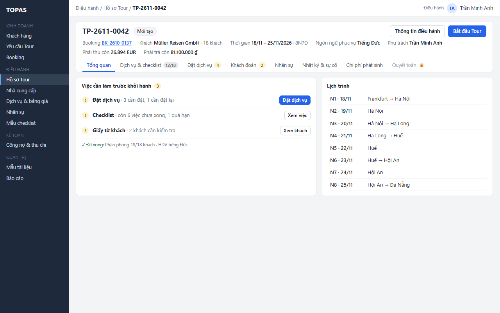

*Kết quả:* thấy ngay trạng thái và việc còn thiếu mà không phải mở từng tab.

**L1.2 Đổi người phụ trách và ngôn ngữ phục vụ.**

1. **W02 · Nút Thông tin điều hành ở header → bảng trượt.** Bảng trượt điền sẵn người phụ trách hiện tại (trống khi hồ sơ tự tạo chưa giao) và ngôn ngữ phục vụ lấy từ Booking. Điều hành chọn người mới từ DH06; danh sách theo RSD DH06 R03: nhân sự thuộc nhóm Điều hành, Đang nhận phân công, Nội bộ, có tài khoản liên kết đang hoạt động và có vai trò Điều hành. Điều hành đổi ngôn ngữ, ghi chú nếu cần, rồi bấm Lưu thay đổi.

   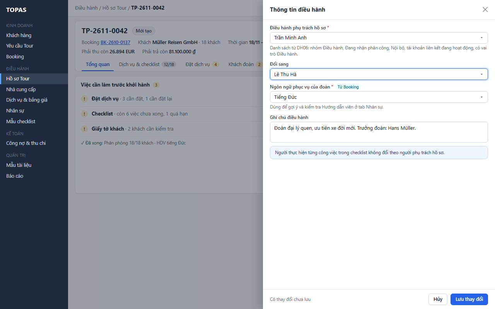

2. **W02a · Header và thông báo ngắn.** Hệ thống kiểm tra người phụ trách hợp lệ, cập nhật header, gửi thông báo cho người được giao và ghi lịch sử. Nếu đây là lần giao đầu (hồ sơ tự tạo chưa có người phụ trách), các công việc có thuộc tính Giao người phụ trách mà chưa có người thực hiện được điền người này (RSD DH01 R05); đổi người về sau không đổi người thực hiện của công việc.

   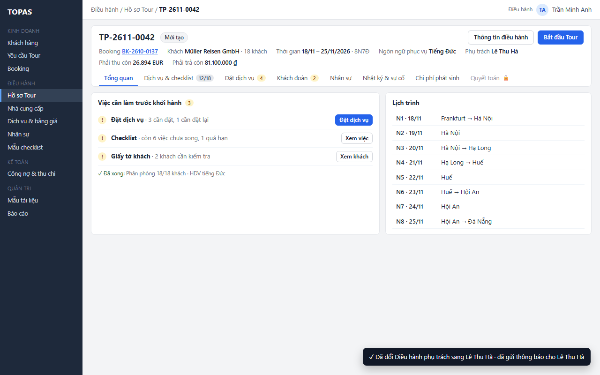

*Kết quả:* header cập nhật ngay. Nếu không đổi giá trị nào, hệ thống giữ nguyên và không ghi lịch sử.

**L1.3 Bắt đầu Tour.**

1. **W03 · Nút Bắt đầu Tour ở header → hộp thoại.** Hộp thoại điền sẵn thời điểm hiện tại và liệt kê mục chưa sẵn sàng theo R01; liên kết Xem các mục mở tab tương ứng. Điều hành giữ hoặc sửa thời điểm, rồi bấm Vẫn bắt đầu Tour (hoặc Bắt đầu Tour khi không còn mục thiếu). Hộp thoại không chặn.

   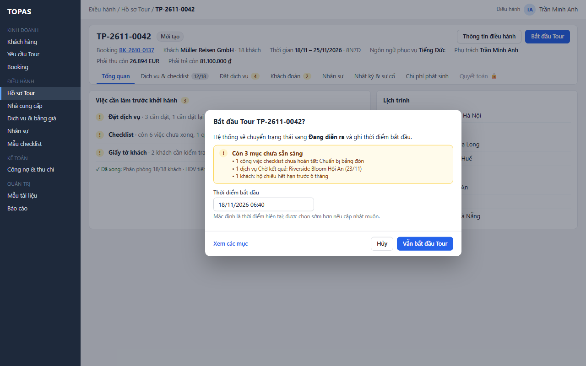

2. **W04 · Tổng quan khi Tour đang diễn ra.** Hồ sơ chuyển Đang diễn ra; Tổng quan đổi bố cục:
   - **Khối Hôm nay.** Lịch dịch vụ và nhân sự của ngày hiện tại. Tiêu đề khối có ba nút ghi nhanh: + Nhật ký, + Sự cố, + Chi phí. Mỗi nút mở bảng trượt của tab tương ứng (W56, W61) ngay trên Tổng quan; lưu xong vẫn ở Tổng quan. Dòng cuối khối ghi số sự cố đang mở và thời điểm nhật ký mới nhất.
   - **Khối Lịch trình.** Ngày hiện tại được tô nền và gắn nhãn Hôm nay; các ngày đã qua hiện màu nhạt.

   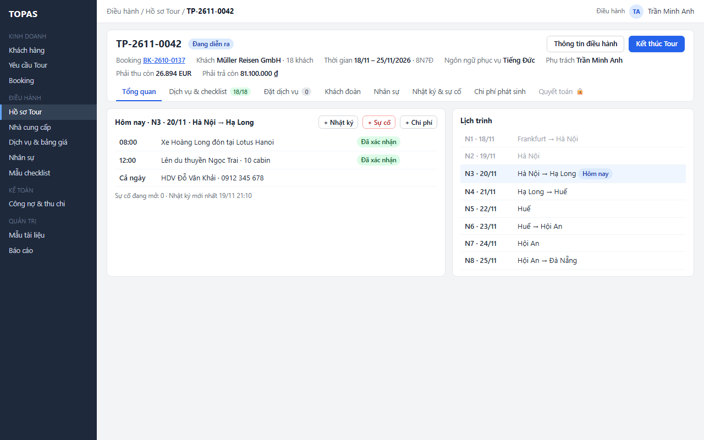

**L1.4 Kết thúc Tour.**

1. **W05 · Nút Kết thúc Tour ở header → hộp thoại.** Điều hành kiểm tra thời điểm rồi bấm Kết thúc Tour. Hệ thống kiểm tra thời điểm, chuyển Đã kết thúc và mở khóa tab Quyết toán ở bước 1.

   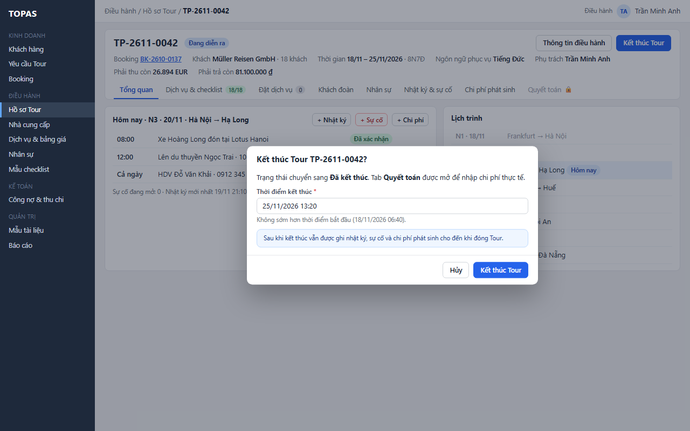

**L1.5 Nhận và áp dụng thay đổi chương trình.** *Điều kiện:* hồ sơ Mới tạo hoặc Đang diễn ra và Booking Hiệu lực; Booking Đã hủy thì không áp dụng được và bản đang chờ chuyển Không áp dụng (E1.11, R19). Kinh doanh bấm Điều chỉnh chương trình ở KD08 để mở KD06 ở chế độ điều chỉnh, sửa hành trình (dịch vụ, ngày, số khách, yêu cầu; giá tự tính lại, lưu thành phiên bản báo giá mới), trao đổi với khách; khách đã chốt thì bấm Chuyển sang Điều hành ở KD08. Hệ thống tự ghi Chốt cho phiên bản điều chỉnh mới nhất của chính Booking đó, Booking lên phiên bản đó, phiên bản cũ thành Đã thay thế, và tạo thay đổi chương trình cho hồ sơ (RSD KD08 R09). Booking nhận thời gian và số khách mới ngay lúc này; hồ sơ giữ thời gian và số khách của phiên bản đang áp dụng cho đến khi Điều hành bấm Áp dụng (người dùng chốt 12/11/2026, rà soát lần ba). Thay đổi có thể do khách hoặc đại lý yêu cầu, do Kinh doanh điều chỉnh chương trình, hoặc để xử lý yêu cầu đổi lịch trình của Điều hành (L3.12). Không nhất thiết phải có NCC không đáp ứng.

1. **W08 · Banner vàng dưới header, trên mọi tab.** Điều hành phụ trách nhận thông báo. Banner ghi phiên bản (số phiên bản báo giá, ví dụ v4), người chuyển, thời điểm, số thay đổi và nút Xem thay đổi; banner mất khi thay đổi đã được áp dụng hoặc chuyển Không áp dụng (E1.11). Hồ sơ giữ nguyên dữ liệu; hạng mục bị thay đổi chạm tới tạm khóa đặt (R19). Header, Tổng quan và cảnh báo lệch số khách vẫn theo thời gian và số khách của phiên bản đang áp dụng; banner là chỉ báo có thay đổi chờ áp dụng và ghi Booking đã theo phiên bản mới.

   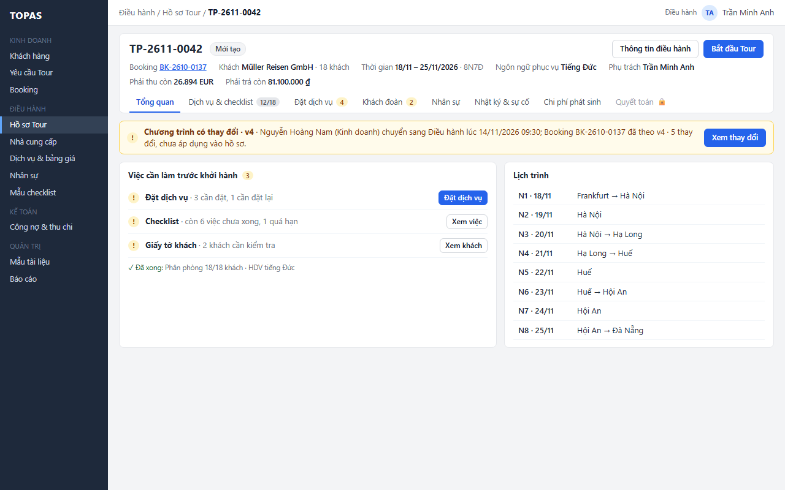

2. **W09 · Nút Xem thay đổi → bảng trượt rộng.** Hệ thống so sánh **bản cũ** (phiên bản đang áp dụng cho hồ sơ) với **bản mới** và liệt kê từng thay đổi theo ngày (Thêm, Bỏ, Đổi dịch vụ, Đổi ngày, Đổi số lượng, Đổi số khách, Đổi yêu cầu). Mỗi dòng có giá trị bản cũ, bản mới và cột “Khi áp dụng vào hồ sơ”. Bảng trượt hiện ghi chú của Kinh doanh trên phiên bản báo giá (nếu có) và những gì không đổi. Điều hành bấm Áp dụng thay đổi ở chân bảng trượt; hệ thống áp dụng cả phiên bản trong một lần.

   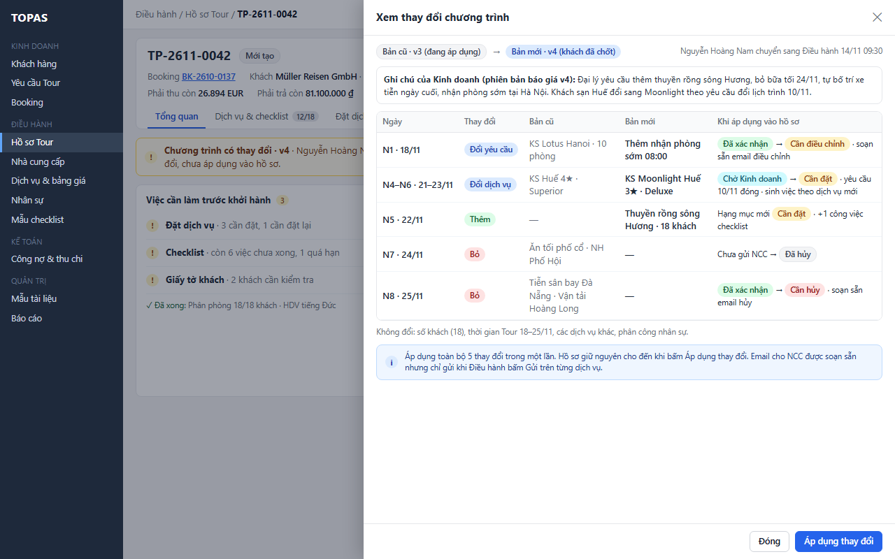

3. **W39 · Banner kết quả xanh trên DH08.3.** Hệ thống cập nhật hồ sơ theo R19 rồi chuyển sang tab Đặt dịch vụ. Banner nêu số dịch vụ cần đặt, cần điều chỉnh, cần hủy và đã bỏ. Dòng bị ảnh hưởng có chỉ báo Theo thay đổi vN và nút xử lý trên dòng: Đặt dịch vụ, Gửi điều chỉnh (W35, L3.11) hoặc Gửi yêu cầu hủy. Email cho NCC đã soạn sẵn, không email nào tự gửi. Banner có nút Soạn email theo NCC (n NCC): mở bảng trượt như W22a, gồm mọi NCC có dịch vụ theo thay đổi; mỗi NCC tách email theo loại việc (R04). Điều hành vẫn có thể xử lý từng dòng.

   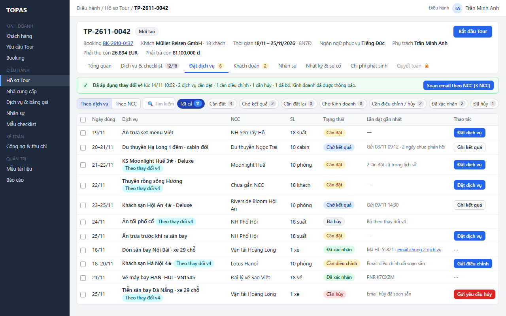

4. **W39a · Nút Gửi yêu cầu hủy trên dòng Cần hủy → bảng trượt.** Lý do điền sẵn từ thay đổi chương trình, email hủy soạn sẵn. Điều hành kiểm tra rồi bấm Gửi yêu cầu hủy, hoặc Để sau.

   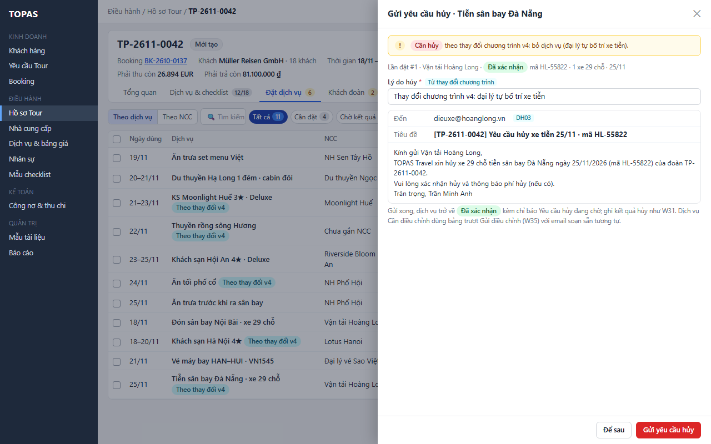

5. **W39b · Dòng cập nhật, thông báo ngắn.** Dịch vụ mới chuyển Chờ kết quả. Dịch vụ đã gửi hủy về Đã xác nhận kèm chỉ báo Yêu cầu hủy đang chờ và nút Ghi kết quả hủy. Kết quả từ NCC ghi như L3.5 hoặc L3.8.

   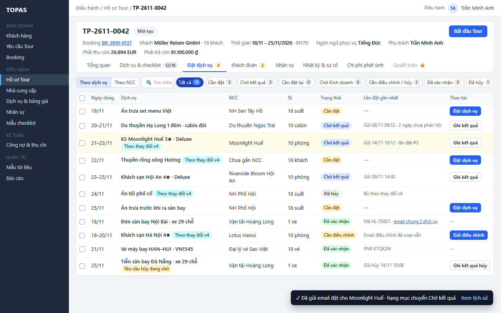

*Kết quả:* hồ sơ chạy theo phiên bản chương trình mới. Lịch trình Tổng quan, hạng mục, checklist và phân phòng được cập nhật. Kinh doanh nhận thông báo đã áp dụng; khối Thay đổi chương trình ở KD08 ghi Đã áp dụng.

**Ngoại lệ**

- **E1.1 · W07.** Không có quyền, không tìm thấy hồ sơ hoặc không tải được: thay toàn bộ vùng nội dung, không tải dữ liệu hồ sơ, hiện lý do và nút Về danh sách hồ sơ Tour. Khi lỗi tải, có thêm nút Thử lại.

  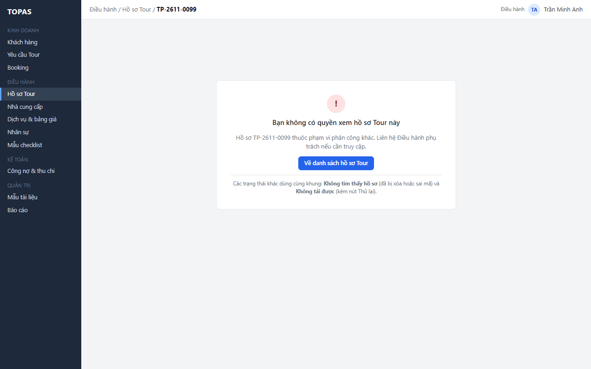

- **E1.2 · W06.** Booking đã hủy: xử lý theo L3.9 và R14.
- **E1.3.** Người phụ trách được chọn đã bị tắt quyền nhận phân công hoặc không còn đủ điều kiện của RSD DH06 R03 ở phiên khác: báo lỗi cạnh trường và yêu cầu chọn lại.
- **E1.4.** Thời điểm bắt đầu ở tương lai hoặc thời điểm kết thúc sớm hơn thời điểm bắt đầu: báo lỗi cạnh trường, không lưu.
- **E1.5.** Hồ sơ vừa được chuyển trạng thái ở phiên khác: từ chối thao tác, tải lại header và báo “Hồ sơ đã được cập nhật bởi …”.
- **E1.6.** Kinh doanh Chuyển sang Điều hành một phiên bản mới hơn khi phiên bản đang chờ chưa áp dụng (RSD KD08 E1.10): thay đổi đang chờ chuyển Đã thay thế. Banner và bảng trượt chỉ hiện phiên bản mới nhất, so với bản cũ đang áp dụng cho hồ sơ.
- **E1.7.** Hồ sơ vừa đổi ở phiên khác trong lúc đang xem thay đổi (ví dụ một dịch vụ vừa được gửi đặt): khi bấm Áp dụng, hệ thống tính lại ảnh hưởng, hiện các dòng đã đổi và yêu cầu bấm Áp dụng lần nữa.
- **E1.8.** Áp dụng lỗi: không áp dụng phần nào, hồ sơ giữ nguyên, banner vẫn còn và có nút Thử lại.
- **E1.9.** Thay đổi chạm tới ngày đã qua khi Tour đang diễn ra: dòng đó hiện “Không áp dụng được, ngày đã qua”. Nút Áp dụng thay đổi bị khóa; Kinh doanh nhận thông báo để điều chỉnh tiếp ở KD06 và Chuyển sang Điều hành phiên bản mới.
- **E1.10.** Hồ sơ Đã kết thúc hoặc Đã đóng: không nhận thay đổi chương trình. KD08 khóa Điều chỉnh chương trình và Chuyển sang Điều hành, ghi lý do hồ sơ Tour đã kết thúc (RSD KD08 R09, E1.6); chênh lệch với khách sau Tour xử lý ở KT01 và quyết toán DH08.8. Hồ sơ vừa chuyển Đã kết thúc khi Kinh doanh đang bấm Chuyển sang Điều hành: máy chủ từ chối, không tạo thay đổi chương trình.
- **E1.11.** Thay đổi chương trình còn Chờ áp dụng khi Booking chuyển Đã hủy (KD08) hoặc khi hồ sơ chuyển Đã kết thúc (Kết thúc Tour, Kết thúc hồ sơ): hệ thống chuyển bản đó sang **Không áp dụng** trong cùng giao dịch, ghi lý do “Booking đã hủy” hoặc “Hồ sơ đã kết thúc”, bỏ banner W08 và chỉ báo Chờ áp dụng thay đổi trên hạng mục; dữ liệu hồ sơ không đổi; lịch sử hồ sơ ghi sự kiện và lý do. Booking Đã hủy thì máy chủ từ chối Áp dụng thay đổi (kể cả khi bảng trượt W09 đang mở ở phiên khác) và báo lý do (R19). Kinh doanh nhận thông báo và KD08 đọc trạng thái Không áp dụng cho khối Thay đổi chương trình (suy ra, chờ xác nhận).

### 3.2. DH08.2 · Dịch vụ và checklist (TN05.04 · SYS05.05, SYS05.06)

**L2.1 Xem và lọc.** **W10 · Chip lọc, ô tìm, chọn ngày trên đầu bảng.** Danh sách gộp dịch vụ và công việc, nhóm theo Trước Tour và từng ngày Tour; nhóm được giữ khi lọc. Chip gồm Tất cả, Việc của tôi, Chưa xong, Quá hạn. Bộ lọc áp dụng ngay. Công việc chưa giao hiện ô Chọn người viền nét đứt nên dễ nhận ra, không cần bộ lọc riêng.

**L2.2 Phân công và đổi tiến độ ngay trên dòng.** **W10 · Ô chọn tại chỗ ở cột Người thực hiện và cột Tiến độ.** Điều hành bấm ô, chọn giá trị; hệ thống lưu ngay, không mở form, và số trên tab cập nhật. Ô Người thực hiện chỉ liệt kê nhân sự Nội bộ, Đang nhận phân công, không có tài khoản liên kết Bị khóa; người phụ trách hồ sơ đứng đầu, rồi theo tên (RSD DH06 R03). Lưu lỗi thì ô trả về giá trị cũ và báo lỗi. Đây là cách duy nhất để phân công và đổi tiến độ trên danh sách; bảng trượt W12 dùng khi cần sửa nhiều trường cùng lúc.

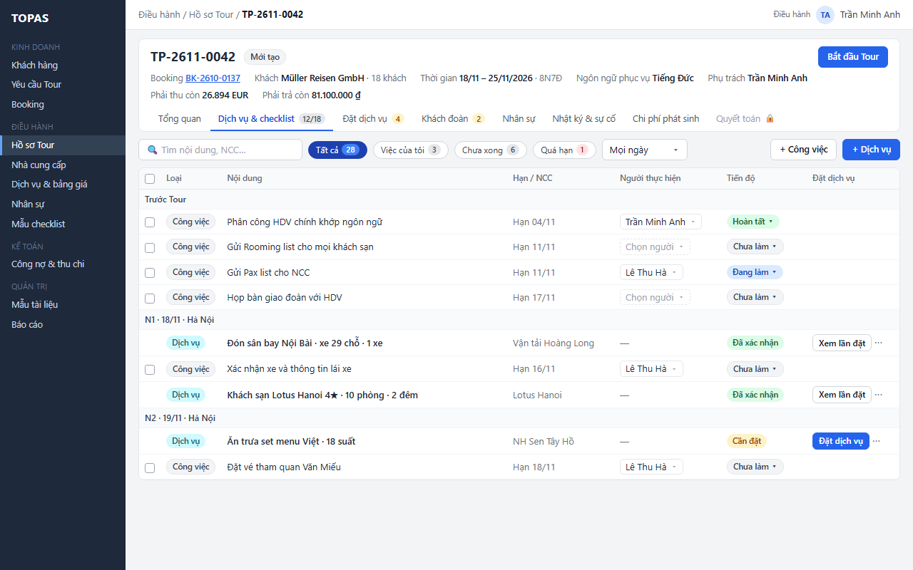

**L2.3 Phân công và sửa công việc.**

1. **W12 · Bấm tên công việc → bảng trượt.** Dòng đầu ghi mẫu và phiên bản đã sinh công việc (ví dụ Inbound tiêu chuẩn v4) và sự kiện tự hoàn tất. Hạn hoàn tất điền sẵn theo mẫu, kèm nhãn cách tính (ví dụ 7 ngày trước Khởi hành). Hướng dẫn thực hiện lấy từ mẫu, chỉ đọc. Cuối bảng trượt có lịch sử công việc.
2. **W12 → W10 · Nút Lưu.** Điều hành chọn người thực hiện, sửa nội dung, hạn, tiến độ hoặc ghi chú, rồi bấm Lưu. Hệ thống kiểm tra nhân sự hợp lệ; bảng trượt đóng, dòng cập nhật tại chỗ, kèm thông báo ngắn.

   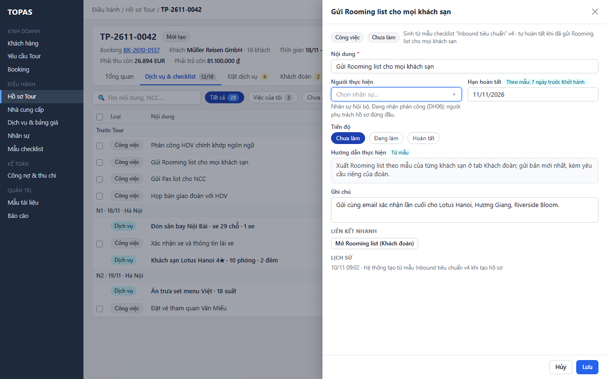

**L2.4 Thao tác hàng loạt.** **W11 · Ô chọn đầu dòng công việc → thanh hàng loạt.** Chọn nhiều dòng công việc trong trang đang xem (dòng dịch vụ không có ô chọn). Khi đã chọn, ô chọn tại chỗ và nút trên các dòng tạm ẩn; thanh hàng loạt hiện ô Giao cho và ô Tiến độ. Chọn giá trị rồi bấm Áp dụng. Hệ thống áp dụng cho từng dòng hợp lệ, thông báo dạng “Đã phân công 3/3”, báo số dòng bị bỏ qua kèm lý do và giữ chọn các dòng lỗi (R09).

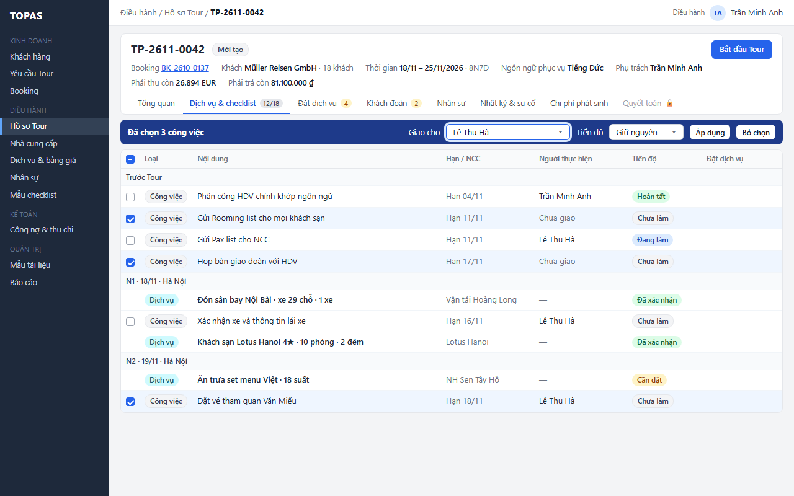

**L2.5 Thêm dịch vụ.**

1. **W13 · Nút + Dịch vụ → bảng trượt.** Chọn ngày và dịch vụ trong danh mục. Đơn vị, giá tham chiếu và số lượng điền sẵn (số lượng mặc định bằng số khách).
2. **W13 · Nút Lưu dịch vụ, hoặc Lưu và đặt ngay** để chuyển thẳng sang W24.

   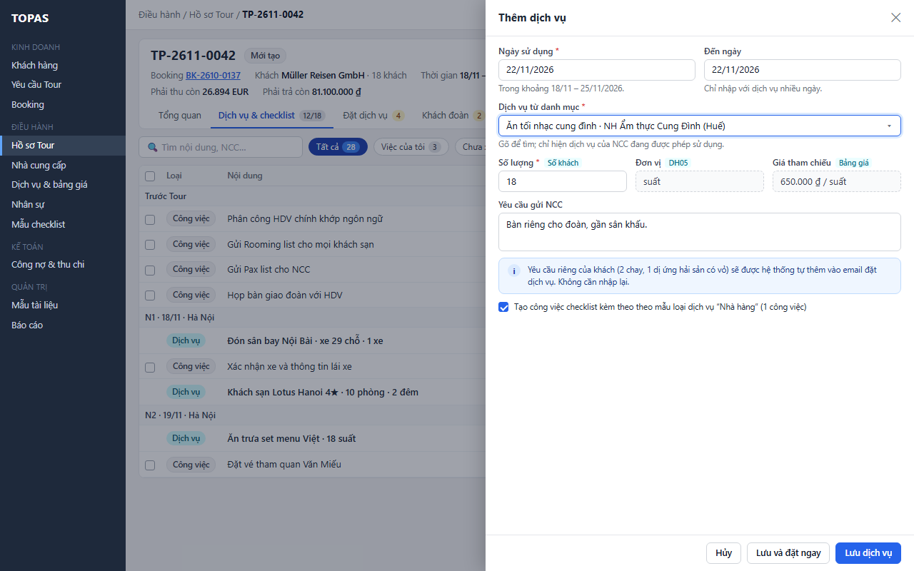

*Kết quả:* hạng mục Cần đặt. Hệ thống sinh các việc theo dịch vụ cùng loại của mẫu mà hồ sơ đã dùng khi tạo, ở phiên bản hiện hành của mẫu, với hạn tính theo ngày sử dụng của hạng mục mới (RSD DH01 L5.2, R07). Việc cả hồ sơ không sinh lại.

**L2.6 Bỏ dịch vụ.** **W14 · Menu ⋯ trên dòng → hộp thoại.** Nhập lý do rồi bấm Bỏ dịch vụ. Hệ thống kiểm tra lại hạng mục chưa có lần đặt và chưa liên kết công nợ, rồi bỏ hạng mục cùng công việc chỉ gắn với nó và tính lại tiến độ.

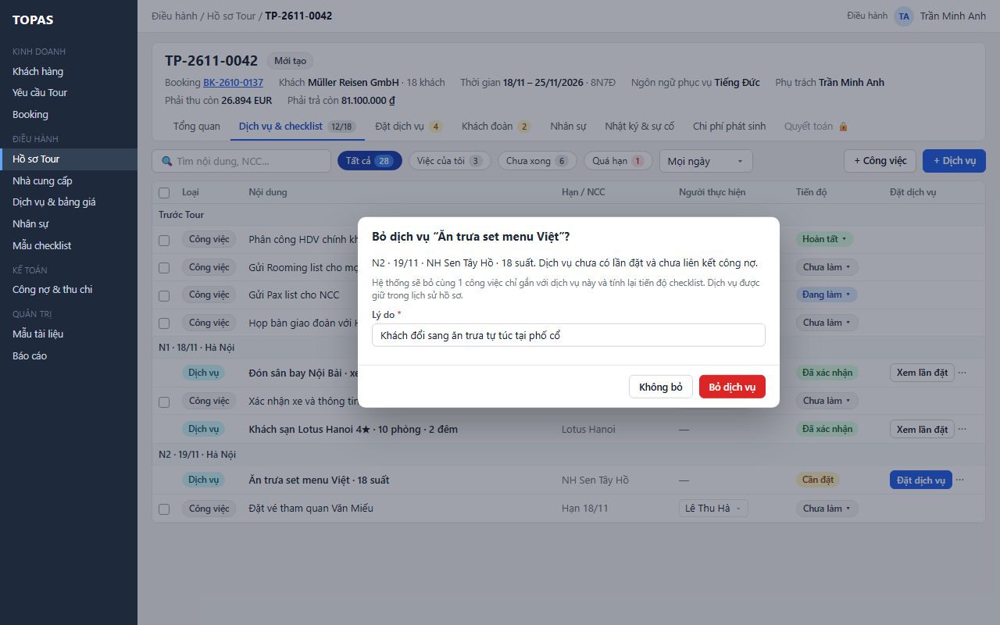

**L2.7 Đặt từ dòng.** **W10 → W24 · Nút Đặt dịch vụ trên dòng dịch vụ Cần đặt.** Một lần bấm: DH08.3 mở với bảng trượt email đã soạn sẵn cho đúng hạng mục.

**Ngoại lệ**

- **E2.1 · W15.** Dịch vụ đã có lần đặt hoặc liên kết công nợ: hộp thoại chặn bỏ, hiện lý do và nút Mở lần đặt để hủy. Nút này mở DH08.3 với bảng trượt lịch sử (W29) của hạng mục.

  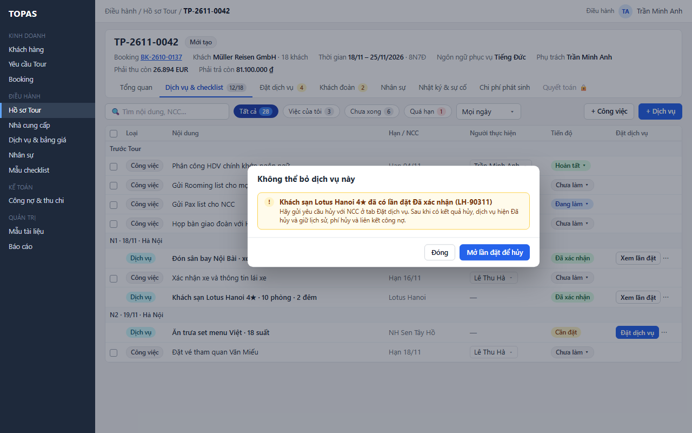

- **E2.2.** Nhân sự được chọn không còn được phép nhận phân công: báo lỗi cạnh trường; với thao tác hàng loạt, ghi dòng bị bỏ qua.
- **E2.3.** Ngày dịch vụ nằm ngoài thời gian Tour hoặc số lượng ≤ 0: báo lỗi cạnh trường.

### 3.3. DH08.3 · Đặt dịch vụ (TN06.01–TN06.04 · SYS06.01–SYS06.06)

**L3.1 Xem việc cần làm.** **W20 · Chip trạng thái có số đếm, bảng.** Chip gồm Tất cả, Cần đặt, Chờ kết quả, Cần đặt lại, Chờ Kinh doanh, Cần điều chỉnh / hủy, Đã xác nhận, Đã hủy; bấm chip là lọc ngay. Mỗi dòng gồm ngày dùng, dịch vụ, NCC, số lượng, trạng thái, tóm tắt lần đặt gần nhất (thời điểm gửi, số ngày chưa phản hồi, mã xác nhận hoặc lý do) và một nút thao tác chính theo trạng thái (R05). Khi lần đặt gần nhất nằm trong một email gồm nhiều dịch vụ, cột Lần đặt gần nhất ghi thêm liên kết “email chung n dịch vụ”, mở W29a (L3.14). Đầu thanh lọc có nút chuyển Theo dịch vụ (mặc định) / Theo NCC (L3.13).

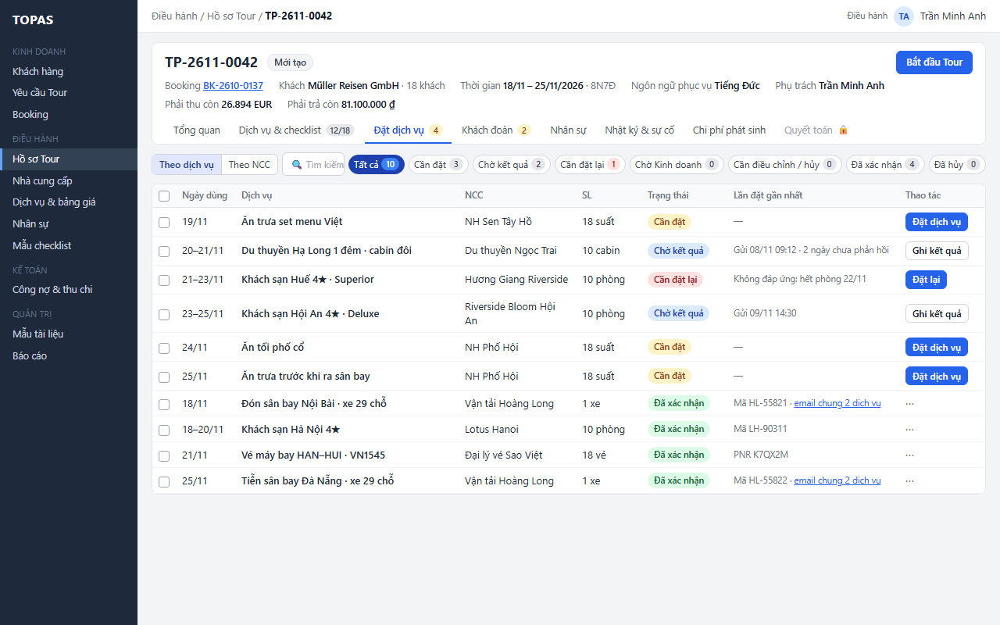

**L3.2 Đặt nhiều hạng mục cùng lúc.**

1. **W21 · Ô chọn đầu dòng → thanh thao tác.** Chọn các dòng Cần đặt. Thanh thao tác cho biết số email sẽ tạo sau khi gộp theo NCC: mỗi NCC một email đặt, kể cả khi các dịch vụ khác loại dịch vụ (R04); dòng không đủ điều kiện bị loại kèm lý do. Bấm Soạn email đặt (n NCC).

   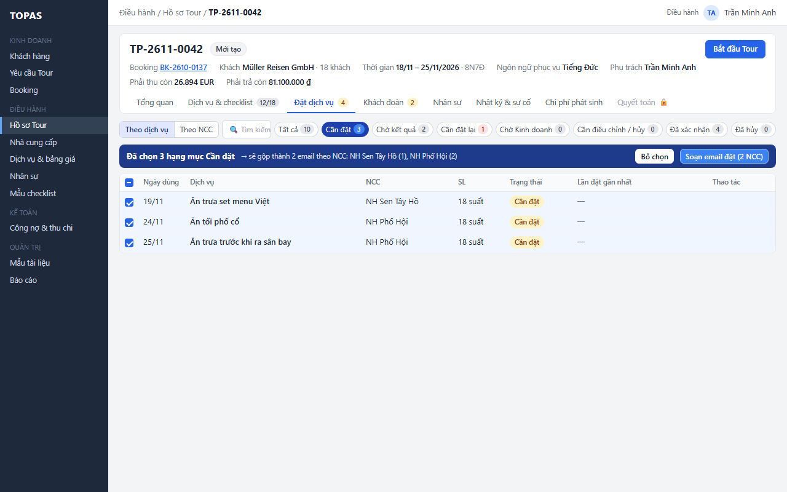

2. **W22 · Bảng trượt rộng: danh sách NCC bên trái, email bên phải.** Email soạn sẵn theo mẫu hệ thống tự khớp (R04); yêu cầu riêng của khách được chèn tự động và tô vàng (R06). Mỗi NCC có nhãn Sẵn sàng gửi hoặc Cần bổ sung. Người dùng bấm từng NCC để xem, sửa trực tiếp nội dung nếu cần, rồi bấm Gửi n email ở chân bảng trượt.

   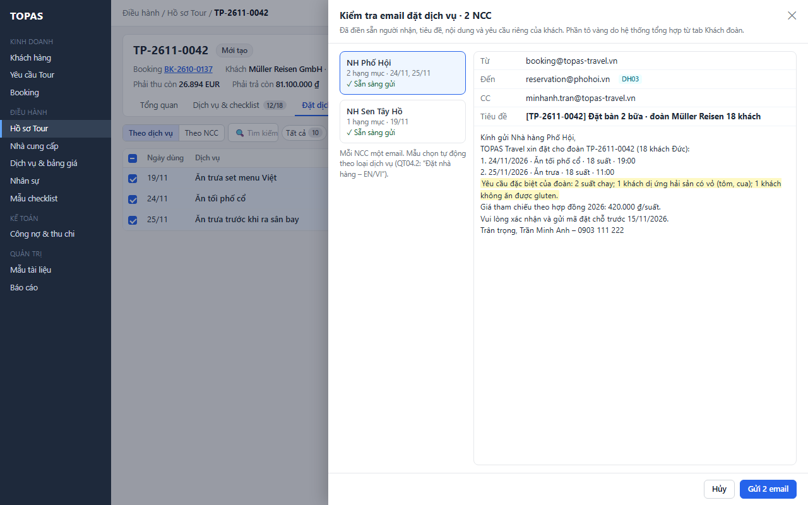

3. **W23 · Banner kết quả trên bảng.** Hệ thống báo kết quả theo từng NCC. Phần gửi thành công tạo lần đặt và chuyển Chờ kết quả. Phần lỗi giữ nguyên email; dòng lỗi chỉ hiện lý do, không có nút riêng. Banner có nút Gửi lại phần lỗi (chỉ gửi các NCC lỗi) và Sửa người nhận.

   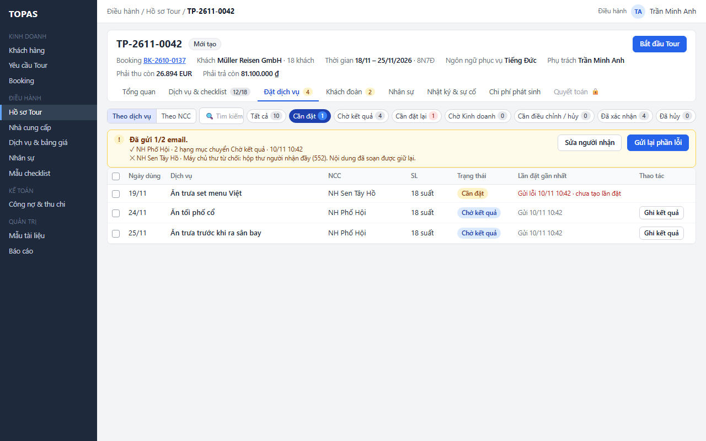

**L3.3 Đặt một hạng mục.**

1. **W24 · Nút Đặt dịch vụ trên dòng → bảng trượt.** Bảng trượt mở thẳng ở bước kiểm tra email, mẫu và ngôn ngữ do hệ thống tự khớp, người dùng không chọn hay đổi mẫu (R04; RSD QT04 R07); dòng chỉ đọc dưới email ghi mã mẫu, phiên bản và ngôn ngữ đang dùng. Người nhận lấy từ DH03, tiêu đề có Tour Code, nội dung có ngày, số lượng, yêu cầu dịch vụ và yêu cầu riêng. Kiểm tra, sửa nếu cần, rồi bấm Gửi email.

   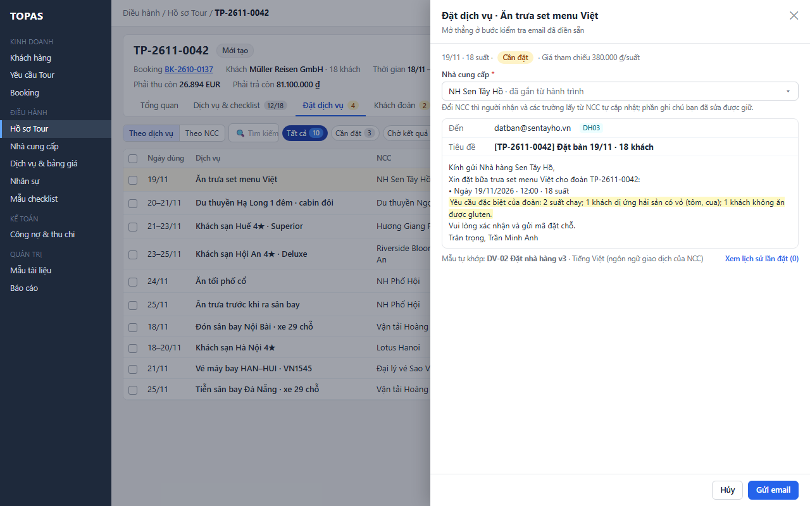

2. **W24a · Dòng cập nhật tại chỗ, thông báo ngắn có liên kết Xem email đã gửi.** Gửi thành công tạo một lần đặt Đã gửi, lưu cùng bản email đã gửi. Dòng chuyển Chờ kết quả, ghi thời điểm gửi và người nhận; số trên tab giảm. Khi NCC phản hồi, bấm Ghi kết quả (L3.5).

   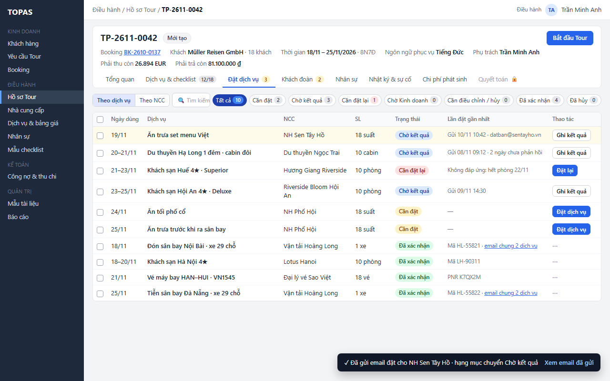

**L3.4 Hạng mục chưa có NCC.** **W25 · Cùng bảng trượt đặt, khi hạng mục chưa có NCC.** Bảng trượt hiện danh sách NCC đang được phép sử dụng, lọc theo loại dịch vụ, khu vực và bảng giá còn hiệu lực ở ngày dùng, có giá tham chiếu, tỷ lệ xác nhận và nhãn Gợi ý. Chọn NCC thì NCC được gắn cho hạng mục, giá tham chiếu cập nhật và email tự soạn ngay bên dưới.

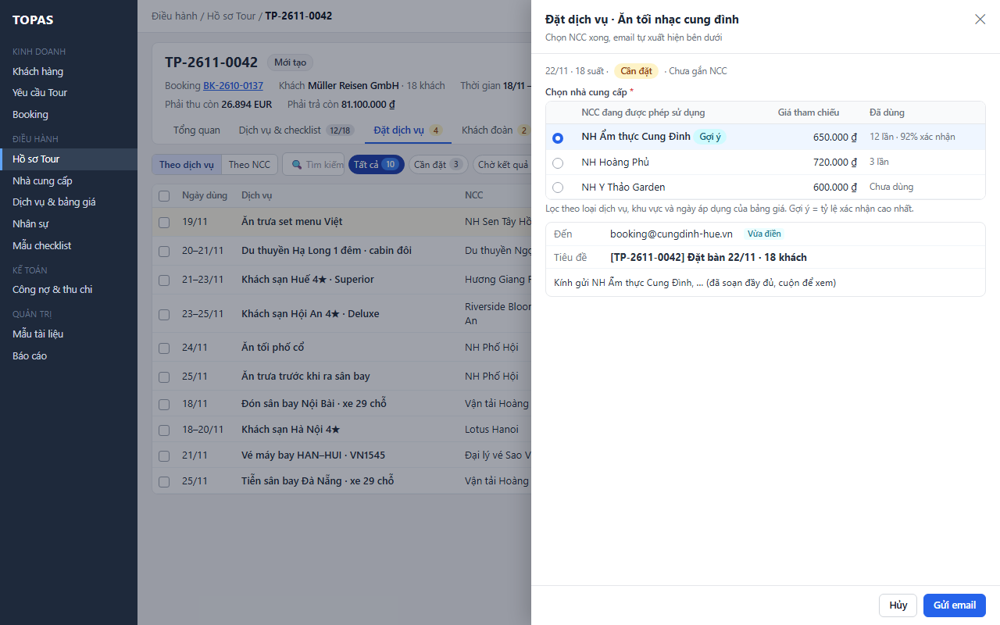

**L3.5 Ghi kết quả Đã xác nhận.**

1. **W26 · Nút Ghi kết quả trên dòng → bảng trượt.** Chọn Đã xác nhận. Số lượng xác nhận và giá NCC điền sẵn theo lần đặt và giá tham chiếu; loại tiền điền sẵn theo loại tiền của dòng giá DH03 dùng làm giá tham chiếu, Điều hành sửa được khi NCC xác nhận bằng loại tiền khác (quyết định 12/11/2026). Bảng trượt hiện so sánh với giá tham chiếu. Nhập mã xác nhận nếu NCC cấp, sửa giá hoặc loại tiền nếu khác, rồi bấm Lưu kết quả. Khi lần đặt nằm trong email gồm nhiều dịch vụ còn chờ kết quả, bảng trượt mở ở chế độ Cả email (L3.15, W26b).

   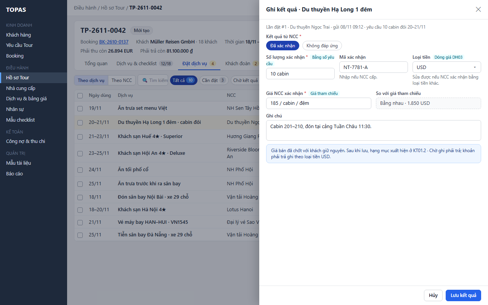

2. **W26a · Dòng cập nhật tại chỗ, thông báo ngắn.** Hạng mục tính lại theo R02; dòng chuyển Đã xác nhận, kèm mã và giá.

   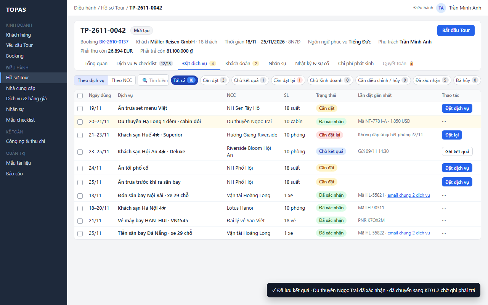

*Kết quả:* hạng mục Đã xác nhận và vào KT01.2 · Chờ ghi phải trả; KT01 tạo khoản phải trả theo loại tiền đã ghi (R10); công việc đặt dịch vụ liên quan tự Hoàn tất (R03). Giá bán đã chốt với khách không đổi.

**L3.6 Xác nhận một phần.** **W27 · Cùng bảng trượt Ghi kết quả.** Khi số lượng xác nhận nhỏ hơn số yêu cầu, hệ thống hiện ngay phần còn thiếu. Sau khi lưu, hạng mục chuyển Xác nhận một phần và nút trên dòng là Đặt phần còn thiếu. Nút này mở cùng bảng trượt với Đặt lại (W28), email đã điền đúng số còn thiếu, gửi được cho cùng NCC hoặc NCC khác; chân bảng trượt có nút Báo Kinh doanh (L3.12) khi không đặt được phần còn thiếu.

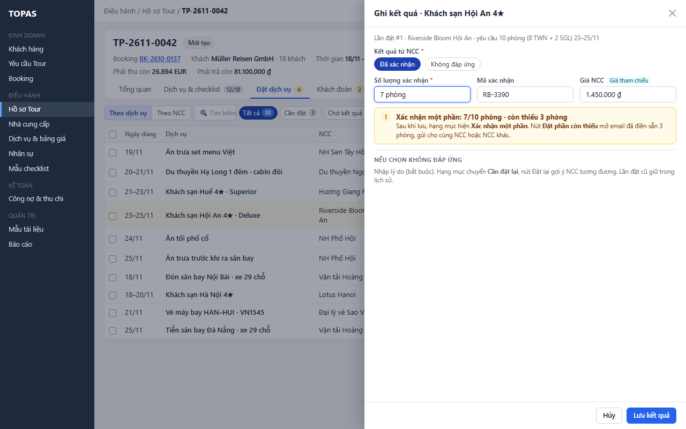

**L3.7 Không đáp ứng và đặt lại.**

1. **W27 · Cùng bảng trượt Ghi kết quả.** Chọn Không đáp ứng, nhập lý do rồi lưu. Hạng mục chuyển Cần đặt lại; nút trên dòng là Đặt lại.
2. **W28 · Nút Đặt lại trên dòng → bảng trượt.** Bảng trượt hiện lý do của lần trước và danh sách NCC thay thế cùng loại dịch vụ và khu vực, kèm chênh lệch giá tham chiếu. Mặc định chọn NCC rẻ nhất có tỷ lệ xác nhận cao. Email tự soạn và đổi theo NCC đã chọn. Chân bảng trượt luôn có nút Báo Kinh doanh (L3.12) cho trường hợp không có NCC phù hợp hoặc cần sửa lịch trình. Khi danh sách NCC thay thế rỗng, bảng trượt hiện “Không còn NCC tương đương” và Báo Kinh doanh trở thành nút chính.

   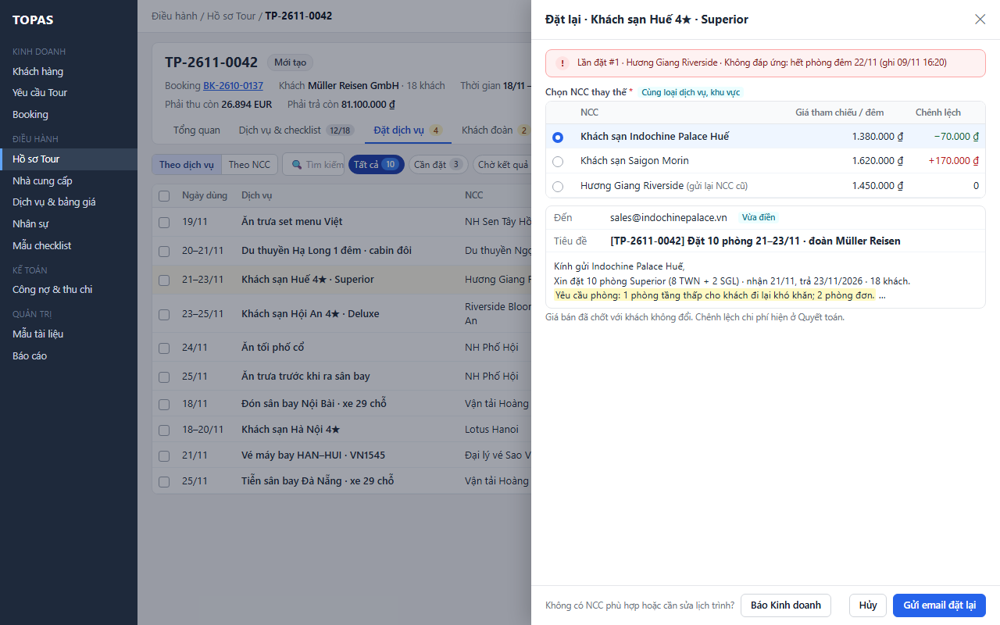

3. **W28 → W29 · Nút Gửi email đặt lại.** Hệ thống tạo lần đặt mới trên cùng hạng mục và giữ lịch sử lần đặt cũ (L3.10).

**L3.8 Hủy một lần đặt.**

1. **W30 · Nút Hủy lần đặt trong lịch sử (W29) hoặc menu ⋯ trên dòng → bảng trượt.** Nhập lý do; email hủy được soạn sẵn kèm mã xác nhận. Kiểm tra rồi bấm Gửi yêu cầu hủy. Hệ thống lưu email và thời điểm; dòng giữ trạng thái hiện tại và thêm chỉ báo Yêu cầu hủy đang chờ.

   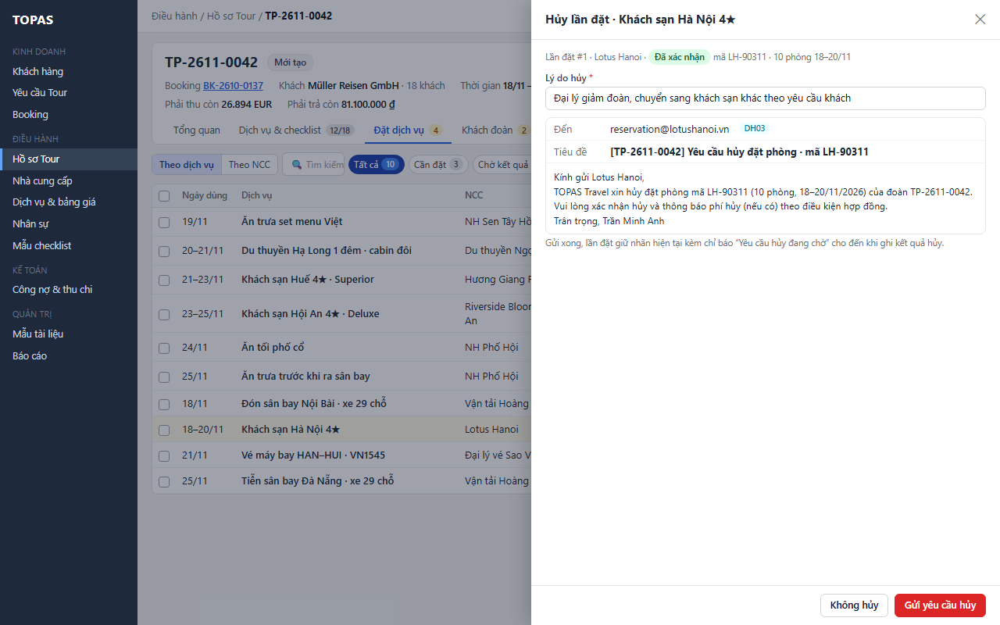

2. **W31 · Nút Ghi kết quả hủy trên dòng → bảng trượt.** Khi NCC phản hồi, chọn NCC chấp nhận hủy hoặc NCC từ chối hủy. Nhập phí hủy (0 nếu NCC không tính phí), loại tiền, mã hủy, đính kèm phản hồi, rồi bấm Lưu kết quả hủy.
   - **Phí hủy gợi ý** theo chính sách đổi hủy của hợp đồng áp dụng cho ngày sử dụng (DH03.2; RSD DH03 R08): số ngày trước = ngày sử dụng đầu tiên − ngày ghi yêu cầu hủy (ngày lịch); chọn mốc có X lớn nhất mà X ≤ số ngày trước; phí = mức × căn cứ (tổng giá của lần đặt, đêm đầu, mỗi khách hoặc mỗi phòng), với căn cứ là giá thì dùng giá NCC xác nhận nếu có, nếu không dùng giá tham chiếu; không đến (no-show) dùng mức no-show. Ô phí có nhãn Gợi ý kèm mốc đã dùng; Điều hành sửa theo phí NCC báo thực tế.
   - **Không có hợp đồng áp dụng, chính sách đổi hủy hoặc mốc phù hợp:** ô phí để trống, bắt buộc nhập trước khi lưu, kèm ghi chú “Chưa có chính sách đổi hủy áp dụng”. Hệ thống không điền 0.
   - **Loại tiền** điền sẵn theo loại tiền của dòng giá DH03 của lần đặt (bằng loại tiền giá xác nhận nếu đã ghi), Điều hành sửa được; lần đặt đã có khoản phải trả ở KT01 thì loại tiền khóa theo khoản đó (R10).

   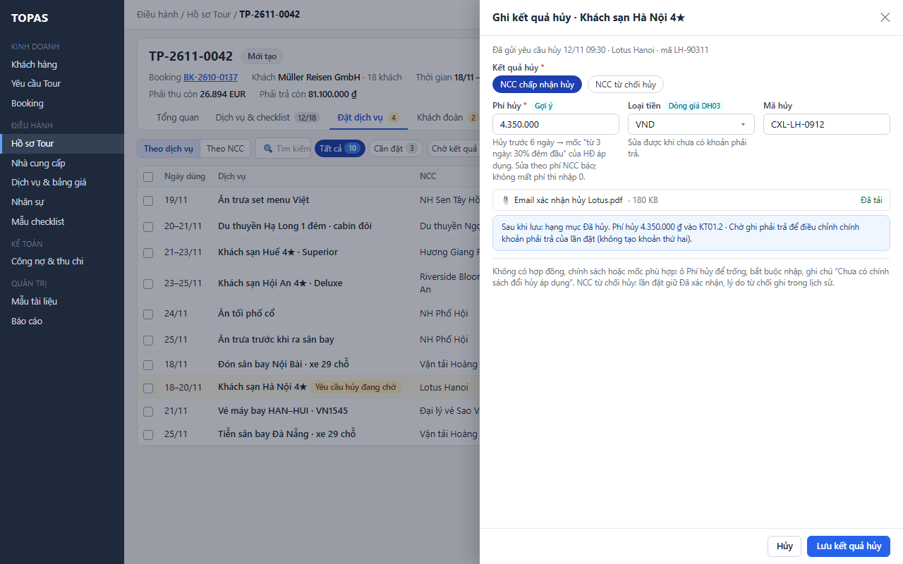

*Kết quả:* nếu NCC chấp nhận, lần đặt chuyển Đã hủy và phí hủy lớn hơn 0 vào KT01.2: lần đặt đã có khoản phải trả thì phí hủy điều chỉnh chính khoản đó, chưa có thì KT01 ghi một khoản với giá trị bằng phí hủy (R10; RSD KT01 R09). Phí hủy bằng 0 mà dịch vụ đã có khoản phải trả ở KT01 thì dòng Hủy không phí vào KT01.2 để Kế toán điều chỉnh khoản về 0 (RSD KT01 R09). Nếu NCC từ chối, lần đặt giữ kết quả cũ và lịch sử ghi lý do từ chối.

**L3.9 Booking đã hủy: hủy hàng loạt (quyết định Q1B).**

1. **W06 · Banner đỏ trên Tổng quan và DH08.3.** Header có chỉ báo đỏ; banner nêu lý do, số lần đặt còn hiệu lực và số NCC. Tổng quan thay khối Việc cần làm bằng khối Việc cần làm để đóng hồ sơ, gồm 3 bước: gửi yêu cầu hủy, ghi kết quả hủy và phí hủy, kết thúc hồ sơ. Khối Lịch trình bị ẩn. Bắt đầu Tour và các nút đặt bị khóa; nút Kết thúc hồ sơ khóa và có chú thích lý do cho đến khi đủ điều kiện R14. Điều hành bấm Soạn email hủy (n NCC) ở bước 1.

   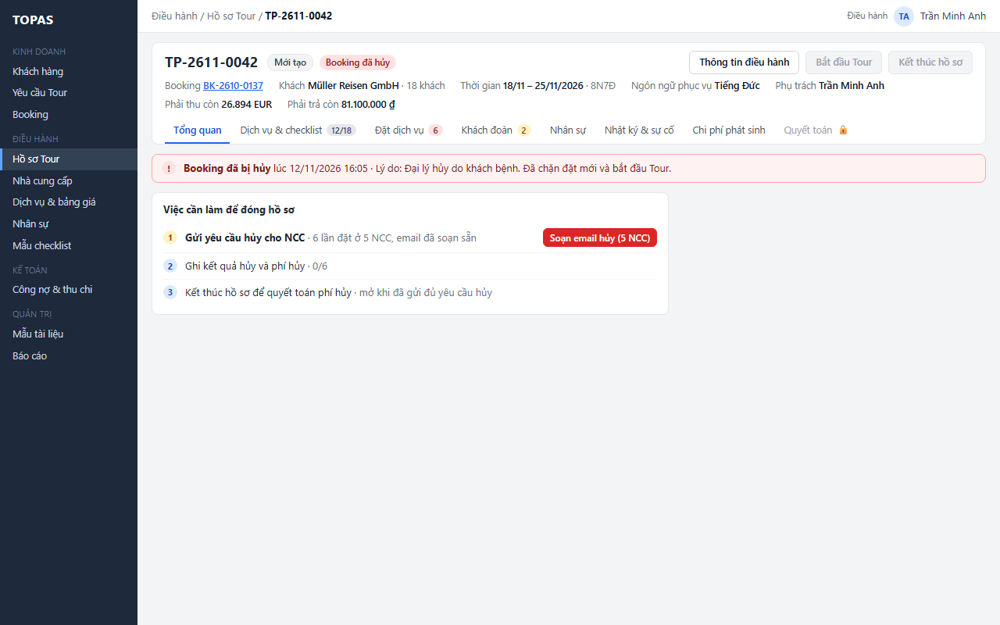

2. **W32 · Bảng trượt rộng.** Hệ thống soạn sẵn một email hủy cho mỗi NCC, gộp mọi lần đặt Đã gửi hoặc Đã xác nhận của NCC đó. Lý do hủy điền sẵn từ Booking. Điều hành xem, sửa từng email nếu cần, bỏ chọn NCC không muốn gửi, rồi bấm Gửi n email hủy.

   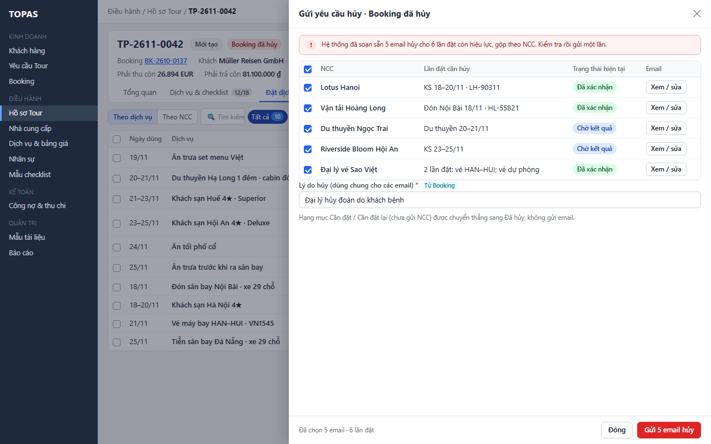

3. **W23, W31.** Kết quả gửi hiện theo từng NCC như W23. Khi có phản hồi, ghi kết quả và phí hủy cho từng lần đặt như W31.

*Kết quả:* hạng mục Cần đặt hoặc Cần đặt lại (chưa từng gửi NCC) tự chuyển Đã hủy và không gửi email. Khi mọi lần đặt còn hiệu lực đã được gửi yêu cầu hủy, nút Kết thúc hồ sơ mở (R14). Booking bị hủy khi hồ sơ Đang diễn ra đi theo E3.16.

**L3.10 Xem lịch sử.** **W29 · Bấm tên dịch vụ → bảng trượt.** Dòng thời gian các lần đặt gồm NCC, thời điểm, người gửi, bản email đã gửi, kết quả, mã, giá và phí hủy. Các nút Xem email đã gửi, Ghi kết quả, Hủy lần đặt chỉ hiện khi hợp lệ. Xem email đã gửi mở W29a, chọn sẵn email của lần đặt đó (L3.14).

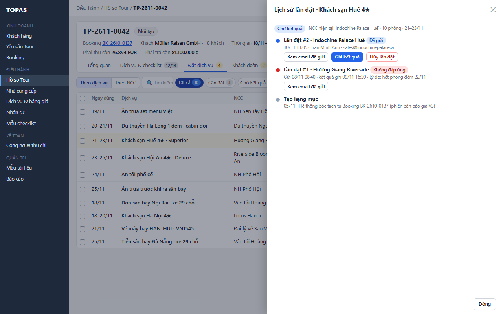

**L3.11 Gửi điều chỉnh khi dữ liệu thay đổi sau lần đặt.** **W35 · Chip Cần điều chỉnh / hủy; nút Gửi điều chỉnh trên dòng → bảng trượt.** Khi yêu cầu riêng, giờ bay hoặc số khách đổi sau khi đã gửi NCC (R07), hoặc khi áp dụng thay đổi chương trình (R19), dịch vụ chuyển **Cần điều chỉnh**. Bảng trượt hiện bảng so sánh “Đã gửi NCC” và “Hiện tại”, cùng email điều chỉnh đã soạn sẵn. Bấm Gửi điều chỉnh: dịch vụ trở về trạng thái trước đó kèm chỉ báo Điều chỉnh đang chờ cho tới khi ghi kết quả, và hệ thống lưu bản chụp mới. Chọn Không cần gửi thì phải nhập lý do, và dịch vụ trở về trạng thái trước đó ngay.

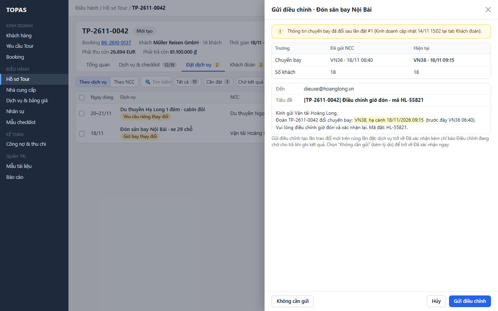

**L3.12 Báo Kinh doanh đổi lịch trình.** *Điều kiện:* hạng mục Cần đặt lại hoặc Xác nhận một phần, và không có NCC tương đương, hoặc phải sửa lịch trình (đổi ngày, đổi dịch vụ hoặc hạng, bỏ dịch vụ).

1. **W36 · Nút Báo Kinh doanh ở chân bảng trượt Đặt lại hoặc Đặt phần còn thiếu (cùng bảng trượt W28) → bảng trượt yêu cầu.** Hệ thống điền sẵn hạng mục, ngày sử dụng, số lượng, các NCC đã thử kèm lý do không đáp ứng, người nhận (Kinh doanh phụ trách Booking) và hạn phản hồi. Điều hành chọn loại đề xuất, ghi nội dung đề xuất, kiểm tra hạn, rồi bấm Gửi Kinh doanh.

   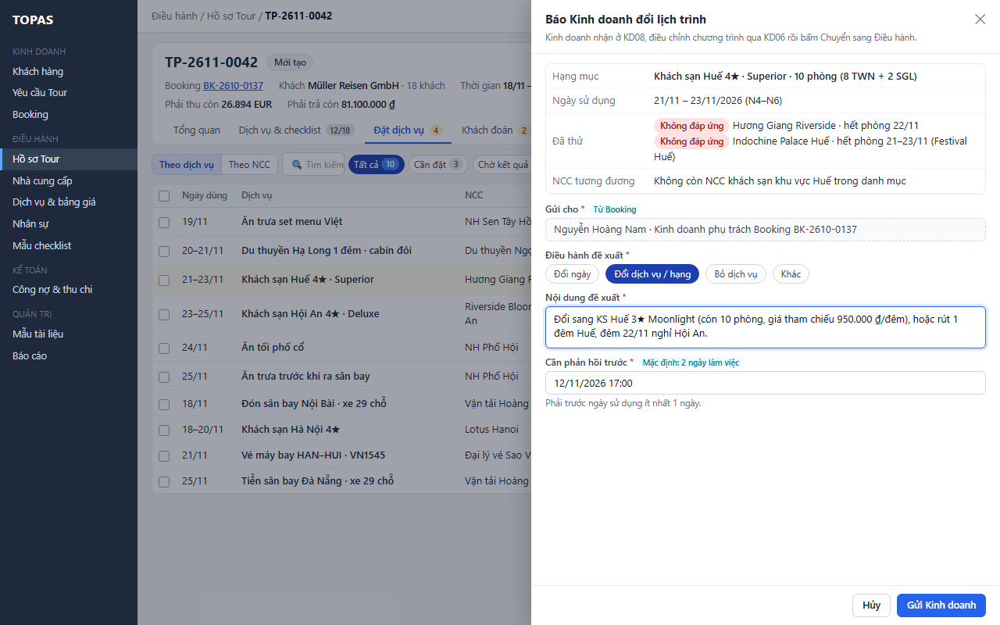

2. **W37 · Chip Chờ Kinh doanh; nút Xem yêu cầu trên dòng.** Hạng mục chuyển **Chờ Kinh doanh**, dòng ghi người nhận và hạn phản hồi; quá hạn có chỉ báo đỏ. Bấm Xem yêu cầu để xem, nhắc lại hoặc rút. Kinh doanh phụ trách Booking nhận thông báo trong hệ thống và email nội bộ, có liên kết mở Booking ở KD08.

   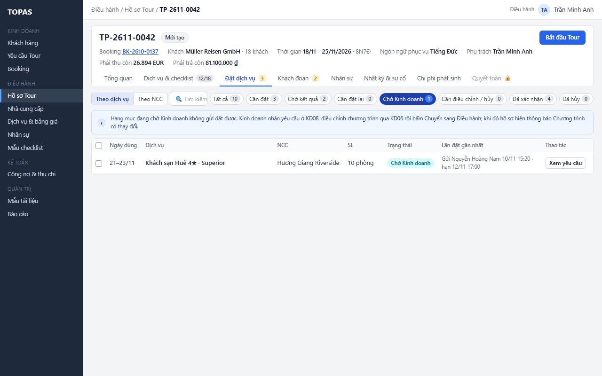

3. **Ngoài DH08; dòng vẫn như W37.** Kinh doanh nhận yêu cầu ở KD08, thống nhất với khách hoặc đại lý, bấm Điều chỉnh chương trình để mở KD06 ở chế độ điều chỉnh, sửa hành trình (giá tự tính lại, lưu thành phiên bản báo giá mới), rồi bấm Chuyển sang Điều hành ở KD08 khi khách đã chốt (RSD KD08 R09; ngoài tài liệu này). Kinh doanh không phản hồi trong DH08.
4. **W08 → W09.** Hồ sơ hiện thông báo Chương trình có thay đổi theo phiên bản báo giá mới; Điều hành xem và áp dụng như L1.5. Khi thay đổi có chạm tới hạng mục này, yêu cầu đổi lịch trình tự chuyển Đã xử lý.
5. **W39.** Hạng mục đổi sang dịch vụ và NCC mới, trạng thái **Cần đặt**, chỉ báo Theo thay đổi vN. Điều hành bấm Đặt dịch vụ trên dòng để mở email đã soạn sẵn (W24).
6. **W39b.** Gửi thành công: hạng mục chuyển **Chờ kết quả**; lần đặt mới nối tiếp các lần đặt cũ trong lịch sử. Từ đây hạng mục đi tiếp luồng ghi kết quả bình thường (L3.5–L3.7).

*Kết quả:* trạng thái hạng mục đi theo chuỗi Cần đặt lại → Chờ Kinh doanh → Cần đặt (sau khi áp dụng thay đổi) → Chờ kết quả. Lịch sử lần đặt cũ được giữ. Kinh doanh thấy cùng trạng thái khi mở DH08.3.

**L3.13 Xem theo NCC và soạn email cho một NCC.** *Ví dụ trên hình:* Vận tải Hoàng Long có xe đón Nội Bài và xe tiễn Đà Nẵng, đặt chung một email ngày 05/11. Sau đó khách đổi chuyến bay (xe đón Cần điều chỉnh) và thay đổi chương trình v4 bỏ xe tiễn (Cần hủy), nên NCC này có 2 việc khác loại chờ gửi.

1. **W20a · Nút chuyển Theo NCC ở đầu thanh lọc.** Bảng gom dịch vụ theo NCC hiện tại của dịch vụ. Dòng nhóm ghi tên NCC, email đặt dịch vụ (DH03) và số việc chờ gửi theo từng loại: cần đặt (gồm cần đặt lại và đặt phần còn thiếu), cần điều chỉnh, cần hủy.
   - Nhóm có việc chờ gửi mở sẵn và xếp trước, theo ngày dùng sớm nhất. Nhóm không có việc chờ gửi thu gọn thành một dòng ở cuối, bấm Mở tất cả để xem.
   - Dịch vụ chưa gắn NCC nằm trong nhóm Chưa gắn NCC; nhóm này không có nút nhóm, chọn NCC trên dòng như L3.4.
   - Chip lọc vẫn áp dụng: chỉ hiện nhóm có dịch vụ khớp, trong nhóm chỉ hiện dịch vụ khớp. Nút Soạn email cho NCC luôn tính mọi việc chờ gửi của NCC, không theo chip.
   - Dòng dịch vụ giữ nguyên nút theo trạng thái (R05). Chế độ xem đã chọn được nhớ theo người dùng.

   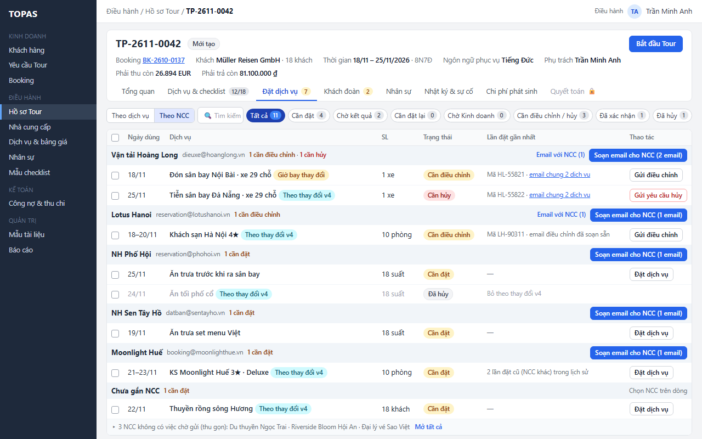

2. **W22a · Nút Soạn email cho NCC (n email) trên dòng nhóm → bảng trượt rộng.** Bên trái là các email sẽ gửi, mỗi loại việc một email, không tách theo loại dịch vụ hay mẫu (R04); email gồm nhiều loại dịch vụ dùng mẫu dự phòng Mọi loại dịch vụ của mục đích đó; mỗi email ghi các dịch vụ trong email và nhãn Sẵn sàng gửi hoặc Cần bổ sung. Bên phải là email đang chọn: email đặt soạn như W22; email điều chỉnh có bảng Đã gửi NCC và Hiện tại như W35; email hủy có lý do điền sẵn như W39a. Điều hành bấm từng email để xem, sửa nếu cần, bỏ chọn email chưa muốn gửi, rồi bấm Gửi n email. Kết quả gửi báo theo từng email như W23.

   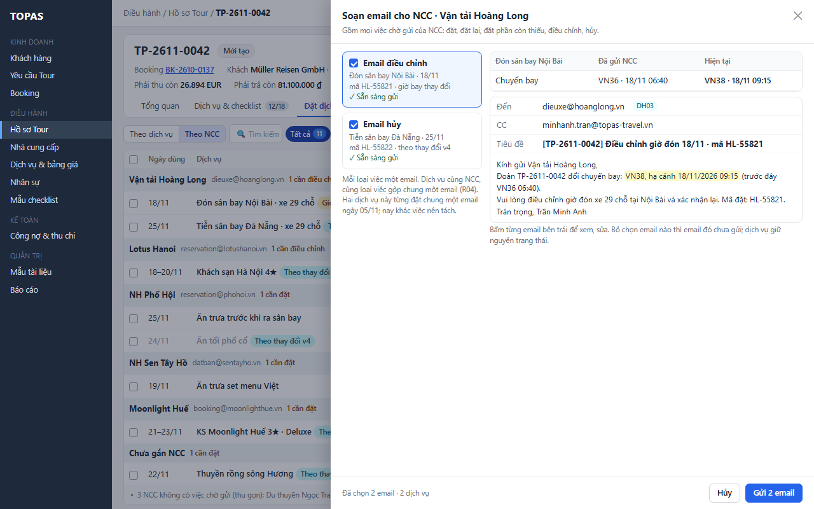

*Kết quả:* mỗi email gửi thành công có mã gửi riêng và cập nhật dịch vụ trong email như khi gửi từ dòng: email đặt thì Chờ kết quả (L3.3), email điều chỉnh thì Điều chỉnh đang chờ (L3.11), email hủy thì Yêu cầu hủy đang chờ (L3.8). Email bị bỏ chọn hoặc gửi lỗi giữ nguyên dịch vụ và nội dung đã soạn.

**L3.14 Xem email đã gửi cho NCC.** **W29a · Liên kết “email chung n dịch vụ” hoặc nút Xem email đã gửi trên dòng, hoặc liên kết Email với NCC (n) trên dòng nhóm → bảng trượt rộng.**
- Bên trái là mọi email đã gửi cho NCC trong hồ sơ (đặt, đặt lại, đặt phần thiếu, điều chỉnh, hủy), mới nhất ở trên, lọc được theo loại. Mỗi email ghi loại, thời điểm, các dịch vụ và tình trạng (chờ NCC trả lời hoặc đã có kết quả). Mở từ dòng dịch vụ thì chọn sẵn email của lần đặt đó.
- Bên phải là email đang chọn: mã gửi, thời điểm, người gửi, người nhận; danh sách dịch vụ trong email kèm kết quả lần đặt và trạng thái hiện tại (dịch vụ đang xem được tô nổi, bấm tên dịch vụ mở lịch sử W29); rồi nội dung email đã gửi.
- Email còn dịch vụ chờ kết quả có nút Ghi kết quả cho cả email (L3.15).

  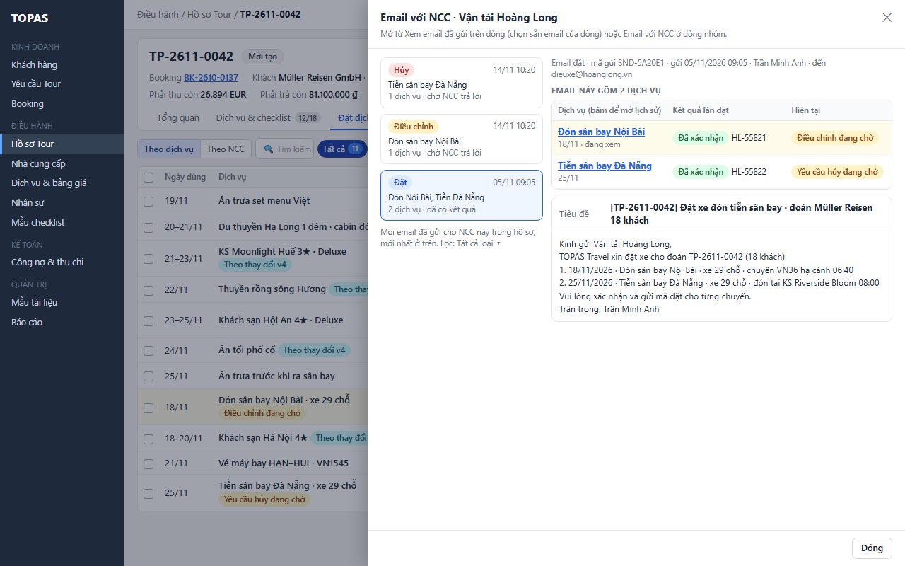

**L3.15 Ghi kết quả cho cả email.** **W26b · Nút Ghi kết quả trên dòng, khi lần đặt nằm trong email còn từ 2 dịch vụ chờ kết quả → bảng trượt rộng, mặc định chế độ Cả email.**
- Bảng có một dòng cho mỗi dịch vụ của email còn chờ kết quả. Kết quả, số lượng xác nhận và giá NCC điền sẵn theo từng lần đặt như W26.
- Mã xác nhận chung, loại tiền và tệp phản hồi của NCC nhập một lần cho mọi dòng; sửa được trên từng dòng khi NCC cấp mã riêng hoặc báo loại tiền khác.
- Dòng chọn Không đáp ứng phải nhập lý do; dòng xác nhận thiếu hiện phần còn thiếu ngay trên dòng như W27.
- Chuyển sang Chỉ dịch vụ này thì bảng trượt trở về W26 cho dịch vụ của dòng đã bấm.
- Email hủy gồm nhiều dịch vụ ghi kết quả theo cùng cách, với cột kết quả hủy và phí hủy gợi ý theo từng lần đặt (W31). Email điều chỉnh có cột NCC chấp nhận hoặc không đáp ứng điều chỉnh.

Bấm Lưu kết quả n dịch vụ: hệ thống lưu kết quả trên từng lần đặt trong một giao dịch.

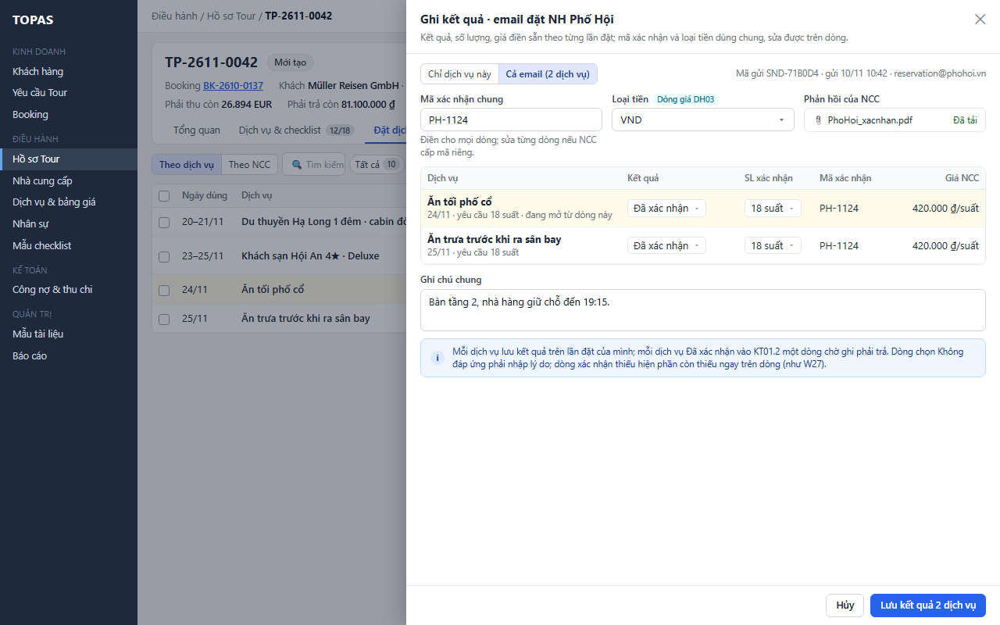

*Kết quả:* mỗi dịch vụ tính lại trạng thái theo R02. Mỗi dịch vụ Đã xác nhận vào KT01.2 một dòng chờ ghi phải trả (R10); công việc đặt dịch vụ liên quan tự Hoàn tất (R03).

**Ngoại lệ**

- **E3.1 · W33.** Thiếu email đặt dịch vụ của NCC, không khớp được mẫu email (không có mẫu Đang dùng cho mục đích và loại dịch vụ, cũng không có mẫu dự phòng Mọi loại dịch vụ của mục đích đó; R04) hoặc thiếu dữ liệu bắt buộc: banner đỏ trong bảng trượt, lỗi cạnh trường, nút Gửi khóa đến khi đủ dữ liệu. Người dùng nhập email cho lần gửi này; DH08 không ghi email vào DH03. Người có quyền sửa hồ sơ NCC thấy liên kết Mở hồ sơ NCC (DH03.1) để cập nhật email đặt dịch vụ tại DH03 (hồ sơ NCC là nơi nhập liệu duy nhất). Khi thiếu mẫu, có nút Soạn không theo mẫu. Thiếu giá tham chiếu chỉ là cảnh báo.

  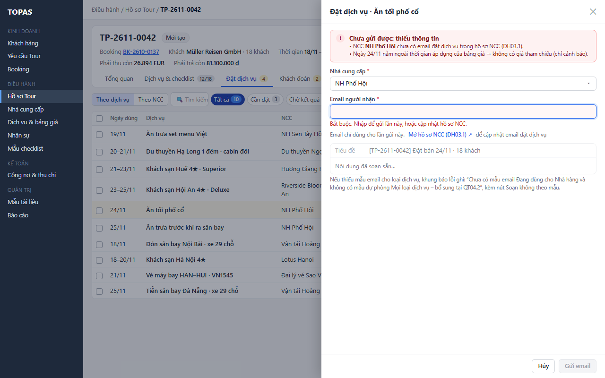

- **E3.2 · W23.** Gửi thất bại: không tạo lần đặt, giữ nội dung, hiện mã lỗi dễ hiểu và nút Gửi lại.
- **E3.3 · W34.** Chưa xác định email đã gửi hay chưa: banner vàng và khối Đang kiểm tra trong bảng trượt, nút Gửi email khóa. Hệ thống tra trạng thái theo mã gửi và tự kiểm tra lại theo R08; người dùng chờ hoặc đóng bảng trượt. Kết quả cuối cùng hiện tại dòng và bằng thông báo ngắn.

  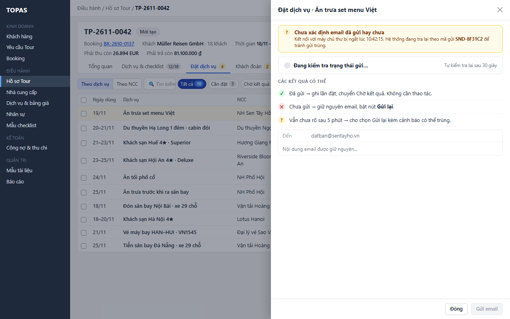

- **E3.4.** Đổi NCC sau khi đã sửa email: người nhận và các trường lấy từ NCC được cập nhật, phần nội dung người dùng tự thêm được giữ.
- **E3.5.** Số lượng xác nhận ≤ 0 hoặc lớn hơn số yêu cầu; giá hoặc phí hủy âm; thiếu loại tiền: báo lỗi cạnh trường.
- **E3.6.** Booking đã hủy: nút Đặt dịch vụ, Đặt lại và Soạn email đặt bị khóa, kèm chú thích “Booking đã hủy”. Các nút hủy và ghi kết quả vẫn hoạt động.
- **E3.7.** Sửa kết quả đã lưu: theo R10.
- **E3.8.** Gửi hàng loạt khi một dòng vừa đổi trạng thái ở phiên khác: dòng đó bị loại khỏi lần gửi và kết quả ghi “Đã thay đổi, không gửi”.
- **E3.9 · W36.** Đã có yêu cầu đang mở cho hạng mục: nút Báo Kinh doanh đổi thành Xem yêu cầu, không tạo yêu cầu thứ hai.
- **E3.10.** Kinh doanh phụ trách Booking đã ngừng hoạt động (tài khoản bị khóa, chưa được Quản trị chuyển; RSD KD08 R11): trường Gửi cho vẫn là người phụ trách Booking, tên kèm “(ngừng hoạt động)” và cảnh báo “Báo Quản trị hệ thống chuyển người phụ trách Booking”. Điều hành vẫn gửi được; người nhận của yêu cầu đang mở luôn đọc theo người phụ trách Booking hiện tại, nên khi Quản trị chuyển phụ trách Booking ở KD08, người mới nhận yêu cầu và thông báo (suy ra, chờ xác nhận). Booking luôn có người phụ trách nên không có trường hợp trống.
- **E3.11 · W37.** Quá hạn phản hồi: dòng có chỉ báo đỏ Quá hạn phản hồi. Mục Đặt dịch vụ trên Tổng quan ghi “n quá hạn phản hồi”. Hệ thống tự gửi nhắc Kinh doanh một lần khi quá hạn.
- **E3.12.** Gửi yêu cầu bị lỗi: giữ nội dung đã nhập, báo lỗi và cho Gửi lại.
- **E3.13.** Thay đổi chương trình được áp dụng nhưng không chạm tới hạng mục đang Chờ Kinh doanh: yêu cầu giữ nguyên Chờ Kinh doanh. Dòng hiện ghi chú “Phiên bản mới chưa xử lý hạng mục này”; Điều hành nhắc Kinh doanh hoặc rút yêu cầu.
- **E3.14.** NCC cũ báo lại còn chỗ trong lúc chờ Kinh doanh: Điều hành mở Xem yêu cầu, bấm Rút yêu cầu và ghi lý do. Yêu cầu chuyển Đã rút, hạng mục trở về Cần đặt lại; Kinh doanh nhận thông báo yêu cầu đã rút.
- **E3.15.** Booking bị hủy khi đang có yêu cầu mở: yêu cầu tự chuyển Đã rút với lý do “Booking đã hủy”.
- **E3.16 · W32.** Booking bị hủy khi hồ sơ Đang diễn ra (RSD KD08 E1.5): bảng trượt hủy hàng loạt chỉ gồm lần đặt của dịch vụ chưa dùng (ngày sử dụng đầu tiên sau hôm nay). Dịch vụ đã dùng hoặc đang dùng không có email hủy, không chuyển Cần hủy, giữ trạng thái để quyết toán. Không có nút Kết thúc hồ sơ; Điều hành kết thúc Tour như bình thường (L1.4, R14).
- **E3.17 · W22a.** Một email trong bảng trượt Soạn email cho NCC thiếu dữ liệu (không khớp được mẫu cho loại việc theo R04, thiếu dữ liệu bắt buộc): email đó có nhãn Cần bổ sung, bị bỏ chọn và không gửi được cho đến khi bổ sung; các email khác vẫn gửi. NCC chưa có email đặt dịch vụ thì mọi email của NCC đều Cần bổ sung và xử lý như E3.1.
- **E3.18.** Dịch vụ đổi trạng thái ở phiên khác khi đang mở W22a hoặc W26b: dịch vụ đó bị loại khỏi lần gửi hoặc lần lưu; kết quả ghi “Đã thay đổi, không gửi” hoặc “Đã có kết quả, không lưu”, như E3.8.
- **E3.19 · W26b.** Một dịch vụ trong email đã được ghi kết quả riêng trước đó: bảng trượt chỉ liệt kê dịch vụ còn chờ kết quả, kèm ghi chú “n dịch vụ trong email đã có kết quả”. Email chỉ còn một dịch vụ chờ kết quả thì Ghi kết quả mở thẳng W26.
- **E3.20.** Bấm nút trên dòng (Đặt dịch vụ, Gửi điều chỉnh, Gửi yêu cầu hủy) khi NCC còn việc khác chờ gửi: email chỉ gồm dịch vụ của dòng đó. Bảng trượt có ghi chú “NCC này còn n việc chờ gửi” và liên kết Soạn email cho NCC (W22a) để gửi gộp.
- **E3.21.** Hồ sơ chuyển Đã kết thúc (Kết thúc Tour hoặc Kết thúc hồ sơ) khi còn yêu cầu đổi lịch trình Chờ Kinh doanh: yêu cầu tự chuyển Đã rút với lý do “Hồ sơ đã kết thúc”, như E3.15; hạng mục tính lại theo R02; Kinh doanh nhận thông báo yêu cầu đã rút (suy ra, chờ xác nhận).

### 3.4. DH08.4 · Khách đoàn và phân phòng (TN07.01, TN07.02, TN07.04 · SYS07.01–SYS07.04)

Tab có 4 phần con: Danh sách khách, Yêu cầu riêng, Phân phòng, Pax list và Rooming list.

**L4.1 Kinh doanh nhập khách.**

1. **W40 · Tab con Danh sách khách; chip lọc có số đếm.** Chip gồm Cần kiểm tra giấy tờ, Chưa có chuyến bay, Có yêu cầu riêng; bấm là lọc ngay. Dòng có cảnh báo được tô nền vàng; lý do cảnh báo hiện ngay ở cột Hết hạn hoặc Visa. Số hộ chiếu đã che. Danh sách giữ từng khách của đoàn; số khách của hồ sơ theo phiên bản chương trình đang áp dụng, chỉ đổi khi Điều hành áp dụng thay đổi chương trình (1.3, R19). Số người trong danh sách lệch số khách của hồ sơ thì hiện cảnh báo (E4.7).

   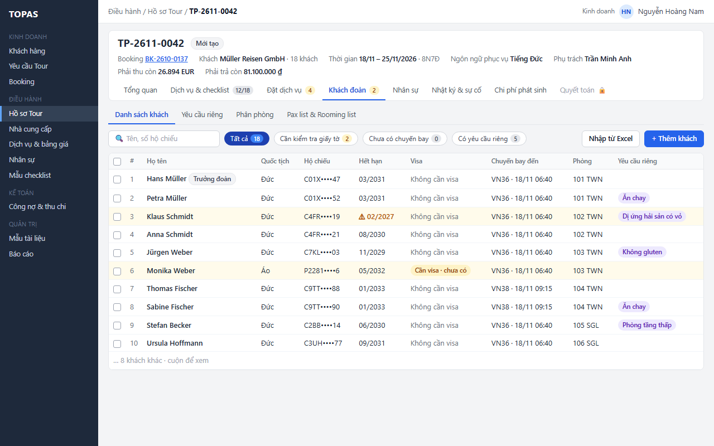

2. **W41 · Nút + Thêm khách hoặc tên khách → bảng trượt.** Bảng trượt có 4 nhóm: Cá nhân, Giấy tờ nhập cảnh (hộ chiếu, hạn, visa), Chuyến bay (điền sẵn chuyến bay chung của đoàn), Yêu cầu riêng (ô Ăn uống và ô Phòng nhập tự do, không chọn từ danh mục; ghi chú cho Điều hành; R06). Bấm Lưu khách. Hệ thống kiểm tra trường bắt buộc và trùng, cảnh báo giấy tờ theo R11, và chạy R07 cho các dịch vụ đã gửi NCC.

   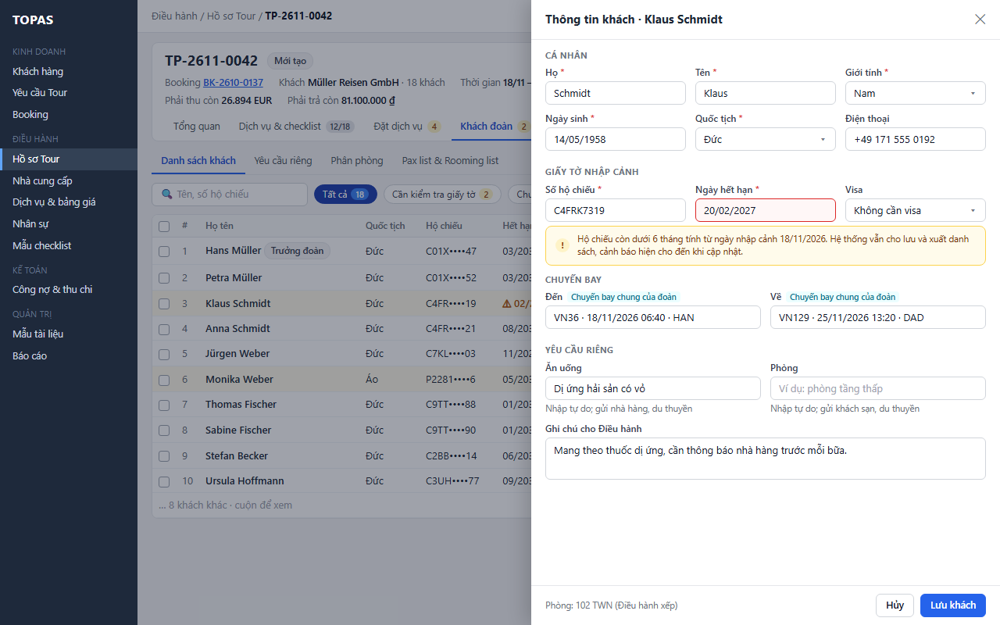

**L4.2 Nhập từ Excel.** **W42 · Nút Nhập từ Excel → hộp thoại.** Chọn tệp theo file mẫu. Hệ thống ghép khách theo số hộ chiếu, rồi hiện xem trước gồm số dòng cập nhật, số khách mới và các dòng lỗi kèm lý do. Bấm Nhập n dòng hợp lệ. Dòng lỗi không được nhập; người dùng tải tệp dòng lỗi về để sửa.

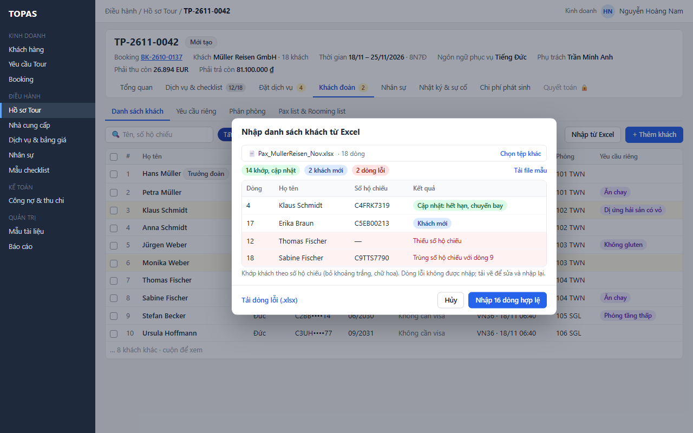

**L4.3 Gán chuyến bay hoặc yêu cầu riêng cho nhiều khách.** **W43 · Ô chọn khách → thanh thao tác → khung nhập tại chỗ.** Chọn khách. Thanh hàng loạt hiện ngay các ô chiều bay, số hiệu, ngày giờ và sân bay; nhập rồi bấm Áp dụng. Yêu cầu riêng cho nhiều khách thêm trong form từng khách (W41). Hệ thống cập nhật mọi khách đã chọn, tô sáng ô chuyến bay vừa đổi và chạy R07: dịch vụ đón hoặc tiễn đã gửi NCC có chỉ báo Giờ bay thay đổi.

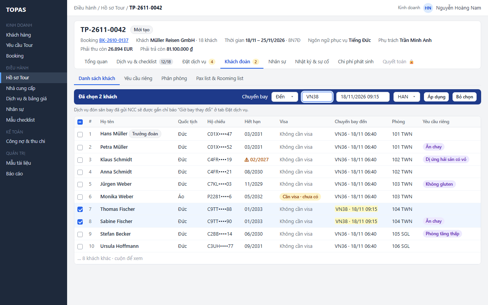

**L4.4 Xem tổng hợp yêu cầu riêng.** **W44 · Tab con Yêu cầu riêng (chỉ đọc).** Hệ thống gom yêu cầu theo nhóm Ăn uống và Phòng, mỗi nội dung một dòng (khách có cùng nội dung gộp chung, R06), ghi số lượng và tên khách. Phần xem trước hiển thị đúng câu sẽ được chèn vào email đặt dịch vụ (R06). Danh sách “Đã gửi NCC trước khi yêu cầu thay đổi” hiện dịch vụ Cần điều chỉnh kèm nút Gửi điều chỉnh (mở W35).

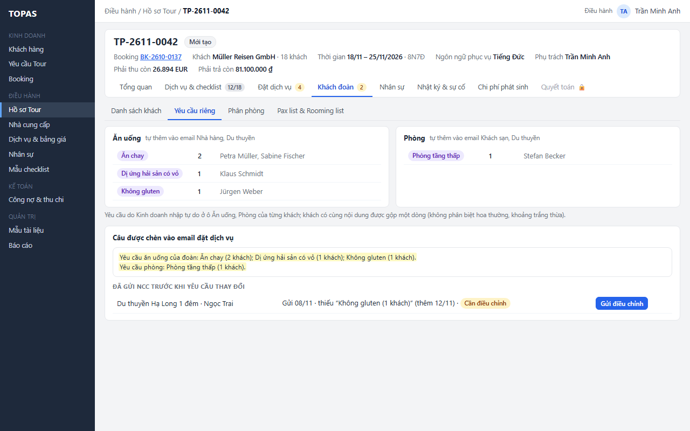

**L4.5 Điều hành xếp phòng.**

1. **W45 · Tab con Phân phòng; chip đợt lưu trú; form tại tab.** Chọn đợt lưu trú (mỗi khách sạn hoặc du thuyền một đợt). Bấm Tự xếp theo gợi ý để hệ thống xếp theo cặp khách đăng ký chung phòng và yêu cầu phòng. Điều hành kéo thả để chỉnh, kéo khách từ nhóm Chưa xếp vào phòng. Ô phòng hiện hạng phòng và số khách; hệ thống không kiểm tra sức chứa phòng (người dùng chốt 12/11/2026, rà soát lần ba). Nhóm Chưa xếp cập nhật ngay; đợt còn thiếu có dấu !.

   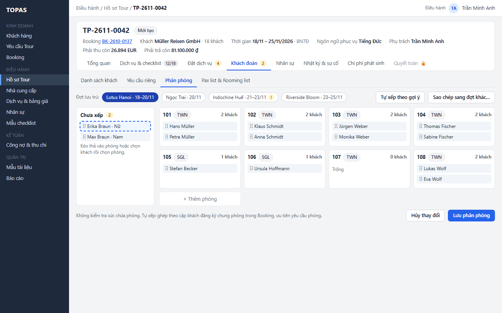

2. **W45a · Nút Sao chép sang đợt khác… → hộp thoại.** Chọn các đợt lưu trú đích. Hộp thoại xem trước số phòng, số khách và đợt bị ghi đè; hệ thống ghép theo hạng phòng, tự đánh số phòng và báo khách chưa xếp. Bấm Sao chép sang n đợt. Kết quả chưa lưu cho tới khi bấm Lưu phân phòng.

   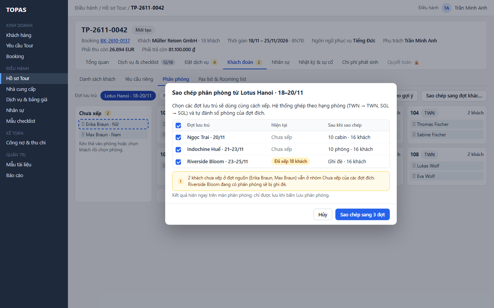

3. **W45b · Nút Lưu phân phòng.** Phân phòng mọi đợt được lưu trong một lần; nút Lưu và Hủy thay đổi khóa lại cho tới khi có sửa mới. Nếu còn khách chưa xếp, thông báo ngắn nêu số khách và liên kết Xem khách chưa xếp.

   

**L4.6 Pax list và Rooming list.**

1. **W47 · Tab con Pax list và Rooming list; chip loại tài liệu.** Chọn Pax list hoặc Rooming list của từng khách sạn. DH08 không cho chọn mẫu: mỗi loại tài liệu dùng mẫu Đang dùng duy nhất ở QT04 (RSD QT04 R07; BOI-CANH-DU-AN “Tự khớp mẫu”); dòng chỉ đọc trên thanh công cụ ghi mã mẫu và phiên bản đang dùng (ví dụ PL-01 v3). Bảng xem trước đọc dữ liệu đã lưu, đúng mẫu đó; lịch sử gửi hiện bên dưới. Bấm Tải Excel hoặc Tải PDF.

   

2. **W48 · Nút Gửi cho NCC… → bảng trượt rộng.** Danh sách liệt kê NCC trong Tour; hệ thống chọn sẵn tập cột theo loại NCC và địa chỉ nhận. Bấm tên NCC để xem trước, rồi bấm Gửi n email. Cảnh báo giấy tờ hiện nhưng không chặn.

   

*Kết quả:* mỗi NCC nhận một email riêng kèm tệp đúng tập cột; kết quả gửi theo từng NCC. Lịch sử gửi hiển thị dưới bảng xem trước.

**Ngoại lệ**

- **E4.1 · W40, W41.** Hộ chiếu hết hạn trước ngày bắt đầu Tour cộng 6 tháng, hoặc visa “Cần visa · chưa có”: cảnh báo trên dòng, trong form, ở Tổng quan và khi gửi Pax list. Không chặn lưu hoặc gửi (R11).
- **E4.2.** Thiếu trường bắt buộc (họ, tên, giới tính, ngày sinh, quốc tịch, số hộ chiếu, ngày hết hạn) hoặc ngày sinh sau ngày hiện tại: báo lỗi cạnh trường, không lưu.
- **E4.3 · W42.** Trùng số hộ chiếu trong cùng Tour: khi nhập tay, mở bản ghi hiện có; khi nhập Excel, dòng bị đánh lỗi.
- **E4.4 · W46.** Khách bị xếp hai phòng trong cùng đợt (ví dụ sau khi Sao chép sang đợt khác hoặc khi phiên khác vừa lưu): banner đỏ, các phòng lỗi viền đỏ, chỉ rõ phòng và khách; chặn lưu và giữ thay đổi. Người dùng bỏ khách khỏi một phòng rồi lưu lại. Hệ thống không kiểm tra sức chứa phòng.

  

- **E4.5 · W49.** Rooming list của đợt còn khách chưa xếp: không tạo tài liệu, khóa Tải và Gửi, liệt kê khách chưa xếp và có nút Mở phân phòng đợt đó. Pax list không phụ thuộc phân phòng.

  

- **E4.6.** Gửi Pax list lỗi cho một số NCC: xử lý như E3.2 và E3.3, có kết quả theo từng NCC.
- **E4.7.** Số người trong danh sách khách khác số khách của hồ sơ (số khách của phiên bản chương trình đang áp dụng; Booking lên phiên bản mới qua Chuyển sang Điều hành thì số so sánh đổi khi Điều hành áp dụng, R19): cảnh báo trên tab (“Danh sách có n khách · Hồ sơ m khách”) và ở mục Giấy tờ khách của Tổng quan (“thiếu n khách” hoặc “thừa n khách”, R01). Không chặn lưu. DH08.4 không đổi số khách của Booking hay hồ sơ; muốn đổi thì Kinh doanh điều chỉnh chương trình (1.3) và Điều hành áp dụng. Khi áp dụng, dịch vụ đã gửi NCC theo số khách cũ chuyển Cần điều chỉnh theo R07 và R19.

### 3.5. DH08.5 · Nhân sự phục vụ Tour (TN07.03 · SYS07.03)

**L5.1 Xem lịch phân công.** **W50 · Chế độ Theo lịch hoặc Danh sách.** Lịch theo ngày Tour, mỗi nhân sự một dòng, ghi vai trò và ngôn ngữ; thanh phân công có màu theo vai trò. Ngôn ngữ phục vụ của đoàn xem ở header. Phân công lệch ngôn ngữ có dấu ⚠ và dòng lý do đã ghi. Bấm thanh phân công để sửa.

**L5.2 Phân công.**

1. **W51 · Nút + Phân công → bảng trượt.** Chọn vai trò và phạm vi (Toàn Tour hoặc Theo ngày, có thể thêm giờ).
2. **W51 · Trường Nhân sự.** Danh sách lấy từ DH06 theo RSD DH06 R03: nhân sự Đang nhận phân công, thuộc nhóm công việc nhận vai trò phục vụ đã chọn, Nội bộ hoặc Cộng tác viên. Danh sách sắp theo thứ tự: khớp ngôn ngữ và còn trống lịch, khớp ngôn ngữ nhưng bận, rồi đến các trường hợp còn lại. Nhân sự bận hiện mã Tour đang trùng.
3. **W51 → W50 · Nút Lưu phân công.** Chọn nhân sự, nhập lý do nếu lệch ngôn ngữ, rồi lưu. Lịch nhân sự hiện thanh phân công mới.

   

**Ngoại lệ (quyết định Q3)**

- **E5.1 · W51.** Vai trò HDV mà nhân sự không có ngôn ngữ phục vụ của đoàn: cảnh báo và bắt buộc nhập lý do mới cho lưu.
- **E5.2 · W52.** Trùng lịch với phân công khác (cùng hoặc khác Tour): banner đỏ trong bảng trượt, chặn lưu (R12), hiện Tour, vai trò và khoảng trùng. Nút Đổi sang Theo ngày… tự điền các ngày còn trống của nhân sự. Muốn chọn người khác thì chọn lại ngay ở trường Nhân sự.

  

### 3.6. DH08.6 · Nhật ký và sự cố (TN08.02, TN08.03 · SYS08.04, SYS08.05)

**L6.1 Ghi nhật ký.** **W55 · Ô nhập ở đầu tab.** Thời điểm điền sẵn là hiện tại. Gõ nội dung rồi bấm Enter hoặc Lưu nhật ký. Bản ghi hiện ngay ở đầu dòng thời gian và ô nhập được xóa. Chip lọc Tất cả, Nhật ký, Sự cố đang mở và ô chọn ngày lọc ngay.

**L6.2 Ghi sự cố.** **W56 · Nút + Sự cố → bảng trượt.** Ngày Tour tự suy ra từ thời điểm. Nhập nội dung và cách xử lý; kết quả có thể để trống. Nếu có chi phí, chọn Có chi phí phát sinh và nhập số tiền, loại tiền, chứng từ. Bấm Lưu sự cố: hệ thống tạo sự cố và dòng chi phí liên kết ở DH08.7 trong một giao dịch.

**L6.3 Cập nhật kết quả.** **W57 · Nút Cập nhật kết quả trên sự cố Đang xử lý → bảng trượt.** Nhập kết quả rồi bấm Lưu kết quả. Sự cố chuyển Đã xử lý; số trên tab giảm.

**Ngoại lệ**

- **E6.1.** Thiếu nội dung hoặc lưu lỗi: hiện lỗi, giữ chữ đã gõ.

### 3.7. DH08.7 · Chi phí phát sinh (TN08.04, lối vào TN08.05 · SYS08.06, SYS08.09)

**L7.1 Điều hành thêm khoản.**

1. **W60 · Bảng chi phí phát sinh.** Chip Chưa ghi công nợ; dòng tổng theo loại tiền. Khoản chưa ghi công nợ có nút Sửa; khoản đã ghi hiện “Sửa tại KT01” thay cho nút Sửa.

   

2. **W61 · Nút + Chi phí phát sinh → bảng trượt.** Nhập ngày, nội dung, số tiền, loại tiền, NCC (nếu có), gợi ý thu lại từ khách và tải chứng từ (R13), rồi bấm Lưu chi phí. Khoản mới hiện Chưa ghi công nợ.

   

**L7.2 Kế toán ghi công nợ.** **W63 · Ô chọn đầu dòng (một hoặc nhiều khoản) → thanh hàng loạt.** Kế toán chọn các khoản Chưa ghi công nợ rồi bấm Ghi công nợ (n) tại KT01.3. KT01.3 mở với Tour Code và các khoản điền sẵn. Khi khoản công nợ liên kết được lưu ở KT01, DH08.7 hiện Đã ghi công nợ. Nếu thoát KT01.3 mà chưa lưu, chỉ báo giữ nguyên.

**Ngoại lệ**

- **E7.1 · W62.** Tệp sai định dạng, vượt 10 MB hoặc tải lỗi: báo lỗi theo từng tệp trong danh sách tệp của bảng trượt, có nút Tải lại hoặc Bỏ. Nút Lưu khóa cho đến khi xử lý xong tệp lỗi; các trường khác được giữ (R13).

  

- **E7.2.** Khoản đã ghi công nợ: DH08 không cho sửa số tiền, loại tiền hoặc xóa, chỉ cho bổ sung chứng từ và ghi chú. Thay đổi giá trị thực hiện ở KT01.
- **E7.3.** Khoản vừa được ghi ở phiên khác: tải lại liên kết, mở khoản đã ghi và không tạo trùng.

### 3.8. DH08.8 · Quyết toán và đóng Tour (TN09.01–TN09.04 · SYS09.01–SYS09.07)

Tab có 2 phần: (1) Chi phí thực tế · Điều hành, (2) Đối chiếu và P&L · Kế toán. Đóng Tour không phải bước của tab; đó là nút ở header khi hồ sơ Đã kết thúc. Luồng đóng Tour (L8.3) độc lập với luồng quyết toán (L8.2): đóng trước hay quyết toán trước đều được (R16). Header luôn có chỉ báo Đã quyết toán hoặc Chưa quyết toán.

**L8.1 Điều hành nhập chi phí thực tế.** *Điều kiện:* hồ sơ Đã kết thúc. Hồ sơ Đã đóng thì phần này chỉ đọc.

1. **W71 · Bước 1; form tại tab.** Mỗi dịch vụ đã xác nhận có một dòng. Ô Chi phí thực tế điền sẵn giá NCC xác nhận, gắn nhãn Gợi ý; chênh lệch tự tính. Mỗi lần đặt Đã hủy có phí hủy lớn hơn 0 (ghi ở DH08.3, L3.8; RSD KT01 R09) có thêm một dòng **Phí hủy NCC** ghi dịch vụ, NCC và phí đã ghi; lần đặt đã liên kết khoản phải trả ở KT01 thì dòng lấy theo số KT01 (R15). Dòng phí hủy chỉ đọc trong bước 1; sửa phí theo R10 ở DH08.3 hoặc KT01 (suy ra, chờ xác nhận). Lần đặt Đã hủy không phí không có dòng. Điều hành sửa ô có số khác, nhập lý do khi chênh lệch khác 0 và đính kèm chứng từ. Bấm Lưu (lưu nhiều lần được), hoặc Lưu và chuyển Kế toán. Header có chỉ báo Chưa quyết toán và nút Đóng Tour.

   

2. **W71a · Banner xanh; bước 1 có dấu ✓.** Bước 1 được đánh dấu Đã chuyển Kế toán, hiện tóm tắt chi phí, chênh lệch và chứng từ; Kế toán nhận thông báo nội bộ. Điều hành vẫn bấm Sửa chi phí được cho tới khi đóng Tour, không phụ thuộc Kế toán đã lưu quyết toán hay chưa. Sửa sau khi đã có phiên bản Hiện hành thì Kế toán nhận thông báo nội bộ và lưu phiên bản mới nếu cần (suy ra, chờ xác nhận).

   

**L8.2 Kế toán đối chiếu và lưu quyết toán.** *Điều kiện:* hồ sơ Đã kết thúc hoặc Đã đóng. Hồ sơ Đã đóng vẫn lưu được, không cần Mở lại Tour (R16).

1. **W72 · Bước 2; form tại tab.** Hệ thống điền sẵn doanh thu từ các khoản phải thu của Booking ở KT01 (lịch thanh toán, Phí hủy sau điều chỉnh khi Booking đã hủy, phát sinh; R15), chi phí từ bước 1 (gồm dòng phí hủy NCC) và DH08.7, kèm bảng đối chiếu AP theo NCC giữa số KT01 và chi phí thực tế (hiện chênh lệch). Ngoại tệ quy đổi theo R15; khối Tỷ giá quy đổi liệt kê từng phần (đã thu, đã trả theo ngày giao dịch; phần còn lại theo ngày lưu) với tỷ giá có hiệu lực điền sẵn từ bảng tỷ giá QT05 (ngày gần nhất ≤ ngày cần; RSD QT05 R13) và cột Ngày tỷ giá ghi ngày đã lấy tỷ giá, Kế toán sửa được. Kế toán nhập kết quả đối chiếu AR và AP, thêm điều chỉnh có lý do, nhập tỷ giá cho dòng chưa có tỷ giá (E8.3), rồi bấm Lưu quyết toán.

   

2. **W73 · Banner xanh; chỉ báo Đã quyết toán ở header.** Hệ thống tính P&L theo R15, lưu phiên bản Hiện hành mới (R16) và đổi chỉ báo Chưa quyết toán thành Đã quyết toán, kèm tóm tắt P&L, công nợ hiện tại và bảng các phiên bản ngay trên tab. Trạng thái hồ sơ không đổi. Kế toán lưu lại nhiều lần được, kể cả khi hồ sơ Đã đóng.

   

**L8.3 Đóng Tour (độc lập với L8.2).** *Điều kiện:* hồ sơ Đã kết thúc. Không cần quyết toán, không cần bước 1 đã chuyển Kế toán, không xét công nợ (R16).

1. **W74 · Nút Đóng Tour ở header → hộp thoại.** Hộp thoại nhắc, không chặn: chưa có quyết toán (Kế toán quyết toán sau, kể cả khi đã đóng); bước 1 chưa Lưu và chuyển Kế toán (hệ thống sẽ chuyển số đang có); công nợ còn lại tiếp tục ghi ở KT01; lần đặt còn chờ kết quả (E8.6). Mục nào không xảy ra thì không hiện. Điều hành bấm Đóng Tour. Hệ thống khóa hồ sơ (trừ phần Kế toán của tab Quyết toán), chuyển chi phí thực tế sang Kế toán nếu bước 1 chưa chuyển, ghi ngày đóng và cập nhật lịch sử Tour của khách ở KD04.2 (hồ sơ kết thúc vì Booking đã hủy thì không ghi, R16); header hiện Đã đóng.

   

2. **W75 · Banner khóa; mọi tab chỉ đọc, trừ phần Kế toán của tab Quyết toán.** Bước 1 hiện chỉ đọc, gắn nhãn Chuyển khi đóng Tour nếu hệ thống đã chuyển khi đóng. Phần Đối chiếu và P&L vẫn mở cho Kế toán (L8.2). Header giữ chỉ báo Chưa quyết toán đến khi Kế toán lưu. Nút Xem công nợ Tour mở KT01.3 lọc theo Tour Code. Nút Mở lại Tour chỉ hiện với Điều hành phụ trách hồ sơ, hoặc với Quản trị hệ thống khi hồ sơ không có người phụ trách hoặc người phụ trách ngừng hoạt động (L8.4). Khách được đưa vào KD04.2, trừ hồ sơ kết thúc vì Booking đã hủy.

   

**L8.4 Mở lại Tour (quyết định Q2B; sửa 12/11/2026, rà soát lần hai).** Dùng khi cần sửa dữ liệu điều hành sau khi đóng (chi phí phát sinh, nhật ký, chi phí thực tế…). Quyết toán lại không cần mở lại (E8.8). *Người mở lại:* Điều hành phụ trách hồ sơ; khi hồ sơ không có người phụ trách hoặc người phụ trách ngừng hoạt động (tài khoản bị khóa hoặc không còn vai trò Điều hành; RSD QT01), Quản trị hệ thống mở lại (người dùng chốt 12/11/2026, rà soát lần hai; R16).

1. **W76 · Nút Mở lại Tour → hộp thoại.** Điều hành phụ trách hồ sơ nhập lý do rồi bấm Mở lại Tour. Hồ sơ trở về Đã kết thúc với chỉ báo Đã mở lại; các phiên bản quyết toán giữ nguyên; Survey chưa gửi của Tour bị bỏ (RSD KD10 E4.4). Ngày đóng lần đầu giữ nguyên. Đóng lại theo L8.3, không cần quyết toán mới (R16).

   

2. **W78 · Quản trị hệ thống mở hồ sơ Đã đóng có người phụ trách ngừng hoạt động hoặc chưa có người phụ trách → nút Mở lại Tour ở header → hộp thoại.** Header ghi tên người phụ trách kèm “(ngừng hoạt động)” hoặc “Chưa giao”. Hộp thoại có hai trường bắt buộc: Lý do mở lại và Điều hành phụ trách mới. Danh sách chọn theo RSD DH06 R03 như L1.2: nhân sự nhóm Điều hành, Đang nhận phân công, Nội bộ, có tài khoản liên kết đang hoạt động và có vai trò Điều hành. Quản trị bấm Mở lại Tour. Hệ thống làm như bước 1, đồng thời ghi người phụ trách mới cho hồ sơ, gửi thông báo cho người đó và ghi lịch sử (người mở lại, lý do, người phụ trách cũ và mới). Từ đây người phụ trách mới sửa dữ liệu và đóng lại theo L8.3; Quản trị chỉ xem như trước. Công việc checklist xử lý như L1.2: hồ sơ chưa từng có người phụ trách thì việc có Giao người phụ trách mà chưa có người thực hiện được điền người mới; thay người ngừng hoạt động thì không đổi người thực hiện của công việc (suy ra, chờ xác nhận).

   

**Ngoại lệ**

- **E8.1 · W70.** Mở tab khi hồ sơ chưa Đã kết thúc: vùng nội dung hiện lý do, trạng thái hiện tại, điều kiện mở tab và nút Về Tổng quan.

  

- **E8.2 · W74.** Đóng Tour khi chưa có quyết toán, hoặc khi bước 1 chưa Lưu và chuyển Kế toán: không chặn. Hộp thoại nêu từng mục. Khi đóng, bước 1 chưa chuyển thì hệ thống chuyển số chi phí thực tế đang có (số đã lưu; ô chưa có số lưu lấy giá gợi ý) sang Kế toán, đánh dấu Chuyển khi đóng Tour và gửi thông báo nội bộ cho Kế toán (R16; suy ra, chờ xác nhận).
- **E8.3 · W72.** Tỷ giá theo “Tỷ giá có hiệu lực” (RSD QT05 R13; BOI-CANH-DU-AN). Bảng tỷ giá QT05 (Kế toán nhập) không có tỷ giá cho một loại tiền đúng ngày cần quy đổi (ngày giao dịch hoặc ngày lưu) nhưng có ngày trước đó: hệ thống dùng tỷ giá của ngày gần nhất ≤ ngày cần, cột Ngày tỷ giá ghi ngày đã lấy (ví dụ “20/11/2026”); không báo lỗi, không khóa. Chỉ khi loại tiền đó không có ngày nào ≤ ngày cần (chưa có tỷ giá): dòng báo lỗi “Chưa có tỷ giá … đến ngày …”, Lưu quyết toán khóa đến khi Kế toán nhập tỷ giá cho dòng đó. Tỷ giá nhập tay hoặc sửa tay chỉ lưu trong phiên bản quyết toán, không ghi vào bảng tỷ giá QT05. Đây là việc nội bộ của Kế toán, không ảnh hưởng Đóng Tour.
- **E8.4.** Dữ liệu nguồn thay đổi trong lúc Kế toán đang soạn (Điều hành sửa chi phí, KT01 có giao dịch mới): khi bấm Lưu, hiện danh sách số đã thay đổi và nút Tải lại số liệu; không ghi đè ngầm.
- **E8.5.** Đóng lỗi hoặc hồ sơ vừa đổi ở phiên khác: giữ trạng thái cũ, báo lý do và tải lại.
- **E8.6.** Còn lần đặt Chờ kết quả hoặc Yêu cầu hủy đang chờ: hộp thoại đóng Tour hiện cảnh báo, không chặn.
- **E8.7.** Công nợ còn dư: không chặn đóng (theo nguồn SYS09; Kế toán không làm chốt chặn, BOI-CANH-DU-AN). Hộp thoại nêu số còn phải thu, còn phải trả theo loại tiền gốc để tham khảo.
- **E8.8.** Quyết toán đã lưu mà KT01 có giao dịch hoặc điều chỉnh mới của Tour (RSD KT01 R13, E2.9): tab Quyết toán hiện chỉ báo “KT01 có giao dịch mới” cạnh phiên bản Hiện hành, kèm số giao dịch, điều chỉnh mới và thời điểm mới nhất; số đã lưu của phiên bản không đổi. Kế toán lưu phiên bản quyết toán mới thì hệ thống đọc lại số KT01 và chỉ báo mất. Hồ sơ Đã đóng cũng vậy: Kế toán lưu phiên bản mới ngay, không cần Mở lại Tour (R16).
- **E8.9.** Booking đã hủy mà KT01 chưa ghi điều chỉnh sau hủy (Chờ điều chỉnh, RSD KT01 R07): ô doanh thu ghi “KT01 chưa điều chỉnh sau hủy Booking”, không lấy lịch thanh toán cũ; Lưu quyết toán khóa đến khi Kế toán ghi điều chỉnh ở KT01.1 (R15; suy ra, chờ xác nhận). Không ảnh hưởng Kết thúc hồ sơ và Đóng Tour.
- **E8.10 · W78.** Trong lúc hộp thoại Mở lại Tour đang mở, hồ sơ vừa được mở lại ở phiên khác, người phụ trách cũ vừa hoạt động trở lại (QT01), hoặc người phụ trách mới được chọn không còn đủ điều kiện RSD DH06 R03: khi bấm Mở lại Tour, máy chủ kiểm tra lại quyền mở lại theo R16 và người được chọn; sai thì từ chối, báo lý do và tải lại header (như E1.3, E1.5).

---

## 4. Quy tắc triển khai chi tiết

### R01. Khối Việc cần làm trước khởi hành

| Mục | Đạt khi | Mô tả khi chưa đạt | Nút |
|---|---|---|---|
| Đặt dịch vụ | Mọi hạng mục không ở trạng thái Đã hủy đều Đã xác nhận | “n cần đặt, m cần đặt lại” (thêm “k chờ kết quả”, “j chờ Kinh doanh” nếu có) | Đặt dịch vụ (mở DH08.3, lọc Cần đặt) |
| Checklist | Mọi công việc đang áp dụng đều Hoàn tất | “còn n việc chưa xong, k quá hạn” | Xem việc (mở DH08.2, lọc Chưa xong) |
| Giấy tờ khách | Số người trong danh sách bằng số khách của hồ sơ (phiên bản chương trình đang áp dụng, như R07), đủ trường bắt buộc và 0 cảnh báo giấy tờ | “n khách cần kiểm tra”, “thiếu n khách” hoặc “thừa n khách” (E4.7) | Xem khách (mở DH08.4, lọc Cần kiểm tra giấy tờ) |
| Phân phòng | Mọi khách được xếp phòng ở mọi đợt lưu trú | “n khách chưa xếp phòng” | Xếp phòng (mở đợt đầu tiên còn thiếu) |
| HDV | Có phân công HDV chính phủ toàn Tour và khớp ngôn ngữ | “Chưa có HDV tiếng …” | Phân công (mở W51) |

- Mục chưa đạt xếp theo thứ tự trong bảng. Mục đã đạt không có dòng riêng; tên mục được ghép vào dòng “✓ Đã xong”.
- Khi mọi mục đều đạt, khối chỉ hiện “✓ Sẵn sàng khởi hành” và nút Bắt đầu Tour.
- Khối này chỉ để thông tin. Hộp thoại Bắt đầu Tour liệt kê các mục chưa đạt nhưng không chặn.

### R02. Trạng thái hạng mục dịch vụ

Hệ thống tính trạng thái theo thứ tự ưu tiên sau, sau mỗi lần ghi lần đặt:

1. Hạng mục bị bỏ, bị hủy theo Booking khi chưa từng gửi NCC, hoặc mọi lần đặt từng xác nhận đều đã Đã hủy: **Đã hủy**.
2. Có lần đặt còn hiệu lực (Đã gửi hoặc Đã xác nhận) phải hủy theo thay đổi chương trình mà chưa gửi yêu cầu hủy: **Cần hủy**.
3. Có lần đặt còn hiệu lực mà dữ liệu đã đổi sau khi gửi (thay đổi chương trình hoặc R07) và chưa gửi điều chỉnh: **Cần điều chỉnh**.
4. Tổng số xác nhận còn hiệu lực (lần đặt Đã xác nhận, chưa Đã hủy) bằng số lượng yêu cầu: **Đã xác nhận**.
5. Tổng số xác nhận lớn hơn 0 nhưng nhỏ hơn số yêu cầu: **Xác nhận một phần** (nếu đang có lần đặt Đã gửi thì thêm chỉ báo “đang chờ n”).
6. Có lần đặt Đã gửi chưa có kết quả: **Chờ kết quả**.
7. Có yêu cầu đổi lịch trình ở trạng thái Chờ Kinh doanh: **Chờ Kinh doanh**.
8. Lần đặt gần nhất có kết quả Không đáp ứng: **Cần đặt lại**.
9. Chưa có lần đặt: **Cần đặt**.

Sau khi gửi yêu cầu hủy hoặc email điều chỉnh, hạng mục rời Cần hủy / Cần điều chỉnh và trở về nhãn tính từ lần đặt (thường là Đã xác nhận), kèm chỉ báo Yêu cầu hủy đang chờ hoặc Điều chỉnh đang chờ. Chỉ báo này không thay đổi nhãn chính. Hạng mục Xác nhận một phần có yêu cầu đổi lịch trình đang mở giữ nhãn Xác nhận một phần và thêm chỉ báo Chờ Kinh doanh. Đặt phần còn thiếu chỉ cho đặt tối đa bằng số yêu cầu trừ tổng số đã xác nhận và tổng số đang chờ.

### R03. Checklist tự hoàn tất theo sự kiện

- Mỗi công việc mẫu ở DH01 có thuộc tính “Tự hoàn tất khi” (RSD DH01 R04) với các giá trị: không có; hạng mục liên kết Đã xác nhận (chỉ việc theo dịch vụ); đã gửi Rooming list cho mọi khách sạn; đã gửi Pax list; có HDV chính khớp ngôn ngữ.
- Khi sự kiện xảy ra, công việc tự chuyển Hoàn tất và lịch sử ghi “Hệ thống”. Khi sự kiện bị đảo ngược (hạng mục chuyển Cần đặt lại hoặc phân công HDV bị bỏ), công việc trở về Đang làm.
- Người dùng vẫn được đổi tiến độ bằng tay. Đổi tay ghi đè trạng thái tự động cho đến lần sự kiện tiếp theo.
- Công việc gắn với dịch vụ bị bỏ được loại khỏi mẫu số và vẫn giữ trong lịch sử.

### R04. Gộp email và chỉ báo chờ phản hồi

- **Khóa gộp (quyết định 12/11/2026; sửa ở rà soát lần hai).** Khi soạn hàng loạt (W21, W22), soạn theo NCC (W22a, nút trên banner W39) hoặc hủy theo Booking (W32), hệ thống gộp email theo bộ (NCC, loại việc): luôn một email cho mỗi NCC và loại việc. Có 3 loại việc:
  - **Đặt:** đặt, đặt lại, đặt phần còn thiếu.
  - **Điều chỉnh:** gửi điều chỉnh theo R07 hoặc R19.
  - **Hủy:** yêu cầu hủy lần đặt.
- Dịch vụ cùng NCC nhưng khác loại việc luôn tách email riêng, kể cả khi trước đó đã đặt chung một email. Dịch vụ cùng NCC, cùng loại việc thì chung một email, kể cả khi khác loại dịch vụ; không tách theo mẫu hay loại dịch vụ (người dùng chốt 12/11/2026, rà soát lần hai).
- **Mẫu email tự khớp, người dùng không chọn** (RSD QT04 R07; BOI-CANH-DU-AN “Tự khớp mẫu”). Mục đích của mẫu theo loại việc (đặt, điều chỉnh, hủy).
  - Email chỉ gồm dịch vụ của một loại dịch vụ: dùng mẫu Đang dùng khớp (mục đích, loại dịch vụ); không có thì dùng mẫu dự phòng Mọi loại dịch vụ của mục đích đó.
  - Email gồm dịch vụ của nhiều loại dịch vụ: dùng mẫu dự phòng Mọi loại dịch vụ của mục đích đó, để giữ một email.
  - Không có mẫu nào khớp: E3.1, E3.17.
  - **Ngôn ngữ mẫu** theo trường Ngôn ngữ giao dịch của NCC ở DH03 (mặc định Tiếng Việt; RSD DH03 v1.4); mẫu không có bản ngôn ngữ đó thì dùng bản Tiếng Việt (RSD QT04 R07). Bảng trượt ghi mã mẫu, phiên bản và ngôn ngữ đã khớp, chỉ đọc.
- Mỗi email có thể gồm nhiều hạng mục, nhưng mỗi hạng mục vẫn có lần đặt (hoặc lần điều chỉnh, yêu cầu hủy) riêng và tham chiếu cùng mã gửi. Mã gửi là khóa để xem email chung (W29a) và ghi kết quả cho cả email (W26b).
- Nút trên dòng chỉ soạn email cho dịch vụ của dòng đó; muốn gộp thì dùng Soạn email cho NCC (E3.20).
- Chỉ dòng Cần đặt có NCC và email hợp lệ được chọn để gửi hàng loạt. Dòng thiếu dữ liệu hiện trong bảng trượt với nhãn Cần bổ sung và không được gửi cho đến khi bổ sung xong.
- “Chọn tất cả” chỉ chọn các dòng trong trang đang xem và phù hợp bộ lọc.
- Chỉ báo “n ngày chưa phản hồi” hiện khi lần đặt Đã gửi quá 48 giờ. Ngưỡng này cấu hình được ở Quản trị.

### R05. Nút chính trên dòng DH08.3

| Trạng thái | Nút chính | Menu ⋯ |
|---|---|---|
| Cần đặt | Đặt dịch vụ | Đổi NCC, Bỏ dịch vụ (ở DH08.2) |
| Chờ kết quả | Ghi kết quả | Xem email, Hủy lần đặt |
| Xác nhận một phần | Đặt phần còn thiếu (cùng bảng trượt W28, có Báo Kinh doanh ở chân) | Ghi kết quả lần đang chờ, Hủy |
| Cần đặt lại | Đặt lại | Xem lịch sử |
| Chờ Kinh doanh | Xem yêu cầu | Xem lịch sử |
| Cần điều chỉnh | Gửi điều chỉnh (W35, email soạn sẵn) | Không cần gửi, Xem lịch sử |
| Cần hủy | Gửi yêu cầu hủy (W39a, email soạn sẵn) | Xem lịch sử |
| Đã xác nhận | Không có | Hủy lần đặt, Xem lịch sử |
| Đã hủy | Không có | Xem lịch sử |
| Có Yêu cầu hủy đang chờ | Ghi kết quả hủy | Xem email hủy |

- Ghi kết quả và Ghi kết quả hủy mở chế độ Cả email khi lần đặt nằm trong email còn từ 2 dịch vụ chờ kết quả (L3.15).
- **Chỉ báo NCC ngừng sử dụng** (RSD DH02 R04, DH03 R05). Khi NCC chuyển Ngừng sử dụng ở DH02 hoặc phần đầu DH03, hạng mục chưa gửi NCC (Cần đặt, Cần đặt lại, Chờ Kinh doanh) của hồ sơ chưa đóng có NCC đó được gắn chỉ báo “NCC ngừng sử dụng”; Điều hành phụ trách mỗi hồ sơ nhận một thông báo nội bộ liệt kê các hạng mục (hồ sơ chưa có người phụ trách thì nhóm Điều hành nhận, như RSD DH07 R09; suy ra, chờ xác nhận). Hạng mục tạo khi NCC hoặc dịch vụ đã ngừng sử dụng có NCC trống và cùng chỉ báo (RSD DH07 R03). Chỉ báo chỉ để nhắc, không khóa nút; NCC ngừng sử dụng không có trong danh sách chọn NCC (W25, W28), Điều hành đổi NCC bằng Đổi NCC trong menu ⋯ hoặc bảng trượt Đặt lại. Chỉ báo mất khi NCC được bật lại hoặc hạng mục đổi NCC. Lần đặt đã gửi hoặc đã xác nhận không có chỉ báo; muốn hủy thì làm như L3.8.
- Ở chế độ Theo NCC (W20a), dòng nhóm có nút chính Soạn email cho NCC (n email) khi NCC có việc chờ gửi, và liên kết Email với NCC (n) khi đã có email gửi cho NCC trong hồ sơ. Nhóm Chưa gắn NCC không có nút nhóm. Khi Booking đã hủy, nút nhóm chỉ còn email hủy (E3.6).

### R06. Tổng hợp yêu cầu riêng vào email

- **Yêu cầu riêng nhập tự do, không có danh mục nhãn** (người dùng chốt 12/11/2026, rà soát lần ba). Mỗi khách có hai ô văn bản cố định: **Ăn uống**, áp dụng cho loại dịch vụ Nhà hàng và Du thuyền; **Phòng**, áp dụng cho Khách sạn và Du thuyền. Nhóm và loại dịch vụ áp dụng cố định trong hệ thống, không cấu hình (suy ra, chờ xác nhận). Ghi chú cho Điều hành không đưa vào email.
- Câu tổng hợp gom khách có cùng nội dung (so khớp sau khi bỏ khoảng trắng thừa, không phân biệt hoa thường) và ghi số khách sau mỗi nội dung, ví dụ “Ăn chay (2 khách); Dị ứng hải sản có vỏ (tôm, cua) (1 khách)”. Nội dung viết khác nhau thì thành dòng riêng; người nhập tự thống nhất cách viết. Tên khách không đưa vào email, trừ khi mẫu có trường tên.
- Mẫu email QT04.2 có trường tự điền `{yeu_cau_rieng}`. Khi mẫu không có trường này, hệ thống chèn câu tổng hợp vào trước lời kết.
- Bản chụp câu đã gửi được lưu theo lần đặt.

### R07. Phát hiện thay đổi sau lần đặt

- Khi lưu khách hoặc phân phòng ở DH08.4, và khi số khách của Booking đổi (Điều hành áp dụng thay đổi chương trình có Đổi số khách, R19), hệ thống so dữ liệu hiện tại với bản chụp của lần đặt còn hiệu lực gần nhất (Đã gửi hoặc Đã xác nhận) của từng hạng mục liên quan:
  - Yêu cầu ăn uống: hạng mục Nhà hàng và Du thuyền.
  - Yêu cầu phòng và số khách: hạng mục Khách sạn và Du thuyền. Số khách so sánh là số khách của Booking theo phiên bản đang áp dụng cho hồ sơ; thêm, bớt người trong danh sách khách ở DH08.4 không đổi số khách, chỉ cảnh báo lệch (E4.7).
  - Chuyến bay: hạng mục có loại Đón sân bay hoặc Tiễn sân bay cùng ngày bay.
- Khi có khác biệt, hạng mục chuyển **Cần điều chỉnh** kèm loại thay đổi, và email điều chỉnh được soạn sẵn. Hạng mục đã được R19 đánh Cần điều chỉnh trong cùng lần áp dụng không tạo thêm lần điều chỉnh; các khác biệt gộp vào cùng một email điều chỉnh. Gửi điều chỉnh hoặc Không cần gửi (có lý do) sẽ lưu bản chụp mới và đưa hạng mục về nhãn trước đó.
- Hạng mục chưa gửi không có chỉ báo, vì email soạn sau luôn dùng dữ liệu mới nhất.

### R08. Chống gửi trùng và lỗi chưa xác định

- Mỗi lần bấm Gửi sinh một mã gửi. Bấm lặp hoặc thử lại tự động dùng cùng mã đó. Lần đặt chỉ được tạo khi dịch vụ thư xác nhận đã nhận email.
- Khi gửi trả lỗi rõ ràng: không tạo lần đặt, giữ email và cho Gửi lại.
- Khi không rõ kết quả (hết thời gian chờ, mất kết nối): trạng thái Đang kiểm tra; hệ thống tra theo mã gửi mỗi 30 giây, tối đa 5 phút. Nếu đã gửi, tạo lần đặt. Nếu chưa gửi, mở Gửi lại. Nếu vẫn chưa rõ, cho Gửi lại kèm cảnh báo có thể trùng; lần gửi mới dùng mã mới và ghi liên kết tới mã cũ.

### R09. Thao tác hàng loạt

| Nơi | Thao tác | Dòng được chọn | Kết quả |
|---|---|---|---|
| DH08.2 | Giao cho, đổi tiến độ | Công việc chưa bị bỏ (dòng dịch vụ không chọn được) | Kết quả theo từng dòng; dòng lỗi giữ chọn để thử lại |
| DH08.3 | Soạn email đặt | Cần đặt có NCC | Theo từng NCC (W23) |
| DH08.3 | Soạn email cho NCC (dòng nhóm W20a, hoặc banner W39 cho mọi NCC theo thay đổi) | Mọi việc chờ gửi của NCC: Cần đặt, Cần đặt lại, phần còn thiếu, Cần điều chỉnh, Cần hủy | Theo từng email (NCC, loại việc), như W23 |
| DH08.3 | Ghi kết quả cho cả email | Dịch vụ của email còn chờ kết quả | Lưu mọi dòng trong một giao dịch; có dòng nhập sai thì không lưu dòng nào; dòng vừa có kết quả ở phiên khác bị loại (E3.18) |
| DH08.3 | Gửi email hủy theo Booking đã hủy | Lần đặt Đã gửi hoặc Đã xác nhận | Theo từng NCC; Cần đặt chuyển Đã hủy |
| DH08.4 | Nhập Excel | Mọi dòng trong tệp | Cập nhật, mới, lỗi |
| DH08.4 | Gán chuyến bay, Thêm yêu cầu riêng | Khách đang chọn | Cập nhật mọi khách đã chọn trong một giao dịch |
| DH08.4 | Gửi Pax list | NCC đã chọn | Theo từng NCC |
| DH08.7 | Ghi công nợ | Khoản Chưa ghi công nợ | Mở KT01.3 với danh sách khoản |
| DH08.8 | Điền gợi ý | Ô chi phí thực tế còn trống | Điền giá NCC xác nhận |

Một dòng đổi trạng thái ở phiên khác sau khi đã được chọn sẽ bị loại khỏi lần áp dụng và được báo trong kết quả.

### R10. Sửa kết quả đặt và liên kết công nợ

- **Một lần đặt, một khoản phải trả** (RSD KT01 R02). Khoản tạo ở KT01 theo giá xác nhận, số lượng xác nhận và loại tiền đã ghi ở DH08.3. Loại tiền điền sẵn theo loại tiền của dòng giá DH03 của lần đặt; Điều hành sửa được khi ghi giá xác nhận hoặc phí hủy; KT01 tạo khoản phải trả theo loại tiền đó (quyết định 12/11/2026; RSD KT01 R04).
- **Phí hủy điều chỉnh chính khoản của lần đặt**, không tạo khoản thứ hai: lần đặt đã có khoản phải trả thì phí hủy (kể cả dòng Hủy không phí khi phí bằng 0) mở điều chỉnh giá trị của khoản đó về bằng phí hủy; lần đặt chưa có khoản thì KT01 ghi một khoản với giá trị bằng phí hủy (RSD KT01 R09). Lần đặt đã có khoản thì loại tiền phí hủy khóa theo loại tiền của khoản (RSD KT01 R04; người dùng chốt 12/11/2026, rà soát lần ba: KT01 không đổi loại tiền của khoản).
- Kết quả chưa ghi phải trả ở KT01: Điều hành sửa trên đúng lần đặt (kể cả loại tiền), phải nhập lý do, và lịch sử lưu giá trị trước và sau. Sau khi sửa, dòng ở KT01.2 · Chờ ghi phải trả cập nhật theo.
- Kết quả đã liên kết khoản phải trả: DH08 chỉ cho sửa ghi chú và mã. Số lượng, giá, phí được điều chỉnh ở KT01 theo quyền và liên kết về lần đặt (RSD KT01 E2.13). Loại tiền của khoản phải trả không đổi ở KT01 (người dùng chốt 12/11/2026, rà soát lần ba; quyết định Q5).

### R11. Kiểm tra giấy tờ khách

- **Cảnh báo hộ chiếu** khi ngày hết hạn sớm hơn ngày bắt đầu Tour cộng N tháng. N mặc định là 6 và cấu hình được.
- **Cảnh báo visa** khi tình trạng visa là “Cần visa · chưa có”, hoặc khi hạn visa sớm hơn ngày kết thúc Tour. Các giá trị tình trạng visa: Không cần visa, Cần visa · chưa có, Đã có visa, Visa tại cửa khẩu. Người dùng chọn giá trị; hệ thống không tự suy ra quy định miễn thị thực.
- Cảnh báo không chặn lưu, xuất hoặc gửi. Số cảnh báo được tính vào số trên tab và mục Giấy tờ khách của Tổng quan.
- Số hộ chiếu được chuẩn hóa (bỏ khoảng trắng, chữ hoa) để kiểm tra trùng trong cùng Tour.

### R12. Phân công nhân sự

- Phạm vi Toàn Tour dùng khoảng từ thời điểm bắt đầu dự kiến đến thời điểm kết thúc dự kiến (lấy giờ chuyến bay đến và về nếu có, nếu không thì 00:00 ngày đầu đến 23:59 ngày cuối). Phạm vi Theo ngày dùng cả ngày, hoặc khoảng giờ đã nhập.
- Hai phân công của cùng một nhân sự bị coi là trùng khi bắt đầu của khoảng này trước kết thúc của khoảng kia và ngược lại. Hai khoảng chỉ chạm nhau ở mốc đầu hoặc cuối không bị coi là trùng. Kiểm tra áp dụng cho mọi Tour chưa đóng và chạy lại khi bấm Lưu.
- Ngôn ngữ của nhân sự lấy từ trường Ngôn ngữ phục vụ ở DH06 (chọn nhiều; RSD DH06 R02). Kiểm tra lệch ngôn ngữ chỉ áp dụng cho vai trò HDV.

### R13. Chứng từ

- Nhận tệp PDF, JPG, PNG, tối đa 10 MB mỗi tệp và 10 tệp mỗi bản ghi. Mỗi tệp hiện tên, dung lượng, tiến độ tải và lỗi riêng.
- Khi còn tệp đang tải hoặc tải lỗi, nút Lưu khóa.

### R14. Booking đã hủy (quyết định Q1B)

- Khi KD08 ghi Booking Đã hủy, hệ thống làm các việc sau:
  - Gắn chỉ báo Booking đã hủy lên hồ sơ.
  - Khóa Bắt đầu Tour, Đặt dịch vụ, Đặt lại, Đặt phần còn thiếu và Soạn email đặt.
  - Gửi thông báo nội bộ cho Điều hành phụ trách.
  - Chuyển thay đổi chương trình còn Chờ áp dụng sang Không áp dụng, lý do “Booking đã hủy” (E1.11, R19); yêu cầu đổi lịch trình Chờ Kinh doanh tự Đã rút (E3.15).
  - Soạn sẵn bản nháp email hủy theo từng NCC cho mọi lần đặt Đã gửi hoặc Đã xác nhận (hồ sơ Đang diễn ra: chỉ dịch vụ chưa dùng, xem dưới).
- Hệ thống không tự gửi email. Điều hành kiểm tra rồi bấm gửi (W32).
- Hạng mục Cần đặt hoặc Cần đặt lại chuyển Đã hủy, lý do “Booking đã hủy”.
- Nút **Kết thúc hồ sơ** (chỉ khi hồ sơ Mới tạo) mở khi mọi lần đặt còn hiệu lực đã gửi yêu cầu hủy thành công. Hồ sơ chuyển Đã kết thúc, lý do kết thúc “Booking đã hủy”, để Kế toán quyết toán phí hủy và khoản cần hoàn; phí hủy NCC đã ghi ở DH08.3 vào chi phí theo R15. Điều hành đóng Tour được ngay, không chờ quyết toán; Kế toán quyết toán trước hoặc sau khi đóng (R16). Hồ sơ này khi đóng không ghi lịch sử Tour cho khách (R16).
- **Booking bị hủy khi hồ sơ Đang diễn ra** (RSD KD08 E1.5; E3.16):
  - Hiện chỉ báo, gửi thông báo cho Điều hành phụ trách và chặn đặt mới như trên.
  - Email hủy chỉ soạn cho lần đặt Đã gửi hoặc Đã xác nhận của dịch vụ chưa dùng (ngày sử dụng đầu tiên sau hôm nay). Dịch vụ đã dùng hoặc đang dùng (ngày sử dụng đầu tiên từ hôm nay trở về trước) không có email hủy, không chuyển Cần hủy và giữ trạng thái để quyết toán. Hạng mục chưa dùng ở Cần đặt hoặc Cần đặt lại chuyển Đã hủy.
  - Không có Kết thúc hồ sơ. Điều hành kết thúc Tour như bình thường (L1.4); lý do kết thúc không ghi “Booking đã hủy”, nên khi đóng vẫn ghi lịch sử Tour cho khách vì đoàn đã đi một phần (suy ra, chờ xác nhận).

### R15. Quyết toán, tỷ giá và P&L

- **Đồng tiền quyết toán.** Toàn bộ quyết toán tính bằng VND.
- **Tỷ giá (quyết định 12/11/2026).** KT01 ghi công nợ và giao dịch theo loại tiền gốc, không có tỷ giá (RSD KT01 R04). Quyết toán quy đổi từng phần của khoản ngoại tệ: phần đã thu hoặc đã trả theo tỷ giá ngày của từng giao dịch Hiệu lực ở KT01; phần còn phải thu, còn phải trả và khoản chưa liên kết KT01 theo tỷ giá ngày lưu quyết toán. Tỷ giá điền sẵn là **tỷ giá có hiệu lực** từ bảng tỷ giá QT05 (Kế toán nhập; RSD QT05 R13): tỷ giá của ngày gần nhất ≤ ngày cần quy đổi có tỷ giá của loại tiền đó; khối Tỷ giá quy đổi ghi ngày đã lấy tỷ giá cho từng dòng. Kế toán sửa được từng dòng. Chỉ khi không có ngày nào ≤ ngày cần thì dòng báo chưa có tỷ giá, Kế toán nhập tay và Lưu quyết toán khóa đến khi nhập (E8.3); Đóng Tour không bị ảnh hưởng. Tỷ giá dùng cho từng phần, kèm ngày lấy tỷ giá, được lưu trong phiên bản quyết toán; lưu lại phiên bản sau thì tính lại theo giao dịch và tỷ giá tại lúc đó.
- **Doanh thu thực tế.** Tổng giá trị các khoản phải thu của Booking ở KT01 (RSD KT01 R02), không lấy giá trị Booking:
  - Booking Hiệu lực: nghĩa vụ theo lịch thanh toán hiện hành (RSD KT01 R05). Tổng lịch lệch giá trị Booking (RSD KD08 R06) thì khối đối chiếu AR hiện số chênh để tham khảo; khoản chênh không thành doanh thu.
  - Booking Đã hủy: khoản Phí hủy sau điều chỉnh (phí giữ lại, RSD KT01 R07) thay cho lịch thanh toán. Chưa điều chỉnh thì xử lý theo E8.9.
  - Cộng các khoản phải thu phát sinh liên kết Tour (RSD KT01 R11).
  - Quy đổi theo tỷ giá như trên.
- **Chi phí thực tế.** Tổng bước 1 cộng chi phí phát sinh (DH08.7). Bước 1 gồm chi phí thực tế từng dịch vụ đã xác nhận và phí hủy NCC của mỗi lần đặt Đã hủy có phí hủy lớn hơn 0 (phí đã ghi ở DH08.3, L3.8; RSD KT01 R09). Lần đặt Đã hủy không còn dòng dịch vụ; không phí thì không có dòng nào. Một khoản đã liên kết KT01 chỉ được tính một lần, theo số KT01 (kể cả phí hủy đã điều chỉnh khoản phải trả của lần đặt, R10); dòng nhập ở DH08 chỉ giữ vai trò tham chiếu. Ngoại tệ quy đổi theo tỷ giá như trên.
- **P&L.** P&L thực tế = doanh thu thực tế − chi phí thực tế + điều chỉnh ròng (điều chỉnh có dấu). Biên = P&L ÷ doanh thu thực tế. P&L dự tính lấy từ phiên bản báo giá đã chốt và chỉ dùng để so sánh.
- **Lưu P&L dự tính (v2.6).** Mỗi lần Lưu quyết toán, phiên bản quyết toán lưu thêm giá bán dự tính, giá vốn dự tính và P&L dự tính = giá bán − giá vốn của phiên bản báo giá Chốt mà Booking đang dùng, quy VND theo tỷ giá của loại tiền báo giá đã dùng trong phiên bản quyết toán (tỷ giá ngày lưu, Kế toán sửa được như các dòng khác). Booking đã hủy không có P&L dự tính (để trống). Số này không đổi khi Booking sau đó lên phiên bản báo giá khác; lưu phiên bản quyết toán mới thì tính lại. QT09 đọc số này, không tự tính (RSD QT06-QT12 R08).
- **Cảnh báo trùng.** Hai dòng cùng NCC, ngày, số tiền và loại tiền được cảnh báo trùng; Kế toán xác nhận hoặc liên kết lại trước khi lưu.

### R16. Phiên bản quyết toán, đóng và mở lại (quyết định Q2B; sửa 12/11/2026)

- **Quyết toán là việc của Kế toán.** Kế toán lưu quyết toán khi hồ sơ Đã kết thúc hoặc Đã đóng, không cần Mở lại Tour. Mỗi lần bấm Lưu quyết toán tạo một phiên bản mới, trở thành bản Hiện hành. Các bản trước được giữ để xem. Lưu quyết toán không đổi trạng thái hồ sơ.
- **Chỉ báo.** Có phiên bản Hiện hành: header hiện Đã quyết toán. Hồ sơ Đã kết thúc hoặc Đã đóng chưa có phiên bản nào: header hiện Chưa quyết toán. Chỉ báo độc lập với trạng thái hồ sơ.
- **Điều kiện đóng.** Đóng Tour chỉ cần hồ sơ Đã kết thúc. Không cần quyết toán, không cần bước 1 đã chuyển Kế toán, không xét công nợ (BOI-CANH-DU-AN: Kế toán không làm chốt chặn cho Điều hành). Hộp thoại đóng nhắc, không chặn: chưa có quyết toán; bước 1 chưa chuyển Kế toán; công nợ còn lại tiếp tục ghi ở KT01; lần đặt còn chờ kết quả (E8.2, E8.6, E8.7). E8.3, E8.9 chỉ khóa Lưu quyết toán, không ảnh hưởng Đóng Tour.
- **Chuyển chi phí khi đóng.** Bước 1 chưa Lưu và chuyển Kế toán thì khi đóng hệ thống chuyển số chi phí thực tế đang có: số đã lưu; ô chưa có số lưu lấy giá gợi ý (giá NCC xác nhận). Bước 1 đánh dấu Chuyển khi đóng Tour; Kế toán nhận thông báo nội bộ (suy ra, chờ xác nhận).
- **Khi đóng.** Hệ thống khóa ghi mọi tab, kể cả bước 1 của tab Quyết toán, ghi thời điểm và người đóng. Ngoại lệ duy nhất: phần Đối chiếu và P&L của tab Quyết toán, Kế toán vẫn đối chiếu, điều chỉnh và lưu quyết toán. Lần đóng đầu tiên ghi **Ngày đóng lần đầu**; mỗi lần đóng ghi **Ngày đóng gần nhất**. Survey, Cần chăm sóc sau Tour và Tour gần nhất của khách dùng Ngày đóng lần đầu (BOI-CANH-DU-AN, suy ra, chờ xác nhận). Hệ thống tạo hoặc cập nhật đúng một mục lịch sử Tour của khách ở KD04.2 theo Tour Code.
- **Hồ sơ kết thúc vì Booking đã hủy** (lý do kết thúc “Booking đã hủy”, R14): khi đóng không ghi lịch sử Tour cho khách, không tính vào số Tour đã đi của khách (RSD KD03-KD04 R06), không đưa khách vào Cần chăm sóc sau Tour (RSD KD03-KD04 R07) và không gửi Survey (RSD KD10 R05). Ngày đóng vẫn ghi để KT01 và báo cáo dùng.
- **Khi mở lại.** Mở lại để sửa dữ liệu điều hành. Điều hành phụ trách hồ sơ mở lại và phải nhập lý do. Hồ sơ không có Điều hành phụ trách, hoặc người phụ trách ngừng hoạt động (tài khoản Bị khóa hoặc không còn vai trò Điều hành; BOI-CANH-DU-AN “Ngừng hoạt động”, RSD QT01), thì Quản trị hệ thống mở lại: bắt buộc lý do và chọn Điều hành phụ trách mới (danh sách theo RSD DH06 R03, chỉ người Đang nhận phân công); hồ sơ nhận người phụ trách mới trong cùng giao dịch (W78; người dùng chốt 12/11/2026, rà soát lần hai). Ngoài trường hợp này Quản trị không thấy nút. Máy chủ kiểm tra điều kiện khi bấm (E8.10). Các phiên bản quyết toán giữ nguyên, không đổi trạng thái; Kế toán lưu phiên bản mới khi cần. Mục ở KD04.2 hiện Đang cập nhật; Survey chưa gửi của Tour đó bị bỏ (RSD KD10 E4.4). Ngày đóng lần đầu giữ nguyên. Đóng lại theo cùng điều kiện như lần đầu, không cần quyết toán mới; đóng lại cập nhật cùng mục lịch sử Tour và Ngày đóng gần nhất, không tạo mục mới.
- **Lịch sử.** Lịch sử mở lại, đóng lại và lý do hiển thị trong tab Quyết toán.

### R17. Cấu hình phụ thuộc

| Cấu hình | Chủ sở hữu | Dùng ở | Khi thiếu |
|---|---|---|---|
| Hộp thư chung gửi NCC | Quản trị | Mọi email | Nút Gửi khóa và báo “Chưa cấu hình hộp thư gửi” |
| Mẫu email theo mục đích, loại dịch vụ và ngôn ngữ, có mẫu dự phòng Mọi loại dịch vụ (QT04.2; tự khớp theo R04) | Điều hành | DH08.3 | Không có mẫu riêng thì dùng mẫu dự phòng; không có cả hai thì E3.1, có nút Soạn không theo mẫu |
| Ngôn ngữ giao dịch của NCC (DH03) | Điều hành | R04 | Tiếng Việt |
| Mẫu Pax list, Rooming list (mỗi loại một mẫu Đang dùng, DH08 không cho chọn; RSD QT04 R07) và tập cột theo loại NCC | Điều hành | DH08.4 | Loại NCC chưa có tập cột riêng dùng tập cột mặc định: họ tên, giới tính, quốc tịch |
| Bảng tỷ giá theo ngày (QT05) | Kế toán | R15 | Dùng tỷ giá có hiệu lực; không có ngày nào ≤ ngày cần thì E8.3 |
| Ngưỡng hộ chiếu (tháng), ngưỡng chờ phản hồi (giờ) | Quản trị | R11, R04 | Mặc định 6 tháng, 48 giờ |
| Hạn phản hồi của Kinh doanh (ngày làm việc) | Quản trị | R18 | Mặc định 2 ngày làm việc |
| Ngôn ngữ phục vụ của nhân sự (DH06) | Điều hành | DH08.5 | Không gợi ý và không cảnh báo lệch ngôn ngữ |

DH08 không có danh mục nhãn yêu cầu riêng (yêu cầu riêng nhập tự do, R06) và không có cấu hình sức chứa theo hạng phòng (không kiểm tra sức chứa, E4.4) (người dùng chốt 12/11/2026, rà soát lần ba).

### R18. Yêu cầu đổi lịch trình gửi Kinh doanh

- **Mở yêu cầu.** Từ nút Báo Kinh doanh ở chân bảng trượt W28: bảng trượt Đặt lại (hạng mục Cần đặt lại) hoặc Đặt phần còn thiếu (hạng mục Xác nhận một phần, cùng bảng trượt; L3.6). Mỗi hạng mục chỉ có một yêu cầu ở trạng thái Chờ Kinh doanh.
- **Gửi.** Người nhận là Kinh doanh phụ trách Booking (đọc theo Booking tại mọi thời điểm, E3.10). Hệ thống gửi thông báo trong hệ thống và email nội bộ có liên kết mở Booking ở KD08, nơi Kinh doanh nhận và xử lý yêu cầu; liên kết thứ hai mở DH08.3 kèm bảng trượt của yêu cầu ở chế độ xem. Hạn phản hồi mặc định là 2 ngày làm việc (cấu hình được) và phải trước ngày sử dụng ít nhất 1 ngày.
- **Khi chờ.** Hạng mục ở trạng thái Chờ Kinh doanh không cho gửi đặt, đặt lại hay đặt phần thiếu. Vẫn cho Điều hành ghi kết quả của lần đặt đang chờ và rút yêu cầu.
- **Kinh doanh xử lý** ở KD08: thống nhất với khách hoặc đại lý, bấm Điều chỉnh chương trình để mở KD06 ở chế độ điều chỉnh, sửa hành trình (giá tự tính lại, lưu thành phiên bản báo giá mới), rồi bấm Chuyển sang Điều hành khi khách đã chốt (L3.12 bước 3–4; RSD KD08 R09). Yêu cầu đóng khi Điều hành áp dụng thay đổi chương trình có chạm tới hạng mục (L1.5, R19), khi Điều hành rút (E3.14), hoặc tự Đã rút khi Booking đã hủy (E3.15) hay hồ sơ sang Đã kết thúc (E3.21).
- **Giá bán.** DH08 không đổi giá bán đã chốt. Giá bán mới, nếu có, được KD06 tự tính lại khi Kinh doanh điều chỉnh chương trình và lên Booking khi Chuyển sang Điều hành. Chênh lệch chi phí thể hiện ở Quyết toán.
- **Lịch sử.** Mọi bước được lưu người, thời điểm và nội dung, xem trong lịch sử của hạng mục (W29).

### R19. Thay đổi chương trình từ Kinh doanh

- **Nguồn.** Mỗi lần Kinh doanh bấm Chuyển sang Điều hành ở KD08 (khách đã chốt; hệ thống tự ghi Chốt cho phiên bản điều chỉnh mới nhất của chính Booking đó, Booking lên phiên bản đó, phiên bản cũ thành Đã thay thế; RSD KD08 R09) tạo một thay đổi chương trình cho Tour Code. Chỉ nhận khi hồ sơ Mới tạo hoặc Đang diễn ra (E1.10). Thay đổi mới được chuyển trước khi áp dụng thay thế thay đổi đang chờ (E1.6).
- **Không áp dụng.** Bản còn Chờ áp dụng mà Booking chuyển Đã hủy hoặc hồ sơ chuyển Đã kết thúc thì hệ thống chuyển Không áp dụng kèm lý do (“Booking đã hủy” hoặc “Hồ sơ đã kết thúc”), bỏ banner và chỉ báo Chờ áp dụng thay đổi; không đổi dữ liệu hồ sơ (E1.11). Áp dụng chỉ được khi hồ sơ Mới tạo hoặc Đang diễn ra và Booking Hiệu lực; máy chủ kiểm tra lại khi bấm.
- **Số phiên bản.** Phiên bản chương trình dùng số phiên bản báo giá của yêu cầu Tour (ví dụ v4), không đánh số riêng. Banner, bảng so sánh, chỉ báo Theo thay đổi vN và lịch sử đều ghi số này.
- **Trước khi áp dụng.** Dữ liệu hồ sơ không đổi, kể cả thời gian và số khách; banner W08 là chỉ báo có thay đổi chờ áp dụng. Hạng mục bị thay đổi chạm tới có chỉ báo Chờ áp dụng thay đổi. Nút Đặt dịch vụ, Đặt lại và Gửi điều chỉnh trên các hạng mục này bị khóa, kèm chú thích, để tránh đặt theo dữ liệu cũ. Hạng mục khác thao tác bình thường.
- **So sánh.** Chỉ những mục khác nhau giữa bản cũ và bản mới mới hiện trong W09.
- **Áp dụng.** Một lần cho cả phiên bản, không áp dụng từng dòng. Áp dụng chạy trong một giao dịch: thành công hết hoặc không đổi gì; bấm lặp hoặc hai người cùng áp dụng chỉ tạo một lần áp dụng. Hệ thống cập nhật các mục thay đổi trong hồ sơ như sau:

| Thay đổi | Hạng mục chưa gửi NCC (Cần đặt, Cần đặt lại, Chờ Kinh doanh) | Hạng mục đã gửi hoặc đã xác nhận |
|---|---|---|
| Thêm dịch vụ | Tạo hạng mục Cần đặt và các việc theo dịch vụ của mẫu hồ sơ đã dùng, phiên bản hiện hành (RSD DH01 R07) | — |
| Bỏ dịch vụ | Chuyển Đã hủy, bỏ công việc chỉ gắn với hạng mục | **Cần hủy**; email hủy soạn sẵn (W39a). Gửi xong và NCC xác nhận hủy thì Đã hủy |
| Đổi dịch vụ / NCC | Cập nhật dịch vụ, NCC, giá tham chiếu; trạng thái Cần đặt. Sinh các việc theo dịch vụ cho dịch vụ mới theo mẫu hồ sơ đã dùng, phiên bản hiện hành (RSD DH01 R07); việc chưa Hoàn tất chỉ gắn với dịch vụ cũ bị bỏ như Bỏ dịch vụ | **Cần hủy** lần đặt cũ; email hủy soạn sẵn. Sinh việc theo dịch vụ mới như cột bên ngay khi áp dụng. Sau khi NCC xác nhận hủy, hạng mục chuyển Cần đặt với dịch vụ mới |
| Đổi ngày, số lượng (kể cả do Đổi số khách), yêu cầu | Cập nhật trực tiếp | **Cần điều chỉnh**; email điều chỉnh soạn sẵn với bảng bản cũ và bản mới (W35). Gửi xong thì về Đã xác nhận kèm chỉ báo Điều chỉnh đang chờ; NCC không đáp ứng điều chỉnh thì ghi Không đáp ứng và chuyển Cần đặt lại |

- **Phần còn lại của hồ sơ.**
  - Lịch trình Tổng quan cập nhật theo phiên bản mới.
  - Hạn công việc checklist chưa Hoàn tất được tính lại theo mốc của mẫu (RSD DH01 R03); hạn đã sửa tay thì giữ nguyên.
  - Đợt lưu trú theo khách sạn mới giữ nguyên cách xếp phòng.
  - Phân công nhân sự theo ngày bị đổi được kiểm tra lại trùng lịch (R12). Nếu trùng, phân công vẫn giữ nhưng có cảnh báo ở tab Nhân sự.
  - Thời gian, số khách của hồ sơ (header, Tổng quan, R01, R07) cập nhật theo phiên bản mới ngay khi áp dụng; trước đó giữ giá trị của phiên bản đang áp dụng dù Booking đã theo phiên bản mới (người dùng chốt 12/11/2026, rà soát lần ba). Đổi số khách: danh sách khách ở DH08.4 không tự thêm, bớt người; lệch thì cảnh báo (E4.7). Hạng mục đã gửi NCC theo số khách cũ chạy R07.
- **Email soạn sẵn, không tự gửi.** Điều hành mở từng dịch vụ, kiểm tra rồi bấm Gửi (L1.5 bước 3–5).
- **Sau khi áp dụng.** Chỉ báo Theo thay đổi vN giữ cho tới khi hạng mục Đã xác nhận hoặc Đã hủy. Kinh doanh nhận thông báo Đã áp dụng; KD08 đọc trạng thái Đã áp dụng cho khối Thay đổi chương trình. Yêu cầu đổi lịch trình liên quan chuyển Đã xử lý.
- **Lịch sử.** Lưu người áp dụng, thời điểm, phiên bản cũ và mới, và danh sách thay đổi.

---

## 5. Dữ liệu

### 5.1. Đối tượng dữ liệu

| Đối tượng | Khóa và dữ liệu chính | Nguồn hoặc tác động |
|---|---|---|
| Hồ sơ Tour | Tour Code, ID Booking, trạng thái, cách tạo (Tự động hoặc Thử lại; chỉ đọc), người bấm Thử lại (khi cách tạo là Thử lại), thời điểm bắt đầu, thời điểm kết thúc, Điều hành phụ trách (trống khi hồ sơ tự tạo chưa giao), ngôn ngữ phục vụ, ghi chú, lý do kết thúc, phiên bản chương trình đang áp dụng (số phiên bản báo giá), khách, số khách, ngày khởi hành và ngày kết thúc theo phiên bản đó (DH07 sao chép khi tạo, RSD DH07 R03; cập nhật khi áp dụng thay đổi chương trình, R19), ngày đóng lần đầu, ngày đóng gần nhất, người đóng gần nhất, cờ Đã mở lại | DH07 tự tạo ngay khi Booking được lưu (cách tạo Tự động), hoặc khi Điều hành bấm Thử lại sau lần tạo lỗi (cách tạo Thử lại); DH07 ghi cách tạo và người bấm Thử lại một lần khi tạo, DH08 sở hữu (RSD DH07 R01); ngôn ngữ mặc định lấy từ Booking; ngày đóng lần đầu dùng cho Survey, Cần chăm sóc sau Tour, Tour gần nhất (R16) |
| Hạng mục dịch vụ | ID hạng mục, Tour Code, ngày dùng từ–đến, ID dịch vụ DH05, NCC hiện tại, số lượng, đơn vị, giá tham chiếu, loại tiền (của dòng giá DH03), yêu cầu gửi NCC, trạng thái (tính), chỉ báo phụ | Bóc tách từ Booking (DH07) hoặc thêm tay |
| Lần đặt | ID lần đặt, ID hạng mục, NCC, loại (đặt, đặt phần thiếu, đặt lại), số lượng yêu cầu, số lượng xác nhận, giá xác nhận, loại tiền (điền sẵn theo dòng giá DH03, sửa được), mã xác nhận, kết quả, lý do, thời điểm gửi, mã gửi, bản email đã gửi; phần hủy gồm lý do, thời điểm gửi hủy, kết quả hủy, phí, phí gợi ý và mốc đã dùng, loại tiền, mã hủy, tệp; ID khoản phải trả KT01 (tối đa một) | Xác nhận và phí hủy chuyển sang KT01.2; một lần đặt một khoản phải trả, phí hủy điều chỉnh chính khoản đó (R10) |
| Bản chụp dữ liệu gửi | ID lần đặt, yêu cầu riêng, chuyến bay, số khách tại thời điểm gửi | Dùng để phát hiện dịch vụ Cần điều chỉnh (R07) |
| Yêu cầu đổi lịch trình | ID, ID hạng mục, trạng thái, lý do rút (Điều hành nhập hoặc hệ thống ghi), người gửi, người nhận, hạn phản hồi, loại đề xuất, nội dung đề xuất, ID thay đổi chương trình đã xử lý, người và thời điểm từng bước | Điều hành gửi; đóng khi thay đổi chương trình được áp dụng (R18) |
| Thay đổi chương trình | ID, Tour Code, mã Booking, phiên bản cũ (đang áp dụng) và phiên bản mới (số phiên bản báo giá, ví dụ v4; không đánh số riêng), người chuyển, thời điểm, ghi chú của Kinh doanh trên phiên bản báo giá, danh sách thay đổi (ngày, loại, hạng mục, giá trị bản cũ và bản mới; gồm Đổi số khách), trạng thái (Chờ áp dụng, Đã áp dụng, Đã thay thế, Không áp dụng), lý do Không áp dụng, người áp dụng, thời điểm áp dụng | Tạo khi Kinh doanh bấm Chuyển sang Điều hành ở KD08 (RSD KD08 R09); DH08 áp dụng (R19) |
| Công việc checklist | ID, ID mẫu nguồn, số phiên bản mẫu, ID công việc mẫu, ID hạng mục liên kết (nếu có), nội dung, hướng dẫn thực hiện, hạn, người thực hiện, tiến độ, sự kiện tự hoàn tất | Sinh từ DH01 khi tạo hồ sơ (DH07) hoặc khi thêm hạng mục (RSD DH01 R07); Điều hành cập nhật |
| Khách đoàn | ID khách, họ, tên, giới tính, ngày sinh, quốc tịch, điện thoại, số hộ chiếu (chuẩn hóa), ngày hết hạn, tình trạng visa, số visa, hạn visa, chuyến bay đến và về, yêu cầu ăn uống, yêu cầu phòng (nhập tự do, R06), ghi chú, trưởng đoàn | Kinh doanh nhập; Pax list |
| Đợt lưu trú và phòng | ID đợt (theo hạng mục khách sạn hoặc du thuyền), số phòng, hạng phòng, danh sách khách (không có sức chứa, E4.4) | Điều hành xếp; Rooming list |
| Phân công nhân sự | ID, ID nhân sự DH06, vai trò, phạm vi, từ–đến, lý do lệch ngôn ngữ | DH06 (nhân sự, ngôn ngữ phục vụ; RSD DH06 R02) |
| Nhật ký và sự cố | ID, loại, thời điểm, ngày Tour, nội dung, cách xử lý, kết quả, ID chi phí liên kết | — |
| Chi phí phát sinh | ID, ngày, nội dung, số tiền, loại tiền, NCC, gợi ý thu khách, tệp, ID sự cố, ID khoản công nợ | KT01.3 ghi công nợ |
| Chi phí thực tế (bước 1) | Tour Code, chi phí thực tế từng dịch vụ, dòng phí hủy NCC (ID lần đặt Đã hủy, phí, loại tiền, nguồn DH08.3 hoặc KT01), lý do chênh lệch, chứng từ, trạng thái chuyển (Chưa chuyển Kế toán, Đã chuyển Kế toán, Chuyển khi đóng Tour), người và thời điểm chuyển | Điều hành nhập; hệ thống chuyển khi đóng Tour nếu chưa chuyển (R16) |
| Quyết toán | ID phiên bản, Tour Code, trạng thái phiên bản, chi phí thực tế từng dịch vụ, nguồn, tỷ giá và ngày lấy tỷ giá từng khoản, kết quả đối chiếu AR và AP, điều chỉnh và lý do, doanh thu, chi phí, P&L, giá bán dự tính, giá vốn dự tính, P&L dự tính (VND, v2.6), người lưu, thời điểm lưu | KT01, DH08.3, DH08.7 |
| Email gửi ra ngoài | Mã gửi, loại (đặt, đặt lại, đặt phần thiếu, điều chỉnh, hủy, Pax list, Rooming list), danh sách ID hạng mục và ID lần đặt trong email (với email đặt, điều chỉnh, hủy), mẫu và phiên bản mẫu đã tự khớp, ngôn ngữ, NCC, người nhận, CC, tiêu đề, nội dung, tệp, trạng thái gửi, người gửi, thời điểm | Hộp thư chung |

### 5.2. Trường nhập chính

| Form | Trường | Bắt buộc | Mặc định hoặc điền sẵn | Kiểm tra |
|---|---|---|---|---|
| Thông tin điều hành | Điều hành phụ trách | Có | Người hiện tại (trống khi hồ sơ tự tạo chưa giao) | Theo RSD DH06 R03: nhóm Điều hành, Đang nhận phân công, Nội bộ, tài khoản liên kết đang hoạt động và có vai trò Điều hành |
| Thông tin điều hành | Ngôn ngữ phục vụ | Có | Từ Booking | Thuộc danh mục ngôn ngữ |
| Bắt đầu Tour | Thời điểm bắt đầu | Có | Hiện tại | Không ở tương lai |
| Kết thúc Tour | Thời điểm kết thúc | Có | Hiện tại | Không sớm hơn thời điểm bắt đầu; không ở tương lai |
| Thêm dịch vụ | Ngày, dịch vụ, số lượng | Có | Số lượng bằng số khách | Ngày trong thời gian Tour; số lượng > 0 |
| Email đặt | Người nhận, tiêu đề, nội dung | Có | Từ DH03 và mẫu QT04.2 | Email hợp lệ; tiêu đề có Tour Code |
| Công việc | Người thực hiện | Không | Theo RSD DH01 R05 | Theo RSD DH06 R03: Nội bộ, Đang nhận phân công, không có tài khoản liên kết Bị khóa |
| Ghi kết quả | Kết quả, số lượng xác nhận, giá, loại tiền | Có | Số yêu cầu; giá tham chiếu; loại tiền của dòng giá DH03 (sửa được) | 0 < số xác nhận ≤ số yêu cầu; giá ≥ 0 |
| Ghi kết quả | Lý do (khi Không đáp ứng) | Có | — | — |
| Ghi kết quả cho cả email | Mã xác nhận chung, loại tiền, tệp phản hồi; kết quả, số lượng, giá, mã từng dòng | Kết quả từng dòng: Có | Từng dòng theo lần đặt như Ghi kết quả; mã chung và loại tiền điền xuống mọi dòng | Kiểm tra như Ghi kết quả, theo từng dòng; một dòng lỗi thì không lưu dòng nào |
| Hủy lần đặt | Lý do | Có | Từ Booking khi hủy theo Booking | — |
| Báo Kinh doanh | Người nhận, loại đề xuất, nội dung đề xuất, hạn phản hồi | Có | Kinh doanh phụ trách Booking; hạn sau 2 ngày làm việc | Hạn trước ngày sử dụng ít nhất 1 ngày |
| Kết quả hủy | Kết quả, phí hủy, loại tiền | Có | Phí gợi ý theo chính sách đổi hủy của hợp đồng áp dụng (RSD DH03 R08); không có hợp đồng, chính sách hoặc mốc phù hợp thì để trống. Loại tiền theo dòng giá DH03 của lần đặt (hoặc loại tiền giá xác nhận), sửa được; khóa theo khoản phải trả nếu đã có | Phí bắt buộc nhập khi NCC chấp nhận hủy; phí ≥ 0 |
| Khách | Họ, tên, giới tính, ngày sinh, quốc tịch, số hộ chiếu, ngày hết hạn | Có | Chuyến bay chung của đoàn | Ngày sinh không sau hôm nay; hộ chiếu không trùng trong Tour |
| Phân công | Vai trò, phạm vi, nhân sự | Có | — | R12; nhân sự theo RSD DH06 R03 (Đang nhận phân công, nhóm công việc nhận vai trò đã chọn); lý do bắt buộc khi lệch ngôn ngữ |
| Sự cố | Thời điểm, nội dung, cách xử lý | Có | Hiện tại | — |
| Chi phí phát sinh | Ngày, nội dung, số tiền, loại tiền | Có | — | Số tiền > 0; tệp theo R13 |
| Quyết toán bước 1 | Chi phí thực tế mỗi dịch vụ (dòng phí hủy NCC chỉ đọc, R15) | Có khi bấm Lưu và chuyển Kế toán. Đóng Tour không kiểm tra; ô chưa có số lưu lấy giá gợi ý (R16) | Giá NCC xác nhận | ≥ 0; lý do khi chênh lệch khác 0 |
| Quyết toán bước 2 | Kết quả đối chiếu AR, AP; tỷ giá từng dòng quy đổi (R15) | Có | Từ KT01; tỷ giá có hiệu lực từ QT05 kèm ngày lấy (RSD QT05 R13) | Điều chỉnh phải có lý do |
| Mở lại Tour | Lý do | Có | — | — |
| Mở lại Tour (Quản trị hệ thống) | Lý do, Điều hành phụ trách mới | Có | — | Chỉ khi hồ sơ không có người phụ trách hoặc người phụ trách ngừng hoạt động; người mới theo RSD DH06 R03 như Thông tin điều hành (R16) |

### 5.3. Dữ liệu gửi ra ngoài

| Tài liệu | Người nhận | Nội dung | Lúc gửi thật | Lưu lại |
|---|---|---|---|---|
| Email đặt, đặt lại, đặt phần thiếu | Email đặt dịch vụ của NCC (DH03) | Tour Code, dịch vụ, ngày, số lượng, yêu cầu dịch vụ, câu yêu cầu riêng, giá tham chiếu nếu mẫu có | Khi bấm Gửi | Bản email, mã gửi, trạng thái |
| Email hủy | Cùng NCC | Mã xác nhận, dịch vụ, ngày, lý do | Khi bấm Gửi yêu cầu hủy | Như trên |
| Email điều chỉnh | Cùng NCC | Bảng bản cũ và bản mới (dữ liệu khách hoặc thay đổi chương trình) | Khi bấm Gửi điều chỉnh | Như trên và bản chụp mới |
| Pax list | NCC đã chọn | Tập cột theo loại NCC (W48) | Khi bấm Gửi | Tệp đã gửi, danh sách cột, người nhận |
| Rooming list | Khách sạn hoặc du thuyền của đợt | Phòng, hạng phòng, khách, yêu cầu phòng | Khi bấm Gửi | Như trên |

Email đặt, điều chỉnh, hủy gồm mọi dịch vụ cùng NCC và cùng loại việc, kể cả khác loại dịch vụ; mẫu và ngôn ngữ tự khớp (R04); nội dung liệt kê từng dịch vụ kèm mã xác nhận của dịch vụ nếu có. Tải Excel hoặc PDF không phải là gửi và không ghi lịch sử gửi. Tên tệp có dạng `TourCode_LoaiTaiLieu_NCC.xlsx`.

---

## 6. Tiêu chí nghiệm thu

| Mã | Điều kiện và thao tác | Kết quả mong đợi |
|---|---|---|
| AC01 | Mở DH08 từ DH07, KD08.1, KD04.2, KD10.2, KT01 (Tour Code, Mở hồ sơ Tour, Mở quyết toán, Mở đặt dịch vụ), QT07, QT09, QT11, QT12 | Đúng Tour Code, đúng tab đích, đúng quyền; KD04.2 và KD10.2 mở chỉ đọc |
| AC02 | Kinh doanh mở hồ sơ của Booking người khác phụ trách | Hiện W07, không lộ dữ liệu |
| AC03 | Tổng quan với checklist 12/18, 3 dịch vụ Cần đặt, 2 khách cảnh báo | Khối Việc cần làm hiện đúng 3 mục chưa đạt với đúng số; mục đã đạt gộp vào dòng Đã xong; mỗi nút mở đúng tab và đúng bộ lọc |
| AC04 | Bắt đầu Tour khi còn mục chưa sẵn sàng | Hộp thoại liệt kê đủ mục; xác nhận thì chuyển Đang diễn ra và ghi thời điểm đã chọn |
| AC05 | Kết thúc Tour với thời điểm sớm hơn thời điểm bắt đầu | Báo lỗi, không đổi trạng thái |
| AC06 | Kết thúc Tour hợp lệ | Trạng thái Đã kết thúc; tab Quyết toán mở bước 1 |
| AC07 | Chọn Hoàn tất ở ô Tiến độ của công việc cuối cùng chưa xong | Tab hiện 18/18 màu xanh; mục Checklist chuyển vào dòng Đã xong của Tổng quan |
| AC08 | Chọn 3 công việc, Phân công cho người đã bị tắt quyền nhận phân công | Không dòng nào được áp dụng; báo lý do theo từng dòng |
| AC09 | Bỏ dịch vụ chưa có lần đặt; bỏ dịch vụ đã có lần đặt | Trường hợp 1 bỏ được, công việc liên quan cũng bị bỏ; trường hợp 2 hiện W15 |
| AC10 | Chọn 3 hạng mục Cần đặt của 2 NCC rồi gửi | Tạo đúng 2 email; mỗi hạng mục có lần đặt riêng; chuyển Chờ kết quả |
| AC11 | Gửi hàng loạt khi 1 NCC lỗi | NCC thành công chuyển Chờ kết quả; NCC lỗi không tạo lần đặt, giữ email; Gửi lại phần lỗi chỉ gửi NCC lỗi |
| AC12 | Hai khách nhập ô Ăn uống “Ăn chay” và “ăn chay ” (khác hoa thường, thừa khoảng trắng), một khách nhập “Dị ứng hải sản có vỏ (tôm, cua)”; đặt nhà hàng và khách sạn | Ô Ăn uống, Phòng nhập tự do, không có danh mục nhãn; email nhà hàng có “Ăn chay (2 khách); Dị ứng hải sản có vỏ (tôm, cua) (1 khách)”; email khách sạn không có câu ăn uống (R06) |
| AC13 | Hạng mục chưa có NCC: chọn NCC | Email tự soạn với người nhận của NCC đã chọn |
| AC14 | Ghi xác nhận 7/10 rồi đặt phần còn thiếu | Hạng mục Xác nhận một phần; email phần thiếu điền 3; đủ 10 thì Đã xác nhận |
| AC15 | Ghi Không đáp ứng rồi Đặt lại với NCC khác | Lần đặt mới trên cùng hạng mục; lịch sử còn lần cũ và lý do |
| AC16 | Ghi xác nhận có giá khác giá tham chiếu | KT01.2 có dòng Chờ ghi phải trả với giá xác nhận; giá bán của Booking không đổi |
| AC17 | Hủy lần đặt: NCC chấp nhận có phí; NCC từ chối; NCC chấp nhận không phí với dịch vụ đã ghi phải trả | Trường hợp 1: Đã hủy, phí vào KT01.2. Trường hợp 2: giữ Đã xác nhận, lịch sử có lý do từ chối. Trường hợp 3: NCC chấp nhận không phí, dịch vụ đã ghi phải trả: dòng Hủy không phí vào KT01.2 (RSD KT01 R09). |
| AC18 | Booking bị hủy khi có 6 lần đặt ở 5 NCC và 2 hạng mục Cần đặt | Banner hiện; Bắt đầu Tour và các nút đặt khóa; W32 có 5 email; 2 hạng mục Cần đặt chuyển Đã hủy không gửi email |
| AC19 | Gửi email nhưng mất kết nối sau khi gửi | Hiện W34; không tạo trùng lần đặt; tra mã gửi trả về đúng kết quả |
| AC20 | Đổi chuyến bay của 2 khách sau khi đã đặt xe đón | Dịch vụ đón chuyển Cần điều chỉnh; Gửi điều chỉnh hiện so sánh và email soạn sẵn; gửi xong trở về Đã xác nhận kèm chỉ báo Điều chỉnh đang chờ |
| AC21 | Nhập khách có hộ chiếu hết hạn 02/2027 cho Tour bắt đầu 18/11/2026 | Lưu được; cảnh báo ở dòng, form, Tổng quan và khi gửi Pax list |
| AC22 | Nhập Excel 18 dòng, có 1 thiếu hộ chiếu và 1 trùng | Xem trước đúng 14 cập nhật, 2 mới, 2 lỗi; chỉ nhập 16 dòng |
| AC23 | Xếp 2 khách vào phòng SGL; trường hợp khác: sau Sao chép sang đợt khác, một khách nằm ở hai phòng của cùng đợt | Trường hợp 1: lưu được, không kiểm tra sức chứa. Trường hợp 2: chặn lưu, hai phòng bị đánh dấu, thay đổi được giữ (W46, E4.4) |
| AC24 | Tạo Rooming list khi đợt còn khách chưa xếp | Hiện W49 với tên khách chưa xếp |
| AC25 | Gửi Pax list cho khách sạn và du thuyền | Mỗi NCC một email; tệp chỉ có cột theo loại NCC; lịch sử gửi ghi đủ |
| AC26 | Phân công HDV không có tiếng Đức cho đoàn tiếng Đức | Cảnh báo; chỉ lưu được khi có lý do |
| AC27 | Phân công nhân sự đang bận ở Tour khác trong cùng khoảng giờ; khoảng giờ chỉ chạm nhau ở điểm đầu hoặc cuối | Trường hợp trùng bị chặn (W52); trường hợp chạm mốc vẫn lưu được |
| AC28 | Ghi sự cố có chi phí phát sinh | Tạo sự cố và dòng chi phí liên kết trong một lần lưu |
| AC29 | Kế toán chọn 2 khoản và ghi công nợ, thoát KT01.3 trước khi lưu | Chỉ báo vẫn Chưa ghi công nợ; lưu ở KT01 thì đổi thành Đã ghi công nợ |
| AC30 | Tải tệp 48 MB dạng MP4 | Lỗi theo tệp; nút Lưu khóa đến khi bỏ tệp |
| AC31 | Quyết toán TP-2611-0042: đợt 1 11.526 EUR thu 21/10, đợt 2 thu 26.894 EUR ngày 12/11 (38.420 − 11.526; khớp RSD KT01 AC05), còn phải thu 0, lưu 27/11; bảng tỷ giá EUR 27.350 (21/10), 27.480 (12/11), 27.520 (27/11) | Doanh thu 1.054.283.220 ₫ = 315.236.100 + 739.047.120; sửa một tỷ giá thì doanh thu tính lại; thiếu tỷ giá đúng ngày cần nhưng có ngày trước đó thì dùng tỷ giá ngày gần nhất trước đó và ghi ngày lấy; chỉ khi không có ngày nào ≤ ngày cần thì Lưu quyết toán khóa (W72, R15, E8.3) |
| AC32 | Tính P&L | P&L = doanh thu thực tế − chi phí thực tế + điều chỉnh ròng = 1.054.283.220 − 871.230.000 − 2.500.000 = 180.553.220 ₫ (biên 17,1%); chi phí thực tế gồm dòng phí hủy NCC của bước 1; khoản liên kết KT01 không bị cộng hai lần (W72, W73) |
| AC33 | Đóng Tour khi chưa có quyết toán, bước 1 đã lưu nhưng chưa chuyển Kế toán (1 ô chưa có số lưu), công nợ còn dư | Nút Đóng Tour bấm được; hộp thoại nhắc chưa quyết toán, bước 1 chưa chuyển, công nợ còn lại, không chặn. Sau khi đóng: bước 1 chuyển Kế toán với nhãn Chuyển khi đóng Tour, ô trống lấy giá gợi ý; hồ sơ chỉ đọc trừ phần Kế toán của tab Quyết toán; header hiện Chưa quyết toán; KT01 vẫn ghi được thu chi (W74, W75, R16) |
| AC34 | Mở lại Tour bằng người không phụ trách và bằng người phụ trách | Người không phụ trách (kể cả Quản trị hệ thống, khi người phụ trách đang hoạt động) không thấy nút; người phụ trách mở được với lý do; phiên bản quyết toán giữ nguyên; đóng lại được ngay, không cần quyết toán mới (R16) |
| AC35 | Hai người cùng sửa một dòng | Người lưu sau nhận thông báo xung đột và lựa chọn tải lại |
| AC36 | Hạng mục Không đáp ứng, không có NCC tương đương; bấm Báo Kinh doanh | Yêu cầu điền sẵn đúng hạng mục, ngày, NCC đã thử, lý do và người nhận; hạng mục chuyển Chờ Kinh doanh; Kinh doanh nhận thông báo có liên kết mở đúng yêu cầu |
| AC37 | Bấm Báo Kinh doanh lần hai khi yêu cầu còn mở | Không tạo yêu cầu mới; mở yêu cầu hiện có |
| AC38 | Sau yêu cầu đổi lịch trình, Kinh doanh nhận yêu cầu ở KD08, điều chỉnh chương trình qua KD06 (lưu v4) rồi bấm Chuyển sang Điều hành | Hồ sơ hiện banner Chương trình có thay đổi ghi phiên bản v4 và người chuyển; Booking đã theo v4, v3 Đã thay thế; yêu cầu vẫn Chờ Kinh doanh tới khi Điều hành áp dụng; trong DH08 không có màn cho Kinh doanh phản hồi |
| AC39 | Áp dụng thay đổi đổi dịch vụ của hạng mục Chờ Kinh doanh, rồi đặt | Trước khi áp dụng, hạng mục giữ nguyên. Sau Áp dụng: đổi dịch vụ, NCC, giá tham chiếu, chuyển Cần đặt; yêu cầu đổi lịch trình Đã xử lý. Sau Gửi: Chờ kết quả, lần đặt #3; lịch sử lần đặt cũ giữ nguyên; giá bán Booking không đổi |
| AC40 | Thay đổi chương trình không chạm tới hạng mục đang Chờ Kinh doanh | Yêu cầu giữ Chờ Kinh doanh; dòng có ghi chú phiên bản mới chưa xử lý |
| AC41 | Quá hạn phản hồi | Chỉ báo đỏ trên dòng và trên Tổng quan; Kinh doanh nhận một lần nhắc |
| AC42 | Kinh doanh Chuyển sang Điều hành thay đổi chương trình do đại lý yêu cầu (không có NCC không đáp ứng) | Hồ sơ hiện banner trên mọi tab; dữ liệu hồ sơ chưa đổi cho tới khi Điều hành bấm Áp dụng thay đổi |
| AC43 | Áp dụng thay đổi gồm Thêm, Bỏ dịch vụ chưa gửi, Bỏ dịch vụ đã xác nhận, Đổi yêu cầu dịch vụ đã xác nhận | Thêm: hạng mục Cần đặt và công việc theo mẫu. Bỏ chưa gửi: Đã hủy. Bỏ đã xác nhận: Cần hủy, email hủy soạn sẵn. Đổi yêu cầu đã xác nhận: Cần điều chỉnh, email điều chỉnh soạn sẵn. Không email nào tự gửi |
| AC44 | Gửi yêu cầu hủy cho dịch vụ Cần hủy, rồi NCC chấp nhận | Sau gửi: Đã xác nhận kèm Yêu cầu hủy đang chờ. Sau ghi kết quả: Đã hủy; phí hủy (nếu có) vào KT01.2 |
| AC45 | Kinh doanh Chuyển sang Điều hành v5 khi thay đổi theo v4 chưa áp dụng | Chỉ hiện v5 (số phiên bản báo giá); thay đổi theo v4 Đã thay thế; so sánh bản cũ đang áp dụng (v3) với v5 |
| AC46 | Bấm Áp dụng hai lần hoặc hai người cùng áp dụng | Thay đổi chỉ được áp dụng một lần |
| AC47 | Hồ sơ tạo từ Inbound tiêu chuẩn v4; mẫu đã lên v5; thêm hạng mục Du thuyền ở DH08.2 | Sinh 2 việc Du thuyền theo v5, hạn theo ngày sử dụng của hạng mục mới; việc cả hồ sơ không sinh lại; các việc cũ giữ nguyên |
| AC48 | Mở công việc “Gửi Rooming list cho mọi khách sạn” | Bảng trượt ghi mẫu Inbound tiêu chuẩn v4, tự hoàn tất khi đã gửi Rooming list cho mọi khách sạn, hạn 11/11/2026 với nhãn 7 ngày trước Khởi hành, hướng dẫn chỉ đọc |
| AC49 | Ghi kết quả hủy: (1) hợp đồng áp dụng có mốc “từ 3 ngày · 50% tổng giá”, ghi yêu cầu hủy 6 ngày trước ngày sử dụng; (2) NCC không có hợp đồng áp dụng | (1) Phí gợi ý = 50% giá xác nhận, nhãn Gợi ý ghi mốc đã dùng; sửa được. (2) Ô phí trống, ghi chú “Chưa có chính sách đổi hủy áp dụng”; bấm Lưu khi trống thì báo lỗi bắt buộc; nhập 0 thì lưu được (W31, RSD DH03 R08) |
| AC50 | Ghi xác nhận cho dòng giá DH03 bằng USD, NCC báo giá bằng VND | Loại tiền điền sẵn USD, đổi được sang VND; KT01.2 có dòng Chờ ghi phải trả bằng VND; phí hủy sau đó điền sẵn VND và khóa khi khoản đã ghi (W26, R10) |
| AC51 | Lần đặt đã có khoản phải trả 9.000.000 ₫; NCC chấp nhận hủy, phí 4.500.000 ₫ | KT01.2 có dòng Phí hủy mở điều chỉnh chính khoản đó về 4.500.000 ₫; không có khoản phải trả thứ hai (R10, RSD KT01 R09) |
| AC52 | Booking bị hủy khi hồ sơ Đang diễn ra ngày N4, còn 3 dịch vụ chưa dùng ở 2 NCC | Bảng trượt hủy chỉ có 2 email cho 3 dịch vụ chưa dùng; dịch vụ N1–N4 không có email hủy; không có Kết thúc hồ sơ; Kết thúc Tour hoạt động như bình thường (E3.16, R14) |
| AC53 | Quyết toán hồ sơ kết thúc vì Booking đã hủy: (1) KT01 chưa điều chỉnh sau hủy; (2) đã điều chỉnh, phí giữ lại 5.763 EUR | (1) Ô doanh thu ghi “KT01 chưa điều chỉnh sau hủy Booking”, Lưu quyết toán khóa; Điều hành vẫn đóng Tour được. (2) Doanh thu = 5.763 EUR quy đổi, không dùng giá trị Booking (R15, E8.9) |
| AC54 | Đóng hồ sơ kết thúc vì Booking đã hủy; đóng hồ sơ thường | Hồ sơ hủy: không có mục lịch sử Tour ở KD04.2, không tính Tour đã đi; ngày đóng lần đầu vẫn ghi. Hồ sơ thường: có một mục lịch sử Tour, ghi ngày đóng lần đầu và ngày đóng gần nhất (R16) |
| AC55 | Đóng 28/11, mở lại 02/12 khi Survey chưa gửi, đóng lại 03/12 | Mở lại: Survey chưa gửi của Tour bị bỏ. Đóng lại: ngày đóng lần đầu 28/11 giữ nguyên, ngày đóng gần nhất 03/12; mục lịch sử Tour cập nhật, không tạo mới (R16) |
| AC56 | Quyết toán đã lưu, sau đó KT01 ghi thêm một khoản thu | Tab Quyết toán hiện “KT01 có giao dịch mới”; số đã lưu không đổi; lưu phiên bản mới thì chỉ báo mất; hồ sơ Đã đóng cũng lưu được ngay, không cần Mở lại Tour (E8.8) |
| AC57 | Hồ sơ Đã kết thúc; Kinh doanh mở KD08 | Điều chỉnh chương trình và Chuyển sang Điều hành khóa kèm lý do; DH08 không nhận thay đổi chương trình (E1.10) |
| AC58 | Mở ô chọn Điều hành phụ trách, người thực hiện công việc và nhân sự phục vụ vai trò HDV điểm | Điều hành phụ trách: chỉ nhân sự nhóm Điều hành, Đang nhận phân công, Nội bộ, có tài khoản hoạt động và có vai trò Điều hành. Người thực hiện: chỉ Nội bộ, Đang nhận phân công, không có tài khoản liên kết Bị khóa. HDV điểm: chỉ nhân sự Đang nhận phân công thuộc nhóm công việc nhận vai trò HDV điểm, gồm cả Cộng tác viên (RSD DH06 R03) |
| AC59 | Điều hành áp dụng v4 có Đổi số khách 18 → 20 và Đổi dịch vụ khách sạn Huế; danh sách khách có 18 người | Header 20 khách; tab Khách đoàn và Tổng quan cảnh báo “thiếu 2 khách”; dịch vụ đã gửi theo 18 khách chuyển Cần điều chỉnh; khách sạn Huế mới có việc theo dịch vụ sinh theo mẫu hồ sơ đã dùng (E4.7, R07, R19) |
| AC60 | Vận tải Hoàng Long có xe đón Nội Bài và xe tiễn Đà Nẵng đã đặt chung một email; xe đón Cần điều chỉnh (đổi chuyến bay), xe tiễn Cần hủy (v4); bấm Soạn email cho NCC ở W20a | W22a có đúng 2 email: 1 điều chỉnh, 1 hủy, mỗi email một mã gửi. Gửi xong: xe đón có Điều chỉnh đang chờ, xe tiễn có Yêu cầu hủy đang chờ (R04) |
| AC61 | NCC có 2 dịch vụ Cần điều chỉnh và 1 dịch vụ Cần đặt; bấm Soạn email cho NCC | 2 email: 1 email điều chỉnh gồm 2 dịch vụ, 1 email đặt; mỗi dịch vụ có bản ghi riêng tham chiếu mã gửi của email chứa nó |
| AC62 | Chế độ Theo NCC, chip Cần điều chỉnh / hủy; NCC có 1 dịch vụ Cần hủy và 1 dịch vụ Cần đặt | Nhóm NCC hiện, trong nhóm chỉ có dịch vụ Cần hủy; nút nhóm vẫn ghi Soạn email cho NCC (2 email). NCC không còn việc chờ gửi nằm ở dòng thu gọn cuối bảng khi chip là Tất cả |
| AC63 | Bấm “email chung 2 dịch vụ” trên dòng xe đón Nội Bài sau khi đã gửi 2 email ở AC60 | W29a chọn sẵn email đặt 05/11; khối “Email này gồm 2 dịch vụ” có xe đón (tô nổi) và xe tiễn với kết quả lần đặt và trạng thái hiện tại; danh sách bên trái có đủ 3 email đã gửi cho NCC, mới nhất ở trên |
| AC64 | NH Phố Hội trả lời một lần cho email đặt 2 dịch vụ; Ghi kết quả cả email: dòng 1 Đã xác nhận 18 suất, dòng 2 Không đáp ứng chưa nhập lý do | Không lưu dòng nào, báo lỗi ở dòng 2. Nhập lý do rồi lưu: dòng 1 Đã xác nhận và vào KT01.2, dòng 2 Cần đặt lại; cả hai lưu trong một giao dịch. Dòng 1 đã ghi riêng trước đó thì bảng trượt chỉ còn dòng 2 và mở thẳng W26 (E3.19) |
| AC65 | Hồ sơ Đã đóng, Chưa quyết toán; Kế toán mở tab Quyết toán, đối chiếu và bấm Lưu quyết toán; Điều hành mở cùng tab | Kế toán lưu được; phiên bản 1 Hiện hành; header đổi Đã quyết toán; hồ sơ vẫn Đã đóng. Điều hành chỉ xem, không sửa được bước 1 hay tab nào khác (R16, 1.4) |
| AC66 | Hồ sơ Đã kết thúc, lưu quyết toán 27/11; bảng tỷ giá QT05 có USD 25.350 ngày 20/11, không có USD ngày 21/11 và 27/11; có chi phát sinh 120 USD ngày 21/11. Trường hợp 2: Tour có khoản 5.000 THB, bảng tỷ giá chưa từng có THB | (1) Dòng 120 USD dùng 25.350, cột Ngày tỷ giá ghi 20/11/2026; không báo lỗi; Lưu quyết toán được. (2) Dòng THB báo “Chưa có tỷ giá THB đến ngày 27/11/2026”; Lưu quyết toán khóa đến khi Kế toán nhập tỷ giá; tỷ giá nhập tay không ghi vào QT05; nút Đóng Tour của Điều hành vẫn bấm được, hộp thoại nhắc chưa quyết toán (E8.3, R15, R16) |
| AC67 | Kế toán lưu quyết toán cho Tour có báo giá Chốt 9.800 EUR giá bán, 8.100 EUR giá vốn, tỷ giá EUR ngày lưu 28.150 | Phiên bản lưu giá bán dự tính 275.870.000 ₫, giá vốn dự tính 228.015.000 ₫, P&L dự tính 47.855.000 ₫; QT09 hiện đúng số này (R15) |
| AC68 | Hồ sơ Đã kết thúc; xe tiễn Đà Nẵng 25/11 (Vận tải Hoàng Long) có lần đặt Đã hủy, phí hủy đã ghi 600.000 ₫ và đã điều chỉnh khoản phải trả ở KT01; một lần đặt khác Đã hủy không phí | Bước 1 có dòng Phí hủy NCC 600.000 ₫ chỉ đọc, theo số KT01; lần đặt không phí không có dòng; chi phí thực tế ở bước 2 tính phí hủy đúng một lần (W71, W72, R15) |
| AC69 | Mở tab con Pax list và Rooming list, chọn Pax list rồi Rooming list · Lotus Hanoi | Không có ô chọn mẫu; dòng chỉ đọc ghi “Mẫu đang dùng: PL-01 v3” rồi “RL-01 v2”; xem trước và tệp tải theo mẫu đó (W47, RSD QT04 R07) |
| AC70 | Vận tải Hoàng Long (Ngôn ngữ giao dịch Tiếng Việt) có 1 dịch vụ Vận chuyển và 1 dịch vụ Tham quan Cần đặt; NH Phố Hội (English) có 2 dịch vụ Nhà hàng Cần đặt; bấm Soạn email đặt cho cả 4 | 2 email: Hoàng Long 1 email gồm 2 dịch vụ, mẫu dự phòng DV-05 bản Tiếng Việt; NH Phố Hội 1 email gồm 2 dịch vụ, mẫu DV-02 bản English. Không có ô chọn mẫu; bảng trượt ghi mã mẫu, phiên bản, ngôn ngữ (R04) |
| AC71 | Thay đổi chương trình v4 đang Chờ áp dụng; (1) Kinh doanh hủy Booking; (2) trường hợp khác: Điều hành bấm Kết thúc Tour | (1) v4 chuyển Không áp dụng, lý do “Booking đã hủy”; banner W08 mất; Áp dụng thay đổi bị máy chủ từ chối nếu bấm từ phiên đang mở. (2) v4 chuyển Không áp dụng, lý do “Hồ sơ đã kết thúc”. Cả hai: dữ liệu hồ sơ không đổi; KD08 hiện Không áp dụng (E1.11, R19) |
| AC72 | Hạng mục có yêu cầu đổi lịch trình Chờ Kinh doanh; Điều hành bấm Kết thúc Tour | Yêu cầu chuyển Đã rút, lý do “Hồ sơ đã kết thúc”; Kinh doanh nhận thông báo (E3.21) |
| AC73 | Hồ sơ Đã đóng, người phụ trách bị khóa tài khoản ở QT01; Quản trị hệ thống và một Điều hành khác mở hồ sơ | Header ghi tên kèm “(ngừng hoạt động)”. Điều hành khác không thấy Mở lại Tour; Quản trị thấy. Hộp thoại W78 bắt buộc lý do và Điều hành phụ trách mới (chỉ người Đang nhận phân công, RSD DH06 R03); thiếu một trường thì không mở được. Mở xong: hồ sơ Đã kết thúc, chỉ báo Đã mở lại, người phụ trách mới nhận thông báo, lịch sử ghi người cũ và mới; Quản trị trở lại chỉ xem (R16, L8.4) |
| AC74 | Hồ sơ đang áp dụng v3 (18 khách, 18/11 – 25/11); Kinh doanh Chuyển sang Điều hành v4 (20 khách, 19/11 – 26/11); danh sách khách có 18 người | Trước Áp dụng: KD08 hiện 20 khách, 19/11 – 26/11; header DH08 vẫn 18 khách, 18/11 – 25/11; Tổng quan không báo thiếu khách; banner W08 hiện. Sau Áp dụng: header 20 khách, 19/11 – 26/11; Tổng quan và tab Khách đoàn báo “thiếu 2 khách”; dòng ở DH07 đổi thời gian (1.3, L1.5, R01, R19; RSD DH07 R11) |
| AC75 | Hồ sơ Mới tạo có hạng mục Cần đặt và hạng mục Chờ Kinh doanh của NH Phố Hội, một hạng mục Đã xác nhận cùng NCC; Điều hành tắt NH Phố Hội ở DH02 | Hai hạng mục chưa gửi có chỉ báo NCC ngừng sử dụng; hạng mục Đã xác nhận không có; Điều hành phụ trách nhận một thông báo; NH Phố Hội không có trong danh sách chọn NCC; bật lại NCC thì chỉ báo mất (R05) |
| AC76 | Hạng mục Xác nhận một phần 7/10, không còn NCC đặt được 3 phần còn thiếu; bấm Đặt phần còn thiếu | Bảng trượt W28 mở với số 3; chân bảng trượt có Báo Kinh doanh; bấm thì mở W36, gửi xong hạng mục giữ Xác nhận một phần kèm chỉ báo Chờ Kinh doanh (L3.6, R02, R18) |
