# RSD KD01, KD02 · Danh sách và hồ sơ Tour mẫu

**TOPAS · Module Kinh doanh · Phiên bản 1.2 · 12/11/2026**
Phần mềm cho doanh nghiệp lữ hành chuyên Tour Inbound và Tour Customized.

- **Nguồn nghiệp vụ.** `luồng/danh-sach-man-hinh-level1.md` (KD01, KD02, KD02.1, KD02.2; vòng đời Tour mẫu; KD06.2), `luồng/danh-sach-tinh-nang-level1.md` (TN01.01–TN01.04, TN03.01, TN03.03), `luồng/level 1/sys01.md` (SYS01.01–SYS01.07), `luồng/level 1/sys03.md` (SYS03.03, SYS03.06), `luồng/level 1/luonghotro.md` (HT01.07 và bảng liên kết SYS01.05), RSD DH02 v1.3 (R04, R05), RSD DH03 v1.4 (R02, R05, R07, R13, R14), RSD DH04 v1.3 (R03, R04, R08), RSD QT05 v1.2 (mục 1.5, R11), các quyết định đã chốt với người dùng ngày 11/11/2026 và quyết định sau rà soát mâu thuẫn ngày 12/11/2026 (`rsd/BOI-CANH-DU-AN.md`).
- **Thay đổi ở v1.2 (12/11/2026).** Theo rà soát mâu thuẫn lần ba, không đổi luồng: R11 sửa chủ sở hữu danh mục theo RSD QT05 mục 1.5 (Kinh doanh sửa Loại Tour; Điều hành sửa Địa điểm, Đơn vị tính); E2.5 bỏ câu “Liên hệ Quản trị hệ thống”, Kinh doanh tự thêm loại Tour ở QT05; mục 2.6 ghi số chữ số thập phân theo loại tiền (RSD QT05 R11: VND, JPY 0, ngoại tệ khác 2); R07 ghi rõ cách chọn dòng giá khi dịch vụ có nhiều hạng phòng (theo RSD DH04 R04: trong cùng hạng phòng lấy Thứ tự nhỏ nhất, khác hạng phòng lấy mức thấp nhất); cập nhật phiên bản RSD dẫn chiếu. Không dựng lại hình.
- **Thay đổi ở v1.1.** Sắp xếp lại theo khung 6 mục, không đổi nghiệp vụ: wireframe nằm ngay dưới bước luồng, mỗi hình nhúng một lần; đặc tả thao tác và phản hồi giao diện (mục 8 cũ) gộp vào từng bước; bỏ mục Wireframe riêng (mục 6 cũ) và bảng Sự kiện tự động (nội dung đã có ở luồng và quy tắc R, phần còn thiếu bổ sung vào R06); bố cục danh sách KD01 và bố cục lịch trình KD02.2 chuyển vào bước mở màn (L1.1, L4.1); quy tắc giao diện dùng chung gộp với xử lý dùng chung (mục 2.6); Dữ liệu gửi ra ngoài chuyển vào mục 5.3. Mã L, E, R, W, AC giữ nguyên.
- **Bổ sung so với nguồn (quyết định 11/11/2026).** (1) Kinh doanh xem, tạo, sửa và bật, tắt mọi Tour mẫu; **Điều hành chỉ xem**; Kế toán không có màn này. (2) Tour mẫu mới tạo mặc định **Không cho phép**. Chỉ bật được **Cho phép sử dụng** khi có ít nhất một ngày và mọi ngày có nội dung lịch trình. Dịch vụ hoặc NCC ngừng sử dụng còn trong mẫu chỉ được cảnh báo, không chặn. (3) Tab lịch trình có **giá vốn tham khảo**: giá NCC của từng dịch vụ, tạm tính từng ngày và cả Tour theo một ngày khởi hành và số khách tham chiếu. Giá này không lưu và không phải báo giá. Không làm: nhân bản Tour mẫu, xóa Tour mẫu, đếm số lần dùng.
- **Cách đọc.** Mục 3 mô tả luồng theo màn và tab. Mỗi bước ghi mã W, chỗ bấm, thao tác của người dùng và phản hồi của hệ thống; hình wireframe nằm ngay dưới bước. Mục 4 ghi quy tắc (mã R) mà các bước dẫn tới.
- **Wireframe.** Ảnh chụp từ khung HTML desktop, 1280 × 800 px. Chụp lại bằng `node build.js` trong `wireframes-src`. Tên, mã, giá và số liệu trên hình chỉ dùng để minh họa. Ngày hiện tại trên hình là 11/11/2026. NCC, dịch vụ và giá khớp với dữ liệu minh họa của RSD DH03, DH04.

## Mục lục

1. Phạm vi và quyền
2. Khung màn, trạng thái và quy ước giao diện
3. Luồng thao tác kèm wireframe
4. Quy tắc triển khai chi tiết
5. Dữ liệu
6. Tiêu chí nghiệm thu

---

## 1. Phạm vi và quyền

### 1.1. Mục tiêu

Tour mẫu là sản phẩm mẫu của công ty: một lịch trình theo ngày, mỗi ngày có nội dung và các dịch vụ chọn từ danh mục NCC. Kinh doanh dùng Tour mẫu làm đầu vào tùy chọn khi thiết kế hành trình cho yêu cầu Tour ở KD06.2: sao chép cả mẫu, hoặc ghép từng ngày của nhiều mẫu (SYS03.03, SYS03.06). KD01 là danh sách, KD02 là hồ sơ của một Tour mẫu, gồm hai tab KD02.1 Thông tin chung và KD02.2 Lịch trình và dịch vụ. Mục tiêu thiết kế:

- **Tìm đúng mẫu nhanh.** Mỗi dòng của KD01 cho biết số ngày, điểm đến, loại Tour, số dịch vụ và dịch vụ ngừng sử dụng. Lọc theo điểm đến, loại Tour, số ngày là ra ngay các mẫu phù hợp với yêu cầu của khách.
- **Tạo mẫu ít bước.** Tạo mới chỉ cần nhập thông tin chung và số ngày. Lưu xong, hệ thống mở thẳng tab lịch trình với đủ số ngày trống.
- **Nhập lịch trình trên một màn.** Danh sách ngày ở bên trái, ngày đang chọn ở bên phải. Thêm, nhân bản, sắp xếp, xóa ngày ngay trên danh sách. Một lần chọn dịch vụ có thể thêm nhiều dịch vụ vào nhiều ngày (ví dụ khách sạn nhiều đêm). Số lượng tự tính theo đơn vị của dịch vụ. Một nút Lưu cho cả lịch trình.
- **Biết mẫu còn dùng được không.** Dịch vụ, NCC đã ngừng sử dụng hiện ngay trên dòng của KD01, trên ngày và trên dịch vụ của KD02.2, kèm thao tác Đổi dịch vụ giữ nguyên số lượng và ghi chú.
- **Ước lượng giá vốn khi thiết kế mẫu.** Nhập một ngày khởi hành và số khách để thấy giá tham khảo của từng dịch vụ, tạm tính từng ngày và cả Tour, cùng các dịch vụ thiếu giá. Không phải mở DH04 cho từng dịch vụ.
- **Inbound, Customized.** Mẫu phân theo loại Tour (Inbound đoàn, Customized riêng tư, MICE…) và điểm đến. Hành trình của từng khách được may đo ở KD06.2 từ một hoặc nhiều mẫu; Tour mẫu không bị sửa khi dùng.

### 1.2. Lối vào và lối ra

| Từ / đến | Hành vi |
|---|---|
| Menu Kinh doanh → Tour mẫu | Mở KD01 với bộ lọc lần trước trong phiên. Lần đầu mở ở chip Tất cả, sắp theo cập nhật mới nhất (W01). |
| KD01 → KD02 | Bấm Tạo Tour mẫu: mở KD02 ở chế độ tạo, tab Thông tin chung (W09). Bấm một dòng: mở KD02 ở tab Lịch trình và dịch vụ, tại ngày đầu tiên còn việc cần làm (ngày chưa có nội dung, ngày có dịch vụ ngừng sử dụng); không có thì tại Ngày 1 (R04). |
| KD02 → KD01 | Liên kết ← Tour mẫu ở phần đầu hoặc menu. KD01 giữ bộ lọc, vị trí cuộn; dòng vừa sửa được tải lại. |
| KD02.2 → DH03, DH05 | Không có lối ra trực tiếp. Kinh doanh không sửa dịch vụ hay bảng giá. Muốn xem đầy đủ bảng giá thì mở DH04 (Kinh doanh có quyền xem). |
| KD02 → KD06.2 | KD06.2 đọc Tour mẫu đang cho phép sử dụng để sao chép cả mẫu hoặc ghép ngày (R10). KD02 không có nút mở KD06. |
| QT05 → KD01, KD02 | Danh mục Loại Tour và danh mục địa điểm (điểm đến) cung cấp giá trị để chọn và lọc. |

### 1.3. Ranh giới

- KD01, KD02 **sở hữu**: Tour mẫu (mã, tên, loại Tour, điểm đến, mô tả, ghi chú nội bộ, cho phép sử dụng), các ngày của Tour mẫu (thứ tự, tiêu đề, nội dung) và các dòng dịch vụ của từng ngày (dịch vụ, cách tính số lượng, số lượng cố định, ghi chú, thứ tự), cùng lịch sử của các dữ liệu này.
- KD01, KD02 **không sở hữu** và chỉ đọc:
  - NCC, dịch vụ, cho phép sử dụng của NCC và dịch vụ, hợp đồng, mùa giá, bảng giá (DH03, DH05; RSD DH02 R04, RSD DH03 R05);
  - danh mục Loại Tour, địa điểm, đơn vị tính (QT05);
  - hành trình của yêu cầu Tour đã sao chép từ mẫu (KD06.2).
- **Giá vốn tham khảo** là số tính khi xem, từ bảng giá NCC. Hệ thống không lưu giá vào Tour mẫu. KD06.2 không sao chép giá. KD06.3 tính giá đầy đủ (trẻ em, phòng đơn, phụ thu, tỷ giá, Markup) khi lập báo giá.
- Sửa, tắt hay đổi Tour mẫu **không** đổi hành trình đã sao chép từ mẫu ở KD06.2. Ngược lại, sửa hành trình ở KD06.2 không đổi Tour mẫu (SYS03.06).
- Điều hành ngừng sử dụng NCC hoặc dịch vụ ở DH02, DH03 **không** xóa dòng dịch vụ khỏi Tour mẫu. KD02 chỉ gắn chỉ báo và ẩn NCC, dịch vụ đó khi chọn mới (R06).
- KD01, KD02 không gửi gì ra ngoài hệ thống.

### 1.4. Quyền theo khu vực (quyết định 11/11/2026)

| Khu vực | Kinh doanh | Điều hành | Kế toán |
|---|---|---|---|
| KD01 danh sách, tìm, lọc | Mọi Tour mẫu | Mọi Tour mẫu, chỉ xem (W08) | Không có mục Tour mẫu |
| Tạo Tour mẫu | Có | — | — |
| KD02.1 sửa thông tin chung | Có | Chỉ xem | — |
| KD02.2 sửa lịch trình và dịch vụ | Có | Chỉ xem (W24) | — |
| Bật, tắt Cho phép sử dụng | Có | — (chỉ thấy nhãn) | — |
| Giá vốn tham khảo | Xem | Xem | — |

- **Phạm vi bản ghi.** Tour mẫu là danh mục dùng chung của công ty. Mọi người Kinh doanh xem và sửa được mọi Tour mẫu, không phân theo người tạo.
- **Nguồn quyền.** Quyền mặc định theo bảng trên. Quản trị hệ thống đổi được ở QT02.
- **Kiểm tra lúc ghi.** Máy chủ kiểm tra quyền và phiên bản bản ghi mỗi lần lưu, bật hoặc tắt.
- **Dữ liệu nhạy cảm.** Tour mẫu không chứa dữ liệu cá nhân của khách. Giá tham khảo chỉ là giá NCC theo bảng giá; KD02 không hiện thông tin nhận thanh toán và điều khoản thanh toán của NCC (RSD DH03 R04).

### 1.5. Truy vết nguồn

| Mã nguồn | Nội dung | Luồng |
|---|---|---|
| TN01.01 · SYS01.01, SYS01.02 | Hiển thị danh sách Tour mẫu, tìm kiếm, lọc; chọn tạo mới hoặc chọn mẫu để cập nhật | L1.1, L1.2 |
| KD01 (danh sách màn) | Lọc theo tên, số ngày, trạng thái cho phép sử dụng | L1.1 |
| TN01.02 · SYS01.03 | Tạo Tour mẫu với tên, mô tả, thông tin cơ bản | L2.1 |
| TN01.02 · SYS01.04 | Nạp Tour mẫu đã chọn để sửa thông tin cơ bản | L3.1 |
| KD02 (danh sách màn) | Khi tạo mới, lưu thông tin chung trước rồi mới mở tab lịch trình | L2.1 |
| TN01.03 · SYS01.05 | Thiết lập các ngày, nội dung lịch trình và dịch vụ, số lượng hoặc cấu hình từng ngày; lưu toàn bộ trong một thao tác | L4.1–L4.4 |
| HT01.07 · luonghotro (SYS01.05) | Chọn dịch vụ của NCC đang được phép sử dụng | L4.1, R05 |
| TN01.04 · SYS01.06 | Lưu và thiết lập Tour mẫu có được chọn khi thiết kế Tour hay không | L6.1–L6.3, R02 |
| SYS01.07 · TN03.01, TN03.03 | Tour mẫu là đầu vào tùy chọn cho thiết kế hành trình; sao chép, không sửa nguồn | R10 |
| Vòng đời Tour mẫu (danh sách màn) | Cho phép sử dụng, Không cho phép; tắt không ảnh hưởng hành trình đã sao chép | 2.4, R02 |
| Quyết định 11/11/2026 | Quyền; điều kiện bật; giá vốn tham khảo | 1.4, R01, R02, L5.1, R07 |

---

## 2. Khung màn, trạng thái và quy ước giao diện

### 2.1. KD01 · Cột của bảng

| Cột | Nội dung | Ghi chú |
|---|---|---|
| Tour mẫu | Tên (đậm, màu liên kết); nhãn Mới (tạo trong 24 giờ qua). Dòng dưới ghi mã và loại Tour | Bấm bất kỳ đâu trên dòng, trừ công tắc, để mở KD02 (mục 1.2) |
| Số ngày | Số ngày của lịch trình đã lưu | R04 |
| Điểm đến | Các điểm đến, cách nhau bằng dấu phẩy | QT05 |
| Dịch vụ | “n dịch vụ” (tổng số dòng dịch vụ của mọi ngày); chỉ báo vàng “k ngừng sử dụng” khi có | R06 |
| Cập nhật | Ngày lưu gần nhất (thông tin chung, lịch trình hoặc cho phép sử dụng) và người lưu | — |
| Cho phép sử dụng | Công tắc (Kinh doanh); chữ Cho phép hoặc Không cho phép (Điều hành) | R02 |

Dòng Không cho phép có chữ xám và công tắc tắt.

### 2.2. KD01 · Bộ lọc và sắp xếp

| Bộ lọc | Giá trị | Mặc định |
|---|---|---|
| Tìm kiếm | Tên, mã. Tìm theo chuỗi con, không phân biệt hoa thường và dấu | Trống |
| Loại Tour | Tất cả, hoặc chọn nhiều loại từ QT05 | Tất cả |
| Điểm đến | Tất cả, hoặc chọn nhiều điểm đến. Tour mẫu khớp khi có ít nhất một điểm đến đã chọn | Tất cả |
| Số ngày | Tất cả, 1–3 ngày, 4–6 ngày, 7–10 ngày, Trên 10 ngày | Tất cả |
| Dịch vụ | Tất cả, Có dịch vụ ngừng sử dụng | Tất cả |
| Chip | Cho phép sử dụng, Không cho phép, Tất cả | Tất cả |

- Bộ lọc áp dụng ngay, không cần bấm nút. Số trên chip tính theo tìm kiếm và các bộ lọc còn lại.
- Sắp theo cập nhật mới nhất. Bấm tiêu đề Tour mẫu để sắp theo tên A–Z, bấm Số ngày để sắp theo số ngày.
- Bộ lọc, trang và vị trí cuộn được giữ trong phiên.

### 2.3. KD02 · Phần đầu và tab

| Vùng | Nội dung | Nguồn |
|---|---|---|
| Dòng 1 | Liên kết ← Tour mẫu; mã và tên Tour mẫu; công tắc Cho phép sử dụng kèm nhãn (Kinh doanh) hoặc nhãn trạng thái và nhãn Chỉ xem (Điều hành). Chế độ tạo: “Tạo Tour mẫu” và nhãn Chưa lưu | Tour mẫu; R02 |
| Dòng 2 | “n ngày · m dịch vụ · Cập nhật dd/mm/yyyy hh:mm bởi …” theo dữ liệu đã lưu. Chế độ tạo: “Mã Tour mẫu cấp khi lưu · lưu thông tin chung trước rồi nhập lịch trình” | Tour mẫu |
| Tab | **Thông tin chung** (KD02.1) và **Lịch trình và dịch vụ** (KD02.2). Chế độ tạo: tab KD02.2 khóa 🔒 | — |
| Số trên tab KD02.2 | Số việc cần làm = số ngày chưa có nội dung + số dòng dịch vụ ngừng sử dụng, tính theo dữ liệu đang hiện (kể cả thay đổi chưa lưu). Màu vàng; ẩn khi bằng 0 và với Điều hành | R04, R06 |

- Thông tin ở phần đầu (mã, tên, số ngày, số dịch vụ, cho phép sử dụng) không lặp lại trong tab. Trường Tên ở KD02.1 là nơi sửa tên.
- Mỗi tab có thanh lưu riêng ở chân màn. Thanh ghi “● Có thay đổi chưa lưu” hoặc lần lưu gần nhất. Nút Lưu khóa khi chưa có thay đổi, cạnh nút ghi “Chưa có thay đổi”.

### 2.4. Vòng đời Cho phép sử dụng

| Từ | Đến | Sự kiện và tác nhân | Điều kiện | Tác động | Ngoại lệ |
|---|---|---|---|---|---|
| (chưa có) | Không cho phép | Kinh doanh lưu ở KD02.1 chế độ tạo | Đủ trường bắt buộc, tên không trùng (R03) | Cấp mã, tạo số ngày trống; mở KD02.2 (W11) | Lỗi nhập: W10 |
| Không cho phép | Cho phép sử dụng | Kinh doanh bật công tắc trên dòng KD01 hoặc ở phần đầu KD02 | Có ít nhất một ngày và mọi ngày có nội dung lịch trình (R02) | Mẫu hiện ở danh sách chọn mẫu và chọn ngày để ghép ở KD06.2; có Hoàn tác | Chưa đủ: chặn, W05. Có dịch vụ ngừng sử dụng: vẫn bật, cảnh báo (W06) |
| Cho phép sử dụng | Không cho phép | Kinh doanh tắt công tắc | Không | Mẫu không hiện khi chọn mới ở KD06.2; hành trình đã sao chép không đổi; có Hoàn tác (W07) | — |
| Bất kỳ | Giá trị trước | Kinh doanh bấm Hoàn tác trong thông báo ngắn | Trong 10 giây và chưa có ai đổi tiếp | Ghi một dòng lịch sử mới | E6.5 |

- Không có bước duyệt. Không có trạng thái nháp riêng: Tour mẫu đang soạn là Tour mẫu Không cho phép.
- Không xóa Tour mẫu (quyết định 11/11/2026). Tour mẫu tạo nhầm hoặc không còn dùng thì để Không cho phép.

### 2.5. Chỉ báo

| Chỉ báo | Ở đâu | Cách có giá trị |
|---|---|---|
| Mới | Dòng KD01 | Tạo trong 24 giờ qua |
| k ngừng sử dụng | Cột Dịch vụ của KD01; ô ngày ở KD02.2 (“1 ngừng”); nhãn “Dịch vụ ngừng sử dụng” trên dòng dịch vụ | NCC hoặc dịch vụ đang Ngừng sử dụng ở DH02, DH03 (R06) |
| Thiếu giá | Ô ngày ở KD02.2 (“1 thiếu giá”); ô Đơn giá tham khảo | Không có giá cho ngày tham chiếu và số khách đang nhập (R07). Tùy ngày khởi hành tham khảo, nên không hiện ở KD01 |
| Chưa có nội dung | Số trên tab KD02.2; ô ngày lỗi khi lưu (W20); thông tin ở W17 | Ngày có nội dung lịch trình trống (R04) |
| Mới (dòng dịch vụ) | Dòng dịch vụ vừa thêm, chưa lưu | Mất sau khi lưu |

### 2.6. Quy ước giao diện và xử lý dùng chung

- **Kiểu thao tác.**
  - *Trên bảng:* lọc và mở Tour mẫu. Bấm bất kỳ đâu trên dòng (trừ công tắc) để mở KD02. Chip có số đếm và áp dụng ngay.
  - *Công tắc tại chỗ:* Cho phép sử dụng. Bấm là lưu ngay, trừ khi chưa đủ điều kiện (khung nổi W05). Lỗi thì trả về giá trị cũ.
  - *Ô chọn tại chỗ:* cách tính số lượng của dòng dịch vụ. Đổi xong thì tính lại giá ngay; ghi khi Lưu lịch trình.
  - *Bảng trượt* (rộng 760 px): chọn dịch vụ (Thêm) và chọn dịch vụ thay thế (Đổi).
  - *Form tại tab:* thông tin chung (một nút Lưu) và cả lịch trình (một nút Lưu lịch trình).
  - *Hộp thoại:* chỉ dùng cho rời khi chưa lưu, hủy thay đổi và bỏ Tour mẫu đang tạo. Xóa ngày, xóa dịch vụ không hỏi vì chưa ghi cho tới khi lưu, và có Hoàn tác.
- **Một thao tác, một chỗ bấm.**
  - Tạo bằng nút trên tiêu đề KD01; mở bằng dòng; bật, tắt bằng công tắc (trên dòng ở KD01, ở phần đầu ở KD02).
  - Thao tác trên ngày nằm trong menu ⋯ của ngày đang chọn; Thêm ngày vào cuối nằm cuối danh sách ngày. Thao tác trên dòng dịch vụ nằm trong ⋯ của dòng. Thêm dịch vụ chỉ có ở đầu bảng Dịch vụ.
  - Liên kết Xóa bộ lọc chỉ có ở thanh lọc, kể cả khi bảng rỗng.
  - Thông tin ở phần đầu KD02 không lặp lại trong tab (mục 2.3).
- **Trường điền sẵn** có nhãn nhỏ màu xanh ngọc (Mặc định, Theo điểm đến, Theo dịch vụ cũ). **Trường chỉ đọc** có viền nét đứt. **Ô lỗi** có viền đỏ, lý do nằm dưới trường.
- **Nút bị khóa có lý do:** Lưu khi chưa có thay đổi (“Chưa có thay đổi”); tab lịch trình ở chế độ tạo (🔒 và lý do ở thanh lưu); Thêm ngày khi đã 30 ngày; Xóa ngày khi chỉ còn một ngày.
- **Tải.** KD01 tải theo trang 20 dòng; cột Dịch vụ tính số dòng và số dòng ngừng sử dụng lúc tải. KD02.2 tải cả lịch trình một lần; giá tham khảo tải riêng sau đó, nên lịch trình hiện trước, ô giá hiện khung xám trong lúc tính.
- **Lưu.** KD02.1 và KD02.2 lưu riêng, mỗi tab một nút Lưu. KD02.2 lưu cả lịch trình trong một giao dịch: thành công hết hoặc không đổi gì. Công tắc lưu ngay. Mọi lần ghi gửi kèm phiên bản bản ghi của Tour mẫu.
- **Thông báo ngắn** hiện ở góc phải dưới, trên thanh lưu, trong 5 giây; có Hoàn tác thì 10 giây.
- **Giữ ngữ cảnh.** Sau khi lưu, KD02 ở lại đúng tab và đúng ngày. Quay lại KD01 thì giữ bộ lọc, trang và vị trí cuộn. Dòng vừa đổi ở KD01 giữ tại chỗ đến khi đổi bộ lọc, đổi trang hoặc tải lại; nếu không còn khớp bộ lọc, thông báo ngắn có liên kết Xem dòng.
- **Tiền và ngày.** Giá giữ loại tiền gốc của dòng giá; không quy đổi, không cộng khác loại tiền (RSD DH04 R07). VND làm tròn đến 1.000 ₫ khi chia theo khách; loại tiền khác làm tròn theo số lẻ thập phân của loại tiền (RSD QT05 R11: JPY 0, ngoại tệ khác 2), bỏ phần “,00”. Ngày hiển thị dd/mm/yyyy theo múi giờ Asia/Ho_Chi_Minh.
- **Lịch sử.** Mọi lần tạo, lưu thông tin chung, lưu lịch trình, bật, tắt và Hoàn tác đều ghi vào nhật ký QT03. Lần lưu lịch trình ghi danh sách ngày, dòng dịch vụ thêm, bỏ, đổi.

---

## 3. Luồng thao tác kèm wireframe

Mỗi luồng có mã L, ngoại lệ có mã E. Mỗi bước ghi theo dạng **mã W · chỗ bấm**, sau đó là thao tác của người dùng và phản hồi của hệ thống. Hình wireframe nằm ngay dưới bước.

### 3.1. Xem, tìm và lọc Tour mẫu (TN01.01 · SYS01.01, SYS01.02)

**L1.1 Xem và lọc danh sách.** *Điều kiện:* Kinh doanh.

1. **W01 · Menu Kinh doanh → Tour mẫu.** Kinh doanh mở màn. Danh sách mở ở chip Tất cả, sắp theo cập nhật mới nhất; cột Dịch vụ được tính lúc tải. Màn gồm:
   - **Tiêu đề:** Tour mẫu, kèm dòng phụ “Lịch trình và dịch vụ mẫu để tạo nhanh hành trình cho yêu cầu Tour”. Bên phải là nút Tạo Tour mẫu (chỉ Kinh doanh).
   - **Thanh lọc:** ô tìm kiếm; bộ chọn Loại Tour, Điểm đến, Số ngày, Dịch vụ (QT05, mục 2.2); liên kết Xóa bộ lọc khi có bộ lọc khác mặc định.
   - **Chip:** Cho phép sử dụng, Không cho phép, Tất cả. Mỗi chip có số đếm theo các bộ lọc khác; Cho phép sử dụng + Không cho phép = Tất cả (W01: 9 + 3 = 12). Bên phải ghi số Tour mẫu đang hiện và cách sắp xếp.
   - **Bảng:** các cột ở mục 2.1; 20 dòng mỗi trang. Mỗi dòng cho biết loại Tour, số ngày, điểm đến, số dịch vụ, dịch vụ ngừng sử dụng, lần cập nhật và công tắc Cho phép sử dụng.
   - Không có thao tác hàng loạt. Mỗi lần bật cần kiểm tra lịch trình của từng mẫu (R02), và danh mục thường dưới 100 mẫu.

   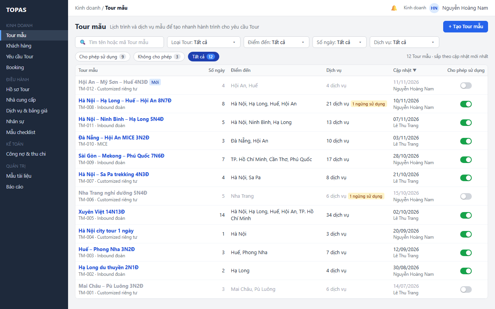

2. **W02 · Thanh lọc và chip.** Kinh doanh chọn giá trị hoặc gõ tìm, ví dụ chọn Điểm đến: Hội An. Bộ lọc áp dụng ngay; danh sách và số trên chip cập nhật (3 + 1 = 4); liên kết Xóa bộ lọc hiện ra.

   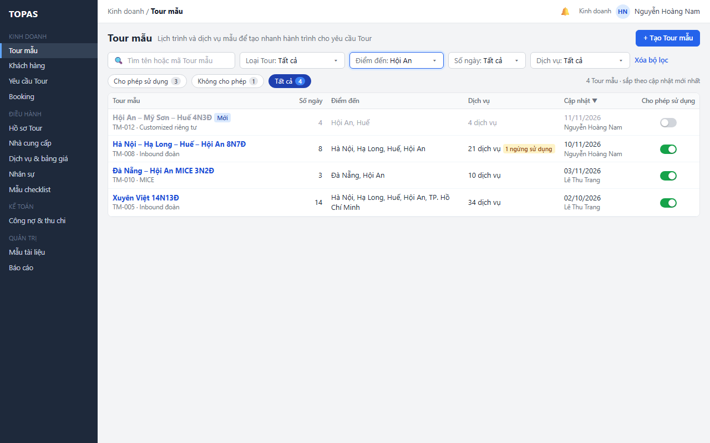

3. **W03 · Vùng bảng khi không có dòng khớp.** Bảng hiện “Không có Tour mẫu khớp bộ lọc” và gợi ý Tạo Tour mẫu ở góc phải. Kinh doanh bấm Xóa bộ lọc ở thanh lọc; danh sách về bộ lọc mặc định.

   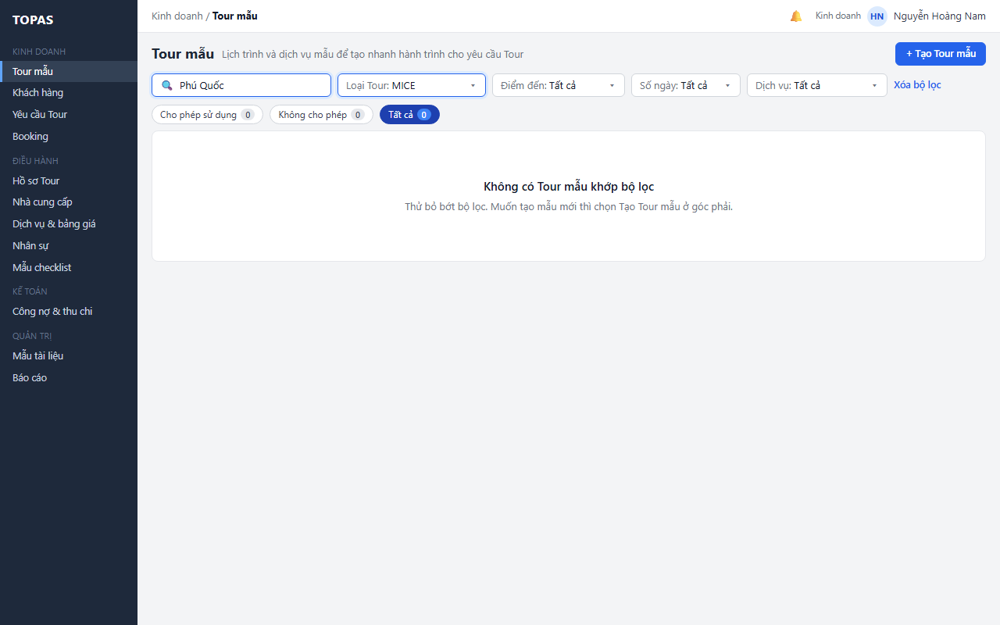

4. **W01 · Bấm dòng trên bảng.** KD02 mở ở tab Lịch trình và dịch vụ, tại ngày đầu tiên còn việc cần làm (mục 1.2, R04), ví dụ TM-008 mở ở Ngày 8 (W21). Bấm Tạo Tour mẫu để sang L2.1.

*Kết quả:* Kinh doanh thấy đúng tập Tour mẫu cần xem và mở được mẫu cần sửa. Khi chưa có Tour mẫu nào, bảng hiện “Chưa có Tour mẫu. Chọn Tạo Tour mẫu để bắt đầu” thay cho W03.

**L1.2 Điều hành xem Tour mẫu (quyết định 11/11/2026).** *Điều kiện:* Điều hành.

1. **W08 · Menu Kinh doanh → Tour mẫu.** Danh sách giống W01 nhưng không có nút Tạo Tour mẫu. Cột Cho phép sử dụng là chữ thay cho công tắc. Dòng phụ của tiêu đề ghi “bạn chỉ có quyền xem”.

   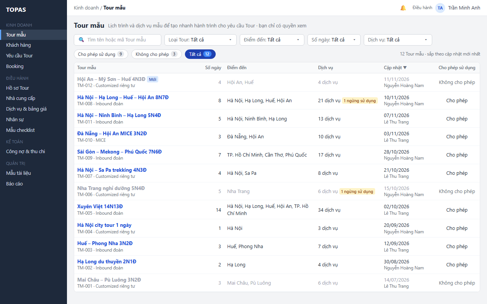

2. **W24 · Bấm dòng → KD02 chỉ xem.** KD02 mở ở chế độ chỉ xem, bố cục như W14, có nhãn Chỉ xem. Ô nhập có viền nét đứt; không có tay kéo, Thêm ngày, Thêm dịch vụ, nút ⋯ hay thanh lưu. Điều hành chọn ngày để xem; thanh Giá vốn tham khảo vẫn nhập được ngày khởi hành và số khách để xem giá. Không có thao tác ghi.

   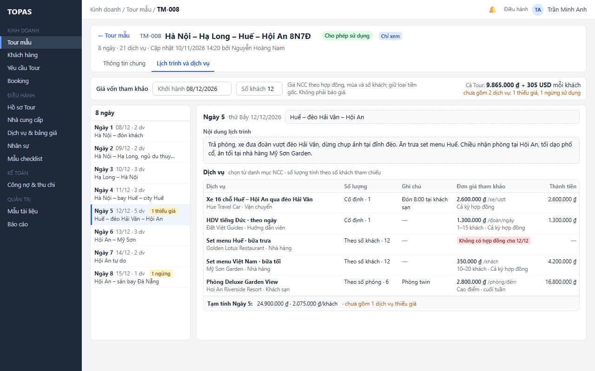

*Kết quả:* Điều hành biết dịch vụ, NCC mà Kinh doanh hay dùng trong sản phẩm mẫu, để chuẩn bị hợp đồng và giá. Điều hành không sửa được Tour mẫu.

**Ngoại lệ**

- **E1.1 · W04.** Không tải được danh sách: vùng bảng thay bằng thông báo lỗi và nút Thử lại; thanh lọc giữ nguyên giá trị; số trên chip hiện “–”. Bấm Thử lại thì tải lại với bộ lọc cũ.

  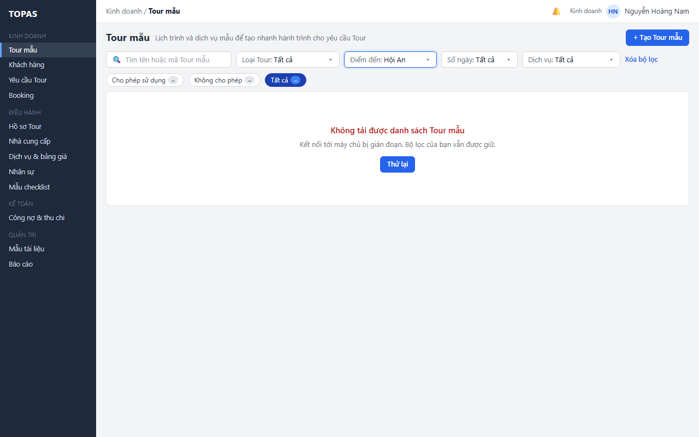

- **E1.2.** Người không có quyền xem (mặc định là Kế toán): menu không có mục Tour mẫu. Mở bằng đường dẫn thì hiện “Bạn không có quyền xem Tour mẫu” và nút Về trang chủ; dữ liệu không được tải.
- **E1.3.** Tìm kiếm dưới 2 ký tự: chưa chạy tìm; ô tìm hiện gợi ý “Nhập ít nhất 2 ký tự”.
- **E1.4.** Bộ lọc trong phiên có loại Tour hoặc điểm đến vừa bị tắt ở QT05: bộ lọc vẫn áp dụng; giá trị hiện kèm chữ “(ngừng dùng)”.
- **E1.5.** Tour mẫu được sửa hoặc bật, tắt ở phiên khác trong lúc KD01 đang mở: danh sách không tự đổi; dữ liệu mới hiện khi đổi bộ lọc, đổi trang hoặc quay lại từ KD02.
- **E1.6.** Mở KD02 bằng đường dẫn của Tour mẫu không tồn tại: hiện “Không tìm thấy Tour mẫu” và liên kết Về danh sách Tour mẫu.
- **E1.7.** Điều hành bấm vào công tắc hoặc mở đường dẫn tạo Tour mẫu: không có công tắc để bấm; đường dẫn tạo hiện thông báo không có quyền như E1.2.

### 3.2. Tạo Tour mẫu (TN01.02 · SYS01.03)

**L2.1 Tạo Tour mẫu và mở lịch trình.** *Điều kiện:* Kinh doanh.

1. **W09 · Nút Tạo Tour mẫu ở tiêu đề KD01 → KD02 chế độ tạo.** KD02 mở ở chế độ tạo, tab Thông tin chung (form tại tab). Tab Lịch trình và dịch vụ khóa, thanh lưu ghi “Tab Lịch trình và dịch vụ mở sau khi lưu thông tin chung”.

   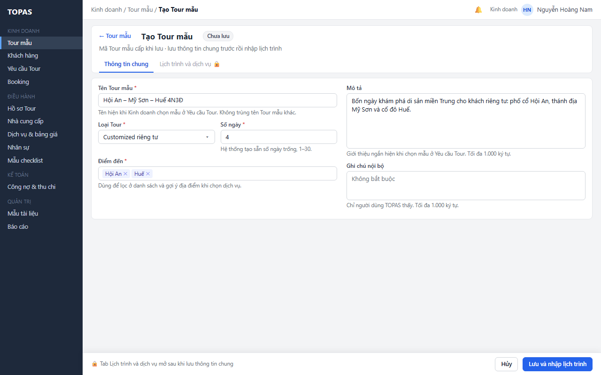

2. **W09 · Các trường của form.** Kinh doanh nhập Tên, chọn Loại Tour, chọn một hoặc nhiều Điểm đến, nhập Số ngày (1–30), Mô tả và Ghi chú nội bộ nếu có.
3. **W09 · Nút Lưu và nhập lịch trình ở thanh lưu.** Kinh doanh bấm Lưu và nhập lịch trình. Hệ thống kiểm tra theo mục 5.2 và R03, cấp mã `TM-NNN`, lưu Tour mẫu ở trạng thái Không cho phép, tạo sẵn đúng số ngày trống (R04).
4. **W11 · Tab Lịch trình và dịch vụ, Ngày 1.** KD02 chuyển sang chế độ sửa và mở tab Lịch trình và dịch vụ tại Ngày 1. Số trên tab là 4 (bốn ngày chưa có nội dung). Thanh Giá vốn tham khảo dùng giá trị mặc định (R07). Thông báo ngắn “Đã tạo Tour mẫu TM-012 với 4 ngày trống”. Kinh doanh nhập lịch trình theo L4.1.

   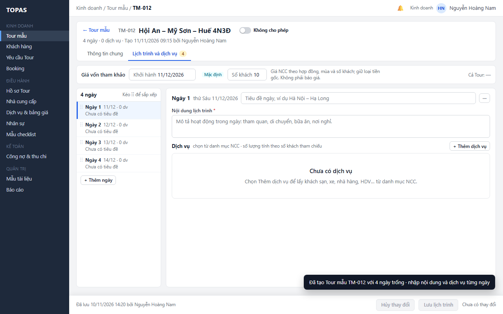

*Kết quả:* Tour mẫu có mã, thông tin chung và số ngày trống, ở trạng thái Không cho phép. Mẫu chưa hiện ở KD06.2 cho tới khi được bật (L6.1).

**Ngoại lệ**

- **E2.1 · W10.** Thiếu trường bắt buộc, số ngày ngoài 1–30, hoặc tên trùng Tour mẫu khác: hệ thống không lưu. Banner đầu form nêu số lỗi; mỗi lỗi hiện cạnh trường. Dữ liệu đã nhập được giữ. Kinh doanh sửa trường rồi lưu lại. Lỗi trùng tên có liên kết Mở TM-… để mở Tour mẫu đó (R03).

  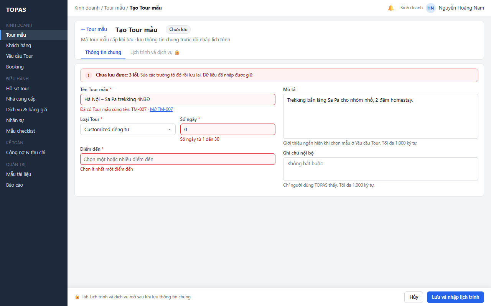

- **E2.2.** Loại Tour hoặc điểm đến vừa bị tắt ở QT05 trong lúc đang nhập: khi lưu, trường đó báo lỗi “… đã ngừng dùng”; người dùng chọn giá trị khác rồi lưu lại.
- **E2.3.** Rời màn hoặc bấm Hủy khi đã nhập: hộp thoại “Bỏ Tour mẫu đang tạo?” với hai nút Bỏ và Ở lại. Chưa có gì được lưu.
- **E2.4.** Lỗi lưu (mất kết nối): banner đỏ trên form có Thử lại; dữ liệu giữ nguyên. Nút Lưu khóa ngay sau lần bấm đầu. Máy chủ dùng mã yêu cầu để chỉ tạo một Tour mẫu.
- **E2.5.** Danh mục Loại Tour ở QT05 chưa có giá trị đang dùng: không lưu được; trường Loại Tour ghi “Chưa có loại Tour. Thêm loại Tour ở QT05.” kèm liên kết mở QT05 nhóm Loại Tour (Kinh doanh sửa nhóm này, RSD QT05 mục 1.5).
- **E2.6.** Bấm tab Lịch trình và dịch vụ khi chưa lưu: không mở tab; thông báo ngắn “Lưu thông tin chung để mở lịch trình”.

### 3.3. Sửa thông tin chung (TN01.02 · SYS01.04)

**L3.1 Sửa thông tin chung.** *Điều kiện:* Kinh doanh; Tour mẫu đã có.

1. **W12 · Tab Thông tin chung.** Kinh doanh chọn tab. Form tại tab hiện Tên, Loại Tour, Mã Tour mẫu (chỉ đọc), Điểm đến, Mô tả và Ghi chú nội bộ. Số ngày không có trong form: số ngày đổi bằng cách thêm, bớt ngày ở KD02.2.

   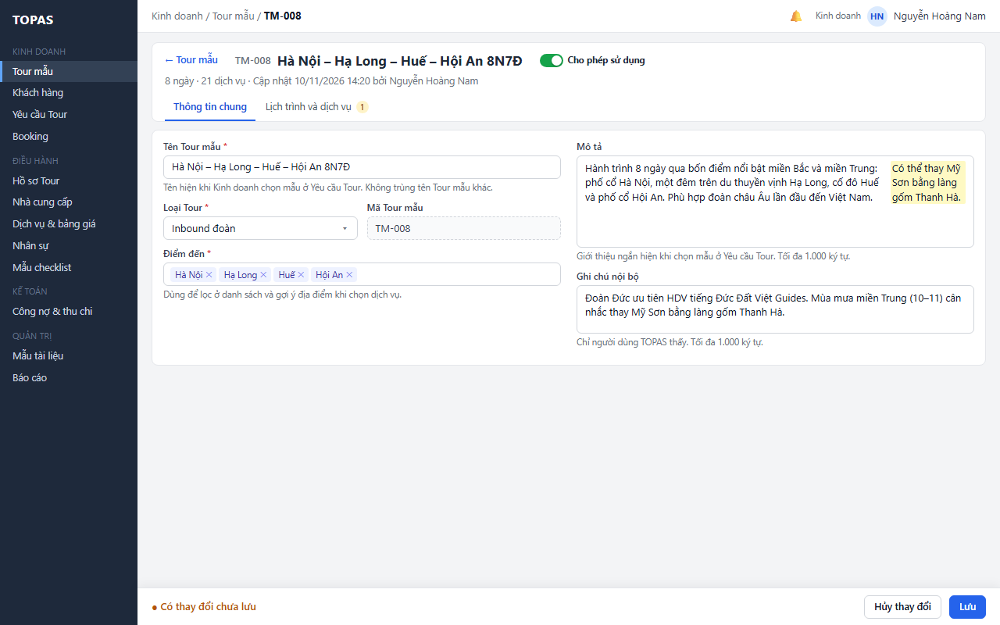

2. **W12 · Các trường của form.** Kinh doanh sửa các trường. Thanh lưu hiện “● Có thay đổi chưa lưu”; nút Hủy thay đổi và Lưu mở khóa.
3. **W12 · Nút Lưu ở thanh lưu.** Kinh doanh bấm Lưu. Hệ thống kiểm tra như L2.1 bước 3 rồi ghi một lần. Màn ở lại tab Thông tin chung. Thanh lưu và dòng 2 của phần đầu ghi lần lưu mới; thông báo ngắn “Đã lưu”.

*Kết quả:* thông tin mới hiện ở KD01 và ở danh sách chọn mẫu của KD06.2. Hành trình đã sao chép từ mẫu không đổi (R10). Cho phép sử dụng không đổi.

**Ngoại lệ**

- **E3.1 · W13.** Tour mẫu vừa được người khác lưu ở phiên khác: máy chủ từ chối vì phiên bản đã đổi. Banner đỏ đầu form nêu người và thời điểm lưu, kèm nút Xem bản mới. Dữ liệu trên form giữ nguyên. Người dùng bấm Xem bản mới, đưa lại thay đổi của mình rồi lưu lại. Hệ thống không ghi đè từng trường.

  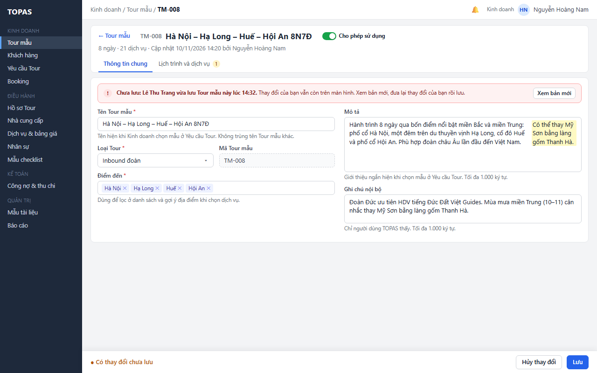

- **E3.2.** Đổi tên trùng Tour mẫu khác, bỏ hết điểm đến hoặc để trống trường bắt buộc: như E2.1, lỗi cạnh trường, không lưu.
- **E3.3.** Rời tab hoặc rời KD02 khi còn thay đổi chưa lưu: hộp thoại như W23 (Lưu và rời, Bỏ thay đổi, Ở lại).
- **E3.4.** Lỗi lưu: như E2.4; dữ liệu trên form giữ nguyên.
- **E3.5.** Loại Tour hoặc điểm đến đang dùng bị tắt ở QT05: Tour mẫu giữ giá trị, hiện kèm “(ngừng dùng)”. Lưu không bị chặn nếu người dùng không đổi trường đó; chọn mới thì không có giá trị đã tắt.

### 3.4. Thiết lập lịch trình và dịch vụ theo ngày (TN01.03 · SYS01.05)

Mọi thay đổi trên KD02.2 (ngày, nội dung, dịch vụ, số lượng, thứ tự) chỉ ghi khi bấm **Lưu lịch trình**, một giao dịch cho cả lịch trình (R08). Trước khi lưu, ngày có thay đổi mang dấu ●.

**L4.1 Nhập nội dung ngày và thêm dịch vụ.** *Điều kiện:* Kinh doanh; Tour mẫu đã lưu thông tin chung.

1. **W11 · Ô ngày ở danh sách bên trái.** Kinh doanh chọn một ngày (sau khi tạo là Ngày 1). Ngày chưa có dịch vụ hiện “Chưa có dịch vụ. Chọn Thêm dịch vụ…”. Tab gồm các vùng sau (hình đầy đủ ở W14, L4.3):
   - **Thanh Giá vốn tham khảo:** ô Khởi hành, ô Số khách, dòng giải thích; bên phải là tổng tham khảo của cả Tour theo từng loại tiền, tính trên mỗi khách, và số dịch vụ chưa được tính (R07).
   - **Danh sách ngày (trái, 216 px):** số ngày; mỗi ngày một ô gồm tay kéo ⋮⋮, “Ngày n”, ngày tham chiếu dd/mm, số dịch vụ, chỉ báo (thiếu giá, ngừng sử dụng), dấu ● khi có thay đổi chưa lưu, và tiêu đề ngày. Cuối danh sách là nút Thêm ngày. Danh sách ngày cuộn riêng khi Tour mẫu dài (ví dụ 14 ngày).
   - **Ngày đang chọn (phải):** “Ngày n”, thứ và ngày tham chiếu, ô Tiêu đề ngày, nút ⋯ (menu ngày, W18); ô Nội dung lịch trình; bảng Dịch vụ với nút Thêm dịch vụ; dòng Tạm tính của ngày.
   - **Bảng Dịch vụ:** tay kéo; Dịch vụ (tên, nhãn; dòng dưới là NCC và loại dịch vụ); Số lượng (ô chọn tại chỗ: cách tính và số lượng); Ghi chú; Đơn giá tham khảo (giá, đơn vị, dòng phụ mùa hoặc khoảng số khách; hoặc chỉ báo thiếu giá); Thành tiền; nút ⋯ (Đổi dịch vụ, Chuyển sang ngày khác, Xóa khỏi ngày).
   - **Thanh lưu:** trạng thái lưu; Hủy thay đổi; Lưu lịch trình.
   - Ngày tham chiếu của Ngày n = ngày khởi hành tham khảo + (n − 1). Ngày này chỉ để tính giá và đọc lịch trình; Tour mẫu không lưu ngày.
2. **W11 · Ô Tiêu đề ngày và ô Nội dung lịch trình.** Kinh doanh nhập Tiêu đề ngày (ví dụ Đà Nẵng – Hội An) và Nội dung lịch trình. Tiêu đề hiện ngay ở ô ngày bên trái; ngày có dấu ●.
3. **W15 · Nút Thêm dịch vụ ở đầu bảng Dịch vụ → bảng trượt.** Bảng trượt mở với bộ lọc Địa điểm lấy sẵn từ Điểm đến của Tour mẫu (nhãn “Theo điểm đến”). Danh sách chỉ gồm dịch vụ đang dùng của NCC đang dùng (R05), mỗi dòng có giá tham khảo theo ngày tham chiếu của ngày đang chọn và số khách tham chiếu. Kinh doanh lọc theo loại dịch vụ bằng chip, tìm theo tên, rồi đánh dấu một hoặc nhiều dịch vụ.

   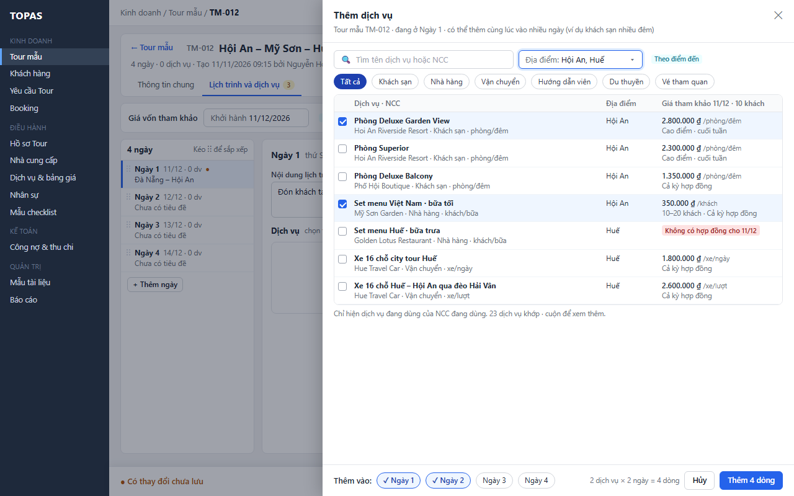

4. **W15 · Ô Thêm vào và nút Thêm n dòng ở chân bảng trượt.** Ô “Thêm vào” chọn sẵn ngày đang chọn. Kinh doanh chọn thêm ngày khác nếu cần (ví dụ khách sạn hai đêm: Ngày 1, Ngày 2). Chân bảng trượt ghi số dòng sẽ thêm (2 dịch vụ × 2 ngày = 4 dòng). Kinh doanh bấm Thêm 4 dòng; hệ thống thêm dòng vào từng ngày đã chọn.
5. **W16 · Bảng Dịch vụ và thông báo ngắn.** Bảng trượt đóng. Các dòng mới nằm cuối bảng của từng ngày, có nhãn Mới và nền xanh nhạt. Số lượng tự điền theo đơn vị tính của dịch vụ (R05): Set menu theo số khách (10), phòng theo số phòng (5). Tạm tính của ngày và cả Tour tính lại; chưa lưu. Thông báo ngắn “Đã thêm 4 dòng vào Ngày 1, Ngày 2” kèm Hoàn tác; Kinh doanh bấm Hoàn tác nếu cần.

   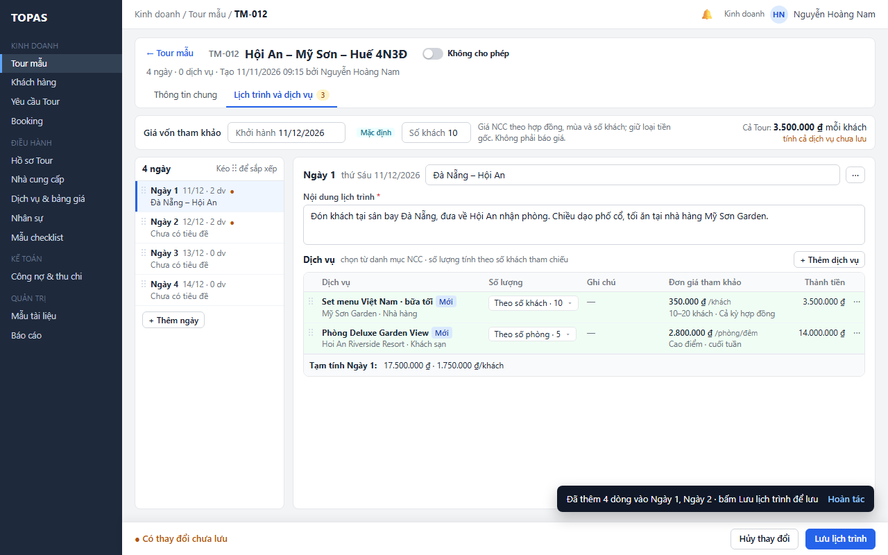

6. **W16 · Ô chọn tại chỗ ở cột Số lượng và ô Ghi chú.** Kinh doanh đổi cách tính hoặc số lượng nếu cần, và nhập Ghi chú (ví dụ “Phòng twin”, “Đón 8:00 tại khách sạn”).
7. **W17 · Nút Lưu lịch trình ở thanh lưu.** Kinh doanh bấm Lưu lịch trình. Hệ thống kiểm tra theo R08 rồi lưu cả lịch trình trong một giao dịch. Nhãn Mới và dấu ● mất. Phần đầu ghi “4 ngày · 4 dịch vụ” và lần lưu mới. Thông báo ngắn “Đã lưu lịch trình · 4 ngày · 4 dịch vụ”. Nếu Tour mẫu còn ngày chưa có nội dung, banner xanh nhắc các ngày đó kèm nút Mở ngày đầu tiên (R02).

   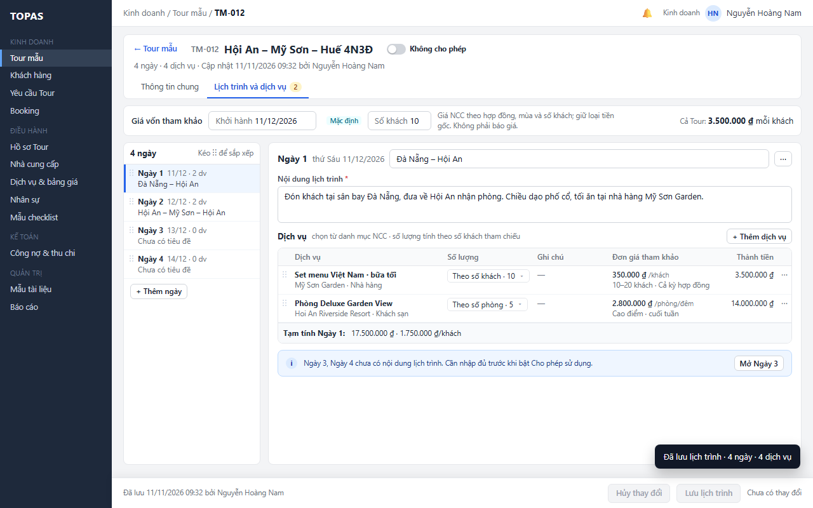

*Kết quả:* lịch trình và dịch vụ của Tour mẫu được lưu. Số ngày và số dịch vụ ở KD01 cập nhật.

**L4.2 Thêm, nhân bản, sắp xếp và xóa ngày.** *Điều kiện:* Kinh doanh.

1. **W18 · Nút ⋯ cạnh tiêu đề ngày → menu ngày.** Menu có Thêm ngày phía sau, Nhân bản ngày này, Chuyển lên, Chuyển xuống và Xóa ngày (kèm số dịch vụ của ngày). Nút Thêm ngày ở cuối danh sách thêm một ngày trống vào cuối.

   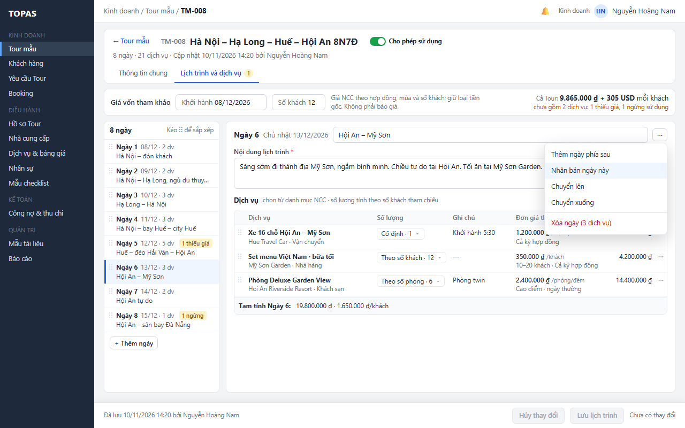

2. **W18 · Mục trong menu ngày, hoặc tay kéo ⋮⋮ ở ô ngày.** Thêm ngày phía sau chèn một ngày trống ngay sau ngày đang chọn. Nhân bản ngày này chèn ngay sau một bản sao gồm tiêu đề, nội dung và mọi dòng dịch vụ (ví dụ Hội An ngày 2). Chuyển lên, Chuyển xuống đổi chỗ với ngày kề. Kinh doanh cũng có thể kéo ⋮⋮ ở ô ngày để đặt vào vị trí mới. Ngày mới hoặc ngày vừa chuyển được chọn và có dấu ●. Các ngày được đánh số lại; ngày tham chiếu và giá tham khảo tính lại theo vị trí mới.
3. **W19 · Mục Xóa ngày.** Kinh doanh chọn Xóa ngày. Hệ thống xóa ngày đó cùng các dòng dịch vụ của ngày, không hỏi lại vì chưa ghi gì cho tới khi lưu. Các ngày sau dồn lên và đổi ngày tham chiếu (Ngày 8 thành Ngày 7, 14/12). Tổng tham khảo tính lại (9.865.000 ₫ thành 8.315.000 ₫ mỗi khách). Thông báo ngắn nêu ngày và số dịch vụ đã xóa, kèm Hoàn tác; Kinh doanh bấm Hoàn tác nếu cần.

   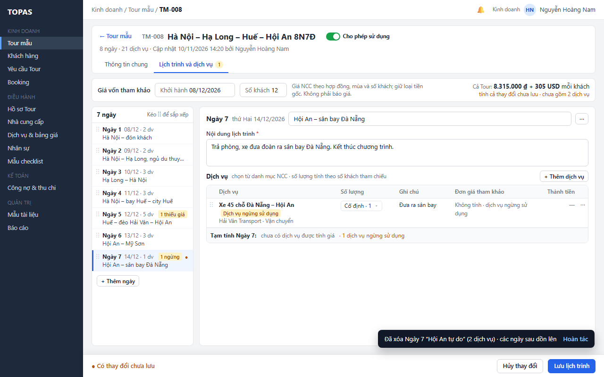

4. **W17 · Nút Lưu lịch trình.** Kinh doanh bấm Lưu lịch trình. Kết quả như L4.1 bước 7; số ngày ở phần đầu và KD01 cập nhật.

*Kết quả:* thứ tự và số ngày của Tour mẫu đổi theo lần lưu. Ngày mới thêm phải có nội dung trước khi lưu nếu Tour mẫu đang cho phép sử dụng (R02, E4.1).

**L4.3 Sửa, chuyển và xóa dịch vụ trong ngày.** *Điều kiện:* Kinh doanh.

1. **W14 · Ô ngày ở danh sách bên trái.** Kinh doanh mở ngày cần sửa. Bảng Dịch vụ cho biết từng dịch vụ, NCC, cách tính số lượng, ghi chú, đơn giá tham khảo và thành tiền.

   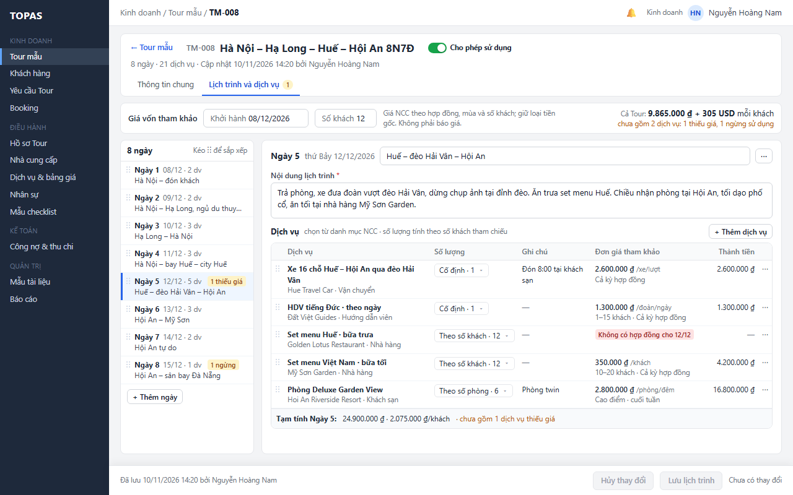

2. **W14 · Ô chọn tại chỗ ở cột Số lượng, ô Ghi chú, tay kéo ⋮⋮.** Kinh doanh đổi cách tính số lượng (Theo số khách, Theo số phòng, Cố định) và nhập số khi chọn Cố định; sửa Ghi chú ngay trên ô. Kéo ⋮⋮ để đổi thứ tự dịch vụ trong ngày. Ngày có dấu ●; giá tham khảo tính lại.
3. **W14 · Nút ⋯ trên dòng dịch vụ.** Chuyển sang ngày khác (chọn ngày đích trong menu con; dòng chuyển sang cuối ngày đích) hoặc Xóa khỏi ngày (xóa ngay, thông báo ngắn kèm Hoàn tác).
4. **W17 · Nút Lưu lịch trình.** Kinh doanh bấm Lưu lịch trình. Kết quả như L4.1 bước 7.

*Kết quả:* dịch vụ, số lượng và ghi chú của ngày được cập nhật.

**L4.4 Đổi dịch vụ ngừng sử dụng.** *Điều kiện:* Kinh doanh; Tour mẫu có dòng dịch vụ mà dịch vụ hoặc NCC đã Ngừng sử dụng (R06).

1. **W21 · Dòng KD01 → KD02.2 tại ngày có dịch vụ ngừng sử dụng; nút ⋯ trên dòng dịch vụ.** Kinh doanh mở Tour mẫu từ KD01. KD02.2 mở thẳng tại ngày có dịch vụ ngừng sử dụng (Ngày 8). Dòng có nhãn “Dịch vụ ngừng sử dụng” và không được tính giá. Banner vàng dưới bảng nói rõ ai tắt, khi nào, và dòng được giữ để chọn thay thế. Kinh doanh bấm ⋯ trên dòng, chọn Đổi dịch vụ.

   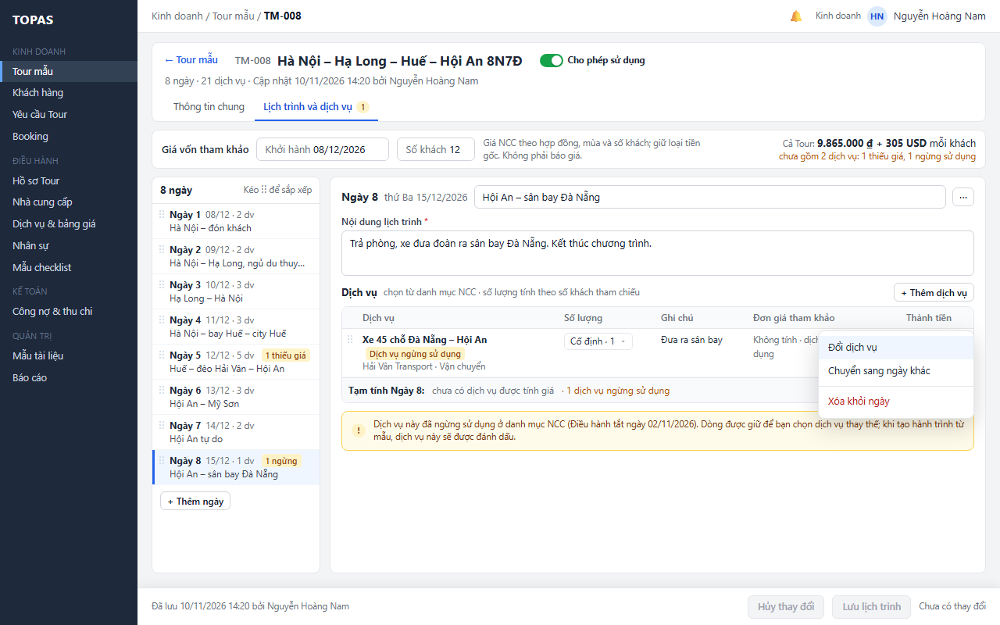

2. **W22 · Bảng trượt Đổi dịch vụ.** Khung đầu nói rõ dịch vụ bị thay, ngày, và số lượng, ghi chú sẽ được giữ. Bộ lọc lấy sẵn loại dịch vụ và địa điểm của dịch vụ cũ (nhãn “Theo dịch vụ cũ”). Kinh doanh chọn một dịch vụ (ô chọn một) rồi bấm Đổi dịch vụ.

   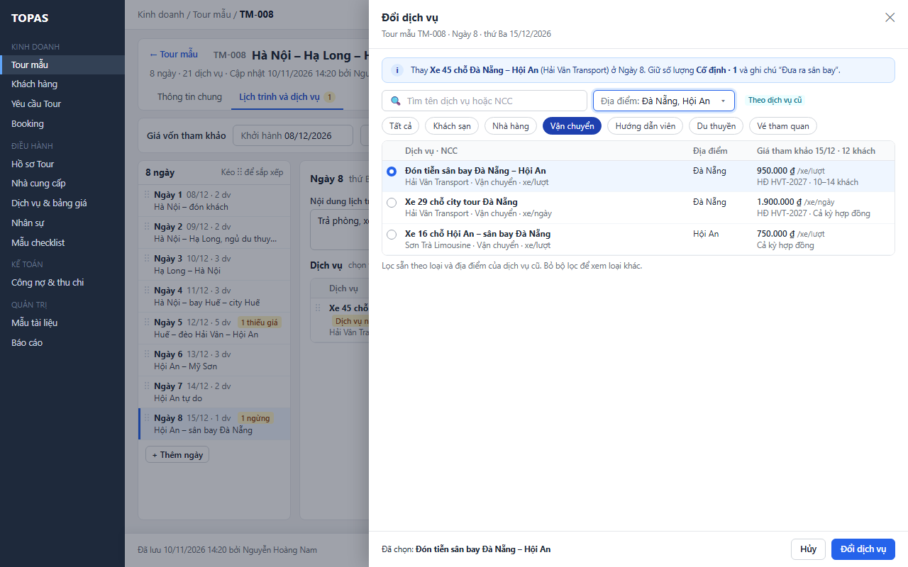

3. **W16 · Bảng Dịch vụ sau khi đổi.** Bảng trượt đóng. Dòng được thay tại chỗ, giữ thứ tự, cách tính số lượng và ghi chú (R06), có nhãn Mới như W16. Nhãn ngừng sử dụng và chỉ báo của ngày mất; số trên tab giảm 1; giá tham khảo tính lại. Kinh doanh bấm Lưu lịch trình (W17).

*Kết quả:* Tour mẫu không còn dịch vụ ngừng sử dụng; chỉ báo ở KD01 mất sau khi lưu. Nếu cách tính số lượng cũ không hợp với đơn vị tính của dịch vụ mới (ví dụ Theo số phòng với dịch vụ xe), hệ thống đặt lại theo đơn vị mới và hiện nhãn “Đã đổi cách tính” trên ô Số lượng.

**Ngoại lệ**

- **E4.1 · W20.** Lưu khi Tour mẫu đang cho phép sử dụng mà có ngày trống nội dung (hoặc xóa hết ngày): hệ thống không lưu. Banner đỏ nêu lý do và cách xử lý (nhập nội dung hoặc tắt Cho phép sử dụng ở phần đầu). Ô ngày lỗi tô đỏ; màn chuyển tới ngày lỗi đầu tiên; lỗi hiện dưới ô Nội dung lịch trình. Dữ liệu giữ nguyên. Kinh doanh nhập nội dung hoặc tắt Cho phép sử dụng rồi lưu lại.

  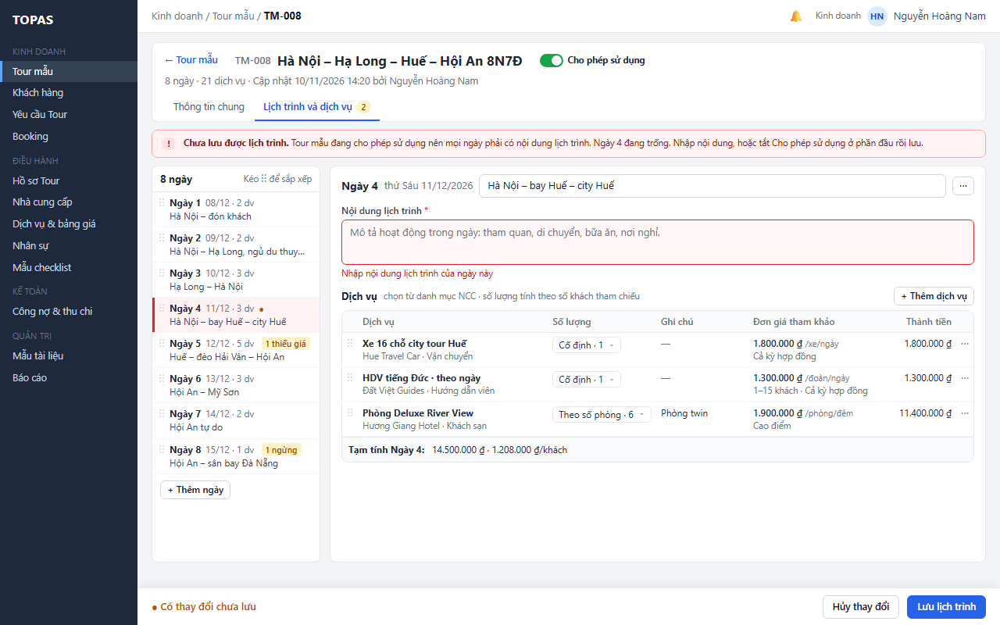

- **E4.2 · W23.** Rời tab, rời KD02 hoặc đóng trình duyệt khi lịch trình còn thay đổi chưa lưu: hộp thoại “Rời khỏi lịch trình?” nêu ngày có thay đổi, với ba nút Ở lại (không đổi gì), Bỏ thay đổi (rời, không lưu), Lưu và rời (lưu rồi rời). Lưu và rời bị chặn bởi E4.1 thì ở lại và hiện W20.

  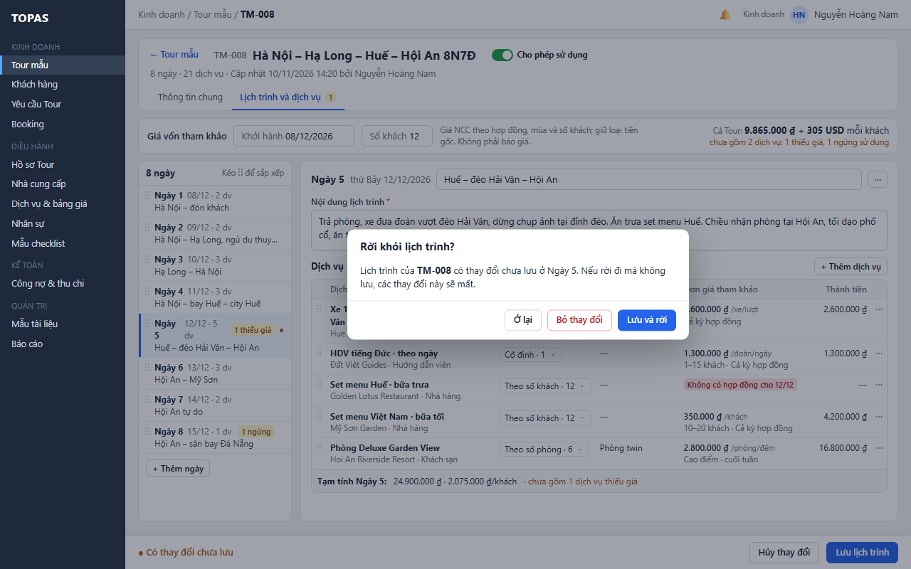

- **E4.3.** Lịch trình vừa được lưu ở phiên khác: máy chủ từ chối. Banner đỏ trên tab như W13 (người, thời điểm, Xem bản mới); thay đổi trên màn giữ nguyên để người dùng đưa lại sau khi xem bản mới. Hệ thống không ghép tự động hai bản lịch trình.
- **E4.4.** Dịch vụ vừa thêm (chưa lưu) bị Ngừng sử dụng ở DH02, DH03 trước khi bấm Lưu: hệ thống không lưu. Dòng đó báo lỗi “Dịch vụ vừa ngừng sử dụng, chọn dịch vụ khác” kèm Đổi dịch vụ. Dòng ngừng sử dụng đã lưu từ trước vẫn được lưu bình thường (R06).
- **E4.5.** Số lượng Cố định ngoài 1–999, hoặc ghi chú quá 200 ký tự: lỗi ngay trên ô, không lưu.
- **E4.6.** Thêm dịch vụ đã có trong cùng ngày: trong bảng trượt, ngày đó ở ô Thêm vào hiện “đã có” và không thêm trùng; ngày khác vẫn thêm được.
- **E4.7.** Thêm ngày khi đã có 30 ngày: nút Thêm ngày và mục Thêm ngày phía sau, Nhân bản khóa, kèm lý do “Tối đa 30 ngày”.
- **E4.8.** Xóa ngày duy nhất: mục Xóa ngày khóa, kèm lý do “Tour mẫu cần ít nhất một ngày”.
- **E4.9.** Bảng trượt Thêm dịch vụ không tải được danh sách: vùng bảng hiện lỗi kèm Thử lại; lịch trình phía sau giữ nguyên.
- **E4.10.** Không có dịch vụ nào khớp bộ lọc trong bảng trượt: hiện “Không có dịch vụ khớp” và gợi ý bỏ bộ lọc Địa điểm. Dịch vụ mới chưa có trong danh mục thì Điều hành thêm ở DH03; Kinh doanh không tạo dịch vụ ở đây.
- **E4.11.** Lỗi lưu (mất kết nối): banner đỏ có Thử lại; mọi thay đổi giữ nguyên. Nút Lưu khóa ngay sau lần bấm đầu; máy chủ dùng mã yêu cầu để chỉ ghi một lần.
- **E4.12.** Bấm Hủy thay đổi: hộp thoại “Bỏ mọi thay đổi chưa lưu của lịch trình?” với Bỏ thay đổi và Ở lại. Bỏ thì lịch trình trở về bản đã lưu.
- **E4.13.** Hoàn tác thêm dịch vụ, xóa ngày hoặc xóa dịch vụ sau khi đã có thay đổi khác trên cùng ngày: chỉ hoàn tác đúng thao tác đó; hết 10 giây thì thông báo biến mất, người dùng dùng Hủy thay đổi nếu muốn bỏ hết.

### 3.5. Xem giá vốn tham khảo (quyết định 11/11/2026)

**L5.1 Ước lượng giá vốn của Tour mẫu.** *Điều kiện:* Kinh doanh hoặc Điều hành; Tour mẫu có dịch vụ.

1. **W14 · Thanh Giá vốn tham khảo khi mở KD02.2.** Thanh dùng ngày khởi hành và số khách người dùng nhập lần trước cho Tour mẫu này. Lần đầu dùng hôm nay + 30 ngày và 10 khách, kèm nhãn Mặc định (W11).
2. **W14 · Ô Khởi hành và ô Số khách.** Người dùng nhập ngày khởi hành tham khảo và số khách người lớn. Sau khi ngừng gõ 400 ms, hệ thống tính lại theo R07: ngày tham chiếu từng ngày, đơn giá của từng dịch vụ (hợp đồng áp dụng, mùa, loại ngày, khoảng số khách), số lượng, thành tiền, tạm tính từng ngày và tổng cả Tour trên mỗi khách theo từng loại tiền. Giá trị vừa nhập được nhớ cho người dùng.
3. **W14 · Ô Đơn giá tham khảo và ô ngày.** Dịch vụ không có giá hiện lý do thay cho đơn giá (ví dụ “Không có hợp đồng cho 12/12”). Ô ngày có chỉ báo “1 thiếu giá”. Tạm tính và tổng ghi “chưa gồm n dịch vụ”. Dịch vụ ngừng sử dụng ghi “Không tính”.

*Kết quả:* người dùng thấy giá vốn ước lượng để điều chỉnh mẫu (ví dụ đổi khách sạn đắt). Không có gì được lưu vào Tour mẫu, trừ ngày và số khách tham khảo được nhớ cho lần mở sau của chính người đó.

**Ngoại lệ**

- **E5.1.** Ngày khởi hành không hợp lệ, hoặc số khách ngoài 1–999: ô báo lỗi; giá giữ lần tính trước và ghi “Chưa tính lại”.
- **E5.2.** Không tải được bảng giá: cột Đơn giá và Thành tiền hiện “–”, thanh giá ghi “Không tính được giá tham khảo” kèm Thử lại. Việc sửa lịch trình không bị ảnh hưởng.
- **E5.3.** Số khách ngoài mọi khoảng số khách của bảng giá: ô Đơn giá ghi “Không có mức giá cho n khách (bảng giá a–b khách)” (RSD DH04 R08).
- **E5.4.** Điều hành vừa sửa bảng giá ở DH05 trong lúc KD02.2 đang mở: giá hiện không tự đổi; giá mới được dùng ở lần tính kế tiếp (đổi ngày, số khách, đổi ngày đang chọn hoặc mở lại).
- **E5.5.** Ngày khởi hành tham khảo đã qua: vẫn tính, ô ngày có ghi chú “Ngày đã qua · chỉ để tham khảo”.

### 3.6. Cho phép sử dụng Tour mẫu (TN01.04 · SYS01.06, SYS01.07)

**L6.1 Bật Cho phép sử dụng.** *Điều kiện:* Kinh doanh; Tour mẫu Không cho phép; đủ điều kiện ở R02.

1. **W01 · Công tắc trên dòng KD01 (hoặc ở phần đầu KD02).** Kinh doanh bật công tắc. Hệ thống kiểm tra R02 theo lịch trình đã lưu rồi lưu ngay, không hỏi.
2. **W06 · Dòng và thông báo ngắn.** Dòng tô sáng, giữ tại chỗ; số trên chip cập nhật (10 + 2 = 12). Thông báo ngắn kèm Hoàn tác trong 10 giây; Kinh doanh bấm Hoàn tác nếu cần. Nếu mẫu còn dịch vụ ngừng sử dụng, thông báo nêu số dịch vụ và NCC, nhắc đổi trước khi dùng. Việc bật không bị chặn (quyết định 11/11/2026).

   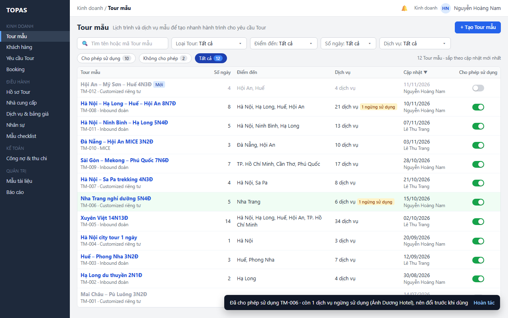

*Kết quả:* Tour mẫu hiện ở danh sách chọn mẫu và chọn ngày để ghép ở KD06.2 (R10).

**L6.2 Bật khi lịch trình chưa đủ.** *Điều kiện:* Kinh doanh; Tour mẫu không đạt R02.

1. **W05 · Công tắc → khung nổi cạnh công tắc.** Kinh doanh bật công tắc của TM-012. Công tắc giữ Không cho phép. Khung nổi cạnh công tắc nêu điều kiện, liệt kê các ngày còn thiếu (Ngày 3, Ngày 4 chưa có nội dung lịch trình) và có nút Mở Ngày 3.

   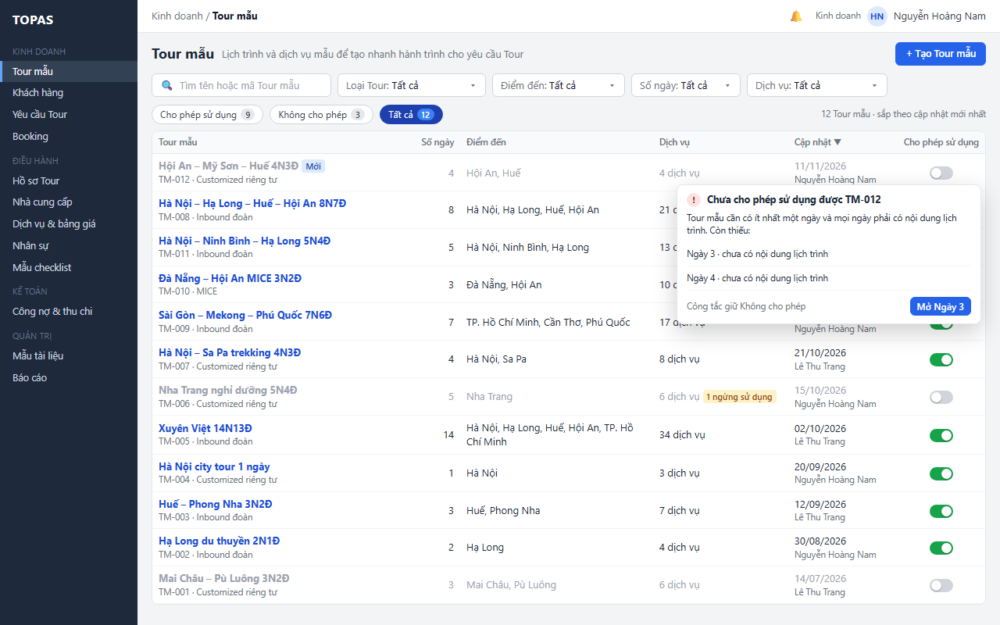

2. **W11 · Nút Mở Ngày 3 trong khung nổi.** Kinh doanh bấm Mở Ngày 3. KD02.2 mở thẳng tại Ngày 3, bố cục như W11 (ngày chưa có nội dung). Kinh doanh nhập nội dung các ngày còn thiếu, Lưu lịch trình, rồi bật lại theo L6.1.

*Kết quả:* Tour mẫu chỉ được cho phép sử dụng khi lịch trình đủ nội dung. Ở phần đầu KD02, cùng khung nổi hiện cạnh công tắc; nút trong khung chuyển tới ngày thiếu đầu tiên.

**L6.3 Tắt Cho phép sử dụng.** *Điều kiện:* Kinh doanh; Tour mẫu Cho phép sử dụng.

1. **W01 · Công tắc trên dòng (hoặc ở phần đầu KD02).** Kinh doanh tắt công tắc. Hệ thống lưu ngay, không hỏi, vì việc tắt không đổi dữ liệu nào đã dùng mẫu.
2. **W07 · Dòng và thông báo ngắn.** Dòng mờ, giữ tại chỗ đến khi đổi bộ lọc, đổi trang hoặc tải lại; số trên chip cập nhật (8 + 4 = 12). Thông báo ngắn “… hành trình đã tạo từ mẫu này không đổi” kèm Hoàn tác trong 10 giây; Kinh doanh bấm Hoàn tác nếu cần.

   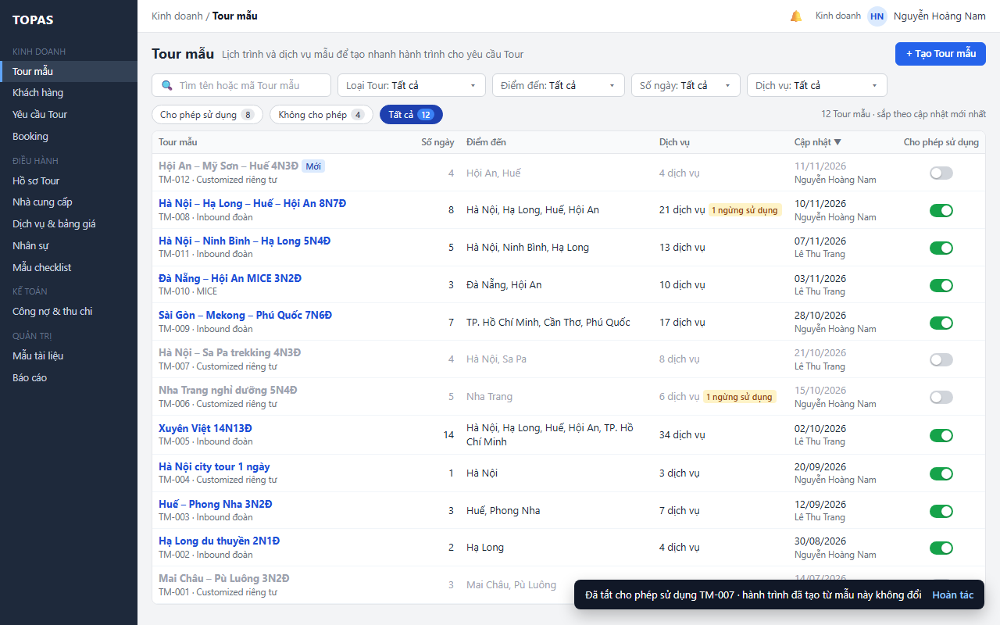

*Kết quả:* Tour mẫu không hiện khi chọn mẫu mới ở KD06.2. Hành trình đã sao chép giữ nguyên (vòng đời Tour mẫu ở danh sách màn).

**Ngoại lệ**

- **E6.1.** Bật, tắt khi Tour mẫu vừa được đổi ở phiên khác: máy chủ từ chối; công tắc trả về giá trị mới nhất; thông báo ngắn “… đã được … đổi lúc …”. Muốn đổi tiếp thì bấm lại.
- **E6.2.** Lỗi lưu (mất kết nối): công tắc trả về giá trị cũ; thông báo lỗi có Thử lại.
- **E6.3.** Bấm công tắc nhiều lần liên tiếp: công tắc khóa ngay sau lần bấm đầu cho tới khi có kết quả; máy chủ chỉ xử lý một yêu cầu.
- **E6.4.** Bật ở phần đầu KD02 khi tab lịch trình còn thay đổi chưa lưu: hệ thống kiểm tra R02 theo bản đã lưu. Khung nổi nhắc “Lịch trình có thay đổi chưa lưu. Lưu lịch trình trước khi bật” kèm nút Lưu lịch trình; công tắc giữ nguyên.
- **E6.5.** Bấm Hoàn tác khi đã có người đổi tiếp Tour mẫu đó: không hoàn tác; thông báo nêu lý do.
- **E6.6.** Tắt Tour mẫu trong lúc người khác đang mở hộp thoại chọn mẫu ở KD06.2: KD06.2 kiểm tra lại khi sao chép; mẫu đã tắt thì báo “Tour mẫu vừa ngừng cho phép sử dụng” và không sao chép (R10).
- **E6.7.** Người dùng bị thu hồi quyền giữa chừng: máy chủ từ chối, công tắc trả về giá trị cũ, thông báo “Bạn không có quyền đổi cho phép sử dụng”.

**Số bước trước và sau khi tối ưu (cả mục 3)**

| Việc | Cách làm thông thường | Bản này |
|---|---|---|
| Tạo Tour mẫu 4 ngày | Lưu thông tin chung, mở tab lịch trình, bấm Thêm ngày 4 lần | 1 lần bấm Lưu và nhập lịch trình; 4 ngày trống có sẵn, tab mở sẵn |
| Thêm khách sạn 3 đêm | Thêm dịch vụ ở từng ngày, chọn lại cùng khách sạn 3 lần | 1 lần chọn, đánh dấu 3 ngày ở ô Thêm vào |
| Nhập số lượng | Tính số phòng, số khách cho từng dòng | Tự điền theo đơn vị tính; chỉ sửa khi khác |
| Ước lượng giá vốn mẫu | Mở DH04 tra từng dịch vụ theo ngày, cộng tay | Nhập 1 ngày khởi hành và số khách; giá từng dòng, ngày, cả Tour hiện ngay |
| Sửa mẫu có dịch vụ đã ngừng | Mở từng mẫu, tìm ngày có dịch vụ cũ | Chỉ báo trên KD01; mở thẳng đúng ngày; Đổi dịch vụ giữ số lượng, ghi chú |

---

## 4. Quy tắc triển khai chi tiết

### R01. Quyền (quyết định 11/11/2026)

- Kinh doanh xem, tạo, sửa thông tin chung, sửa lịch trình và bật, tắt Cho phép sử dụng của **mọi** Tour mẫu. Không phân quyền theo người tạo.
- Điều hành xem KD01, KD02 ở chế độ chỉ xem và dùng được thanh Giá vốn tham khảo.
- Kế toán không có mục Tour mẫu. Quản trị hệ thống đổi quyền ở QT02.
- Máy chủ kiểm tra quyền mỗi lần ghi. Không có Xóa Tour mẫu cho mọi vai trò.

### R02. Cho phép sử dụng (TN01.04 · quyết định 11/11/2026)

- Hai giá trị: **Cho phép sử dụng** và **Không cho phép**. Tour mẫu mới tạo là Không cho phép.
- **Điều kiện bật:** lịch trình đã lưu có ít nhất một ngày và mọi ngày có nội dung lịch trình (sau khi bỏ khoảng trắng). Không đạt thì chặn bật và hiện các ngày còn thiếu (W05). Hệ thống kiểm tra trên bản đã lưu; tab lịch trình còn thay đổi chưa lưu thì nhắc lưu trước (E6.4).
- **Dịch vụ, NCC ngừng sử dụng** trong mẫu: không chặn bật; thông báo sau khi bật nêu số dịch vụ và NCC (W06).
- **Giữ điều kiện khi đang cho phép:** lưu lịch trình làm mất điều kiện bật (ngày trống nội dung, không còn ngày nào) thì bị chặn (E4.1). Người dùng muốn để mẫu dở dang thì tắt Cho phép sử dụng trước.
- **Bật, tắt** lưu ngay, không hộp thoại. Thông báo ngắn có Hoàn tác trong 10 giây. Hoàn tác ghi giá trị cũ như một lần đổi mới và kiểm tra phiên bản như mọi lần ghi.
- **Tác động khi bật:** Tour mẫu hiện ở KD06.2 khi chọn “Từ Tour mẫu” và khi Ghép ngày.
- **Tác động khi tắt:** Tour mẫu không hiện khi chọn mới ở KD06.2. Hành trình đã sao chép, phiên bản báo giá, Booking và hồ sơ Tour không đổi.

### R03. Mã Tour mẫu và chống trùng

- Mã dạng `TM-NNN`, cấp tăng dần khi tạo, không sửa được. Vượt 999 thì tự thêm chữ số (`TM-1000`).
- **Tên** chuẩn hóa bằng cách bỏ dấu, đổi sang chữ thường, gộp khoảng trắng và đổi các dấu gạch (–, —, -) thành một loại. Trùng với Tour mẫu khác (kể cả Không cho phép) thì chặn lưu, kèm liên kết mở Tour mẫu đó. Máy chủ kiểm tra lại khi lưu.

### R04. Ngày của Tour mẫu

- Một Tour mẫu có 1–30 ngày. Số ngày = số ngày của lịch trình đã lưu; không có trường số ngày riêng sau khi tạo.
- Khi tạo, hệ thống tạo sẵn n ngày trống theo trường Số ngày.
- Ngày đánh số theo thứ tự 1…n, đánh số lại sau mỗi lần thêm, nhân bản, chuyển, kéo hoặc xóa. Tiêu đề và nội dung đi theo ngày, không theo số.
- **Nhân bản ngày** sao chép tiêu đề, nội dung và mọi dòng dịch vụ (dịch vụ, cách tính số lượng, số lượng cố định, ghi chú); dòng dịch vụ ngừng sử dụng cũng được sao chép kèm nhãn.
- **Việc cần làm** của KD02.2 (số trên tab, ngày mở thẳng từ KD01): ngày chưa có nội dung và dòng dịch vụ ngừng sử dụng, xét theo thứ tự ngày.

### R05. Chọn dịch vụ và số lượng (TN01.03 · HT01.07)

- Bảng trượt chỉ liệt kê dịch vụ **đang dùng** của NCC **đang dùng** (RSD DH02 R04, RSD DH03 R05). Bộ lọc Địa điểm lấy sẵn từ Điểm đến của Tour mẫu; khi đổi dịch vụ thì lấy loại và địa điểm của dịch vụ cũ. Người dùng bỏ được bộ lọc.
- Chọn nhiều dịch vụ (Thêm) hoặc một dịch vụ (Đổi). Ô Thêm vào chọn sẵn ngày đang mở, chọn thêm được các ngày khác. Một dịch vụ không được có hai dòng trong cùng một ngày.
- **Cách tính số lượng** mặc định theo đơn vị tính của dịch vụ:

| Căn cứ mặc định của đơn vị tính (RSD DH03 R14) | Cách tính mặc định | Số lượng khi tính giá tham khảo |
|---|---|---|
| Khách (khách/suất, khách/bữa, khách/chuyến…) | Theo số khách | Số khách tham chiếu |
| Phòng (phòng/đêm, cabin/đêm…) | Theo số phòng | Làm tròn lên (số khách ÷ 2), phòng đôi |
| Đoàn, xe, đơn vị dịch vụ (xe/lượt, đoàn/ngày…) | Cố định · 1 | Số đã nhập |

- Người dùng đổi được cách tính ở ô chọn tại chỗ. Cách tính được sao chép sang KD06.2 cùng dòng dịch vụ để KD06.2 tính lại theo số khách, số phòng thật của yêu cầu.
- Ghi chú dùng cho cấu hình, yêu cầu riêng của dịch vụ trong ngày (ví dụ “Phòng twin”, “Đón 8:00 tại khách sạn”), được sao chép sang KD06.2.

### R06. Dịch vụ, NCC ngừng sử dụng sau khi đã có trong Tour mẫu

- Dòng dịch vụ được giữ nguyên (RSD DH02 R04, RSD DH03 R05). Dòng có nhãn vàng “Dịch vụ ngừng sử dụng” (hoặc “NCC ngừng sử dụng”), không được tính giá tham khảo, và được đếm vào số trên tab KD02.2 và chỉ báo cột Dịch vụ ở KD01. Kinh doanh không nhận thông báo riêng; chỉ báo hiện ở KD01, KD02.2.
- Banner dưới bảng của ngày nêu người và ngày Điều hành tắt (đọc từ lịch sử DH02, DH03).
- **Đổi dịch vụ** thay ID dịch vụ của dòng, giữ thứ tự, cách tính số lượng (hoặc đặt lại theo đơn vị mới nếu không hợp) và ghi chú.
- Khi dịch vụ hoặc NCC được bật lại, nhãn tự mất; chỉ báo mất ở lần tải sau.
- DH03 không cho xóa dịch vụ đã có trong Tour mẫu (RSD DH03 R13), nên KD02 không gặp dòng trỏ tới dịch vụ đã xóa.

### R07. Giá vốn tham khảo (quyết định 11/11/2026)

- **Đầu vào:** ngày khởi hành tham khảo D và số khách người lớn N. Ngày tham chiếu của Ngày n = D + (n − 1).
- **Đơn giá của một dòng** vào ngày tham chiếu của ngày chứa dòng đó:
  1. hợp đồng áp dụng là hợp đồng của NCC có kỳ chứa ngày đó (RSD DH03 R02);
  2. mùa và loại ngày theo RSD DH03 R07; với đơn vị theo đêm, loại ngày lấy theo đêm của ngày đó (mỗi dòng phòng là một đêm);
  3. dòng giá chính có khoảng số khách chứa N (RSD DH04 R04): trong cùng hạng phòng lấy dòng có Thứ tự nhỏ nhất; Tour mẫu không chọn hạng phòng nên dịch vụ có nhiều hạng phòng lấy mức thấp nhất, như DH04 khi chưa lọc Hạng phòng;
  4. phụ thu Thay thế thì dùng giá thay thế; phụ thu Cộng dồn không cộng vào, ô Đơn giá có dòng phụ “+ phụ thu …” (RSD DH04 R06).
- **Thành tiền** = đơn giá × số lượng theo R05. **Tạm tính ngày** = tổng thành tiền các dòng có giá của ngày, theo từng loại tiền; **mỗi khách** = tạm tính ÷ N. **Cả Tour** = tổng các ngày, mỗi khách, theo từng loại tiền.
- **Không tính:** trẻ em, phòng đơn, giường phụ, tỷ giá, Markup. Các khoản này KD06.3 tính khi lập báo giá.
- **Thiếu giá** (không có hợp đồng cho ngày đó, mùa chưa có giá, số khách ngoài mọi khoảng, hợp đồng chưa có dòng giá) hiện đúng lý do theo RSD DH04 R08; không dùng giá 0, không lấy giá của hợp đồng hoặc mùa khác. Dòng thiếu giá và dòng ngừng sử dụng không vào tổng; tạm tính và tổng ghi “chưa gồm n dịch vụ”.
- Giá giữ loại tiền gốc, không quy đổi (RSD DH04 R07).
- Hệ thống không lưu giá vào Tour mẫu. Ngày và số khách tham khảo được nhớ theo từng người dùng và từng Tour mẫu; lần đầu là hôm nay + 30 ngày và 10 khách.
- Tính lại khi đổi D, N, khi thêm, đổi, chuyển, xóa dòng hoặc ngày (kể cả thay đổi chưa lưu), và khi mở lại tab.

### R08. Lưu lịch trình

- Một nút **Lưu lịch trình** ghi toàn bộ ngày, thứ tự, tiêu đề, nội dung và dòng dịch vụ trong một giao dịch, kèm phiên bản bản ghi của Tour mẫu (nguồn TN01.03).
- Kiểm tra khi lưu: trường theo mục 5.2; R02 nếu Tour mẫu đang cho phép sử dụng; dòng **mới thêm** phải là dịch vụ, NCC đang dùng (E4.4); không trùng dịch vụ trong một ngày.
- Lỗi thì không ghi gì, giữ mọi thay đổi trên màn, chuyển tới ngày lỗi đầu tiên.
- Lưu thành công thì cập nhật dòng 2 của phần đầu, KD01 (số ngày, số dịch vụ, cập nhật) và ghi lịch sử.

### R09. Đồng thời và lịch sử

- Mỗi Tour mẫu có một phiên bản bản ghi, tăng khi lưu thông tin chung, lưu lịch trình, bật hoặc tắt. Phiên bản đã đổi thì máy chủ từ chối: form hiện W13, công tắc trả về giá trị mới nhất (E6.1).
- Lịch sử xem ở QT03, lọc theo đối tượng Tour mẫu; chỉ Quản trị hệ thống xem, Kinh doanh không có lịch sử trong KD02 (người dùng chốt 12/11/2026, RSD QT03).

### R10. Dùng Tour mẫu ở KD06.2 (SYS01.07 · SYS03.03, SYS03.06)

- KD06.2 chỉ liệt kê Tour mẫu **Cho phép sử dụng** khi chọn “Từ Tour mẫu” và khi Ghép ngày, và kiểm tra lại lúc sao chép (E6.6).
- KD06.2 sao chép bản đã lưu mới nhất: ngày, tiêu đề, nội dung, dòng dịch vụ, cách tính số lượng, ghi chú. Không sao chép giá tham khảo, ghi chú nội bộ.
- Sau khi sao chép, hành trình không liên kết với Tour mẫu, trừ việc ghi mã Tour mẫu nguồn để báo cáo (QT08, cách tạo hành trình). Sửa, tắt Tour mẫu không đổi hành trình; sửa hành trình không đổi Tour mẫu.
- Dòng dịch vụ ngừng sử dụng được sao chép kèm nhãn, để Kinh doanh đổi ở KD06.2.

### R11. Cấu hình phụ thuộc

| Cấu hình | Chủ sở hữu | Dùng ở | Khi thiếu |
|---|---|---|---|
| Danh mục Loại Tour (QT05) | Kinh doanh (RSD QT05 mục 1.5; Quản trị hệ thống sửa được mọi nhóm) | KD02.1, bộ lọc KD01 | Không tạo được Tour mẫu (E2.5) |
| Danh mục địa điểm (QT05; điểm đến), dùng chung với RSD DH02 R07 | Điều hành (RSD QT05 mục 1.5) | Điểm đến, bộ lọc, gợi ý địa điểm khi chọn dịch vụ | Không tạo được Tour mẫu; lỗi nêu cần cấu hình QT05 |
| Dịch vụ, NCC, cho phép sử dụng (DH03, DH05) | Điều hành | Bảng trượt chọn dịch vụ, R06 | Bảng trượt rỗng (E4.10) |
| Hợp đồng, mùa, bảng giá (DH03.2, DH05.2) | Điều hành | R07 | Dòng thiếu giá, ghi lý do |
| Đơn vị tính và cờ theo đêm (QT05) | Điều hành (RSD QT05 mục 1.5) | R05, R07 | Đơn vị chưa khai căn cứ thì mặc định Cố định · 1 |
| Quyền KD01, KD02 (QT02) | Quản trị hệ thống | R01 | Theo mục 1.4 |

---

## 5. Dữ liệu

### 5.1. Đối tượng dữ liệu

| Đối tượng | Khóa và dữ liệu chính | Nguồn hoặc tác động |
|---|---|---|
| Tour mẫu | ID, mã `TM-NNN`, tên, tên chuẩn hóa, loại Tour, điểm đến (một hoặc nhiều), mô tả, ghi chú nội bộ, cho phép sử dụng, phiên bản bản ghi, người và thời điểm tạo, cập nhật | KD02 sở hữu |
| Ngày của Tour mẫu | ID, ID Tour mẫu, thứ tự (1…n), tiêu đề, nội dung lịch trình | KD02.2 sở hữu; số ngày của Tour mẫu = số bản ghi ngày |
| Dòng dịch vụ | ID, ID ngày, thứ tự trong ngày, ID dịch vụ (DH05), cách tính số lượng (Theo số khách, Theo số phòng, Cố định), số lượng cố định, ghi chú | KD02.2 sở hữu; NCC lấy qua dịch vụ |
| Dịch vụ, NCC (đọc) | ID, tên, loại dịch vụ, đơn vị tính (có cờ theo đêm), địa điểm NCC, cho phép sử dụng của dịch vụ và NCC | DH03, DH05 sở hữu (RSD DH03 R05, R14) |
| Hợp đồng, mùa, dòng giá (đọc) | Theo RSD DH03 R02, R07, R14, R15 | Dùng để tính giá vốn tham khảo (R07) |
| Loại Tour, địa điểm (đọc) | ID, tên, đang dùng | QT05 sở hữu |
| Giá trị tham khảo đã nhập | ID người dùng, ID Tour mẫu, ngày khởi hành, số khách | Tùy chọn cá nhân, không thuộc dữ liệu Tour mẫu |
| Lịch sử Tour mẫu | ID Tour mẫu, đối tượng (thông tin chung, ngày, dòng dịch vụ, cho phép sử dụng), giá trị trước, sau, người, thời điểm, nguồn (KD01 dòng, KD02 phần đầu, KD02.1, KD02.2, Hoàn tác) | Nhật ký QT03 |

### 5.2. Trường nhập

| Form | Trường | Bắt buộc | Mặc định hoặc điền sẵn | Kiểm tra |
|---|---|---|---|---|
| KD02.1 | Tên Tour mẫu | Có | — | 3–150 ký tự; không trùng Tour mẫu khác sau khi chuẩn hóa (R03) |
| KD02.1 | Mã Tour mẫu | — | Hệ thống cấp khi lưu | Chỉ đọc |
| KD02.1 | Loại Tour | Có | — | Một giá trị đang dùng ở QT05 |
| KD02.1 | Điểm đến | Có | — | Một hoặc nhiều địa điểm đang dùng ở QT05 |
| KD02.1 (tạo) | Số ngày | Có | — | Số nguyên 1–30; chỉ có ở chế độ tạo |
| KD02.1 | Mô tả | Không | — | Tối đa 1.000 ký tự |
| KD02.1 | Ghi chú nội bộ | Không | — | Tối đa 1.000 ký tự |
| KD02.2 · ngày | Tiêu đề ngày | Không | — | Tối đa 150 ký tự |
| KD02.2 · ngày | Nội dung lịch trình | Có khi lưu nếu Tour mẫu đang cho phép sử dụng; có để bật (R02) | — | Tối đa 3.000 ký tự |
| KD02.2 · dịch vụ | Dịch vụ | Có | Chọn trong bảng trượt | Dịch vụ và NCC đang dùng khi thêm (R05); không trùng trong cùng ngày |
| KD02.2 · dịch vụ | Cách tính số lượng | Có | Theo đơn vị tính (R05) | Ba giá trị ở R05 |
| KD02.2 · dịch vụ | Số lượng cố định | Có khi Cố định | 1 | Số nguyên 1–999 |
| KD02.2 · dịch vụ | Ghi chú | Không | — | Tối đa 200 ký tự |
| KD02.2 · giá tham khảo | Khởi hành | Có để tính giá | Lần trước của người dùng; lần đầu hôm nay + 30 ngày | Ngày hợp lệ dd/mm/yyyy |
| KD02.2 · giá tham khảo | Số khách | Có để tính giá | Lần trước; lần đầu 10 | Số nguyên 1–999, khách người lớn |
| KD01 | Tìm kiếm | Không | Trống | Từ 2 ký tự |

### 5.3. Dữ liệu gửi ra ngoài

KD01, KD02 không gửi email, tin nhắn hay tài liệu ra ngoài hệ thống. Nội dung Tour mẫu chỉ ra ngoài gián tiếp, qua báo giá của KD06.3 sau khi đã được sao chép và sửa ở KD06.2.

---

## 6. Tiêu chí nghiệm thu

| Mã | Điều kiện và thao tác | Kết quả mong đợi |
|---|---|---|
| AC01 | Kinh doanh mở KD01 lần đầu trong phiên | Chip Tất cả; sắp theo cập nhật mới nhất; Cho phép 9 + Không cho phép 3 = Tất cả 12 (W01) |
| AC02 | Tìm “tm-008”, “ha long” hoặc “Hạ Long” | Hiện các Tour mẫu có mã hoặc tên khớp, không phân biệt hoa thường và dấu |
| AC03 | Chọn Điểm đến: Hội An | Chỉ còn TM-012, TM-008, TM-010, TM-005; chip 3/1/4; hiện Xóa bộ lọc (W02) |
| AC04 | Chọn Dịch vụ: Có dịch vụ ngừng sử dụng | Chỉ còn TM-008 và TM-006 |
| AC05 | Lọc ra không có dòng nào | Hiện W03, không hiện “Chưa có Tour mẫu” |
| AC06 | Bấm dòng TM-008 (có dịch vụ ngừng sử dụng ở Ngày 8) | KD02 mở tab Lịch trình và dịch vụ tại Ngày 8 (W21) |
| AC07 | Điều hành mở KD01 và TM-008 | Không có Tạo Tour mẫu, không có công tắc (W08); KD02 chỉ xem, không có ô nhập và thanh lưu, vẫn nhập được giá tham khảo (W24) |
| AC08 | Kế toán mở đường dẫn KD01 | Thông báo không có quyền; dữ liệu không được tải |
| AC09 | Tạo Tour mẫu “Hội An – Mỹ Sơn – Huế 4N3Đ”, 4 ngày | Mã TM-012; Không cho phép; KD02.2 mở với 4 ngày trống, số trên tab 4 (W11); KD01 có dòng mới, nhãn Mới |
| AC10 | Tạo Tour mẫu tên “Hà Nội – Sa Pa trekking 4N3Đ”, không chọn điểm đến, số ngày 0 | Không lưu; 3 lỗi cạnh trường; lỗi tên có liên kết Mở TM-007 (W10) |
| AC11 | Ở chế độ tạo, bấm tab Lịch trình và dịch vụ | Tab không mở; thông báo “Lưu thông tin chung để mở lịch trình” |
| AC12 | Sửa mô tả TM-008 rồi Lưu | Lưu; ở lại tab; phần đầu ghi lần lưu mới; cho phép sử dụng không đổi |
| AC13 | Lưu thông tin chung khi người khác vừa lưu TM-008 | Bị từ chối; banner nêu người và thời điểm; dữ liệu trên form giữ nguyên (W13) |
| AC14 | Ở Ngày 1 của TM-012, Thêm dịch vụ, chọn Phòng Deluxe Garden View và Set menu Việt Nam, Thêm vào Ngày 1, Ngày 2 | Thêm 4 dòng, nhãn Mới; phòng Theo số phòng 5, set menu Theo số khách 10 (10 khách tham chiếu); tạm tính Ngày 1 17.500.000 ₫ · 1.750.000 ₫/khách (W16) |
| AC15 | Bảng trượt Thêm dịch vụ | Không có dịch vụ ngừng sử dụng, dịch vụ của NCC ngừng sử dụng (ví dụ Xe 45 chỗ Đà Nẵng – Hội An, Ánh Dương Hotel) |
| AC16 | Sau AC14, bấm Lưu lịch trình | Lưu một lần; phần đầu “4 ngày · 4 dịch vụ”; số trên tab 2; banner nhắc Ngày 3, Ngày 4 (W17); KD01 cột Dịch vụ “4 dịch vụ” |
| AC17 | Thêm dịch vụ đã có trong Ngày 1 vào Ngày 1 | Ngày 1 ở ô Thêm vào ghi “đã có”; không tạo dòng trùng |
| AC18 | Nhân bản Ngày 6 của TM-008 | Có Ngày 7 mới giống Ngày 6 (tiêu đề, nội dung, 3 dịch vụ); các ngày sau đánh số lại; ngày tham chiếu dồn 1 ngày |
| AC19 | Xóa Ngày 7 (2 dịch vụ) của TM-008 | Còn 7 ngày; Ngày 8 thành Ngày 7, ngày tham chiếu 14/12; tổng tham khảo 8.315.000 ₫ + 305 USD mỗi khách; thông báo có Hoàn tác (W19); chưa lưu |
| AC20 | Bấm Hoàn tác ở AC19 trong 10 giây | Ngày 7 “Hội An tự do” trở lại đúng vị trí cùng 2 dịch vụ |
| AC21 | Kéo Ngày 6 lên trên Ngày 5 rồi Lưu | Thứ tự mới được lưu; tiêu đề Ngày 5 là “Hội An – Mỹ Sơn” |
| AC22 | TM-008 đang cho phép sử dụng, xóa nội dung Ngày 4 rồi Lưu | Không lưu; banner W20; Ngày 4 tô đỏ, lỗi dưới ô nội dung; dữ liệu giữ nguyên |
| AC23 | TM-012 Không cho phép, Ngày 3, Ngày 4 trống nội dung, bấm Lưu | Lưu được (W17) |
| AC24 | Đổi Xe 45 chỗ Đà Nẵng – Hội An ở Ngày 8 của TM-008 bằng Đón tiễn sân bay Đà Nẵng – Hội An | Dòng thay tại chỗ, giữ Cố định 1 và ghi chú “Đưa ra sân bay”; đơn giá 950.000 ₫/xe/lượt; số trên tab 0; sau khi lưu, KD01 không còn chỉ báo ngừng sử dụng của TM-008 |
| AC25 | Điều hành ngừng sử dụng Hải Vân Transport ở DH02 | TM-008 giữ dòng của Hải Vân; dòng có nhãn ngừng sử dụng; KD01 có chỉ báo; NCC không có trong bảng trượt Thêm dịch vụ |
| AC26 | Rời KD02.2 khi còn thay đổi chưa lưu | Hộp thoại W23; Ở lại thì không đổi gì; Bỏ thay đổi thì rời và không lưu |
| AC27 | Lưu lịch trình khi người khác vừa lưu cùng Tour mẫu | Bị từ chối; banner như W13; thay đổi giữ trên màn; không ghép tự động |
| AC28 | Mở KD02.2 của TM-008 với khởi hành 08/12/2026, 12 khách | Ngày 5 là thứ Bảy 12/12/2026; Phòng Deluxe Garden View 2.800.000 ₫/phòng/đêm Cao điểm · cuối tuần × 6 phòng = 16.800.000 ₫; Set menu Huế ghi “Không có hợp đồng cho 12/12”; tạm tính Ngày 5 24.900.000 ₫ · 2.075.000 ₫/khách · chưa gồm 1 dịch vụ thiếu giá (W14) |
| AC29 | Cả Tour TM-008 có dịch vụ VND và USD | Tổng ghi riêng từng loại tiền (9.865.000 ₫ + 305 USD mỗi khách), không quy đổi |
| AC30 | Đổi số khách từ 12 sang 16 | Phòng Theo số phòng thành 8; HDV tiếng Đức (bảng giá 1–15 khách) báo “Không có mức giá cho 16 khách”; dịch vụ Cố định giữ số lượng |
| AC31 | Mở lại TM-008 sau AC30 | Giá tham khảo dùng 08/12/2026, 16 khách của chính người dùng; người dùng khác vẫn thấy giá trị của họ |
| AC32 | Bật công tắc TM-012 (Ngày 3, Ngày 4 trống) | Công tắc giữ Không cho phép; khung nổi liệt kê Ngày 3, Ngày 4; Mở Ngày 3 mở đúng ngày (W05) |
| AC33 | Bật công tắc TM-006 (đủ nội dung, 1 dịch vụ của Ánh Dương Hotel ngừng sử dụng) | Bật ngay; chip 10/2/12; thông báo nêu dịch vụ ngừng sử dụng, có Hoàn tác (W06); TM-006 hiện ở danh sách chọn mẫu của KD06.2 |
| AC34 | Tắt công tắc TM-007 | Lưu ngay, không hộp thoại; chip 8/4/12; dòng mờ, giữ tại chỗ (W07); TM-007 không hiện ở KD06.2; hành trình đã sao chép từ TM-007 không đổi |
| AC35 | Bật ở phần đầu KD02 khi lịch trình còn thay đổi chưa lưu | Công tắc giữ nguyên; khung nổi nhắc lưu lịch trình trước (E6.4) |
| AC36 | Sửa TM-008 sau khi đã sao chép vào một yêu cầu Tour ở KD06.2 | Hành trình của yêu cầu không đổi |
| AC37 | Lỗi tải danh sách | W04; bấm Thử lại thì tải lại với bộ lọc cũ |
