# RSD KD03 · Danh sách khách hàng và KD04 · Hồ sơ khách hàng

**TOPAS · Module Kinh doanh · Phiên bản 1.4 · 12/11/2026**
Phần mềm cho doanh nghiệp lữ hành chuyên Tour Inbound và Tour Customized.

- **Nguồn nghiệp vụ.** `luồng/danh-sach-man-hinh-level1.md` (KD03, KD04, KD04.1–KD04.4), `luồng/danh-sach-tinh-nang-level1.md` (TN02.02, TN02.03, TN02.04, TN10.01, TN10.03), `luồng/level 1/sys02.md` (SYS02.03–SYS02.05), `luồng/level 1/sys10.md` (SYS10.01–SYS10.10), `luồng/level 1/sys09.md` (SYS09.04), `luồng/danh-sach-tinh-nang-ho-tro-level1.md` (DX06), RSD DH08 v2.8 (đóng Tour bằng nút ở header, ghi lịch sử khách ở KD04.2; R16 ngày đóng lần đầu, đóng Tour không cần quyết toán), RSD KD05 v1.4 (nhóm trạng thái yêu cầu), RSD KD08 v1.5 (hủy Booking), RSD KD10 v1.2 (lần gửi, hủy nhận), RSD QT05 v1.2 (mục 1.5 phòng sửa danh mục), `rsd/BOI-CANH-DU-AN.md` và các quyết định đã chốt với người dùng ngày 11/11/2026 và 12/11/2026.
- **Quyết định 11/11/2026.** Khách hàng có hai loại, Cá nhân và Doanh nghiệp; doanh nghiệp có nhiều người liên hệ. Mọi người Kinh doanh xem chung mọi khách, chỉ người phụ trách được sửa. Người phụ trách và Quản trị hệ thống đổi được người phụ trách (Quản trị đổi được hàng loạt). Chỉ xóa được khách chưa dùng; không có trạng thái ngừng giao dịch. Tạm bỏ hạng khách hàng. Gửi Survey và Remarketing không đặt ở KD04.
- **Thay đổi ở v1.1.** Sắp xếp lại theo khung 6 mục, không đổi nghiệp vụ: vị trí, kiểu thao tác và phản hồi giao diện (mục 8 cũ) gộp vào từng bước luồng; bỏ mục Wireframe riêng (mục 6 cũ), mỗi hình chỉ nhúng một lần dưới bước hoặc ngoại lệ; nút ở phần đầu, số trên tab và banner gộp vào mục phần đầu hồ sơ (2.4); quy tắc giao diện dùng chung (8.1 cũ) gộp với xử lý dùng chung (4.3 cũ) thành mục 2.7; bỏ bảng Sự kiện tự động, phần chưa có đưa vào R04, R06, R09; dữ liệu gửi ra ngoài chuyển về mục 5.3. Mã L, E, R, W, AC giữ nguyên.
- **Thay đổi ở v1.4 (12/11/2026).** Theo rà soát mâu thuẫn lần ba. Bảng quyền 1.4: Quản trị hệ thống mở KD08, DH08 chỉ xem và chuyển người phụ trách Booking ở KD08, khớp R03 và RSD KD08 R11. R13: danh mục quốc gia thuộc Kinh doanh, danh mục ngôn ngữ thuộc Điều hành (RSD QT05 mục 1.5; Quản trị sửa được mọi nhóm). 5.2 thêm trường Ghi chú nguồn đồng ý, bắt buộc khi bật lại Nhận email chăm sóc sau khi khách tự hủy nhận (R11). Mở lại Tour ghi “khi hồ sơ được mở lại ở DH08” thay cho “khi Điều hành mở lại Tour”, vì Quản trị hệ thống cũng mở lại được (RSD DH08 R16) (2.6, E6.1, R06; chú thích W22). Cập nhật phiên bản dẫn chiếu ở Nguồn nghiệp vụ, thêm RSD QT05 v1.2. Dựng lại W22 (chỉ đổi chú thích ở index). Tên tệp lên v1.4.
- **Thay đổi ở v1.3 (12/11/2026).** Đồng bộ sau rà soát lần hai, không đổi nghiệp vụ và wireframe: Điều hành đóng Tour bằng nút ở header DH08, không còn ở tab DH08.8 (RSD DH08 R16); bỏ cụm “kể cả khi đóng sau quyết toán” vì đóng Tour không cần quyết toán. Sửa mục 1.2, 1.5, L6.1, R06, AC30. Nguồn nghiệp vụ: DH08 v2.7, KD08 v1.4.
- **Thay đổi ở v1.2 (12/11/2026).** Đồng bộ sau rà soát mâu thuẫn giữa các RSD:
  - Nhóm yêu cầu theo RSD KD05 v1.3: Đã có Booking chỉ khi có Booking Hiệu lực; hủy Booking thì yêu cầu Đã hủy (mục 2.2, 2.6, R08, AC44 mới). Số liệu minh họa không đổi (mọi Booking trên hình là Hiệu lực).
  - Quản trị hệ thống mở KD08, DH08 từ KD04, chỉ xem (mục 1.4, R03).
  - Điều kiện xóa khách: chưa có yêu cầu Tour và chưa có lần gửi chiến dịch nào, kể cả Gửi lỗi; thêm lý do chặn “đã có lần gửi chiến dịch” (mục 2.5, L5.1, E5.1, E5.2, R05, AC27, AC28; W19, W20).
  - Lịch sử Tour và Tour đã đi không tính hồ sơ kết thúc vì Booking đã hủy; Cần chăm sóc sau Tour, Tour gần nhất dùng ngày đóng lần đầu (mục 2.2, 2.6, L6.1, R06, R07, AC44).
  - Kết quả lần gửi theo RSD KD10: Đang gửi, Đã gửi, Gửi lỗi; Survey thêm Hết hạn chưa phản hồi; chỉ báo Hủy nhận; khách tự hủy nhận ghi chiến dịch và lần gửi nguồn (mục 2.6, R09, R11, AC42, AC45 mới).
  - Lối KD04.4 → KD10 mở tab Lịch sử gửi, ô tìm điền sẵn mã khách (mục 1.2).
  - Tên tab “Chăm sóc và phản hồi” khớp RSD KD10 (mục 2.4, L1.2, L8.1, AC08; dựng lại W08–W26, W28–W31).
  - Tham chiếu RSD DH08 v2.4.
- **Cách đọc.** Mục 3 mô tả luồng theo màn và tab. Mỗi bước ghi mã W, chỗ bấm, thao tác của người dùng và phản hồi của hệ thống; hình wireframe nằm ngay dưới bước. Mục 4 ghi quy tắc (mã R) mà các bước dẫn tới.
- **Wireframe.** Ảnh chụp từ khung HTML desktop, 1280 × 800 px. Chụp lại bằng `node build.js` trong `wireframes-src`.
- **Dữ liệu trên hình.** Tên, mã và số liệu chỉ dùng để minh họa. Hôm nay trên hình là 11/11/2026; cửa sổ chăm sóc sau Tour là 30 ngày. Người dùng minh họa: Nguyễn Hoàng Nam và Lê Thu Hà (Kinh doanh), Đỗ Quang Huy (Quản trị hệ thống).

## Mục lục

1. Phạm vi và quyền
2. Khung màn, trạng thái và quy ước giao diện
3. Luồng thao tác kèm wireframe
4. Quy tắc triển khai chi tiết
5. Dữ liệu
6. Tiêu chí nghiệm thu

---

## 1. Phạm vi và quyền

### 1.1. Mục tiêu

KD03 là điểm vào của khách hàng; KD04 là nơi duy nhất nhập và sửa thông tin khách hàng, đồng thời gom mọi thứ Kinh doanh cần biết về một khách: Tour đã đi, yêu cầu và Booking, lịch sử chăm sóc. Mục tiêu thiết kế:

- **Không tạo trùng khách.** Tìm theo cả tên, email, điện thoại của người liên hệ doanh nghiệp. Khi lưu, hệ thống cảnh báo hồ sơ có thể trùng và cho mở thẳng hồ sơ đã có; vẫn tạo thì phải ghi lý do.
- **Biết ngay khách nào cần chăm sóc sau Tour.** Chip Cần chăm sóc sau Tour gom khách của tôi có Tour vừa đóng mà chưa có ghi nhận chăm sóc; bấm dòng mở thẳng tab Chăm sóc và phản hồi.
- **Ít nhập lại.** Ngôn ngữ giao tiếp gợi ý theo quốc gia; người phụ trách là người tạo; lịch sử Tour tự ghi khi Điều hành đóng Tour; Tạo yêu cầu Tour mở hồ sơ yêu cầu với khách, liên hệ chính và ngôn ngữ phục vụ điền sẵn; ghi nhận chăm sóc điền sẵn ngày, liên hệ và Tour liên quan; kết quả Có nhu cầu Tour mới thì lưu và mở yêu cầu mới trong một lần bấm.
- **Xem chung, sửa có chủ.** Mọi người Kinh doanh thấy đủ thông tin để tiếp khách; chỉ người phụ trách sửa và ghi chăm sóc. Khi nhân viên nghỉ, Quản trị chuyển hàng loạt khách sang người khác.

### 1.2. Lối vào và lối ra

| Từ / đến | Hành vi |
|---|---|
| Menu Kinh doanh → Khách hàng | Mở KD03 với bộ lọc lần trước trong phiên; lần đầu là chip Khách của tôi (Quản trị: chip Tất cả), sắp theo tên. |
| KD03 → KD04 | Bấm dòng mở hồ sơ; tab đích theo R10. Bấm Tạo khách hàng mở KD04 ở chế độ tạo mới. |
| KD04 → KD03 | Breadcrumb Khách hàng hoặc nút quay lại của trình duyệt trả về KD03 với bộ lọc, trang và vị trí cuộn giữ nguyên. |
| KD06.1 → KD04 | Bấm tên khách trong hồ sơ yêu cầu mở KD04.1 (RSD KD06). Tạo nhanh khách trong KD06.1 dùng cùng R01, R02 của bản này. |
| KD10.2 → KD04.4 | Bấm tên khách trong lịch sử gửi mở KD04 ở tab Chăm sóc và phản hồi. |
| KD04 → KD06 | Tạo yêu cầu Tour mở KD06 mới với khách hàng điền sẵn (W27). Bấm mã yêu cầu ở KD04.3 mở KD06 của yêu cầu đó. |
| KD04.3 → KD08 | Bấm mã Booking mở KD08, nếu Booking thuộc phạm vi của người dùng (R08). |
| KD04.2 → DH08 | Bấm Tour Code mở DH08 ở chế độ chỉ đọc (RSD DH08 AC01), nếu hồ sơ Tour thuộc phạm vi của người dùng. |
| KD04.4 → KD10 | Bấm tên chiến dịch của một lần gửi Survey hoặc email mở KD10 của chiến dịch đó ở tab Lịch sử gửi, ô tìm điền sẵn mã khách (RSD KD10). |
| DH08 (nút Đóng Tour ở header) → KD04.2 | Điều hành đóng Tour: hệ thống ghi mục lịch sử Tour cho khách (R06). Không có thao tác người dùng ở KD04. |

### 1.3. Ranh giới

- KD03, KD04 **sở hữu**: hồ sơ khách hàng (thông tin, người liên hệ, nguồn khách, ghi chú và sở thích, đồng ý nhận email chăm sóc), người phụ trách khách hàng, mục lịch sử Tour của khách, ghi nhận chăm sóc, lý do vẫn tạo khi trùng.
- KD04 **không sở hữu** và chỉ đọc: yêu cầu Tour và phiên bản báo giá (KD06), Booking (KD08), hồ sơ Tour và dịch vụ của Tour (DH08), lần gửi Survey, email chiến dịch và phản hồi Survey (KD10). Muốn sửa thì mở màn sở hữu.
- **Hạng khách hàng tạm bỏ** khỏi bản này (quyết định 11/11/2026): không có cột, bộ lọc hạng ở KD03, không có hạng ở phần đầu KD04, không có tính hạng ở KD04.2. Tab KD04.2 đổi tên thành Lịch sử Tour. DX06 giữ ở danh sách việc sau.
- **Gửi Survey, Remarketing, Xem thống kê không đặt ở KD04** (quyết định 11/11/2026). Ba thao tác của SYS10.03 làm ở KD09, KD10 và QT06. KD04.4 chỉ xem các lần gửi và ghi nhận chăm sóc.
- Thông tin khách đoàn (hộ chiếu, visa, phân phòng) thuộc DH08.4 theo từng Tour, không lưu ở hồ sơ khách hàng.
- KD03, KD04 không gửi gì ra ngoài hệ thống. Trường Nhận email chăm sóc chỉ là dữ liệu để KD10 lọc người nhận (R11).

### 1.4. Quyền theo khu vực

| Khu vực | Kinh doanh · người phụ trách | Kinh doanh · người khác | Quản trị hệ thống | Điều hành, Kế toán |
|---|---|---|---|---|
| KD03: xem, tìm, lọc, mở hồ sơ | Mọi khách | Mọi khách | Mọi khách | Không có mục KD03 |
| Tạo khách hàng | Có (trở thành người phụ trách) | Có (trở thành người phụ trách) | Không | — |
| KD04.1: xem | Có | Có, chỉ đọc (W14) | Có, chỉ đọc | — |
| KD04.1: sửa thông tin, người liên hệ | Có | Không | Không | — |
| Chuyển người phụ trách một khách | Có (W17) | Không | Có | — |
| Chuyển người phụ trách hàng loạt ở KD03 | Không | Không | Có (W06) | — |
| Xóa khách hàng chưa dùng | Có (R05) | Không | Không | — |
| KD04.2, KD04.3: xem | Có | Có | Có | — |
| Mở DH08, KD08 từ KD04 | Theo phạm vi của DH08, KD08 | Theo phạm vi của DH08, KD08 | Có, chỉ xem; chuyển người phụ trách Booking ở KD08 (R03; RSD KD08 R11) | — |
| Tạo yêu cầu Tour | Có | Có | Không | — |
| KD04.4: xem | Có | Có, chỉ đọc (W31) | Có, chỉ đọc | — |
| KD04.4: ghi, sửa, xóa ghi nhận chăm sóc | Có | Không | Không | — |

- **Ẩn và khóa.** Người không phụ trách thấy dòng “🔒 Chỉ xem · do … phụ trách” cạnh tên khách; mọi ô ở viền nét đứt; không có nút Chuyển phụ trách và menu ⋯. Nút Tạo yêu cầu Tour vẫn dùng được. Ở KD04.4 nút Ghi nhận chăm sóc khóa kèm lý do.
- **Kiểm tra lúc ghi.** Máy chủ kiểm tra quyền (người phụ trách hiện tại) và phiên bản hồ sơ ở mọi thao tác ghi.
- **Dữ liệu cá nhân.** Ngày sinh và địa chỉ chỉ hiện trong KD04.1, không hiện ở KD03. Không có xuất tệp danh sách khách. Mọi thao tác tạo, sửa, chuyển, xóa được ghi vào nhật ký QT03.

### 1.5. Truy vết nguồn

| Mã nguồn | Nội dung | Luồng |
|---|---|---|
| TN02.02 · SYS10.01 · KD03 | Danh sách khách; tìm theo tên, email, điện thoại; lọc khách có Tour đã đóng; Tạo mới hoặc mở KD04; chăm sóc sau Tour dùng bộ lọc khách có Tour đã đóng | L1.1, L1.2, L1.3 |
| TN02.02 · SYS02.03, SYS02.04 | Đã có hồ sơ thì chọn hồ sơ đã có, không tạo trùng | E2.3, R02 |
| TN02.03 · SYS02.05 · KD04.1 | Nhập thông tin cá nhân và liên hệ; cảnh báo trùng theo email hoặc điện thoại trước khi lưu; Lưu | L2.1, L2.2, L3.1, R01, R02 |
| KD04 · Lối vào | Mở từ KD03, KD06.1, KD10.2 | 1.2, L1.3 |
| KD04 · Phần đầu | Số Tour đã đi; nút Tạo yêu cầu Tour | 2.4, L7.2 |
| TN10.01 · SYS10.02 · KD04.2 | Xem Tour đã đóng và dịch vụ đã sử dụng; Cập nhật lịch sử; chọn Tour mở DH08 chế độ xem | L6.1, L6.2, L6.3, R06 |
| SYS09.04 · DH08 (Đóng Tour) | Đóng Tour chuyển khách sang chăm sóc sau Tour | L6.1, L1.2, R07 |
| TN02.04 · SYS10.09, SYS10.10 · KD04.3 | Liệt kê yêu cầu và Booking; mở đúng KD06 hoặc KD08; Tạo yêu cầu mới mở KD06 với khách điền sẵn | L7.1, L7.2, R08 |
| TN10.03 · SYS10.05 · KD04.4 | Xem lần gửi Survey, email và phản hồi; Ghi nhận chăm sóc trong hộp thoại | L8.1, L8.2, L8.3, R09 |
| SYS10.03 · Gửi Survey, Remarketing, Xem thống kê | Không đặt ở KD04 (quyết định 11/11/2026) | 1.3 |
| KD03 lọc theo hạng · KD04 hạng · KD04.2 tính hạng · DX06 | Tạm bỏ (quyết định 11/11/2026) | 1.3 |
| Quyết định 11/11/2026 | Hai loại khách; xem chung, phụ trách sửa; chuyển phụ trách; xóa khách chưa dùng | L4.1, L4.2, L5.1, R01, R03, R04, R05 |

---

## 2. Khung màn, trạng thái và quy ước giao diện

### 2.1. KD03 · Bố cục (W01)

| Vùng | Nội dung | Nguồn |
|---|---|---|
| Tiêu đề | Khách hàng; bên phải là Tạo khách hàng (Kinh doanh). Với Quản trị ghi “Quản trị · chỉ chuyển người phụ trách” | — |
| Thanh lọc | Ô tìm kiếm; bộ chọn Loại, Tour đã đóng, Quốc gia; Phụ trách (chỉ hiện ở chip Tất cả); liên kết Xóa bộ lọc khi có bộ lọc khác mặc định | — |
| Chip | Khách của tôi, Tất cả; sau vạch ngăn là Cần chăm sóc sau Tour (nền vàng). Quản trị chỉ có chip Tất cả. Bên phải ghi số dòng và cách sắp xếp | Khách hàng |
| Banner kết quả | Chỉ hiện sau khi chuyển phụ trách hàng loạt | — |
| Thanh hàng loạt | Chỉ Quản trị; hiện khi chọn ít nhất một dòng | — |
| Bảng | Các cột ở mục 2.2; 20 dòng mỗi trang | Khách hàng, KD06, DH08 |

- Khách của tôi là tập con của Tất cả. Cần chăm sóc sau Tour là tập con của Khách của tôi nên đứng sau vạch ngăn.

### 2.2. KD03 · Cột của bảng

| Cột | Nội dung | Ghi chú |
|---|---|---|
| Ô chọn | Chọn dòng để chuyển phụ trách hàng loạt | Chỉ Quản trị |
| Khách hàng | Tên (đậm, màu liên kết) và nhãn Cá nhân hoặc Doanh nghiệp; dòng dưới là mã và quốc gia | Bấm bất kỳ đâu trên dòng (trừ ô chọn) để mở KD04 |
| Liên hệ chính | Doanh nghiệp: tên liên hệ chính, email ở dòng dưới. Cá nhân: email và điện thoại | KD04.1 |
| Ngôn ngữ | Ngôn ngữ giao tiếp | KD04.1 |
| Phụ trách | Người phụ trách khách | Chỉ hiện ở chip Tất cả và với Quản trị |
| Tour đã đi | Số Tour đã đóng của khách, không tính hồ sơ kết thúc vì Booking đã hủy (R06) | Sắp xếp được |
| Tour gần nhất | Tour Code và ngày đóng lần đầu của Tour đóng gần nhất (R06); ngày màu cam khi khách Cần chăm sóc | Sắp xếp được |
| Yêu cầu đang xử lý | Số yêu cầu Tour Đang xử lý: chưa hủy (hoặc đã mở lại) và không có Booking Hiệu lực, cùng cách tính với RSD KD05 R02 (R08); không có thì “—” | KD06 |
| Chăm sóc gần nhất | Ngày và kết quả của ghi nhận chăm sóc gần nhất; khách Cần chăm sóc ghi “Chưa chăm sóc sau Tour” màu cam | Sắp xếp được |

### 2.3. KD03 · Bộ lọc và sắp xếp

| Bộ lọc | Giá trị | Mặc định |
|---|---|---|
| Tìm kiếm | Tên, tên giao dịch, mã khách, email, điện thoại, mã số thuế, và tên, email, điện thoại của người liên hệ; R10 | Trống |
| Loại | Tất cả, Cá nhân, Doanh nghiệp | Tất cả |
| Tour đã đóng | Tất cả, Có Tour đã đóng, Đóng trong 30 ngày, Chưa có Tour đã đóng | Tất cả |
| Quốc gia | Tất cả hoặc chọn nhiều quốc gia | Tất cả |
| Phụ trách | Tất cả hoặc một người dùng Kinh doanh, kể cả người đã ngừng hoạt động | Tất cả (chỉ ở chip Tất cả) |
| Chip | Khách của tôi, Tất cả, Cần chăm sóc sau Tour | Khách của tôi; Quản trị: Tất cả |

- Bộ lọc áp dụng ngay. Số trên chip tính theo tìm kiếm và các bộ lọc còn lại.
- Sắp xếp mặc định theo tên A–Z (bỏ dấu khi so sánh). Chip Cần chăm sóc sau Tour luôn sắp theo ngày đóng Tour, cũ trước.

### 2.4. KD04 · Phần đầu hồ sơ, nút và số trên tab

| Vùng | Nội dung | Nguồn |
|---|---|---|
| Dòng 1 | Tên khách, nhãn Cá nhân hoặc Doanh nghiệp; với người không phụ trách thêm “🔒 Chỉ xem · do … phụ trách”. Bên phải là các nút theo người dùng (đoạn dưới bảng) | KD04.1, R03 |
| Dòng 2 | Mã; Quốc gia (Doanh nghiệp) hoặc Quốc tịch (Cá nhân); Ngôn ngữ; Liên hệ chính (Doanh nghiệp: tên và email) hoặc Liên hệ (Cá nhân: email và điện thoại); Phụ trách; Tour đã đi | KD04.1, R06 |
| Tab | Thông tin khách hàng; Lịch sử Tour; Yêu cầu & Booking; Chăm sóc và phản hồi | — |

- Khi tạo mới, phần đầu chỉ có “Khách hàng mới”, ô chọn loại Cá nhân / Doanh nghiệp và tab Thông tin khách hàng; các tab còn lại khóa với ghi chú “Lưu thông tin để mở các tab khác” (W08).
- Thông tin ở phần đầu không lặp lại ở nội dung tab KD04.2–KD04.4.

**Nút ở phần đầu theo người dùng.** Người phụ trách: Tạo yêu cầu Tour (nút chính), Chuyển phụ trách, ⋯ (Xóa khách hàng). Kinh doanh khác: Tạo yêu cầu Tour. Quản trị hệ thống: Chuyển phụ trách. Đang tạo mới: không có nút ở phần đầu; nút Lưu ở thanh dưới.

**Số trên tab.**

| Tab | Số trên tab | Màu |
|---|---|---|
| Thông tin khách hàng | Không có | — |
| Lịch sử Tour | Không có (số Tour đã đi đã ở phần đầu) | — |
| Yêu cầu & Booking | Số yêu cầu đang xử lý (R08); không có thì ẩn | Xám |
| Chăm sóc và phản hồi | 1 khi khách Cần chăm sóc sau Tour (R07); không thì ẩn | Vàng |

**Banner ở đầu tab.** KD04.4: “Tour … đóng ngày …, chưa có ghi nhận chăm sóc sau Tour” khi khách Cần chăm sóc sau Tour (L8.1, R07). KD04.2: “… Tour đã đóng chưa có trong lịch sử” khi có Tour đã đóng quá 5 phút mà chưa có mục lịch sử (L6.3, R06). KD04.1: “Chưa lưu: hồ sơ vừa được cập nhật ở phiên khác” khi lưu bị từ chối vì phiên bản cũ (E3.4).

### 2.5. Vòng đời hồ sơ khách hàng

Hồ sơ khách hàng không có trạng thái người dùng chọn. Các sự kiện làm đổi hồ sơ:

| Từ | Đến | Sự kiện và tác nhân | Điều kiện | Tác động | Ngoại lệ |
|---|---|---|---|---|---|
| (chưa có) | Đã tạo | Kinh doanh bấm Lưu ở KD04 tạo mới hoặc tạo nhanh ở KD06.1 | Hợp lệ theo R01; trùng thì đã chọn Vẫn tạo kèm lý do (R02) | Cấp mã (R12); người tạo là người phụ trách; mở các tab | Lỗi nhập E2.1; trùng E2.3 |
| Đã tạo | Đã tạo (đổi thông tin) | Người phụ trách bấm Lưu ở KD04.1 | Hợp lệ; đúng phiên bản; trùng thì đã ghi lý do | Ghi phiên bản mới; yêu cầu, Booking đã có giữ nguyên dữ liệu đã lưu | E3.1–E3.5 |
| Đã tạo | Đã tạo (đổi người phụ trách) | Người phụ trách hoặc Quản trị chuyển (R04) | Người nhận là Kinh doanh đang hoạt động, khác người hiện tại | Quyền sửa chuyển sang người mới; người mới nhận thông báo | E4.1–E4.4 |
| Đã tạo | (đã xóa) | Người phụ trách xóa (R05) | Chưa có yêu cầu Tour và chưa có lần gửi chiến dịch nào, kể cả Gửi lỗi | Xóa hồ sơ, người liên hệ, ghi nhận chăm sóc; ghi nhật ký QT03 | E5.1, E5.2 |

### 2.6. Trạng thái và chỉ báo của đối tượng con

| Đối tượng | Giá trị | Cách có giá trị |
|---|---|---|
| Khách hàng · Cần chăm sóc sau Tour | Có, Không | Tính theo R07; người dùng không chọn |
| Mục lịch sử Tour | Đã đóng, Đang cập nhật | Đã đóng khi DH08 đóng Tour; Đang cập nhật khi hồ sơ được mở lại ở DH08 (RSD DH08 R16); về Đã đóng khi đóng lại (R06). Hồ sơ kết thúc vì Booking đã hủy không có mục |
| Yêu cầu Tour (chỉ đọc) | Đang xử lý, Đã có Booking, Đã hủy | Theo KD06; Đã có Booking là chỉ báo tính từ dữ liệu, chỉ khi có Booking Hiệu lực; hủy Booking thì yêu cầu Đã hủy (R08) |
| Booking (chỉ đọc) | Hiệu lực, Đã hủy | Theo KD08 |
| Lần gửi Survey, email (chỉ đọc) · kết quả gửi | Đang gửi, Đã gửi, Gửi lỗi | Theo KD10 (RSD KD10 mục 2.4) |
| Lần gửi Survey · phản hồi (chỉ đọc) | Chưa phản hồi, Đã phản hồi (điểm, ý kiến), Hết hạn chưa phản hồi | Theo KD10 (RSD KD10 R12) |
| Lần gửi · chỉ báo Hủy nhận (chỉ đọc) | Hủy nhận | Khách bấm hủy nhận từ email của lần gửi đó (RSD KD10 R13; R11) |
| Ghi nhận chăm sóc | Kết quả theo danh mục Kết quả chăm sóc (R09) | Người phụ trách chọn |

### 2.7. Quy ước giao diện và xử lý dùng chung

- **Kiểu thao tác.**
  - *Trên bảng:* KD03, KD04.2, KD04.3; chip và bộ lọc áp dụng ngay, bấm dòng hoặc mã trên dòng để mở.
  - *Form tại tab:* tạo mới và KD04.1; thanh dưới có Lưu (và Hủy thay đổi khi sửa).
  - *Hộp thoại:* cảnh báo trùng, rời trang khi chưa lưu, chuyển phụ trách, xóa khách, ghi nhận chăm sóc.
  - *Menu ⋯:* Xóa khách hàng ở phần đầu; Sửa, Xóa trên mục ghi nhận chăm sóc.
- **Một thao tác, một chỗ bấm.** Tạo yêu cầu Tour chỉ có ở phần đầu hồ sơ (không lặp ở KD04.3); Ghi nhận chăm sóc chỉ ở thanh trên của KD04.4 (banner nhắc không có nút riêng); Xóa khách chỉ ở menu ⋯. Khi Quản trị chọn nhiều dòng, thanh hàng loạt là nơi thao tác duy nhất và có sẵn ô chọn người nhận.
- **Không lặp header.** Tên, mã, quốc gia, ngôn ngữ, liên hệ chính, người phụ trách, số Tour đã đi chỉ ở phần đầu; tab KD04.2–KD04.4 không lặp lại. KD04.1 là nơi sửa các trường này.
- **Nút bị khóa có lý do** ngay cạnh nút hoặc trong menu (W20, W31, E4.1).
- **Điền sẵn** có nhãn nhỏ màu riêng: Gợi ý theo quốc tịch, Người tạo, Hôm nay, Liên hệ chính, Tour chưa chăm sóc, Từ hồ sơ khách hàng. Ô chỉ đọc viền nét đứt.
- **Tải.** KD03 tải theo trang 20 dòng; số trên chip tính ở máy chủ. Mỗi tab của KD04 tải riêng khi mở; lỗi ở một tab không chặn tab khác.
- **Lưu.** KD04.1 lưu cả form và bảng người liên hệ trong một giao dịch. Nút Lưu khóa khi đang lưu và khi chưa có thay đổi.
- **Sau khi lưu** giữ tab, vị trí cuộn, bộ lọc; thông báo ngắn ở góc dưới phải.
- **Đồng thời.** Hồ sơ khách có số phiên bản; mọi thao tác ghi gửi kèm phiên bản đã tải (E3.4, E4.2). Ghi nhận chăm sóc ghi độc lập với phiên bản hồ sơ.
- **Ngày giờ.** Hiển thị dd/mm/yyyy, múi giờ Asia/Ho_Chi_Minh. “Hôm nay”, “trong 30 ngày” tính theo ngày ở múi giờ này.
- **Lịch sử.** Mọi thao tác tạo, sửa, chuyển, xóa và lý do trùng được ghi vào lịch sử hồ sơ và nhật ký QT03 (người, thời điểm, trước, sau).
- **Dữ liệu cá nhân.** Không lưu hộ chiếu, visa ở hồ sơ khách. Xóa khách xóa dữ liệu cá nhân của khách và người liên hệ; nhật ký QT03 chỉ giữ mã, tên và người xóa.

---

## 3. Luồng thao tác kèm wireframe

Mỗi luồng có mã L, ngoại lệ có mã E. Mỗi bước ghi theo dạng **mã W · chỗ bấm**, sau đó là thao tác của người dùng và phản hồi của hệ thống. Hình wireframe nằm ngay dưới bước.

### 3.1. KD03 · Xem, tìm, lọc và mở hồ sơ (TN02.02 · SYS10.01)

**L1.1 Xem và tìm khách.** *Điều kiện:* Kinh doanh hoặc Quản trị.

1. **W01 · Menu Kinh doanh → Khách hàng.** Kinh doanh mở Khách hàng từ menu. Danh sách ở chip Khách của tôi, 20 dòng mỗi trang, sắp theo tên. Mỗi dòng cho biết loại khách, liên hệ chính, ngôn ngữ, số Tour đã đi, Tour gần nhất, số yêu cầu đang xử lý và lần chăm sóc gần nhất (cột ở mục 2.2).

   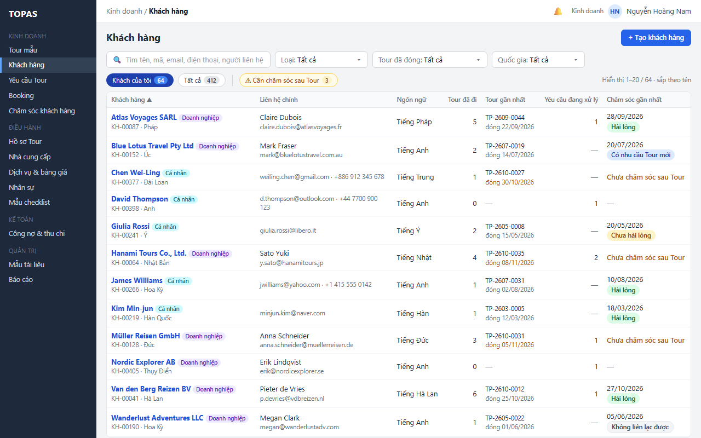

2. **W03 · Ô tìm kiếm, bộ chọn ở thanh lọc và chip.** Người dùng gõ tìm kiếm, ví dụ tên người liên hệ “schneider”, chọn bộ lọc nếu cần, rồi chọn chip Tất cả. Bộ lọc áp dụng ngay, số trên chip cập nhật. Danh sách hiện cả khách doanh nghiệp có người liên hệ trùng tên (phần khớp được tô vàng) và khách do người khác phụ trách; cột Phụ trách hiện ra. Liên kết Xóa bộ lọc xuất hiện.

   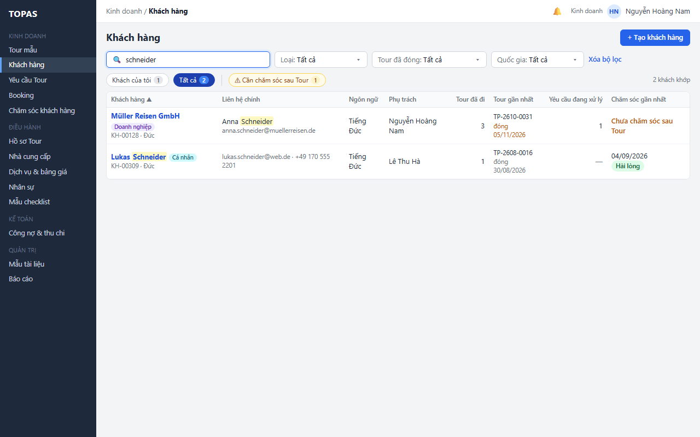

3. **W04 · Bảng khi không có dòng khớp.** Bảng hiện “Không có khách hàng khớp bộ lọc” kèm gợi ý. Người dùng bấm Xóa bộ lọc hoặc Tạo khách hàng ở tiêu đề.

   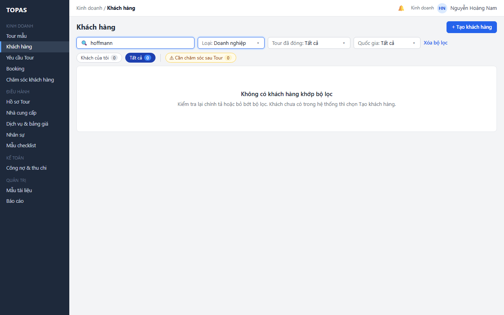

*Kết quả:* người dùng thấy đúng tập khách cần xem.

**L1.2 Chăm sóc sau Tour.** *Điều kiện:* Kinh doanh phụ trách khách.

1. **W02 · Chip Cần chăm sóc sau Tour.** Người phụ trách bấm chip. Danh sách chỉ còn khách của tôi có Tour đóng trong 30 ngày mà chưa có ghi nhận chăm sóc từ ngày đóng (R07), sắp theo ngày đóng, cũ trước.

   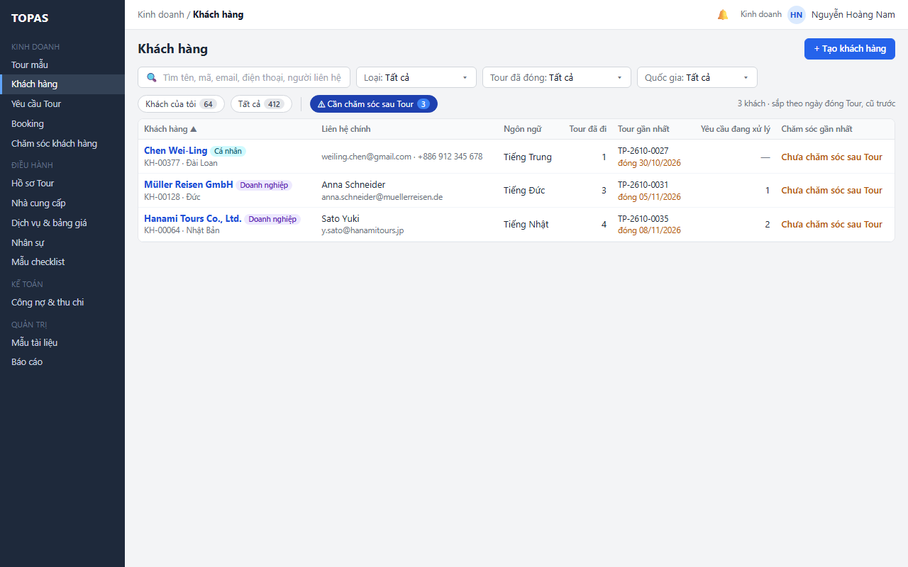

2. **W02 → W28 · Bấm dòng.** KD04 mở thẳng tab Chăm sóc và phản hồi (R10), có banner nêu Tour vừa đóng. Tiếp tục ở L8.2.
3. **W02 · Quay lại KD03.** Sau khi ghi nhận và quay lại, khách rời khỏi chip Cần chăm sóc sau Tour; số trên chip giảm theo.

*Kết quả:* mỗi khách có Tour vừa đóng đều được liên hệ và ghi nhận.

**L1.3 Mở hồ sơ và quay lại.**

1. **W01 · Bấm dòng.** Người dùng bấm một dòng (bất kỳ đâu trừ ô chọn). KD04 mở ở tab đích theo R10.
2. **W01 · Breadcrumb Khách hàng hoặc nút quay lại của trình duyệt.** KD03 hiện lại với bộ lọc, trang và vị trí cuộn như trước; dòng vừa mở được tải lại.

**Ngoại lệ**

- **E1.1 Lỗi tải danh sách (W05).** Bảng hiện “Không tải được danh sách khách hàng”, số trên chip là “–”, bộ lọc giữ nguyên. Người dùng bấm Thử lại.

  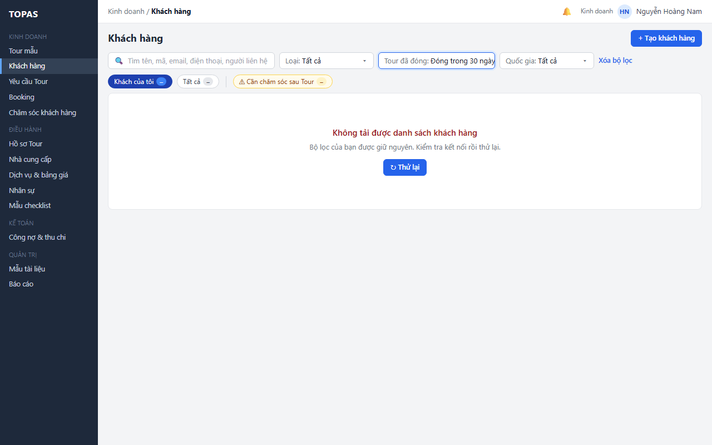

- **E1.2 Chưa có dữ liệu.** Hệ thống chưa có khách nào: bảng ghi “Chưa có khách hàng. Chọn Tạo khách hàng để bắt đầu”. Người dùng chưa phụ trách khách nào: chip Khách của tôi ghi “Bạn chưa phụ trách khách nào. Chọn Tất cả để tìm khách của công ty”. Khác với W04 vì không có bộ lọc nào đang áp dụng.
- **E1.3 Khách đã bị xóa hoặc vừa chuyển phụ trách khi đang xem danh sách.** Bấm dòng của khách đã xóa: thông báo ngắn “Khách hàng này không còn tồn tại”, danh sách tải lại. Khách vừa được chuyển cho người khác vẫn mở được, ở chế độ chỉ xem (W14).
- **E1.4 Không có quyền.** Điều hành, Kế toán không có mục Khách hàng; mở bằng đường dẫn thì hiện trang “Bạn không có quyền xem khách hàng”.

### 3.2. Tạo khách hàng (TN02.03 · SYS02.05)

**L2.1 Tạo khách hàng cá nhân.** *Điều kiện:* Kinh doanh.

1. **W08 · Nút Tạo khách hàng ở tiêu đề KD03 → KD04 tạo mới (form tại tab).** KD04 mở ở chế độ tạo mới, loại Cá nhân được chọn sẵn. Người dùng nhập danh xưng, họ và tên, quốc tịch; ngôn ngữ giao tiếp tự điền theo quốc tịch (nhãn Gợi ý theo quốc tịch, sửa được; R01); nhập email, điện thoại, địa chỉ, nguồn khách, ghi chú và sở thích, bật Nhận email chăm sóc khi khách đồng ý. Người phụ trách là người tạo (chỉ đọc).

   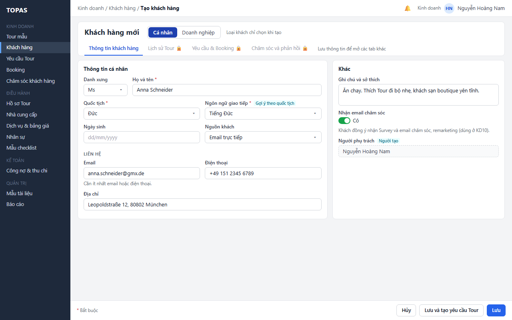

2. **W08 · Nút Lưu ở thanh dưới.** Người dùng bấm Lưu. Hệ thống kiểm tra R01, rồi kiểm tra trùng theo R02. Không trùng: lưu ngay.
3. **W12 · Phần đầu và thông báo ngắn.** Hồ sơ được cấp mã KH-00413 (R12). Phần đầu hiện đủ thông tin, các tab được mở, thông báo ngắn “Đã tạo khách hàng”. Màn ở lại tab Thông tin khách hàng; nút Lưu khóa với ghi chú “Chưa có thay đổi”.

   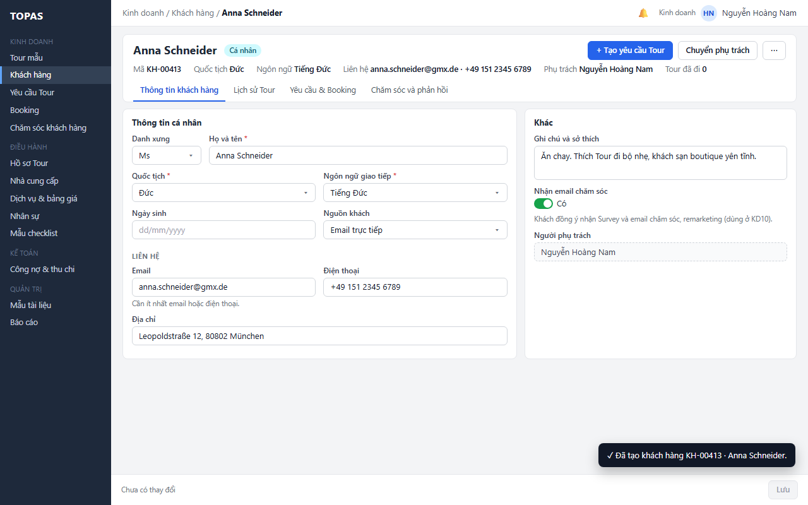

*Kết quả:* khách mới dùng được ngay khi tạo yêu cầu Tour ở KD06.1.

**L2.2 Tạo khách hàng doanh nghiệp.** *Điều kiện:* Kinh doanh.

1. **W09 · Ô chọn loại ở phần đầu → Doanh nghiệp.** Ở chế độ tạo mới, người dùng chọn Doanh nghiệp. Form đổi sang thông tin doanh nghiệp (tên, tên giao dịch, quốc gia, ngôn ngữ giao tiếp, mã số thuế, website, email chung, điện thoại, địa chỉ) và bảng Người liên hệ. Người dùng thêm người liên hệ, chọn đúng một liên hệ chính (người đầu tiên được chọn sẵn).

   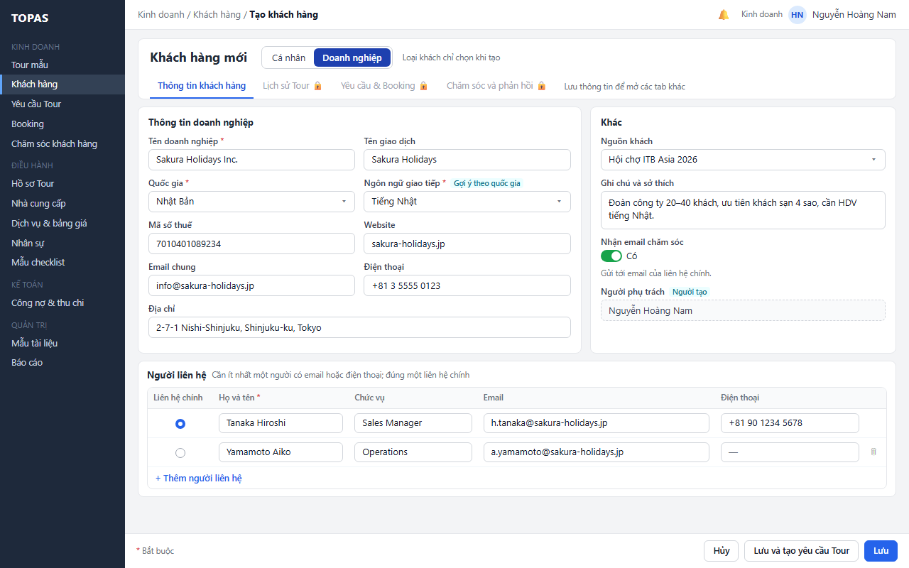

2. **W12 · Nút Lưu.** Người dùng bấm Lưu. Xử lý như bước 2–3 của L2.1; phần đầu hiện liên hệ chính.

*Kết quả:* khách doanh nghiệp có ít nhất một người liên hệ.

**L2.3 Lưu và tạo yêu cầu Tour.** *Điều kiện:* như L2.1 hoặc L2.2.

1. **W08 · Nút Lưu và tạo yêu cầu Tour ở thanh dưới.** Người dùng bấm nút này thay cho Lưu. Hệ thống lưu khách như L2.1.
2. **W27 · KD06 tạo mới.** Lưu xong, hệ thống mở KD06 tạo mới với khách hàng, liên hệ chính và ngôn ngữ phục vụ điền sẵn (L7.2).

**Ngoại lệ**

- **E2.1 Lỗi nhập (W10).** Thiếu trường bắt buộc, email sai định dạng, điện thoại sai định dạng, doanh nghiệp chưa có người liên hệ hợp lệ hoặc không có liên hệ chính: không lưu; banner “Còn n lỗi” ở đầu form, ô lỗi tô đỏ và ghi lý do. Dữ liệu đã nhập giữ nguyên.

  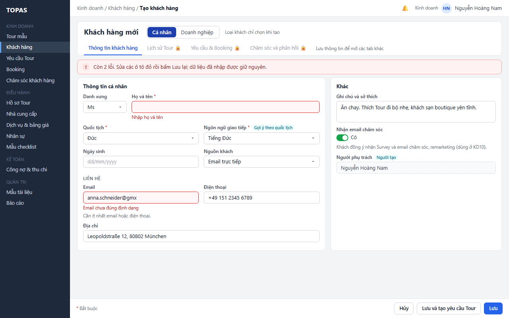

- **E2.2 Đổi loại khi đã nhập.** Đổi từ Cá nhân sang Doanh nghiệp (hoặc ngược lại) khi đã nhập dữ liệu: các trường chung (quốc gia, ngôn ngữ, email, điện thoại, địa chỉ, nguồn khách, ghi chú) được giữ; email và điện thoại của cá nhân chuyển thành người liên hệ đầu tiên khi đổi sang Doanh nghiệp. Sau khi lưu, không đổi được loại (R01).
- **E2.3 Có thể trùng (W11).** Hộp thoại liệt kê các hồ sơ trùng theo R02, mỗi dòng có trường trùng, người phụ trách, số Tour đã đi và nút Mở hồ sơ. Người dùng chọn một trong ba cách:
  - Mở hồ sơ: bỏ phần đang nhập (hỏi xác nhận như W15) và mở KD04 của hồ sơ đã có. Đây là cách không tạo trùng của SYS02.04.
  - Quay lại sửa: đóng hộp thoại, giữ nguyên form.
  - Vẫn tạo khách hàng: chỉ bấm được khi đã nhập lý do; hệ thống lưu khách và lưu lý do vào lịch sử hồ sơ.

  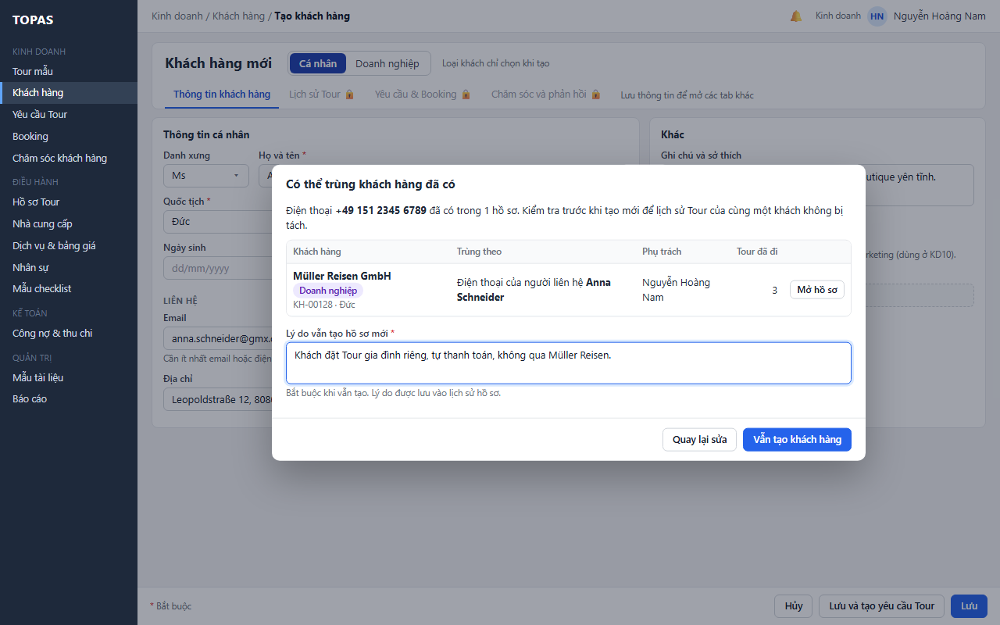

- **E2.4 Hủy tạo.** Bấm Hủy hoặc rời trang khi đã nhập: hỏi xác nhận như W15; chưa nhập gì thì về KD03 ngay. Không có bản nháp.
- **E2.5 Lỗi lưu hoặc mất kết nối.** Thông báo “Chưa lưu được. Thử lại”, form giữ nguyên. Bấm Lưu lặp chỉ tạo một hồ sơ (khóa nút khi đang lưu; máy chủ chống tạo lặp theo mã yêu cầu của lần bấm).
- **E2.6 Danh mục bị tắt.** Quốc gia, ngôn ngữ hoặc nguồn khách bị tắt ở QT05 trong lúc đang nhập: lưu bị chặn ở ô đó với lý do “Giá trị đã ngừng sử dụng, chọn giá trị khác”.

### 3.3. KD04.1 · Cập nhật thông tin khách hàng (TN02.03)

**L3.1 Sửa thông tin.** *Điều kiện:* người phụ trách.

1. **W13 · Tab Thông tin khách hàng, form tại tab.** Người phụ trách mở tab và sửa trực tiếp trên form. Ô vừa sửa ghi giá trị trước; thanh dưới hiện “● n thay đổi chưa lưu” cùng Hủy thay đổi và Lưu.

   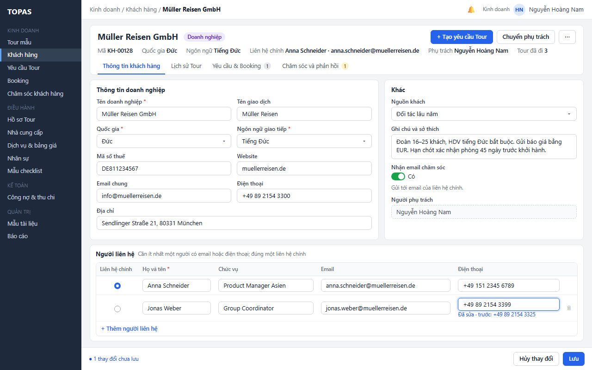

2. **W13 · Nút Lưu ở thanh dưới.** Người phụ trách bấm Lưu (hoặc Hủy thay đổi). Hệ thống kiểm tra R01; kiểm tra trùng theo R02 nếu tên, email, điện thoại, mã số thuế hoặc người liên hệ đổi; lưu form và bảng người liên hệ trong một giao dịch. Lưu xong: thông báo ngắn “Đã lưu”, thanh dưới về “Chưa có thay đổi”, phần đầu cập nhật.

*Kết quả:* thông tin mới dùng cho yêu cầu Tour tạo sau đó. Yêu cầu, Booking và hồ sơ Tour đã có giữ dữ liệu đã lưu của chúng.

**Ngoại lệ**

- **E3.1 Người không phụ trách mở hồ sơ (W14).** Mọi ô chỉ đọc (viền nét đứt), không có thanh Lưu; phần đầu ghi “🔒 Chỉ xem · do … phụ trách”. Người dùng vẫn bấm được Tạo yêu cầu Tour.

  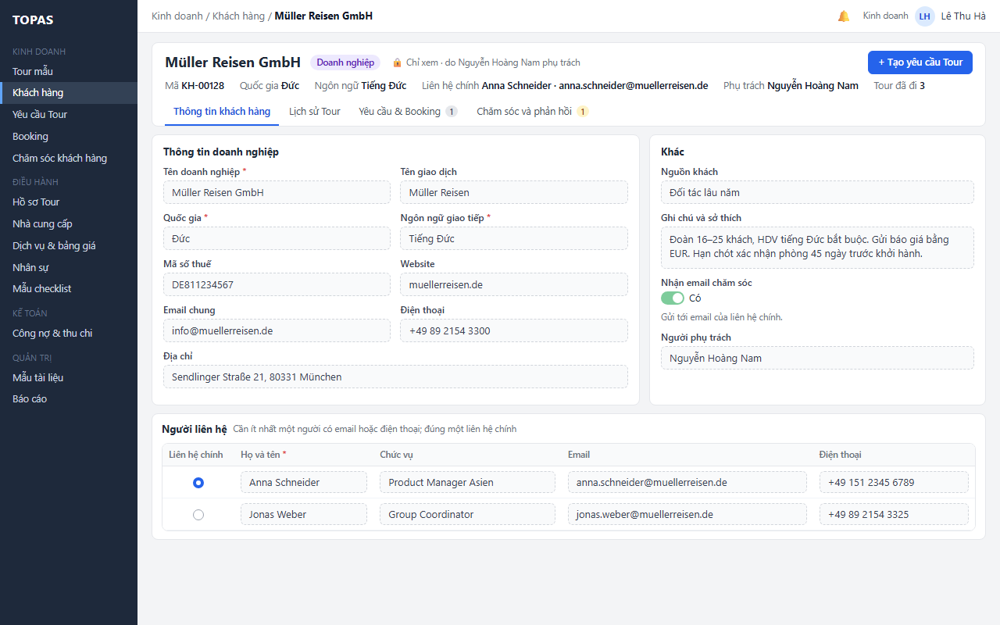

- **E3.2 Rời hồ sơ hoặc đổi tab khi chưa lưu (W15).** Hộp thoại nêu thay đổi sẽ mất; Ở lại (mặc định) hoặc Bỏ thay đổi và rời đi.

  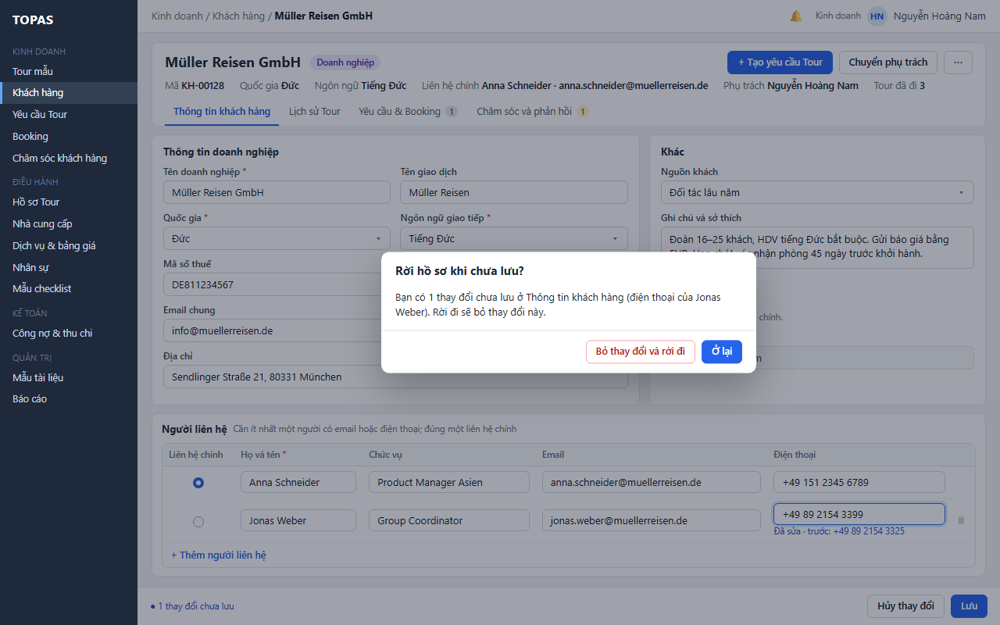

- **E3.3 Lỗi nhập và trùng.** Như E2.1 (W10) và E2.3 (W11). Cặp hồ sơ đã xác nhận không trùng (đã ghi lý do) thì không hỏi lại.
- **E3.4 Hồ sơ đã được sửa ở phiên khác (W16).** Lưu bị từ chối. Banner ở đầu form nêu ai sửa, lúc nào, trường nào; thay đổi của người dùng vẫn trên màn hình; Lưu khóa. Người dùng bấm Tải bản mới, giữ thay đổi của tôi: hệ thống nạp bản mới và đặt lại các ô người dùng đã sửa; ô bị cả hai bên sửa hiện thêm dòng “Bản mới: …” để người dùng chọn. Sau đó Lưu như bước 2.

  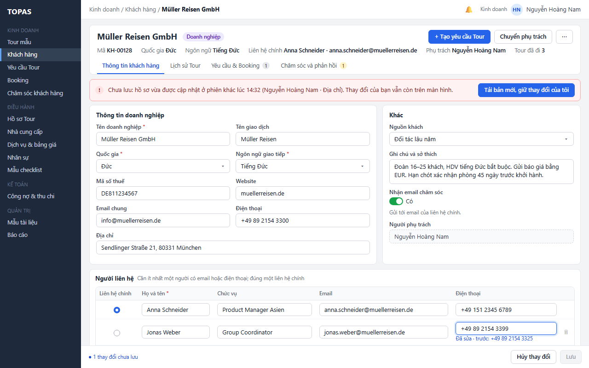

- **E3.5 Mất quyền khi đang sửa.** Quản trị chuyển khách cho người khác trong lúc người phụ trách đang sửa: Lưu bị từ chối, banner cùng vị trí với W16 ghi “Chưa lưu: bạn không còn phụ trách khách hàng này (chuyển cho … lúc …)” và liệt kê các ô đã sửa để người dùng báo người phụ trách mới; form chuyển sang chỉ xem như W14.
- **E3.6 Bỏ người liên hệ.** Không bỏ được liên hệ chính khi chưa chọn liên hệ chính khác (biểu tượng xóa không hiện trên dòng liên hệ chính). Bỏ người liên hệ không đổi yêu cầu Tour đã ghi tên người đó.
- **E3.7 Lỗi tải hồ sơ.** Hiện “Không tải được hồ sơ khách hàng” và Thử lại; không hiện form trống.

### 3.4. Chuyển người phụ trách (quyết định 11/11/2026)

**L4.1 Chuyển một khách.** *Điều kiện:* người phụ trách hoặc Quản trị hệ thống.

1. **W17 · Nút Chuyển phụ trách ở phần đầu → hộp thoại.** Hộp thoại hiện người phụ trách hiện tại, ô Người phụ trách mới (chỉ người dùng Kinh doanh đang hoạt động, trừ người hiện tại) và Ghi chú bàn giao. Ghi chú nhỏ nêu yêu cầu Tour, Booking, hồ sơ Tour không đổi người phụ trách. Người dùng chọn người mới, ghi chú nếu cần.

   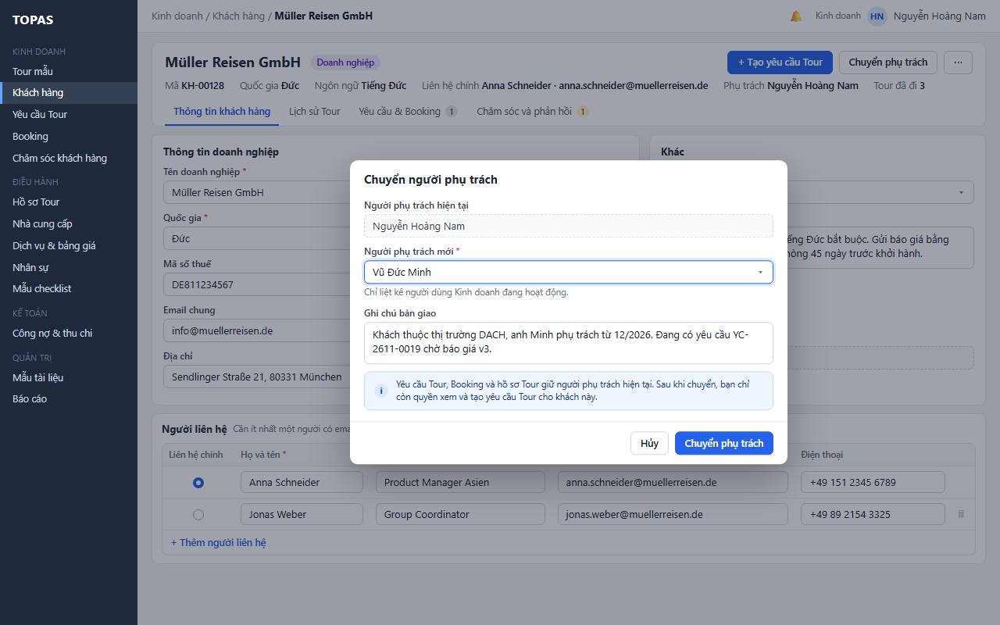

2. **W18 · Nút Chuyển phụ trách trong hộp thoại → phần đầu và thông báo ngắn.** Người dùng bấm Chuyển phụ trách. Hệ thống kiểm tra R04, ghi người phụ trách mới, lưu ghi chú vào lịch sử hồ sơ, gửi thông báo nội bộ cho người mới (kèm ghi chú). Phần đầu đổi người phụ trách, kèm thông báo ngắn; với người phụ trách cũ, hồ sơ chuyển sang chỉ xem.

   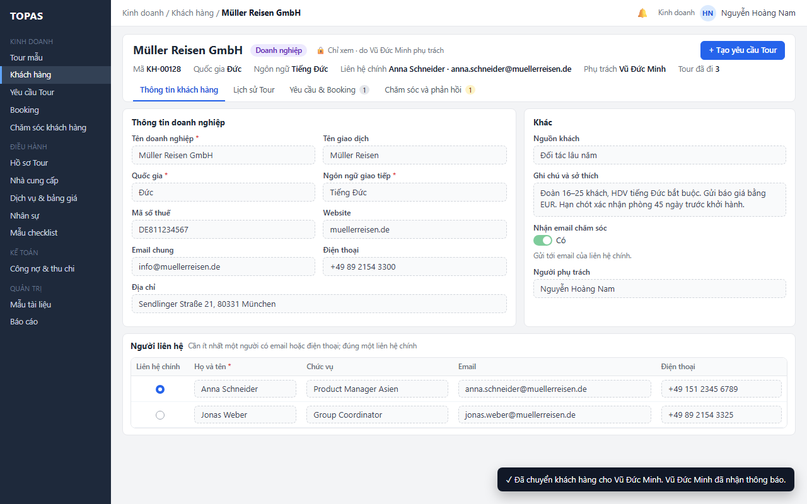

*Kết quả:* chỉ người phụ trách mới sửa được hồ sơ và ghi nhận chăm sóc.

**L4.2 Chuyển hàng loạt ở KD03.** *Điều kiện:* Quản trị hệ thống.

1. **W06 · Bộ lọc Phụ trách, ô chọn đầu bảng và trên dòng → thanh hàng loạt.** Quản trị mở KD03, chọn Phụ trách là người cần bàn giao (ví dụ Lê Thu Hà nghỉ việc), chọn ô đầu bảng để chọn mọi dòng trong trang (hoặc chọn từng dòng). Thanh hàng loạt hiện số khách đã chọn, ô chọn người nhận ngay trên thanh và nút Chuyển phụ trách; nút khóa khi chưa chọn người nhận. Khi kết quả lọc nhiều hơn một trang, thanh có thêm liên kết “Chọn tất cả n khách khớp bộ lọc” (R04).

   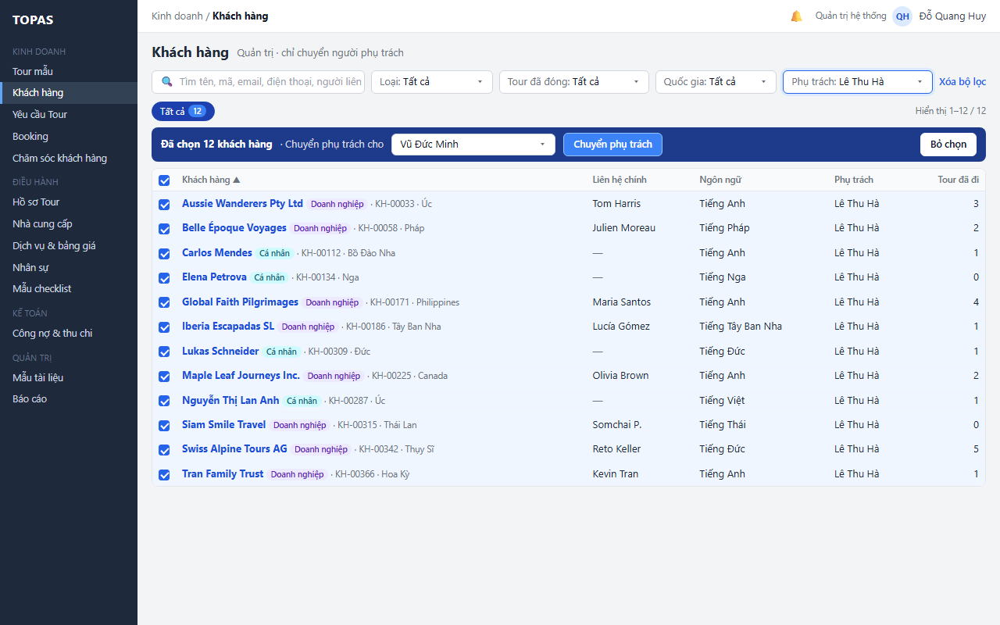

2. **W07 · Nút Chuyển phụ trách trên thanh hàng loạt → banner kết quả.** Quản trị chọn người nhận rồi bấm Chuyển phụ trách. Hệ thống chuyển từng khách theo R04. Banner nêu số khách đã chuyển và số bỏ qua; dòng bỏ qua ghi lý do. Các dòng giữ tại chỗ (mờ, nhãn Vừa chuyển) đến khi tải lại. Người nhận nhận một thông báo gộp.

   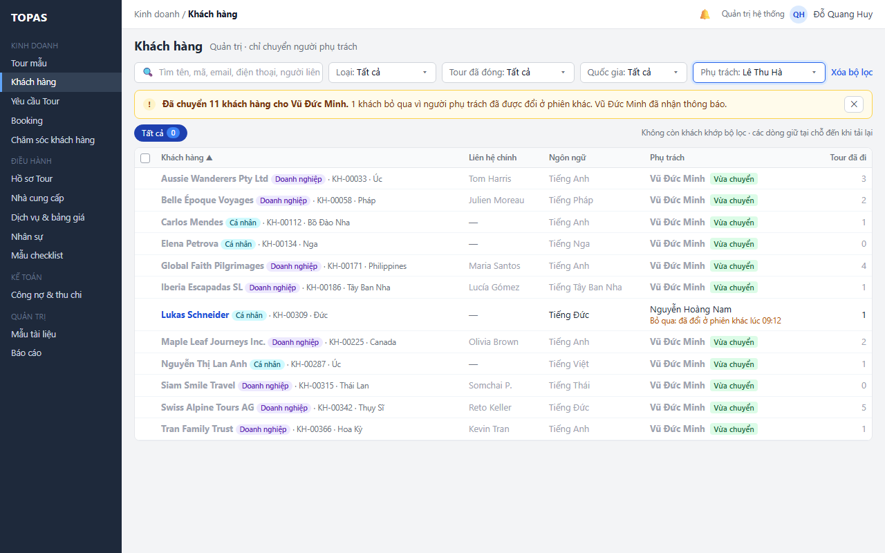

**Ngoại lệ**

- **E4.1 Người nhận không hợp lệ.** Chọn chính người hiện tại hoặc người dùng vừa bị khóa ở QT01: nút Chuyển phụ trách khóa, ghi lý do cạnh ô.
- **E4.2 Khách đã đổi ở phiên khác.** Khi chuyển, khách mà người phụ trách đã khác với lúc tải: một khách thì báo “Người phụ trách đã đổi thành … Tải lại để xem”; hàng loạt thì bỏ qua dòng đó và ghi lý do (W07).
- **E4.3 Người phụ trách đã ngừng hoạt động.** Tài khoản bị khóa ở QT01 vẫn hiện là người phụ trách, kèm “(ngừng hoạt động)”; chỉ Quản trị chuyển được các khách này (L4.2).
- **E4.4 Lỗi giữa chừng khi chuyển hàng loạt.** Mỗi khách là một giao dịch riêng. Mất kết nối giữa chừng: banner nêu số đã chuyển; các dòng còn lại vẫn được chọn để bấm lại. Bấm lặp không chuyển hai lần.

### 3.5. Xóa khách hàng (quyết định 11/11/2026)

**L5.1 Xóa khách chưa dùng.** *Điều kiện:* người phụ trách; khách chưa có yêu cầu Tour và chưa có lần gửi chiến dịch nào, kể cả Gửi lỗi (R05).

1. **W19 · Menu ⋯ ở phần đầu → Xóa khách hàng → hộp thoại.** Người phụ trách bấm ⋯ rồi Xóa khách hàng. Hộp thoại nêu khách chưa được dùng và những gì sẽ bị xóa.

   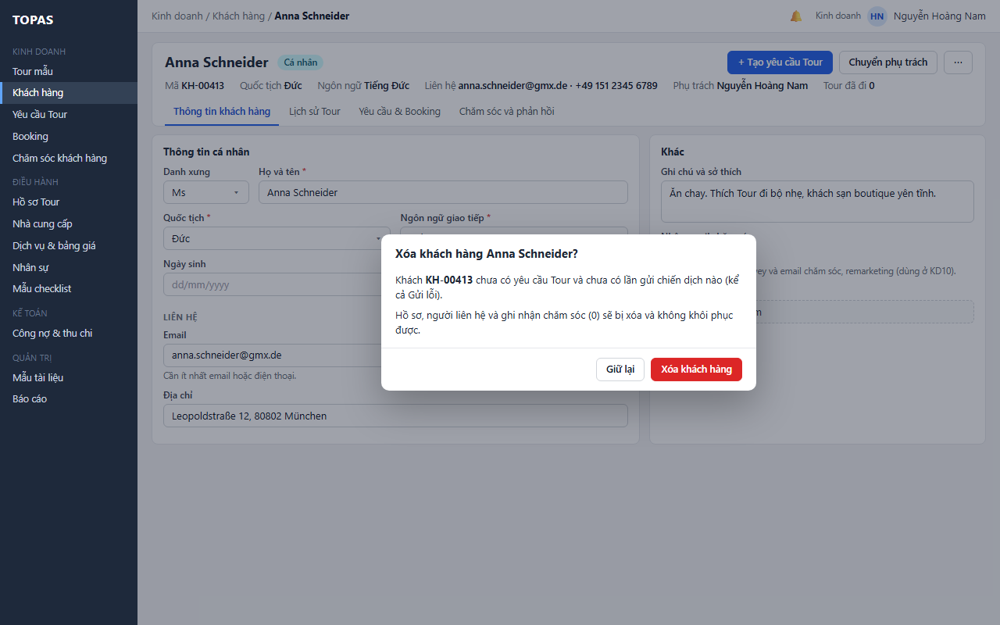

2. **W19a · Nút Xóa khách hàng trong hộp thoại → KD03.** Người phụ trách bấm Xóa khách hàng. Hệ thống kiểm tra lại R05, xóa hồ sơ, người liên hệ và ghi nhận chăm sóc, ghi nhật ký QT03, rồi về KD03 với bộ lọc cũ và thông báo ngắn.

   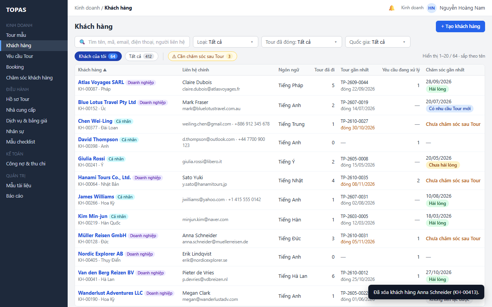

**Ngoại lệ**

- **E5.1 Khách đã được dùng (W20).** Mục Xóa khách hàng trong menu ⋯ bị khóa và ghi lý do theo điều kiện chặn: “khách đã có n yêu cầu Tour”, “khách đã có n lần gửi chiến dịch” (kể cả Gửi lỗi), hoặc cả hai, ví dụ “Không xóa được: khách đã có 6 yêu cầu Tour và 4 lần gửi chiến dịch”.

  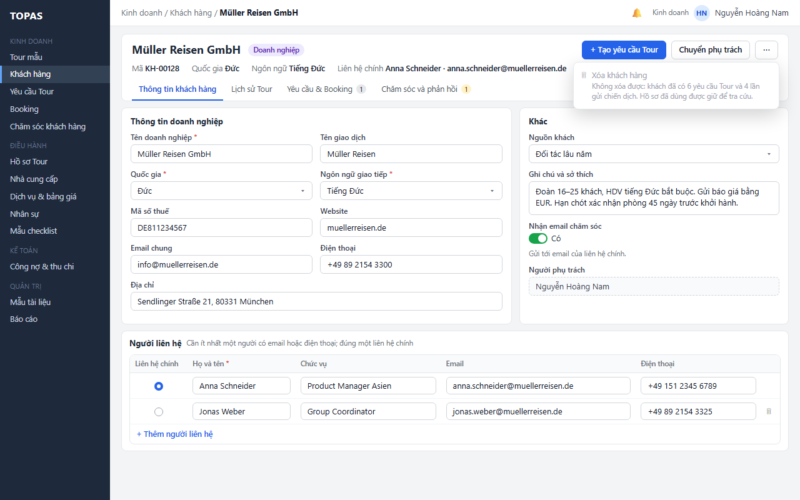

- **E5.2 Khách vừa được dùng sau khi mở hộp thoại.** Có người tạo yêu cầu Tour cho khách, hoặc KD10 vừa tạo lần gửi chiến dịch cho khách, trong lúc hộp thoại đang mở: xóa bị từ chối, hộp thoại đóng, thông báo “Không xóa được: khách vừa có yêu cầu Tour” hoặc “Không xóa được: khách vừa có lần gửi chiến dịch”; menu chuyển sang W20.

### 3.6. KD04.2 · Lịch sử Tour (TN10.01 · SYS10.02 · SYS09.04)

**L6.1 Ghi lịch sử khi đóng Tour.** *Điều kiện:* Điều hành đóng Tour bằng nút Đóng Tour ở header DH08 (RSD DH08 L8.3, R16); hồ sơ không kết thúc vì Booking đã hủy (R06).

1. **W21 · Không có thao tác ở KD04; dòng mới hiện trong bảng.** Hệ thống tạo đúng một mục lịch sử theo Tour Code cho khách của Booking: Tour Code, Booking, thời gian, số khách, hành trình, dịch vụ đã sử dụng gom theo loại dịch vụ, ngày đóng (R06). Số Tour đã đi ở phần đầu và ở KD03 tăng; khách vào Cần chăm sóc sau Tour (R07).

**L6.2 Xem lịch sử Tour.** *Điều kiện:* Kinh doanh hoặc Quản trị.

1. **W21 · Tab Lịch sử Tour; “n dịch vụ” trên dòng.** Người dùng mở tab Lịch sử Tour. Mỗi Tour đã đóng là một dòng, mới nhất ở trên. Bấm “n dịch vụ” để mở rộng dòng: dịch vụ đã sử dụng hiện theo loại ngay dưới dòng (tên dịch vụ, NCC, số đêm hoặc số lượng).

   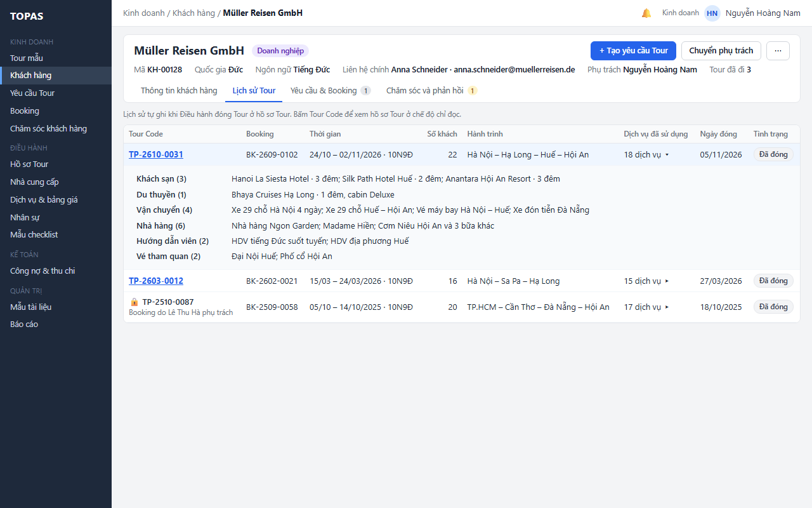

2. **W21 · Tour Code trên dòng.** Người dùng bấm Tour Code. DH08 mở ở chế độ chỉ đọc (RSD DH08 AC01). Tour mà Booking không thuộc phạm vi của người dùng có biểu tượng khóa và ghi người phụ trách Booking, không bấm được.

**L6.3 Cập nhật lịch sử khi còn thiếu.** *Điều kiện:* có Tour đã đóng quá 5 phút mà chưa có mục lịch sử.

1. **W23 · Banner đầu tab.** Tab hiện banner nêu Tour còn thiếu và nút Cập nhật lịch sử.

   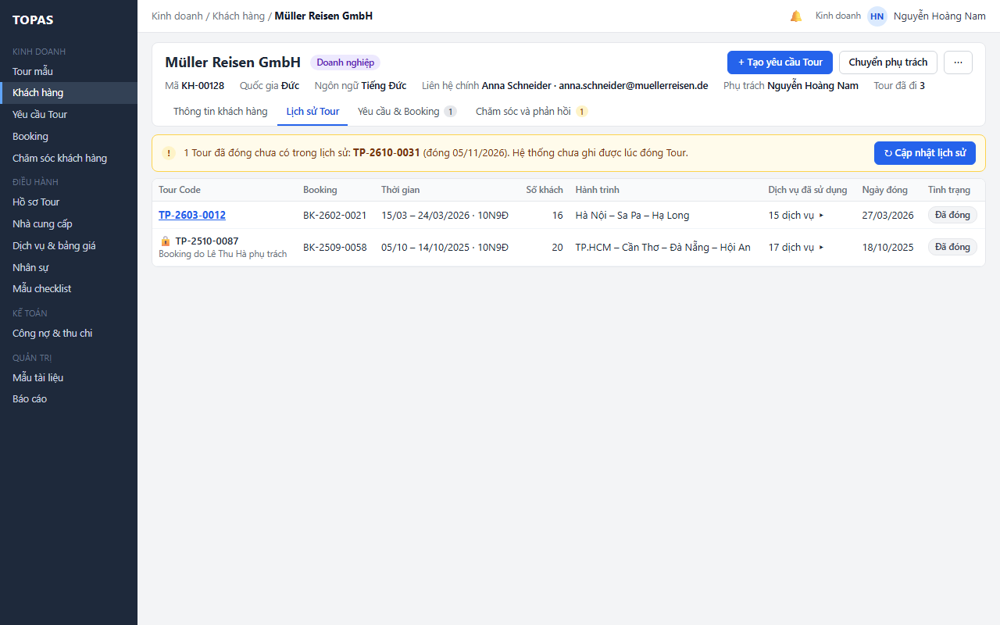

2. **W21 · Nút Cập nhật lịch sử trên banner.** Người dùng bấm Cập nhật lịch sử. Hệ thống tạo các mục còn thiếu theo Tour Code (không tạo trùng), banner biến mất, dòng mới hiện trong bảng.

**Ngoại lệ**

- **E6.1 Tour được mở lại (W22).** Khi hồ sơ được mở lại ở DH08 (RSD DH08 R16): cột Tình trạng của mục lịch sử hiện Đang cập nhật kèm ngày mở lại; danh sách dịch vụ giữ theo lần đóng trước và có ghi chú trên phần mở rộng. Đóng lại thì cập nhật cùng mục đó, không tạo mục mới (RSD DH08).

  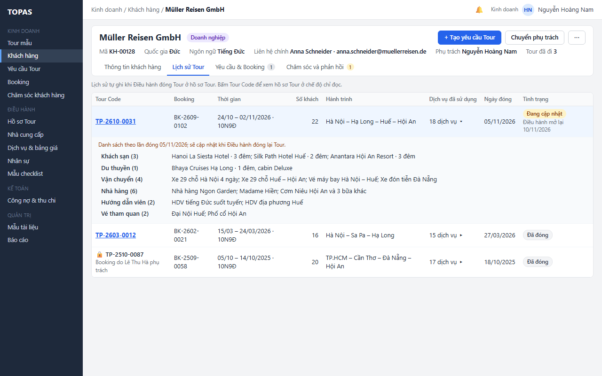

- **E6.2 Chưa có Tour đã đóng (W24).** Bảng hiện “Khách chưa có Tour đã đóng” và giải thích lịch sử tự ghi khi nào.

  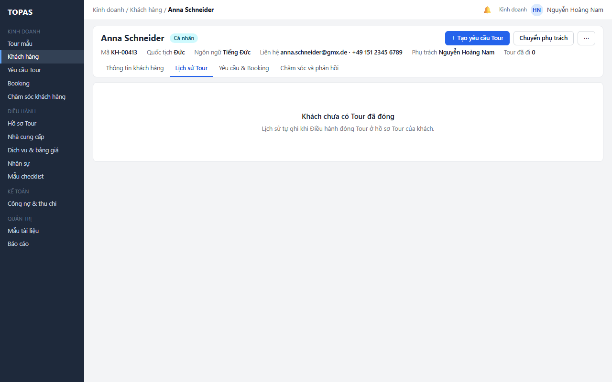

- **E6.3 Cập nhật lịch sử lỗi.** Thông báo “Chưa cập nhật được lịch sử. Thử lại”; banner W23 giữ nguyên. Hệ thống cũng tự đối soát hằng đêm (R06).
- **E6.4 Booking đổi khách sau khi đóng Tour.** Không xảy ra: Booking kế thừa khách của phiên bản báo giá và chỉ đọc (KD08). Nếu dữ liệu nguồn bị sửa bằng công cụ quản trị, mục lịch sử đi theo khách mới ở lần đối soát kế tiếp.

### 3.7. KD04.3 · Yêu cầu Tour và Booking (TN02.04 · SYS10.09 · SYS10.10)

**L7.1 Xem và mở yêu cầu, Booking.** *Điều kiện:* Kinh doanh hoặc Quản trị.

1. **W25 · Tab Yêu cầu & Booking; chip trên bảng.** Người dùng mở tab Yêu cầu & Booking. Mỗi yêu cầu Tour của khách là một dòng, mới nhất ở trên: mã và ngày tạo, thời gian đi, số khách, phiên bản báo giá mới nhất và kết quả, Booking và hồ sơ Tour nếu có, người phụ trách yêu cầu, trạng thái. Chip Đang xử lý, Đã có Booking, Đã hủy, Tất cả lọc ngay theo R08.

   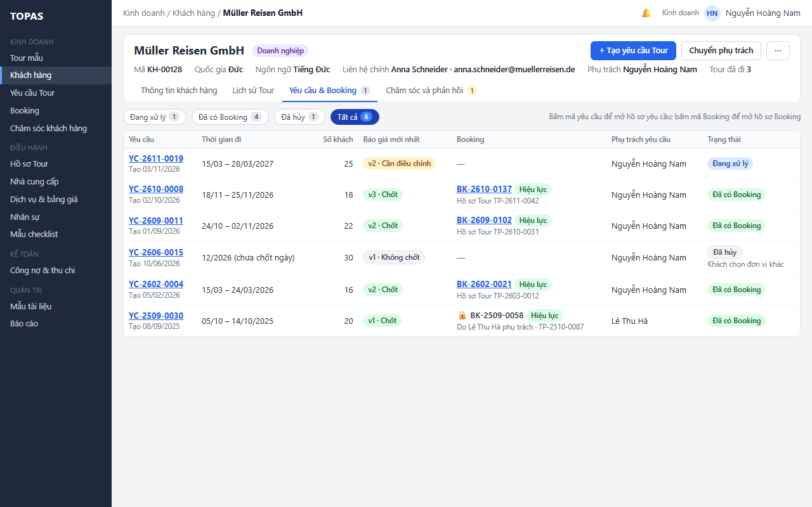

2. **W25 · Mã yêu cầu hoặc mã Booking trên dòng.** Người dùng bấm mã yêu cầu để mở KD06 của yêu cầu, hoặc bấm mã Booking để mở KD08. Booking không thuộc phạm vi của người dùng có biểu tượng khóa và ghi người phụ trách, không bấm được.

**L7.2 Tạo yêu cầu Tour từ hồ sơ khách.** *Điều kiện:* Kinh doanh.

1. **W25 · Nút chính Tạo yêu cầu Tour ở phần đầu.** Người dùng bấm Tạo yêu cầu Tour ở phần đầu hồ sơ (ở bất kỳ tab nào).
2. **W27 · KD06 tạo mới, tab Thông tin yêu cầu.** KD06 mở ở chế độ tạo mới, tab Thông tin yêu cầu, với khách hàng điền sẵn (nhãn Từ hồ sơ khách hàng), người liên hệ là liên hệ chính (Doanh nghiệp) và ngôn ngữ phục vụ lấy từ ngôn ngữ giao tiếp. Ghi chú và sở thích của khách hiện làm gợi ý. Người dùng nhập nhu cầu Tour và lưu theo RSD KD06.

   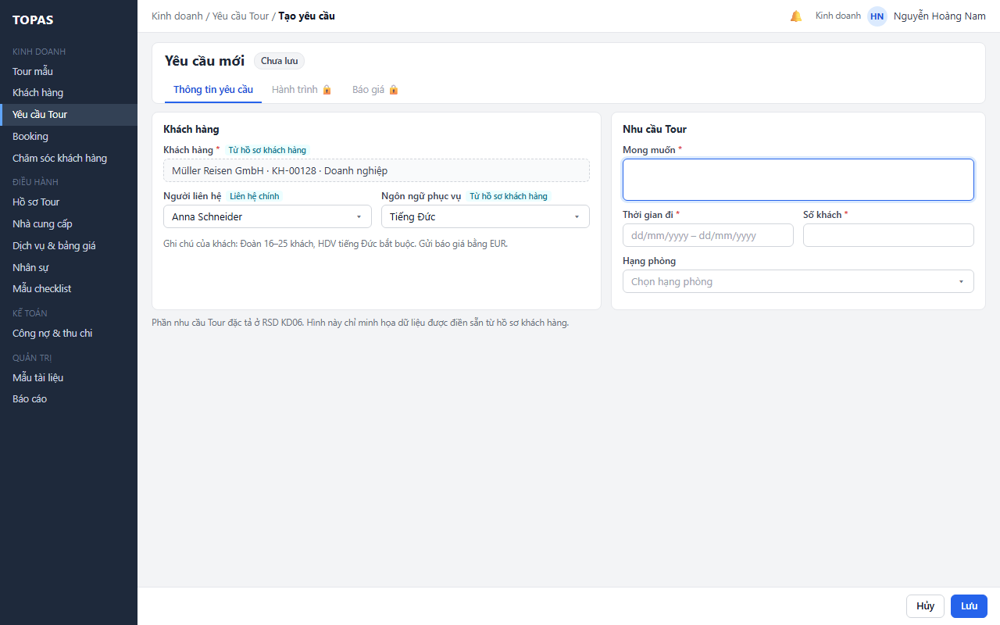

*Kết quả:* yêu cầu Tour mới gắn với khách, không phải tìm lại khách (SYS10.09 → SYS10.10). Yêu cầu chỉ được tạo khi lưu ở KD06; hủy ở KD06 thì không có gì được tạo.

**Ngoại lệ**

- **E7.1 Khách chưa có yêu cầu (W26).** Bảng hiện “Khách chưa có yêu cầu Tour” và chỉ tới nút Tạo yêu cầu Tour ở phần đầu.

  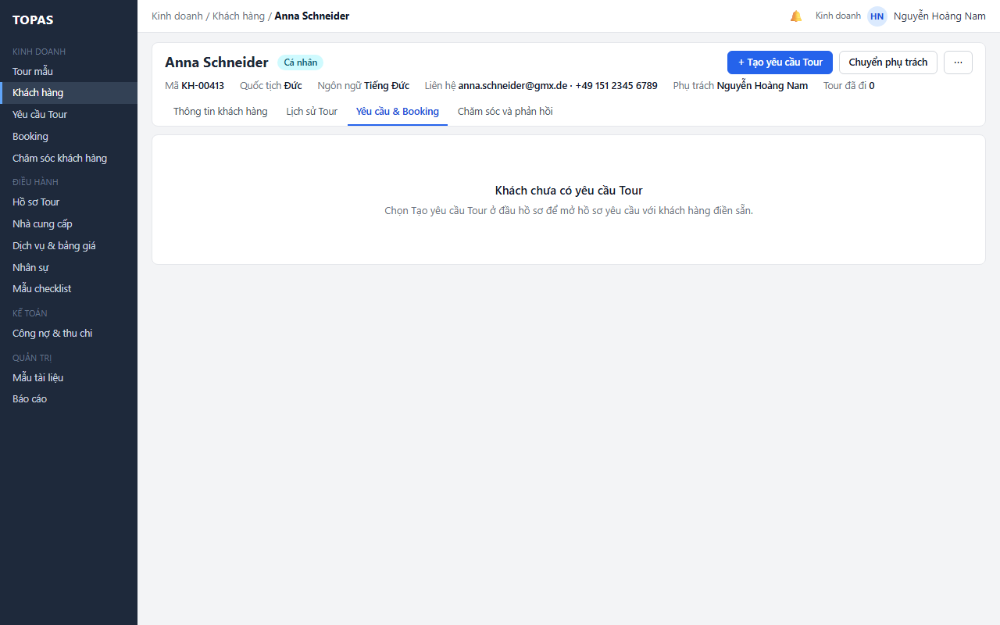

- **E7.2 Chip không có dòng.** Ví dụ chip Đã hủy có 0: bảng ghi “Không có yêu cầu ở nhóm này”.
- **E7.3 Một yêu cầu có nhiều Booking.** Ô Booking liệt kê từng Booking trên một dòng (số Booking tối đa cho một yêu cầu do RSD KD06 quy định).
- **E7.4 Lỗi tải.** Bảng hiện “Không tải được yêu cầu và Booking” và Thử lại; phần đầu và các tab khác không bị ảnh hưởng.

### 3.8. KD04.4 · Chăm sóc và phản hồi (TN10.03 · SYS10.05)

**L8.1 Xem lịch sử chăm sóc.** *Điều kiện:* Kinh doanh hoặc Quản trị.

1. **W28 · Tab Chăm sóc và phản hồi; chip loại trên dòng thời gian.** Người dùng mở tab. Dòng thời gian gồm ghi nhận chăm sóc, các lần gửi Survey (kèm phản hồi nếu có) và email chiến dịch, mới nhất ở trên (R09); bấm chip loại để lọc ngay. Khách Cần chăm sóc sau Tour thì banner đầu tab nêu Tour vừa đóng (“Tour … đóng ngày …, chưa có ghi nhận chăm sóc sau Tour”).

   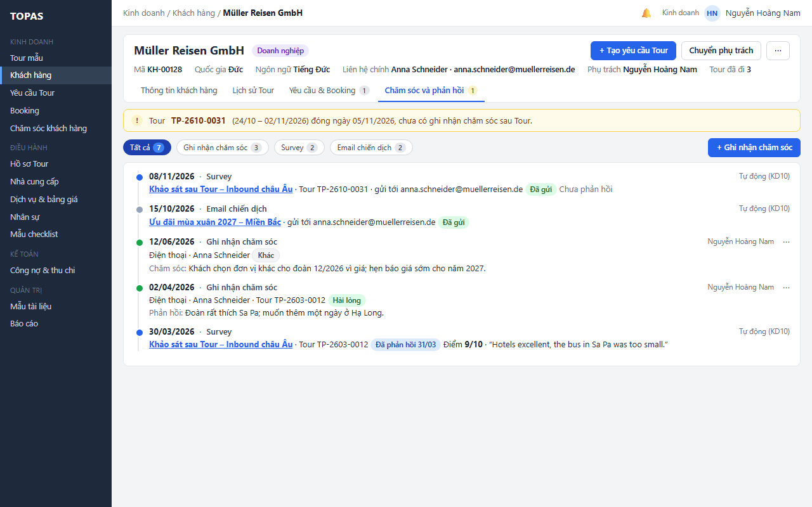

**L8.2 Ghi nhận chăm sóc.** *Điều kiện:* người phụ trách.

1. **W29 · Nút Ghi nhận chăm sóc ở thanh trên → hộp thoại.** Người phụ trách bấm Ghi nhận chăm sóc. Hộp thoại điền sẵn ngày chăm sóc là hôm nay, người liên hệ là liên hệ chính và Tour liên quan là Tour đóng gần nhất chưa được chăm sóc (R09). Người dùng chọn kênh, nhập phản hồi của khách, nội dung chăm sóc và kết quả.

   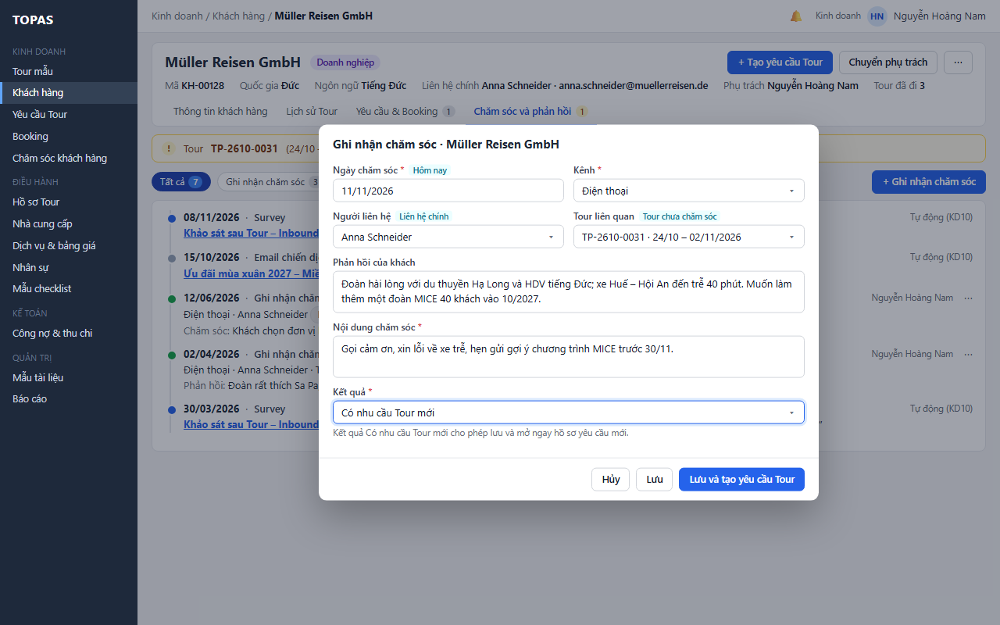

2. **W30 · Nút Lưu trong hộp thoại → dòng thời gian và thông báo ngắn.** Người dùng bấm Lưu. Hệ thống kiểm tra rồi ghi. Mục mới ở đầu dòng thời gian (nền xanh, nhãn Vừa lưu), kèm thông báo ngắn; banner nhắc và số trên tab biến mất; số trên chip tăng; khách rời chip Cần chăm sóc sau Tour ở KD03.

   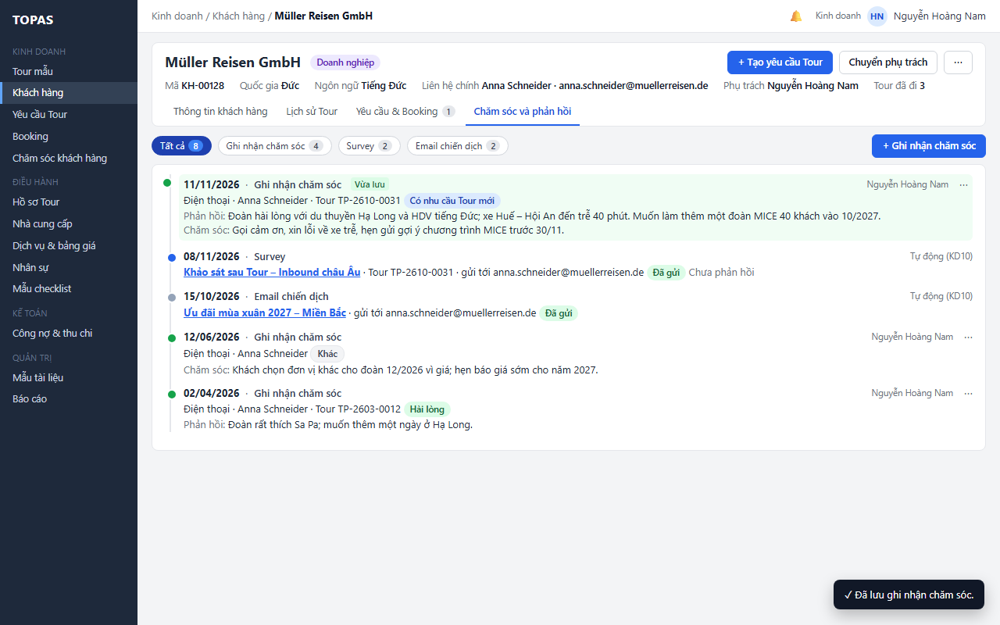

3. **W27 · Nút Lưu và tạo yêu cầu Tour trong hộp thoại.** Khi kết quả là Có nhu cầu Tour mới, người dùng có thể bấm Lưu và tạo yêu cầu Tour: hệ thống lưu như bước 2 rồi mở KD06 tạo mới như L7.2; phần Mong muốn được điền sẵn phản hồi của khách.

**L8.3 Sửa hoặc xóa ghi nhận chăm sóc.** *Điều kiện:* người phụ trách; chỉ ghi nhận do người dùng nhập, không áp dụng cho lần gửi Survey, email.

1. **W29 · Menu ⋯ trên mục → Sửa → hộp thoại.** Người phụ trách bấm ⋯ trên mục rồi Sửa. Hộp thoại W29 mở với dữ liệu của mục; Lưu ghi đè và ghi người, thời điểm sửa.
2. **W30 · Menu ⋯ trên mục → Xóa.** Người phụ trách bấm ⋯ rồi Xóa. Mục biến mất; thông báo ngắn có Hoàn tác trong 10 giây. Xóa có thể làm khách trở lại Cần chăm sóc sau Tour (R07).

**Ngoại lệ**

- **E8.1 Người không phụ trách (W31).** Xem được toàn bộ dòng thời gian; nút Ghi nhận chăm sóc ở thanh trên khóa, ghi “Chỉ người phụ trách (…) ghi nhận chăm sóc”; không có menu ⋯ trên mục.

  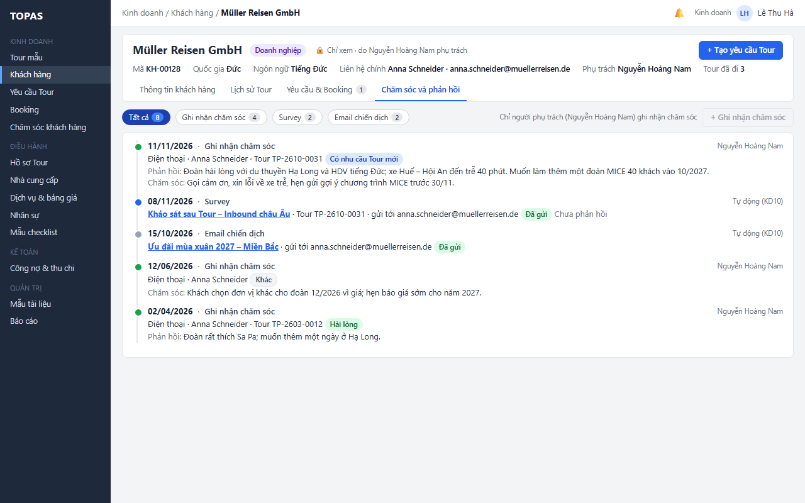

- **E8.2 Lỗi nhập.** Thiếu kênh, nội dung chăm sóc hoặc kết quả; ngày chăm sóc sau hôm nay: không lưu, lỗi cạnh ô, hộp thoại giữ dữ liệu.
- **E8.3 Lỗi lưu hoặc bấm lặp.** Thông báo “Chưa lưu được. Thử lại”, hộp thoại giữ nguyên. Nút khóa khi đang lưu; máy chủ chỉ ghi một mục cho một lần bấm.
- **E8.4 Mất quyền giữa chừng.** Khách được chuyển cho người khác trong lúc hộp thoại đang mở: lưu bị từ chối, thông báo “Bạn không còn phụ trách khách hàng này”; nội dung đã nhập hiện trong hộp thoại để sao chép.
- **E8.5 Chưa có hoạt động.** Dòng thời gian trống: “Chưa có hoạt động chăm sóc. Survey và email chiến dịch gửi cho khách sẽ tự hiện ở đây.”
- **E8.6 Khách không nhận email chăm sóc.** Khách tắt Nhận email chăm sóc: phần đầu dòng thời gian ghi “Khách không nhận email chăm sóc từ …”; KD10 không gửi cho khách này (R11). Ghi nhận chăm sóc thủ công vẫn dùng được.

---

## 4. Quy tắc triển khai chi tiết

### R01. Loại khách hàng và dữ liệu bắt buộc (quyết định 11/11/2026)

- Hai loại: **Cá nhân** (một người) và **Doanh nghiệp** (đại lý, công ty, tổ chức; có một hoặc nhiều người liên hệ). Loại chỉ chọn khi tạo; sau khi lưu không đổi được. Tạo nhầm loại thì xóa (nếu chưa dùng, R05) và tạo lại.
- Cá nhân bắt buộc: họ và tên, quốc tịch, ngôn ngữ giao tiếp, và ít nhất một trong email, điện thoại.
- Doanh nghiệp bắt buộc: tên doanh nghiệp, quốc gia, ngôn ngữ giao tiếp, ít nhất một người liên hệ có họ và tên và có email hoặc điện thoại, đúng một liên hệ chính.
- Ngôn ngữ giao tiếp được gợi ý theo cột “Ngôn ngữ mặc định” của danh mục quốc gia (QT05) khi ô đang trống hoặc vẫn là giá trị gợi ý trước đó; người dùng đã tự chọn thì không ghi đè. Quốc gia chưa khai ngôn ngữ mặc định thì để trống.
- Liên hệ chính của doanh nghiệp là người nhận mặc định khi tạo yêu cầu Tour (KD06) và khi KD10 gửi email chăm sóc.

### R02. Chuẩn hóa và kiểm tra trùng (TN02.02, TN02.03)

- **Chuẩn hóa.** Email: bỏ khoảng trắng, chữ thường. Điện thoại: lưu dạng quốc tế `+<mã quốc gia><số>`; người dùng nhập số bắt đầu bằng 0 thì hệ thống bỏ số 0 và thêm mã của quốc gia đang chọn; so sánh theo chuỗi chữ số. Tên doanh nghiệp: bỏ dấu, chữ thường, bỏ ký tự không phải chữ hoặc số, gộp khoảng trắng. Mã số thuế: chữ hoa, bỏ khoảng trắng và dấu gạch.
- **Hồ sơ có thể trùng** với hồ sơ đang lưu khi có ít nhất một điều kiện:
  1. Email trùng với email của khách cá nhân, email chung của doanh nghiệp hoặc email của người liên hệ thuộc khách khác.
  2. Điện thoại trùng tương tự.
  3. Doanh nghiệp: mã số thuế trùng; hoặc tên chuẩn hóa trùng và cùng quốc gia.
- Tên của khách cá nhân không dùng để kiểm tra trùng.
- **Khi kiểm tra.** Khi bấm Lưu lúc tạo; khi sửa mà một trong các trường trên đổi. Máy chủ kiểm tra lại ngay trước khi ghi (hai người cùng tạo một khách thì người lưu sau thấy hộp thoại).
- **Cảnh báo, không chặn.** Hộp thoại W11 liệt kê tối đa 10 hồ sơ, mỗi dòng ghi trường trùng. Vẫn tạo hoặc vẫn lưu cần lý do; hệ thống lưu cặp hồ sơ đã xác nhận không trùng để không hỏi lại.
- Tạo nhanh khách ở KD06.1 dùng cùng quy tắc và cùng hộp thoại.

### R03. Người phụ trách và quyền sửa (quyết định 11/11/2026)

- Mỗi khách có đúng một người phụ trách là người dùng có vai trò Kinh doanh. Khi tạo, người phụ trách là người tạo.
- Chỉ người phụ trách hiện tại được: sửa KD04.1, ghi, sửa, xóa ghi nhận chăm sóc, xóa khách, chuyển phụ trách. Quản trị hệ thống được chuyển phụ trách (một khách hoặc hàng loạt), không sửa nội dung.
- Mọi người Kinh doanh xem được mọi khách và tạo được yêu cầu Tour cho bất kỳ khách nào; người phụ trách của yêu cầu là người tạo yêu cầu (RSD KD06).
- Quyền mở KD08, DH08 từ KD04 theo phạm vi của chính các màn đó (Kinh doanh: Booking và hồ sơ Tour mình phụ trách, theo `BOI-CANH-DU-AN.md`; Quản trị hệ thống: mở KD08, DH08 chỉ xem, chuyển người phụ trách Booking theo RSD KD08).

### R04. Chuyển người phụ trách (quyết định 11/11/2026)

- Người nhận: người dùng có vai trò Kinh doanh, đang hoạt động ở QT01, khác người hiện tại.
- Chuyển chỉ đổi người phụ trách khách. Yêu cầu Tour, Booking, hồ sơ Tour, ghi nhận chăm sóc đã có giữ nguyên người phụ trách và người ghi.
- Hàng loạt: chỉ Quản trị, ở KD03. “Chọn tất cả” ở đầu bảng chỉ chọn các dòng trong trang. Khi kết quả lọc nhiều hơn một trang, thanh hàng loạt có liên kết “Chọn tất cả n khách khớp bộ lọc”; chỉ khi bấm liên kết này hệ thống mới áp dụng cho mọi kết quả lọc, và số n được ghi lại trên nút. Mỗi khách là một giao dịch; khách mà người phụ trách đã khác lúc tải thì bỏ qua và ghi lý do.
- Thông báo nội bộ: người mới nhận một thông báo (hàng loạt thì gộp, ví dụ “Bạn được giao 11 khách hàng từ Lê Thu Hà”), có ghi chú bàn giao. Người mới bấm thông báo để mở KD04 của khách hoặc KD03 lọc theo mình. Khi Quản trị chuyển, người cũ cũng nhận thông báo nếu tài khoản còn hoạt động.
- Ghi lịch sử hồ sơ và QT03: người cũ, người mới, người thực hiện, ghi chú.

### R05. Xóa khách hàng (quyết định 11/11/2026)

- Chỉ người phụ trách xóa được, và chỉ khi khách **chưa được dùng**: không có yêu cầu Tour nào (kể cả đã hủy) và chưa có lần gửi chiến dịch nào ở KD10 (Survey hoặc email Remarketing, mọi kết quả gửi, kể cả Gửi lỗi).
- **Lý do chặn** hiện ở mục Xóa khách hàng trong menu ⋯ (W20): “đã có n yêu cầu Tour”, “đã có n lần gửi chiến dịch”, hoặc cả hai.
- Xóa là xóa hẳn hồ sơ, người liên hệ, ghi nhận chăm sóc và lịch sử hồ sơ. Nhật ký QT03 giữ mã, tên, người xóa, thời điểm. Mã khách không được dùng lại.
- Không có trạng thái ngừng giao dịch. Khách không còn giao dịch vẫn giữ để tra cứu.
- Máy chủ kiểm tra lại điều kiện ngay khi xóa (E5.2).

### R06. Lịch sử Tour và Tour đã đi (TN10.01 · RSD DH08)

- **Khi DH08 đóng Tour**, hệ thống tạo đúng một mục lịch sử theo Tour Code cho khách của Booking của hồ sơ Tour. Hồ sơ kết thúc vì Booking đã hủy (lý do kết thúc “Booking đã hủy”, RSD DH08 R14) không ghi lịch sử Tour. Nội dung là bản chụp lúc đóng: Tour Code, mã Booking, ngày đi – ngày về và số ngày đêm, số khách (số thành viên đoàn ở DH08.4; chưa có thì số khách của Booking), hành trình (tuyến điểm đến của Booking), dịch vụ đã sử dụng, ngày đóng lần đầu.
- **Dịch vụ đã sử dụng** là các hạng mục dịch vụ của hồ sơ Tour không ở trạng thái Đã hủy, gom theo loại dịch vụ; mỗi mục ghi tên dịch vụ, NCC và số đêm hoặc số lượng. Không ghi giá, không ghi công nợ.
- **Mở lại và đóng lại.** Khi hồ sơ được mở lại ở DH08 (RSD DH08 R16), mục chuyển Đang cập nhật, nội dung giữ bản chụp cũ. Khi đóng lại, hệ thống cập nhật bản chụp, ngày đóng gần nhất và trạng thái Đã đóng trên cùng mục.
- **Ghi lỗi và đối soát.** Việc ghi chạy sau khi đóng Tour và tự thử lại. Tour đã đóng quá 5 phút chưa có mục thì KD04.2 hiện banner W23; nút Cập nhật lịch sử tạo các mục còn thiếu theo Tour Code. Mỗi đêm hệ thống tự đối soát: Tour đã đóng chưa có mục hoặc mục lệch nội dung thì tạo hoặc sửa mục theo Tour Code, không có thông báo cho người dùng. Mọi lần tạo đều theo Tour Code nên không tạo trùng.
- **Tour đã đi** (phần đầu KD04, cột KD03) là số hồ sơ Tour của khách đã từng được đóng, tính từ DH08 (kể cả Tour đang mở lại), không tính hồ sơ kết thúc vì Booking đã hủy. Tour gần nhất là Tour có ngày đóng lần đầu muộn nhất (thuật ngữ Ngày đóng Tour, RSD DH08 R16); mở lại rồi đóng lại không đổi Tour gần nhất.

### R07. Cần chăm sóc sau Tour

- Khách **Cần chăm sóc sau Tour** khi: Tour đóng gần nhất của khách (theo R06, không tính hồ sơ kết thúc vì Booking đã hủy) có ngày đóng lần đầu trong N ngày gần đây (ngày đóng lần đầu ≥ hôm nay − N), và chưa có ghi nhận chăm sóc nào có ngày chăm sóc ≥ ngày đóng lần đầu đó. Ngày đóng gần nhất (khi mở lại rồi đóng lại) không dùng ở đây. N mặc định 30, Quản trị cấu hình (R13).
- Chỉ ghi nhận chăm sóc thủ công mới tính; lần gửi Survey, email tự động không tính.
- Ra khỏi trạng thái khi có ghi nhận đủ điều kiện, hoặc khi quá N ngày. Xóa ghi nhận có thể đưa khách trở lại.
- Dùng ở: chip Cần chăm sóc sau Tour và cột Chăm sóc gần nhất (KD03), số trên tab và banner (KD04.4), Tour liên quan gợi ý (R09). Chip Cần chăm sóc chỉ tính khách của người dùng đang đăng nhập.

### R08. Yêu cầu Tour và Booking trên hồ sơ khách

- KD04.3 liệt kê mọi yêu cầu Tour gắn với khách, mọi trạng thái, mới nhất ở trên. Booking và Tour Code lấy theo yêu cầu.
- Nhóm của yêu cầu, cùng cách tính với RSD KD05 R02 và RSD KD06 R02: **Đã hủy** nếu yêu cầu có dấu hủy chưa được mở lại (người phụ trách hủy, hoặc hệ thống tự hủy khi Booking Hiệu lực của yêu cầu bị hủy); ngược lại **Đã có Booking** nếu có Booking Hiệu lực; còn lại **Đang xử lý**. Số trên tab KD04.3 và cột Yêu cầu đang xử lý ở KD03 là số yêu cầu Đang xử lý, nên khớp với KD05.
- Booking đã hủy vẫn hiện ở ô Booking của yêu cầu (nhãn Đã hủy), nhưng không làm yêu cầu ở nhóm Đã có Booking.
- Báo giá mới nhất: phiên bản lớn nhất và kết quả đã ghi (Chốt, Cần điều chỉnh, Không chốt theo KD06); chưa ghi kết quả thì “vN · Chưa có kết quả”; chưa có báo giá thì “—”.
- Mã yêu cầu luôn bấm được (KD05, KD06 không giới hạn phạm vi theo người phụ trách). Mã Booking chỉ bấm được khi Booking thuộc phạm vi của người dùng; ngoài phạm vi thì hiện khóa và tên người phụ trách.

### R09. Ghi nhận chăm sóc (TN10.03)

- Người ghi: người phụ trách hiện tại. Sửa và xóa: người phụ trách hiện tại, cho mọi ghi nhận thủ công của khách (kể cả do người phụ trách trước ghi); lần sửa ghi người và thời điểm sửa. Xóa có Hoàn tác 10 giây.
- Tour liên quan gợi ý: Tour đóng gần nhất làm khách Cần chăm sóc (R07); nếu không có thì để trống. Danh sách chọn gồm các Tour trong lịch sử của khách và “Không gắn Tour”.
- Kết quả lấy từ danh mục **Kết quả chăm sóc** (QT05). Giá trị mặc định: Hài lòng, Chưa hài lòng, Có nhu cầu Tour mới, Không liên lạc được, Khác. Giá trị Có nhu cầu Tour mới là giá trị hệ thống (không xóa, không tắt): khi được chọn, hộp thoại có thêm nút Lưu và tạo yêu cầu Tour.
- Lưu và tạo yêu cầu Tour: lưu ghi nhận trước, rồi mở KD06 tạo mới như L7.2, với Mong muốn điền sẵn nội dung Phản hồi của khách.
- Dòng thời gian KD04.4 gộp: ghi nhận chăm sóc (KD04), lần gửi Survey và phản hồi Survey, lần gửi email chiến dịch (KD10). Mỗi lần gửi hiện kết quả gửi theo KD10: Đang gửi, Đã gửi, hoặc Gửi lỗi kèm lý do. Lần gửi Survey hiện thêm phản hồi: Chưa phản hồi; Đã phản hồi kèm điểm và ý kiến (khi khách phản hồi, phản hồi được ghi vào lần gửi); Hết hạn chưa phản hồi khi link Survey hết hạn (RSD KD10 R12). Lần gửi mà khách bấm hủy nhận có chỉ báo Hủy nhận (RSD KD10 R13). Sắp theo ngày giảm dần.

### R10. Tìm kiếm, mở đúng tab và giữ ngữ cảnh

- Tìm từ 2 ký tự, áp dụng sau 300 ms ngừng gõ; không phân biệt hoa thường, bỏ dấu; tìm chuỗi con trong tên, tên giao dịch, mã khách, email, mã số thuế, tên và email người liên hệ; điện thoại so theo chuỗi chữ số (gõ “21543310” tìm thấy “+49 89 2154 3310”).
- Tab đích khi mở KD04: từ chip Cần chăm sóc sau Tour và từ KD10.2 là KD04.4; còn lại là KD04.1.
- Bộ lọc, chip, trang và vị trí cuộn của KD03 được giữ trong phiên khi mở KD04 rồi quay lại.
- KD04 giữ tab đang xem khi lưu, chuyển phụ trách, hoặc quay lại từ KD06, KD08, DH08.

### R11. Nhận email chăm sóc

- Mặc định Không; người phụ trách bật khi khách đồng ý nhận Survey và email chăm sóc, remarketing.
- KD10 chỉ gửi cho khách đang bật; với doanh nghiệp, gửi tới email của liên hệ chính.
- Khi khách bấm hủy nhận trong email của KD10 và xác nhận, hệ thống tự chuyển Không và ghi ngày, nguồn “Khách tự hủy nhận”, chiến dịch và lần gửi nguồn (RSD KD10 R13); KD04.4 hiện dòng này kèm tên chiến dịch (E8.6), lần gửi nguồn có chỉ báo Hủy nhận. Người phụ trách chỉ bật lại được khi khách đồng ý lại, và phải nhập Ghi chú nguồn đồng ý (5.2).

### R12. Mã khách hàng

- Dạng `KH-NNNNN`, tăng dần, cấp khi lưu lần đầu; không đổi, không dùng lại kể cả khi khách bị xóa.

### R13. Cấu hình phụ thuộc

| Cấu hình | Chủ sở hữu | Dùng ở đâu | Hành vi khi thiếu |
|---|---|---|---|
| Danh mục quốc gia và ngôn ngữ mặc định theo quốc gia | Kinh doanh (QT05; Quản trị hệ thống sửa được mọi nhóm) | Quốc gia, quốc tịch, gợi ý ngôn ngữ (R01) | Không gợi ý ngôn ngữ; người dùng tự chọn |
| Danh mục ngôn ngữ | Điều hành (QT05, dùng chung DH06; Quản trị hệ thống sửa được mọi nhóm) | Ngôn ngữ giao tiếp | Không lưu được khách khi danh mục trống |
| Danh mục nguồn khách | Quản trị hệ thống, Kinh doanh (QT05) | Nguồn khách | Ô Nguồn khách trống, không bắt buộc |
| Danh mục kết quả chăm sóc | Quản trị hệ thống, Kinh doanh (QT05) | Ghi nhận chăm sóc (R09) | Luôn có ít nhất giá trị hệ thống Có nhu cầu Tour mới |
| Cửa sổ chăm sóc sau Tour N | Quản trị hệ thống | R07 | Mặc định 30 ngày |
| Phạm vi Booking, hồ sơ Tour của Kinh doanh | Quản trị hệ thống (QT02) | Mở KD08, DH08 từ KD04 (R03, R08) | Không mở được, hiện khóa |

---

## 5. Dữ liệu

### 5.1. Đối tượng dữ liệu

| Đối tượng | Khóa | Dữ liệu chính | Nguồn hoặc tác động |
|---|---|---|---|
| Khách hàng | Mã khách hàng (R12) | Loại, thông tin cá nhân hoặc doanh nghiệp, quốc gia, ngôn ngữ giao tiếp, nguồn khách, ghi chú và sở thích, nhận email chăm sóc, người phụ trách, phiên bản | KD04 tạo, sửa; KD06.1 tạo nhanh; KD06, KD08, KD10 đọc |
| Người liên hệ | Mã khách hàng + mã người liên hệ | Họ và tên, chức vụ, email, điện thoại, là liên hệ chính | Chỉ Doanh nghiệp; KD06 đọc liên hệ chính |
| Lịch sử hồ sơ | Mã khách hàng + thời điểm | Tạo, sửa (trường, trước, sau), chuyển phụ trách (người cũ, người mới, ghi chú), lý do vẫn tạo khi trùng (hồ sơ trùng, lý do) | Ghi nhật ký QT03 |
| Mục lịch sử Tour | Mã khách hàng + Tour Code | Booking, thời gian, số khách, hành trình, dịch vụ đã sử dụng (bản chụp khi đóng), ngày đóng lần đầu, ngày đóng gần nhất, tình trạng | DH08 đóng, mở lại Tour (R06) |
| Ghi nhận chăm sóc | Mã ghi nhận | Ngày, kênh, người liên hệ, Tour liên quan, phản hồi, nội dung, kết quả, người ghi, người sửa | KD04.4 (R09) |
| Yêu cầu Tour, phiên bản báo giá | Mã yêu cầu | Chỉ đọc | KD06 |
| Booking | Mã Booking | Chỉ đọc | KD08 |
| Lần gửi Survey, email; phản hồi Survey | Mã lần gửi | Chỉ đọc | KD10 |

### 5.2. Trường nhập

| Form | Trường | Bắt buộc | Mặc định hoặc điền sẵn | Kiểm tra |
|---|---|---|---|---|
| Khách hàng (chung) | Loại | Có | Cá nhân | Chỉ chọn khi tạo (R01) |
| Khách hàng (chung) | Quốc gia hoặc Quốc tịch | Có | — | Danh mục quốc gia (QT05), giá trị đang dùng |
| Khách hàng (chung) | Ngôn ngữ giao tiếp | Có | Gợi ý theo quốc gia (R01) | Danh mục ngôn ngữ (QT05) |
| Khách hàng (chung) | Nguồn khách | Không | — | Danh mục nguồn khách (QT05) |
| Khách hàng (chung) | Ghi chú và sở thích | Không | — | Tối đa 2.000 ký tự |
| Khách hàng (chung) | Nhận email chăm sóc | Có | Không | Công tắc (R11) |
| Khách hàng (chung) | Ghi chú nguồn đồng ý | Có, khi bật lại Nhận email chăm sóc sau khi khách tự hủy nhận; không hiện trong trường hợp khác | — | Tối đa 300 ký tự; lưu vào lịch sử hồ sơ cùng lần bật (R11) |
| Khách hàng (chung) | Người phụ trách | Có | Người tạo | Chỉ đổi bằng Chuyển phụ trách (R04) |
| Cá nhân | Danh xưng | Không | — | Mr, Mrs, Ms, Mx |
| Cá nhân | Họ và tên | Có | — | 2–150 ký tự |
| Cá nhân | Ngày sinh | Không | — | Không sau hôm nay |
| Cá nhân | Email, Điện thoại | Ít nhất một | — | Email đúng định dạng; điện thoại theo R02 |
| Cá nhân | Địa chỉ | Không | — | Tối đa 300 ký tự |
| Doanh nghiệp | Tên doanh nghiệp | Có | — | 2–200 ký tự |
| Doanh nghiệp | Tên giao dịch, Mã số thuế, Website, Email chung, Điện thoại, Địa chỉ | Không | — | Email, điện thoại theo R02; website dạng tên miền |
| Người liên hệ | Họ và tên | Có | — | 2–150 ký tự |
| Người liên hệ | Chức vụ | Không | — | — |
| Người liên hệ | Email, Điện thoại | Ít nhất một | — | Theo R02 |
| Người liên hệ | Liên hệ chính | Có | Người đầu tiên | Đúng một người mỗi doanh nghiệp |
| Cảnh báo trùng | Lý do vẫn tạo | Có khi Vẫn tạo hoặc Vẫn lưu | — | Tối thiểu 10 ký tự |
| Chuyển phụ trách | Người phụ trách mới | Có | — | Kinh doanh đang hoạt động, khác người hiện tại |
| Chuyển phụ trách | Ghi chú bàn giao | Không | — | Tối đa 1.000 ký tự |
| Ghi nhận chăm sóc | Ngày chăm sóc | Có | Hôm nay | Không sau hôm nay |
| Ghi nhận chăm sóc | Kênh | Có | Kênh của lần ghi trước của người dùng | Điện thoại, Email, Gặp trực tiếp, Tin nhắn, Khác |
| Ghi nhận chăm sóc | Người liên hệ | Không | Liên hệ chính | Chỉ Doanh nghiệp |
| Ghi nhận chăm sóc | Tour liên quan | Không | Tour đóng gần nhất chưa được chăm sóc (R09) | Tour trong lịch sử của khách |
| Ghi nhận chăm sóc | Phản hồi của khách | Không | — | Tối đa 2.000 ký tự |
| Ghi nhận chăm sóc | Nội dung chăm sóc | Có | — | Tối đa 2.000 ký tự |
| Ghi nhận chăm sóc | Kết quả | Có | — | Danh mục kết quả chăm sóc (QT05) |

### 5.3. Dữ liệu gửi ra ngoài

KD03 và KD04 không gửi tài liệu hoặc email nào ra ngoài hệ thống. Survey và email chăm sóc do KD10 gửi, theo trường Nhận email chăm sóc (R11) và liên hệ chính (R01). Thông báo chuyển phụ trách là thông báo nội bộ.

---

## 6. Tiêu chí nghiệm thu

| Mã | Điều kiện và thao tác | Kết quả kiểm chứng được |
|---|---|---|
| AC01 | Kinh doanh mở Khách hàng lần đầu trong phiên | KD03 ở chip Khách của tôi, sắp theo tên, đủ cột ở mục 2.2; không có cột Phụ trách (W01) |
| AC02 | Gõ tên người liên hệ của doanh nghiệp vào ô tìm | Doanh nghiệp đó hiện ra, phần khớp được tô; tìm không phân biệt hoa thường và dấu (W03) |
| AC03 | Chọn chip Tất cả | Thấy khách của mọi người phụ trách; cột Phụ trách hiện; tổng chip đúng với số dòng (W03) |
| AC04 | Bộ lọc không có kết quả | Hiện “Không có khách hàng khớp bộ lọc” khác với trạng thái chưa có dữ liệu (W04, E1.2) |
| AC05 | Không tải được danh sách | Hiện lỗi, bộ lọc giữ nguyên, Thử lại tải lại (W05) |
| AC06 | Khách có Tour đóng 6 ngày trước, chưa có ghi nhận chăm sóc từ ngày đóng | Khách ở chip Cần chăm sóc sau Tour, cột Chăm sóc gần nhất ghi “Chưa chăm sóc sau Tour”; tab KD04.4 có số 1 vàng và banner (W02, W28) |
| AC07 | Khách có Tour đóng 31 ngày trước, chưa chăm sóc | Không ở chip Cần chăm sóc sau Tour (R07) |
| AC08 | Bấm dòng ở chip Cần chăm sóc sau Tour | KD04 mở thẳng tab Chăm sóc và phản hồi (R10) |
| AC09 | Mở hồ sơ rồi quay lại KD03 | Bộ lọc, trang, vị trí cuộn giữ nguyên (L1.3) |
| AC10 | Tạo khách cá nhân hợp lệ, không trùng | Hồ sơ có mã KH-NNNNN, người phụ trách là người tạo, các tab mở, thông báo đã tạo (W12) |
| AC11 | Chọn quốc tịch Đức khi ô ngôn ngữ đang trống | Ngôn ngữ giao tiếp điền Tiếng Đức, có nhãn Gợi ý; người dùng sửa được (W08) |
| AC12 | Tạo doanh nghiệp không có người liên hệ có email hoặc điện thoại | Không lưu; lỗi ở bảng Người liên hệ (E2.1) |
| AC13 | Thiếu họ và tên; email sai định dạng | Không lưu; banner “Còn 2 lỗi”, lỗi cạnh ô, dữ liệu giữ nguyên (W10) |
| AC14 | Điện thoại “0151 2345 6789” với quốc tịch Đức trùng với “+49 151 2345 6789” của một người liên hệ | Hộp thoại trùng liệt kê doanh nghiệp đó với “Điện thoại của người liên hệ …” (W11, R02) |
| AC15 | Trong hộp thoại trùng, bấm Mở hồ sơ | Hỏi bỏ phần đang nhập; xác nhận thì mở KD04 của hồ sơ đã có; không tạo hồ sơ mới |
| AC16 | Trong hộp thoại trùng, Vẫn tạo khách hàng khi chưa nhập lý do | Nút khóa; nhập lý do đủ 10 ký tự thì bấm được; lý do lưu trong lịch sử hồ sơ |
| AC17 | Sửa lại khách đã xác nhận không trùng với cùng hồ sơ | Không hỏi lại cặp đó (E3.3) |
| AC18 | Bấm Lưu và tạo yêu cầu Tour khi tạo khách | Khách được lưu, KD06 mở với khách, liên hệ chính, ngôn ngữ phục vụ điền sẵn (W27) |
| AC19 | Người không phụ trách mở KD04.1 | Mọi ô chỉ đọc, không có Lưu, Chuyển phụ trách, ⋯; Tạo yêu cầu Tour dùng được (W14) |
| AC20 | Người phụ trách sửa điện thoại một người liên hệ rồi Lưu | Ô ghi giá trị trước khi chưa lưu; sau Lưu có thông báo, phần đầu cập nhật; yêu cầu Tour đã có không đổi (W13) |
| AC21 | Đổi tab khi còn thay đổi chưa lưu | Hộp thoại W15; Ở lại giữ thay đổi; Bỏ thay đổi thì chuyển tab |
| AC22 | Hai phiên cùng sửa; phiên sau bấm Lưu | Lưu bị từ chối, banner W16; Tải bản mới giữ lại các ô người dùng đã sửa |
| AC23 | Người phụ trách chuyển khách cho người Kinh doanh khác | Người mới nhận thông báo; người cũ chỉ còn xem; yêu cầu, Booking giữ người phụ trách cũ (W17, W18) |
| AC24 | Chọn người nhận là chính người hiện tại | Nút Chuyển phụ trách khóa và ghi lý do (E4.1) |
| AC25 | Quản trị chọn 12 khách và chuyển, trong đó 1 khách vừa được đổi ở phiên khác | Chuyển 11, bỏ qua 1 kèm lý do; người nhận nhận một thông báo gộp (W06, W07) |
| AC26 | Kinh doanh không phụ trách mở KD03 | Không có ô chọn dòng và thanh hàng loạt |
| AC27 | Người phụ trách xóa khách chưa có yêu cầu Tour, chưa có lần gửi chiến dịch nào | Hộp thoại W19; xác nhận thì hồ sơ bị xóa, về KD03 với thông báo (W19a); nhật ký QT03 có bản ghi |
| AC28 | Mở menu ⋯ của khách đã có yêu cầu Tour, của khách chưa có yêu cầu nhưng có một lần gửi Survey Gửi lỗi | Cả hai: Xóa khách hàng khóa; lý do ghi số yêu cầu Tour, số lần gửi chiến dịch hoặc cả hai (W20, R05) |
| AC29 | Có người tạo yêu cầu cho khách trong lúc hộp thoại xóa đang mở; bấm Xóa | Xóa bị từ chối, menu chuyển W20 (E5.2) |
| AC30 | Điều hành đóng Tour của khách bằng nút Đóng Tour ở header DH08 | KD04.2 có đúng một mục mới theo Tour Code; Tour đã đi tăng 1; khách vào Cần chăm sóc sau Tour (W21) |
| AC31 | Điều hành mở lại rồi đóng lại Tour đó | Mục hiện Đang cập nhật khi mở lại (W22); đóng lại cập nhật cùng mục, không có mục thứ hai |
| AC32 | Có Tour đã đóng quá 5 phút chưa có mục lịch sử; bấm Cập nhật lịch sử | Banner W23 hiện; sau khi bấm, mục được tạo, banner biến mất; bấm lặp không tạo trùng |
| AC33 | Bấm Tour Code trong phạm vi của người dùng | DH08 mở chỉ đọc; Tour ngoài phạm vi có khóa và không bấm được (W21) |
| AC34 | Mở KD04.3 của khách có 6 yêu cầu | Chip 1 / 4 / 1 / 6; tab có số 1; bấm mã yêu cầu mở KD06; bấm mã Booking trong phạm vi mở KD08; Booking ngoài phạm vi có khóa (W25) |
| AC35 | Bấm Tạo yêu cầu Tour ở phần đầu | KD06 mở tạo mới với khách điền sẵn; bấm Hủy ở KD06 không tạo yêu cầu (W27) |
| AC36 | Người phụ trách ghi nhận chăm sóc cho khách Cần chăm sóc | Hộp thoại điền sẵn ngày, liên hệ chính, Tour liên quan; sau Lưu banner và số trên tab mất, khách rời chip ở KD03 (W29, W30) |
| AC37 | Chọn kết quả Có nhu cầu Tour mới rồi bấm Lưu và tạo yêu cầu Tour | Ghi nhận được lưu; KD06 mở với khách điền sẵn và Mong muốn là phản hồi của khách |
| AC38 | Người không phụ trách mở KD04.4 | Thấy dòng thời gian; nút Ghi nhận chăm sóc khóa với lý do; không có ⋯ (W31) |
| AC39 | Ngày chăm sóc sau hôm nay | Không lưu, lỗi cạnh ô (E8.2) |
| AC40 | Người phụ trách xóa ghi nhận chăm sóc duy nhất sau ngày đóng Tour trong 30 ngày | Mục biến mất, có Hoàn tác 10 giây; khách trở lại Cần chăm sóc sau Tour |
| AC41 | KD10 gửi Survey cho khách và khách phản hồi | Mục Survey hiện ở KD04.4 với Đã gửi, sau đó Đã phản hồi, điểm và ý kiến (W28) |
| AC42 | Khách bấm hủy nhận email trong một email của KD10 | Nhận email chăm sóc của khách chuyển Không; KD04.4 ghi ngày khách tự hủy nhận, chiến dịch và lần gửi nguồn; lần gửi đó có chỉ báo Hủy nhận (R11) |
| AC43 | Điều hành hoặc Kế toán mở đường dẫn KD03, KD04 | Trang không có quyền (E1.4) |
| AC44 | Booking Hiệu lực duy nhất của một yêu cầu bị hủy ở KD08; hồ sơ Tour của Booking kết thúc rồi đóng | Yêu cầu sang chip Đã hủy ở KD04.3, số yêu cầu đang xử lý ở KD03 và trên tab không tăng; không có mục lịch sử Tour; Tour đã đi, Tour gần nhất, Cần chăm sóc sau Tour không đổi (R06, R07, R08) |
| AC45 | Lần gửi Survey hết hạn 30 ngày chưa phản hồi; lần gửi đang chờ dịch vụ email | KD04.4 hiện lần lượt “Hết hạn chưa phản hồi” và “Đang gửi” (R09) |
