# RSD KD05 · Danh sách yêu cầu Tour

**TOPAS · Module Kinh doanh · Phiên bản 1.4 · 12/11/2026**
Phần mềm cho doanh nghiệp lữ hành chuyên Tour Inbound và Tour Customized.

- **Nguồn nghiệp vụ.** `luồng/danh-sach-man-hinh-level1.md` (KD05; lối ra KD06), `luồng/danh-sach-tinh-nang-level1.md` (TN02.01), `luồng/level 1/sys02.md` (SYS02.01, SYS02.02, SYS02.07, SYS02.08, SYS02.10, SYS02.11), vòng đời Yêu cầu Tour và Phiên bản báo giá trong danh sách màn, RSD KD03-KD04 v1.4 (R08: nhóm yêu cầu và báo giá mới nhất), KD06 v1.5 (R02, R21, R22, R23), KD08 v1.5 (R09, R10, R11), `rsd/BOI-CANH-DU-AN.md` và các quyết định đã chốt với người dùng ngày 11/11/2026 và 12/11/2026.
- **Quyết định 11/11/2026.** Mọi người Kinh doanh xem mọi yêu cầu Tour; chỉ người phụ trách yêu cầu được sửa, lập báo giá, hủy. Danh sách dùng đúng trạng thái của nguồn (Đang xử lý, Đã có Booking, Đã hủy) và kết quả báo giá mới nhất; không thêm giai đoạn hay nhắc theo dõi. Có chuyển người phụ trách hàng loạt và xuất Excel theo bộ lọc.
- **Thay đổi ở v1.2.** Sắp xếp lại theo khung 6 mục, không đổi nghiệp vụ: đặc tả thao tác và phản hồi giao diện (mục 8 cũ) gộp vào từng bước luồng ở mục 3; bỏ mục Wireframe riêng (mục 6 cũ), mỗi ảnh chỉ nằm dưới bước hoặc ngoại lệ đầu tiên hiện màn đó; quy tắc dùng chung (8.1 cũ) gộp với xử lý dùng chung (4.3 cũ) thành mục 2.7; bảng Sự kiện tự động bỏ, phần chưa có đưa vào R03, R08; Dữ liệu gửi ra ngoài chuyển về mục 5.3. Quy tắc R thành mục 4, Dữ liệu mục 5, Tiêu chí nghiệm thu mục 6. Mã L, E, R, W, AC giữ nguyên.
- **Thay đổi ở v1.4 (12/11/2026).** Đồng bộ sau rà soát mâu thuẫn lần ba, không đổi nghiệp vụ, không đổi hình. (1) R03: Chuyển sang Điều hành ghi Chốt cho phiên bản điều chỉnh mới nhất của chính Booking, không phải phiên bản số lớn nhất của yêu cầu (RSD KD08 R09). (2) Mục 2.2 (cột Phụ trách), R08: “ngừng hoạt động” là tài khoản bị khóa hoặc không còn vai trò Kinh doanh (`BOI-CANH-DU-AN.md`, RSD QT01 R03, R08). (3) Mục 2.2: cột Trạng thái · Booking ẩn ở chip Đang xử lý vì mọi dòng không có Booking Hiệu lực (yêu cầu Mở lại có thể có Booking đã hủy). Cập nhật phiên bản các RSD nguồn ở đầu tài liệu.
- **Thay đổi ở v1.3 (12/11/2026).** Đồng bộ sau rà soát mâu thuẫn giữa các RSD (quyết định của người dùng 12/11/2026):
  - Đã có Booking chỉ khi có Booking Hiệu lực; hủy Booking thì yêu cầu tự chuyển Đã hủy (lý do “Booking đã hủy”); khách đặt lại thì Mở lại yêu cầu ở KD06 (mục 1.3, 1.5, 2.2, 2.4, R02, R13, E3.2, AC45, AC46 mới). Kết quả Chốt cũng do hệ thống ghi khi Chuyển sang Điều hành (2.4, R03).
  - Thao tác làm đổi nhóm: Booking tạo ở KD08 (không phải KD06.3); thêm Mở lại yêu cầu (KD06) và Hủy Booking (KD08) (mục 2.4, R13).
  - Chuyển người phụ trách: yêu cầu Đã có Booking không chuyển ở KD05, đổi theo Booking khi chuyển ở KD08; yêu cầu Đã hủy giữ người phụ trách, ngoại lệ Quản trị mở lại ở KD06 kèm chọn người phụ trách mới (R08, E4.2, AC47 mới).
  - Quản trị mở KD08 từ mã Booking, chỉ xem; chuyển người phụ trách Booking theo KD08; mở lại yêu cầu Đã hủy ở KD06 (mục 1.4, R01).
  - Thông báo giao việc mở KD06 của yêu cầu, thống nhất với RSD KD06 (mục 1.2, R08, R12, AC32).
  - W09: Tour mẫu đổi TM-014 thành TM-005 (khớp RSD KD01-KD02, KD06); dựng lại W09. Dữ liệu minh họa không có yêu cầu chỉ có Booking đã hủy nên số đếm, Kanban, Lịch không đổi.
- **Thay đổi ở v1.1 (quyết định 11/11/2026).** Thêm hai dạng xem bên cạnh Bảng: **Kanban** ba cột theo đúng ba trạng thái của nguồn, và **Lịch** theo thời gian đi (mục 2.6, luồng 3.6, R12–R14, AC33–AC44, W16–W19). Kanban không kéo thả: đổi trạng thái vẫn làm ở KD06. Ảnh W01–W15 có thêm bộ chuyển dạng xem ở cuối hàng chip; nội dung khác không đổi.
- **Cách đọc.** Mục 3 mô tả luồng. Mỗi bước ghi mã W, chỗ bấm, thao tác của người dùng và phản hồi của hệ thống; hình wireframe nằm ngay dưới bước. Mục 4 ghi quy tắc (mã R) mà các bước dẫn tới.
- **Dữ liệu trên hình.** Tên, mã và số liệu chỉ dùng để minh họa. Hôm nay trên hình là 11/11/2026. Người dùng minh họa: Nguyễn Hoàng Nam, Lê Thu Hà, Phạm Thanh Tùng, Vũ Đức Minh (Kinh doanh), Trần Quốc Bảo (Kinh doanh, đã ngừng hoạt động), Đỗ Quang Huy (Quản trị hệ thống). Dữ liệu của Müller Reisen GmbH khớp RSD KD03-KD04.

## Mục lục

1. Phạm vi và quyền
2. Khung màn, trạng thái và quy ước giao diện
3. Luồng thao tác kèm wireframe
4. Quy tắc triển khai chi tiết
5. Dữ liệu
6. Tiêu chí nghiệm thu

---

## 1. Phạm vi và quyền

### 1.1. Mục tiêu

KD05 là điểm vào hằng ngày của người Kinh doanh với các yêu cầu Tour: thấy mình đang có những yêu cầu nào, yêu cầu nào sắp đến ngày đi, báo giá mới nhất của từng yêu cầu đang ở kết quả nào, rồi mở đúng chỗ để xử lý. Mục tiêu thiết kế:

- **Biết ngay việc cần làm.** Màn mặc định là yêu cầu Đang xử lý của tôi, sắp theo thời gian đi gần nhất. Mỗi dòng có báo giá mới nhất kèm kết quả và giá bán, nên không phải mở từng yêu cầu để biết tình hình.
- **Mở thẳng đúng bước.** Bấm dòng mở hồ sơ yêu cầu (KD06) ở tab ứng với tiến độ: chưa có hành trình thì Thông tin yêu cầu, chưa có báo giá thì Hành trình, đã có báo giá thì Báo giá (R07).
- **Tìm theo khách, không theo mã.** Ô tìm nhận tên khách, mã khách, tên và email người liên hệ, mã yêu cầu, mã Booking.
- **Xem chung, sửa có chủ.** Mọi người Kinh doanh thấy mọi yêu cầu để tránh hai người cùng báo giá cho một khách; chỉ người phụ trách xử lý. Khi bàn giao, chuyển nhiều yêu cầu một lần.
- **Lấy số liệu ra ngoài.** Xuất Excel đúng tập đang lọc để báo cáo nội bộ.
- **Nhìn theo cách hợp với việc đang làm.** Bảng để rà và xử lý hàng loạt; Kanban để thấy số yêu cầu ở từng trạng thái trên một màn; Lịch để thấy các yêu cầu theo ngày đi, nhận ra tháng nào dồn đoàn và yêu cầu nào sắp đi.

### 1.2. Lối vào và lối ra

| Từ / đến | Hành vi |
|---|---|
| Menu Kinh doanh → Yêu cầu Tour | Mở KD05 với bộ lọc lần trước trong phiên và dạng xem người dùng dùng lần cuối (R12). Lần đầu: dạng Bảng, Phụ trách Của tôi, chip Đang xử lý (Quản trị: Phụ trách Tất cả). |
| Thông báo “Bạn được giao n yêu cầu Tour” → KD06 | Thông báo liệt kê mã các yêu cầu vừa nhận; bấm một mã mở KD06 của yêu cầu đó ở tab đích theo R07 (thống nhất với RSD KD06). Ở KD05, các yêu cầu vừa nhận có nhãn Mới giao trong ngày (R08). |
| KD05 → KD06 (tạo mới) | Bấm Tạo yêu cầu mở KD06 ở chế độ tạo mới, trống (W08). |
| KD05 → KD06 (yêu cầu có sẵn) | Bấm dòng mở KD06 ở tab đích theo R07 (W09). Cập nhật, hủy, lập báo giá đều làm ở KD06 (SYS02.08). |
| KD06 → KD05 | Breadcrumb Yêu cầu Tour hoặc nút quay lại trả về KD05 với dạng xem, bộ lọc, chip, trang (hoặc tháng đang xem ở Lịch) và vị trí cuộn giữ nguyên; dòng hoặc thẻ vừa mở được tải lại (W10). |
| KD05 → KD08 | Bấm mã Booking trong cột Trạng thái · Booking mở KD08, nếu Booking thuộc phạm vi của người dùng (R01). |
| KD04.3, QT08 → KD06 | Không qua KD05; mở thẳng KD06. Ghi ở đây để biết KD05 không phải lối vào duy nhất. |

### 1.3. Ranh giới

- KD05 **sở hữu**: cách hiển thị, tìm, lọc danh sách; thao tác chuyển người phụ trách yêu cầu (hàng loạt); tệp Excel xuất ra.
- KD05 **không sở hữu** và chỉ đọc: yêu cầu Tour, hành trình, phiên bản báo giá và kết quả, lý do hủy (KD06); khách hàng, người liên hệ (KD04); Booking (KD08). Cập nhật, hủy và lập báo giá (SYS02.08–SYS02.11) làm ở KD06; KD05 chỉ mở đúng chỗ.
- **Không thêm trạng thái hay giai đoạn** (quyết định 11/11/2026). Danh sách dùng ba nhóm của nguồn và kết quả báo giá mới nhất (R02, R03). Không có nhắc theo dõi, không có chỉ báo quá hạn.
- **Hủy yêu cầu không làm ở KD05**, kể cả hàng loạt: hủy cần lý do riêng cho từng yêu cầu và điều kiện không có Booking Hiệu lực do KD06 kiểm tra. Mở lại yêu cầu Đã hủy cũng chỉ làm ở KD06 (RSD KD06 R22).
- KD05 không gửi gì cho khách hay NCC. Tệp Excel tải về máy người dùng (R09).

### 1.4. Quyền theo khu vực

| Khu vực | Kinh doanh · người phụ trách yêu cầu | Kinh doanh · người khác | Quản trị hệ thống | Điều hành, Kế toán |
|---|---|---|---|---|
| Xem, tìm, lọc mọi yêu cầu | Có | Có | Có | Không có mục KD05 |
| Tạo yêu cầu | Có (trở thành người phụ trách) | Có (trở thành người phụ trách) | Không | — |
| Mở KD06 | Có, sửa được | Có, chỉ đọc (RSD KD06) | Có, chỉ đọc; Mở lại yêu cầu Đã hủy kèm chọn người phụ trách mới (RSD KD06 R22) | — |
| Chọn dòng để chuyển phụ trách | Yêu cầu Đang xử lý của mình | Không | Mọi yêu cầu Đang xử lý | — |
| Mở KD08 từ mã Booking | Theo phạm vi của KD08 | Theo phạm vi của KD08 | Có, chỉ xem; chuyển người phụ trách Booking theo RSD KD08 | — |
| Xuất Excel | Có | Có | Có | — |

- **Ô chọn dòng** chỉ hiện trên dòng người dùng được chuyển (R08). Dòng khác không có ô chọn; không cần chú thích vì cột Phụ trách cho biết lý do.
- **Kiểm tra lúc ghi.** Máy chủ kiểm tra quyền, người phụ trách hiện tại và trạng thái của từng yêu cầu khi chuyển (E4.2, E4.3).
- **Dữ liệu cá nhân.** Danh sách và tệp Excel không có email, điện thoại, ngày sinh của khách hay người liên hệ. Ô tìm vẫn tìm theo email người liên hệ nhưng không hiện email trên dòng. Mỗi lần xuất ghi nhật ký QT03 (R09).

### 1.5. Truy vết nguồn

| Mã nguồn | Nội dung | Luồng |
|---|---|---|
| TN02.01 · SYS02.01 · KD05 | Hiển thị danh sách yêu cầu Tour kèm chức năng tạo yêu cầu; tìm kiếm, lọc | L1.1, L1.2, L1.3 |
| KD05 · bộ lọc | Lọc theo khách, thời gian đi, người phụ trách, trạng thái, kết quả báo giá mới nhất | L1.2, L1.3, R02–R06 |
| SYS02.02 | Chọn tạo yêu cầu mới hay xử lý yêu cầu hiện có | L2.1, L3.1 |
| SYS02.02 → SYS02.03 · KD05 | Tạo yêu cầu mở KD06 trống | L2.1 |
| TN02.01 · SYS02.07 | Chọn yêu cầu hiện có để cập nhật, hủy hoặc lập báo giá | L3.1, R07 |
| SYS02.08, SYS02.09, SYS02.10 | Chọn thao tác: cập nhật, hủy (làm ở KD06) | L3.1, L3.2 |
| TN02.01 · SYS02.11 · SYS03.01 | Lập báo giá: mở thiết kế với khách, nhu cầu, thời gian, số khách, hạng phòng của yêu cầu | L3.1 (tab đích Hành trình hoặc Báo giá), R07 |
| Vòng đời Yêu cầu Tour, Phiên bản báo giá | Đang xử lý, Đã có Booking (chỉ báo), Đã hủy; kết quả Chốt, Cần điều chỉnh, Không chốt | 2.4, R02, R03 |
| Quyết định 11/11/2026 | Xem chung, phụ trách sửa; đúng trạng thái nguồn; chuyển phụ trách hàng loạt; xuất Excel | R01, L4.1, L4.2, L5.1, R08, R09 |
| Quyết định 11/11/2026 · dạng xem | Bảng, Kanban theo ba trạng thái (không kéo thả), Lịch theo thời gian đi | 2.6, L6.1–L6.3, R12–R14 |
| Quyết định 12/11/2026 · rà soát giữa các RSD | Hủy Booking thì yêu cầu Đã hủy, đặt lại bằng Mở lại yêu cầu; người phụ trách yêu cầu theo Booking; Quản trị mở lại yêu cầu Đã hủy kèm đổi người phụ trách | 2.4, R02, R08, R13 |

---

## 2. Khung màn, trạng thái và quy ước giao diện

### 2.1. Bố cục (W01)

| Vùng | Nội dung | Nguồn |
|---|---|---|
| Tiêu đề | Yêu cầu Tour; bên phải là Xuất Excel và Tạo yêu cầu (nút chính). Với Quản trị: ghi “Quản trị · chỉ xem và chuyển người phụ trách”, chỉ có Xuất Excel | — |
| Thanh lọc | Ô tìm kiếm; Thời gian đi; Kết quả báo giá; Phụ trách; liên kết Xóa bộ lọc khi có bộ lọc khác mặc định | R04–R06 |
| Banner kết quả | Chỉ hiện sau khi chuyển phụ trách | R08 |
| Chip | Đang xử lý, Đã có Booking, Đã hủy, Tất cả, mỗi chip có số; bên phải ghi số dòng và cách sắp xếp, cuối hàng là bộ chuyển dạng xem Bảng · Kanban · Lịch. Ở Kanban hàng chip ẩn, chỉ còn dòng ghi chú và bộ chuyển | R02, R06, R12 |
| Thanh hàng loạt | Hiện khi chọn ít nhất một dòng; thay chỗ cho nút Xuất Excel | R08 |
| Bảng, Kanban hoặc Lịch | Bảng: các cột ở mục 2.2, 20 dòng mỗi trang. Kanban, Lịch: mục 2.6 | KD06, KD04, KD08 |

- Chip là trạng thái của yêu cầu; Phụ trách là bộ lọc thả xuống. Không dùng chip “Của tôi” để tránh hai hàng chip.
- Khi đang chọn dòng, nút Xuất Excel ẩn để không lẫn giữa “xuất các dòng đã chọn” và “xuất theo bộ lọc”. Tạo yêu cầu vẫn hiện vì không liên quan tới dòng.

### 2.2. Cột của bảng

| Cột | Nội dung | Khi nào hiện |
|---|---|---|
| Ô chọn | Chọn dòng để chuyển phụ trách | Dòng người dùng được chuyển (R08) |
| Yêu cầu | Mã yêu cầu (đậm, màu liên kết); dòng dưới là ngày tạo | Luôn hiện |
| Khách hàng | Tên khách và nhãn Cá nhân hoặc Doanh nghiệp; dòng dưới là người liên hệ của yêu cầu (doanh nghiệp) và quốc gia | Luôn hiện |
| Thời gian đi | Ngày đi – ngày về; dòng dưới là số ngày đêm. Yêu cầu chưa chốt ngày ghi “Tháng mm/yyyy” và “chưa chốt ngày” | Luôn hiện |
| Số khách | Số khách của yêu cầu | Luôn hiện |
| Báo giá mới nhất | Nhãn “vN · kết quả”; dòng dưới là giá bán và loại tiền, ngày lưu phiên bản. Chưa có phiên bản: “— Chưa có báo giá” (R03) | Luôn hiện |
| Phụ trách | Người phụ trách yêu cầu; người ngừng hoạt động (tài khoản bị khóa hoặc không còn vai trò Kinh doanh) ghi thêm “(ngừng hoạt động)” | Khi Phụ trách không phải Của tôi |
| Trạng thái · Booking | Nhãn trạng thái (R02). Đã hủy: lý do hủy ở dòng dưới; hủy do Booking bị hủy thì lý do là “Booking đã hủy” kèm mã Booking. Đã có Booking: mã Booking Hiệu lực (bấm mở KD08) hoặc 🔒 mã kèm “do … phụ trách” khi ngoài phạm vi | Ở chip Đã có Booking, Đã hủy, Tất cả |
| Cập nhật | Ngày thay đổi gần nhất của yêu cầu hoặc phiên bản báo giá | Luôn hiện |

- Bấm bất kỳ đâu trên dòng (trừ ô chọn và mã Booking) mở KD06. Mã yêu cầu có màu liên kết để báo dòng bấm được; không có nút “Mở” riêng.
- Ở chip Đang xử lý, cột Trạng thái · Booking ẩn vì mọi dòng cùng trạng thái và không có Booking Hiệu lực (yêu cầu đã Mở lại có thể có Booking đã hủy).

### 2.3. Bộ lọc và sắp xếp

| Bộ lọc | Giá trị | Mặc định |
|---|---|---|
| Tìm kiếm | Mã yêu cầu, tên và mã khách, tên và email người liên hệ, mã Booking (R04) | Trống |
| Thời gian đi | Tất cả; Đã qua; Tháng này; Tháng sau; 3 tháng tới; khoảng ngày khởi hành tùy chọn (R05) | Tất cả |
| Kết quả báo giá | Tất cả; Chưa có báo giá; Chưa có kết quả; Chốt; Cần điều chỉnh; Không chốt (R03) | Tất cả |
| Phụ trách | Của tôi; Tất cả; từng người dùng Kinh doanh, kể cả người đã ngừng hoạt động | Của tôi; Quản trị: Tất cả |
| Chip trạng thái | Đang xử lý, Đã có Booking, Đã hủy, Tất cả (R02) | Đang xử lý |

- Bộ lọc áp dụng ngay, trừ khoảng ngày tùy chọn (cần Áp dụng). Số trên chip tính theo tìm kiếm và các bộ lọc còn lại (R06).
- Sắp xếp mặc định: chip Đang xử lý theo thời gian đi, gần nhất trước, yêu cầu chưa chốt ngày xếp cuối; các chip khác theo ngày tạo, mới nhất trước. Người dùng bấm tiêu đề cột Yêu cầu, Thời gian đi, Số khách, Cập nhật để đổi.

### 2.4. Trạng thái yêu cầu trên danh sách

Yêu cầu Tour không có trạng thái người dùng chọn ở KD05. Danh sách đọc ba nhóm của nguồn và tính theo thứ tự ưu tiên ở R02:

| Nhóm | Cách có | Thao tác làm đổi nhóm | Ở đâu |
|---|---|---|---|
| Đang xử lý | Có khi lưu yêu cầu lần đầu ở KD06, hoặc khi yêu cầu Đã hủy được Mở lại kèm lý do | Sửa, lập báo giá, ghi kết quả không đổi nhóm. Mở lại yêu cầu (người phụ trách, hoặc Quản trị kèm chọn người phụ trách mới) đưa Đã hủy về Đang xử lý | KD06 |
| Đã có Booking | Tính từ dữ liệu: có Booking Hiệu lực tạo từ phiên bản của yêu cầu | Tạo Booking ở KD08 từ phiên bản Chốt (bấm Tạo Booking ở KD06.3 mở KD08) | KD08 |
| Đã hủy | Người phụ trách hủy kèm lý do, hoặc hệ thống tự chuyển khi Booking Hiệu lực của yêu cầu bị hủy (lý do “Booking đã hủy”) | Hủy yêu cầu ở KD06 (khi không có Booking Hiệu lực); Hủy Booking ở KD08 | KD06, KD08 |

| Đối tượng con | Giá trị | Cách có giá trị |
|---|---|---|
| Phiên bản báo giá mới nhất | v1, v2… | Phiên bản có số lớn nhất của yêu cầu (R03) |
| Kết quả của phiên bản | Chốt, Cần điều chỉnh, Không chốt, Chưa có kết quả | Người phụ trách ghi ở KD06.3; hệ thống ghi Chốt khi Kinh doanh bấm Chuyển sang Điều hành ở KD08 (RSD KD08 R09); chưa ghi thì Chưa có kết quả |
| Booking (chỉ đọc) | Hiệu lực, Đã hủy | Theo KD08. Chỉ Booking Hiệu lực làm yêu cầu ở nhóm Đã có Booking; hủy Booking thì yêu cầu tự chuyển Đã hủy (R02) |

### 2.5. Màu nhãn

| Nhãn | Màu |
|---|---|
| Đang xử lý | Xanh dương |
| Đã có Booking | Xanh lá |
| Đã hủy | Xám |
| Chốt | Xanh lá |
| Cần điều chỉnh | Vàng |
| Không chốt | Xám |
| Chưa có kết quả | Xanh dương |

### 2.6. Dạng xem (quyết định 11/11/2026)

| Dạng | Dùng khi | Cách trình bày | Khác với Bảng |
|---|---|---|---|
| Bảng (mặc định) | Rà danh sách, sắp theo cột, chuyển phụ trách, xem lý do hủy | Mục 2.2 | — |
| Kanban (W16) | Thấy số yêu cầu ở từng trạng thái và các yêu cầu đang xử lý trên một màn | Ba cột cố định Đang xử lý · Đã có Booking · Đã hủy (R02), mỗi cột có số đếm. Thẻ ghi mã yêu cầu, số khách, khách hàng, thời gian đi, báo giá mới nhất kèm kết quả và giá bán; thẻ Đã có Booking thêm mã Booking, thẻ Đã hủy thêm lý do; dòng Phụ trách hiện khi Phụ trách không phải Của tôi | Không có hàng chip (cột thay chip); không có ô chọn và thanh hàng loạt; không kéo thả (R13) |
| Lịch (W17, W18) | Thấy yêu cầu theo ngày đi, tháng nào nhiều đoàn | Lịch tháng (mặc định) hoặc tuần, tuần bắt đầu Thứ 2. Mỗi yêu cầu là một thanh từ ngày đi đến ngày về, màu theo trạng thái (mục 2.5); Đã hủy gạch ngang. Khay bên phải liệt kê yêu cầu chưa chốt ngày có tháng dự kiến là tháng đang xem | Giữ hàng chip và mọi bộ lọc; không có ô chọn và thanh hàng loạt (R14) |

- Bộ lọc, ô tìm, Phụ trách và phạm vi xem (R01) dùng chung cho cả ba dạng; đổi dạng không mất bộ lọc.
- Bấm thẻ ở Kanban hoặc thanh ở Lịch giống bấm dòng: mở KD06 ở tab đích theo R07. Bấm mã Booking trên thẻ giống bấm mã Booking trên dòng.
- Không có dạng xem nào cho đổi trạng thái hay ghi kết quả báo giá. Thao tác ghi duy nhất của KD05 (chuyển phụ trách) chỉ có ở Bảng.

### 2.7. Quy ước giao diện và xử lý dùng chung

- **Một thao tác, một chỗ bấm.** Tạo yêu cầu chỉ ở tiêu đề (trạng thái rỗng chỉ tới nút này, không lặp nút). Mở yêu cầu bằng bấm dòng, không có nút Mở hay menu ⋯ trên dòng. Chuyển phụ trách chỉ ở thanh hàng loạt, có sẵn ô chọn người nhận. Xuất Excel chỉ ở tiêu đề và ẩn khi đang chọn dòng. Hủy, sửa, lập báo giá chỉ ở KD06.
- **Không lặp thông tin.** Cột Trạng thái · Booking ẩn ở chip Đang xử lý; cột Phụ trách ẩn khi đang lọc Của tôi.
- **Nút bị khóa có lý do** ngay cạnh nút (Xuất Excel ở W05–W07) hoặc trên dòng (dòng bỏ qua ở W14).
- **Giữ ngữ cảnh.** Sau khi mở KD06 rồi quay lại, sau khi chuyển phụ trách: giữ bộ lọc, chip, trang, vị trí cuộn; dòng ra khỏi bộ lọc giữ tại chỗ, mờ, kèm liên kết xem lại (R07).
- **Thông báo ngắn** ở góc dưới phải; banner kết quả hàng loạt ở trên chip, đóng được.
- **Một dữ liệu, ba cách nhìn.** Dạng xem chỉ đổi cách trình bày; bộ lọc, quyền và đích khi bấm giống nhau. Không có thao tác ghi ở Kanban, Lịch.
- **Tải.** Tải theo trang 20 dòng. Số trên chip tính ở máy chủ trong cùng lần tải. Báo giá mới nhất và Booking lấy kèm trong cùng truy vấn, không tải riêng từng dòng.
- **Tải theo dạng xem.** Bảng tải theo trang 20 dòng. Kanban tải 20 thẻ đầu của mỗi cột, ba cột song song; cuộn tới cuối cột thì tải tiếp 20 thẻ. Lịch tải mọi yêu cầu có thời gian đi giao với các ngày đang hiện trên lưới (kể cả ngày của tháng trước, tháng sau) và yêu cầu chưa chốt ngày có tháng dự kiến là tháng đang xem. Số trên chip và số đếm cột tính ở máy chủ như R06.
- **Đồng thời.** Danh sách là ảnh chụp lúc tải. Thao tác ghi duy nhất là chuyển phụ trách, kiểm tra lại người phụ trách và trạng thái của từng yêu cầu ngay khi ghi (R08).
- **Ngày giờ.** Hiển thị dd/mm/yyyy, múi giờ Asia/Ho_Chi_Minh. “Hôm nay”, “Tháng này”, “3 tháng tới” tính theo ngày ở múi giờ này.
- **Tiền.** Giá bán hiển thị theo loại tiền của phiên bản báo giá, không quy đổi. Không có cột tổng tiền trên danh sách vì các yêu cầu khác loại tiền.
- **Lịch sử.** Chuyển phụ trách và xuất Excel ghi lịch sử và nhật ký QT03.

---

## 3. Luồng thao tác kèm wireframe

Mỗi luồng có mã L, ngoại lệ có mã E. Mỗi bước ghi theo dạng **mã W · chỗ bấm**, sau đó là thao tác của người dùng và phản hồi của hệ thống. Hình wireframe nằm ngay dưới bước.

### 3.1. Xem, tìm và lọc (TN02.01 · SYS02.01)

**L1.1 Xem yêu cầu của tôi.** *Điều kiện:* Kinh doanh.

1. **W01 · Menu Kinh doanh → Yêu cầu Tour.** Kinh doanh mở Yêu cầu Tour từ menu. Danh sách ở Phụ trách Của tôi, chip Đang xử lý, 20 dòng mỗi trang, sắp theo thời gian đi gần nhất. Mỗi dòng cho biết khách và người liên hệ, thời gian đi, số khách, báo giá mới nhất kèm kết quả và giá bán, ngày cập nhật. Người dùng thấy ngay yêu cầu nào sắp đi mà báo giá còn Cần điều chỉnh (dòng đầu, Oceania Pilgrim Tours, đi 25/11).

   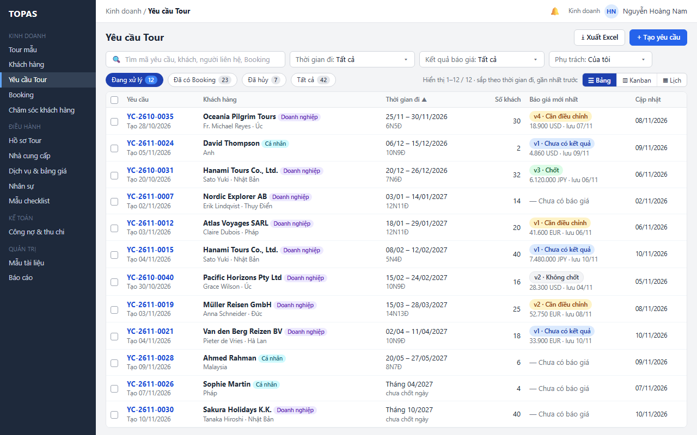

2. **W01 · Chip trạng thái.** Người dùng bấm chip Đã có Booking, Đã hủy hoặc Tất cả. Danh sách lọc ngay; cột Trạng thái · Booking hiện ra; cách sắp xếp mặc định đổi theo ngày tạo, mới nhất trước (R06). Bấm lại chip Đang xử lý thì cột ẩn đi.

*Kết quả:* người dùng biết mình có bao nhiêu yêu cầu đang xử lý và yêu cầu nào cần làm trước.

**L1.2 Tìm yêu cầu của một khách trong toàn công ty.** *Điều kiện:* Kinh doanh hoặc Quản trị.

1. **W02 · Ô tìm kiếm, ô chọn Phụ trách ở thanh lọc, chip Tất cả.** Người dùng gõ tên khách, ví dụ “müller” (từ 2 ký tự), chọn Phụ trách Tất cả và chip Tất cả. Ô tìm áp dụng sau 300 ms ngừng gõ (R04); ô Phụ trách và chip lọc ngay. Danh sách hiện mọi yêu cầu của Müller Reisen GmbH, kể cả yêu cầu do người khác phụ trách; phần khớp được tô vàng; số trên chip cập nhật; cột Phụ trách và Trạng thái · Booking hiện ra; Booking ngoài phạm vi có khóa và tên người phụ trách. Liên kết Xóa bộ lọc xuất hiện.

   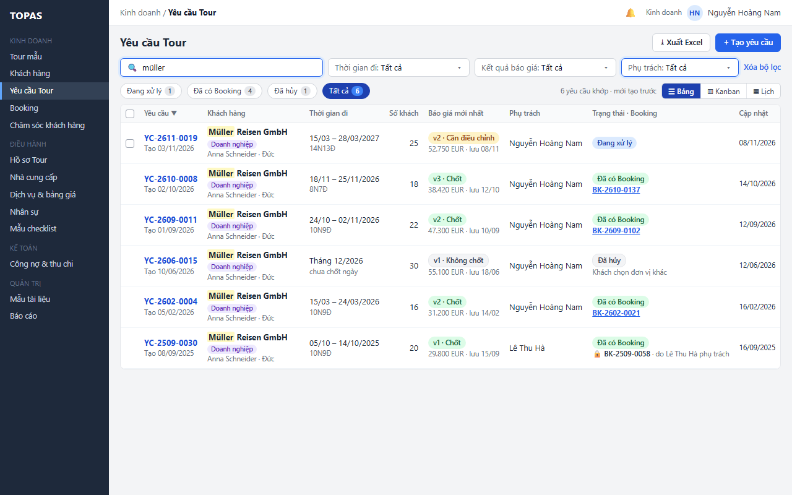

2. **W02 · Cột Phụ trách và Trạng thái · Booking.** Người dùng thấy khách đã có yêu cầu Đang xử lý do ai phụ trách, trước khi tạo yêu cầu mới cho cùng khách.

*Kết quả:* không có hai người cùng báo giá cho một khách mà không biết.

**L1.3 Lọc theo thời gian đi và kết quả báo giá.** *Điều kiện:* Kinh doanh hoặc Quản trị.

1. **W03 · Ô chọn Thời gian đi ở thanh lọc → bảng chọn.** Người dùng bấm Thời gian đi. Bộ chọn hiện các khoảng chọn nhanh (Đã qua, Tháng này, Tháng sau, 3 tháng tới), áp dụng ngay, và khoảng ngày khởi hành tùy chọn, nhập rồi bấm Áp dụng; khoảng tùy chọn được kiểm tra theo E1.4 (R05).

   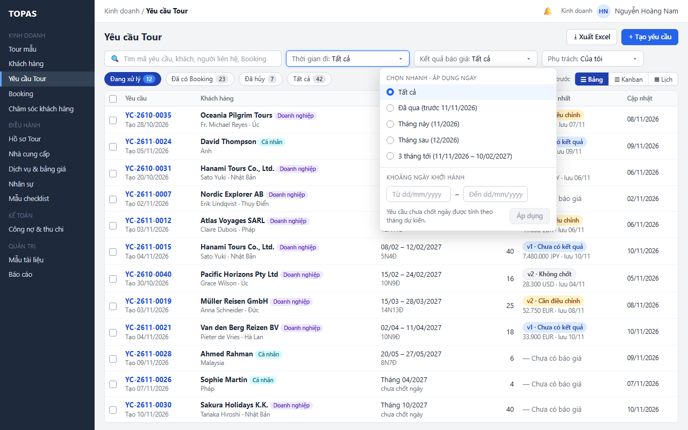

2. **W04 · Khoảng nhanh 3 tháng tới, ô chọn Kết quả báo giá ở thanh lọc.** Người dùng chọn 3 tháng tới (áp dụng ngay), rồi chọn Kết quả báo giá là Chưa có kết quả; hệ thống lọc theo phiên bản báo giá mới nhất (R03). Danh sách còn hai yêu cầu khởi hành trước 10/02/2027 mà khách chưa phản hồi báo giá; số trên chip tính theo bộ lọc.

   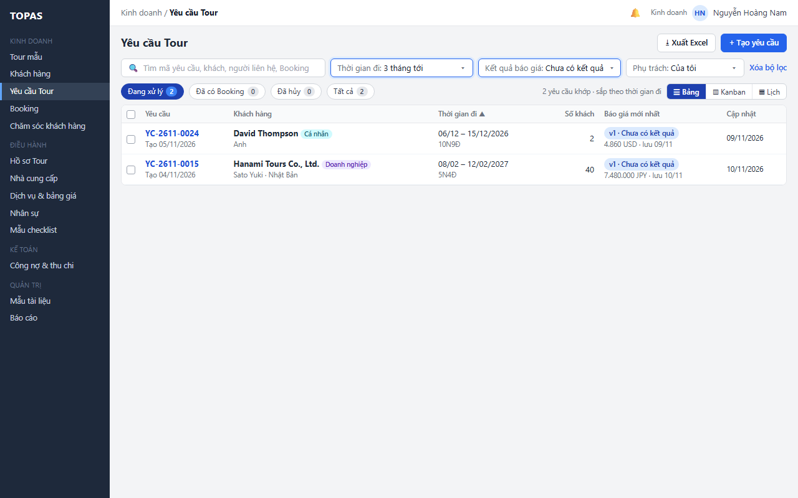

3. **W04 → W01 · Liên kết Xóa bộ lọc cuối thanh lọc.** Người dùng bấm Xóa bộ lọc. Ô tìm, Thời gian đi, Kết quả báo giá và Phụ trách về mặc định; chip đang chọn giữ nguyên.

*Kết quả:* người dùng lập được danh sách khách cần liên hệ mà không cần thêm trạng thái mới.

**Ngoại lệ**

- **E1.1 Không khớp bộ lọc (W05).** Bảng hiện “Không có yêu cầu khớp bộ lọc” kèm gợi ý bỏ bớt bộ lọc hoặc tạo yêu cầu; mọi chip có số 0; Xuất Excel khóa với lý do “Không có dòng để xuất”. Người dùng bấm Xóa bộ lọc.

  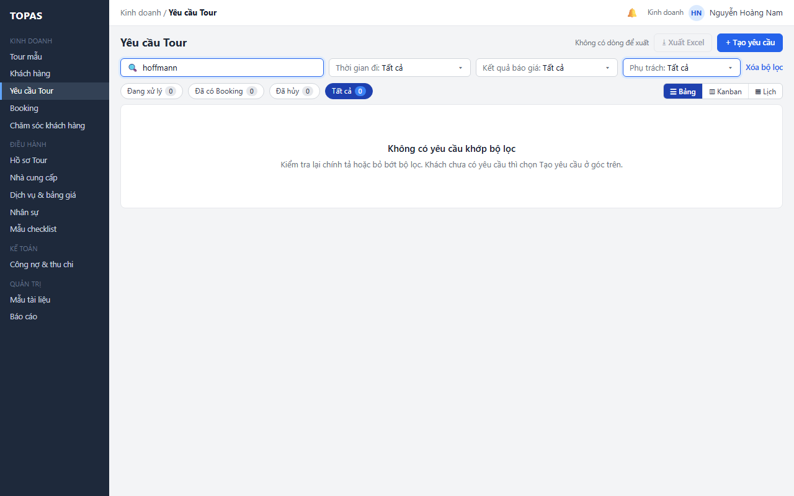

- **E1.2 Lỗi tải danh sách (W06).** Bảng hiện “Không tải được danh sách yêu cầu Tour”, số trên chip là “–”, bộ lọc giữ nguyên, Xuất Excel khóa. Người dùng bấm Thử lại.

  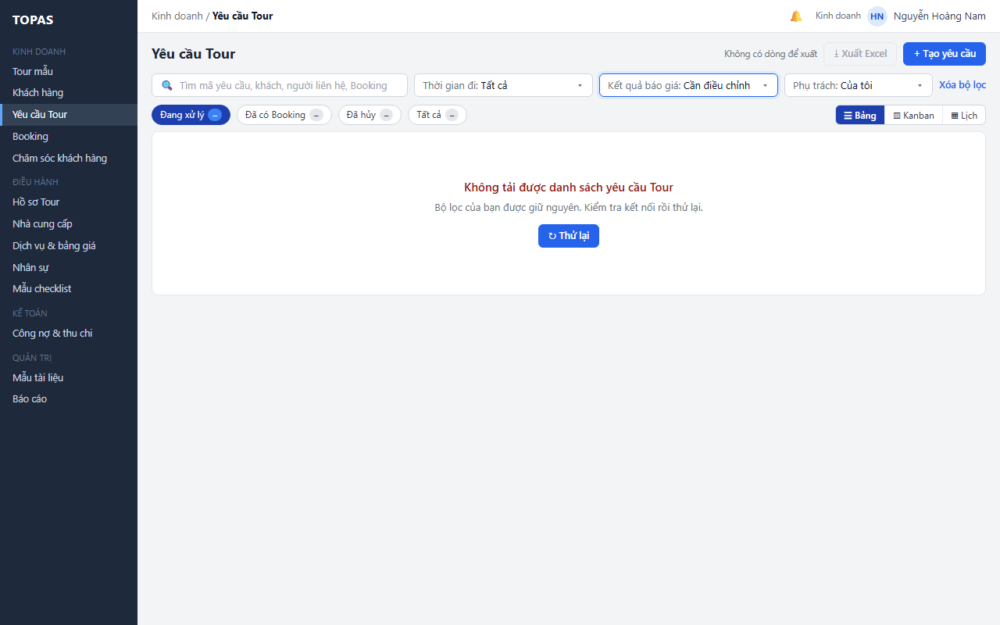

- **E1.3 Chưa có dữ liệu (W07).** Người dùng chưa phụ trách yêu cầu nào: bảng ghi “Bạn chưa phụ trách yêu cầu Tour nào” và chỉ cách chọn Phụ trách Tất cả hoặc Tạo yêu cầu ở góc trên. Hệ thống chưa có yêu cầu nào: “Chưa có yêu cầu Tour. Chọn Tạo yêu cầu để bắt đầu.” Khác W05 vì không có bộ lọc nào ngoài mặc định. Xuất Excel khóa kèm lý do.

  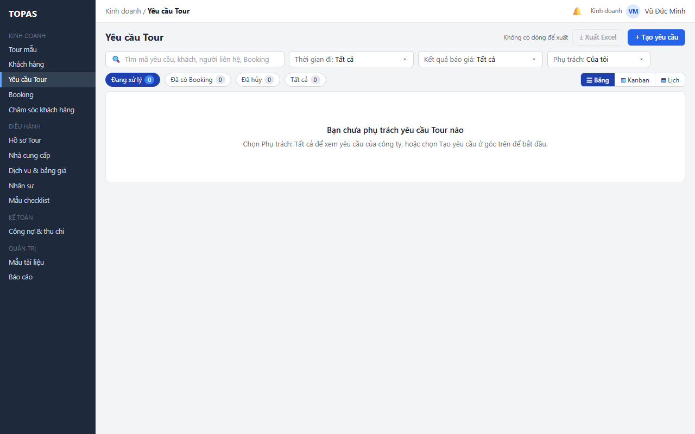

- **E1.4 Khoảng ngày không hợp lệ.** Từ ngày sau Đến ngày, hoặc ngày sai định dạng: nút Áp dụng khóa, lỗi ghi dưới ô (“Từ ngày phải trước hoặc bằng Đến ngày”). Bỏ trống một đầu thì khoảng mở về phía đó.
- **E1.5 Người phụ trách đã ngừng hoạt động.** Vẫn có trong danh sách chọn Phụ trách, kèm “(ngừng hoạt động)”, để tìm yêu cầu cần bàn giao (L4.2).
- **E1.6 Không có quyền.** Điều hành, Kế toán không có mục Yêu cầu Tour; mở bằng đường dẫn thì hiện trang “Bạn không có quyền xem yêu cầu Tour”.
- **E1.7 Đang tải.** Lần tải đầu và khi đổi bộ lọc: bảng hiện dòng xám (khung chờ), bộ lọc vẫn dùng được; yêu cầu mới thay yêu cầu cũ nếu người dùng đổi bộ lọc lần nữa trước khi tải xong.

### 3.2. Tạo yêu cầu (SYS02.02 → KD06)

**L2.1 Tạo yêu cầu mới.** *Điều kiện:* Kinh doanh.

1. **W01 → W08 · Nút chính Tạo yêu cầu ở tiêu đề.** Người dùng bấm Tạo yêu cầu. KD06 mở ở chế độ tạo mới, tab Thông tin yêu cầu, trống. Người phụ trách điền sẵn là người tạo (nhãn Người tạo).
2. **W08 · Hồ sơ yêu cầu mới ở KD06.** Người dùng tìm khách, nhập nhu cầu và lưu theo RSD KD06 (SYS02.03–SYS02.06, SYS02.09).

   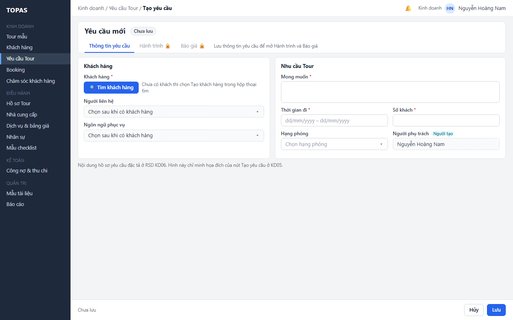

3. **W01 · Quay lại KD05.** Lưu xong và quay lại KD05: yêu cầu mới có trong chip Đang xử lý ở vị trí theo thời gian đi.

*Kết quả:* yêu cầu chỉ được tạo khi lưu ở KD06; người tạo là người phụ trách.

**Ngoại lệ**

- **E2.1 Hủy tạo ở KD06.** Người dùng bấm Hủy hoặc quay lại trước khi lưu: không có yêu cầu nào được tạo; KD05 hiện lại như trước (W01). Hỏi xác nhận khi đã nhập do KD06 quy định.
- **E2.2 Quản trị hệ thống.** Không có nút Tạo yêu cầu (W13).
- **E2.3 Yêu cầu mới không khớp bộ lọc đang dùng.** Ví dụ đang lọc Thời gian đi Tháng sau mà yêu cầu mới đi tháng 03/2027: thông báo ngắn “Đã tạo YC-…, không khớp bộ lọc hiện tại · Xem”, bấm Xem mở KD06 của yêu cầu đó.

### 3.3. Mở yêu cầu để cập nhật, hủy hoặc lập báo giá (SYS02.07 · SYS02.08 · SYS02.11)

**L3.1 Mở đúng chỗ cần xử lý.** *Điều kiện:* Kinh doanh hoặc Quản trị.

1. **W01 · Bấm dòng (trừ ô chọn và mã Booking).** Người dùng bấm một dòng. Bấm mã Booking trong cột Trạng thái · Booking thì mở KD08 thay vì KD06; Booking ngoài phạm vi hiện khóa (W02, R01, E3.5).
2. **W09 · KD06 ở tab đích.** KD06 mở ở tab đích theo R07, chỉ đọc nếu người dùng không phụ trách yêu cầu (E3.1). Ví dụ YC-2611-0019 đã có hai phiên bản báo giá nên mở thẳng tab Báo giá; yêu cầu chưa có hành trình mở tab Thông tin yêu cầu; yêu cầu đã có hành trình nhưng chưa có báo giá mở tab Hành trình (lập báo giá, SYS02.11 → SYS03.01). Cập nhật, hủy và lập báo giá làm ở KD06 theo RSD KD06.

   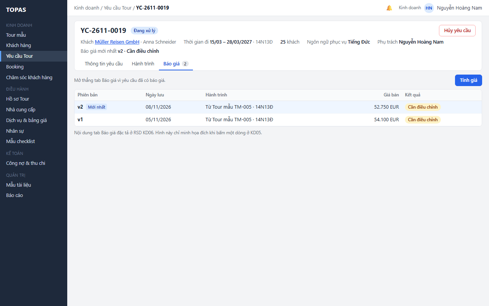

*Kết quả:* người dùng vào thẳng bước cần làm, không phải chọn lại tab.

**L3.2 Quay lại danh sách sau khi xử lý.** *Điều kiện:* đã mở KD06 từ KD05.

1. **W10 · Breadcrumb Yêu cầu Tour hoặc nút quay lại.** Người dùng bấm breadcrumb Yêu cầu Tour hoặc nút quay lại. KD05 hiện lại với bộ lọc, chip, trang và vị trí cuộn như trước; dòng vừa mở được tải lại.
2. **W10 · Dòng không còn khớp bộ lọc.** Nếu dòng không còn khớp bộ lọc (ví dụ vừa hủy YC-2611-0028 ở KD06 khi đang xem chip Đang xử lý), dòng giữ tại chỗ, mờ, ghi nhãn mới và “Không còn khớp bộ lọc”; số trên chip cập nhật; thông báo ngắn có liên kết Xem ở chip Đã hủy. Dòng mờ ẩn ở lần tải lại kế tiếp (R07).

   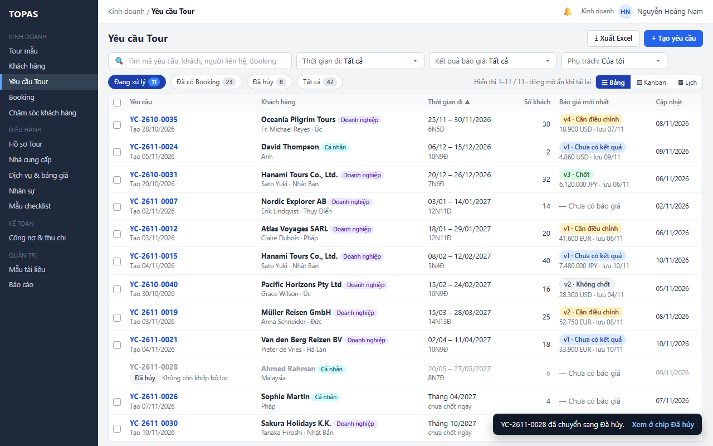

*Kết quả:* người dùng không mất vị trí và thấy kết quả của thao tác vừa làm.

**Ngoại lệ**

- **E3.1 Yêu cầu do người khác phụ trách.** Mở được; KD06 ở chế độ chỉ đọc kèm “🔒 Chỉ xem · do … phụ trách” (RSD KD06). Không có tab đích khác.
- **E3.2 Yêu cầu Đã hủy hoặc Đã có Booking.** Mở tab đích theo R07; các thao tác còn được phép do KD06 quy định (ví dụ Mở Booking ở phần đầu KD06, Mở lại yêu cầu Đã hủy).
- **E3.3 Yêu cầu không còn tồn tại.** Bản ghi bị xóa bằng công cụ quản trị trong lúc đang xem danh sách: thông báo ngắn “Yêu cầu này không còn tồn tại”, danh sách tải lại. KD05 và KD06 không có thao tác xóa yêu cầu.
- **E3.4 Dữ liệu đổi ở phiên khác.** Danh sách không tự làm mới theo thời gian thực. Khi mở dòng, KD06 luôn tải bản mới nhất; khi quay lại, KD05 tải lại trang đang xem.
- **E3.5 Booking ngoài phạm vi.** Mã Booking có khóa và tên người phụ trách, không bấm được (W02). Bấm vào phần còn lại của dòng vẫn mở KD06.

### 3.4. Chuyển người phụ trách (quyết định 11/11/2026)

**L4.1 Kinh doanh chuyển yêu cầu của mình.** *Điều kiện:* người phụ trách; yêu cầu Đang xử lý.

1. **W11 · Ô chọn trên dòng hoặc đầu bảng → thanh hàng loạt.** Người dùng chọn các dòng cần chuyển (ví dụ ba yêu cầu của khách Nhật). Thanh hàng loạt thay chỗ nút Xuất Excel, ghi số yêu cầu đã chọn, ô chọn người nhận ngay trên thanh và nút Chuyển phụ trách (khóa tới khi chọn người nhận, E4.1). Danh sách người nhận gồm người dùng Kinh doanh đang hoạt động trừ chính mình, mỗi người kèm số yêu cầu đang xử lý để chia việc. Nút Bỏ chọn ở cuối thanh ẩn thanh và hiện lại Xuất Excel (E4.5).

   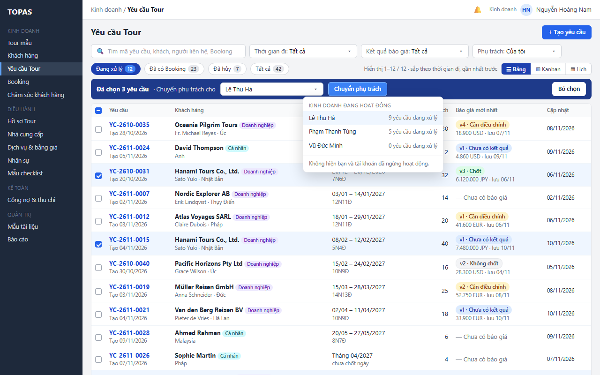

2. **W12 · Ô chọn người nhận, nút Chuyển phụ trách trên thanh hàng loạt.** Người dùng chọn Lê Thu Hà rồi bấm Chuyển phụ trách. Hệ thống chuyển từng yêu cầu theo R08. Banner nêu số yêu cầu đã chuyển, người nhận và những gì không đổi; các dòng đã chuyển mờ tại chỗ, ghi người nhận và nhãn Vừa chuyển; số trên chip giảm theo. Người nhận nhận một thông báo gộp.

   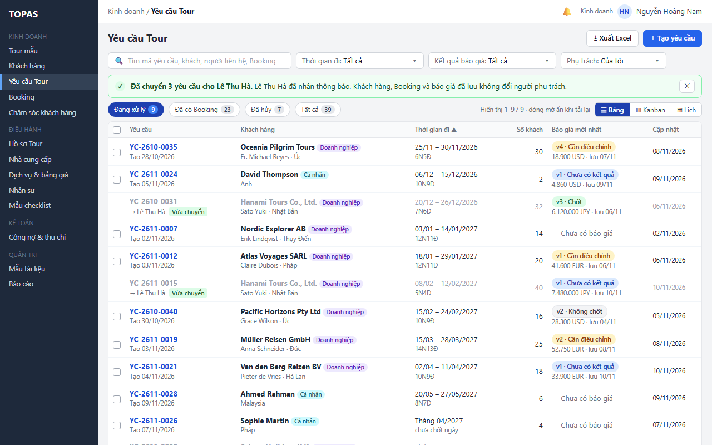

*Kết quả:* người nhận sửa, lập báo giá, hủy được các yêu cầu đó; người cũ chỉ còn xem.

**L4.2 Quản trị chuyển yêu cầu của người đã nghỉ.** *Điều kiện:* Quản trị hệ thống.

1. **W13 · Ô chọn Phụ trách, ô chọn đầu bảng, liên kết trên thanh hàng loạt.** Quản trị chọn Phụ trách là người cần bàn giao (Trần Quốc Bảo, đã ngừng hoạt động), chip Đang xử lý, rồi chọn ô đầu bảng để chọn mọi dòng trong trang. Thanh hàng loạt hiện số đã chọn và ô chọn người nhận. Khi kết quả lọc nhiều hơn một trang, thanh có thêm liên kết “Chọn tất cả n yêu cầu khớp bộ lọc”; bấm liên kết thì số trên thanh thành n (R08).

   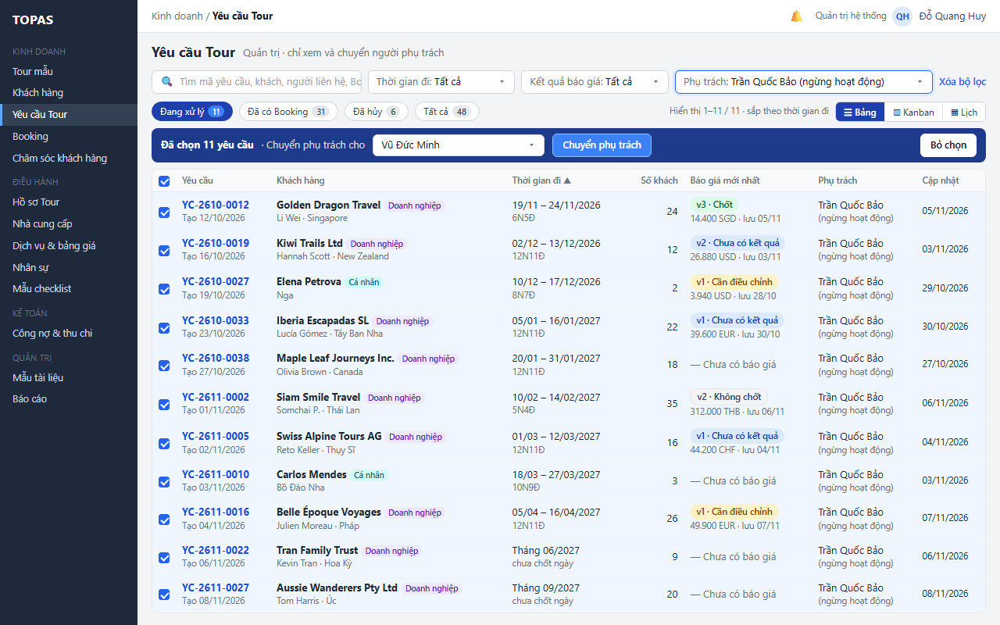

2. **W14 · Nút Chuyển phụ trách trên thanh hàng loạt.** Quản trị chọn Vũ Đức Minh rồi bấm Chuyển phụ trách. Banner nêu đã chuyển 10, bỏ qua 1; dòng bỏ qua ghi lý do (vừa có Booking lúc 10:02 nên không còn Đang xử lý); dòng đã chuyển mờ tại chỗ đến khi tải lại. Người nhận nhận một thông báo gộp.

   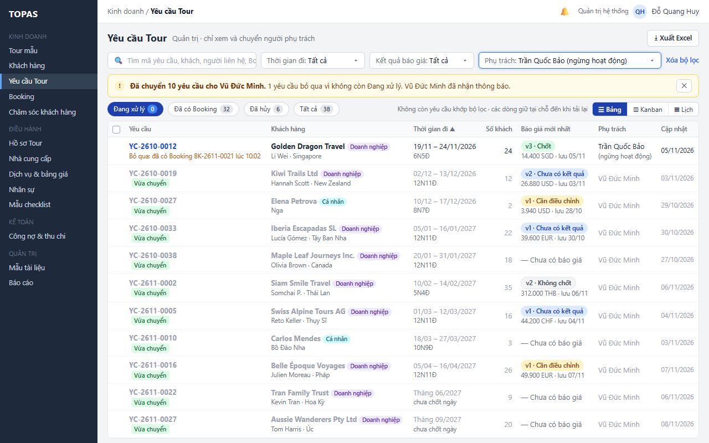

*Kết quả:* không còn yêu cầu Đang xử lý nào nằm ở tài khoản đã khóa.

**Ngoại lệ**

- **E4.1 Người nhận không hợp lệ.** Chưa chọn người nhận: nút Chuyển phụ trách khóa (W11 trước khi chọn). Người nhận vừa bị khóa ở QT01 sau khi chọn: chuyển bị từ chối, lỗi ghi cạnh ô “Tài khoản đã ngừng hoạt động, chọn người khác”; các dòng vẫn được chọn.
- **E4.2 Dòng đổi sau khi đã chọn.** Lúc ghi, yêu cầu đã hủy, đã có Booking Hiệu lực, hoặc người phụ trách đã khác lúc tải: bỏ qua dòng đó và ghi lý do trên dòng (W14). Yêu cầu vừa có Booking thì người phụ trách đổi theo Booking ở KD08 (R08). Các dòng khác vẫn được chuyển.
- **E4.3 Mất quyền giữa chừng.** Kinh doanh chọn yêu cầu của mình nhưng Quản trị vừa chuyển đi ở phiên khác: dòng bị bỏ qua với lý do “Người phụ trách đã đổi thành … lúc …”.
- **E4.4 Lỗi giữa chừng hoặc mất kết nối.** Mỗi yêu cầu là một giao dịch riêng. Banner nêu số đã chuyển; các dòng chưa chuyển vẫn được chọn, nút Chuyển phụ trách bấm lại được. Nút khóa khi đang chuyển; bấm lặp không chuyển hai lần (R08).
- **E4.5 Bỏ chọn hoặc đổi bộ lọc khi đang chọn.** Bỏ chọn, đổi chip, đổi bộ lọc hoặc sang trang khác thì xóa lựa chọn, không hỏi lại (chưa có gì được ghi).
- **E4.6 Người dùng không có dòng nào được chọn.** Kinh doanh ở Phụ trách Tất cả xem yêu cầu của người khác: dòng không có ô chọn; ô chọn đầu bảng chỉ chọn các dòng có ô chọn trong trang.

### 3.5. Xuất Excel (quyết định 11/11/2026)

**L5.1 Xuất theo bộ lọc.** *Điều kiện:* Kinh doanh hoặc Quản trị; danh sách có ít nhất một dòng.

1. **W01 · Nút Xuất Excel ở tiêu đề.** Người dùng bấm Xuất Excel. Nút đổi thành “Đang tạo tệp…” và khóa tới khi tải xong (E5.4).
2. **W15 · Tệp tải về, thông báo ngắn.** Hệ thống tạo tệp gồm mọi yêu cầu khớp tìm kiếm, bộ lọc và chip đang chọn (mọi trang, không chỉ trang đang xem), cột theo R09, rồi tải về. Thông báo ngắn nêu số dòng và tên tệp. Nhật ký QT03 ghi người xuất, thời điểm, bộ lọc và số dòng.

   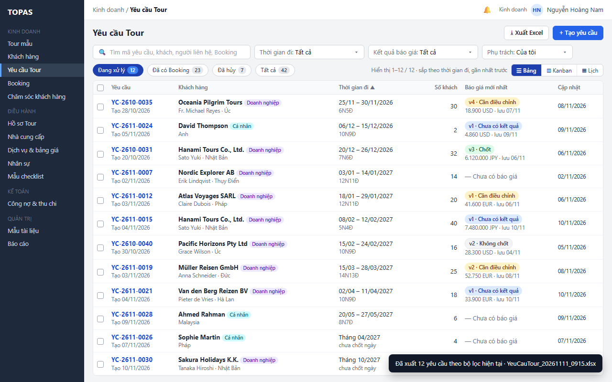

*Kết quả:* người dùng có tệp đúng tập đang xem để báo cáo nội bộ.

**Ngoại lệ**

- **E5.1 Không có dòng.** Nút Xuất Excel khóa, ghi “Không có dòng để xuất” cạnh nút (W05, W06, W07).
- **E5.2 Vượt giới hạn.** Kết quả lọc hơn 5.000 dòng: nút khóa, ghi “Tối đa 5.000 dòng · thu hẹp bộ lọc”.
- **E5.3 Lỗi tạo tệp.** Thông báo “Chưa xuất được tệp. Thử lại”; danh sách và bộ lọc giữ nguyên.
- **E5.4 Bấm lặp.** Nút khóa và ghi “Đang tạo tệp…” tới khi tải xong; không tạo hai tệp cho một lần bấm.
- **E5.5 Dữ liệu đổi trong lúc xuất.** Tệp lấy dữ liệu tại thời điểm bắt đầu tạo; số dòng trong tệp có thể khác số trên chip nếu có người vừa sửa. Thông báo nêu số dòng thực tế trong tệp.
- **E5.6 Xuất ở Kanban hoặc Lịch.** Nút Xuất Excel vẫn ở tiêu đề. Tệp theo R09, không theo tháng đang xem ở Lịch; ở Kanban tệp gồm đúng các yêu cầu các cột đang tính (R13).

### 3.6. Dạng xem Kanban và Lịch (quyết định 11/11/2026)

**L6.1 Xem yêu cầu dạng Kanban.** *Điều kiện:* Kinh doanh hoặc Quản trị.

1. **W16 · Bộ chuyển dạng xem cuối hàng chip → Kanban.** Người dùng bấm Kanban. Cách trình bày đổi ngay, bộ lọc giữ nguyên, dạng xem được ghi nhớ (R12); nếu đang chọn dòng ở Bảng thì lựa chọn bị xóa (E6.6). Hàng chip ẩn; danh sách hiện ba cột Đang xử lý (12), Đã có Booking (23), Đã hủy (7) với cùng bộ lọc Của tôi. Cột Đang xử lý sắp theo thời gian đi gần nhất như chip Đang xử lý ở Bảng. Hai cột còn lại chỉ tải yêu cầu cập nhật trong 90 ngày gần nhất, mới cập nhật trước; đầu cột ghi “Cập nhật 90 ngày gần nhất” và “6 / 23” để biết còn yêu cầu cũ hơn (R13).

   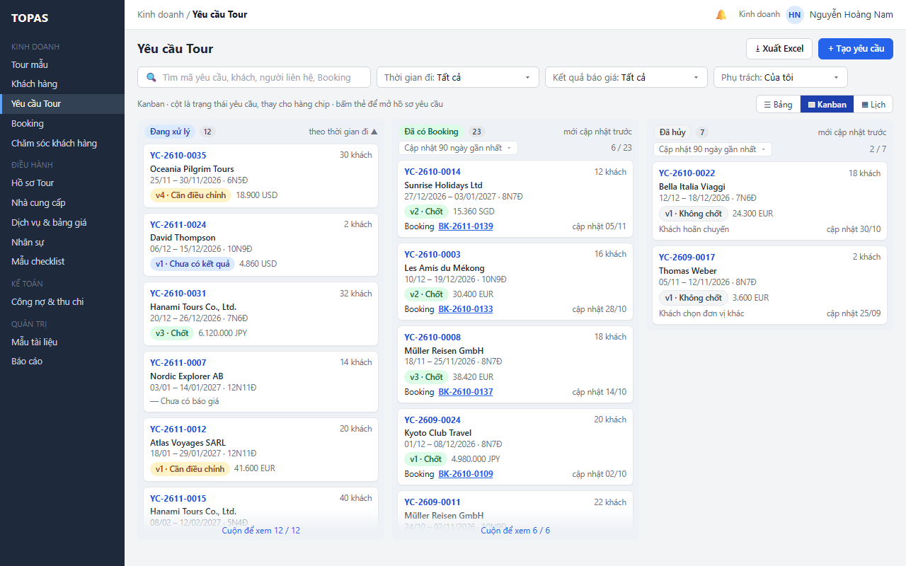

2. **W16 · Cuộn trong cột; ô chọn khoảng cập nhật ở đầu cột Đã có Booking, Đã hủy.** Người dùng cuộn tới cuối một cột để xem thêm thẻ; mỗi lần tải thêm 20 thẻ của cột đó. Người dùng đổi khoảng cập nhật ở đầu cột (30 ngày, 90 ngày, 12 tháng, Tất cả) khi cần tìm yêu cầu cũ; hệ thống tải lại riêng cột đó và đầu cột ghi “n / số đếm”; số đếm của cột không đổi theo khoảng này (R13).
3. **W09 · Bấm thẻ Kanban.** Người dùng bấm một thẻ. KD06 mở ở tab đích theo R07, như bấm dòng.

*Kết quả:* người dùng thấy cả ba nhóm trạng thái trên một màn mà không phải đổi chip.

**L6.2 Xem yêu cầu dạng Lịch.** *Điều kiện:* Kinh doanh hoặc Quản trị.

1. **W17 · Bộ chuyển dạng xem cuối hàng chip → Lịch.** Người dùng bấm Lịch. Lịch mở ở tháng hiện tại (hoặc tháng đầu của bộ lọc Thời gian đi nếu đang lọc), dạng Tháng; dạng xem được ghi nhớ (R12). Hàng chip và bộ lọc giữ nguyên. Ví dụ chip Tất cả, tháng 12/2026: mỗi yêu cầu là một thanh từ ngày đi đến ngày về; thanh vắt qua tuần có dấu ◂ ▸; yêu cầu Đã hủy (Bella Italia Viaggi) xám, gạch ngang. Khay Chưa chốt ngày bên phải có YC-2606-0015, tháng dự kiến 12/2026. Dòng ghi chú cạnh chip ghi “6 yêu cầu đi trong tháng · 1 chưa chốt ngày”.

   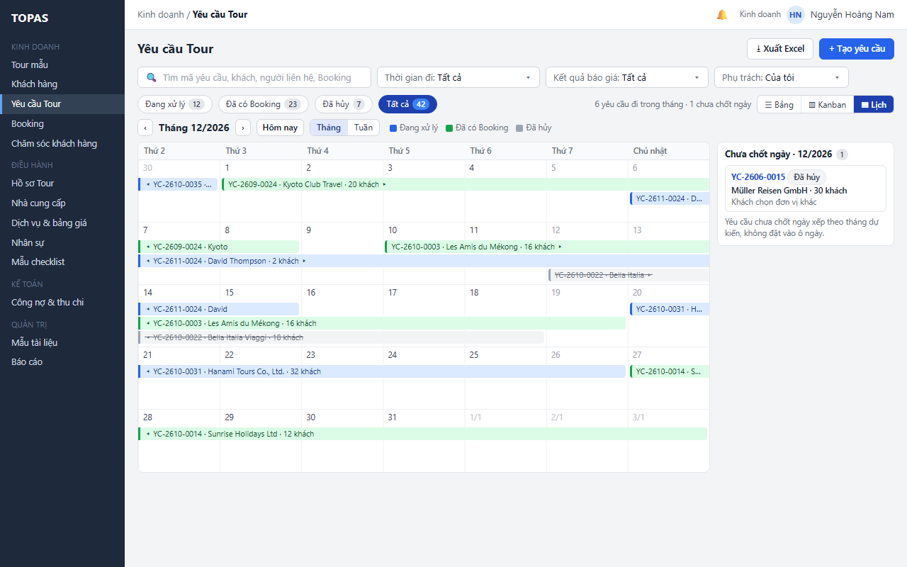

2. **W17 · Nút ‹ ›, Hôm nay và nhóm nút Tháng, Tuần ở đầu lịch.** Người dùng bấm ‹ › để đổi tháng, Hôm nay để về tháng hiện tại; hệ thống tải yêu cầu của tháng mới. Đổi tháng không đổi bộ lọc Thời gian đi. Người dùng bấm Tuần để xem một tuần (lưới đổi, mọi thanh hiện đủ, không gộp) hoặc Tháng để về lưới tháng.
3. **W09 · Bấm thanh trên Lịch hoặc thẻ trong khay.** Người dùng bấm một thanh hoặc một thẻ trong khay. KD06 mở ở tab đích theo R07.

*Kết quả:* người dùng thấy lịch đi của các yêu cầu, nhận ra ngày dồn đoàn và yêu cầu sắp đi.

**L6.3 Ngày có nhiều yêu cầu.** *Điều kiện:* dạng Lịch, tháng.

1. **W18 · Liên kết “+n” trong ô ngày → bảng nhỏ.** Ở Phụ trách Tất cả, chip Đang xử lý, tuần 07–13/12 có nhiều yêu cầu đi cùng lúc. Mỗi tuần hiện tối đa 3 hàng thanh; ngày còn yêu cầu chưa hiện có “+n”. Người dùng bấm “+2” ở ngày 11/12; bảng nhỏ liệt kê đủ 5 yêu cầu đi trong ngày, mỗi yêu cầu có thời gian đi, số khách và người phụ trách. Bấm một yêu cầu mở KD06; bấm ra ngoài để đóng bảng nhỏ.

   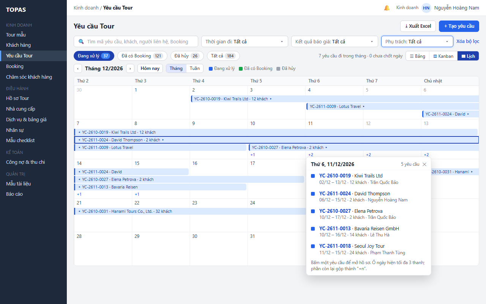

*Kết quả:* không yêu cầu nào bị che mất trong ô ngày.

**Ngoại lệ**

- **E6.1 Một cột Kanban không tải được (W19).** Các cột tải riêng. Cột lỗi ghi “Không tải được cột này”, số đếm “–”, nút Thử lại trong cột; bấm Thử lại tải lại riêng cột đó. Các cột khác vẫn dùng được, bộ lọc giữ nguyên. Không tải được cả ba cột thì hiện như E1.2.

  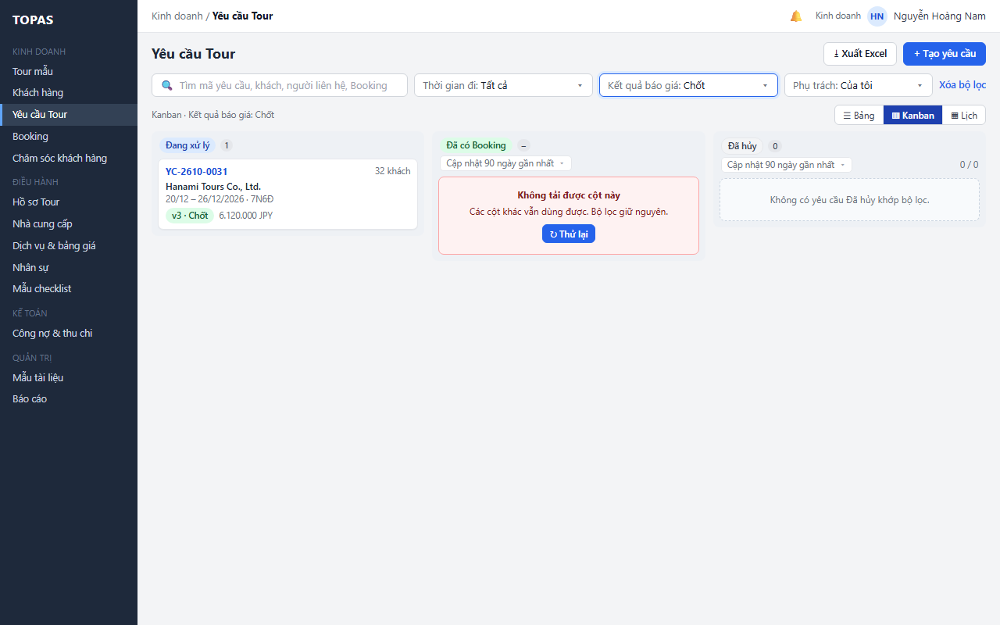

- **E6.2 Cột không có thẻ (W19).** Cột ghi “Không có yêu cầu … khớp bộ lọc”. Nếu cột có yêu cầu nhưng ngoài khoảng cập nhật đang chọn, ghi “Không có yêu cầu cập nhật trong 90 ngày gần nhất · Xem tất cả” để đổi khoảng ngay. Cả ba cột rỗng thì hiện trạng thái rỗng như E1.1 hoặc E1.3.
- **E6.3 Tháng không có yêu cầu.** Lịch vẫn hiện lưới tháng, giữa lịch ghi “Không có yêu cầu đi trong tháng 01/2027” kèm liên kết tới tháng gần nhất có yêu cầu (trước và sau). Khay Chưa chốt ngày ẩn khi rỗng.
- **E6.4 Tháng ngoài khoảng Thời gian đi.** Đang lọc Thời gian đi mà người dùng đổi sang tháng ngoài khoảng: lịch rỗng, ghi “Tháng này ngoài khoảng Thời gian đi đang lọc · Xóa lọc thời gian”.
- **E6.5 Quá nhiều yêu cầu trong tháng.** Hơn 500 yêu cầu đi trong tháng đang xem với bộ lọc hiện tại: lịch không vẽ thanh, ghi “Có n yêu cầu, quá nhiều để hiện trên lịch · thu hẹp bộ lọc hoặc dùng Bảng”.
- **E6.6 Đang chọn dòng ở Bảng rồi đổi dạng.** Lựa chọn bị xóa, thanh hàng loạt ẩn, không hỏi lại (như E4.5).
- **E6.7 Thẻ hoặc thanh đổi trạng thái sau khi quay lại từ KD06.** Như R07: thẻ ở lại cột cũ, mờ, ghi nhãn mới và “Không còn khớp”; số đếm các cột cập nhật; thông báo ngắn nêu cột mới. Ở Lịch, thanh đổi màu theo trạng thái mới; nếu không còn khớp chip thì mờ tại chỗ. Thẻ, thanh mờ ẩn ở lần tải lại kế tiếp.
- **E6.8 Màn hẹp.** Dưới 1100 px chiều ngang, Kanban cuộn ngang theo cột; Lịch chuyển sang dạng Tuần.

---

## 4. Quy tắc triển khai chi tiết

### R01. Phạm vi xem và quyền (quyết định 11/11/2026)

- Mọi người dùng Kinh doanh xem được mọi yêu cầu Tour ở KD05 và mở được KD06 của mọi yêu cầu.
- Mỗi yêu cầu có đúng một người phụ trách là người dùng Kinh doanh; khi tạo là người tạo. Chỉ người phụ trách hiện tại được sửa, lập báo giá, ghi kết quả, tạo Booking, hủy ở KD06 (RSD KD06 áp dụng).
- Quản trị hệ thống xem mọi yêu cầu, chuyển người phụ trách, xuất Excel; không tạo, không sửa nội dung. Ở KD06, Quản trị mở lại được yêu cầu Đã hủy kèm chọn người phụ trách mới (RSD KD06 R22).
- Mã Booking trên KD05 chỉ bấm được khi Booking thuộc phạm vi của người dùng ở KD08 (Kinh doanh: Booking mình phụ trách, theo `BOI-CANH-DU-AN.md`; Quản trị: mọi Booking, mở KD08 chỉ xem, chuyển người phụ trách Booking theo RSD KD08).
- Điều hành, Kế toán không có quyền vào KD05.

### R02. Nhóm trạng thái của yêu cầu (đúng nguồn, quyết định 11/11/2026)

Tính theo thứ tự, dừng ở điều kiện đầu tiên đúng:

1. **Đã hủy** nếu yêu cầu có dấu hủy chưa được mở lại: người phụ trách hủy ở KD06, hoặc hệ thống tự hủy khi Booking Hiệu lực của yêu cầu bị hủy ở KD08 (lý do “Booking đã hủy”).
2. **Đã có Booking** nếu có Booking Hiệu lực tạo từ phiên bản của yêu cầu.
3. **Đang xử lý** trong các trường hợp còn lại, kể cả yêu cầu Đã hủy vừa được Mở lại ở KD06.

- Không có nhóm hay giai đoạn khác. Kết quả của phiên bản báo giá không làm đổi nhóm; yêu cầu có báo giá Không chốt vẫn Đang xử lý tới khi người phụ trách hủy.
- Cùng quy tắc với R08 của RSD KD03-KD04 (tab Yêu cầu & Booking của hồ sơ khách) và R02 của RSD KD06, để số yêu cầu đang xử lý của một khách khớp giữa KD03, KD04, KD05 và KD06.
- **Hủy Booking** (quyết định 12/11/2026): yêu cầu tự chuyển Đã hủy, không còn ở nhóm Đã có Booking. Khách muốn đặt lại thì người phụ trách (hoặc Quản trị, kèm chọn người phụ trách mới) Mở lại yêu cầu kèm lý do ở KD06; yêu cầu về Đang xử lý, rồi báo giá và tạo Booking mới ở KD08 (RSD KD06 R22, KD08 R10). Mã Booking đã hủy vẫn hiện ở cột Trạng thái · Booking của yêu cầu Đã hủy (mục 2.2).

### R03. Báo giá mới nhất và kết quả

- **Phiên bản mới nhất** là phiên bản có số lớn nhất của yêu cầu, không phụ thuộc kết quả.
- **Kết quả** là giá trị người phụ trách ghi cho phiên bản đó ở KD06.3: Chốt, Cần điều chỉnh, Không chốt (người dùng chọn ngày 11/11/2026); hệ thống tự ghi Chốt cho phiên bản điều chỉnh mới nhất của chính Booking (không phải phiên bản số lớn nhất của yêu cầu) khi Kinh doanh bấm Chuyển sang Điều hành ở KD08 (RSD KD08 R09). Chưa ghi thì **Chưa có kết quả**. Danh sách giá trị do KD06 sở hữu; khi KD06 đổi danh sách, bộ lọc và nhãn của KD05 đọc theo.
- **Giá bán** là tổng giá bán của phiên bản, hiển thị theo loại tiền báo giá của phiên bản, không quy đổi.
- **Bộ lọc Kết quả báo giá**: Chưa có báo giá (yêu cầu không có phiên bản nào); Chưa có kết quả; Chốt; Cần điều chỉnh; Không chốt. Lọc theo phiên bản mới nhất, không theo phiên bản cũ.
- **Khi KD06 đổi dữ liệu.** Lưu phiên bản báo giá hoặc ghi kết quả ở KD06.3 cập nhật báo giá mới nhất và ngày cập nhật của yêu cầu; cột Báo giá mới nhất và Cập nhật trên KD05 đổi ở lần tải lại kế tiếp (E3.4).

### R04. Tìm kiếm

- Tìm từ 2 ký tự, áp dụng sau 300 ms ngừng gõ; không phân biệt hoa thường, bỏ dấu (gõ “muller” tìm thấy “Müller”).
- Tìm chuỗi con trong: mã yêu cầu, tên khách hàng, tên giao dịch, mã khách hàng, tên và email người liên hệ của yêu cầu, mã Booking của yêu cầu.
- Email chỉ dùng để tìm, không hiện trên danh sách và không có trong tệp Excel.
- Tô vàng phần khớp ở cột Yêu cầu và Khách hàng.

### R05. Bộ lọc Thời gian đi

- **Chọn nhanh** (áp dụng ngay): Đã qua = ngày đi trước hôm nay; Tháng này; Tháng sau; 3 tháng tới = từ hôm nay đến hôm nay + 3 tháng − 1 ngày.
- **Khoảng ngày tùy chọn**: theo ngày đi (ngày khởi hành), có thể bỏ trống một đầu; cần bấm Áp dụng.
- **Yêu cầu chưa chốt ngày** (chỉ có tháng dự kiến, theo KD06) khớp khi tháng dự kiến giao với khoảng lọc; không khớp Đã qua cho tới khi hết tháng dự kiến.
- Bộ lọc không làm đổi dữ liệu, không tự hủy yêu cầu đã qua ngày đi.

### R06. Chip, số trên chip, sắp xếp và phân trang

- Bốn chip: Đang xử lý, Đã có Booking, Đã hủy, Tất cả. Số trên mỗi chip tính theo tìm kiếm và các bộ lọc còn lại, không theo chip đang chọn. Tổng ba chip đầu bằng chip Tất cả.
- Sắp xếp mặc định: chip Đang xử lý theo ngày đi tăng dần, yêu cầu chưa chốt ngày xếp sau cùng theo tháng dự kiến; các chip khác theo ngày tạo giảm dần. Cột sắp xếp được: Yêu cầu (ngày tạo), Thời gian đi, Số khách, Cập nhật.
- 20 dòng mỗi trang; dòng chữ bên phải chip ghi khoảng đang xem và cách sắp xếp.

### R07. Mở KD06 đúng tab và giữ ngữ cảnh

- Tab đích khi bấm dòng: yêu cầu đã có ít nhất một phiên bản báo giá → Báo giá; đã có hành trình nhưng chưa có báo giá → Hành trình; còn lại → Thông tin yêu cầu. Áp dụng cho mọi nhóm trạng thái và mọi vai trò.
- Bộ lọc, chip, trang, vị trí cuộn và sắp xếp của KD05 được giữ trong phiên khi mở KD06 rồi quay lại. Khi quay lại, trang đang xem được tải lại.
- Dòng không còn khớp bộ lọc sau khi tải lại thì giữ tại chỗ, mờ, có nhãn mới và “Không còn khớp bộ lọc”; thông báo ngắn có liên kết tới chip chứa dòng đó (W10). Dòng mờ ẩn ở lần tải lại kế tiếp hoặc khi đổi bộ lọc.

### R08. Chuyển người phụ trách yêu cầu (quyết định 11/11/2026)

- **Ai chuyển.** Người phụ trách hiện tại (yêu cầu của mình) và Quản trị hệ thống (mọi yêu cầu).
- **Yêu cầu được chuyển.** Chỉ yêu cầu Đang xử lý.
  - Yêu cầu Đã có Booking không chuyển ở KD05: người phụ trách yêu cầu luôn là người phụ trách Booking Hiệu lực; chuyển người phụ trách Booking ở KD08 thì yêu cầu chuyển theo (RSD KD08 R11, quyết định 12/11/2026).
  - Yêu cầu Đã hủy giữ người phụ trách để báo cáo chuyển đổi (QT08) đúng người đã xử lý. Ngoại lệ: Quản trị hệ thống mở lại yêu cầu Đã hủy ở KD06 kèm chọn người phụ trách mới (RSD KD06 R22, quyết định 12/11/2026); KD05 không có thao tác này.
- **Người nhận.** Người dùng Kinh doanh đang hoạt động ở QT01, khác người thực hiện (khi Kinh doanh chuyển). Danh sách người nhận ghi số yêu cầu Đang xử lý của từng người.
- **Phạm vi chọn.** Ô chọn đầu bảng chỉ chọn các dòng có ô chọn trong trang. Khi kết quả lọc nhiều hơn một trang, thanh hàng loạt có liên kết “Chọn tất cả n yêu cầu khớp bộ lọc”; chỉ khi bấm liên kết này hệ thống mới áp dụng cho mọi kết quả lọc, và số n được ghi trên thanh.
- **Ghi.** Mỗi yêu cầu là một giao dịch riêng. Ngay khi ghi, hệ thống kiểm tra lại: yêu cầu còn Đang xử lý, người phụ trách vẫn như lúc tải, người thực hiện còn quyền. Không đạt thì bỏ qua và ghi lý do. Mỗi lần bấm có mã thao tác; bấm lặp hoặc gửi lại sau mất kết nối không chuyển hai lần.
- **Không đổi.** Người phụ trách khách hàng (KD04), Booking (KD08), hồ sơ Tour (DH08); người lưu các phiên bản báo giá đã có.
- **Thông báo nội bộ.** Người nhận nhận một thông báo gộp liệt kê mã các yêu cầu, ví dụ “Bạn được giao 3 yêu cầu Tour từ Nguyễn Hoàng Nam: YC-…, YC-…, YC-…”; bấm một mã mở KD06 của yêu cầu đó ở tab đích theo R07, thống nhất với thông báo giao yêu cầu của RSD KD06 (1.2). Khi Quản trị chuyển, người phụ trách cũ cũng nhận thông báo nếu tài khoản còn hoạt động. Nhãn Mới giao hiện trên dòng tới hết ngày.
- **Lịch sử.** Ghi lịch sử yêu cầu (hiện ở KD06) và nhật ký QT03: người cũ, người mới, người thực hiện, thời điểm, cách chuyển.
- **Không tự chuyển.** KD05 không tự chuyển người phụ trách, không tự hủy và không gửi nhắc theo dõi (quyết định 11/11/2026). Người phụ trách ngừng hoạt động (tài khoản bị khóa ở QT01 hoặc không còn vai trò Kinh doanh) thì yêu cầu không đổi gì; tên hiện kèm “(ngừng hoạt động)” cho tới khi Quản trị chuyển ở L4.2.

### R09. Xuất Excel (quyết định 11/11/2026)

- **Phạm vi.** Mọi yêu cầu khớp tìm kiếm, bộ lọc và chip đang chọn, mọi trang; theo cách sắp xếp đang dùng. Không xuất theo dòng đã chọn; khi đang chọn dòng, nút ẩn. Ở Lịch: như Bảng, không giới hạn theo tháng đang xem. Ở Kanban: các yêu cầu ba cột đang tính, gồm khoảng cập nhật của từng cột; sắp theo cột rồi theo thứ tự trong cột.
- **Giới hạn.** Tối đa 5.000 dòng mỗi lần. Hơn thì nút khóa kèm lý do (E5.2).
- **Tệp.** `.xlsx`, tên `YeuCauTour_YYYYMMDD_HHmm.xlsx`, một trang tính. Dòng đầu ghi bộ lọc đã dùng, người xuất, thời điểm; dòng hai là tiêu đề cột.
- **Cột.** Mã yêu cầu; Ngày tạo; Mã khách hàng; Khách hàng; Loại khách; Quốc gia; Người liên hệ; Ngày đi; Ngày về (trống nếu chưa chốt ngày); Tháng dự kiến; Số ngày đêm; Số khách; Hạng phòng; Ngôn ngữ phục vụ; Báo giá mới nhất (phiên bản); Ngày lưu báo giá; Giá bán; Loại tiền; Kết quả báo giá; Trạng thái; Mã Booking; Lý do hủy; Người phụ trách; Ngày cập nhật. Ngày dạng dd/mm/yyyy, giá bán là số.
- **Không có** email, điện thoại, ngày sinh của khách và người liên hệ.
- **Nhật ký.** Mỗi lần xuất ghi QT03: người xuất, thời điểm, bộ lọc, số dòng, tên tệp. Hệ thống không lưu tệp sau khi tải.

### R10. Mã yêu cầu

- Dạng `YC-YYMM-NNNN` do KD06 cấp khi lưu lần đầu (YYMM là tháng tạo; NNNN đếm lại mỗi tháng), như dữ liệu của RSD KD03-KD04. Quy tắc cấp mã thuộc RSD KD06; KD05 chỉ hiển thị và tìm theo mã.

### R11. Cấu hình phụ thuộc

| Cấu hình | Chủ sở hữu | Dùng ở đâu | Hành vi khi thiếu |
|---|---|---|---|
| Danh sách giá trị kết quả báo giá | KD06 | Nhãn và bộ lọc Kết quả báo giá (R03) | Dùng Chốt, Cần điều chỉnh, Không chốt |
| Vai trò và quyền Chuyển phụ trách yêu cầu, Xuất Excel yêu cầu | Quản trị hệ thống (QT02) | R01, R08, R09 | Kinh doanh và Quản trị có quyền như mục 1.4 |
| Trạng thái tài khoản người dùng | Quản trị hệ thống (QT01) | Danh sách người nhận, nhãn “(ngừng hoạt động)” | — |
| Phạm vi Booking của Kinh doanh | Quản trị hệ thống (QT02) | Mở KD08 từ mã Booking (R01) | Không mở được, hiện khóa |
| Giới hạn số dòng xuất Excel | Quản trị hệ thống | R09 | 5.000 dòng |
| Khoảng cập nhật mặc định của cột Kanban Đã có Booking, Đã hủy | Quản trị hệ thống | R13 | 90 ngày |
| Số hàng thanh tối đa mỗi tuần ở Lịch tháng; số yêu cầu tối đa vẽ trên Lịch | Quản trị hệ thống | R14, E6.5 | 3 hàng; 500 yêu cầu |

### R12. Dạng xem và ghi nhớ (quyết định 11/11/2026)

- KD05 có ba dạng xem: Bảng, Kanban, Lịch. Mọi người dùng vào được KD05 đều dùng được cả ba.
- Bộ chuyển dạng xem là nhóm nút ở cuối hàng chip; ở Kanban nằm cuối dòng ghi chú.
- Hệ thống nhớ dạng xem dùng lần cuối theo người dùng và màn, qua các phiên đăng nhập. Lần đầu là Bảng. Thông báo “Bạn được giao n yêu cầu” mở KD06 của từng yêu cầu (R08), không qua KD05; nhãn Mới giao hiện ở mọi dạng xem của KD05.
- Ô tìm, bộ lọc và chip dùng chung. Chip đang chọn được giữ khi sang Kanban (Kanban không dùng chip) và áp dụng lại khi về Bảng hoặc Lịch.
- Ở Kanban và Lịch không có ô chọn, thanh hàng loạt hay thao tác ghi nào. Muốn chuyển phụ trách thì về Bảng; bộ lọc giữ nguyên.

### R13. Kanban

- **Cột.** Ba cột cố định theo R02: Đang xử lý, Đã có Booking, Đã hủy. Không thêm, bớt, ẩn hay đổi thứ tự cột; không có giai đoạn khác (quyết định 11/11/2026).
- **Không kéo thả** (quyết định 11/11/2026). Thẻ không kéo được. Trạng thái đổi bằng thao tác ở KD06 (hủy yêu cầu, Mở lại yêu cầu) và KD08 (tạo Booking, Hủy Booking → Đã hủy) theo R02.
- **Số đếm cột** bằng số trên chip tương ứng ở Bảng với cùng bộ lọc, không phụ thuộc khoảng cập nhật.
- **Khoảng cập nhật.** Cột Đã có Booking và Đã hủy chỉ tải yêu cầu có ngày cập nhật trong khoảng đang chọn ở đầu cột: 30 ngày, 90 ngày (mặc định), 12 tháng, Tất cả. Đầu cột ghi “số thẻ trong khoảng / số đếm cột”. Cột Đang xử lý không có khoảng này. Khoảng được nhớ theo người dùng (5.1).
- **Thứ tự thẻ.** Đang xử lý: như chip Đang xử lý ở Bảng (R06). Hai cột còn lại: ngày cập nhật giảm dần. Không đổi thứ tự bằng tay.
- **Tải thêm.** 20 thẻ mỗi đợt mỗi cột; cuộn tới cuối cột thì tải tiếp, cuối cùng ghi “Đã hiện n / n”.
- **Nội dung thẻ.** Như mục 2.6. Tô vàng phần khớp ô tìm như R04.

### R14. Lịch

- **Ngày dùng.** Thời gian đi của yêu cầu: thanh bắt đầu ở ngày đi, kết thúc ở ngày về. Yêu cầu chưa chốt ngày không vẽ trên lưới, nằm ở khay Chưa chốt ngày của tháng dự kiến.
- **Lưới.** Tháng (mặc định) hoặc Tuần; tuần bắt đầu Thứ 2; cuối tuần chữ xám; ngày của tháng trước, tháng sau mờ nhưng vẫn vẽ thanh. Lựa chọn Tháng hay Tuần được nhớ theo người dùng.
- **Màu.** Theo trạng thái ở mục 2.5: Đang xử lý xanh dương, Đã có Booking xanh lá, Đã hủy xám gạch ngang. Chú giải ở đầu lịch.
- **Nhãn thanh.** Mã yêu cầu · khách hàng · số khách, cắt bớt khi thanh ngắn; di chuột hiện đủ khách, thời gian đi, báo giá mới nhất, người phụ trách.
- **Xếp thanh.** Trong mỗi tuần, thanh xếp theo ngày đi rồi theo độ dài (dài trước). Tháng: tối đa 3 hàng thanh mỗi tuần; ngày còn yêu cầu chưa hiện có “+n”, bấm mở bảng nhỏ liệt kê mọi yêu cầu đi trong ngày đó. Tuần: hiện đủ.
- **Tháng mở đầu.** Tháng hiện tại; nếu đang lọc Thời gian đi thì tháng đầu của khoảng lọc. Quay lại từ KD06 thì giữ tháng đang xem.
- **Ghi chú cạnh chip** thay dòng “Hiển thị 1–20 / n” bằng “n yêu cầu đi trong tháng · m chưa chốt ngày”.

---

## 5. Dữ liệu

### 5.1. Đối tượng dữ liệu

| Đối tượng | Khóa | Dữ liệu KD05 dùng | Nguồn hoặc tác động |
|---|---|---|---|
| Yêu cầu Tour | Mã yêu cầu (R10) | Ngày tạo, khách, người liên hệ, thời gian đi hoặc tháng dự kiến, số ngày đêm, số khách, người phụ trách, trạng thái hủy, lý do hủy, ngày cập nhật, phiên bản | KD06 sở hữu; KD05 đọc; KD05 chỉ ghi người phụ trách (R08) |
| Phiên bản báo giá | Mã yêu cầu + số phiên bản | Số phiên bản, ngày lưu, giá bán, loại tiền, kết quả | KD06.3; KD05 chỉ đọc phiên bản mới nhất |
| Booking | Mã Booking | Mã, trạng thái, người phụ trách | KD08; KD05 chỉ đọc |
| Khách hàng, người liên hệ | Mã khách hàng | Tên, loại, quốc gia, tên và email người liên hệ (chỉ dùng để tìm) | KD04; KD05 chỉ đọc |
| Lịch sử chuyển phụ trách | Mã yêu cầu + thời điểm | Người cũ, người mới, người thực hiện, cách chuyển (một hay hàng loạt) | KD05 ghi; KD06 hiện trong lịch sử yêu cầu; QT03 |
| Nhật ký xuất Excel | Mã lần xuất | Người xuất, thời điểm, bộ lọc, số dòng, tên tệp | KD05 ghi; QT03 |
| Thiết lập dạng xem | Người dùng + màn | Dạng xem dùng lần cuối, Tháng hay Tuần ở Lịch, khoảng cập nhật của từng cột Kanban | KD05 ghi khi người dùng đổi; không ghi nhật ký QT03 |

### 5.2. Trường nhập

| Form | Trường | Bắt buộc | Mặc định hoặc điền sẵn | Kiểm tra |
|---|---|---|---|---|
| Thanh lọc | Tìm kiếm | Không | Trống | Từ 2 ký tự (R04) |
| Thanh lọc | Thời gian đi · khoảng tùy chọn | Không | Trống | dd/mm/yyyy; Từ ≤ Đến (E1.4) |
| Thanh lọc | Kết quả báo giá | Không | Tất cả | Một giá trị (R03) |
| Thanh lọc | Phụ trách | Có | Của tôi; Quản trị: Tất cả | Người dùng Kinh doanh, kể cả đã ngừng hoạt động |
| Thanh hàng loạt | Người nhận | Có | Trống | Kinh doanh đang hoạt động, khác người dùng hiện tại (Kinh doanh) hoặc khác người phụ trách của mọi dòng đã chọn (Quản trị) |

### 5.3. Dữ liệu gửi ra ngoài

| Tài liệu | Người nhận | Nội dung | Lúc gửi thật | Dữ liệu lưu lại |
|---|---|---|---|---|
| Tệp Excel danh sách yêu cầu | Chính người xuất (tải về máy) | Cột theo R09, không có email, điện thoại | Khi bấm Xuất Excel | Nhật ký QT03: người xuất, thời điểm, bộ lọc, số dòng, tên tệp; không lưu tệp |

KD05 không gửi email hay tài liệu cho khách hoặc NCC. Thông báo chuyển phụ trách là thông báo nội bộ.

---

## 6. Tiêu chí nghiệm thu

| Mã | Điều kiện và thao tác | Kết quả kiểm chứng được |
|---|---|---|
| AC01 | Kinh doanh mở Yêu cầu Tour lần đầu trong phiên | Phụ trách Của tôi, chip Đang xử lý, sắp theo thời gian đi gần nhất, yêu cầu chưa chốt ngày ở cuối; không có cột Phụ trách và Trạng thái · Booking (W01) |
| AC02 | Có 12 yêu cầu Đang xử lý, 23 Đã có Booking, 7 Đã hủy của người dùng | Chip ghi 12, 23, 7, 42; tổng ba chip bằng Tất cả (W01) |
| AC03 | Yêu cầu có phiên bản v1 (Cần điều chỉnh) và v2 chưa ghi kết quả | Cột Báo giá mới nhất ghi “v2 · Chưa có kết quả” kèm giá bán và ngày lưu của v2 (R03) |
| AC04 | Yêu cầu chưa có phiên bản báo giá | Cột ghi “— Chưa có báo giá”; khớp bộ lọc Kết quả báo giá Chưa có báo giá |
| AC05 | Gõ “muller” (không dấu) với Phụ trách Tất cả, chip Tất cả | Hiện 6 yêu cầu của Müller Reisen GmbH, phần khớp được tô; chip 1 / 4 / 1 / 6; cột Phụ trách và Trạng thái · Booking hiện (W02) |
| AC06 | Gõ email của người liên hệ Anna Schneider | Các yêu cầu của Müller Reisen GmbH hiện ra; email không hiện trên dòng (R04, 1.4) |
| AC07 | Gõ mã Booking BK-2610-0137 | Hiện YC-2610-0008 (R04) |
| AC08 | Yêu cầu Đã có Booking mà Booking do người khác phụ trách | Mã Booking có khóa và tên người phụ trách, không bấm được; bấm phần còn lại của dòng mở KD06 (W02, E3.5) |
| AC09 | Chọn Thời gian đi 3 tháng tới vào ngày 11/11/2026 | Chỉ còn yêu cầu có ngày đi từ 11/11/2026 đến 10/02/2027, cộng yêu cầu chưa chốt ngày có tháng dự kiến trong khoảng đó (R05, W04) |
| AC10 | Thêm Kết quả báo giá Chưa có kết quả | Còn YC-2611-0024 và YC-2611-0015; chip 2 / 0 / 0 / 2 (W04) |
| AC11 | Nhập khoảng tùy chọn Từ 20/12/2026 Đến 01/12/2026 | Áp dụng khóa, lỗi dưới ô (E1.4) |
| AC12 | Tìm “hoffmann” không có kết quả | Hiện “Không có yêu cầu khớp bộ lọc”, khác với trạng thái chưa có dữ liệu; Xuất Excel khóa kèm lý do (W05, W07) |
| AC13 | Không tải được danh sách | Hiện lỗi, số trên chip “–”, bộ lọc giữ nguyên; Thử lại tải lại (W06) |
| AC14 | Bấm Tạo yêu cầu | KD06 mở ở chế độ tạo mới, trống, người phụ trách là người tạo; bấm Hủy ở KD06 không tạo yêu cầu (W08, E2.1) |
| AC15 | Bấm dòng của yêu cầu đã có báo giá | KD06 mở ở tab Báo giá (W09, R07) |
| AC16 | Bấm dòng của yêu cầu có hành trình nhưng chưa có báo giá | KD06 mở ở tab Hành trình (R07) |
| AC17 | Bấm dòng của yêu cầu chưa có hành trình | KD06 mở ở tab Thông tin yêu cầu (R07) |
| AC18 | Bấm dòng của yêu cầu do người khác phụ trách | KD06 mở ở chế độ chỉ đọc (E3.1) |
| AC19 | Hủy một yêu cầu ở KD06 rồi quay lại KD05 đang ở chip Đang xử lý | Bộ lọc, trang, vị trí cuộn giữ nguyên; dòng mờ tại chỗ với nhãn Đã hủy; chip Đang xử lý giảm 1, Đã hủy tăng 1; thông báo có liên kết xem lại (W10) |
| AC20 | Kinh doanh ở Phụ trách Tất cả | Chỉ yêu cầu Đang xử lý của mình có ô chọn (E4.6) |
| AC21 | Chọn 3 yêu cầu của mình | Thanh hàng loạt hiện “Đã chọn 3 yêu cầu”, Xuất Excel ẩn; Chuyển phụ trách khóa tới khi chọn người nhận; danh sách người nhận không có chính mình và tài khoản đã khóa (W11) |
| AC22 | Chuyển 3 yêu cầu cho Lê Thu Hà | Banner kết quả; dòng mờ tại chỗ với người nhận; chip Đang xử lý 12 → 9; Lê Thu Hà nhận một thông báo gộp; khách hàng và Booking không đổi người phụ trách (W12, R08) |
| AC23 | Người cũ mở KD06 của yêu cầu vừa chuyển | KD06 chỉ đọc; người nhận sửa được |
| AC24 | Quản trị lọc Phụ trách là tài khoản đã khóa, chọn 11 yêu cầu, trong đó 1 yêu cầu vừa có Booking ở phiên khác | Chuyển 10, bỏ qua 1 kèm lý do; người nhận nhận một thông báo gộp (W13, W14) |
| AC25 | Kết quả lọc 27 dòng, chọn ô đầu bảng | Chỉ 20 dòng của trang được chọn; liên kết “Chọn tất cả 27 yêu cầu khớp bộ lọc” hiện; bấm liên kết thì số trên thanh thành 27 (R08) |
| AC26 | Bấm Chuyển phụ trách hai lần liên tiếp hoặc mất kết nối giữa chừng | Không chuyển hai lần; dòng chưa chuyển vẫn được chọn để bấm lại (E4.4) |
| AC27 | Bấm Xuất Excel khi chip Đang xử lý có 12 dòng trên một trang và bộ lọc Của tôi | Tệp có đúng 12 dòng, cột theo R09, không có email, điện thoại; thông báo ghi số dòng và tên tệp; QT03 có bản ghi (W15) |
| AC28 | Xuất khi kết quả lọc 45 dòng (3 trang) | Tệp có 45 dòng, không chỉ 20 dòng của trang đang xem |
| AC29 | Kết quả lọc hơn 5.000 dòng | Xuất Excel khóa, ghi lý do (E5.2) |
| AC30 | Quản trị mở KD05 | Phụ trách Tất cả; không có Tạo yêu cầu; có Xuất Excel; ô chọn trên mọi yêu cầu Đang xử lý (W13) |
| AC31 | Điều hành hoặc Kế toán mở đường dẫn KD05 | Trang không có quyền (E1.6) |
| AC32 | Người nhận bấm một mã yêu cầu trong thông báo “Bạn được giao 3 yêu cầu Tour”, rồi mở KD05 | KD06 của yêu cầu đó mở ở tab đích theo R07; ở KD05 Của tôi, chip Đang xử lý, ba yêu cầu có nhãn Mới giao trong ngày |
| AC33 | Người dùng mở KD05 lần đầu | Dạng Bảng; bộ chuyển dạng xem ở cuối hàng chip, Bảng được chọn (W01) |
| AC34 | Ở Bảng đang lọc Của tôi, bấm Kanban | Ba cột Đang xử lý 12, Đã có Booking 23, Đã hủy 7; hàng chip ẩn; ô tìm và bộ lọc giữ nguyên; không có ô chọn trên thẻ (W16) |
| AC35 | Cột Đã có Booking có 23 yêu cầu, 6 yêu cầu cập nhật trong 90 ngày | Cột hiện 6 thẻ, mới cập nhật trước; đầu cột ghi “6 / 23”; đổi khoảng thành Tất cả thì cột tải đủ 23 thẻ theo từng đợt 20 (R13) |
| AC36 | Kéo một thẻ Kanban sang cột khác | Thẻ không di chuyển; không có thay đổi nào được ghi (R13) |
| AC37 | Bấm một thẻ Kanban hoặc một thanh trên Lịch | KD06 mở ở tab đích theo R07, như bấm dòng |
| AC38 | Bấm Lịch khi đang ở chip Tất cả, Của tôi, tháng 12/2026 | Thanh của 6 yêu cầu đi trong tháng từ ngày đi đến ngày về, màu theo trạng thái; YC-2606-0015 (chưa chốt ngày, tháng dự kiến 12/2026) nằm ở khay; ghi chú “6 yêu cầu đi trong tháng · 1 chưa chốt ngày” (W17) |
| AC39 | Yêu cầu đi 27/12/2026 – 03/01/2027 | Hiện ở cả tháng 12/2026 và 01/2027; thanh vắt qua tuần có dấu ◂ ▸ |
| AC40 | Ngày 11/12 có 5 yêu cầu Đang xử lý, tuần đó đã đủ 3 hàng thanh | Ô ngày hiện “+2”; bấm thì bảng nhỏ liệt kê đủ 5 yêu cầu kèm người phụ trách (W18) |
| AC41 | Cột Đã có Booking lỗi tải, hai cột còn lại tải được | Cột lỗi có Thử lại, số đếm “–”; hai cột còn lại dùng được (W19) |
| AC42 | Đổi sang Kanban, đóng trình duyệt, đăng nhập lại và mở KD05 | KD05 mở ở dạng Kanban (R12) |
| AC43 | Mở KD06 từ một thẻ, hủy yêu cầu, quay lại | Vẫn ở Kanban; thẻ mờ tại chỗ ở cột Đang xử lý kèm nhãn Đã hủy; số đếm Đang xử lý giảm 1, Đã hủy tăng 1 (E6.7) |
| AC44 | Bấm Xuất Excel ở Lịch đang xem tháng 12/2026, chip Đang xử lý | Tệp gồm mọi yêu cầu Đang xử lý khớp bộ lọc, không chỉ yêu cầu đi trong tháng 12/2026 (E5.6) |
| AC45 | Booking Hiệu lực BK-2610-0137 của YC-2610-0008 bị hủy ở KD08, rồi tải lại KD05 | YC-2610-0008 ở chip Đã hủy, lý do “Booking đã hủy” kèm BK-2610-0137; chip Đã có Booking giảm 1, Đã hủy tăng 1; ở Kanban thẻ sang cột Đã hủy; ở Lịch thanh xám gạch ngang (R02) |
| AC46 | Người phụ trách Mở lại YC-2610-0008 ở KD06 kèm lý do | Yêu cầu về chip Đang xử lý; tạo được Booking mới ở KD08 từ phiên bản Chốt mới (R02) |
| AC47 | Quản trị chọn dòng ở chip Đã có Booking hoặc Đã hủy | Dòng không có ô chọn; yêu cầu Đã có Booking đổi người phụ trách theo Booking ở KD08; yêu cầu Đã hủy đổi người phụ trách khi Quản trị Mở lại ở KD06 (R08) |
