# RSD KD06 · Hồ sơ yêu cầu Tour

**TOPAS · Module Kinh doanh · Phiên bản 1.5 · 12/11/2026**
Phần mềm cho doanh nghiệp lữ hành chuyên Tour Inbound và Tour Customized.

- **Nguồn nghiệp vụ.** `luồng/danh-sach-man-hinh-level1.md` (KD06, KD06.1, KD06.2, KD06.3; vòng đời Yêu cầu Tour, Phiên bản báo giá, Booking), `luồng/danh-sach-tinh-nang-level1.md` (TN02.01–TN02.05, TN03.01–TN03.08, TN04.01), `luồng/danh-sach-tinh-nang-ho-tro-level1.md` (HT05.05 mẫu báo giá; dịch vụ bao gồm và không bao gồm), `luồng/level 1/sys02.md` (SYS02.03–SYS02.11), `luồng/level 1/sys03.md` (SYS03.01–SYS03.14). Dùng lại quy tắc đã chốt của RSD KD01-KD02 v1.2 (Tour mẫu), KD03-KD04 v1.4 (khách hàng), KD05 v1.4 (danh sách yêu cầu), DH03 v1.4 và DH04 v1.3 (hợp đồng, mùa giá, bảng giá NCC, thứ tự dòng giá), KD08 v1.5 (Booking, chế độ điều chỉnh, phiên bản điều chỉnh của Booking, Chuyển sang Điều hành), DH08 v2.8 (thay đổi chương trình sau Booking), QT05 v1.2 (R13: tỷ giá có hiệu lực; bảng tỷ giá do Kế toán nhập; mục 1.5: quyền sửa danh mục theo phòng), QT04 v1.3 (proposal không cấu hình ở QT04).
- **Quyết định 12/11/2026 (rà soát mâu thuẫn giữa các RSD).** (7) Hủy Booking thì yêu cầu tự chuyển Đã hủy (lý do “Booking đã hủy”); khách muốn đặt lại thì Mở lại yêu cầu kèm lý do, yêu cầu về Đang xử lý, rồi báo giá và tạo Booking mới. Đã có Booking chỉ khi có Booking Hiệu lực. (8) Khi có Booking Hiệu lực, người phụ trách yêu cầu luôn là người phụ trách Booking; chuyển Booking ở KD08 thì yêu cầu chuyển theo. (9) KD08 mở KD06 ở **chế độ điều chỉnh**: sửa hành trình thì giá tự tính lại, lưu thành phiên bản mới (Chưa có kết quả); không ghi kết quả ở chế độ này. Kinh doanh tự trao đổi với khách; bấm Chuyển sang Điều hành ở KD08 nghĩa là khách đã chốt: hệ thống tự ghi Chốt cho phiên bản điều chỉnh mới nhất của Booking (sửa ở rà soát lần hai), Booking lên phiên bản đó, phiên bản cũ của Booking thành **Đã thay thế**. Không bao giờ có hai phiên bản cùng Chốt. (10) Quản trị hệ thống được mở lại yêu cầu Đã hủy kèm đổi người phụ trách.
- **Quyết định 12/11/2026 (rà soát lần hai).** (11) Ở chế độ điều chỉnh **được publish proposal** của phiên bản điều chỉnh (người dùng chốt); vẫn không ghi kết quả, không tạo Booking. (12) Phiên bản Chuyển sang Điều hành là phiên bản điều chỉnh mới nhất của chính Booking, không phải phiên bản số lớn nhất của yêu cầu (suy từ R19, E6.7: Booking có thể tạo từ phiên bản Chốt cũ hơn). (13) Tỷ giá dùng **tỷ giá có hiệu lực** (RSD QT05 R13): ngày chưa nhập thì lấy ngày gần nhất trước đó và ghi ngày lấy tỷ giá; chỉ “chưa có tỷ giá” khi không có ngày nào trước đó.
- **Quyết định 11/11/2026.** (1) Chỉ hủy yêu cầu khi không có Booking Hiệu lực; yêu cầu đã hủy được mở lại kèm lý do. (2) Markup mặc định theo loại Tour, tỷ giá lấy từ bảng tỷ giá hệ thống; cả hai sửa được cho từng phiên bản. (3) Báo giá ra ngoài bằng **proposal** do hệ thống tự tạo, publish thành link, có tiếng Anh và tiếng Việt; khách tải PDF ngay trên proposal. (4) Mỗi yêu cầu tối đa một Booking Hiệu lực và một phiên bản Chốt. (5) Mỗi phiên bản publish có link riêng, có hạn, thu hồi được. (6) Khách chỉ xem và tải PDF; hệ thống ghi số lần mở; kết quả do Kinh doanh ghi.
- **Thay đổi ở v1.5 (12/11/2026).** Bổ sung sau kiểm tra chéo cuối đợt: E1.7: câu báo danh mục trống hướng thêm ở QT05 theo phòng sở hữu (R25), bỏ “liên hệ Quản trị”. Sửa theo rà soát mâu thuẫn lần ba, không đổi luồng. (a) R13: trong cùng hạng phòng nhiều dòng giá chính khớp thì lấy dòng Thứ tự nhỏ nhất; không so Thứ tự giữa các hạng phòng (quyết định 12/11/2026, rà soát lần ba; RSD DH03 R14); điều kiện tính chưa có hạng phòng thì lấy hạng phòng có giá thấp nhất, kèm cảnh báo (người dùng chốt 12/11/2026). (b) L3.4 bước W18: giá tham chiếu theo loại tiền gốc của dòng giá (RSD DH03 R14, DH04 R07); sửa dòng chữ tương ứng trên W18. (c) Truy vết nguồn (1.5): Hủy yêu cầu khi không có Booking Hiệu lực (R21). (d) R25: cột Chủ sở hữu ghi đúng phòng sửa từng danh mục theo RSD QT05 mục 1.5 (Kinh doanh: loại Tour, lý do hủy yêu cầu Tour; Điều hành: hạng phòng, thẻ bao gồm và không bao gồm, gán loại dịch vụ vào hạng mục; Quản trị: hạng mục dịch vụ và Markup, Markup mặc định của loại Tour, bội số làm tròn, tham số chung). (e) R10, R25: RSD DH03 v1.4 chỉ có Ngôn ngữ giao dịch của NCC, chưa có ngôn ngữ của dịch vụ HDV; câu dẫn sửa theo. (f) Chú thích W42 sửa cho khớp hình và E7.1: Hủy yêu cầu vẫn hiện, khóa kèm lý do “đang có Booking hiệu lực”, nút chính Mở Booking. Cập nhật phiên bản các RSD nguồn ở đầu tài liệu. Dựng lại W18, W42.
- **Thay đổi ở v1.4 (12/11/2026).** Sửa theo kết quả rà soát lần hai, quyết định (11)–(13). (a) Ở chế độ điều chỉnh được publish proposal của phiên bản điều chỉnh của Booking (người dùng chốt): link riêng, có hạn, thu hồi được như R18; proposal ghi “Phương án điều chỉnh cho Booking BK-…” (suy ra, chờ xác nhận cách ghi); link của phiên bản của Booking giữ nguyên; vẫn không ghi kết quả, không tạo Booking. (b) Định nghĩa **phiên bản điều chỉnh của Booking** (lưu ở chế độ điều chỉnh mở từ chính Booking, sau lần tạo hoặc lần Chuyển sang Điều hành gần nhất, Chưa có kết quả); Chuyển sang Điều hành ghi Chốt cho phiên bản điều chỉnh mới nhất của Booking, không phải phiên bản số lớn nhất của yêu cầu, nên không thể ghi Chốt cho phiên bản khách đã từ chối khi Booking tạo từ phiên bản Chốt cũ hơn. (c) Hành trình khi vào chế độ điều chỉnh: chưa có phiên bản điều chỉnh thì nạp từ bản chụp phiên bản của Booking, đã có thì tiếp tục từ hành trình đang lưu, không hỏi; điều kiện tính điền sẵn từ phiên bản điều chỉnh mới nhất, chưa có thì từ phiên bản của Booking (suy ra, chờ xác nhận). (d) Tỷ giá dùng tỷ giá có hiệu lực của QT05 (RSD QT05 R13), ghi ngày lấy tỷ giá; chỉ “chưa có tỷ giá” khi không có ngày nào trước đó; chủ sở hữu bảng tỷ giá là QT05 (Kế toán nhập). (e) Liên kết từ KD08 sang KD06 chỉ hiện với Kinh doanh và Quản trị hệ thống. Sửa đầu tài liệu, 1.2, 1.3, 1.4, 2.3, 2.4, 2.5, L4.1 (bước 2), L5.1, L6.5 (bước 1–4), E2.6, E4.2, E5.8, E6.7, E6.11, E6.12, R01, R14, R15, R17, R18, R25, R27, 5.1, 5.2, 5.3, AC78. Thêm AC83–AC87. Dựng lại W51 (bảng trượt v4 có Publish proposal) và W50 (dải tím nhắc publish được proposal).
- **Thay đổi ở v1.3 (12/11/2026).** Theo quyết định của người dùng khi viết RSD QT04: công ty có mẫu proposal riêng, hệ thống dựng sẵn, không cấu hình ở QT04 hay nơi nào khác. Bỏ “mẫu proposal (QT04.1)” khỏi ranh giới (1.3); hộp thoại Publish không cho chọn mẫu, mẫu theo ngôn ngữ đã chọn (L5.1 bước 2, W32 dựng lại); mục mặc định bao gồm, không bao gồm cố định trong mẫu (R18); bảng cấu hình phụ thuộc bỏ hành vi “thiếu mẫu”. Không đổi nghiệp vụ khác.
- **Thay đổi ở v1.2 (12/11/2026).** Sửa theo quyết định (7)–(10) sau rà soát mâu thuẫn giữa các RSD. Hủy Booking làm yêu cầu tự Đã hủy, mở lại để đặt lại (R02, R19, R20, R21, R22; 2.3, 2.4; L6.4; W47). Người phụ trách yêu cầu theo Booking (1.4, R01, R23, E7.4, E7.6). Thay chỗ “sau Booking KD06 chỉ xem, sửa ở KD08 rồi Gửi Điều hành” bằng chế độ điều chỉnh: thêm L6.5, R27, E6.9–E6.12, W50, W51; sửa 1.2, 1.3, 2.1, 2.3, 2.5, L6.1, L6.2, E5.8, E6.2, R18, R20; W42. Kết quả Đã thay thế do Chuyển sang Điều hành gán, Chuyển sang Điều hành tự ghi Chốt cho phiên bản mới nhất (2.5, R17, 5.1). Quản trị mở lại kèm người phụ trách mới (1.4, L7.2, R22, AC60). Sửa không đổi nghiệp vụ: R13 tuổi trẻ em tính tại ngày sử dụng đầu tiên của dịch vụ, chọn dòng giá theo số khách người lớn; Tiêu đề ngày không bắt buộc (5.2, E5.1); bỏ Tạo yêu cầu ở KD04.3 (1.2); L1.3 dẫn RSD KD03-KD04 L8.2; L4.2 dẫn bước 3–5; proposal ghi tên hành trình, thêm trường Tên hành trình (L5.1, R18, 5.1, 5.2, 5.3); bỏ dựa vào ngôn ngữ của dịch vụ HDV ở DH03, chờ xác nhận (2.5, L3.1, R10, R25, AC27); yêu cầu Tour thêm Thời điểm tạo (5.1); thông báo giao yêu cầu mở KD06 ở tab đích (1.2, R23). Thêm AC76–AC82; sửa AC54, AC56. Thêm W50, W51; dựng lại W39, W42, W47.
- **Thay đổi ở v1.1.** Sắp xếp lại theo khung 6 mục, không đổi nghiệp vụ: wireframe chỉ nhúng một lần, ngay dưới bước luồng (bỏ mục Wireframe riêng, mục 6 cũ); vị trí, kiểu thao tác và phản hồi của bảng Đặc tả thao tác (mục 8 cũ) gộp vào câu của từng bước; bảng Nút ở phần đầu theo trạng thái gộp thành một đoạn dưới phần đầu; quy tắc giao diện dùng chung (8.1 cũ) gộp với xử lý chung (4.3 cũ) thành mục 2.6; bảng Sự kiện tự động bỏ, nội dung đã có trong quy tắc R và bước luồng; Dữ liệu gửi ra ngoài chuyển vào mục 5.3. Quy tắc R thành mục 4, Dữ liệu mục 5, Tiêu chí nghiệm thu mục 6. Mã L, E, R, W, AC giữ nguyên. Bổ sung 12/11/2026: ngân sách của khách (R26); Markup theo hạng mục dịch vụ (R14); proposal theo mẫu riêng của công ty (R18).
- **Cách đọc.** Mục 3 mô tả luồng theo tab. Mỗi bước ghi mã W, chỗ bấm, thao tác của người dùng và phản hồi của hệ thống; hình wireframe nằm ngay dưới bước đầu tiên hiện màn đó, bước khác chỉ dẫn mã W. Mục 4 ghi quy tắc (mã R) mà các bước dẫn tới.
- **Dữ liệu trên hình.** Tên, mã và số liệu chỉ dùng để minh họa. Hôm nay trên hình là 11/11/2026. Người dùng minh họa: Nguyễn Hoàng Nam, Lê Thu Hà (Kinh doanh). Dữ liệu của Müller Reisen GmbH (YC-2611-0019), Hanami Tours (YC-2610-0031), Ahmed Rahman (YC-2611-0028) khớp RSD KD05; Tour mẫu TM-005, TM-008, TM-010 khớp RSD KD01-KD02.
- **Wireframe.** Ảnh chụp từ khung HTML desktop, 1280 × 800 px. Chụp lại bằng `node build.js` trong `wireframes-src`.

## Mục lục

1. Phạm vi và quyền
2. Khung màn, trạng thái và quy ước giao diện
3. Luồng thao tác kèm wireframe
4. Quy tắc triển khai chi tiết
5. Dữ liệu
6. Tiêu chí nghiệm thu

---

## 1. Phạm vi và quyền

### 1.1. Mục tiêu

KD06 là nơi người Kinh doanh xử lý trọn một yêu cầu Tour: ghi nhu cầu của khách, thiết kế hành trình, tính giá thành các phiên bản báo giá, gửi proposal cho khách, ghi kết quả rồi chuyển phiên bản đã chốt sang Booking. Mục tiêu thiết kế:

- **Không nhập lại.** Khách tìm một lần và tạo nhanh ngay trong hộp thoại; nhu cầu của yêu cầu nạp sẵn vào hành trình và tính giá; phiên bản mới điền sẵn điều kiện của phiên bản trước; Markup, tỷ giá lấy từ cấu hình.
- **Ba cách tạo hành trình** (Bằng AI là cách được làm nổi bật, cùng với Từ Tour mẫu, Thủ công) đi vào cùng một lưới ngày và dịch vụ, giống KD02 để người dùng không phải học hai giao diện.
- **Giá đúng hợp đồng.** Giá vốn lấy từ hợp đồng NCC áp dụng cho ngày sử dụng, theo mùa, loại ngày, nhóm tuổi trẻ em và phụ thu. Khoản thiếu được chỉ rõ để nhập tay; không có giá 0 ngầm.
- **Bám ngân sách của khách.** Ngân sách là trường riêng của yêu cầu, hiện ở phần đầu mọi tab, là tiêu chí cho AI, và được so với giá bán bình quân ở mỗi lần tính giá và mỗi phiên bản (R26). Vượt ngân sách chỉ cảnh báo, không chặn.
- **Phiên bản không bị sửa.** Báo giá đã lưu giữ nguyên dù hành trình, bảng giá hay tỷ giá đổi sau đó; muốn khác thì tạo phiên bản mới.
- **Gửi khách bằng link.** Proposal tự tạo từ phiên bản, bằng tiếng Anh hoặc tiếng Việt; người dùng sao chép link và tự gửi. Hệ thống không tự gửi email.
- **Biết bước tiếp theo.** Mỗi trạng thái chỉ có một nút chính: Lập báo giá, Tính giá, Publish proposal, Sửa hành trình, Tạo Booking, Mở Booking, Về Booking (chế độ điều chỉnh), Mở lại yêu cầu.

### 1.2. Lối vào và lối ra

| Từ / đến | Hành vi |
|---|---|
| KD05 → KD06 (tạo mới) | Tạo yêu cầu mở KD06 ở chế độ tạo mới, trống (W01). |
| KD05 → KD06 (yêu cầu có sẵn) | Bấm dòng mở KD06 ở tab đích theo tiến độ (R06; RSD KD05 R07). |
| KD04 → KD06 | Tạo yêu cầu Tour (phần đầu KD04, ghi nhận chăm sóc “Có nhu cầu Tour mới”) mở KD06 tạo mới với khách, liên hệ chính, ngôn ngữ phục vụ điền sẵn (W05; RSD KD03-KD04 W27). Bấm mã yêu cầu ở KD04.3 mở KD06 của yêu cầu. |
| KD06 → KD04 | Bấm tên khách ở phần đầu mở KD04.1 của khách (RSD KD03-KD04). |
| KD06.3 → KD08 (tạo mới) | Tạo Booking ở phiên bản Chốt mở KD08 tạo mới, kế thừa đúng phiên bản (W41). Booking có khi lưu ở KD08. |
| KD06 → KD08 | Mở Booking ở phần đầu khi yêu cầu có Booking Hiệu lực (W42). |
| KD08.1 → KD06.3 | Liên kết phiên bản nguồn của Booking (và nút Xem vN của phiên bản điều chỉnh) mở KD06.3 với bảng trượt của phiên bản đó; liên kết chỉ hiện với Kinh doanh phụ trách Booking và Quản trị hệ thống, Điều hành, Kế toán thấy mã dạng chữ (R01; RSD KD08 1.4, R01). |
| KD08 → KD06 (chế độ điều chỉnh) | Điều chỉnh chương trình ở KD08 mở KD06 ở chế độ điều chỉnh cho Booking, tab Hành trình (W50; R27; RSD KD08 R09). Về Booking ở phần đầu trả về KD08 để bấm Chuyển sang Điều hành. |
| QT08 → KD06 | Bấm dòng báo cáo chuyển đổi mở KD06 ở tab đích (R06). |
| Thông báo nội bộ | “Bạn được giao yêu cầu YC-…” mở KD06 của yêu cầu ở tab đích (R06, R23). |
| KD06 → KD05 | Breadcrumb Yêu cầu Tour trả về KD05 với bộ lọc và vị trí giữ nguyên (RSD KD05 L3.2). |
| KD06.3 → Proposal | Mở proposal mở trang công khai của link trong tab mới (W33). |

### 1.3. Ranh giới

- KD06 **sở hữu**: yêu cầu Tour (khách được gắn, người liên hệ, ngôn ngữ phục vụ, loại Tour, nhu cầu, thời gian, số khách, phòng), người phụ trách yêu cầu và lịch sử chuyển, hành trình hiện hành (ngày, nội dung tiếng Việt và tiếng Anh, dòng dịch vụ), phiên bản báo giá (bản chụp hành trình, điều kiện, giá vốn, Markup, tỷ giá, giá bán), kết quả báo giá, proposal và link, lý do hủy và mở lại.
- KD06 **không sở hữu** và chỉ đọc:
  - khách hàng và người liên hệ (KD04; KD06.1 chỉ tạo nhanh theo quy tắc của KD04);
  - Tour mẫu (KD02; KD06.2 sao chép, không liên kết sau khi sao chép);
  - NCC, hợp đồng, mùa giá, bảng giá, chính sách trẻ em, phụ thu, dịch vụ bao gồm và không bao gồm (DH03);
  - Booking, lịch thanh toán (KD08); bảng tỷ giá (QT05, Kế toán nhập; RSD QT05 R13); danh mục loại Tour, hạng phòng, lý do hủy, Markup mặc định, quy tắc làm tròn (QT05).
- **Sau khi có Booking Hiệu lực**, KD06 mở bình thường thì chỉ xem. Thay đổi chương trình làm ở **chế độ điều chỉnh**: KD08 mở KD06 (R27); sửa hành trình thì giá tự tính lại, lưu thành phiên bản mới; được publish proposal của phiên bản điều chỉnh để gửi khách; không ghi kết quả, không tạo Booking ở chế độ này. KD06 không đổi giá trị Booking: Booking chỉ lên phiên bản mới khi Kinh doanh bấm Chuyển sang Điều hành ở KD08 (RSD KD08 R09; hồ sơ Tour nhận thay đổi theo RSD DH08 L1.5).
- **Không có trạng thái hay giai đoạn ngoài nguồn** (RSD KD05): Đang xử lý, Đã có Booking, Đã hủy và kết quả của phiên bản. Không nhắc theo dõi, không có bước duyệt báo giá.
- **Không tự gửi ra ngoài.** Publish chỉ tạo link; người dùng tự gửi link cho khách. Khách không thao tác gì trên proposal ngoài xem và tải PDF.

### 1.4. Quyền theo khu vực

| Khu vực | Kinh doanh · người phụ trách yêu cầu | Kinh doanh · người khác | Quản trị hệ thống | Điều hành, Kế toán |
|---|---|---|---|---|
| Xem KD06.1, KD06.2, KD06.3, lịch sử | Có | Có, chỉ đọc (W11) | Có, chỉ đọc | Không có quyền (E2.6) |
| Tạo yêu cầu | Có (trở thành người phụ trách) | Có (trở thành người phụ trách) | Không | — |
| Sửa thông tin, hành trình, nội dung tiếng Anh | Có, khi Đang xử lý hoặc ở chế độ điều chỉnh (R27) | Không | Không | — |
| Tính giá, lưu phiên bản | Có, khi Đang xử lý hoặc ở chế độ điều chỉnh (R27) | Không | Không | — |
| Ghi kết quả | Có, khi Đang xử lý (không ở chế độ điều chỉnh) | Không | Không | — |
| Publish, gia hạn, thu hồi link | Có (R18; ở chế độ điều chỉnh: publish phiên bản điều chỉnh của Booking, R27) | Không | Không | — |
| Mở proposal, sao chép link đang mở | Có | Có | Có | — |
| Tạo Booking | Có, phiên bản Chốt (R19) | Không | Không | — |
| Hủy yêu cầu | Có (R21) | Không | Không | — |
| Mở lại yêu cầu | Có (R22) | Không | Có, kèm chọn người phụ trách mới (R22) | — |
| Chuyển người phụ trách | Có, yêu cầu Đang xử lý (R23) | Không | Có, yêu cầu Đang xử lý (R23) | — |

- **Người phụ trách yêu cầu khi có Booking Hiệu lực** luôn là người phụ trách Booking: chuyển người phụ trách Booking ở KD08 thì yêu cầu chuyển theo (RSD KD08 R11). KD05, KD06 không chuyển riêng người phụ trách của yêu cầu Đã có Booking (R23).
- **Chế độ chỉ đọc** (W11): phần đầu ghi “🔒 Chỉ xem · do … phụ trách”; không có ô nhập, nút lưu, Tính giá, Hủy yêu cầu, menu ⋯ chỉ còn Lịch sử thay đổi. Người dùng vẫn bấm được tên khách, mở proposal, sao chép link.
- **Kiểm tra lúc ghi.** Máy chủ kiểm tra người phụ trách hiện tại và trạng thái yêu cầu ở mọi thao tác ghi (E2.5).
- **Dữ liệu cá nhân.** KD06 hiện tên khách và người liên hệ; email, điện thoại chỉ hiện trong hộp thoại tìm và tạo khách. Proposal không có email, điện thoại của khách. Dữ liệu gửi cho dịch vụ AI không có tên, email, điện thoại của khách (R09).

### 1.5. Truy vết nguồn

| Mã nguồn | Nội dung | Luồng |
|---|---|---|
| KD06 · phần đầu | Mã yêu cầu, khách, trạng thái, báo giá mới nhất, liên kết Booking; Hủy yêu cầu khi không có Booking Hiệu lực | 2.1, L7.1, R02 |
| TN02.01 · SYS03.01 | Mở để thiết kế: nạp khách, nhu cầu, thời gian, số khách, hạng phòng | L2.1, L3.1, R06 |
| TN02.02 · SYS02.03, SYS02.04 | Tìm hồ sơ khách; có thì chọn, không tạo trùng | L1.1, R05 |
| TN02.03 · SYS02.05 | Tạo hồ sơ khách với thông tin cá nhân và liên hệ | L1.2, R05 |
| TN02.04 · SYS02.06, SYS02.09, SYS10.09, SYS10.10 | Tạo yêu cầu gắn khách (kể cả từ hồ sơ khách sau Tour); nhập, lưu nhu cầu; chọn lập báo giá | L1.1, L1.3, L1.4, L2.2, R04 |
| TN02.05 · SYS02.10, SYS03.14 | Hủy yêu cầu, lưu lý do; từ yêu cầu hoặc sau khi ghi kết quả; không có trạng thái dừng riêng | L7.1, R21 |
| Vòng đời Yêu cầu Tour | Mở lại yêu cầu đã hủy (nguồn ghi chờ đặc tả; chốt 11/11/2026) | L7.2, R22 |
| TN03.01 · SYS03.02, SYS03.03, SYS01.07 | Chọn cách tạo; sao chép Tour mẫu cho phép sử dụng | L3.1, R08 |
| TN03.02 · SYS03.04, SYS03.05 | Khởi tạo thủ công: nhập mới hoặc ghép ngày | L3.3, R07 |
| TN03.03 · SYS03.06 | Ghép ngày từ một hoặc nhiều Tour mẫu, gán ngày đích; thêm hoặc thay ngày lúc sửa | L3.2, R08 |
| TN03.04 · SYS03.07 | Tạo hành trình bằng AI; đề xuất không xác nhận giá, chỗ | L3.5, R09 |
| TN03.05 · SYS03.08 | Thêm, sửa, xóa, sắp xếp ngày và dịch vụ; lưu vào yêu cầu | L3.4, L3.6, L3.7, R07, R10, R11 |
| KD06.2 · đề xuất | Thay hành trình đã có bằng cách tạo khác cần xác nhận ghi đè | L3.6, R07 |
| TN03.06 · SYS03.09 | Tính giá theo hợp đồng, mùa, trẻ em, phụ thu, tỷ giá, Markup; thiếu giá thì nhập, không dùng giá 0 | L4.1, R13–R15 |
| TN03.07 · SYS03.10 | Lưu phiên bản; tạo PDF hoặc Link; tổng hợp bao gồm và không bao gồm | L4.1, L5.1–L5.3, R16, R18 |
| TN03.08 · SYS03.11, SYS03.12 | Ghi kết quả, có thể ghi sau; chọn sửa hành trình, sửa giá, tạo Booking, hủy | L6.1, L4.2, R17 |
| TN04.01 · SYS03.13 | Tạo Booking từ phiên bản Chốt; kế thừa khách, hành trình, giá trị | L6.2, R19 |
| Vòng đời Booking · KD08 | Booking Đã hủy | L6.4, R20 |
| Quyết định 11/11/2026 | Hủy, mở lại; Markup, tỷ giá; proposal và link; một Booking Hiệu lực, một phiên bản Chốt | R17–R22 |
| Quyết định 12/11/2026 · RSD KD08 R09–R11 | Hủy Booking thì yêu cầu Đã hủy; người phụ trách yêu cầu theo Booking; chế độ điều chỉnh, Chuyển sang Điều hành tự ghi Chốt, Đã thay thế; Quản trị mở lại kèm người phụ trách mới | L6.4, L6.5, R02, R17, R20–R23, R27 |
| RSD KD05 (chuyển giao) | Quyền xem chung, phụ trách sửa; tab đích; chuyển phụ trách | R01, R06, L7.3, R23 |

---

## 2. Khung màn, trạng thái và quy ước giao diện

### 2.1. Phần đầu (W07, W26)

| Vùng | Nội dung | Nguồn |
|---|---|---|
| Dòng 1 | Mã yêu cầu (R03); nhãn trạng thái (R02); với người không phụ trách: “🔒 Chỉ xem · do … phụ trách”. Bên phải: nút theo trạng thái (đoạn Nút theo trạng thái bên dưới) và menu ⋯ | KD06 |
| Dòng 2 | Khách (tên, bấm mở KD04) · người liên hệ; Thời gian đi và số ngày đêm (hoặc “Tháng mm/yyyy · chưa chốt ngày”); số khách (người lớn, trẻ em); Ngân sách (“đến 2.100 EUR/khách”, “1.800–2.000 EUR/khách”, “đến 15.000 USD cả đoàn”, hoặc “—”); Ngôn ngữ phục vụ; Phụ trách; Báo giá mới nhất “vN · kết quả” hoặc “—”; Booking (mã, khi có) | KD06.1, KD06.3, KD08 |
| Tab | Thông tin yêu cầu · Hành trình · Báo giá | — |

- Thông tin ở phần đầu (khách, thời gian, số khách, ngôn ngữ, người phụ trách, báo giá mới nhất, Booking) không lặp lại trong tab. Vì vậy KD06.1 của yêu cầu đã lưu không có ô Người phụ trách; KD06.2 chỉ nhắc mong muốn, hạng phòng, loại Tour khi chưa có hành trình (W13).
- Yêu cầu chưa lưu: dòng 1 là “Yêu cầu mới · Chưa lưu”, không có dòng 2; Hành trình và Báo giá khóa kèm câu “Lưu thông tin yêu cầu để mở Hành trình và Báo giá” (W01).

**Nút theo trạng thái.** Chưa lưu: không có nút ở phần đầu (Hủy, Lưu ở chân trang). Đang xử lý: người phụ trách có Hủy yêu cầu · ⋯ (Chuyển người phụ trách, Lịch sử thay đổi); người khác chỉ có ⋯ (Lịch sử thay đổi), Quản trị thêm Chuyển người phụ trách. Đã có Booking: người phụ trách có Mở Booking (nút chính), Hủy yêu cầu bị khóa ghi lý do “đang có Booking hiệu lực”, ⋯ (Lịch sử); người khác, Quản trị có Mở Booking nếu Booking trong phạm vi KD08 · ⋯. Chế độ điều chỉnh (R27): người phụ trách có Về Booking BK-… (nút chính) · ⋯ (Lịch sử); không có Hủy yêu cầu. Đã hủy: người phụ trách có Mở lại yêu cầu · ⋯ (Lịch sử); người khác có ⋯; Quản trị có Mở lại yêu cầu (kèm chọn người phụ trách mới).

### 2.2. Số trên tab

| Tab | Số | Màu |
|---|---|---|
| Thông tin yêu cầu | Không có | — |
| Hành trình | Số việc cần xử lý trước khi tính giá: ngày chưa có nội dung + dịch vụ của NCC hoặc dịch vụ ngừng sử dụng + dịch vụ chưa gán NCC (R10). Không có thì không hiện | Vàng |
| Báo giá | Số phiên bản đã lưu | Xám |

### 2.3. Dải thông báo cấp hồ sơ

| Dải | Khi nào | Nội dung | Nút |
|---|---|---|---|
| Đã hủy (xám, W44) | Yêu cầu Đã hủy do người phụ trách hủy | Ngày, người hủy, lý do, ghi chú; “Hồ sơ chỉ còn xem” | Không (nút Mở lại ở phần đầu) |
| Đã hủy do hủy Booking (xám, W47) | Yêu cầu tự Đã hủy khi Booking bị hủy (R21) | Mã Booking, ngày hủy, người hủy, lý do hủy Booking; “Khách muốn đặt lại: Mở lại yêu cầu, báo giá và tạo Booking mới” | Không (nút Mở lại ở phần đầu) |
| Đã có Booking (xanh lá, W42) | Có Booking Hiệu lực, KD06 mở bình thường | Mã Booking, phiên bản của Booking, thời điểm; “Hồ sơ chỉ xem; thay đổi chương trình: bấm Điều chỉnh chương trình ở Booking” | Không (nút Mở Booking ở phần đầu) |
| Chế độ điều chỉnh (tím, W50, W51) | KD06 mở từ Điều chỉnh chương trình ở KD08 (R27) | Mã Booking, phiên bản của Booking; “Sửa hành trình thì giá tự tính lại, lưu thành phiên bản mới; publish proposal của phiên bản mới để gửi khách nếu cần. Không ghi kết quả ở đây; khách đồng ý thì về Booking bấm Chuyển sang Điều hành” | Không (nút Về Booking ở phần đầu) |
| Hành trình khác báo giá (xanh dương, W23, W26) | Hành trình lưu sau phiên bản mới nhất | Phiên bản, thời điểm sửa, số dịch vụ đổi và ngày bị đổi (R11) | Không (Tính giá là nút chính của tab) |

Dải chỉ hiện ở tab liên quan: Hành trình khác báo giá hiện ở Hành trình và Báo giá; các dải còn lại hiện ở mọi tab.

### 2.4. Vòng đời yêu cầu Tour

| Từ → đến | Sự kiện và tác nhân | Điều kiện | Tác động | Ngoại lệ |
|---|---|---|---|---|
| (chưa có) → Đang xử lý | Kinh doanh bấm Lưu hoặc Lưu và lập báo giá ở KD06.1 | Hợp lệ theo R04; có khách | Cấp mã (R03); người tạo là người phụ trách; mở các tab | E1.1, E1.5 |
| Đang xử lý → Đã có Booking | Kinh doanh lưu Booking ở KD08 từ phiên bản Chốt | Phiên bản Chốt; chưa có Booking Hiệu lực (R19) | Hồ sơ chỉ xem; nút Mở Booking; người phụ trách Booking là người phụ trách yêu cầu | E6.4 |
| Đã có Booking → Đã có Booking | Kinh doanh bấm Chuyển sang Điều hành ở KD08 sau khi điều chỉnh (R27) | Booking có phiên bản điều chỉnh chưa chuyển (R27; RSD KD08 R09) | Phiên bản điều chỉnh mới nhất của Booking thành Chốt, gắn Booking; phiên bản cũ của Booking thành Đã thay thế (R17) | E6.12 |
| Đã có Booking → Đã hủy | Kinh doanh hủy Booking ở KD08 | Booking là Booking Hiệu lực duy nhất | Tự hủy, lý do “Booking đã hủy”; thu hồi link đang mở; dải W47 (R20, R21) | — |
| Đang xử lý → Đã hủy | Người phụ trách bấm Hủy yêu cầu, chọn lý do | Không có Booking Hiệu lực (R21) | Chỉ xem; thu hồi mọi link đang mở; ghi lý do | E7.1, E7.2 |
| Đã hủy → Đang xử lý | Người phụ trách hoặc Quản trị (kèm người phụ trách mới) bấm Mở lại yêu cầu, nhập lý do (R22) | Yêu cầu Đã hủy | Giữ hành trình, phiên bản, kết quả; link đã thu hồi không mở lại; tạo được Booking mới (R19) | E7.4 |

Thứ tự tính trạng thái ở R02. Lưu hành trình, tính giá, lưu phiên bản, ghi kết quả, publish, Chuyển sang Điều hành không đổi trạng thái (nguồn: “Giữ nguyên khi sửa hành trình, sửa giá hoặc lưu phiên bản mới”).

### 2.5. Trạng thái của đối tượng con

| Đối tượng | Giá trị | Cách có giá trị |
|---|---|---|
| Hành trình | Chưa có · Có (chưa lưu thay đổi) · Đã lưu | Chưa lưu chỉ là trạng thái trên màn hình; chân trang ghi “● Chưa lưu” |
| Chỉ báo hành trình | Khác báo giá mới nhất | Lưu hành trình sau phiên bản mới nhất (R11) |
| Dòng dịch vụ | Bình thường · Ngừng sử dụng · Chưa gán NCC · Khác ngôn ngữ phục vụ (cảnh báo, chỉ khi DH03 có ngôn ngữ của dịch vụ HDV; chờ xác nhận) | R10 |
| Phiên bản báo giá | Đã lưu (không sửa); nhãn “Điều chỉnh cho BK-…” khi lưu ở chế độ điều chỉnh; là **phiên bản điều chỉnh của Booking** khi mang nhãn của Booking đang Hiệu lực, lưu sau lần tạo hoặc lần Chuyển sang Điều hành gần nhất của Booking và Chưa có kết quả | R16, R27; RSD KD08 R09 |
| Kết quả phiên bản | Chưa có kết quả · Chốt · Cần điều chỉnh · Không chốt · Đã thay thế | Người phụ trách ghi bốn giá trị đầu (R17). Chuyển sang Điều hành ở KD08 tự ghi Chốt cho phiên bản điều chỉnh mới nhất của Booking và gán Đã thay thế cho phiên bản Chốt cũ của Booking; người dùng không chọn được Đã thay thế. Mỗi yêu cầu tối đa một phiên bản Chốt |
| Proposal link | Đang mở · Hết hạn · Đã thu hồi; chỉ báo “có bản mới hơn” | R18 |
| Booking (chỉ đọc) | Hiệu lực · Đã hủy | Theo KD08 |

| Nhãn | Màu |
|---|---|
| Đang xử lý | Xanh dương |
| Đã có Booking | Xanh lá |
| Đã hủy | Xám |
| Chốt · Cần điều chỉnh · Không chốt · Chưa có kết quả · Đã thay thế | Xanh lá · Vàng · Xám · Xanh dương · Xám |
| Chế độ điều chỉnh, Điều chỉnh cho BK-… | Tím |
| Link Đang mở · Hết hạn · Đã thu hồi | Xanh lá · Xám · Xám |
| Nhập tay (khoản giá) · Đề xuất AI · Dịch nháp | Tím |

### 2.6. Quy ước giao diện và xử lý dùng chung

- **Kiểu thao tác.** *Form tại tab:* Thông tin yêu cầu (một form, một nút Lưu ở chân trang) và lưới ngày của Hành trình. *Ô chọn tại chỗ:* Số lượng của dòng dịch vụ (chưa lưu đến khi Lưu hành trình); kết quả báo giá và hạn link khi Gia hạn (lưu ngay). *Bảng trượt:* Chọn Tour mẫu, Thêm và Đổi dịch vụ, Tạo bằng AI, Tính giá, Phiên bản báo giá, Lịch sử thay đổi. *Hộp thoại:* Tìm khách hàng, trùng khách, rời khi chưa lưu, Ghép ngày, Tạo lại hành trình, Publish, đổi phiên bản Chốt, Thu hồi link, Hủy, Mở lại, Chuyển người phụ trách.
- **Một thao tác, một chỗ bấm.** Mỗi trạng thái màn hình chỉ có một điểm bấm cho một việc: Hủy yêu cầu, Mở lại, Mở Booking, Về Booking chỉ ở phần đầu; Tính giá chỉ ở đầu tab Báo giá (hoặc Tính giá → ở chân Hành trình khi vừa lưu, là bước tiếp theo của tab đó); Publish, Gia hạn, Thu hồi chỉ trong bảng trượt phiên bản; Tạo Booking chỉ trong bảng trượt phiên bản Chốt.
- **Nút bị khóa có lý do** ngay cạnh (Lưu và tính giá, Tính giá →, Hủy yêu cầu, Publish, Lưu phiên bản).
- **Nhãn nguồn** cho dữ liệu điền sẵn: Từ khách hàng, Liên hệ chính, Từ yêu cầu, Từ vN, Mặc định …, Bảng tỷ giá, Nhập tay, Dịch nháp, Đề xuất AI.
- **Chưa lưu** luôn hiện ở chân trang (● Chưa lưu); rời đi thì hỏi (W09).
- **Không tự gửi ra ngoài.** Publish tạo link; người dùng tự gửi. Không có sự kiện nào tự gửi email hay tin nhắn cho khách hoặc NCC.
- **Tải.** Mở hồ sơ tải yêu cầu, hành trình, danh sách phiên bản; bảng trượt phiên bản tải chi tiết khi mở. Đang tải: khung xám ở phần đầu và tab.
- **Lưu.** Mỗi form một nút Lưu; lưu theo phần (thông tin yêu cầu; hành trình; nội dung tiếng Anh); phiên bản bản ghi để phát hiện xung đột (E2.1, E3.8). Kết quả báo giá và gia hạn link lưu ngay khi chọn.
- **Tiền và ngày.** Hiển thị theo quy ước dự án: dd/mm/yyyy, dấu chấm phân cách nghìn, dấu phẩy thập phân trong giao diện; proposal tiếng Anh dùng định dạng tiếng Anh (2,030; 15 Mar 2027). Giá vốn tính và lưu với 2 chữ số thập phân; giá bán theo R14.
- **Lịch sử.** Mọi thao tác ghi ở 5.1 ghi lịch sử yêu cầu và QT03.
- **Giữ ngữ cảnh.** Sau khi lưu ở lại đúng tab và ngày đang mở; đóng bảng trượt trở về danh sách đang cuộn.

---

## 3. Luồng thao tác kèm wireframe

Mỗi luồng có mã L, ngoại lệ có mã E. Mỗi bước ghi theo dạng **mã W · chỗ bấm**, sau đó là thao tác của người dùng và phản hồi của hệ thống. Hình wireframe nằm ngay dưới bước.

### 3.1. Tạo yêu cầu (KD06.1 · TN02.02–TN02.04)

**L1.1 Tạo yêu cầu cho khách đã có.** *Điều kiện:* Kinh doanh; mở từ Tạo yêu cầu ở KD05.

1. **W01 · Nút Tạo yêu cầu ở KD05 → form tại tab.** KD06 mở ở chế độ tạo mới, tab Thông tin yêu cầu, form trống. Thẻ Khách hàng chỉ có nút Tìm khách hàng; Người liên hệ, Ngôn ngữ phục vụ khóa đến khi có khách. Người phụ trách điền sẵn là người tạo. Lưu và Lưu và lập báo giá khóa đến khi có khách.

   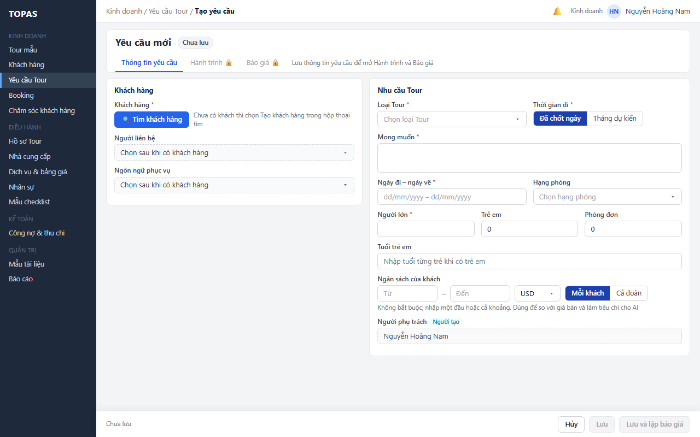

2. **W02 · Nút Tìm khách hàng ở thẻ Khách hàng → hộp thoại.** Người dùng gõ “müller”. Hệ thống tìm sau 300 ms theo tên, mã khách, email và điện thoại, kể cả của người liên hệ (R05). Mỗi dòng ghi loại, quốc gia, liên hệ chính và yêu cầu đang xử lý kèm người phụ trách, để người dùng thấy Müller Reisen GmbH đã có YC-2611-0019 trước khi tạo thêm.

   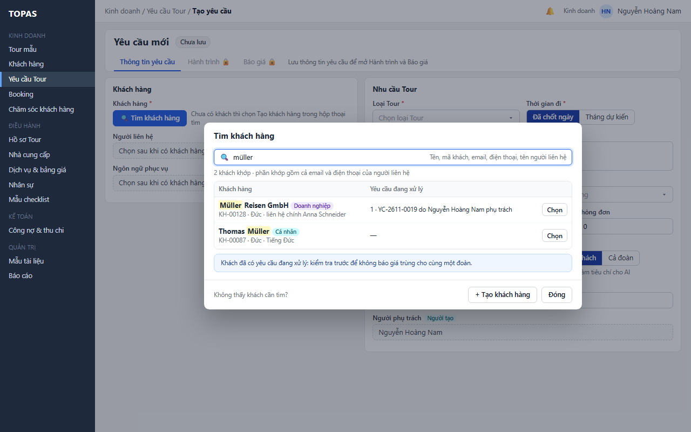

3. **W05 · Nút Chọn trên dòng khách.** Hộp thoại đóng; thẻ Khách hàng hiện khách (ô chỉ đọc, có Đổi khách), Người liên hệ là liên hệ chính (nhãn Liên hệ chính), Ngôn ngữ phục vụ lấy từ ngôn ngữ giao tiếp của khách (nhãn Từ khách hàng), ghi chú của khách hiện làm gợi ý. Người dùng nhập loại Tour, mong muốn, ngày đi – ngày về (hệ thống ghi số ngày đêm dưới ô), số người lớn, số trẻ em và tuổi từng trẻ, hạng phòng, số phòng đơn (hệ thống ghi số phòng dưới ô), ngân sách của khách (từ – đến, loại tiền, Mỗi khách hoặc Cả đoàn; hệ thống ghi giá trị quy đổi sang cách tính còn lại).

   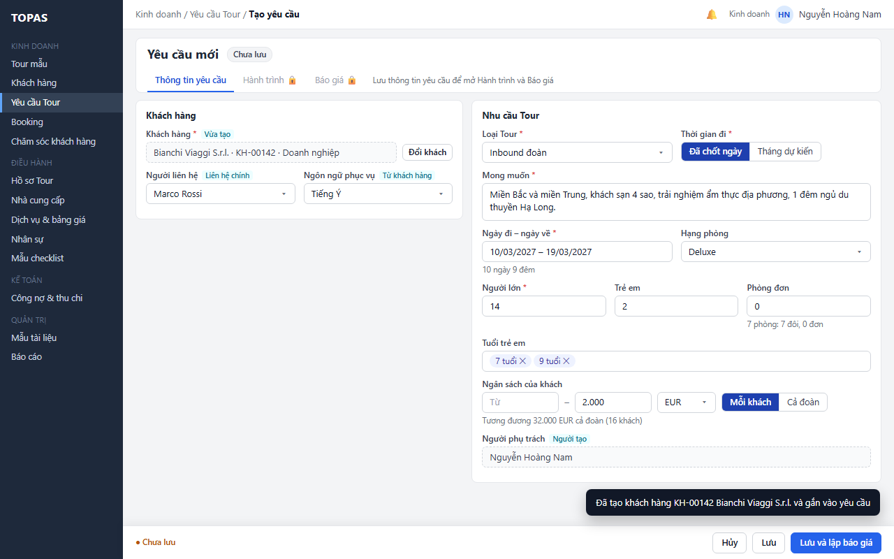

4. **W07 · Nút Lưu ở chân trang.** Hệ thống kiểm tra theo R04, cấp mã YC-2611-0031, trạng thái Đang xử lý. Phần đầu đầy đủ; Hành trình và Báo giá mở; ô Người phụ trách rời khỏi form vì đã có ở phần đầu; chân trang có nút chính Lập báo giá.

   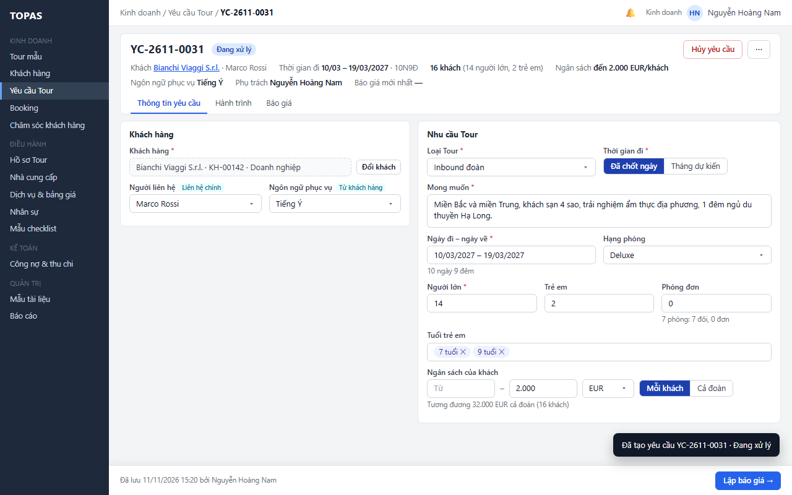

*Kết quả:* yêu cầu Đang xử lý gắn với khách đã có, người tạo là người phụ trách; KD05 hiện yêu cầu ở chip Đang xử lý.

**L1.2 Tạo khách nhanh khi không tìm thấy.** *Điều kiện:* như L1.1; tìm không có kết quả.

1. **W03 · Ô tìm của hộp thoại Tìm khách hàng.** Người dùng gõ “bianchi”, không có kết quả. Hộp thoại hiện ngay form tạo khách: loại (Cá nhân, Doanh nghiệp), tên (điền sẵn từ ô tìm), quốc gia, ngôn ngữ giao tiếp (gợi ý theo quốc gia), người liên hệ chính với họ tên, email, điện thoại. Các trường bắt buộc theo RSD KD03-KD04 R01.

   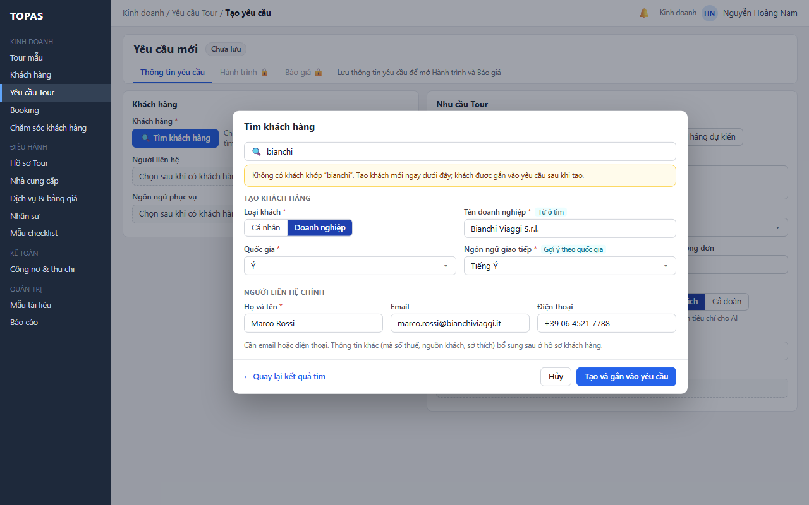

2. **W05 · Nút Tạo và gắn vào yêu cầu.** Hệ thống kiểm tra theo R05; có thể trùng thì hiện W04 (E1.2). Không trùng thì hệ thống tạo khách KH-00142 theo quy tắc KD04 (người tạo là người phụ trách khách), đóng hộp thoại và gắn khách vào yêu cầu; nhãn Vừa tạo cạnh ô Khách hàng; thông báo ngắn xác nhận. Yêu cầu vẫn chưa lưu.
3. **W07 · Nút Lưu ở chân trang.** Người dùng nhập nhu cầu và bấm Lưu như L1.1 bước 4.

*Kết quả:* khách mới có trong KD03 ngay cả khi người dùng bỏ yêu cầu sau đó (E1.4).

**L1.3 Tạo yêu cầu từ hồ sơ khách hàng.** *Điều kiện:* Kinh doanh bấm Tạo yêu cầu Tour ở KD04 (SYS10.09, SYS10.10).

1. **W05 · Nút Tạo yêu cầu Tour ở KD04 → form tại tab.** KD06 mở tạo mới với khách, liên hệ chính, ngôn ngữ phục vụ điền sẵn (nhãn Từ khách hàng); nếu mở từ ghi nhận chăm sóc “Có nhu cầu Tour mới” thì Mong muốn điền sẵn phản hồi của khách (RSD KD03-KD04 L8.2). Người dùng nhập phần còn lại và lưu như L1.1 bước 4 (W07).

*Kết quả:* không phải tìm lại khách.

**L1.4 Lưu và lập báo giá.** *Điều kiện:* form hợp lệ.

1. **W13 · Nút Lưu và lập báo giá ở chân trang.** Người dùng bấm Lưu và lập báo giá thay cho Lưu. Hệ thống lưu như L1.1 bước 4 rồi mở thẳng tab Hành trình (SYS02.09 → SYS02.11 → SYS03.01). Với yêu cầu đã lưu và không có thay đổi, nút này mang nhãn Lập báo giá (W07).

*Kết quả:* một lần bấm thay cho Lưu rồi chọn tab.

**Ngoại lệ**

- **E1.1 Dữ liệu nhập sai (W06).** Bấm Lưu khi thiếu hoặc sai: banner đỏ “Chưa lưu được: còn n lỗi”, lỗi ghi dưới từng trường; dữ liệu đã nhập được giữ; con trỏ đặt vào trường lỗi đầu tiên. Các lỗi theo R04: thiếu loại Tour, mong muốn, thời gian, số người lớn; ngày về trước ngày đi; ngày đi trước hôm nay (chỉ khi tạo mới); số tuổi nhập khác số trẻ em; tuổi ngoài 0–17; phòng đơn lớn hơn số người lớn.

  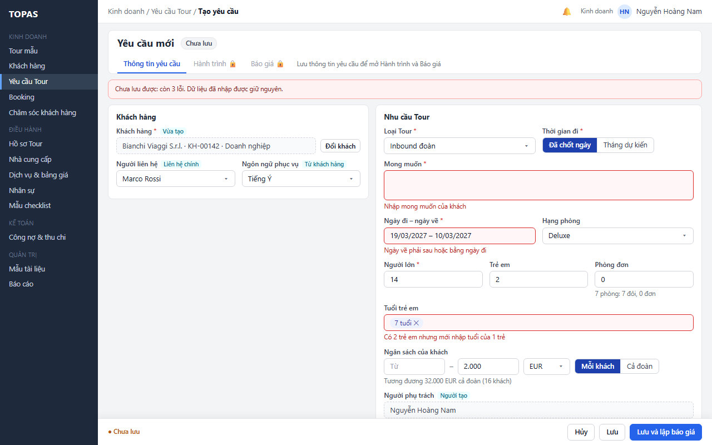

- **E1.2 Khách mới có thể trùng (W04).** Khi bấm Tạo và gắn vào yêu cầu, nếu thông tin trùng theo RSD KD03-KD04 R02 thì hiện hộp thoại liệt kê hồ sơ có thể trùng và trường trùng. Người dùng chọn Dùng hồ sơ này (gắn khách đã có, bỏ form tạo) hoặc nhập lý do rồi Vẫn tạo và gắn vào yêu cầu (hệ thống ghi cặp hồ sơ là không trùng).

  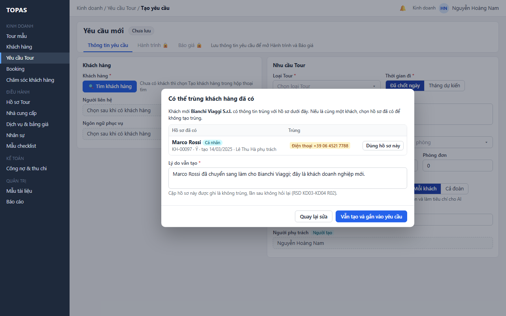

- **E1.3 Rời khi chưa lưu (W09).** Bấm Hủy, breadcrumb, menu hoặc đóng trình duyệt khi đã nhập: hộp thoại Lưu và rời, Bỏ thay đổi, Ở lại. Chưa nhập gì thì rời ngay. Trình duyệt chỉ hiện hộp thoại mặc định của trình duyệt khi đóng tab.

  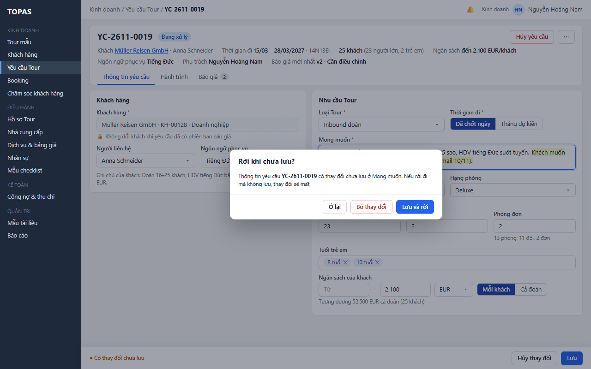

- **E1.4 Bỏ yêu cầu sau khi đã tạo khách nhanh.** Khách KH-00142 vẫn được giữ ở KD03 (không xóa ngầm); thông báo ngắn khi rời: “Khách Bianchi Viaggi S.r.l. đã được tạo ở Khách hàng”.
- **E1.5 Lỗi lưu.** Mất kết nối hoặc lỗi máy chủ: banner đỏ “Chưa lưu được yêu cầu. Thử lại”, dữ liệu giữ nguyên; nút Lưu bật lại. Bấm Lưu lặp trong lúc đang lưu bị bỏ qua (nút hiện Đang lưu…), máy chủ chống tạo hai yêu cầu bằng mã phiên tạo mới.
- **E1.6 Đổi khách sau khi chọn.** Trước khi có phiên bản báo giá: Đổi khách mở lại hộp thoại tìm; người liên hệ và ngôn ngữ phục vụ được điền lại theo khách mới nếu người dùng chưa tự đổi. Đã có phiên bản báo giá: ô khóa với lý do “Không đổi khách khi yêu cầu đã có phiên bản báo giá” (W08).
- **E1.7 Danh mục trống.** Loại Tour hoặc hạng phòng chưa khai ở QT05: ô thả xuống ghi “Chưa có danh mục · thêm ở QT05” (loại Tour do Kinh doanh, hạng phòng do Điều hành thêm, R25; RSD QT05 mục 1.5); loại Tour bắt buộc nên chưa lưu được; hạng phòng không bắt buộc.
- **E1.8 Khách doanh nghiệp không còn liên hệ chính** (bị sửa ở KD04 trong lúc tạo): ô Người liên hệ trống, chọn được người liên hệ khác của khách; không bắt buộc.
- **E1.9 Chưa chốt ngày.** Chọn Tháng dự kiến: nhập tháng và số ngày thay cho ngày đi – ngày về; phần đầu ghi “Tháng mm/yyyy · chưa chốt ngày”; hành trình ghi Ngày n không kèm ngày (R04, R07).
- **E1.10 Không có quyền tạo.** Quản trị hệ thống mở đường dẫn tạo mới: trang “Bạn không có quyền tạo yêu cầu Tour”. Điều hành, Kế toán: E2.6.

### 3.2. Mở và cập nhật yêu cầu (KD06.1 · SYS02.07–SYS02.09)

**L2.1 Mở đúng chỗ cần xử lý.** *Điều kiện:* mở từ KD05, KD04.3, QT08 hoặc thông báo.

1. **W13, W26 · Dòng yêu cầu ở KD05, mã yêu cầu ở KD04.3, dòng báo cáo ở QT08 hoặc thông báo.** KD06 mở ở tab đích theo R06: chưa có hành trình → Thông tin yêu cầu; có hành trình nhưng chưa có phiên bản → Hành trình; có phiên bản → Báo giá. Hệ thống luôn tải bản mới nhất của yêu cầu.

*Kết quả:* người dùng vào thẳng bước cần làm.

**L2.2 Sửa thông tin yêu cầu.** *Điều kiện:* người phụ trách; Đang xử lý.

1. **W08 · Form tại tab Thông tin yêu cầu.** Người dùng sửa trực tiếp trên form (ví dụ thêm vào Mong muốn “Khách muốn đổi khách sạn ở Huế từ 5 sao xuống 4 sao”). Chân trang đổi thành “● Có thay đổi chưa lưu” kèm Hủy thay đổi và Lưu. Khi đã có phiên bản báo giá, dải xanh nhắc báo giá đã lưu không tự đổi; ô Khách hàng khóa.

   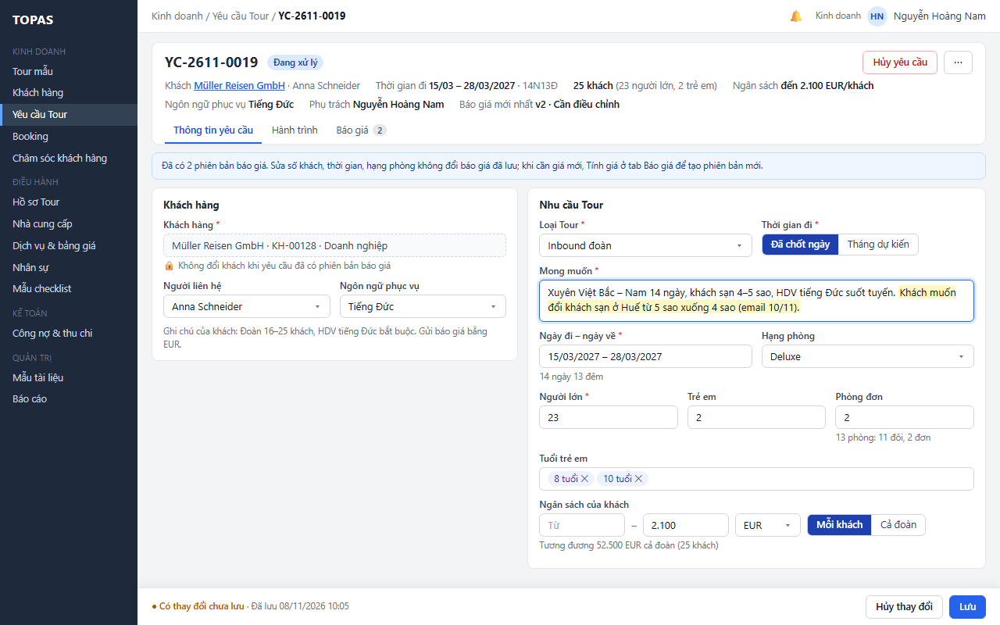

2. **W08 · Nút Lưu ở chân trang.** Hệ thống lưu theo phần (chỉ thông tin yêu cầu), chân trang ghi “Đã lưu … bởi …”, phần đầu cập nhật (thời gian, số khách). Tác động sang tab khác theo R07: đổi ngày đi thì ngày của hành trình dời theo; đổi số khách, số phòng thì số lượng “Theo số khách”, “Theo số phòng” tính lại; số ngày lệch thì KD06.2 cảnh báo.

*Kết quả:* thông tin yêu cầu mới dùng ngay cho hành trình và lần tính giá sau; phiên bản báo giá đã lưu giữ nguyên (R16).

**L2.3 Xem yêu cầu do người khác phụ trách.** *Điều kiện:* Kinh doanh không phải người phụ trách, hoặc Quản trị.

1. **W11 · Mọi tab của yêu cầu do người khác phụ trách.** Mọi tab ở chế độ chỉ đọc: phần đầu ghi “🔒 Chỉ xem · do Nguyễn Hoàng Nam phụ trách”, không có nút Hủy yêu cầu; lưới ngày không có ô nhập, nút thêm, kéo thả; tab Báo giá không có Tính giá; bảng trượt phiên bản chỉ hiện kết quả và link.

   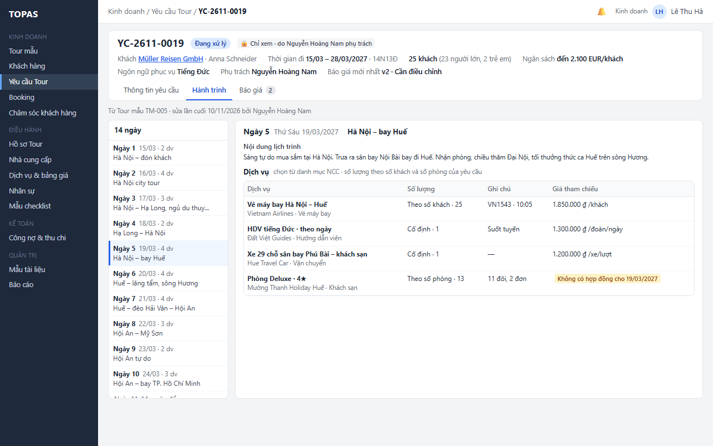

*Kết quả:* người khác biết yêu cầu đang ở đâu mà không sửa được.

**Ngoại lệ**

- **E2.1 Xung đột khi lưu (W10).** Yêu cầu vừa được lưu ở phiên khác (cùng người ở cửa sổ khác): không ghi đè ngầm; banner đỏ liệt kê trường lệch (bản vừa lưu, bản của bạn); chọn Tải bản mới, bỏ thay đổi của tôi hoặc Lưu bản của tôi đè lên. Lưu đè ghi lịch sử như một lần sửa.

  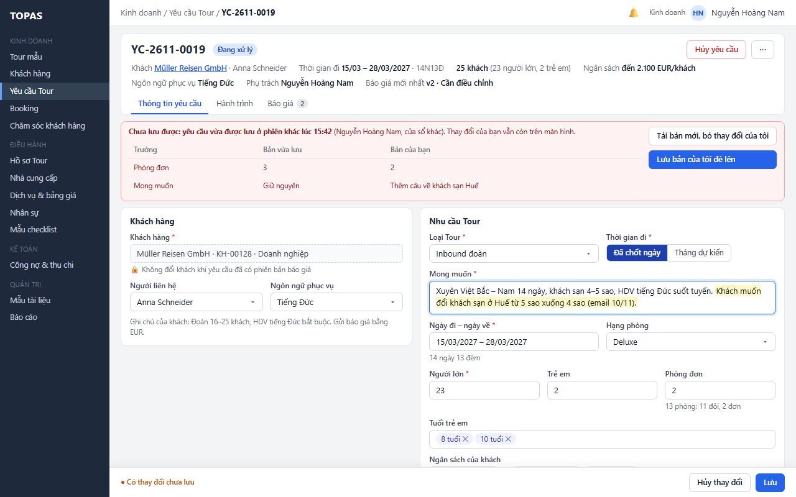

- **E2.2 Lỗi tải hồ sơ (W12).** Không tải được: không hiện dữ liệu cũ; Thử lại hoặc Về danh sách yêu cầu.

  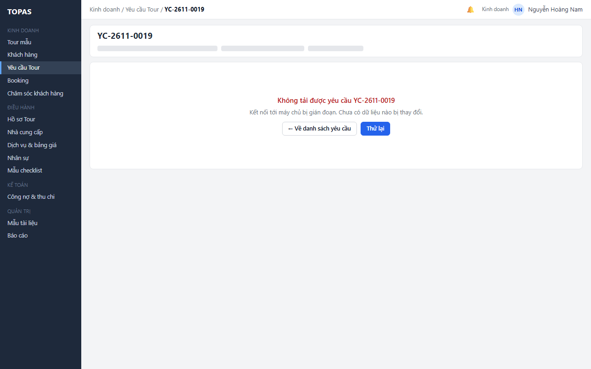

- **E2.3 Rời khi chưa lưu (W09).** Áp dụng cho mọi tab có thay đổi chưa lưu, kể cả khi chuyển tab.

- **E2.4 Đổi số ngày khi đã có hành trình.** Lưu được; tab Hành trình hiện dải vàng “Hành trình có n ngày, yêu cầu đi m ngày” (như W15). Hệ thống không tự thêm hoặc xóa ngày.
- **E2.5 Mất quyền giữa chừng.** Yêu cầu vừa được chuyển cho người khác (kể cả do chuyển người phụ trách Booking ở KD08), vừa có Booking, vừa bị hủy ở phiên khác hoặc tự hủy do Booking bị hủy: lưu bị từ chối, banner đỏ nêu lý do (“Yêu cầu vừa được chuyển cho Lê Thu Hà”), dữ liệu đang nhập giữ trên màn hình để sao chép; Tải lại chuyển sang chế độ chỉ đọc.
- **E2.6 Không có quyền xem.** Điều hành, Kế toán mở đường dẫn KD06: trang “Bạn không có quyền xem yêu cầu Tour”. Từ KD08, liên kết sang KD06 (yêu cầu, phiên bản nguồn, Xem vN) chỉ hiện với Kinh doanh phụ trách Booking và Quản trị hệ thống; Điều hành, Kế toán thấy mã yêu cầu và số phiên bản dạng chữ (RSD KD08 1.4, R01).
- **E2.7 Yêu cầu không còn tồn tại.** Mã không có (gõ sai hoặc bị xóa bằng công cụ quản trị): trang “Không tìm thấy yêu cầu YC-…” và nút về danh sách.

### 3.3. Thiết kế hành trình (KD06.2 · TN03.01–TN03.05)

**L3.1 Tạo hành trình từ Tour mẫu.** *Điều kiện:* người phụ trách; Đang xử lý; chưa có hành trình.

1. **W13 · Tab Hành trình, chưa có hành trình.** Dải đầu nhắc loại Tour, hạng phòng và số phòng, tuổi trẻ em, mong muốn (phần còn lại đã ở phần đầu). Ba thẻ theo thứ tự: **Bằng AI** (bên trái, viền xanh, nhãn Nhanh nhất, nút Tạo bằng AI màu xanh là nút chính của màn), Từ Tour mẫu, Thủ công (nút viền trắng); mỗi thẻ ghi gợi ý dựa trên yêu cầu (ví dụ “gần nhất với 10 ngày là TM-008”). Nút của thẻ mở: Tạo bằng AI → W19 (L3.5); Chọn Tour mẫu → W14; Tạo 10 ngày trống → W48 (L3.3); Ghép ngày từ Tour mẫu → W16 (L3.2).

   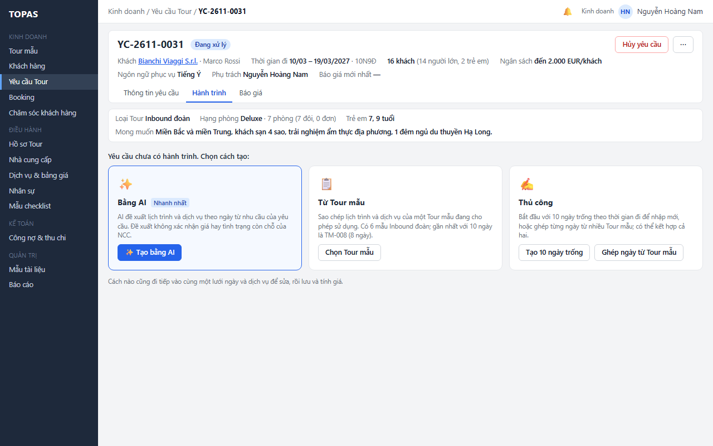

2. **W14 · Nút Chọn Tour mẫu → bảng trượt.** Bảng trượt chỉ liệt kê Tour mẫu Cho phép sử dụng (RSD KD01-KD02 R10), lọc sẵn theo loại Tour của yêu cầu, sắp theo số ngày gần với yêu cầu nhất. Người dùng lọc và chọn một mẫu thì bên phải xem trước các ngày, số dịch vụ, dịch vụ ngừng sử dụng, và cảnh báo khi số ngày khác yêu cầu.

   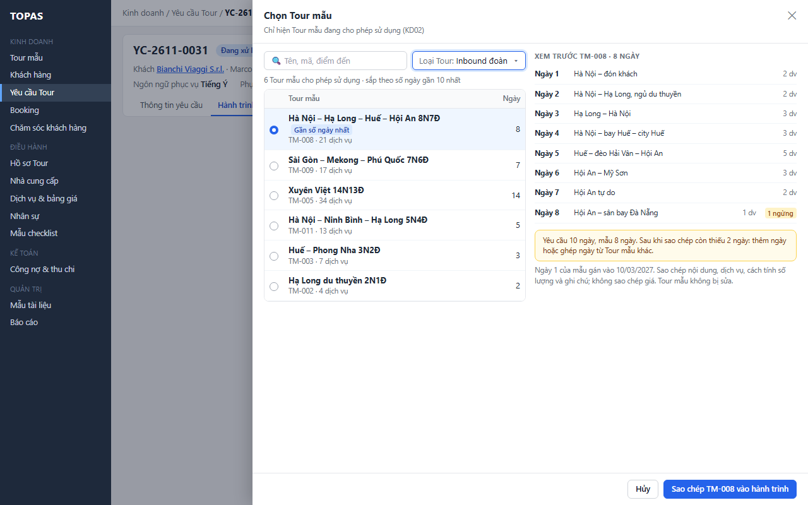

3. **W15 · Nút Sao chép TM-008 vào hành trình.** Hệ thống sao chép bản đã lưu mới nhất của mẫu (ngày, tiêu đề, nội dung, dòng dịch vụ, cách tính số lượng, ghi chú; không sao chép giá, ghi chú nội bộ) theo R08. Ngày 1 gán vào ngày đi 10/03/2027; số lượng tính theo 16 khách và 7 phòng của yêu cầu. Dòng ghi “Từ Tour mẫu TM-008 · chưa lưu”; thông báo có Hoàn tác. Dải vàng báo hành trình 8 ngày, yêu cầu 10 ngày. Dòng HDV tiếng Đức có cảnh báo Khác ngôn ngữ phục vụ (R10; chỉ có khi DH03 có trường ngôn ngữ của dịch vụ HDV, chờ xác nhận). Số trên tab là 1 vì Ngày 8 có dịch vụ của NCC ngừng sử dụng.

   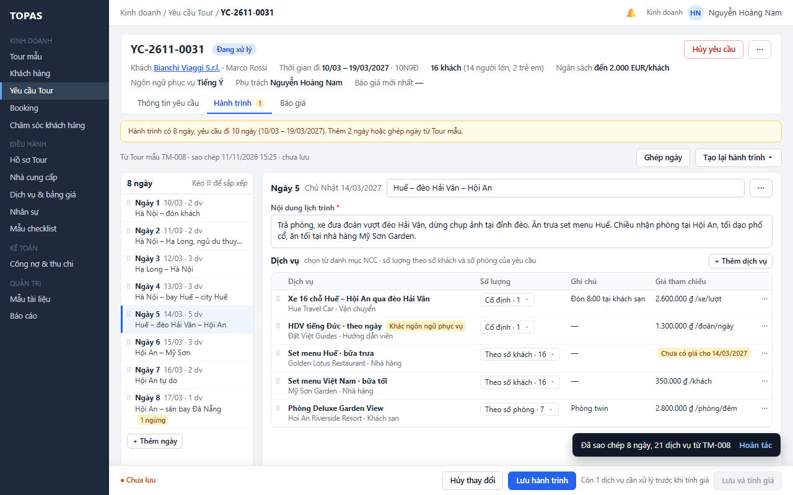

4. **W15 · Lưới ngày.** Người dùng bổ sung ngày (L3.2), dịch vụ (L3.4) rồi lưu (L3.7).

*Kết quả:* hành trình có lịch trình và dịch vụ của mẫu, theo đúng ngày và số khách của yêu cầu; Tour mẫu không đổi.

**L3.2 Ghép ngày từ Tour mẫu.** *Điều kiện:* như L3.1; có hoặc chưa có hành trình (SYS03.05, SYS03.06).

1. **W16 · Nút Ghép ngày trên lưới, hoặc Ghép ngày từ Tour mẫu ở thẻ Thủ công (W13) → hộp thoại.** Hộp thoại có hai cột: (1) chọn Tour mẫu và tích các ngày nguồn; đổi sang Tour mẫu khác vẫn giữ ngày đã chọn; (2) chọn cách ghép Chèn hoặc Thay ngày và vị trí đích. Bảng xem trước cập nhật trực tiếp theo lựa chọn, cho thấy ngày đích, nội dung nguồn và ngày bị dời hoặc bị thay.

   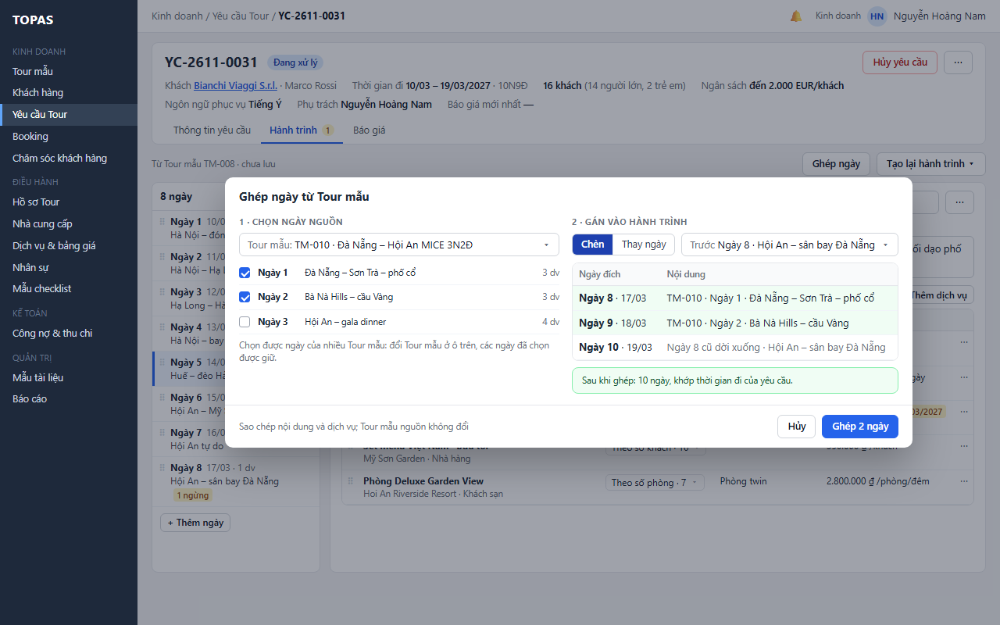

2. **W17 · Nút Ghép 2 ngày.** Hệ thống sao chép nội dung và dịch vụ của các ngày nguồn vào vị trí đích, đánh lại số ngày và ngày theo R07; ngày ghép có nhãn nguồn (TM-010 · N1) và nền xanh; Ngày 8 cũ thành Ngày 10. Thông báo có Hoàn tác. Hành trình chưa lưu.

   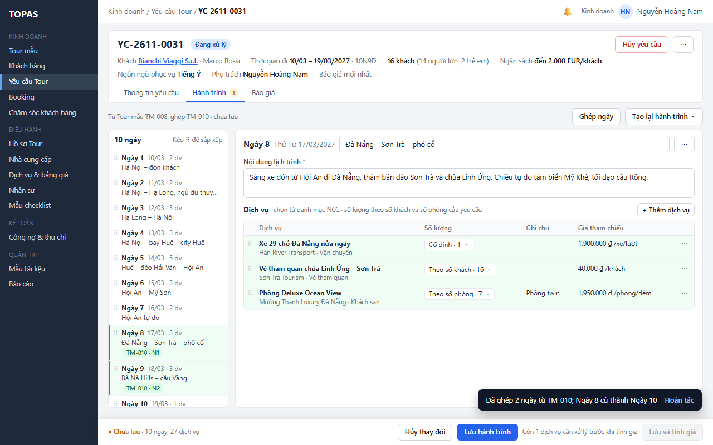

*Kết quả:* hành trình 10 ngày, khớp thời gian đi; Tour mẫu nguồn không đổi.

**L3.3 Khởi tạo thủ công.** *Điều kiện:* như L3.1.

1. **W48 · Nút Tạo 10 ngày trống ở thẻ Thủ công.** Hệ thống tạo đủ số ngày theo thời gian đi, mỗi ngày đã có ngày tháng; con trỏ ở tiêu đề Ngày 1. Số trên tab là 10 (ngày chưa có nội dung). Người dùng nhập tiêu đề, nội dung, thêm dịch vụ (L3.4) hoặc ghép ngày vào ngày trống (L3.2 cách Thay ngày).

   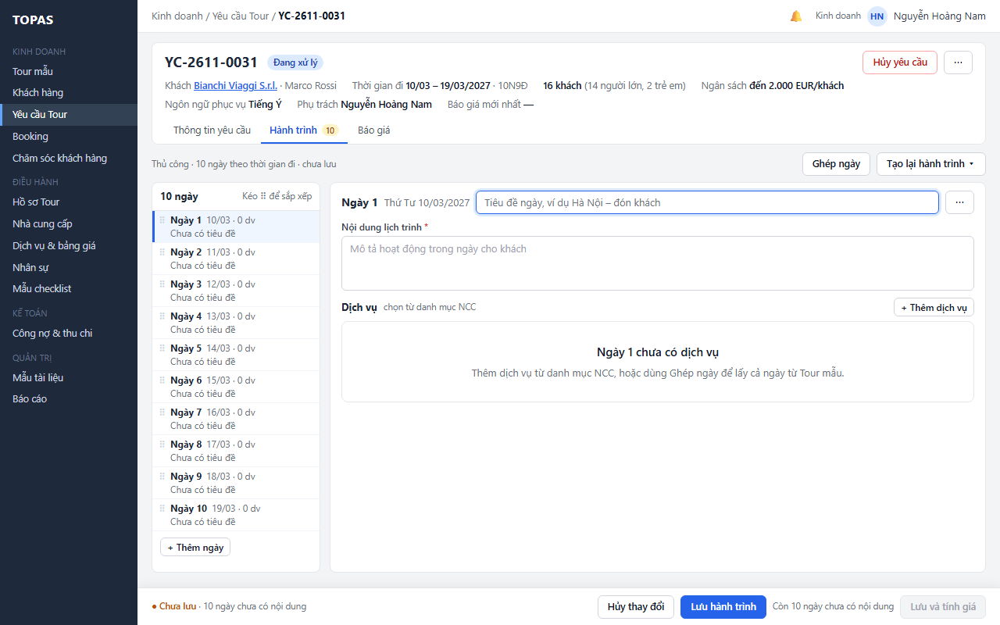

*Kết quả:* hành trình nhập mới, có thể kết hợp với ngày ghép từ Tour mẫu.

**L3.4 Sửa ngày và dịch vụ.** *Điều kiện:* có hành trình; người phụ trách; Đang xử lý.

1. **W15 · Ô ngày, ô chọn Số lượng, nút kéo ⠿ và menu ⋯ trên lưới.** Người dùng chọn ngày ở cột trái; sửa tiêu đề, nội dung tại chỗ; kéo ⠿ để sắp xếp ngày hoặc dòng dịch vụ; menu ⋯ của ngày có Thêm ngày phía sau, Nhân bản, Chuyển lên, Chuyển xuống, Xóa ngày; ô Số lượng là ô chọn tại chỗ (Cố định, Theo số khách, Theo số phòng); ⋯ của dòng có Đổi dịch vụ, Xóa. Mọi sửa đổi ở trạng thái chưa lưu; sắp xếp ngày thì ngày tháng tính lại (R07).
2. **W18 · Nút + Thêm dịch vụ trong ô Ngày 5 → bảng trượt.** Bảng trượt danh mục NCC (chỉ NCC và dịch vụ đang dùng) lọc sẵn theo nơi của ngày; giá tham chiếu theo ngày sử dụng và loại tiền gốc của dòng giá (RSD DH03 R14, DH04 R07). Dịch vụ HDV khớp ngôn ngữ phục vụ có nhãn. Người dùng chọn một hoặc nhiều dịch vụ và chọn thêm các ngày khác cần thêm cùng dịch vụ (mặc định chỉ ngày đang mở).

   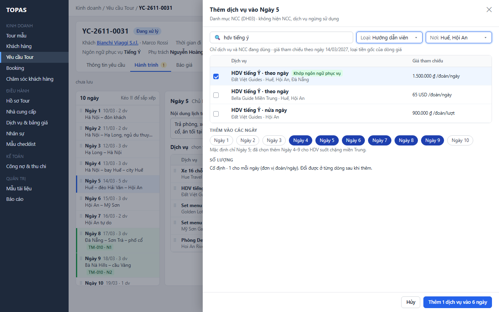

3. **W17 · Nút Thêm trong bảng trượt.** Dòng mới vào cuối mỗi ngày đã chọn, có nhãn Mới; số lượng tự tính theo đơn vị tính (RSD KD01-KD02 R05). Hành trình chưa lưu.

*Kết quả:* hành trình có đủ dịch vụ; không phải mở từng ngày để thêm dịch vụ lặp.

**L3.5 Tạo hành trình bằng AI.** *Điều kiện:* như L3.1.

1. **W19 · Nút Tạo bằng AI ở thẻ Bằng AI → bảng trượt.** Bảng trượt điền sẵn phần “Từ yêu cầu” (mong muốn, thời gian, khách, hạng phòng, ngôn ngữ, ngân sách) và cho nhập thêm: điểm đến phải có, nhịp độ, điểm vào – ra, ưu tiên, ghi chú. Dải xanh ghi rõ đề xuất không xác nhận giá, chỗ.

   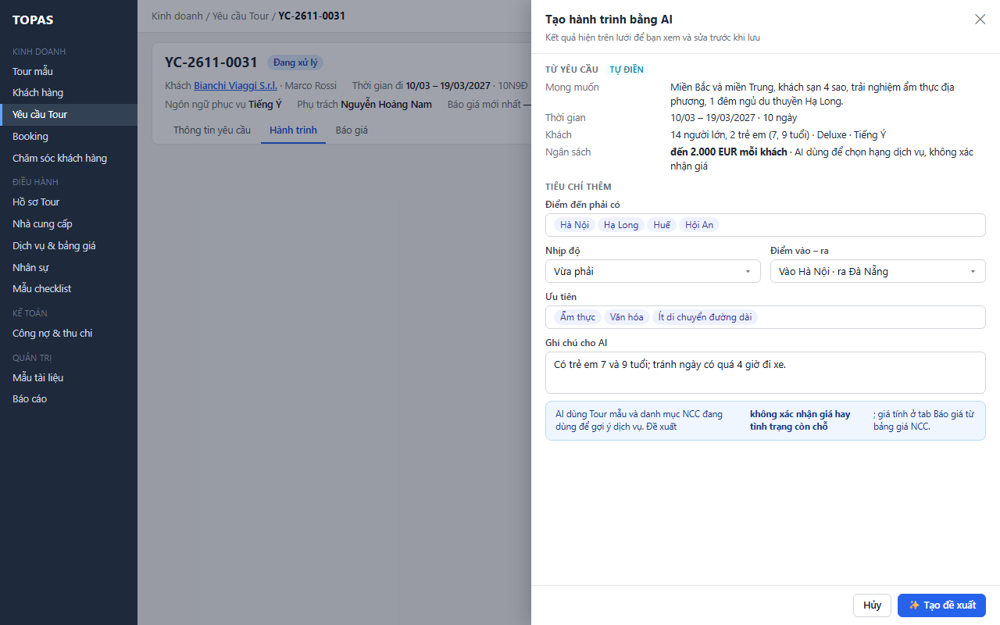

2. **W20 · Nút Tạo đề xuất.** Nút khóa, hiện Đang tạo (tối đa 60 giây); lỗi hoặc quá thời gian thì hiện W21 (E3.1). Hệ thống gửi tiêu chí theo R09 và hiện đề xuất ngay trên lưới, chưa lưu: dải tím “Đề xuất AI · 10 ngày, 24 dịch vụ: 22 khớp danh mục NCC, 2 chưa gán NCC”. Dịch vụ khớp được gán sẵn NCC và cách tính số lượng; dịch vụ chưa khớp có nhãn Chưa gán NCC và ô Chọn dịch vụ. Người dùng sửa trực tiếp, hoặc Bỏ đề xuất (về hành trình trước đó), hoặc Tạo lại với tiêu chí khác (mở lại W19, giữ tiêu chí).

   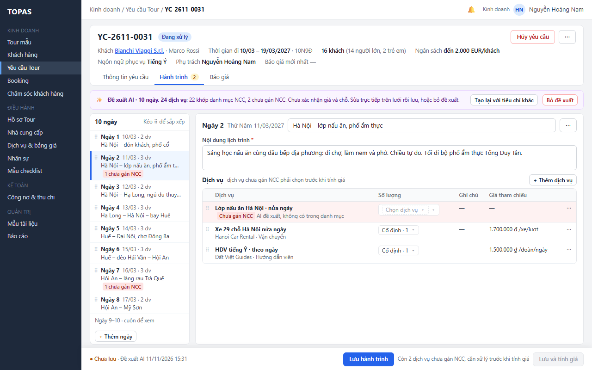

3. **W24 · Nút Lưu hành trình ở chân trang.** Hành trình được lưu kể cả khi còn dịch vụ chưa gán NCC; tab Hành trình đếm các dòng đó; Tính giá khóa đến khi xử lý xong (R10).

*Kết quả:* hành trình đề xuất thành hành trình của yêu cầu; nguồn ghi “Bằng AI”. Giá chỉ tính ở KD06.3 từ bảng giá NCC.

**L3.6 Tạo lại hành trình.** *Điều kiện:* đã có hành trình đã lưu.

1. **W22 · Menu Tạo lại hành trình ▾ → Từ Tour mẫu, Thủ công hoặc Bằng AI → hộp thoại.** Hộp thoại nêu số ngày, số dịch vụ sẽ bị thay, nói rõ phiên bản báo giá đã lưu không đổi và hành trình cũ được giữ trong lịch sử; gợi ý dùng Ghép ngày với Thay ngày nếu chỉ đổi vài ngày. Bấm Giữ thì đóng hộp thoại, không đổi gì.

   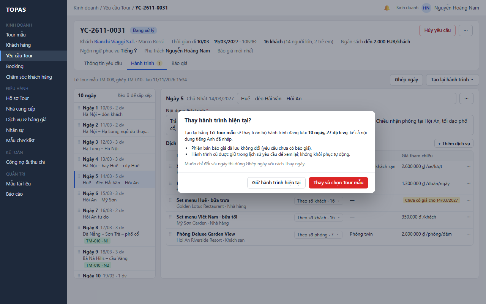

2. **W14, W48, W19 · Nút Thay và chọn Tour mẫu (hoặc Thay và tạo ngày trống, Thay và tạo bằng AI).** Luồng tiếp tục như L3.1, L3.3, L3.5. Hành trình mới chỉ thay hành trình cũ khi người dùng bấm Lưu; bấm Hủy thay đổi trả lại hành trình cũ.

*Kết quả:* hành trình mới; R11 đánh dấu khác báo giá mới nhất nếu đã có phiên bản.

**L3.7 Lưu hành trình.** *Điều kiện:* có thay đổi chưa lưu.

1. **W23 · Nút Lưu hành trình ở chân trang.** Hệ thống lưu toàn bộ ngày và dịch vụ trong một lần (R11). Thông báo “Đã lưu hành trình 14 ngày, 45 dịch vụ”. Nếu yêu cầu đã có phiên bản báo giá, dải xanh “Hành trình đã sửa sau báo giá v2: đổi 2 dịch vụ ở Ngày 5, 6” hiện ở Hành trình và Báo giá; dòng đổi có nhãn Đã đổi. Chân trang chỉ còn nút chính Tính giá →.

   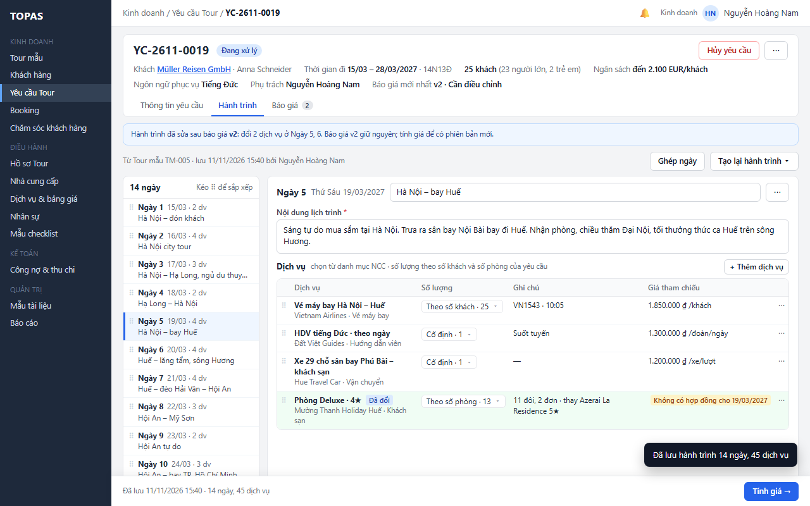

2. **W27 · Nút Tính giá → ở chân trang (hoặc Lưu và tính giá trước khi lưu).** Hệ thống lưu rồi mở tab Báo giá với bảng trượt Tính giá (L4.1).

*Kết quả:* hành trình hiện hành đã lưu; phiên bản báo giá cũ giữ nguyên.

**L3.8 Xử lý dịch vụ cần xử lý.** *Điều kiện:* số trên tab Hành trình lớn hơn 0.

1. **W24 · Dải vàng đầu lưới và dòng đỏ.** Dải vàng nêu số việc cần xử lý; ngày có việc tô đỏ ở cột trái; dòng ngừng sử dụng hoặc chưa gán NCC tô đỏ, ghi lý do (ví dụ “Ánh Dương Transport ngừng sử dụng từ 05/11/2026”) và nút Đổi dịch vụ. Tính giá → khóa, ghi “Còn 1 dịch vụ cần xử lý”.

   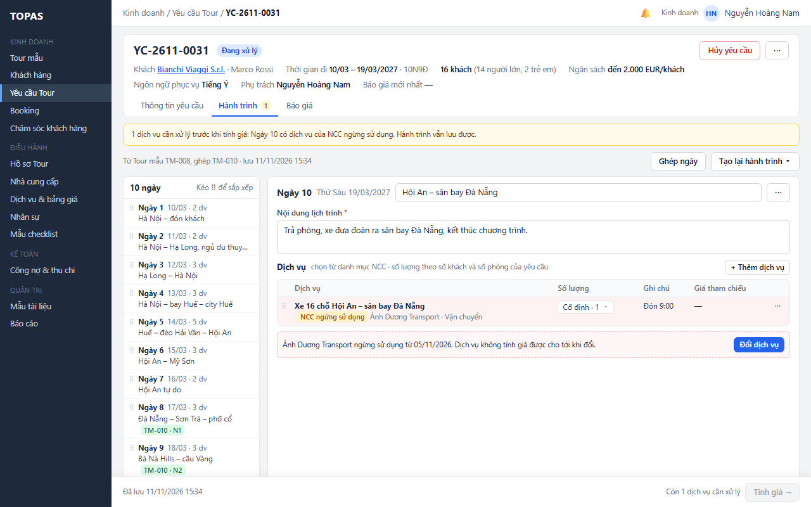

2. **W18 · Nút Đổi dịch vụ trên dòng đỏ → bảng trượt.** Bảng trượt danh mục NCC lọc sẵn theo loại và nơi của dịch vụ cũ; người dùng chọn dịch vụ thay thế và bấm Đổi; hệ thống thay tại chỗ, giữ số lượng và ghi chú. Ngày chưa có nội dung thì nhập nội dung. Lưu; số trên tab về 0 và Tính giá mở.

*Kết quả:* mọi dịch vụ của hành trình đều tính giá được.

**L3.9 Nội dung tiếng Anh cho proposal.** *Điều kiện:* có hành trình; người phụ trách.

1. **W25 · Nút chọn Tiếng Việt | English trong ô ngày.** Người dùng chuyển sang English. Cột trái ghi tình trạng EN của từng ngày (EN, EN nháp, chưa EN). Người dùng nhập tiêu đề và nội dung tiếng Anh, hoặc bấm Dịch nháp từ tiếng Việt: hệ thống điền bản dịch có nhãn “Dịch nháp · cần kiểm tra” (R12). Đánh dấu đã kiểm tra bỏ nhãn. Lưu.

   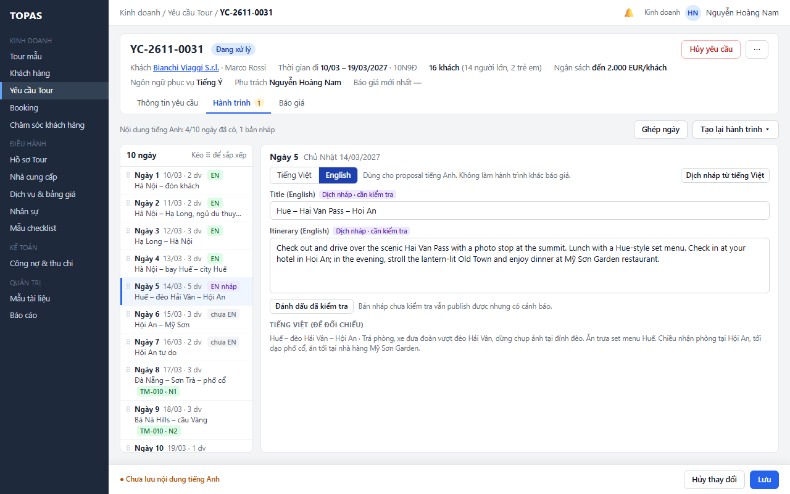

*Kết quả:* proposal tiếng Anh dùng được nội dung này; hành trình không bị coi là khác báo giá.

**Ngoại lệ**

- **E3.1 AI không trả được đề xuất (W21).** Lỗi, quá 60 giây hoặc kết quả không hợp lệ: hành trình không đổi; tiêu chí giữ nguyên; Thử lại hoặc Chọn cách khác (về W13). Không có gì được ghi ngoài nhật ký lần gọi.

  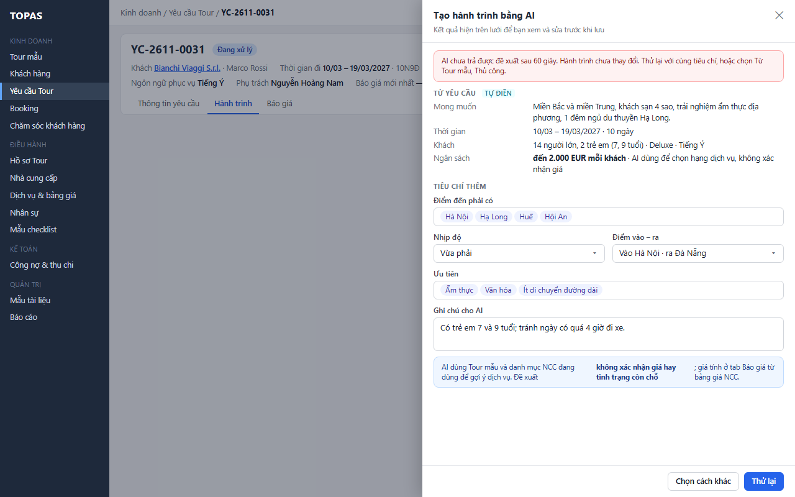

- **E3.2 Tour mẫu vừa tắt hoặc vừa sửa.** Khi sao chép hoặc ghép, hệ thống kiểm tra lại: mẫu đã Không cho phép thì báo “Tour mẫu vừa ngừng cho phép sử dụng” và không sao chép (RSD KD01-KD02 E6.6); mẫu vừa sửa thì sao chép bản đã lưu mới nhất.
- **E3.3 Không có Tour mẫu phù hợp.** Bảng trượt W14 rỗng theo loại Tour: “Không có Tour mẫu Inbound đoàn cho phép sử dụng · Bỏ lọc loại Tour”. Chưa có Tour mẫu nào: thẻ Từ Tour mẫu ghi “Chưa có Tour mẫu cho phép sử dụng” và nút khóa.
- **E3.4 Dịch vụ, NCC ngừng sử dụng** (trong mẫu, trong hành trình đã lưu, hoặc vừa bị tắt ở DH03): dòng có nhãn, được đếm trên tab; không tính giá được cho tới khi đổi (W24, R10).
- **E3.5 Số ngày khác thời gian đi.** Dải vàng (W15); không chặn lưu; Tính giá vẫn được nhưng bảng trượt nhắc lệch.
- **E3.6 Ghép vượt hoặc chồng.** Ghép Thay ngày với số ngày nguồn nhiều hơn số ngày còn lại phía sau: phần thừa được chèn sau ngày cuối, xem trước ghi rõ. Không chọn ngày nguồn nào: nút Ghép khóa.
- **E3.7 Xóa ngày.** Các ngày sau dồn lên, ngày tháng tính lại; có Hoàn tác; chưa lưu. Không xóa được ngày cuối cùng còn lại (hành trình phải có ít nhất 1 ngày).
- **E3.8 Lỗi lưu, xung đột.** Lỗi mạng: banner đỏ, giữ nguyên lưới. Hành trình vừa được lưu ở phiên khác: hộp thoại như W10 nhưng ở cấp hành trình (Tải bản mới hoặc Lưu bản của tôi đè lên).
- **E3.9 Tính giá khi còn việc cần xử lý.** Nút Lưu và tính giá, Tính giá → khóa kèm “Còn n … cần xử lý trước khi tính giá” (W15, W20, W24, W48).
- **E3.10 Rời khi chưa lưu hoặc đang có đề xuất AI chưa lưu.** Hộp thoại W09. Bỏ thay đổi trả hành trình đã lưu gần nhất.
- **E3.11 Yêu cầu chưa chốt ngày.** Ngày ghi “Ngày n” không kèm ngày tháng; giá tham chiếu ở W18 tính theo ngày đầu tháng dự kiến và ghi “giá tham chiếu theo 01/04/2027 (tháng dự kiến)”.
- **E3.12 Dịch nháp lỗi.** Không dịch được: ô giữ nguyên, thông báo “Chưa dịch được, thử lại hoặc nhập tay”.

### 3.4. Tính giá và phiên bản báo giá (KD06.3 · TN03.06, TN03.07)

**L4.1 Tính giá và lưu phiên bản.** *Điều kiện:* người phụ trách; Đang xử lý; hành trình đã lưu, không còn việc cần xử lý.

1. **W26 · Tab Báo giá.** Tab liệt kê phiên bản mới nhất trước: điều kiện tính, giá bán kèm bình quân mỗi khách và nhãn trong hoặc vượt ngân sách (v2 vượt 0,5 %, v1 vượt 3,0 %), proposal (ngôn ngữ, hạn, số lần mở) và kết quả. Dải xanh báo hành trình đã sửa sau v2. Tính giá là nút chính.

   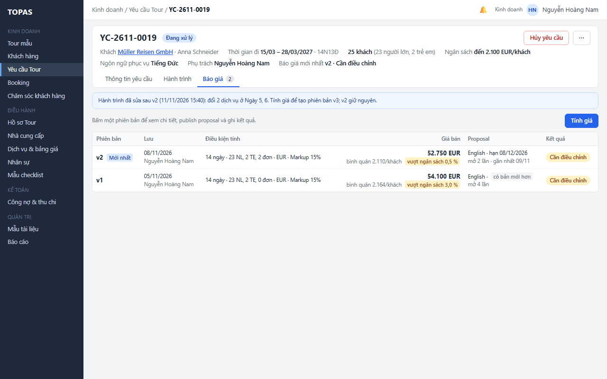

2. **W27 · Nút Tính giá ở đầu tab → bảng trượt.** Bảng trượt điền sẵn điều kiện từ phiên bản mới nhất (nhãn Từ v2), hoặc từ yêu cầu khi chưa có phiên bản: người lớn, trẻ em và tuổi, hạng phòng, phòng đơn, số phòng (tự tính), ngày khởi hành (Từ yêu cầu), loại tiền báo giá, Markup chung (Mặc định theo loại Tour), Markup theo hạng mục dịch vụ: Lưu trú, Di chuyển, Vé máy bay, Hướng dẫn viên, Tham quan, Ăn uống… (để trống thì dùng Markup chung; ví dụ Vé máy bay 5 % mặc định của hạng mục, Hướng dẫn viên người dùng đặt 20 %) và tỷ giá của từng loại tiền có trong hành trình (tỷ giá có hiệu lực ngày tính ở QT05; ngày chưa nhập thì lấy ngày gần nhất trước đó, ô ghi ngày lấy tỷ giá, R14). Người dùng sửa nếu cần.

   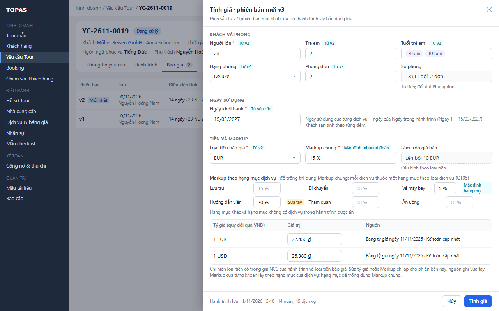

3. **W28 · Nút Tính giá trong bảng trượt.** Hệ thống tính theo R13, R14: chọn hợp đồng áp dụng cho ngày sử dụng của từng dịch vụ, mùa và loại ngày, dòng giá theo số khách, giá trẻ em theo nhóm tuổi, phụ thu; quy đổi từng khoản qua VND; cộng giá vốn theo người lớn, trẻ em, phụ thu phòng đơn; áp Markup theo hạng mục của từng khoản, hạng mục để trống dùng Markup chung (R14), rồi làm tròn lên. Bảng trượt hiện bốn ô (giá vốn 44.317,40 EUR, Markup chung 15 %, bình quân thực tế 14,3 %, giá bán 50.750 EUR, lãi gộp 6.432,60 EUR), dải so với ngân sách (bình quân 2.030 EUR/khách, thấp hơn ngân sách 2.100 EUR/khách 70 EUR, trong ngân sách; R26), bảng giá bán theo đối tượng, và bảng giá vốn từng khoản lọc được theo ngày hoặc Nhập tay; mỗi khoản ghi hợp đồng, mùa, loại ngày, số lượng, đơn giá gốc, quy đổi và Markup đang áp kèm hạng mục (ví dụ “5 % · Vé máy bay”, “15 % · Di chuyển (chung)”). Muốn đổi Markup thì bấm Sửa điều kiện về W27; không đặt Markup cho riêng một khoản. Người dùng có thể bấm Sửa điều kiện để đổi điều kiện tính trước khi lưu.

   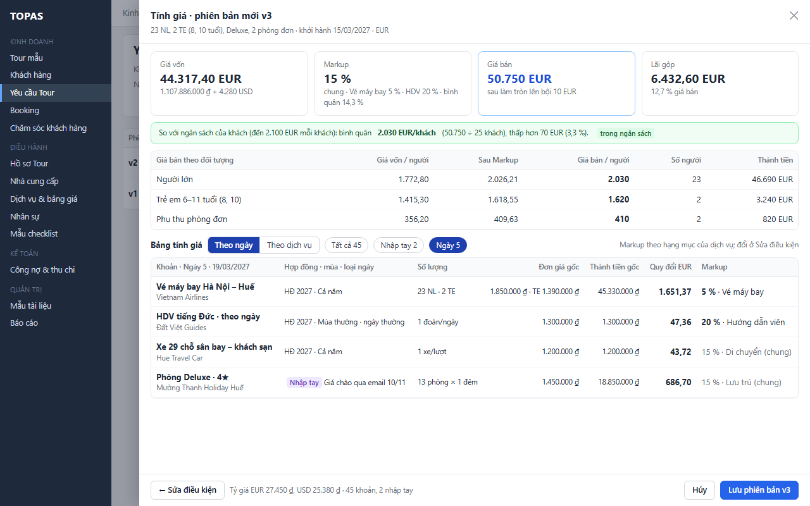

4. **W49 · Nút chọn Theo dịch vụ trên tiêu đề Bảng tính giá.** Cùng kết quả tính, bảng đổi sang xem theo dịch vụ: dịch vụ gom theo hạng mục (Lưu trú, Vé máy bay, Hướng dẫn viên, Di chuyển, Ăn uống, Tham quan, Khác); dòng hạng mục ghi số dịch vụ, tổng giá vốn, Markup, tổng giá bán; bấm ▸ mở các dịch vụ của hạng mục, Mở tất cả mở mọi hạng mục. Mỗi dịch vụ là một dòng gộp cả hành trình (ví dụ HDV tiếng Đức Ngày 1–14, 14 đoàn/ngày; Phòng Deluxe Mường Thanh Ngày 5–6, 13 phòng × 2 đêm) với NCC, ngày dùng, số lượng, giá vốn quy đổi, Markup, giá bán trước làm tròn; nhãn Nhập tay giữ nguyên. Dòng tổng: 45 dịch vụ, giá vốn 44.317,40, giá bán 50.659,00 trước làm tròn, sau làm tròn theo đối tượng là 50.750 (R14). Bấm Theo ngày để về cách xem từng khoản theo ngày (W28). Cách xem được nhớ cho lần mở sau.

   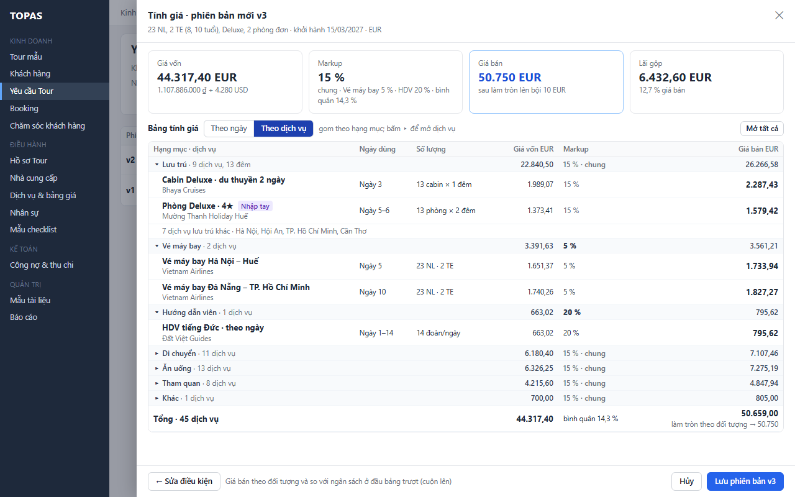

5. **W30 · Nút Lưu phiên bản v3 trong bảng trượt.** Hệ thống lưu phiên bản theo R16 (bản chụp hành trình, điều kiện, từng khoản, tỷ giá, Markup, giá bán). Bảng trượt đóng; v3 lên đầu danh sách với nhãn Mới nhất, Chưa có kết quả, Chưa publish; phần đầu ghi “Báo giá mới nhất v3 · Chưa có kết quả”; số trên tab Báo giá thành 3; dải “hành trình đã sửa” biến mất.

   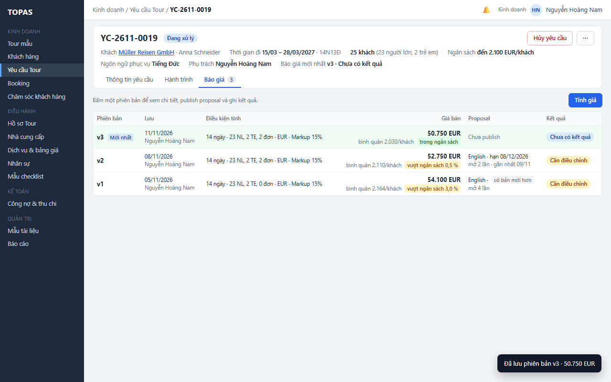

*Kết quả:* phiên bản v3 sẵn sàng publish và ghi kết quả.

**L4.2 Sửa giá từ một phiên bản.** *Điều kiện:* phiên bản có kết quả bất kỳ; yêu cầu Đang xử lý.

1. **W38 → W27 · Nút Sửa giá ở chân bảng trượt phiên bản.** Bảng trượt Tính giá (W27) mở với điều kiện điền sẵn từ đúng phiên bản đó (nhãn Từ vN), dùng hành trình hiện hành. Các bước tiếp như L4.1 bước 3–5 (tính, xem bảng tính giá, lưu phiên bản); phiên bản mới mang số tiếp theo.

*Kết quả:* phiên bản cũ giữ nguyên; giá mới thành phiên bản mới (nguồn: sửa giá tạo phiên bản mới).

**Ngoại lệ**

- **E4.1 Thiếu giá, thiếu hợp đồng (W29).** Khoản không có hợp đồng cho ngày sử dụng, hoặc ô giá mùa, ô giá trẻ em trống: banner đỏ liệt kê từng khoản và lý do; dòng tô đỏ có ô nhập đơn giá, loại tiền và ghi chú nguồn giá; có lựa chọn áp cùng giá cho các đêm hoặc ngày khác của cùng dịch vụ. Giá vốn, giá bán hiện “—”; Lưu phiên bản khóa với lý do “Còn n khoản thiếu giá”. Nhập xong, khoản có nhãn Nhập tay (W28). Không dùng giá 0 hay hợp đồng, mùa khác (R15).

  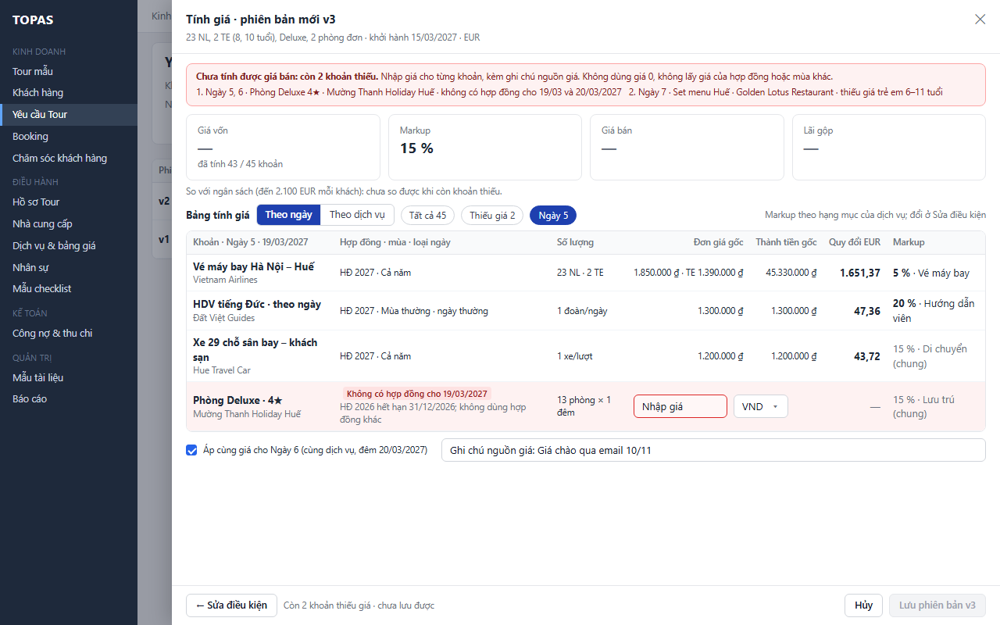

- **E4.2 Tỷ giá ngày tính chưa nhập, hoặc chưa có tỷ giá.** Ngày tính chưa có dòng tỷ giá nhưng có ngày trước đó: dùng **tỷ giá có hiệu lực** (số của ngày gần nhất ≤ ngày tính có ô loại tiền đó, RSD QT05 R13), không chặn; nguồn ghi ngày lấy tỷ giá, ví dụ “Bảng tỷ giá ngày 10/11/2026” khi tính ngày 11/11/2026. Chỉ khi loại tiền không có ngày nào ≤ ngày tính có tỷ giá thì là **chưa có tỷ giá**: ô tỷ giá trống, viền đỏ “Chưa có tỷ giá USD · nhập tỷ giá”, bắt buộc nhập tay (nguồn ghi Sửa tay); không dùng tỷ giá mặc định.
- **E4.3 Thiếu Markup mặc định.** Loại Tour chưa khai Markup ở QT05: ô Markup trống, bắt buộc nhập.
- **E4.4 Hành trình còn việc cần xử lý.** Tính giá khóa, ghi lý do, kèm liên kết Mở Hành trình (E3.9).
- **E4.5 Hành trình bị sửa ở phiên khác trong lúc đang tính.** Khi Lưu phiên bản, nếu hành trình đã lưu khác bản dùng để tính: “Hành trình vừa thay đổi lúc …, tính lại để lưu”; nút Tính lại giữ điều kiện.
- **E4.6 Lưu lặp.** Bấm Lưu phiên bản hai lần hoặc hai cửa sổ cùng lưu: mỗi lần tính có mã; máy chủ chỉ tạo một phiên bản cho một mã; số phiên bản cấp tuần tự trên máy chủ.
- **E4.7 Bảng giá, hợp đồng, tỷ giá đổi sau khi lưu.** Phiên bản giữ nguyên (R16); lần tính sau dùng dữ liệu mới.
- **E4.8 Yêu cầu chưa chốt ngày.** Ngày khởi hành trong bảng trượt trống, bắt buộc nhập; phiên bản ghi “giá theo khởi hành giả định dd/mm/yyyy”; yêu cầu vẫn ghi tháng dự kiến.
- **E4.9 Số ngày lệch.** Bảng trượt nhắc “Hành trình 8 ngày, yêu cầu 10 ngày”; vẫn tính được.
- **E4.10 Lỗi tính.** Máy chủ lỗi: bảng trượt giữ điều kiện, banner đỏ và Thử lại.
- **E4.11 Không có phiên bản.** Tab Báo giá chưa có phiên bản: “Chưa có báo giá. Tính giá từ hành trình đã lưu.” và nút Tính giá; chưa có hành trình thì nút khóa kèm “Lưu hành trình trước”.

### 3.5. Proposal cho khách (KD06.3 · TN03.07)

**L5.1 Publish proposal.** *Điều kiện:* người phụ trách; yêu cầu Đang xử lý, hoặc ở chế độ điều chỉnh với phiên bản điều chỉnh của Booking (R27, L6.5); phiên bản chưa có link đang mở cùng ngôn ngữ.

1. **W31 · Bấm dòng v3 trên tab Báo giá → bảng trượt phiên bản.** Bảng trượt hiện giá bán theo đối tượng, tóm tắt giá vốn, Markup, tỷ giá; mục Proposal cho khách ghi Chưa publish và nút chính Publish proposal; mục Kết quả báo giá với bốn lựa chọn. Chân bảng trượt: Sửa hành trình, Sửa giá. Nút chính của bảng trượt đổi theo kết quả (L6.1).

   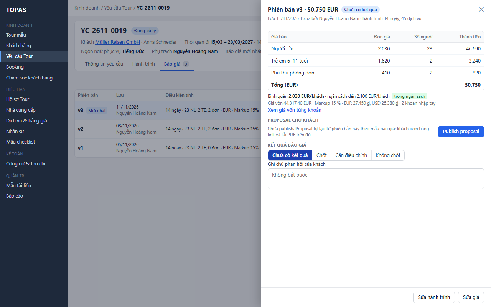

2. **W32 · Nút Publish proposal trong bảng trượt → hộp thoại.** Hộp thoại điền sẵn: ngôn ngữ (English khi ngôn ngữ phục vụ khác Tiếng Việt), hạn hiệu lực (hôm nay + 30 ngày), dịch vụ bao gồm và không bao gồm tổng hợp từ dịch vụ của phiên bản và mục mặc định của mẫu proposal (R18). Mẫu proposal đi theo ngôn ngữ đã chọn, hiện chỉ đọc; người dùng không chọn mẫu. Người dùng thêm, bỏ mục; bấm Xem trước để mở proposal ở chế độ xem trước (không tạo link).

   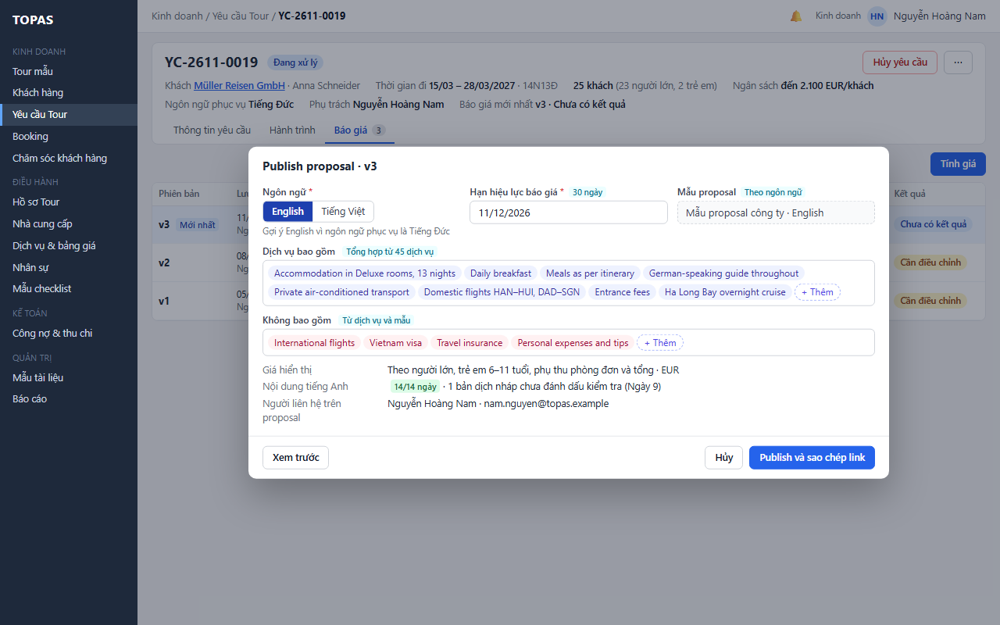

3. **W34 · Nút Publish và sao chép link.** Thiếu nội dung tiếng Anh thì hộp thoại chuyển sang W35 (E5.1). Đủ thì hệ thống tạo proposal và link riêng của phiên bản theo R18, sao chép link vào bộ nhớ tạm. Bảng trượt hiện link, nút Sao chép link, Mở proposal, ngôn ngữ, thời điểm publish, hạn, số lần mở, Gia hạn, Thu hồi link và liên kết Publish bản tiếng Việt. Người dùng tự gửi link cho khách qua kênh mình dùng.

   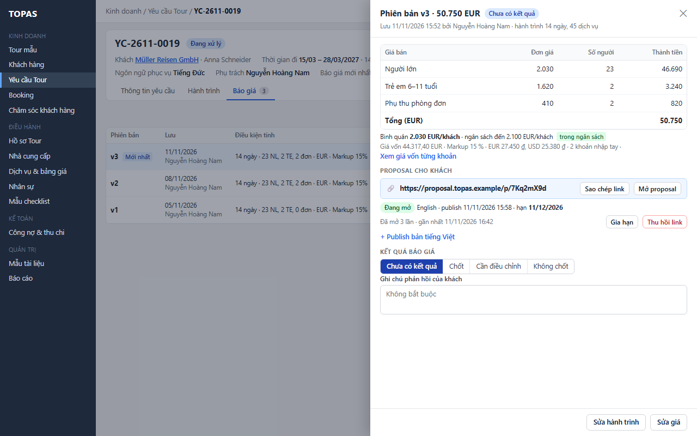

4. **W33 · Link proposal, khách mở trên trình duyệt.** Khách mở link, không cần đăng nhập. Trang proposal theo ngôn ngữ đã chọn: khách, tên hành trình, thời gian, số khách, lịch trình theo ngày, giá theo đối tượng và tổng, bao gồm, không bao gồm, hạn hiệu lực, người phụ trách; nút Download PDF tải tệp PDF cùng nội dung. Bố cục, nhận diện và điều khoản cố định theo mẫu proposal riêng của công ty, hệ thống dựng sẵn; hình W33 chỉ minh họa vùng dữ liệu. Mỗi lần mở được ghi (R18); W34 cập nhật số lần mở và lần mở gần nhất.

   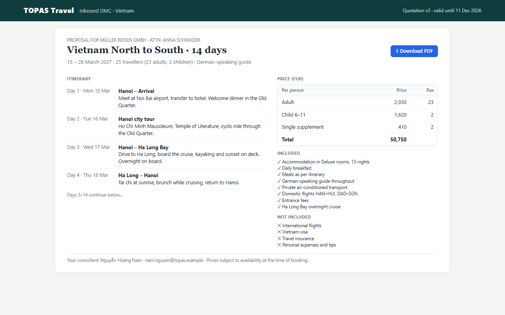

*Kết quả:* khách có báo giá; người dùng thấy khách đã mở mấy lần để chủ động liên hệ.

**L5.2 Gia hạn hoặc thu hồi link.** *Điều kiện:* người phụ trách; link Đang mở hoặc Hết hạn.

1. **W34 · Ô ngày Gia hạn tại chỗ, nút Thu hồi link → hộp thoại xác nhận.** Gia hạn: người dùng chọn hạn mới (từ hôm nay), lưu ngay; cùng link. Thu hồi link: hộp thoại xác nhận “Khách mở link sẽ thấy báo giá không còn hiệu lực”; xác nhận thì link Đã thu hồi.
2. **W36 · Link đã thu hồi hoặc hết hạn, khách mở.** Trang không hiện giá và lịch trình, chỉ ghi cách liên hệ người phụ trách.

   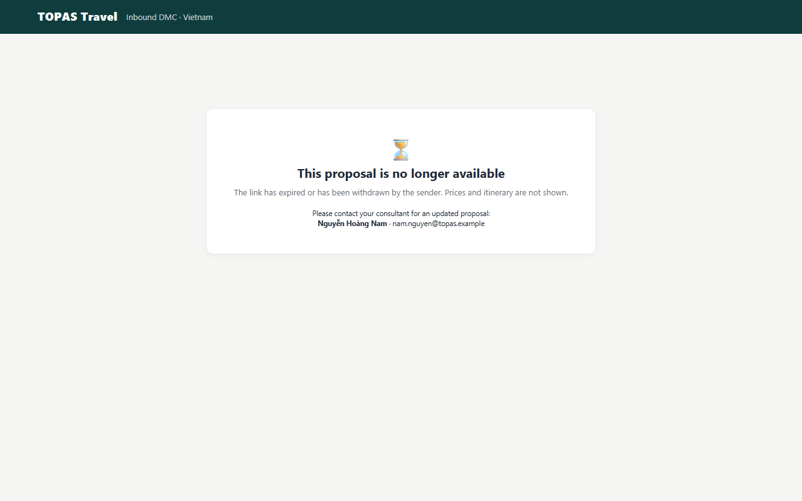

*Kết quả:* người dùng kiểm soát được báo giá đang lưu hành.

**L5.3 Publish phiên bản mới khi khách đang giữ link cũ.** *Điều kiện:* phiên bản cũ có link Đang mở cùng ngôn ngữ.

1. **W37 · Link English của v2, khách mở sau khi v3 được publish.** Sau khi publish v3 bằng English, link English của v2 vẫn mở được nhưng có dải “A newer version of this proposal is available (v3) · View the latest proposal”. Ở KD06.3, cột Proposal của v1, v2 ghi “có bản mới hơn” (W30).

   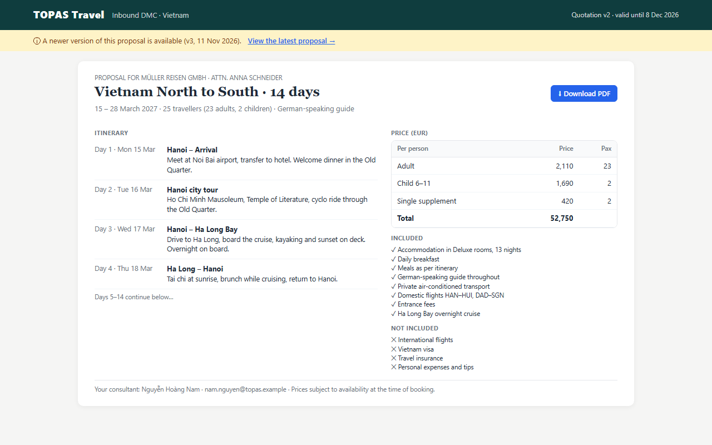

*Kết quả:* khách không dùng nhầm giá cũ mà không biết.

**Ngoại lệ**

- **E5.1 Thiếu nội dung tiếng Anh (W35).** Publish English khi có ngày chưa có nội dung tiếng Anh, hoặc có tiêu đề tiếng Việt mà chưa có tiêu đề tiếng Anh: hộp thoại liệt kê các ngày đó với ô nhập và Dịch nháp tại chỗ; Publish khóa đến khi đủ; Đổi sang Tiếng Việt để publish bản tiếng Việt. Nội dung nhập ở đây được lưu vào hành trình (R12). Bản dịch nháp chưa đánh dấu kiểm tra không chặn, chỉ ghi số lượng (W32).

  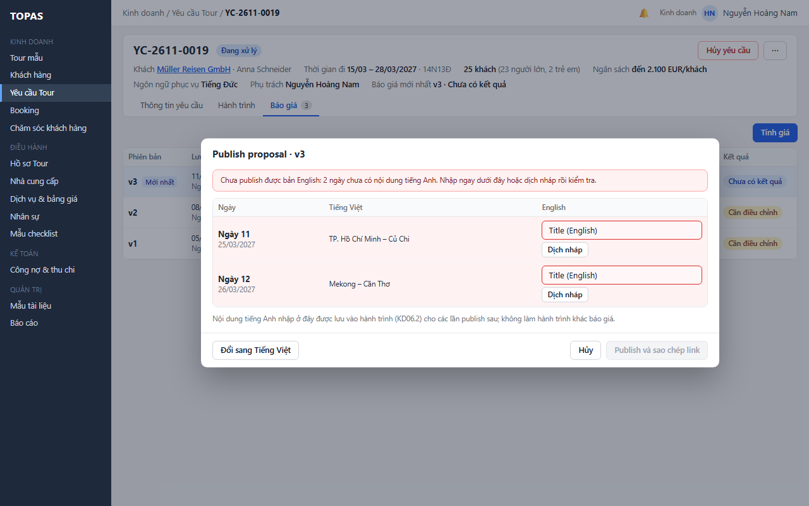

- **E5.2 Mục bao gồm, không bao gồm chưa có bản tiếng Anh.** Thẻ từ DH03 không có tên tiếng Anh ở QT05: thẻ viền đỏ trong W32, sửa tên tiếng Anh ngay trên thẻ (chỉ cho proposal này) hoặc bỏ thẻ.
- **E5.3 Hạn không hợp lệ.** Hạn trước hôm nay: lỗi cạnh ô, Publish khóa.
- **E5.4 Lỗi tạo proposal.** Không tạo được: hộp thoại giữ dữ liệu, banner đỏ, Thử lại; không có link nào được tạo. Bấm lặp chỉ tạo một link (mã publish).
- **E5.5 Sao chép link không được** (trình duyệt chặn bộ nhớ tạm): link hiện chọn sẵn để người dùng tự sao chép; thông báo “Chưa sao chép được, chọn link và nhấn Ctrl+C”.
- **E5.6 Publish lại cùng ngôn ngữ.** Phiên bản đã có link Đang mở cùng ngôn ngữ: chỉ có Sao chép link (không tạo link thứ hai). Link Đã thu hồi: Publish tạo link mới.
- **E5.7 Yêu cầu bị hủy.** Mọi link Đang mở chuyển Đã thu hồi (R21); khách thấy W36. Mở lại yêu cầu không tự mở lại link.
- **E5.8 Đã có Booking.** KD06 mở bình thường (chỉ xem): không publish mới. Ở chế độ điều chỉnh (R27): publish được proposal của phiên bản điều chỉnh của Booking (W51), không publish phiên bản khác (phiên bản của Booking, phiên bản ngoài chế độ điều chỉnh, phiên bản điều chỉnh lưu trước lần Chuyển sang Điều hành gần nhất). Link đã có của phiên bản của Booking giữ nguyên; người phụ trách Gia hạn, Thu hồi, Sao chép link được như R18 (ở cả hai cách mở); khi phiên bản điều chỉnh có link Đang mở cùng ngôn ngữ thì link cũ hiện dải bản mới hơn (W37).
- **E5.9 Người không phụ trách.** Chỉ thấy link, Sao chép link, Mở proposal; không thấy Gia hạn, Thu hồi, Publish.
- **E5.10 Mở proposal từ KD06.** Lượt mở của người dùng đã đăng nhập không được tính vào số lần mở của khách.

### 3.6. Kết quả báo giá và Booking (KD06.3 · TN03.08, TN04.01)

**L6.1 Ghi kết quả báo giá.** *Điều kiện:* người phụ trách; yêu cầu Đang xử lý (không ở chế độ điều chỉnh); phiên bản không gắn Booking Hiệu lực.

1. **W38 · Nút chọn kết quả tại chỗ trong bảng trượt phiên bản.** Khi khách phản hồi (có thể vài ngày sau khi gửi), người dùng mở KD06 (thẳng tab Báo giá), bấm phiên bản và chọn kết quả ở nút chọn Chưa có kết quả, Chốt, Cần điều chỉnh, Không chốt. Kết quả lưu ngay (ô chọn tại chỗ); thông báo ngắn xác nhận. Ghi chú phản hồi lưu cùng (nút Lưu ghi chú hiện khi đã sửa ghi chú). Theo kết quả, chân bảng trượt đổi nút chính: Cần điều chỉnh → Sửa hành trình (chính), Sửa giá; Không chốt → Sửa hành trình, Sửa giá (không có nút chính); Chốt → Tạo Booking (L6.2). Hủy yêu cầu luôn ở phần đầu (SYS03.12 → SYS03.14).

   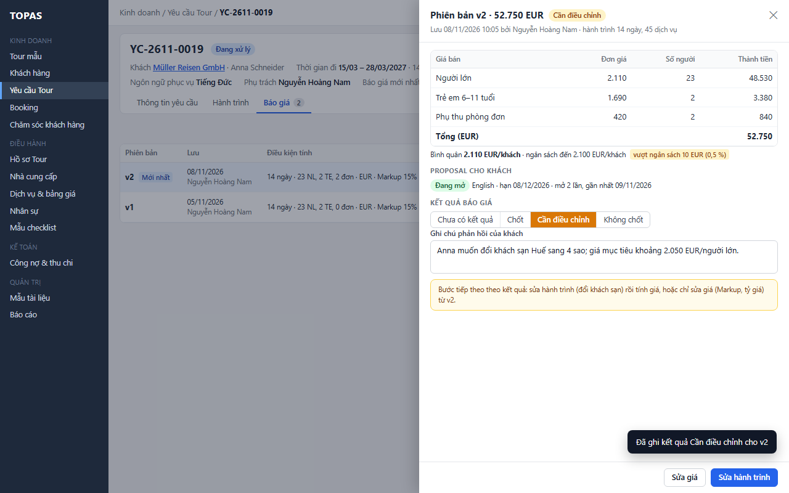

2. **W23 · Nút Sửa hành trình hoặc Sửa giá ở chân bảng trượt.** Sửa hành trình mở tab Hành trình (L3.4, L3.7). Sửa giá mở W27 điền sẵn từ phiên bản này (L4.2).

*Kết quả:* kết quả của phiên bản cập nhật ở phần đầu (nếu là phiên bản mới nhất), KD05 và KD04.3.

**L6.2 Chốt và tạo Booking.** *Điều kiện:* người phụ trách; yêu cầu Đang xử lý; không có Booking Hiệu lực.

1. **W40 · Nút chọn Chốt trong bảng trượt v3.** Người dùng chọn Chốt cho v3 và ghi chú xác nhận của khách. Nút chính ở chân bảng trượt thành Tạo Booking (xanh lá); dải xanh nêu những gì Booking sẽ kế thừa.

   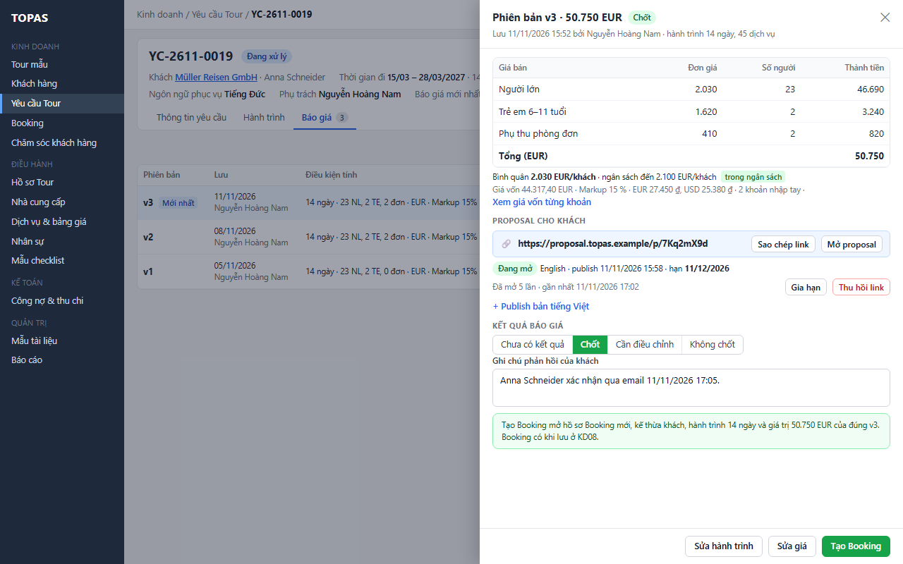

2. **W41 · Nút Tạo Booking ở chân bảng trượt → KD08.** KD08 mở ở chế độ tạo mới, kế thừa khách, thời gian, số khách, hành trình và giá trị của đúng v3, chỉ đọc (R19). Booking chỉ được tạo khi người dùng lưu ở KD08; KD08 đặc tả phần còn lại (điều khoản, lịch thanh toán).

   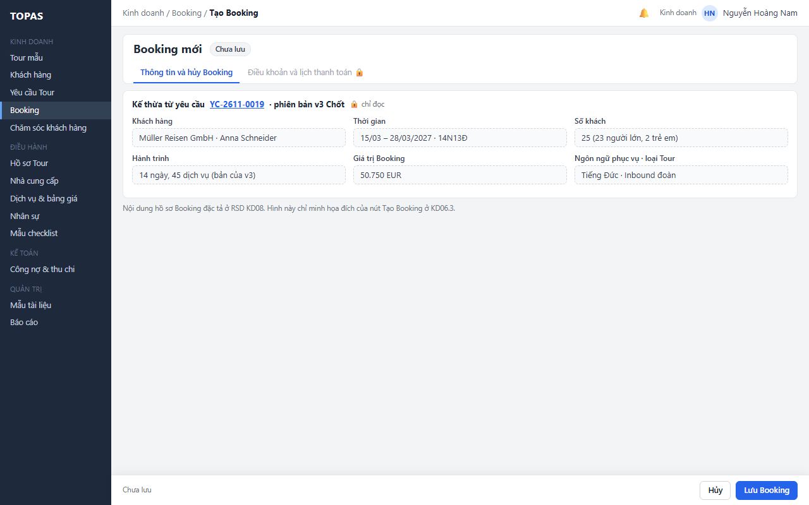

3. **W42 · KD06 sau khi lưu Booking ở KD08.** Lưu ở KD08 xong, yêu cầu thành Đã có Booking; người phụ trách Booking là người phụ trách yêu cầu. Mở lại KD06: phần đầu có Booking BK-2611-0158 và nút chính Mở Booking (bấm mở KD08 của Booking); Hủy yêu cầu khóa kèm lý do; dải xanh lá nói thay đổi chương trình bấm Điều chỉnh chương trình ở Booking; mọi tab chỉ xem; v3 ghi “Booking BK-2611-0158”; không có Tính giá.

   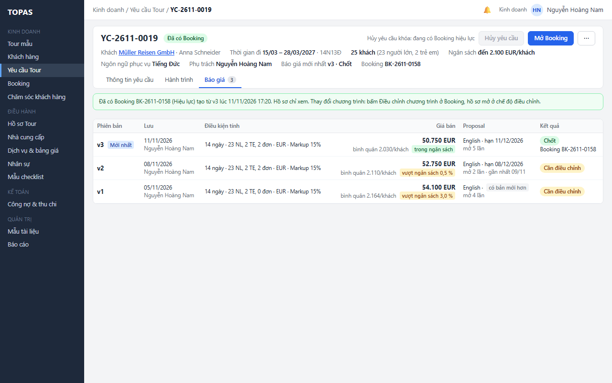

*Kết quả:* Booking Hiệu lực tạo từ đúng phiên bản Chốt (SYS03.13); thay đổi chương trình sau đó làm ở chế độ điều chỉnh mở từ KD08 (L6.5).

**L6.3 Đổi phiên bản Chốt.** *Điều kiện:* đã có phiên bản Chốt; không có Booking Hiệu lực.

1. **W39 · Nút chọn Chốt trong bảng trượt v4 → hộp thoại.** Người dùng chọn Chốt cho v4 trong khi v3 đang Chốt. Hộp thoại nhắc mỗi yêu cầu chỉ có một phiên bản Chốt, cho chọn kết quả mới của v3 (Cần điều chỉnh mặc định, hoặc Không chốt) và ghi chú cho v4. Xác nhận thì hai thay đổi lưu trong một giao dịch (R17).

   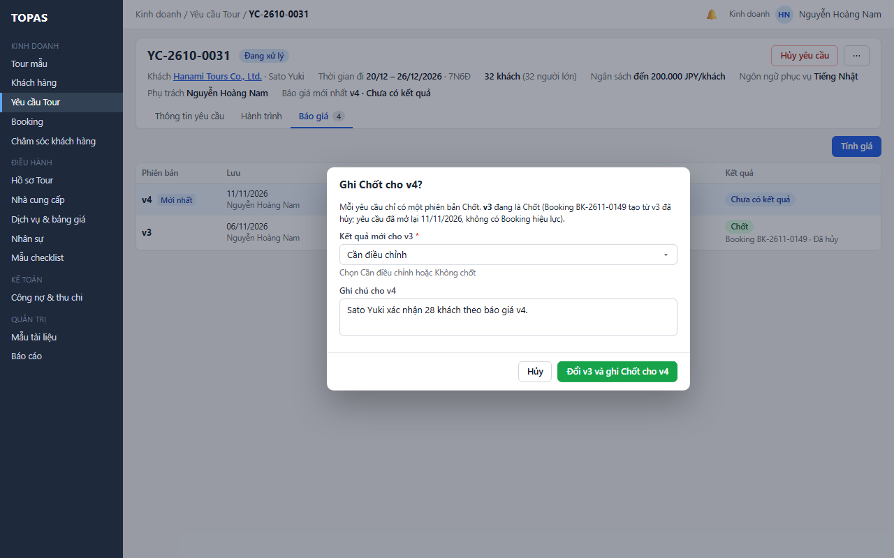

*Kết quả:* v4 Chốt, v3 đổi kết quả; Tạo Booking dùng v4.

**L6.4 Booking bị hủy, khách đặt lại.** *Điều kiện:* Kinh doanh hủy Booking Hiệu lực duy nhất ở KD08.

1. **W47 · KD06 sau khi Booking bị hủy ở KD08.** Yêu cầu tự chuyển Đã hủy, lý do “Booking đã hủy” (R02, R20, R21); link proposal đang mở bị thu hồi. Phần đầu: nhãn Đã hủy, nút Mở lại yêu cầu. Dải xám nêu Booking đã hủy, ngày, người hủy, lý do hủy Booking và cách đặt lại. Phiên bản Chốt ghi “Booking BK-2611-0149 · Đã hủy”. Mọi tab chỉ xem.

   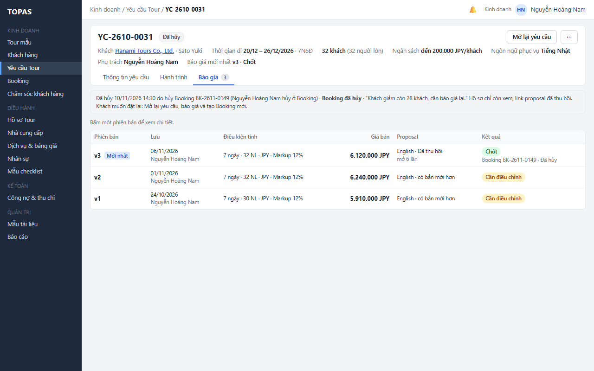

2. **W45 · Nút Mở lại yêu cầu ở phần đầu → hộp thoại.** Khách muốn đặt lại: người phụ trách mở lại kèm lý do (L7.2). Yêu cầu về Đang xử lý; mọi thao tác của người phụ trách mở lại.
3. **W27, W39, W40 · Tính giá ở đầu tab Báo giá, nút chọn Chốt, nút Tạo Booking.** Người dùng tính giá phiên bản mới theo nhu cầu mới (L4.1), ghi Chốt cho phiên bản đó (đổi phiên bản Chốt, L6.3), rồi Tạo Booking mới (L6.2). Nếu khách đặt lại đúng phương án cũ, Tạo Booking dùng được phiên bản Chốt cũ.

*Kết quả:* khách đặt lại mà không phải tạo yêu cầu mới; Booking đã hủy giữ nguyên ở KD08 để tra cứu.

**L6.5 Điều chỉnh chương trình sau Booking (chế độ điều chỉnh).** *Điều kiện:* yêu cầu Đã có Booking; người phụ trách Booking (cũng là người phụ trách yêu cầu) bấm Điều chỉnh chương trình ở KD08 (RSD KD08 R09).

1. **W50 · Nút Điều chỉnh chương trình ở KD08 → KD06 tab Hành trình.** KD06 mở ở chế độ điều chỉnh (R27). Phần đầu giữ nhãn Đã có Booking, có nút chính Về Booking BK-2611-0158; không có Hủy yêu cầu. Dải tím ghi Booking, phiên bản của Booking (v3) và cách làm. Lần đầu vào (Booking chưa có phiên bản điều chỉnh chưa chuyển), hành trình nạp từ bản chụp của phiên bản của Booking; đã có thì tiếp tục từ hành trình đang lưu, không hỏi (R27); người dùng sửa ngày, dịch vụ như L3.4 (ví dụ thêm Ca Huế trên sông Hương ở Ngày 5). Chân trang có một nút chính Lưu và tính giá.

   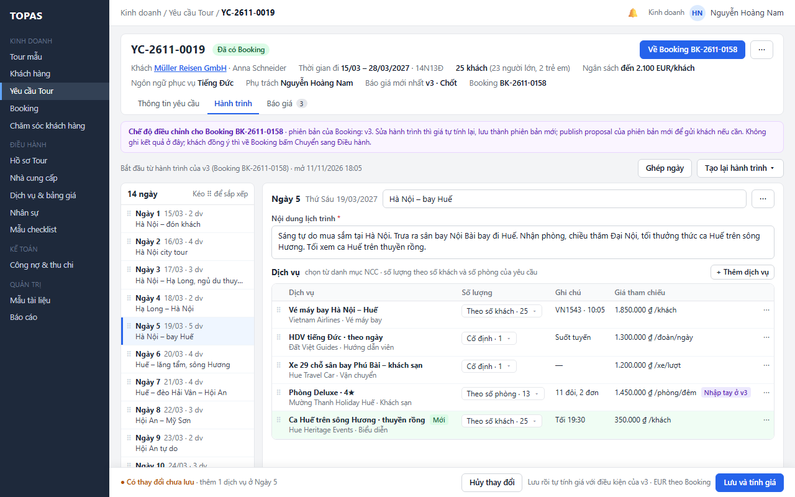

2. **W28 · Nút Lưu và tính giá ở chân trang.** Hệ thống lưu hành trình rồi tự tính giá (R13, R14) với điều kiện của phiên bản điều chỉnh mới nhất của Booking, chưa có thì của phiên bản của Booking (R27); loại tiền khóa theo loại tiền của Booking. Bảng trượt kết quả mở như W28; còn khoản thiếu giá thì như W29 (E4.1). Người dùng xem, có thể Sửa điều kiện (số khách, Markup, tỷ giá), rồi bấm Lưu phiên bản v4.
3. **W51 · Nút Lưu phiên bản trong bảng trượt.** v4 lên đầu danh sách: Mới nhất, Chưa có kết quả, nhãn “Điều chỉnh cho BK-2611-0158”, Chưa publish. Bảng trượt phiên bản không có nút chọn kết quả, không có Tạo Booking; ghi “Kết quả ghi khi Chuyển sang Điều hành ở Booking”. Mục Proposal cho khách có nút Publish proposal và ghi proposal sẽ ghi “Phương án điều chỉnh cho Booking BK-2611-0158” (R18). v3 vẫn Chốt, gắn Booking, giữ link English đang mở. Muốn gửi phương án cho khách: bấm Publish proposal, các bước như L5.1 bước 2–3 (hộp thoại W32, link riêng của v4, có hạn, thu hồi được); link English của v3 hiện dải bản mới hơn (W37). Kinh doanh tự gửi link và trao đổi với khách.

   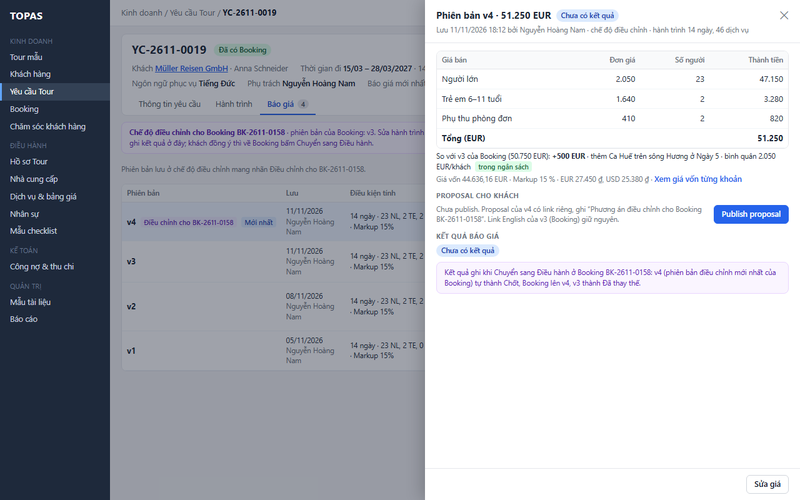

4. **W51 · Nút Về Booking BK-2611-0158 ở phần đầu → KD08.** Khách đồng ý thì người dùng bấm Chuyển sang Điều hành ở KD08 (RSD KD08 R09): hệ thống tự ghi Chốt cho phiên bản điều chỉnh mới nhất của Booking (v4), Booking lên v4, v3 thành Đã thay thế (R17). Mở lại KD06 thì v4 ghi “Booking BK-2611-0158”, v3 ghi Đã thay thế.

*Kết quả:* thay đổi chương trình đi qua đúng một phiên bản báo giá mới; yêu cầu luôn chỉ có một phiên bản Chốt; KD06 không tự đổi Booking.

**Ngoại lệ**

- **E6.1 Đổi kết quả của phiên bản đã gắn Booking Hiệu lực.** Nút chọn kết quả khóa, ghi “Phiên bản đã có Booking BK-…”.
- **E6.2 Ghi kết quả khi yêu cầu Đã hủy hoặc Đã có Booking, kể cả ở chế độ điều chỉnh.** Nút chọn không hiện; kết quả chỉ đọc (W42, W51). Đã thay thế không bao giờ có trên nút chọn.
- **E6.3 Lỗi lưu kết quả.** Nút chọn trả về giá trị cũ, thông báo đỏ “Chưa lưu được kết quả · Thử lại”.
- **E6.4 Tạo Booking khi vừa có Booking Hiệu lực ở phiên khác.** KD08 kiểm tra lại khi lưu (R19): từ chối, báo “Yêu cầu đã có Booking BK-…”, có liên kết mở Booking đó; KD06 tải lại ở W42.
- **E6.5 Phiên bản vừa bị đổi khỏi Chốt.** Bấm Tạo Booking khi phiên bản đã đổi kết quả ở phiên khác: báo “v3 không còn Chốt”, bảng trượt tải lại.
- **E6.6 Rời KD08 không lưu.** Không có Booking; yêu cầu vẫn Đang xử lý, v3 vẫn Chốt.
- **E6.7 Chốt một phiên bản cũ.** Được phép (khách chọn lại phương án cũ); proposal cũ vẫn dùng được nếu chưa hết hạn. Booking tạo từ phiên bản Chốt cũ thì các phiên bản số lớn hơn đã có (ví dụ v3 Cần điều chỉnh khi Booking theo v2) không phải phiên bản điều chỉnh của Booking: Chuyển sang Điều hành ở KD08 không bao giờ ghi Chốt cho chúng (RSD KD08 R09, E1.14).
- **E6.8 Kết quả Không chốt.** Không tự hủy yêu cầu (không coi một lần không chốt là hủy, TN02.05); người dùng tự quyết hủy ở phần đầu.
- **E6.9 Mở KD06 bình thường khi có Booking Hiệu lực.** Hồ sơ chỉ xem (W42); không có lối vào chế độ điều chỉnh ở KD06, chỉ có Mở Booking.
- **E6.10 Booking không còn điều chỉnh được** (vừa bị hủy, hồ sơ Tour vừa Đã kết thúc, hoặc vừa chuyển người phụ trách Booking ở phiên khác): lưu ở chế độ điều chỉnh bị từ chối, banner đỏ nêu lý do; Tải lại mở hồ sơ ở trạng thái hiện tại (E2.5).
- **E6.11 Lưu nhiều phiên bản ở chế độ điều chỉnh.** Mỗi lần lưu là một phiên bản mới, Chưa có kết quả; Chuyển sang Điều hành chỉ dùng phiên bản điều chỉnh mới nhất của Booking, các phiên bản điều chỉnh khác giữ Chưa có kết quả (link proposal của chúng, nếu có, giữ nguyên theo R18).
- **E6.12 Rời chế độ điều chỉnh không chuyển.** Phiên bản đã lưu và link proposal đã publish giữ nguyên, Booking không đổi; lần sau mở Điều chỉnh chương trình, hành trình tiếp tục từ bản đang lưu, không hỏi (R27). Nút Chuyển sang Điều hành ở KD08 bấm được khi Booking có phiên bản điều chỉnh chưa chuyển; không có thì khóa kèm lý do (RSD KD08 R09).

### 3.7. Hủy, mở lại, chuyển người phụ trách (KD06 · TN02.05)

**L7.1 Hủy yêu cầu.** *Điều kiện:* người phụ trách; yêu cầu Đang xử lý; không có Booking Hiệu lực.

1. **W43 · Nút Hủy yêu cầu ở phần đầu → hộp thoại.** Người dùng bấm Hủy yêu cầu từ tab nào cũng được, kể cả sau khi ghi kết quả. Hộp thoại: lý do hủy (danh mục QT05, bắt buộc), ghi chú (bắt buộc khi lý do là Khác); câu nói rõ dữ liệu được giữ và mở lại được; số link proposal đang mở sẽ bị thu hồi.

   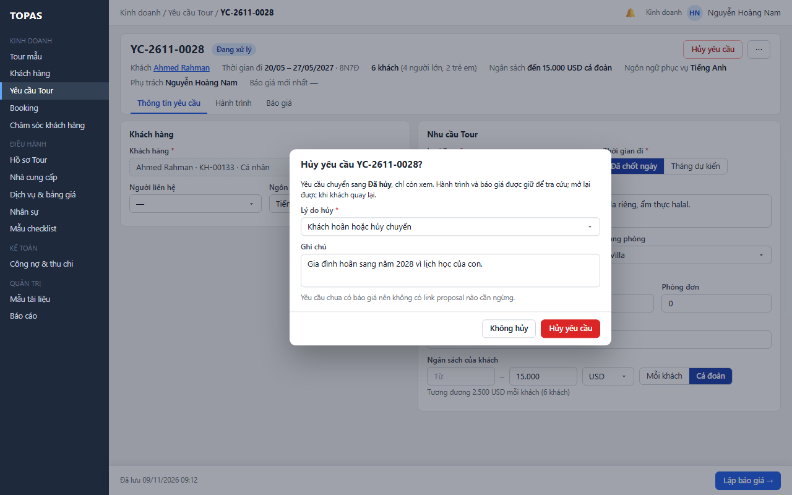

2. **W44 · Nút Hủy yêu cầu trong hộp thoại.** Hệ thống ghi Đã hủy, lý do, người, thời điểm; thu hồi mọi link đang mở (R21). Phần đầu: nhãn Đã hủy, nút duy nhất Mở lại yêu cầu; dải xám; mọi tab chỉ xem.

   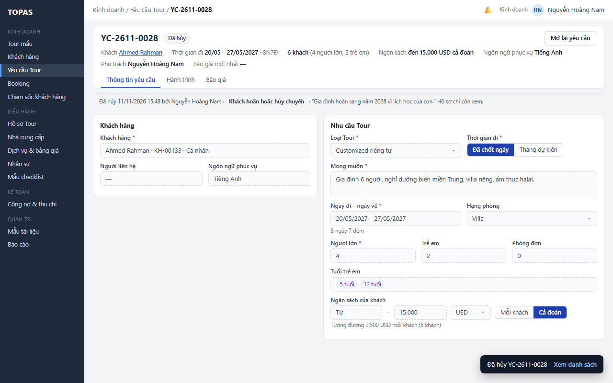

*Kết quả:* yêu cầu ở chip Đã hủy của KD05 kèm lý do; QT08 đếm lý do hủy.

**L7.2 Mở lại yêu cầu.** *Điều kiện:* yêu cầu Đã hủy (do người phụ trách hủy hoặc tự hủy khi Booking bị hủy); người phụ trách hoặc Quản trị.

1. **W45 · Nút Mở lại yêu cầu ở phần đầu → hộp thoại.** Người dùng nhập lý do (bắt buộc, ví dụ “Khách đặt lại”). Hộp thoại nói rõ dữ liệu giữ nguyên, link đã thu hồi không tự mở lại, và sau khi mở lại thì báo giá, tạo Booking mới được. Với Quản trị, hộp thoại có thêm ô Người phụ trách mới (bắt buộc; chọn được người hiện tại nếu còn hoạt động).

   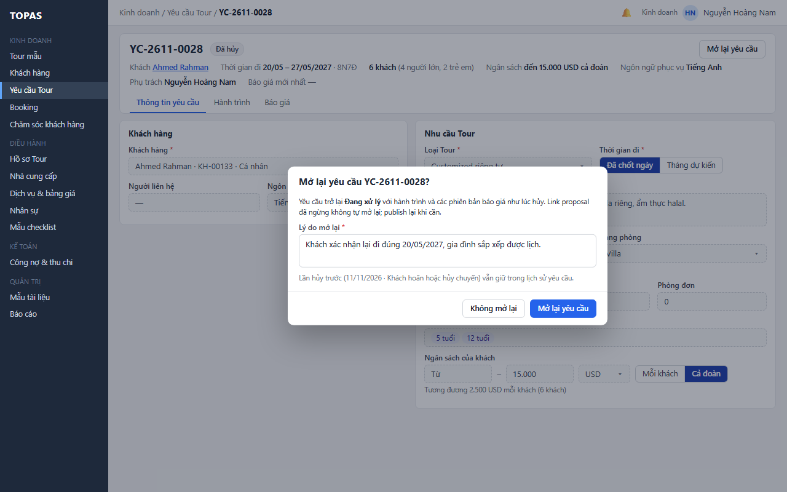

2. **W07 · Nút Mở lại yêu cầu trong hộp thoại.** Yêu cầu về Đang xử lý (R22); phần đầu có lại Hủy yêu cầu; thông báo “Đã mở lại YC-…”. Lịch sử giữ cả lần hủy và lần mở lại.

*Kết quả:* tiếp tục xử lý với hành trình và phiên bản cũ; publish lại khi cần; tạo Booking mới từ phiên bản Chốt (L6.4, R19).

**L7.3 Chuyển người phụ trách một yêu cầu.** *Điều kiện:* yêu cầu Đang xử lý; người phụ trách hoặc Quản trị.

1. **W46 · Menu ⋯ ở phần đầu → Chuyển người phụ trách → hộp thoại.** Hộp thoại: người nhận (người dùng Kinh doanh đang hoạt động, khác người hiện tại, kèm số yêu cầu đang xử lý), ghi chú bàn giao. Nói rõ người phụ trách khách hàng không đổi.

   

2. **W11 · Nút Chuyển phụ trách trong hộp thoại.** Yêu cầu đổi người phụ trách (R23); người chuyển chuyển sang chế độ chỉ đọc ngay; người nhận nhận thông báo.

*Kết quả:* như chuyển một dòng ở KD05 (RSD KD05 L4.1).

**Ngoại lệ**

- **E7.1 Có Booking Hiệu lực.** Hủy yêu cầu khóa kèm lý do “đang có Booking hiệu lực” (W42); muốn hủy thì hủy Booking ở KD08 trước.
- **E7.2 Thiếu lý do.** Nút Hủy yêu cầu, Mở lại yêu cầu trong hộp thoại khóa đến khi có lý do (và ghi chú khi lý do Khác).
- **E7.3 Bấm lặp, hai phiên cùng hủy.** Lần thứ hai nhận “Yêu cầu đã được hủy lúc …”, hồ sơ tải lại ở W44.
- **E7.4 Người phụ trách đã ngừng hoạt động.** Yêu cầu Đã hủy: Quản trị mở lại kèm chọn người phụ trách mới (người cũ không còn trong danh sách chọn). Yêu cầu Đang xử lý: Quản trị chuyển ở KD05 hoặc ⋯ của KD06. Yêu cầu Đã có Booking: Quản trị chuyển người phụ trách Booking ở KD08, yêu cầu chuyển theo.
- **E7.5 Có thay đổi chưa lưu khi bấm Hủy yêu cầu.** Hộp thoại W09 trước; sau đó mới đến W43.
- **E7.6 Chuyển yêu cầu Đã có Booking hoặc Đã hủy.** Không có mục Chuyển người phụ trách (RSD KD05 R08). Đã có Booking: người phụ trách yêu cầu theo người phụ trách Booking, chuyển ở KD08 (R23). Đã hủy: Quản trị đổi người phụ trách khi mở lại (R22).

**Số bước của luồng chính so với cách làm thông thường.**

| Luồng | Cách làm thông thường | Ở KD06 |
|---|---|---|
| Tạo yêu cầu cho khách mới | Tạo khách ở KD04, quay lại tạo yêu cầu, tìm khách: khoảng 9 bước, 2 màn | Tìm, tạo nhanh trong hộp thoại, nhập nhu cầu, Lưu và lập báo giá: 5 bước, 1 màn |
| Hành trình 10 ngày từ mẫu 8 ngày | Sao chép rồi nhập tay 2 ngày | Sao chép, Ghép 2 ngày trong một hộp thoại |
| Thêm HDV cho 6 ngày | Mở 6 ngày, thêm 6 lần | Một lần thêm, chọn 6 ngày |
| Báo giá lần 2 | Nhập lại số khách, trẻ em, phòng, tỷ giá, Markup | Điền sẵn từ phiên bản trước, bấm Tính giá |
| Gửi báo giá | Xuất PDF, soạn email, đính kèm | Publish và sao chép link: 2 bấm, tự gửi |

---

## 4. Quy tắc triển khai chi tiết

### R01. Quyền và chế độ chỉ đọc (quyết định 11/11/2026, 12/11/2026; RSD KD05, KD08)

- Mọi người Kinh doanh xem mọi yêu cầu; chỉ người phụ trách yêu cầu hiện tại được ghi (mục 1.4). Quản trị hệ thống xem, chuyển phụ trách, mở lại kèm người phụ trách mới (R22); không sửa nội dung.
- Khi yêu cầu có Booking Hiệu lực, người phụ trách yêu cầu luôn là người phụ trách Booking (RSD KD08 R11); chuyển ở KD08, không chuyển riêng ở KD05, KD06 (R23).
- Ghi chỉ được khi yêu cầu Đang xử lý, trừ: Mở lại (Đã hủy); Gia hạn và Thu hồi link (Đang xử lý hoặc Đã có Booking); sửa thông tin, hành trình, tính giá, lưu phiên bản, publish proposal của phiên bản điều chỉnh ở chế độ điều chỉnh (Đã có Booking, R18, R27).
- Điều hành, Kế toán không truy cập KD06. Quyền mở KD08 từ KD06 theo phạm vi của KD08. KD08 chỉ hiện liên kết sang KD06 với Kinh doanh phụ trách Booking và Quản trị hệ thống; Điều hành, Kế toán thấy mã yêu cầu và số phiên bản dạng chữ (E2.6; RSD KD08 1.4, R01).

### R02. Trạng thái yêu cầu (tính từ dữ liệu)

Tính theo thứ tự, dừng ở điều kiện đầu tiên đúng:

1. **Đã hủy**: yêu cầu có dấu hủy chưa được mở lại. Dấu hủy do người phụ trách ghi (R21) hoặc hệ thống tự ghi khi Booking Hiệu lực của yêu cầu bị hủy ở KD08, lý do “Booking đã hủy” (R20).
2. **Đã có Booking**: có Booking Hiệu lực tạo từ một phiên bản của yêu cầu.
3. **Đang xử lý**: còn lại.

Booking đã hủy không giữ nhóm Đã có Booking: hủy Booking làm yêu cầu Đã hủy; khách đặt lại thì Mở lại yêu cầu (R22), yêu cầu về Đang xử lý rồi tạo Booking mới (quyết định 12/11/2026; RSD KD05 R02).

### R03. Mã yêu cầu

- Dạng `YC-YYMM-NNNN`: YYMM là năm, tháng tạo; NNNN tăng dần trong tháng, bắt đầu 0001. Cấp khi lưu lần đầu, không đổi, không dùng lại.

### R04. Dữ liệu yêu cầu (TN02.04)

- Trường và kiểm tra ở 5.2. Thời gian có hai kiểu: **Đã chốt ngày** (ngày đi, ngày về; số ngày = ngày về − ngày đi + 1) và **Tháng dự kiến** (tháng, số ngày). Đổi kiểu được khi Đang xử lý.
- Số phòng = phòng đơn + làm tròn lên ((người lớn − phòng đơn) ÷ 2). Trẻ em không tính vào số phòng; chỗ ngủ của trẻ theo chính sách trẻ em của hợp đồng khi tính giá (R13).
- Đổi khách chỉ khi chưa có phiên bản báo giá. Người liên hệ và ngôn ngữ phục vụ sửa được khi Đang xử lý.
- Ngân sách: theo R26. Sửa ngân sách không đổi phiên bản đã lưu; nhãn trong hoặc vượt ngân sách của mọi phiên bản tính lại theo ngân sách mới.
- Tác động khi sửa: R07.

### R05. Tìm và tạo nhanh khách (TN02.02, TN02.03)

- Tìm theo tên, mã khách, tên và email, điện thoại của khách và người liên hệ; không phân biệt hoa thường, bỏ dấu; tối thiểu 2 ký tự; tối đa 20 kết quả, sắp theo mức khớp.
- Mỗi kết quả ghi số yêu cầu Đang xử lý của khách và người phụ trách từng yêu cầu (tối đa 2 mã, còn lại “+n”).
- Tạo nhanh dùng RSD KD03-KD04 R01 (trường bắt buộc), R02 (chuẩn hóa, trùng, lý do), R12 (mã). Khách được lưu ngay khi bấm Tạo, độc lập với việc lưu yêu cầu.

### R06. Tab đích (RSD KD05 R07)

- Có phiên bản → Báo giá; có hành trình đã lưu → Hành trình; còn lại → Thông tin yêu cầu. Lối vào truyền tab cụ thể (ví dụ KD08.1 → phiên bản nguồn) thì dùng tab đó.

### R07. Hành trình và ngày

- Mỗi yêu cầu một hành trình hiện hành, có ít nhất 1 ngày khi lưu. Hành trình cũ khi tạo lại (L3.6) được lưu vào lịch sử, không khôi phục tự động.
- Ngày n = ngày đi + (n − 1). Đổi ngày đi, sắp xếp, chèn, xóa ngày thì ngày tháng tính lại; với Tháng dự kiến chỉ ghi Ngày n.
- Số ngày khác thời gian đi: cảnh báo ở đầu lưới (W15), không tự thêm hoặc xóa ngày.
- Số lượng dòng: Cố định giữ số đã nhập; Theo số khách = người lớn + trẻ em; Theo số phòng = số phòng (R04). Tính lại ngay khi số khách, phòng đổi. KD06.3 tính lại theo điều kiện tính giá.

### R08. Sao chép Tour mẫu và ghép ngày (TN03.01, TN03.03; RSD KD01-KD02 R10)

- Chỉ liệt kê Tour mẫu Cho phép sử dụng; kiểm tra lại khi sao chép. Sao chép bản đã lưu mới nhất: ngày, tiêu đề, nội dung, dòng dịch vụ, cách tính số lượng, ghi chú. Không sao chép giá tham khảo, ghi chú nội bộ. Dòng dịch vụ ngừng sử dụng được sao chép kèm nhãn.
- Không có liên kết sau khi sao chép: sửa, tắt Tour mẫu không đổi hành trình; sửa hành trình không đổi Tour mẫu.
- Ghép ngày: Chèn (trước một ngày, hoặc sau ngày cuối) hoặc Thay ngày (từ một ngày, thay liên tiếp). Ngày ghép ghi nguồn (mã Tour mẫu, số ngày nguồn).
- Sắp xếp gợi ý ở W14: cùng loại Tour trước, rồi chênh lệch số ngày với yêu cầu tăng dần, rồi cập nhật mới nhất.

### R09. Tạo hành trình bằng AI (TN03.04)

- Dữ liệu gửi cho dịch vụ AI: mong muốn, thời gian và số ngày, ngân sách (dùng để chọn hạng dịch vụ), số người lớn, tuổi trẻ em, hạng phòng, ngôn ngữ phục vụ, loại Tour, tiêu chí thêm; danh sách Tour mẫu Cho phép sử dụng và danh mục dịch vụ đang dùng (tên, loại, nơi). **Không gửi** tên, email, điện thoại của khách, người liên hệ, hay giá NCC.
- Kết quả: ngày (tiêu đề, nội dung) và dòng dịch vụ. Dòng chỉ được gán NCC khi trỏ tới một dịch vụ đang dùng trong danh mục; còn lại là Chưa gán NCC kèm tên AI đề xuất. AI không đặt giá, số lượng lấy theo đơn vị tính.
- Đề xuất hiện trên lưới, chưa lưu; nguồn hành trình ghi Bằng AI khi lưu. Thời gian chờ tối đa 60 giây (cấu hình). Mỗi lần gọi ghi nhật ký (người, thời điểm, tiêu chí, kết quả thành công hay lỗi).

### R10. Việc cần xử lý của hành trình

- Đếm trên tab Hành trình: ngày chưa có nội dung; dòng của NCC hoặc dịch vụ ngừng sử dụng (DH03 R05); dòng Chưa gán NCC.
- Có ít nhất một việc thì Tính giá, Lưu và tính giá khóa kèm lý do. Lưu hành trình vẫn được.
- Cảnh báo, không đếm: dòng Hướng dẫn viên có ngôn ngữ khác ngôn ngữ phục vụ của yêu cầu. RSD DH03 v1.4 chỉ có Ngôn ngữ giao dịch của NCC (dùng cho email đặt dịch vụ), chưa có trường ngôn ngữ của dịch vụ HDV: chờ xác nhận có cần thêm vào DH03 không. Khi chưa có trường này, không hiện cảnh báo (R25).

### R11. Lưu hành trình và chỉ báo khác báo giá

- Lưu toàn bộ hành trình trong một giao dịch, kiểm tra phiên bản bản ghi.
- Hành trình **khác báo giá mới nhất** khi lần lưu hành trình gần nhất sau thời điểm lưu phiên bản mới nhất và nội dung khác bản chụp của phiên bản đó (ngày, tiêu đề, nội dung tiếng Việt, dòng dịch vụ, số lượng). Nội dung tiếng Anh không tính. Dải nêu số dòng dịch vụ đổi và các ngày bị đổi.
- Chỉ báo mất khi lưu phiên bản mới, hoặc khi hành trình được sửa trở lại giống bản chụp.

### R12. Nội dung tiếng Anh

- Mỗi ngày có tiêu đề và nội dung tiếng Anh, không bắt buộc khi lưu; cần cho proposal English (E5.1). Tình trạng: chưa có, dịch nháp, đã kiểm tra.
- Dịch nháp dùng dịch vụ AI với dữ liệu là tiêu đề và nội dung tiếng Việt của ngày (không có dữ liệu khách). Bản dịch có nhãn đến khi người dùng sửa hoặc đánh dấu đã kiểm tra.
- Sửa nội dung tiếng Anh không đổi chỉ báo R11 và không tạo phiên bản. Proposal lấy nội dung tiếng Anh tại lúc publish.

### R13. Tính giá vốn (TN03.06; RSD DH03 R02, R07, R09, R14, R15)

- **Ngày sử dụng** của dòng = ngày của Ngày chứa dòng, tính từ ngày khởi hành của điều kiện tính.
- **Hợp đồng áp dụng** là hợp đồng của NCC có kỳ chứa ngày sử dụng (DH03 R02). Không có thì khoản thiếu (R15); không dùng hợp đồng khác.
- **Mùa và loại ngày** theo hợp đồng áp dụng (DH03 R07). Dịch vụ theo đêm tính từng đêm theo mùa, loại ngày của đêm đó.
- **Số lượng** theo cách tính của dòng: Theo số khách → người lớn và từng trẻ em; Theo số phòng → số phòng; Cố định → số đã nhập. Dòng giá chọn theo hạng phòng (nếu có) và khoảng số khách chứa **số khách người lớn** của điều kiện tính (DH03 R14; cùng cách chọn với RSD DH04 R04, KD01-KD02 R07). Trong cùng hạng phòng còn nhiều dòng giá chính khớp thì lấy dòng có Thứ tự nhỏ nhất; không so Thứ tự giữa các hạng phòng (quyết định 12/11/2026, rà soát lần ba; DH03 R14). Điều kiện tính chưa có hạng phòng mà dịch vụ có dòng giá chính ở nhiều hạng phòng: lấy dòng của hạng phòng có giá thấp nhất (cùng cách hiện mức thấp nhất của RSD DH04 R04), khoản ghi cảnh báo “Chưa chọn hạng phòng · tính theo hạng giá thấp nhất” (người dùng chốt 12/11/2026, rà soát lần ba). Trẻ em không tính vào số khách để chọn dòng giá.
- **Trẻ em**: tuổi tính tại ngày sử dụng đầu tiên của dịch vụ (DH03 R09). KD06 không có ngày sinh của khách: tuổi nhập ở điều kiện tính được dùng làm tuổi tại ngày sử dụng đầu tiên của từng dịch vụ. Giá theo nhóm tuổi và điều kiện ngủ chung giường, thêm giường, số trẻ miễn phí của hợp đồng (DH03 R09). Ô giá trẻ em trống là khoản thiếu.
- **Phụ thu** lễ Tết, phòng đơn theo DH03 R15 (Cộng dồn hoặc Thay thế; theo khách, phòng, đêm, đơn vị).
- **Phân bổ giá vốn vào đối tượng**:
  - khoản theo khách: vào người lớn theo giá người lớn, vào từng trẻ theo giá nhóm tuổi;
  - khoản theo phòng: phòng đôi chia đều cho 2 người lớn; phòng đơn tính cho 1 người lớn, phần lớn hơn nửa giá phòng đôi là **phụ thu phòng đơn**; trẻ em theo chính sách trẻ em;
  - khoản theo đoàn, xe, đơn vị: chia đều cho số khách tính phí (người lớn và trẻ em, trừ trẻ được miễn phí theo hợp đồng của chính dịch vụ đó).
- Trẻ em cùng nhóm tuổi theo mọi hợp đồng gộp một dòng giá bán; khác nhóm thì tách dòng.

### R14. Tiền, tỷ giá, Markup, làm tròn (quyết định 11/11/2026, 12/11/2026)

- **Tỷ giá** là **tỷ giá có hiệu lực** ngày tính giá ở bảng tỷ giá QT05 (Kế toán nhập theo ngày), theo VND: số của ngày gần nhất ≤ ngày tính có ô loại tiền đó (RSD QT05 R13). Ngày tính chưa có dòng thì dùng ngày gần nhất trước đó, không chặn; W27 và phiên bản ghi ngày lấy tỷ giá (nguồn “Bảng tỷ giá ngày dd/mm/yyyy”). Chỉ khi không có ngày nào ≤ ngày tính có tỷ giá của loại tiền thì là chưa có tỷ giá: bắt buộc nhập tay (E4.2, R15). Quy đổi khoản = thành tiền gốc × tỷ giá loại tiền gốc ÷ tỷ giá loại tiền báo giá. Báo giá bằng VND thì tỷ giá VND là 1. Không cộng trực tiếp các khoản khác loại tiền.
- **Markup** là % trên giá vốn, có hai cấp; mỗi khoản dùng Markup của hạng mục chứa dịch vụ, hạng mục để trống thì dùng Markup chung:
  1. **Theo hạng mục dịch vụ** (Lưu trú, Di chuyển, Vé máy bay, Hướng dẫn viên, Tham quan, Ăn uống, Khác): điền sẵn từ Markup mặc định của hạng mục (QT05, nếu có), sửa được ở W27. Mỗi loại dịch vụ thuộc đúng một hạng mục (QT05); W27 chỉ hiện hạng mục có dịch vụ trong hành trình;
  2. **Chung**: mặc định theo loại Tour (QT05); dùng cho hạng mục để trống.
- Sửa tỷ giá, Markup chung hoặc Markup theo hạng mục chỉ áp cho phiên bản đang tính; nguồn ghi Bảng tỷ giá / Mặc định hoặc Sửa tay. Phiên bản mới điền sẵn Markup chung và Markup theo hạng mục từ phiên bản nguồn.
- **Markup bình quân** = tổng giá bán trước làm tròn ÷ tổng giá vốn − 1; hiện ở ô Markup của W28 để người dùng thấy tác động của Markup theo hạng mục.
- **Bảng tính giá có hai cách xem** (W28, W49), cùng một kết quả tính: **Theo ngày** (từng khoản của từng ngày, lọc theo ngày, Nhập tay, Thiếu giá; ghi hợp đồng, mùa, loại ngày, đơn giá gốc) và **Theo dịch vụ** (gom các khoản của cùng một dịch vụ và cùng NCC trên cả hành trình thành một dòng, nhóm theo hạng mục; mỗi dòng có ngày dùng, tổng số lượng, giá vốn quy đổi, Markup, giá bán trước làm tròn). Tổng của hạng mục và tổng bảng ở hai cách xem phải bằng nhau và bằng giá vốn, giá bán trước làm tròn của phiên bản. Phiên bản đã lưu (W31, liên kết Xem giá vốn từng khoản) mở cùng bảng ở chế độ chỉ đọc, có cả hai cách xem.
- **Giá bán mỗi đối tượng** = làm tròn lên (Σ phần giá vốn của từng khoản phân bổ cho đối tượng × (1 + Markup theo hạng mục của khoản)) theo bội số của loại tiền (cấu hình: EUR, USD 10; JPY 1.000; VND 10.000). **Tổng giá bán** = Σ giá bán × số người. **Lãi gộp** = tổng giá bán − tổng giá vốn.
- Ví dụ v3 của Müller: giá vốn 1.107.886.000 ₫ + 4.280 USD = 40.360,15 + 3.957,25 = 44.317,40 EUR. Markup chung 15 %; hạng mục Vé máy bay 5 %, Hướng dẫn viên 20 %. Người lớn: 1.772,80 × 1,15 = 2.038,72; trừ 10 % phần vé máy bay 138,43 (HAN–HUI 67,40 + DAD–SGN 71,04) = 13,84; cộng 5 % phần HDV 14 ngày 26,52 = 1,33 → 2.026,21 → 2.030. Trẻ em: 1.627,60 − 10 % × 103,83 + 1,33 = 1.618,55 → 1.620. Phụ thu phòng đơn 409,63 → 410. Tổng 2.030 × 23 + 1.620 × 2 + 410 × 2 = 50.750 EUR; lãi gộp 6.432,60 EUR (12,7 %); Markup bình quân 14,3 %.
- Ở KD06, “hạng mục dịch vụ” (Lưu trú, Di chuyển…) là nhóm loại dịch vụ để đặt Markup; khác “Hạng mục dịch vụ” của hồ sơ Tour ở DH08 (một dịch vụ cần đặt với NCC).
- Proposal hiện giá bán theo đối tượng và tổng, không hiện giá vốn, Markup, tỷ giá, ngân sách hay so sánh với ngân sách.

### R15. Khoản thiếu và giá nhập tay

- Khoản thiếu: không có hợp đồng áp dụng; không có dòng giá phù hợp; ô giá mùa hoặc ô giá trẻ em trống; chưa có tỷ giá (không có ngày nào ≤ ngày tính, E4.2). Giá 0 có trong bảng giá là hợp lệ (miễn phí), khác ô trống.
- Người dùng nhập đơn giá, loại tiền và ghi chú nguồn giá; có thể áp cho các đêm, ngày khác của cùng dịch vụ trong lần tính. Khoản có nhãn Nhập tay trong phiên bản. Giá nhập tay không ghi ngược về DH03.
- Còn khoản thiếu thì không lưu phiên bản.

### R16. Phiên bản báo giá

- Số phiên bản tăng dần trong yêu cầu (v1, v2…), cấp trên máy chủ khi lưu; chống lưu lặp bằng mã lần tính.
- Phiên bản lưu bản chụp đầy đủ (5.1) và không bao giờ bị sửa. Sửa hành trình, bảng giá, hợp đồng, tỷ giá sau đó không đổi phiên bản đã lưu.
- **Phiên bản mới nhất** là phiên bản có số lớn nhất (RSD KD05 R03).

### R17. Kết quả báo giá (quyết định 11/11/2026, 12/11/2026)

- Giá trị: Chưa có kết quả (mặc định), Chốt, Cần điều chỉnh, Không chốt, **Đã thay thế**. Người phụ trách ghi bốn giá trị đầu bất kỳ lúc nào khi yêu cầu Đang xử lý và phiên bản không gắn Booking Hiệu lực; lưu ngay; ghi lịch sử. Không ghi kết quả ở chế độ điều chỉnh (R27).
- **Đã thay thế** chỉ do hệ thống gán: khi Kinh doanh bấm Chuyển sang Điều hành ở KD08, trong một giao dịch hệ thống tự ghi Chốt cho phiên bản điều chỉnh mới nhất của Booking (2.5, R27; không phải phiên bản số lớn nhất của yêu cầu), gắn phiên bản đó vào Booking, và chuyển phiên bản Chốt cũ của Booking thành Đã thay thế (RSD KD08 R09). Lịch sử ghi người bấm và thời điểm. Phiên bản Đã thay thế không đổi kết quả được nữa.
- Mỗi yêu cầu có tối đa **một** phiên bản Chốt, ở mọi thời điểm. Ghi Chốt cho phiên bản khác thì bắt buộc chọn kết quả mới (Cần điều chỉnh hoặc Không chốt) cho phiên bản đang Chốt trong cùng giao dịch (W39). Phiên bản lưu ở chế độ điều chỉnh giữ Chưa có kết quả cho tới khi Chuyển sang Điều hành.
- Không chốt không làm đổi trạng thái yêu cầu.

### R18. Proposal và link (quyết định 11/11/2026, 12/11/2026)

- **Mẫu proposal của công ty:** công ty đã có mẫu proposal riêng; hệ thống dựng sẵn theo mẫu đó, mỗi ngôn ngữ (English, Tiếng Việt) một bản gồm bản web và bản PDF; không cấu hình trên hệ thống (người dùng chốt 12/11/2026, RSD QT04). Bố cục, logo, màu, ảnh, phần giới thiệu công ty, điều khoản cố định do mẫu quyết định. KD06 không thiết kế bố cục proposal; W33 chỉ minh họa vùng dữ liệu.
- **Trường dữ liệu KD06 cung cấp cho mẫu:** tên khách, người liên hệ; tên hành trình theo ngôn ngữ (5.1), ngày đi, ngày về, số ngày đêm; số người lớn, trẻ em và tuổi; lịch trình theo ngày (số ngày, ngày, tiêu đề, nội dung theo ngôn ngữ); lưu trú theo đêm (tên khách sạn, hạng phòng); bảng giá bán theo đối tượng, số người, tổng, loại tiền; bao gồm; không bao gồm; số phiên bản; ngày publish; hạn hiệu lực; người phụ trách và email công việc; mã Booking được điều chỉnh (chỉ khi phiên bản là phiên bản điều chỉnh của Booking, dùng cho dòng “Phương án điều chỉnh cho Booking BK-…”, suy ra, chờ xác nhận cách ghi). Mẫu cần trường khác thì bổ sung ở RSD này.
- **Tạo:** hệ thống trộn các trường trên của bản chụp phiên bản vào mẫu proposal của công ty theo ngôn ngữ, nội dung tiếng Anh tại lúc publish (với English), bao gồm, không bao gồm và hạn. Nội dung proposal là bản chụp lúc publish, không đổi khi hành trình, mẫu đổi.
- **Bao gồm, không bao gồm** tổng hợp từ thẻ của các dịch vụ trong phiên bản (DH03, gộp trùng theo tên) và mục mặc định cố định trong mẫu proposal của công ty; tên tiếng Anh lấy từ danh mục thẻ QT05; người dùng thêm, bỏ trong hộp thoại.
- **Link:** mỗi phiên bản, mỗi ngôn ngữ có tối đa một link Đang mở. Mã link ngẫu nhiên, đủ dài để không đoán được; trang không cho công cụ tìm kiếm lập chỉ mục; không cần đăng nhập.
- **Hạn:** mặc định publish + 30 ngày (cấu hình). Quá hạn thì link chuyển Hết hạn ở KD06.3 và trang hiện không còn hiệu lực (W36). Gia hạn giữ cùng link.
- **Thu hồi:** vĩnh viễn; publish lại tạo link mới. Hủy yêu cầu thu hồi mọi link Đang mở; mở lại yêu cầu không mở lại link.
- **Bản mới hơn:** khi một phiên bản lớn hơn có link Đang mở cùng ngôn ngữ, link của phiên bản cũ hiện dải và liên kết tới link đó (W37).
- **Khách chỉ xem và tải PDF.** PDF dựng từ cùng nội dung, cùng ngôn ngữ. Mỗi lần mở trang hoặc tải PDF ghi một lần mở; lượt của người dùng đã đăng nhập TOPAS không tính.
- Publish, gia hạn, thu hồi chỉ người phụ trách. Đã có Booking, KD06 mở bình thường: không publish mới; gia hạn, thu hồi được.
- **Ở chế độ điều chỉnh** (quyết định 12/11/2026, rà soát lần hai): publish được proposal của **phiên bản điều chỉnh của Booking** (2.5, R27), theo đúng các quy tắc trên (link riêng mỗi phiên bản, mỗi ngôn ngữ; có hạn; gia hạn; thu hồi vĩnh viễn; số lần mở). Proposal ghi rõ đây là phương án điều chỉnh cho Booking: dòng “Phương án điều chỉnh cho Booking BK-…” (English: “Revised proposal for booking BK-…”) ở đầu trang và PDF, cạnh số phiên bản (suy ra, chờ xác nhận cách ghi). Link đã có của phiên bản của Booking giữ nguyên (gia hạn, thu hồi theo các quy tắc trên); dải bản mới hơn áp dụng như thường. Link của phiên bản điều chỉnh không được chuyển (Kinh doanh chuyển phiên bản điều chỉnh mới hơn) giữ nguyên tới khi hết hạn hoặc người phụ trách thu hồi (suy ra, chờ xác nhận). Hủy Booking làm yêu cầu Đã hủy nên mọi link Đang mở bị thu hồi (R20, R21).

### R19. Tạo Booking (TN04.01; quyết định 11/11/2026)

- Điều kiện: phiên bản Chốt; yêu cầu Đang xử lý; không có Booking Hiệu lực của yêu cầu; người phụ trách.
- Tạo Booking mở KD08 tạo mới, truyền ID phiên bản. KD08 kế thừa khách, người liên hệ, ngôn ngữ phục vụ, loại Tour, thời gian, số khách, hành trình (bản chụp của phiên bản) và giá trị, chỉ đọc.
- Booking có khi lưu ở KD08. Khi lưu, KD08 kiểm tra lại cả ba điều kiện trên trong cùng giao dịch; mỗi yêu cầu tối đa một Booking Hiệu lực. Người tạo (người phụ trách yêu cầu) là người phụ trách Booking.
- Yêu cầu đã mở lại sau khi Booking bị hủy (R22) tạo được Booking mới theo cùng điều kiện, thường từ phiên bản mới tính lại và ghi Chốt (L6.4); phiên bản Chốt cũ (ghi Booking đã hủy) vẫn dùng được nếu khách đặt lại đúng phương án đó. Phiên bản Đã thay thế không tạo Booking được.

### R20. Sau khi có Booking và khi Booking bị hủy (quyết định 12/11/2026)

- Có Booking Hiệu lực, KD06 mở bình thường: KD06.1, KD06.2, KD06.3 chỉ đọc; không tính giá, không ghi kết quả; không hủy yêu cầu; không chuyển phụ trách ở KD06 (người phụ trách theo Booking, R23). Thay đổi chương trình làm ở chế độ điều chỉnh do KD08 mở (R27); Booking chỉ đổi khi bấm Chuyển sang Điều hành ở KD08 (RSD KD08 R09); hồ sơ Tour nhận thay đổi theo RSD DH08 L1.5.
- Booking Hiệu lực duy nhất bị hủy ở KD08: trong cùng giao dịch hủy Booking, yêu cầu tự chuyển **Đã hủy** (R02, R21), lý do “Booking đã hủy”, người hủy là người hủy Booking; thu hồi link Đang mở; phiên bản của Booking giữ Chốt và ghi “Booking … · Đã hủy”; phiên bản lưu ở chế độ điều chỉnh chưa chuyển giữ Chưa có kết quả. Khách đặt lại thì Mở lại yêu cầu (R22).

### R21. Hủy yêu cầu (TN02.05; quyết định 11/11/2026, 12/11/2026)

- **Người phụ trách hủy:** điều kiện Đang xử lý; không có Booking Hiệu lực; người phụ trách. Lý do từ danh mục QT05 “Lý do hủy yêu cầu Tour” (ví dụ: Khách hoãn hoặc hủy chuyến, Khách chọn đơn vị khác, Giá không phù hợp, Không liên lạc được khách, Khác); ghi chú bắt buộc khi Khác.
- **Tự hủy khi hủy Booking:** khi Booking Hiệu lực của yêu cầu bị hủy ở KD08 (RSD KD08 R10), hệ thống ghi Đã hủy với lý do hệ thống “Booking đã hủy”, ghi chú là mã Booking và lý do hủy Booking, người và thời điểm là người, thời điểm hủy Booking. Không có hộp thoại ở KD06. “Booking đã hủy” là giá trị hệ thống của danh mục, không chọn được ở W43.
- Tác động (cả hai nhánh): Đã hủy; thu hồi link Đang mở; giữ hành trình, phiên bản, kết quả; không đổi kết quả phiên bản. Không có trạng thái dừng riêng.

### R22. Mở lại yêu cầu (quyết định 11/11/2026, 12/11/2026)

- Điều kiện: Đã hủy (người phụ trách hủy hoặc tự hủy khi Booking bị hủy). Người mở lại: người phụ trách, hoặc Quản trị hệ thống kèm chọn người phụ trách mới (bắt buộc; Kinh doanh đang hoạt động, chọn được người hiện tại nếu còn hoạt động).
- Lý do bắt buộc. Yêu cầu về Đang xử lý với dữ liệu như lúc hủy; lịch sử giữ lần hủy và lần mở lại. Không giới hạn số lần mở lại.
- Sau khi mở lại, người phụ trách báo giá và tạo Booking mới từ phiên bản Chốt như yêu cầu Đang xử lý khác (R19). Booking đã hủy không mở lại được.
- Quản trị đổi người phụ trách khi mở lại: thông báo cho người nhận và người cũ; ghi lịch sử và QT03 như R23.

### R23. Chuyển người phụ trách (RSD KD05 R08, KD08 R11; quyết định 12/11/2026)

- Ở KD05, KD06 chỉ chuyển yêu cầu Đang xử lý. Người nhận: Kinh doanh đang hoạt động, khác người hiện tại. Không đổi người phụ trách khách.
- Yêu cầu Đã có Booking: người phụ trách yêu cầu luôn là người phụ trách Booking. Chuyển người phụ trách Booking ở KD08 thì hệ thống đổi người phụ trách yêu cầu theo trong cùng giao dịch, ghi lịch sử yêu cầu với nguồn “theo Booking BK-…”. KD06 không có mục Chuyển người phụ trách cho yêu cầu này.
- Yêu cầu Đã hủy: không chuyển; Quản trị đổi người phụ trách khi mở lại (R22).
- Thông báo “Bạn được giao yêu cầu YC-…” cho người nhận, bấm mở KD06 ở tab đích (R06); khi Quản trị chuyển thì người cũ cũng nhận thông báo. Chuyển theo Booking dùng thông báo của KD08, không gửi thêm. Ghi lịch sử và QT03.

### R24. Đồng thời và lịch sử

- Mọi lưu kiểm tra phiên bản bản ghi của phần đang lưu; lệch thì xử lý như E2.1, E3.8.
- Thao tác tạo bản ghi (yêu cầu, phiên bản, proposal) có mã chống lặp.
- Lịch sử theo 5.1, xem ở ⋯ → Lịch sử thay đổi (bảng trượt, mới nhất trước, lọc theo loại sự kiện).

### R25. Cấu hình phụ thuộc

| Cấu hình | Chủ sở hữu | Dùng ở đâu | Hành vi khi thiếu |
|---|---|---|---|
| Danh mục hạng mục dịch vụ, gán loại dịch vụ vào hạng mục, Markup mặc định theo hạng mục | Quản trị hệ thống (QT05; gán loại dịch vụ vào hạng mục: Điều hành) | R14 | Ô để trống, dùng Markup chung |
| Danh mục loại Tour và Markup mặc định | Kinh doanh (QT05; Markup mặc định: Quản trị hệ thống) | KD06.1, R14 | Loại Tour: không lưu được yêu cầu; Markup: ô trống, bắt buộc nhập |
| Danh mục hạng phòng | Điều hành (QT05) | KD06.1, KD06.3 | Ô trống, không bắt buộc |
| Danh mục lý do hủy yêu cầu Tour | Kinh doanh (QT05) | R21 | Luôn có giá trị hệ thống Khác và Booking đã hủy (chỉ hệ thống ghi) |
| Bảng tỷ giá theo ngày | QT05 (Kế toán nhập; RSD QT05 R13) | R14 | Ngày tính chưa nhập: dùng tỷ giá có hiệu lực của ngày gần nhất trước đó, ghi ngày lấy tỷ giá; không có ngày nào trước đó: ô tỷ giá trống, bắt buộc nhập (E4.2) |
| Bội số làm tròn giá bán theo loại tiền | Quản trị hệ thống (QT05) | R14 | Làm tròn tới đơn vị nhỏ nhất của loại tiền |
| Loại tiền báo giá mặc định | Quản trị hệ thống (QT05, tham số chung) | 5.2 | USD |
| Mẫu proposal riêng của công ty (English, Tiếng Việt; bản web và PDF) | Hệ thống dựng sẵn, không cấu hình (quyết định 12/11/2026) | R18 | Luôn có cho English và Tiếng Việt |
| Tên tiếng Anh của thẻ bao gồm, không bao gồm | Điều hành (QT05) | R18 | E5.2 |
| Hạn mặc định của proposal | Quản trị hệ thống (QT05, tham số chung) | R18 | 30 ngày |
| Dịch vụ AI, thời gian chờ | Quản trị hệ thống | R09, R12 | Ẩn thẻ Bằng AI và nút Dịch nháp; thời gian chờ mặc định 60 giây |
| Ngôn ngữ của dịch vụ Hướng dẫn viên (RSD DH03 v1.4 chỉ có Ngôn ngữ giao dịch của NCC, chưa có trường này; chờ xác nhận nếu cần thêm vào DH03) | Điều hành (DH03) | R10 | Không cảnh báo lệch ngôn ngữ |

### R26. Ngân sách của khách

- Trường không bắt buộc của yêu cầu: **từ**, **đến** (nhập một hoặc cả hai đầu), **loại tiền**, **cách tính** Mỗi khách hoặc Cả đoàn. Form ghi giá trị tương đương theo cách tính còn lại (tổng = mỗi khách × số khách, gồm cả trẻ em).
- Hiện ở phần đầu mọi tab. Không lặp trong tab, trừ dải so sánh ở KD06.3.
- **So sánh** ở mỗi lần tính giá (W28), mỗi dòng phiên bản (W26) và bảng trượt phiên bản (W31, W38): bình quân mỗi khách = tổng giá bán ÷ (người lớn + trẻ em) khi ngân sách tính Mỗi khách; tổng giá bán khi Cả đoàn. Ngân sách khác loại tiền báo giá thì quy đổi qua VND theo tỷ giá của chính phiên bản.
- Kết quả: **trong ngân sách** (giữa từ và đến, hoặc ≤ đến khi chỉ có đến), **vượt ngân sách x %** (so với đến), **dưới ngân sách x %** (so với từ, khi có từ). Chỉ là chỉ báo màu, không chặn lưu, publish hay tạo Booking.
- Khi còn khoản thiếu giá: “chưa so được” (W29). Không có ngân sách: không hiện so sánh.
- Ngân sách là dữ liệu nội bộ: không hiện trên proposal, PDF; gửi cho AI làm tiêu chí (R09).

### R27. Chế độ điều chỉnh (quyết định 12/11/2026; RSD KD08 R09)

- **Mở:** chỉ từ Điều chỉnh chương trình ở KD08, khi Booking Hiệu lực và hồ sơ Tour chưa có, Mới tạo hoặc Đang diễn ra (điều kiện của KD08). Người dùng là người phụ trách Booking (cũng là người phụ trách yêu cầu, R23). Yêu cầu giữ trạng thái Đã có Booking. Mở KD06 bằng lối vào khác thì chỉ xem (R20).
- **Phiên bản điều chỉnh của Booking** (định nghĩa dùng chung với RSD KD08 R09): phiên bản lưu ở chế độ điều chỉnh mở từ chính Booking này (nhãn “Điều chỉnh cho BK-…” với mã của Booking), lưu sau lần tạo Booking hoặc lần Chuyển sang Điều hành gần nhất của Booking, Chưa có kết quả. Phiên bản khác của yêu cầu, kể cả số lớn hơn phiên bản của Booking (E6.7) hay mang nhãn của Booking đã hủy trước đó, không phải phiên bản điều chỉnh của Booking.
- **Hành trình bắt đầu:** Booking chưa có phiên bản điều chỉnh (lần đầu vào, hoặc lần đầu sau một lần Chuyển sang Điều hành) thì hành trình hiện hành được nạp từ bản chụp của phiên bản của Booking (bản đang lưu, nếu khác, giữ trong lịch sử như L3.6); đã có thì tiếp tục từ hành trình đang lưu (thường là của phiên bản điều chỉnh mới nhất), không hỏi.
- **Được làm:** sửa thông tin yêu cầu (trừ khách), hành trình, nội dung tiếng Anh; tính giá, Sửa giá, lưu phiên bản; publish proposal của phiên bản điều chỉnh của Booking, gia hạn, thu hồi link (R18; quyết định 12/11/2026, rà soát lần hai). Lưu hành trình ở chế độ này là **Lưu và tính giá**: hệ thống lưu rồi tự tính giá theo R13, R14 với điều kiện điền sẵn từ phiên bản điều chỉnh mới nhất của Booking, chưa có thì từ phiên bản của Booking (suy ra, chờ xác nhận; số khách, tuổi trẻ em, phòng, ngày khởi hành lấy theo thông tin yêu cầu nếu đã sửa sau phiên bản đó) và mở kết quả; người dùng bấm Lưu phiên bản. Loại tiền báo giá khóa theo loại tiền của Booking (RSD KD08 R09: đổi loại tiền thì hủy Booking và tạo Booking mới).
- **Phiên bản mới:** Chưa có kết quả, nhãn “Điều chỉnh cho BK-…”; không đổi Booking, không đổi phiên bản Chốt.
- **Không làm:** ghi kết quả, tạo Booking, publish proposal của phiên bản không phải phiên bản điều chỉnh của Booking, hủy yêu cầu, chuyển người phụ trách. Gia hạn, thu hồi link cũ vẫn được (R18).
- **Kết thúc:** Về Booking ở phần đầu trả về KD08. Chuyển sang Điều hành ở KD08 tự ghi Chốt cho phiên bản điều chỉnh mới nhất của Booking, gắn vào Booking, phiên bản cũ thành Đã thay thế (R17). Không có lúc hai phiên bản cùng Chốt.
- Máy chủ kiểm tra lại điều kiện mở ở mọi thao tác ghi; không còn đủ thì từ chối (E6.10).

---

## 5. Dữ liệu

### 5.1. Đối tượng dữ liệu

| Đối tượng | Khóa | Dữ liệu chính | Nguồn hoặc tác động |
|---|---|---|---|
| Yêu cầu Tour | Mã yêu cầu (R03) | Khách, người liên hệ, ngôn ngữ phục vụ, loại Tour, mong muốn, kiểu thời gian (đã chốt ngày, tháng dự kiến), ngày đi, ngày về hoặc tháng, số ngày; số người lớn, số trẻ em, tuổi từng trẻ; hạng phòng, số phòng đơn; ngân sách (từ, đến, loại tiền, Mỗi khách hoặc Cả đoàn); người phụ trách; người tạo; thời điểm tạo; trạng thái hủy (lý do, ghi chú, người, thời điểm, nguồn: người phụ trách hoặc hủy Booking kèm mã Booking); phiên bản bản ghi | KD06.1 ghi; KD08 ghi dấu hủy khi hủy Booking và người phụ trách khi chuyển Booking (R21, R23); KD05, KD04.3, QT08 đọc |
| Hành trình | ID yêu cầu (một hành trình hiện hành) | Tên hành trình (tiếng Việt, tiếng Anh; điền sẵn tên Tour mẫu khi sao chép hoặc tên AI đề xuất; trống thì proposal ghi loại Tour và số ngày); nguồn tạo (Tour mẫu mã nào, Thủ công, Bằng AI), danh sách ngày, thời điểm lưu, người lưu, phiên bản bản ghi | KD06.2 |
| Ngày | ID ngày | Thứ tự, tiêu đề, nội dung (tiếng Việt), tiêu đề và nội dung tiếng Anh, tình trạng tiếng Anh (chưa có, nháp, đã kiểm tra), nguồn (Tour mẫu và số ngày nguồn, AI) | KD06.2 |
| Dòng dịch vụ | ID dòng | ID dịch vụ DH03 (trống nếu chưa gán NCC), tên đề xuất của AI, cách tính số lượng, số lượng cố định, ghi chú, thứ tự | KD06.2; giá đọc DH03 |
| Phiên bản báo giá | ID yêu cầu + số phiên bản | Bản chụp hành trình (ngày, dòng dịch vụ), điều kiện (người lớn, tuổi trẻ em, hạng phòng, phòng đơn, số phòng, ngày khởi hành), loại tiền, tỷ giá và nguồn, Markup chung, Markup theo hạng mục dịch vụ và nguồn, quy tắc làm tròn, từng khoản (hợp đồng, mùa, loại ngày, dòng giá, số lượng, đơn giá gốc, loại tiền gốc, nhập tay và ghi chú, quy đổi, hạng mục và Markup áp dụng), giá vốn và giá bán theo đối tượng, tổng giá bán, tổng giá vốn; người lưu, thời điểm; Booking được điều chỉnh (khi lưu ở chế độ điều chỉnh, R27) | KD06.3 ghi một lần; KD05, KD04.3, KD08, QT08, QT09 đọc |
| Kết quả phiên bản | ID phiên bản | Giá trị (R17), ghi chú, người ghi, thời điểm, nguồn (người phụ trách hoặc Chuyển sang Điều hành); lịch sử thay đổi | KD06.3 ghi; KD08 ghi Chốt, Đã thay thế khi Chuyển sang Điều hành (R17) |
| Proposal | ID phiên bản + ngôn ngữ + số lần publish | Mã link (ngẫu nhiên, không đoán được), ngôn ngữ, mẫu, hạn, bao gồm, không bao gồm, mã Booking được điều chỉnh (khi publish phiên bản điều chỉnh của Booking ở chế độ điều chỉnh, R18), bản chụp nội dung hiển thị, trạng thái (Đang mở, Đã thu hồi), người publish, thời điểm, người thu hồi, số lần mở, lần mở gần nhất | KD06.3 ghi; trang proposal đọc |
| Lần mở proposal | ID proposal + thời điểm | Thời điểm, loại (xem, tải PDF); không lưu địa chỉ IP đầy đủ | Trang proposal ghi |
| Lịch sử yêu cầu | ID yêu cầu + thời điểm | Sự kiện (tạo, sửa trường, lưu hành trình, tạo lại hành trình kèm bản cũ, lưu phiên bản, kết quả, Chuyển sang Điều hành, publish, gia hạn, thu hồi, hủy, tự hủy do hủy Booking, mở lại, chuyển phụ trách, chuyển phụ trách theo Booking), người, giá trị cũ và mới | KD06 ghi; ⋯ Lịch sử thay đổi |
| Khách hàng (đọc, tạo nhanh) | Mã khách hàng | Theo RSD KD03-KD04 | KD04 sở hữu |
| Booking (đọc) | Mã Booking | Trạng thái, ID phiên bản hiện hành, người phụ trách, loại tiền | KD08 sở hữu |

### 5.2. Trường nhập

| Form | Trường | Bắt buộc | Mặc định hoặc điền sẵn | Kiểm tra |
|---|---|---|---|---|
| KD06.1 | Khách hàng | Có | Từ KD04 khi mở từ KD04 | Chọn từ hộp thoại tìm; không đổi khi đã có phiên bản |
| KD06.1 | Người liên hệ | Không | Liên hệ chính (doanh nghiệp) | Thuộc khách đã chọn |
| KD06.1 | Ngôn ngữ phục vụ | Có | Ngôn ngữ giao tiếp của khách | Danh mục ngôn ngữ (QT05) |
| KD06.1 | Loại Tour | Có | Trống | Danh mục QT05 đang dùng |
| KD06.1 | Mong muốn | Có | Phản hồi của khách khi mở từ ghi nhận chăm sóc | 1–2.000 ký tự |
| KD06.1 | Thời gian | Có | Đã chốt ngày | Ngày về ≥ ngày đi; ngày đi ≥ hôm nay khi tạo mới; số ngày 1–60. Tháng dự kiến: tháng ≥ tháng hiện tại, số ngày 1–60 |
| KD06.1 | Người lớn | Có | Trống | 1–500 |
| KD06.1 | Trẻ em, tuổi | Không | 0 | 0–100; số tuổi = số trẻ; tuổi 0–17 (tuổi khi đi Tour; dùng làm tuổi tại ngày sử dụng dịch vụ, R13) |
| KD06.1 | Hạng phòng | Không | Trống | Danh mục QT05 |
| KD06.1 | Phòng đơn | Không | 0 | 0 ≤ phòng đơn ≤ người lớn |
| KD06.1 | Ngân sách của khách | Không | Trống; loại tiền theo loại tiền báo giá mặc định; Mỗi khách | Số ≥ 0; có ít nhất một đầu khi nhập; từ ≤ đến; loại tiền trong danh mục |
| KD06.2 | Tên hành trình (tiếng Việt, tiếng Anh) | Không | Tên Tour mẫu khi sao chép; tên AI đề xuất | ≤ 150 ký tự |
| KD06.2 | Tiêu đề ngày | Không (để trống được, như Tour mẫu) | Từ nguồn | ≤ 150 ký tự |
| KD06.2 | Nội dung ngày | Không khi lưu; cần trước khi tính giá | Từ nguồn | ≤ 4.000 ký tự |
| KD06.2 | Số lượng dòng | Có | Theo đơn vị tính (RSD KD01-KD02 R05) | Cố định: số nguyên ≥ 1 |
| KD06.3 | Người lớn, trẻ em, tuổi, hạng phòng, phòng đơn | Như KD06.1 | Từ phiên bản trước hoặc yêu cầu | Như KD06.1; không ghi ngược về yêu cầu |
| KD06.3 | Ngày khởi hành | Có | Ngày đi của yêu cầu | Ngày hợp lệ |
| KD06.3 | Loại tiền báo giá | Có | Phiên bản trước; nếu chưa có: loại tiền mặc định của cấu hình | Danh mục loại tiền; ở chế độ điều chỉnh khóa theo loại tiền của Booking (R27) |
| KD06.3 | Markup chung | Có | Mặc định theo loại Tour (QT05) | 0–300 %, tối đa 2 chữ số thập phân |
| KD06.3 | Markup theo hạng mục dịch vụ | Không | Mặc định của hạng mục (QT05); trống thì dùng Markup chung | Như Markup chung |
| KD06.3 | Tỷ giá từng loại tiền | Có | Tỷ giá có hiệu lực ngày tính (QT05; ghi ngày lấy tỷ giá, R14) | > 0 |
| KD06.3 | Giá nhập tay | Có với khoản thiếu | Trống | ≥ 0; loại tiền; ghi chú nguồn giá bắt buộc |
| Publish | Ngôn ngữ | Có | English nếu ngôn ngữ phục vụ khác Tiếng Việt | English, Tiếng Việt |
| Publish | Hạn hiệu lực | Có | Hôm nay + 30 ngày | ≥ hôm nay |
| Publish | Bao gồm, không bao gồm | Không | Tổng hợp (R18) | Mỗi mục ≤ 200 ký tự |
| Hủy yêu cầu | Lý do, ghi chú | Lý do có; ghi chú khi Khác | Trống | Danh mục QT05 |
| Mở lại | Lý do; người phụ trách mới (Quản trị) | Có | Trống | — |
| Chuyển phụ trách | Người nhận; ghi chú | Người nhận có | Trống | Kinh doanh đang hoạt động, khác người hiện tại |

### 5.3. Dữ liệu gửi ra ngoài

| Tài liệu | Người nhận | Nội dung | Lúc gửi thật | Dữ liệu lưu lại |
|---|---|---|---|---|
| Proposal (trang web và PDF theo mẫu riêng của công ty) English hoặc Tiếng Việt | Người có link (Kinh doanh tự gửi cho khách) | Phần cố định của mẫu và các trường dữ liệu ở R18: tên khách và người liên hệ, tên hành trình, thời gian, số khách, lịch trình theo ngày, giá bán theo đối tượng và tổng, bao gồm, không bao gồm, hạn, người phụ trách và email công việc; dòng “Phương án điều chỉnh cho Booking BK-…” khi publish ở chế độ điều chỉnh (R18). Không có giá vốn, Markup, tỷ giá, NCC (trừ tên khách sạn trong nội dung ngày nếu có), email, điện thoại của khách | Khi bấm Publish; link chỉ ra ngoài khi người dùng tự gửi | Bản chụp nội dung, ngôn ngữ, hạn, mã link, người, thời điểm, trạng thái, lần mở |
| PDF của proposal | Người mở link | Như proposal | Khi khách bấm Download PDF | Lần tải |
| Yêu cầu tới dịch vụ AI (tạo hành trình, dịch nháp) | Dịch vụ AI do Quản trị cấu hình | Theo R09, R12 (gồm ngân sách); không có dữ liệu cá nhân của khách, không có giá NCC | Khi bấm Tạo đề xuất, Dịch nháp | Nhật ký lần gọi |

---

## 6. Tiêu chí nghiệm thu

| Mã | Điều kiện và thao tác | Kết quả kiểm chứng |
|---|---|---|
| AC01 | Bấm Tạo yêu cầu ở KD05 | KD06 tạo mới, tab Thông tin yêu cầu; Hành trình, Báo giá khóa; Lưu khóa đến khi có khách; người phụ trách là người tạo (W01) |
| AC02 | Tìm “müller” | Hiện Müller Reisen GmbH và Thomas Müller; dòng doanh nghiệp ghi 1 yêu cầu đang xử lý do Nguyễn Hoàng Nam phụ trách (W02) |
| AC03 | Tìm theo email người liên hệ | Khách doanh nghiệp của người liên hệ đó hiện trong kết quả |
| AC04 | Chọn khách doanh nghiệp | Người liên hệ là liên hệ chính, ngôn ngữ phục vụ là ngôn ngữ giao tiếp, có nhãn nguồn; ghi chú khách hiện làm gợi ý (W05) |
| AC05 | Tìm “bianchi” không có kết quả, nhập form, bấm Tạo và gắn | Khách KH-00142 tạo ở KD03 với người phụ trách là người tạo; gắn vào yêu cầu; yêu cầu chưa lưu (W03, W05) |
| AC06 | Tạo nhanh khách có điện thoại trùng KH-00097 | Hộp thoại trùng; Dùng hồ sơ này gắn KH-00097; Vẫn tạo bắt buộc lý do (W04) |
| AC07 | Lưu thiếu mong muốn, ngày về trước ngày đi, thiếu 1 tuổi trẻ em | Không lưu; banner “còn 3 lỗi”; lỗi cạnh trường; dữ liệu giữ (W06) |
| AC08 | Lưu hợp lệ | Mã YC-YYMM-NNNN tăng dần; Đang xử lý; tab mở; KD05 hiện ở chip Đang xử lý (W07) |
| AC09 | Bấm Lưu và lập báo giá | Lưu rồi mở tab Hành trình W13 |
| AC10 | Mở KD06 từ KD04 Tạo yêu cầu Tour | Khách, liên hệ chính, ngôn ngữ điền sẵn; bấm Hủy không tạo yêu cầu |
| AC11 | Mở yêu cầu có phiên bản từ KD05 | Mở tab Báo giá; chưa có hành trình mở Thông tin; có hành trình chưa có phiên bản mở Hành trình |
| AC12 | Đổi ngày đi từ 10/03 sang 12/03/2027 khi đã có hành trình | Ngày 1 thành 12/03, mọi ngày dời 2 ngày; phiên bản đã lưu không đổi |
| AC13 | Đổi người lớn 14 → 16 | Dòng Theo số khách thành 18, Theo số phòng thành 8 |
| AC14 | Ô Khách hàng khi đã có phiên bản | Khóa, ghi lý do (W08) |
| AC15 | Lưu khi bản ghi vừa được lưu ở cửa sổ khác | Không ghi đè; hiện trường lệch; hai lựa chọn (W10) |
| AC16 | Lê Thu Hà mở yêu cầu của Nguyễn Hoàng Nam | Chỉ đọc, ghi người phụ trách; không có Hủy yêu cầu, Tính giá, ô nhập (W11) |
| AC17 | Điều hành mở đường dẫn KD06 | Trang không có quyền |
| AC18 | Rời tab có thay đổi chưa lưu | Hộp thoại ba lựa chọn (W09) |
| AC19 | Chọn Tour mẫu | Chỉ mẫu Cho phép sử dụng; lọc sẵn loại Tour; TM-008 có nhãn gần số ngày nhất; cảnh báo 8/10 ngày (W14) |
| AC20 | Sao chép TM-008 | 8 ngày từ 10/03/2027; 21 dịch vụ; số lượng theo 16 khách, 7 phòng; không có giá; dải lệch ngày; Hoàn tác; chưa lưu (W15) |
| AC21 | Sửa TM-008 ở KD02 sau khi sao chép | Hành trình của yêu cầu không đổi |
| AC22 | Ghép Ngày 1, 2 của TM-010, chèn trước Ngày 8 | Ngày 8, 9 mới có nhãn nguồn; Ngày 8 cũ thành Ngày 10; 27 dịch vụ (W16, W17) |
| AC23 | Ghép với cách Thay ngày cho Ngày 3 | Ngày 3 được thay; số ngày không đổi |
| AC24 | Tour mẫu bị tắt khi đang mở hộp thoại | Sao chép bị từ chối với thông báo (E3.2) |
| AC25 | Tạo 10 ngày trống | 10 ngày có ngày tháng; số trên tab 10; Lưu và tính giá khóa (W48) |
| AC26 | Thêm HDV tiếng Ý vào Ngày 4–9 | 6 dòng mới, mỗi ngày một dòng, Cố định · 1 (W18) |
| AC27 | Dòng HDV tiếng Đức trong yêu cầu Tiếng Ý (chỉ kiểm khi DH03 có trường ngôn ngữ của dịch vụ HDV; chờ xác nhận) | Nhãn Khác ngôn ngữ phục vụ; không chặn. DH03 chưa có trường: không có nhãn |
| AC28 | Tạo bằng AI | Bảng trượt điền sẵn từ yêu cầu; đề xuất hiện trên lưới chưa lưu; dịch vụ chưa khớp có nhãn; Bỏ đề xuất trả hành trình trước (W19, W20) |
| AC29 | Dữ liệu gửi AI | Không chứa tên, email, điện thoại khách; nhật ký ghi lần gọi |
| AC30 | AI quá 60 giây | Hành trình không đổi; Thử lại, Chọn cách khác (W21) |
| AC31 | Tạo lại hành trình khi đã có | Hộp thoại nêu số ngày, dịch vụ bị thay; Giữ không đổi gì; Thay rồi Hủy thay đổi trả hành trình cũ (W22) |
| AC32 | Lưu hành trình sau v2 | Dải “đã sửa sau v2” ở Hành trình và Báo giá; dòng Đã đổi; nút Tính giá → (W23) |
| AC33 | Hành trình có dịch vụ NCC ngừng sử dụng | Số trên tab 1; dòng đỏ; Tính giá khóa có lý do; đổi dịch vụ xong mở (W24) |
| AC34 | Dịch nháp tiếng Anh Ngày 5 | Ô tiếng Anh có nhãn Dịch nháp; không đổi chỉ báo khác báo giá (W25) |
| AC35 | Tính giá lần 3 của Müller | Điền sẵn từ v2; Markup 15 % mặc định Inbound đoàn; tỷ giá EUR 27.450 ₫, USD 25.380 ₫ từ bảng ngày 11/11/2026 (W27) |
| AC36 | Kết quả tính | Giá vốn 44.317,40 EUR; NL 2.030, TE 1.620, phòng đơn 410; tổng 50.750 EUR; lãi gộp 6.432,60 EUR (W28) |
| AC37 | Khoản thiếu hợp đồng cho 19/03/2027 | Đánh dấu, nhập tay có ghi chú; giá bán “—”; Lưu khóa đến khi đủ; không dùng hợp đồng khác (W29) |
| AC38 | Khách sạn qua nhiều mùa | Từng đêm tính theo mùa và loại ngày của đêm đó (R13) |
| AC39 | Trẻ em 8 và 10 tuổi | Giá theo nhóm tuổi 6–11 của hợp đồng từng dịch vụ; dịch vụ không có giá trẻ em là khoản thiếu |
| AC40 | Lưu v3 | v3 Mới nhất, Chưa có kết quả, Chưa publish; phần đầu “v3 · Chưa có kết quả”; số tab 3; dải đã sửa biến mất (W30) |
| AC41 | Sửa bảng giá DH03 sau khi lưu v3 | v3 không đổi |
| AC42 | Bấm Lưu phiên bản hai lần | Chỉ một phiên bản |
| AC43 | Publish English v3 | Hộp thoại điền sẵn English, hạn 11/12/2026, bao gồm và không bao gồm tổng hợp; link tạo và sao chép; bảng trượt hiện link, hạn, Gia hạn, Thu hồi (W32, W34) |
| AC44 | Khách mở link | Không cần đăng nhập; nội dung tiếng Anh; giá theo đối tượng; Download PDF cùng nội dung; số lần mở tăng (W33) |
| AC45 | Người dùng KD06 bấm Mở proposal | Số lần mở không tăng |
| AC46 | Publish English khi Ngày 11, 12 chưa có tiếng Anh | Chặn; nhập hoặc dịch nháp tại chỗ; nội dung lưu vào hành trình (W35) |
| AC47 | Thu hồi link, hoặc quá hạn | Trang không hiện giá, chỉ cách liên hệ (W36) |
| AC48 | Gia hạn link hết hạn | Cùng link mở lại tới hạn mới |
| AC49 | Mở link v2 sau khi publish v3 cùng ngôn ngữ | Dải bản mới hơn, liên kết tới v3 (W37) |
| AC50 | Ghi Cần điều chỉnh cho v2 | Lưu ngay; nút chính Sửa hành trình; phần đầu, KD05 cập nhật (W38) |
| AC51 | Sửa giá từ v1 | Tính giá điền sẵn từ v1; phiên bản mới là v4 |
| AC52 | Ghi Chốt cho v4 khi v3 Chốt | Hộp thoại chọn kết quả mới cho v3; sau khi xác nhận chỉ v4 Chốt (W39) |
| AC53 | Chốt v3, bấm Tạo Booking | KD08 tạo mới kế thừa v3 chỉ đọc; rời không lưu thì không có Booking (W40, W41) |
| AC54 | Lưu Booking ở KD08 | KD06 Đã có Booking; Mở Booking; Hủy yêu cầu khóa có lý do; chỉ đọc; không có Tính giá; dải nói thay đổi chương trình bấm Điều chỉnh chương trình ở Booking (W42) |
| AC55 | Tạo Booking thứ hai từ phiên khác | KD08 từ chối, chỉ tới Booking đã có (E6.4) |
| AC56 | Hủy Booking duy nhất ở KD08 | Yêu cầu tự Đã hủy, lý do “Booking đã hủy” kèm mã và lý do hủy Booking; link đang mở bị thu hồi; nút Mở lại yêu cầu; KD05 ở chip Đã hủy (W47) |
| AC57 | Hủy yêu cầu chưa có Booking, lý do Khách hoãn | Đã hủy; dải xám; link đang mở bị thu hồi; KD05 chip Đã hủy có lý do (W43, W44) |
| AC58 | Hủy khi có Booking Hiệu lực | Nút khóa có lý do; API từ chối (E7.1) |
| AC59 | Mở lại YC-2611-0028 với lý do | Đang xử lý; dữ liệu giữ; link không tự mở lại; lịch sử có hai sự kiện (W45) |
| AC60 | Quản trị mở lại yêu cầu Đã hủy (người phụ trách còn hoặc đã ngừng hoạt động) | Bắt buộc chọn người phụ trách mới; người phụ trách đã ngừng hoạt động không có trong danh sách chọn; người nhận và người cũ nhận thông báo |
| AC61 | Chuyển YC-2611-0031 cho Lê Thu Hà | Người nhận sửa được; người chuyển chỉ đọc; thông báo; người phụ trách khách không đổi (W46) |
| AC62 | Lỗi tải hồ sơ | Không hiện dữ liệu cũ; Thử lại (W12) |
| AC63 | Nhập ngân sách đến 2.000 EUR Mỗi khách cho 16 khách | Gợi ý “Tương đương 32.000 EUR cả đoàn”; phần đầu ghi “Ngân sách đến 2.000 EUR/khách” (W05, W07) |
| AC64 | Nhập từ 2.200 đến 2.000 | Lỗi “Từ phải nhỏ hơn hoặc bằng Đến”, không lưu |
| AC65 | Tính giá v3 với ngân sách đến 2.100 EUR/khách | Dải ghi bình quân 2.030 EUR/khách (50.750 ÷ 25), thấp hơn 70 EUR, trong ngân sách; v2 2.110 vượt 0,5 %, v1 2.164 vượt 3,0 % (W26, W28, W38) |
| AC66 | Ngân sách bằng USD, báo giá bằng EUR | So sánh sau khi quy đổi theo tỷ giá của lần tính; dải ghi tỷ giá đã dùng |
| AC67 | Yêu cầu không có ngân sách | Phần đầu “Ngân sách —”; không có dải và nhãn so sánh |
| AC68 | Proposal của phiên bản vượt ngân sách | Không hiện ngân sách hay so sánh |
| AC69 | Markup chung 15 %, hạng mục Vé máy bay 5 % (mặc định), Hướng dẫn viên đặt 20 % ở W27 | Khoản vé máy bay ghi “5 % · Vé máy bay”, HDV “20 % · Hướng dẫn viên”, xe “15 % · Di chuyển (chung)”; NL 2.030, TE 1.620, phòng đơn 410, tổng 50.750 EUR; Markup bình quân 14,3 % (W27, W28) |
| AC70 | Xóa Markup của hạng mục Hướng dẫn viên | Các khoản HDV về 15 % · chung; giá bán tính lại khi bấm Tính giá |
| AC71 | Bảng giá vốn ở W28 | Không có ô sửa Markup trên từng khoản; muốn đổi thì Sửa điều kiện |
| AC72 | Publish v3 | Proposal dùng mẫu proposal của công ty theo ngôn ngữ; các trường dữ liệu ở R18 được điền đúng; PDF cùng mẫu |
| AC73 | Ở bảng trượt Tính giá, chọn Theo dịch vụ | Dịch vụ gom theo hạng mục; Lưu trú 22.840,50 → 26.266,58, Vé máy bay 3.391,63 → 3.561,21 (5 %), Hướng dẫn viên 663,02 → 795,62 (20 %); tổng 45 dịch vụ, 44.317,40 → 50.659,00, sau làm tròn 50.750 (W49) |
| AC74 | Dịch vụ dùng nhiều ngày (HDV tiếng Đức 14 ngày) | Một dòng: Ngày 1–14, 14 đoàn/ngày, tổng giá vốn và giá bán của cả 14 ngày |
| AC75 | Mở phiên bản v3 đã lưu, bấm Xem giá vốn từng khoản | Bảng chỉ đọc, chọn được Theo ngày và Theo dịch vụ; số liệu bằng lúc lưu |
| AC76 | Mở lại YC-2610-0031 sau khi Booking BK-2611-0149 bị hủy, tính v4, ghi Chốt v4, Tạo Booking | Yêu cầu Đang xử lý sau khi mở lại; v3 đổi kết quả khi Chốt v4 (W39); KD08 tạo Booking mới từ v4; yêu cầu Đã có Booking |
| AC77 | Bấm Điều chỉnh chương trình ở KD08 của BK-2611-0158 | KD06 mở tab Hành trình ở chế độ điều chỉnh; dải tím; nút Về Booking; không có Hủy yêu cầu; hành trình là bản của v3; chân trang Lưu và tính giá (W50) |
| AC78 | Thêm Ca Huế ở Ngày 5, bấm Lưu và tính giá, Lưu phiên bản | Bảng trượt kết quả tự mở, loại tiền EUR khóa; v4 Mới nhất, Chưa có kết quả, nhãn “Điều chỉnh cho BK-2611-0158”, Chưa publish; v3 vẫn Chốt, gắn Booking, giữ link English; không có nút chọn kết quả, Tạo Booking; có nút Publish proposal (W51) |
| AC79 | Bấm Chuyển sang Điều hành ở KD08 sau AC78 | v4 Chốt, gắn BK-2611-0158; v3 Đã thay thế; chỉ một phiên bản Chốt; yêu cầu vẫn Đã có Booking |
| AC80 | Mở KD06 từ KD05 khi có Booking Hiệu lực | Chỉ xem; không có lối vào chế độ điều chỉnh ở KD06 (E6.9) |
| AC81 | Quản trị chuyển người phụ trách BK-2611-0158 cho Lê Thu Hà ở KD08 | Người phụ trách yêu cầu YC-2611-0019 thành Lê Thu Hà; lịch sử ghi “theo Booking BK-2611-0158”; KD06 không có mục Chuyển người phụ trách cho yêu cầu này |
| AC82 | Dịch vụ có dòng giá 20–24 khách và 25–29 khách; điều kiện 23 người lớn, 2 trẻ em (8, 10 tuổi) | Dòng giá 20–24 khách (theo 23 người lớn, không theo 25 khách); trẻ em tính theo nhóm tuổi của hợp đồng, tuổi nhập coi là tuổi tại ngày sử dụng đầu tiên của dịch vụ (R13) |
| AC83 | Sau AC78, ở chế độ điều chỉnh bấm Publish proposal của v4 (English) | Hộp thoại như W32; tạo link riêng của v4, hạn mặc định 30 ngày, Gia hạn, Thu hồi được; proposal ghi “Revised proposal for booking BK-2611-0158”; v4 vẫn Chưa có kết quả, v3 vẫn Chốt, Booking không đổi; link English của v3 hiện dải bản mới hơn v4 (L6.5, R18, R27) |
| AC84 | Ở chế độ điều chỉnh mở bảng trượt v3 (phiên bản của Booking) hoặc v2 | Không có nút Publish proposal; Gia hạn, Thu hồi, Sao chép link đang mở của v3 vẫn có (E5.8) |
| AC85 | Yêu cầu có v2 Chốt, v3 Cần điều chỉnh; Booking tạo từ v2; bấm Điều chỉnh chương trình | Hành trình nạp từ bản chụp v2; điều kiện tính điền sẵn từ v2; v3 không phải phiên bản điều chỉnh của Booking, Chuyển sang Điều hành ở KD08 không ghi Chốt cho v3 (E6.7, R17, R27) |
| AC86 | Lưu v4 ở chế độ điều chỉnh, về Booking không chuyển, rồi bấm Điều chỉnh chương trình lần nữa | Không có câu hỏi; hành trình là hành trình đang lưu (của v4), không nạp lại bản chụp v3 (E6.12, R27) |
| AC87 | Tính giá ngày 12/11/2026 khi bảng tỷ giá QT05 chỉ có dòng đến 11/11/2026 | Tỷ giá EUR 27.450 ₫, USD 25.380 ₫ điền sẵn, nguồn “Bảng tỷ giá ngày 11/11/2026”; tính và lưu phiên bản được. Loại tiền chưa từng có tỷ giá: ô trống viền đỏ “Chưa có tỷ giá … · nhập tỷ giá”, bắt buộc nhập (E4.2, R14) |

