# RSD KD07 · Danh sách Booking

**TOPAS · Module Kinh doanh · Phiên bản 1.4 · 12/11/2026**
Phần mềm cho doanh nghiệp lữ hành chuyên Tour Inbound và Tour Customized.

- **Nguồn nghiệp vụ.** `docs/flows/danh-sach-man-hinh-level1.md` (KD07; lối ra KD08; vòng đời Booking), `docs/flows/danh-sach-tinh-nang-level1.md` (TN04.01, TN04.03, TN04.04), `docs/flows/level 1/sys04.md` (SYS04.05, SYS04.06, SYS04.07, SYS04.09), RSD KD05 v1.4 (dạng xem, mở Booking từ yêu cầu), RSD KD06 v1.5 (R19, R20: tạo và hủy Booking), RSD KD08 v1.5 (R10: hủy Booking; R11: người phụ trách Booking), RSD KT01 v1.5 (R03: tình trạng đợt và dòng Booking; R07: điều chỉnh sau hủy), RSD DH07 v1.7 (R01: hồ sơ Tour tự tạo khi lưu Booking), RSD DH08 v2.8 (quyền xem hồ sơ Tour), `docs/rsd/BOI-CANH-DU-AN.md`, `docs/QUYET-DINH-PHASE-CODING.md`.
- **Quyết định 11/11/2026.** KD07 có hai dạng xem: Bảng (mặc định) và Lịch với mốc Ngày khởi hành hoặc Hạn thanh toán. Không có Kanban vì Booking chỉ có hai trạng thái Hiệu lực, Đã hủy. Không kéo thả ở bất kỳ dạng xem nào.
- **Quyết định 12/11/2026.** Lịch theo hạn thanh toán ẩn đợt của Booking Đã hủy; Booking đã hủy vẫn tra cứu được ở Bảng. Số còn phải thu đọc từ Công nợ (KT01); thiếu số liệu thì ghi “Chưa có dữ liệu công nợ”, không coi là 0.
- **Quyết định sau rà soát mâu thuẫn (12/11/2026).** Ngưỡng Đến hạn là tham số chung do Quản trị hệ thống cấu hình, mặc định 7 ngày; KD07 và KT01 cùng đọc. Hủy Booking thì yêu cầu Tour tự chuyển Đã hủy; khách đặt lại thì Mở lại yêu cầu ở KD06.
- **Quyết định của người dùng (12/11/2026, yêu cầu riêng của doanh nghiệp).** Không có luồng duyệt. Kế toán (KT01) không làm chốt chặn cho Kinh doanh và Điều hành. Hồ sơ Tour tự tạo ngay khi Booking được lưu ở KD08, không chờ thanh toán; không còn điều kiện tạo hồ sơ và Tạo sớm. Số liệu thanh toán từ KT01 trên KD07 chỉ để tham khảo.
- **Thay đổi ở v1.4 (12/11/2026).** Cập nhật theo quyết định phase coding (`docs/QUYET-DINH-PHASE-CODING.md`). Q1: bỏ phạm vi “Kinh doanh xem Booking mình phụ trách”; mọi vai trò được xem KD07 thấy mọi Booking; thêm chip Của tôi (bật sẵn với Kinh doanh); bộ lọc và cột Phụ trách cho mọi vai trò; 1.4 thành bảng quyền mặc định theo vai trò, cấu hình ở QT02. Q5: bỏ tình trạng Tạo lỗi của hồ sơ Tour và bộ lọc Hồ sơ Tour; bỏ E1.8, E2.1, AC48 (giữ mã). Q18: Còn phải thu tách theo loại tiền khi có khoản phải thu phát sinh khác loại tiền (R04). Q3: bỏ nhãn “suy ra, chờ xác nhận”. U3: nhớ bộ lọc cả sau khi đăng xuất. Sửa đầu tài liệu, 1.1–1.5, 2.1–2.7, L1.1, L1.2, L3.1, L4.1, E1.1, E1.3, E1.6, E1.9, E2.5, E3.1, R01, R03–R05, R07, R08, R10, R11, R13, 5.1, 5.2, AC01, AC03, AC22, AC26, AC28, AC32; thêm AC50. Không dựng lại hình.
- **Thay đổi ở v1.4 (bổ sung 12/11/2026).** Theo quyết định của người dùng 12/11/2026 (để RSD CH03 có thẻ VT-KD-06): thêm bộ lọc **Yêu cầu đổi lịch trình** (Tất cả, Đang chờ, Quá hạn phản hồi), định nghĩa theo trạng thái Chờ Kinh doanh và chỉ báo Quá hạn phản hồi của RSD DH08 (R18, E3.11; RSD KD08 R13). Sửa 1.5, 2.1, 2.3, R07, 5.1, 5.2; thêm AC51, AC52. Không đổi luồng, trạng thái, quyền; không dựng lại hình (thanh lọc trên hình chưa có ô này).
- **Thay đổi ở v1.3 (12/11/2026).** Sau rà soát mâu thuẫn lần ba, không đổi nghiệp vụ, không đổi hình: cập nhật phiên bản các RSD nguồn ở đầu tài liệu và ở mục Truy vết nguồn (KD05 v1.4, KD06 v1.5, KD08 v1.5, KT01 v1.5, DH07 v1.7, DH08 v2.8).
- **Thay đổi ở v1.2 (12/11/2026).** Theo quyết định trên. Bỏ điều kiện tạo hồ sơ Tour (Không chờ thanh toán, Thu đủ đến đợt n), tình trạng Chờ đủ điều kiện (nhãn vàng, số còn thiếu, “Chưa có lịch thanh toán” ở cột Hồ sơ Tour), chỉ báo Tạo sớm, và việc KT01 ghi khoản thu làm hồ sơ được tạo. Cột Hồ sơ Tour chỉ còn Tour Code kèm trạng thái hồ sơ, hoặc Tạo lỗi kèm “Điều hành đang xử lý” (Điều hành Thử lại ở DH07), hoặc “—” cho Booking Đã hủy chưa có hồ sơ. Cột và bộ lọc Thanh toán đọc từ KT01 giữ nguyên, chỉ để tham khảo. Sửa: 1.1, 1.3, 1.4, 1.5, 2.2, 2.3, 2.4, 2.5 (bỏ dòng màu vàng Chờ đủ điều kiện, Tạo sớm), 2.6, L1.1, L4.1, E1.4, E1.8, R01, R03, R07 (bộ lọc Hồ sơ Tour còn Tất cả, Đã có hồ sơ, Tạo lỗi), R11, R13 (màu thanh: xanh lá Đã có hồ sơ, đỏ Tạo lỗi), 5.1. AC11, AC17, AC32 viết lại. **Bỏ AC15** (Chờ đủ điều kiện kèm số còn thiếu) và **AC16** (chỉ báo Tạo sớm); mã không dùng lại. AC48, AC49 mới. Hình dựng lại: W01, W02, W04, W06, W08, W09, W10, W11, W12, W13, W14, W16, W17 (BK-2611-0155 và BK-2611-0158 có Tour Code; bỏ Tạo sớm ở Lefebvre, Dupont; bộ lọc mẫu ở W06 là Tạo lỗi; chú giải và màu thanh ở W12; bỏ nhãn ở khay W13, W14; bỏ dòng điều kiện tạo hồ sơ ở W09, W16). Tên tệp lên v1.2.
- **Thay đổi ở v1.1 (12/11/2026).** Đồng bộ sau rà soát mâu thuẫn giữa các RSD. Ngưỡng Đến hạn đọc tham số chung dùng chung với KT01. Tình trạng đợt và tình trạng thanh toán của dòng Booking đọc từ KT01 (cùng cách tính với RSD KT01 R03), nêu rõ các trường hợp còn phải thu > 0 dù mọi đợt đã thu đủ (khoản Phát sinh ngoài lịch), Tiền thừa, Cần hoàn. Chỉ báo Tạo sớm chỉ hiện khi Booking chưa đạt điều kiện, mất khi đạt (RSD DH07). Quyền Quản trị: mở KD08 xem và chuyển người phụ trách (RSD KD08 R11); mở DH08 theo phạm vi. Ghi rõ hủy Booking làm yêu cầu Tour chuyển Đã hủy. Sửa 1.3, 1.4, 2.2, R01, R03, R04, R07, R11, 5.1, AC10, AC16, AC44–AC47 mới. Tên tệp lên v1.1. Hình không đổi chữ nên không dựng lại.
- **Thay đổi ở v1.0.** Bản đầu, viết mới từ danh sách màn.
- **Cách đọc.** Mục 3 mô tả luồng. Mỗi bước ghi mã W, chỗ bấm, thao tác của người dùng và phản hồi của hệ thống; hình wireframe nằm ngay dưới bước. Mục 4 ghi quy tắc (mã R) mà các bước dẫn tới.
- **Dữ liệu trên hình.** Tên, mã và số liệu chỉ dùng để minh họa. Hôm nay trên hình là Thứ 5, 12/11/2026. Người dùng minh họa: Nguyễn Hoàng Nam, Vũ Đức Minh (Kinh doanh), Phạm Ngọc Lan (Kế toán). Mã yêu cầu, mã Booking, Tour Code khớp RSD KD05, KD06, DH07 và KD03-KD04; riêng TP-2612-0009 (BK-2611-0155) và TP-2703-0001 (BK-2611-0158) đặt mới ở v1.2 theo quy tắc mã của DH07 R02, cần đối chiếu với DH07, KD08. Từ v1.4 mọi hình danh sách còn ô lọc Hồ sơ Tour (đã bỏ, Q5) và chưa có chip Của tôi (Q1); thanh bên còn mục Chăm sóc khách hàng (đã bỏ, C3). Ảnh 1280 × 800, dựng bằng `wireframes-src/` (`node build.js [Wxx]`); xem tất cả ở `wireframes/index.html`.

## Mục lục

1. Phạm vi và quyền
2. Khung màn, trạng thái và quy ước giao diện
3. Luồng thao tác kèm wireframe
4. Quy tắc triển khai chi tiết
5. Dữ liệu
6. Tiêu chí nghiệm thu

---

## 1. Phạm vi và quyền

### 1.1. Mục tiêu

KD07 là nơi người Kinh doanh theo dõi Booking sau khi khách chốt (chip Của tôi bật sẵn để thấy trước Booking của mình), và là nơi Kế toán nhìn toàn bộ Booking theo hạn thu. Booking không được tạo ở đây: Booking chỉ có từ phiên bản báo giá Chốt ở KD06.3. Mục tiêu thiết kế:

- **Biết ngay việc cần làm.** Mỗi dòng cho biết Tour Code và trạng thái hồ sơ Tour, còn phải thu bao nhiêu và đợt tiếp theo đang Còn hạn, Đến hạn hay Quá hạn. Không cần mở từng Booking để biết khách nào phải nhắc tiền.
- **Mở thẳng đúng chỗ.** Kinh doanh bấm dòng mở KD08 ở tab Thông tin và hủy Booking; Kế toán bấm dòng hoặc bấm thẻ đợt mở thẳng tab Điều khoản và lịch thanh toán, đợt được tô (R09).
- **Số tiền đáng tin.** Số đã thu, còn phải thu lấy từ sổ công nợ KT01. Khi KT01 không trả được số liệu, danh sách nói rõ “Chưa có dữ liệu công nợ” thay vì hiện 0 (quyết định 12/11/2026).
- **Nhìn theo cách hợp với việc đang làm.** Bảng để rà và lọc; Lịch theo ngày khởi hành để thấy tuần nào nhiều đoàn; Lịch theo hạn thanh toán để Kế toán thấy ngày nào phải thu, đợt nào đã quá hạn.

### 1.2. Lối vào và lối ra

| Từ / đến | Hành vi |
|---|---|
| Menu Kinh doanh → Booking | Mở KD07 với bộ lọc lần trước và dạng xem dùng lần cuối, nhớ theo người dùng cả sau khi đăng xuất (R12, U3). Lần đầu: dạng Bảng; Kinh doanh: chip Của tôi bật, Khởi hành Chưa kết thúc, chip Hiệu lực (W01); Kế toán: chip Của tôi tắt, Khởi hành Tất cả, Phụ trách Tất cả, sắp theo hạn thu (W11). |
| KD07 → KD08 | Bấm dòng (hoặc thanh trên Lịch ngày khởi hành) mở KD08 ở tab đích theo R09 (W09, W16). Hủy Booking, nhập điều khoản và lịch thanh toán làm ở KD08 (SYS04.06, SYS04.03). |
| KD07 → KD08.2 | Bấm thẻ đợt trên Lịch hạn thanh toán mở KD08 tab Điều khoản và lịch thanh toán, đợt đó được tô (W16). |
| KD08 → KD07 | Breadcrumb Booking hoặc nút quay lại trả về KD07 với dạng xem, mốc, bộ lọc, chip, trang (hoặc tháng đang xem) và vị trí cuộn giữ nguyên; dòng vừa mở được tải lại (W10). |
| KD07 → DH08 | Bấm Tour Code trong cột Hồ sơ Tour mở hồ sơ Tour ở DH08 theo quyền của DH08 (R03). |
| KD07 → KD05 | Trạng thái rỗng có nút Mở danh sách yêu cầu Tour (W07), vì Booking được tạo từ đó. |
| KD05, KD04.3, KD06.3, DH07, DH08, KT01.1 → KD08 | Không qua KD07; mở thẳng KD08. Ghi ở đây để biết KD07 không phải lối vào duy nhất. |

### 1.3. Ranh giới

- KD07 **sở hữu**: cách hiển thị, tìm, lọc danh sách Booking; hai dạng xem và lựa chọn mốc của Lịch; thiết lập dạng xem của từng người dùng.
- KD07 **không sở hữu** và chỉ đọc: Booking, trạng thái, lý do hủy, điều khoản và lịch thanh toán (KD08); số đã thu, còn phải thu, tình trạng điều chỉnh sau hủy (KT01, chỉ để tham khảo); hồ sơ Tour, Tour Code (DH07, DH08); khách hàng, người liên hệ (KD04); yêu cầu Tour, phiên bản báo giá (KD06).
- **Không có nút tạo.** Booking chỉ được tạo từ phiên bản Chốt ở KD06.3 (TN04.01, RSD KD06 R19).
- **Không có thao tác ghi.** Hủy Booking (SYS04.06) làm ở KD08.1; hủy Booking thì yêu cầu Tour nguồn tự chuyển Đã hủy, khách đặt lại thì người có quyền Mở lại yêu cầu ở KD06 rồi báo giá và tạo Booking mới (RSD KD08 R10, KD06 R02); Chuyển sang Điều hành và chuyển người phụ trách Booking cũng làm ở KD08; ghi khoản thu, điều chỉnh sau hủy (SYS04.08, SYS04.10) làm ở KT01.1. KD07 không có ô chọn dòng, thanh hàng loạt hay xuất tệp.
- **Không có Kanban, không thêm trạng thái** (quyết định 11/11/2026). Danh sách dùng hai trạng thái Hiệu lực, Đã hủy (R02). Còn hạn, Đến hạn, Quá hạn, Đã thu đủ là tình trạng của từng đợt, tính để hiển thị, không phải trạng thái Booking (R04).
- KD07 không gửi gì cho khách hay NCC, không gửi nhắc thanh toán.

### 1.4. Quyền mặc định theo vai trò

Bảng dưới là quyền mặc định (màn hoặc phần × thao tác) và giá trị mặc định của bộ lọc; Quản trị hệ thống cấu hình quyền ở QT02 (Q1). Quản trị xem được mọi màn (Q25).

| Phần × thao tác | Kinh doanh | Kế toán | Quản trị hệ thống | Điều hành |
|---|---|---|---|---|
| KD07 · Xem (có mục Booking ở menu) | Có, mọi Booking | Có, mọi Booking | Có, mọi Booking | Không (xem Booking qua DH07, DH08) |
| Chip Của tôi · mặc định | Bật | Tắt | Tắt | — |
| Bộ lọc Phụ trách, cột Phụ trách | Có (cột ẩn khi chip Của tôi bật) | Có | Có | — |
| Mở KD08 | Có, thao tác theo quyền ở RSD KD08 1.4 | Có, theo quyền ở RSD KD08 1.4 (mặc định chỉ xem) | Có, theo quyền ở RSD KD08 1.4 (mặc định xem và chuyển người phụ trách) | — |
| Mở DH08 từ Tour Code | Theo quyền xem DH08 | Theo quyền xem DH08 | Theo quyền xem DH08 | — |
| Lịch · mốc mặc định | Ngày khởi hành | Hạn thanh toán | Ngày khởi hành | — |

- **Không có phạm vi bản ghi** (Q1). Người có quyền xem KD07 thấy mọi Booking. Chip Của tôi chỉ là bộ lọc theo người phụ trách, tắt được; tìm đúng mã Booking của người khác khi chip đang bật thì ra rỗng kèm gợi ý tắt chip (E1.1).
- **Kiểm tra lúc mở.** Máy chủ kiểm tra lại quyền khi tải danh sách và khi mở KD08.
- **Dữ liệu cá nhân.** Danh sách không hiện email, điện thoại, hộ chiếu của khách hay người liên hệ. Ô tìm vẫn tìm theo email người liên hệ nhưng không hiện email trên dòng (R05).

### 1.5. Truy vết nguồn

| Mã nguồn | Nội dung | Luồng |
|---|---|---|
| TN04.03 · SYS04.05 · KD07 | Mở Booking hiện có để hủy; danh sách Booking, chọn dòng mở KD08 | L1.1, L2.1, L2.2, R09 |
| KD07 · bộ lọc (DX01) | Tìm và lọc theo khách, ngày khởi hành, trạng thái, đã có hồ sơ Tour hay chưa, còn phải thu | L1.2, L1.3, L1.4, R05–R08 |
| Người dùng chốt 12/11/2026; RSD KD08 R13, DH08 R18, E3.11 | Lọc Booking có yêu cầu đổi lịch trình đang chờ Kinh doanh, quá hạn phản hồi (lối vào thẻ VT-KD-06 của RSD CH03) | 2.3, R07 |
| KD07 · không có nút tạo · TN04.01 | Booking chỉ được tạo từ KD06.3 | 1.3, E1.3, E2.6 |
| TN04.04 · SYS04.07 · SYS04.09 | Kế toán mở thanh toán của Booking; số đã thu, còn phải thu tự cập nhật | L3.1, L4.2, R04 |
| Vòng đời Booking | Hiệu lực, Đã hủy | 2.4, R02 |
| RSD DH07 v1.7 R01, BOI-CANH (quyết định 12/11/2026, Q5) | Hồ sơ Tour tạo trong cùng giao dịch lưu Booking; không có Tạo lỗi | R03 |
| Quyết định 11/11/2026 · dạng xem | Bảng; Lịch mốc Ngày khởi hành (mặc định Kinh doanh) hoặc Hạn thanh toán (mặc định Kế toán); không Kanban, không kéo thả | 2.6, L4.1–L4.3, R12–R14 |
| Quyết định 12/11/2026 | Lịch hạn thanh toán ẩn đợt Booking Đã hủy; còn phải thu đọc từ KT01, thiếu thì ghi Chưa có dữ liệu công nợ | R04, R14, E1.4, E4.1, E4.5 |

---

## 2. Khung màn, trạng thái và quy ước giao diện

### 2.1. Bố cục (W01)

| Vùng | Nội dung | Nguồn |
|---|---|---|
| Tiêu đề | Booking; bên cạnh ghi “Booking được tạo từ phiên bản báo giá Chốt ở hồ sơ yêu cầu Tour” (Kinh doanh) hoặc “Kế toán · chỉ xem”. Không có nút ở tiêu đề | 1.3 |
| Thanh lọc | Ô tìm kiếm; Khởi hành; Thanh toán; Yêu cầu đổi lịch trình; Phụ trách; liên kết Xóa bộ lọc khi có bộ lọc khác mặc định | R05–R07 |
| Banner | Chỉ hiện khi không lấy được số liệu công nợ từ KT01 (W08) | E1.4 |
| Chip | Của tôi (bật/tắt); Hiệu lực, Đã hủy, Tất cả, mỗi chip có số; bên phải là dòng ghi chú (khoảng đang xem, cách sắp xếp, hoặc tóm tắt tháng ở Lịch) và bộ chuyển dạng xem Bảng · Lịch | R02, R08, R12 |
| Bảng hoặc Lịch | Bảng: các cột ở mục 2.2, 20 dòng mỗi trang. Lịch: mục 2.6 | KD08, KT01, DH07 |

- Chip Hiệu lực, Đã hủy, Tất cả là trạng thái Booking; chip Của tôi lọc Booking người dùng phụ trách (Q1). Thanh toán là bộ lọc thả xuống để chỉ có một hàng chip.
- Không có nút Tạo Booking. Trạng thái rỗng chỉ đường sang KD05 (W07).

### 2.2. Cột của bảng

| Cột | Nội dung | Khi nào hiện |
|---|---|---|
| Booking | Mã Booking (đậm, màu liên kết); dòng dưới là ngày tạo | Luôn hiện |
| Khách hàng | Tên khách và nhãn Cá nhân hoặc Doanh nghiệp; dòng dưới là người liên hệ và quốc gia. Khi có cột Phụ trách thì bỏ nhãn loại khách để dòng không xuống hàng | Luôn hiện |
| Khởi hành | Ngày khởi hành – ngày kết thúc; dòng dưới là số ngày đêm và số khách | Luôn hiện |
| Giá trị | Giá trị Booking và loại tiền; dòng dưới là yêu cầu và phiên bản nguồn (`YC-… · v3`) | Luôn hiện |
| Hồ sơ Tour | Tour Code (bấm mở DH08) kèm trạng thái hồ sơ (R03) | Luôn hiện |
| Còn phải thu | Số còn phải thu; dòng dưới là đợt chưa thu sớm nhất: tên đợt, hạn, tình trạng đợt và số ngày còn lại hoặc quá hạn. Hoặc Đã thu đủ; “Phát sinh · …” khi mọi đợt đã thu đủ mà còn khoản Phát sinh; Đã thu đủ kèm chỉ báo Tiền thừa; “— Chưa có lịch thanh toán”; “Chưa có dữ liệu công nợ”. Booking Đã hủy: số đã thu kèm Chờ điều chỉnh hoặc Đã điều chỉnh, có thể là Cần hoàn (R04) | Luôn hiện |
| Phụ trách | Người phụ trách Booking | Khi chip Của tôi tắt |
| Trạng thái | Nhãn Hiệu lực hoặc Đã hủy; Booking Đã hủy có ngày hủy và lý do ở dòng dưới (cắt bớt, di chuột xem đủ) | Ở chip Đã hủy, Tất cả |

- Bấm bất kỳ đâu trên dòng (trừ Tour Code) mở KD08. Mã Booking có màu liên kết để báo dòng bấm được; không có nút “Mở” riêng.
- Ở chip Hiệu lực, cột Trạng thái ẩn vì mọi dòng cùng trạng thái.

### 2.3. Bộ lọc và sắp xếp

| Bộ lọc | Giá trị | Mặc định |
|---|---|---|
| Tìm kiếm | Mã Booking, Tour Code, mã yêu cầu, tên và mã khách, tên và email người liên hệ (R05) | Trống |
| Khởi hành | Chưa kết thúc; Đang diễn ra; Tháng này; Tháng sau; 3 tháng tới; Đã kết thúc; Tất cả; khoảng ngày khởi hành tùy chọn (R06) | Kinh doanh, Quản trị: Chưa kết thúc. Kế toán: Tất cả |
| Thanh toán | Tất cả; Còn phải thu; Cần thu trong 7 ngày (gồm quá hạn); Có đợt quá hạn; Đã thu đủ; Chưa có lịch thanh toán; Chưa có dữ liệu công nợ (R07) | Tất cả |
| Yêu cầu đổi lịch trình | Tất cả; Đang chờ; Quá hạn phản hồi (R07) | Tất cả |
| Phụ trách | Tất cả; từng người dùng Kinh doanh, kể cả người đã ngừng hoạt động (R07) | Tất cả |
| Chip Của tôi | Bật, Tắt (R08) | Kinh doanh: Bật; Kế toán, Quản trị: Tắt |
| Chip trạng thái | Hiệu lực, Đã hủy, Tất cả (R02) | Hiệu lực |

- Bộ lọc áp dụng ngay, trừ khoảng ngày tùy chọn (cần Áp dụng). Số trên chip tính theo tìm kiếm và các bộ lọc còn lại (R08).
- Sắp xếp mặc định: Kinh doanh, Quản trị theo ngày khởi hành, gần nhất trước; Kế toán theo hạn của đợt chưa thu sớm nhất (R08). Người dùng bấm tiêu đề cột Booking (ngày tạo), Khởi hành, Còn phải thu (hạn đợt chưa thu) để đổi.

### 2.4. Trạng thái Booking trên danh sách

Booking không có trạng thái người dùng chọn ở KD07. Danh sách đọc trạng thái của KD08 (R02):

| Trạng thái | Cách có | Thao tác làm đổi | Ở đâu |
|---|---|---|---|
| Hiệu lực | Có khi Kinh doanh lưu Booking ở KD08 từ phiên bản Chốt | Hủy Booking | KD06.3 → KD08 |
| Đã hủy | Kinh doanh hủy kèm lý do | Không có thao tác mở lại | KD08.1 |

| Thông tin đọc kèm | Giá trị | Cách có giá trị |
|---|---|---|
| Hồ sơ Tour | Đã có (kèm trạng thái hồ sơ Mới tạo, Đang diễn ra, Đã kết thúc, Đã đóng) | Tạo trong cùng giao dịch lưu Booking (DH07 R01; Q5), DH08 (R03) |
| Tình trạng đợt thanh toán | Còn hạn, Đến hạn, Quá hạn, Đã thu đủ | Tính lúc đọc từ hạn đợt (KD08.2) và số đã thu (KT01) (R04, Q6) |
| Điều chỉnh sau hủy | Chờ điều chỉnh, Đã điều chỉnh | KT01.1 ghi điều chỉnh nghĩa vụ (R04) |

### 2.5. Màu nhãn

| Nhãn | Màu |
|---|---|
| Hiệu lực | Xanh lá |
| Đã hủy | Xám |
| Quá hạn | Đỏ |
| Đến hạn | Vàng |
| Còn hạn | Xanh dương |
| Đã thu đủ, Đã điều chỉnh | Xanh lá |
| Chờ điều chỉnh | Vàng |

### 2.6. Dạng xem (quyết định 11/11/2026)

| Dạng | Dùng khi | Cách trình bày | Khác với Bảng |
|---|---|---|---|
| Bảng (mặc định) | Rà danh sách, sắp theo cột, xem lý do hủy, tra cứu Booking đã hủy | Mục 2.2 | — |
| Lịch · Ngày khởi hành (W12; mặc định của Kinh doanh, Quản trị) | Thấy tuần nào nhiều đoàn | Lịch tháng (mặc định) hoặc tuần. Mỗi Booking là một thanh từ ngày khởi hành đến ngày kết thúc; xanh lá Booking Hiệu lực; Booking Đã hủy xám gạch ngang (R13) | Giữ hàng chip và mọi bộ lọc |
| Lịch · Hạn thanh toán (W13, W14; mặc định của Kế toán) | Thấy ngày nào phải thu, đợt nào quá hạn | Lịch tháng hoặc tuần. Mỗi đợt thanh toán là một thẻ ở ngày hạn, ghi tên khách và số tiền đợt; màu theo tình trạng đợt (mục 2.5). Khay bên phải liệt kê Booking Hiệu lực chưa có lịch thanh toán. Đợt của Booking Đã hủy không hiện (quyết định 12/11/2026) (R14) | Giữ hàng chip và mọi bộ lọc; chip Đã hủy cho lịch rỗng có giải thích (W15) |

- Không có Kanban: Booking chỉ có hai trạng thái nên cột Kanban không giúp gì thêm so với chip (quyết định 11/11/2026).
- Bộ lọc, ô tìm, Phụ trách và chip Của tôi dùng chung cho mọi dạng; đổi dạng hoặc đổi mốc không mất bộ lọc.
- Bấm thanh ở Lịch ngày khởi hành giống bấm dòng. Bấm thẻ đợt ở Lịch hạn thanh toán mở KD08.2 với đợt được tô (R09).
- Không dạng xem nào có thao tác ghi.

### 2.7. Quy ước giao diện và xử lý dùng chung

- **Một thao tác, một chỗ bấm.** Mở Booking bằng bấm dòng, thanh hoặc thẻ; không có nút Mở hay menu ⋯ trên dòng. Mở hồ sơ Tour bằng Tour Code. Hủy Booking chỉ ở KD08.1; ghi khoản thu chỉ ở KT01.1 (qua nút Xem công nợ ở KD08.2).
- **Không lặp thông tin.** Cột Trạng thái ẩn ở chip Hiệu lực; cột Phụ trách ẩn khi chip Của tôi bật; số khách nằm dưới ngày khởi hành, không có cột riêng.
- **Không coi thiếu dữ liệu là 0.** Còn phải thu khi KT01 không trả số liệu ghi “Chưa có dữ liệu công nợ”; Booking chưa có lịch thanh toán ghi “— Chưa có lịch thanh toán” (R04).
- **Giữ ngữ cảnh.** Sau khi mở KD08 rồi quay lại: giữ dạng xem, mốc, bộ lọc, chip, trang hoặc tháng, vị trí cuộn; dòng ra khỏi bộ lọc giữ tại chỗ, mờ, kèm liên kết xem lại (R09).
- **Thông báo ngắn** ở góc dưới phải; banner ở trên chip.
- **Đang tải.** Lần tải đầu và khi đổi bộ lọc: bảng hiện dòng xám (khung chờ), bộ lọc vẫn dùng được; yêu cầu mới thay yêu cầu cũ nếu người dùng đổi bộ lọc lần nữa trước khi tải xong.
- **Tải.** Bảng tải theo trang 20 dòng. Số trên chip tính ở máy chủ trong cùng lần tải. Hồ sơ Tour và số liệu công nợ lấy kèm theo lô cho cả trang, không tải riêng từng dòng. Lịch tải mọi Booking (hoặc đợt) có ngày giao với các ngày đang hiện trên lưới, kể cả ngày của tháng trước, tháng sau.
- **Số liệu công nợ tách lần lấy.** Danh sách Booking và số liệu KT01 lấy song song; KT01 lỗi không làm hỏng danh sách (E1.4).
- **Đồng thời.** Danh sách là ảnh chụp lúc tải, không tự làm mới theo thời gian thực. Khi mở KD08, KD08 luôn tải bản mới nhất; khi quay lại, KD07 tải lại trang đang xem.
- **Ngày giờ.** Hiển thị dd/mm/yyyy, múi giờ Asia/Ho_Chi_Minh. “Hôm nay”, “Tháng này”, “7 ngày tới” tính theo ngày ở múi giờ này.
- **Tiền.** Giá trị Booking theo loại tiền của Booking; số đã thu, còn phải thu, số tiền đợt theo loại tiền của lịch thanh toán, không quy đổi. Không có dòng tổng tiền trên danh sách vì các Booking khác loại tiền; tổng hợp phải thu xem ở KT01.

---

## 3. Luồng thao tác kèm wireframe

Mỗi luồng có mã L, ngoại lệ có mã E. Mỗi bước ghi theo dạng **mã W · chỗ bấm**, sau đó là thao tác của người dùng và phản hồi của hệ thống. Hình wireframe nằm ngay dưới bước.

### 3.1. Xem, tìm và lọc (TN04.03 · SYS04.05 · DX01)

**L1.1 Xem Booking của tôi.** *Điều kiện:* Kinh doanh.

1. **W01 · Menu Kinh doanh → Booking.** Kinh doanh mở Booking từ menu. Danh sách ở chip Của tôi bật, Khởi hành Chưa kết thúc, chip Hiệu lực, sắp theo ngày khởi hành gần nhất. Mỗi dòng cho biết khách, thời gian, số khách, giá trị, hồ sơ Tour và còn phải thu kèm đợt chưa thu sớm nhất. Mọi Booking đều có Tour Code vì hồ sơ Tour tạo trong cùng giao dịch lưu Booking (R03). Người dùng thấy ngay Tanaka Travel Co. khởi hành 14/11 mà đợt 2 đã quá hạn 5 ngày, Lefebvre Famille chưa thu đợt 1, và Brown & Co Travel chưa có lịch thanh toán. Số liệu thanh toán chỉ để tham khảo, không ảnh hưởng hồ sơ Tour (R04).

   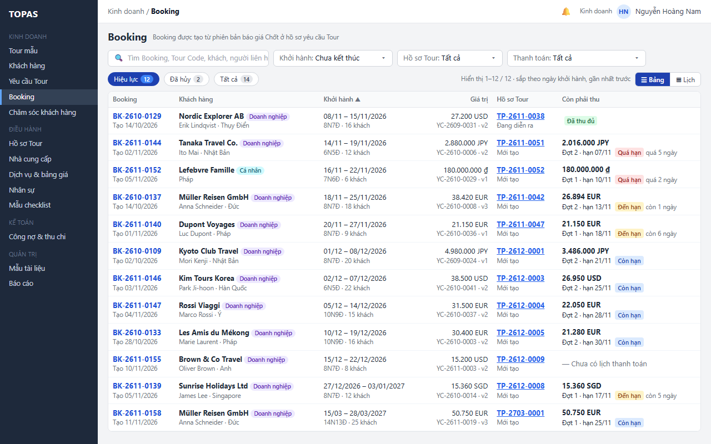

   > Hình chưa cập nhật: chưa có chip Của tôi (bật); thanh lọc còn ô Hồ sơ Tour.

2. **W01 · Tour Code trong cột Hồ sơ Tour.** Người dùng bấm TP-2611-0042. DH08 mở hồ sơ Tour theo quyền của DH08; bấm phần còn lại của dòng mở KD08 (R03, R09).

*Kết quả:* người dùng biết Booking nào cần nhắc tiền, hồ sơ Tour nào đang ở trạng thái nào, mà không phải mở từng Booking.

**L1.2 Tìm Booking của một khách.** *Điều kiện:* Kinh doanh, Kế toán hoặc Quản trị.

1. **W02 · Ô tìm kiếm, ô chọn Khởi hành, chip Tất cả.** Người dùng gõ “müller” (từ 2 ký tự), chọn Khởi hành Tất cả và chip Tất cả. Ô tìm áp dụng sau 300 ms ngừng gõ (R05); ô Khởi hành và chip lọc ngay. Danh sách hiện 4 Booking của Müller Reisen GmbH do người dùng phụ trách (chip Của tôi đang bật), kể cả hai Booking đã đi có hồ sơ Tour Đã đóng; phần khớp được tô vàng; cột Trạng thái hiện ra; liên kết Xóa bộ lọc xuất hiện.

   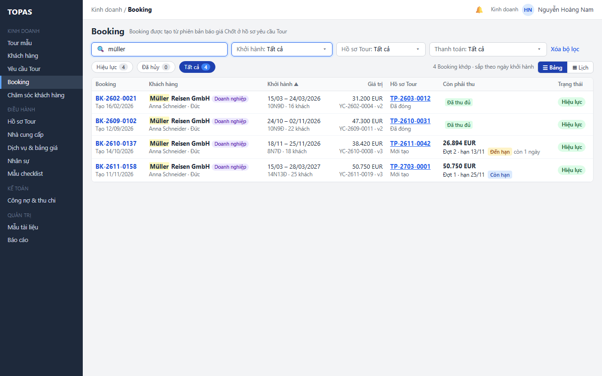

*Kết quả:* người dùng thấy toàn bộ lịch sử Booking của khách; tắt chip Của tôi để thấy cả Booking của người khác.

**L1.3 Lọc theo thanh toán và hồ sơ Tour.** *Điều kiện:* Kinh doanh, Kế toán hoặc Quản trị.

1. **W03 · Ô chọn Thanh toán ở thanh lọc → bảng chọn.** Người dùng bấm Thanh toán. Bảng chọn liệt kê các giá trị ở R07, áp dụng ngay khi chọn; chân bảng ghi số liệu lấy từ KT01 lúc tải và cách hiểu Đến hạn. Ô Khởi hành mở cùng kiểu bảng chọn; khoảng ngày khởi hành tùy chọn cần bấm Áp dụng và được kiểm tra theo E1.5.

   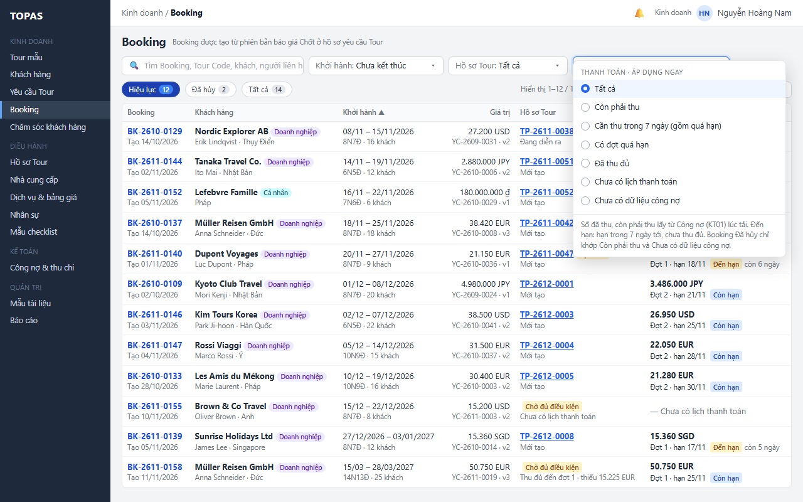

2. **W04 · Giá trị Cần thu trong 7 ngày.** Người dùng chọn Cần thu trong 7 ngày (gồm quá hạn). Danh sách còn 5 Booking có đợt chưa thu đủ với hạn trước hoặc trong ngày 19/11/2026: hai Booking quá hạn và ba Booking đến hạn; số trên chip tính theo bộ lọc (R04, R07). Người dùng gọi nhắc từng khách rồi mở KD08 khi cần xem điều khoản.

   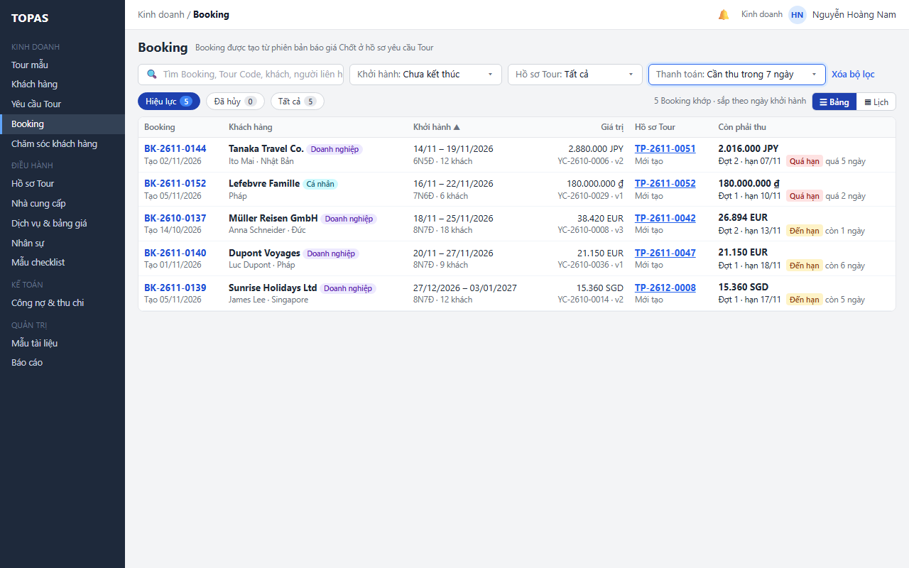

3. **W04 → W01 · Liên kết Xóa bộ lọc cuối thanh lọc.** Người dùng bấm Xóa bộ lọc. Ô tìm, Khởi hành, Thanh toán, Phụ trách về mặc định của vai trò; chip đang chọn giữ nguyên.

*Kết quả:* người dùng có danh sách khách cần nhắc thanh toán mà không cần thêm trạng thái mới cho Booking.

**L1.4 Xem Booking đã hủy.** *Điều kiện:* Kinh doanh, Kế toán hoặc Quản trị.

1. **W17 · Chip Đã hủy.** Người dùng bấm chip Đã hủy. Cột Trạng thái hiện ngày hủy và lý do. Cột Còn phải thu cho biết Kế toán đã điều chỉnh nghĩa vụ chưa: Smith Family đã thu 2.520 USD, Chờ điều chỉnh; Hanami Tours Đã điều chỉnh, không còn phải thu (R04). Hồ sơ Tour đã tạo trước khi hủy vẫn hiện Tour Code để mở DH08 (R03).

   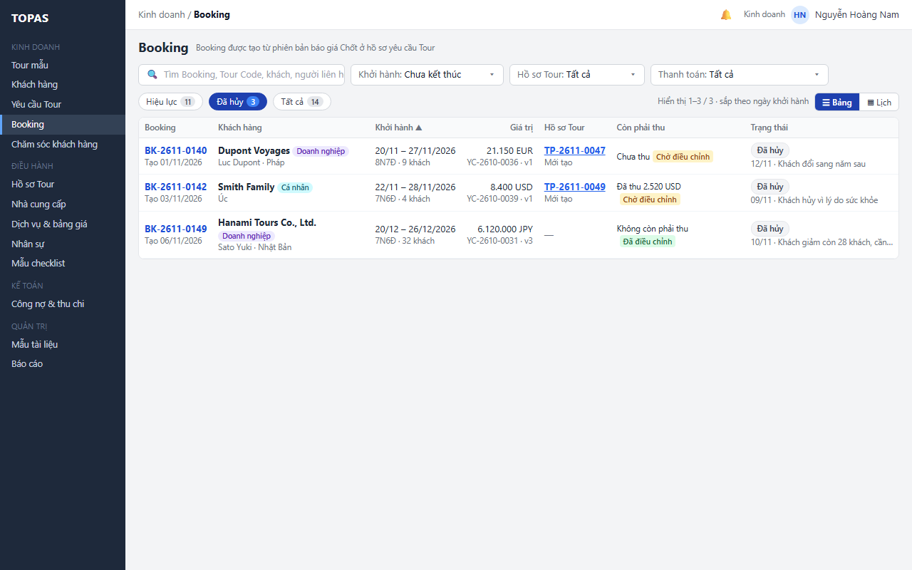

   > Hình chưa cập nhật: dòng Hanami Tours (BK-2611-0149) còn “—” ở cột Hồ sơ Tour; nay mọi Booking đều có Tour Code (Q5).

*Kết quả:* Booking đã hủy vẫn tra cứu được ở Bảng (quyết định 12/11/2026).

**Ngoại lệ**

- **E1.1 Không khớp bộ lọc (W05).** Bảng hiện “Không có Booking khớp bộ lọc” kèm gợi ý bỏ bớt bộ lọc; khi chip Của tôi đang bật có thêm câu “Đang lọc Booking của tôi” kèm liên kết Tắt Của tôi, vì tìm đúng mã Booking của người khác cũng ra kết quả rỗng; mọi chip có số 0. Người dùng bấm Xóa bộ lọc.

  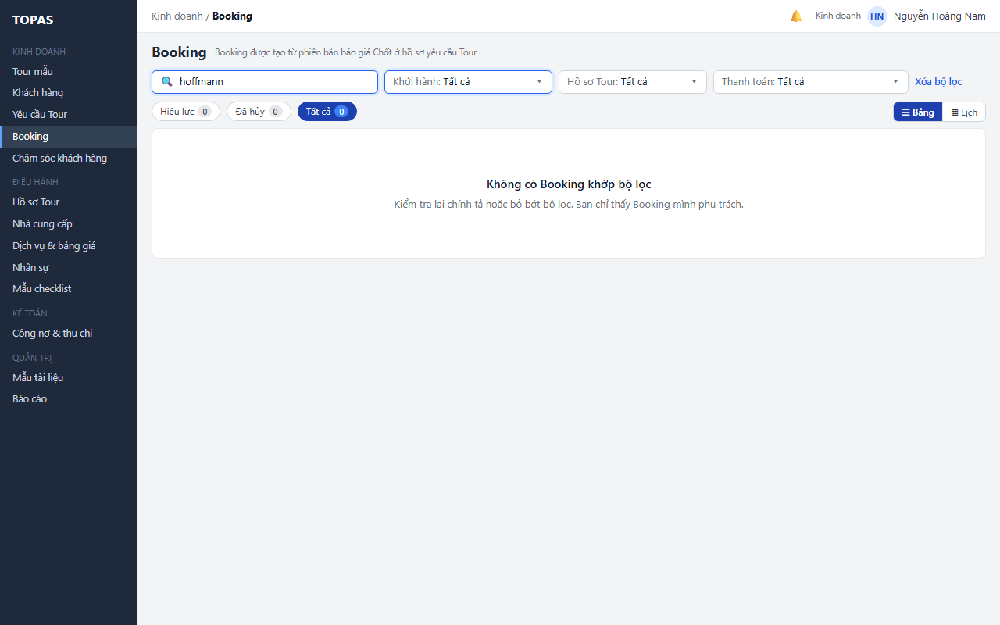

  > Hình chưa cập nhật: còn câu “Bạn chỉ thấy Booking mình phụ trách”; nay là “Đang lọc Booking của tôi” kèm liên kết Tắt Của tôi.

- **E1.2 Lỗi tải danh sách (W06).** Bảng hiện “Không tải được danh sách Booking”, số trên chip là “–”, bộ lọc giữ nguyên. Người dùng bấm Thử lại.

  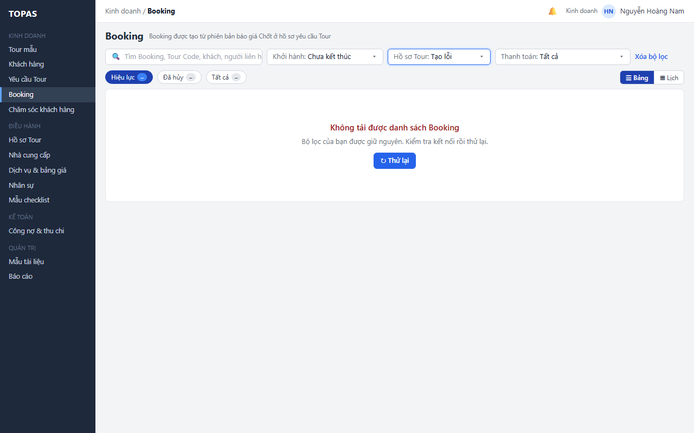

  > Hình chưa cập nhật: ô lọc Hồ sơ Tour đang chọn “Tạo lỗi” (đã bỏ, Q5).

- **E1.3 Chưa có dữ liệu (W07).** Chip Của tôi bật và người dùng chưa phụ trách Booking nào: bảng ghi “Bạn chưa phụ trách Booking nào”, giải thích Booking được tạo từ phiên bản báo giá Chốt ở hồ sơ yêu cầu Tour, kèm nút Mở danh sách yêu cầu Tour (KD05) và liên kết Tắt Của tôi. Khác W05 vì không có bộ lọc nào ngoài mặc định. Hệ thống chưa có Booking nào (Kế toán): “Chưa có Booking nào”.

  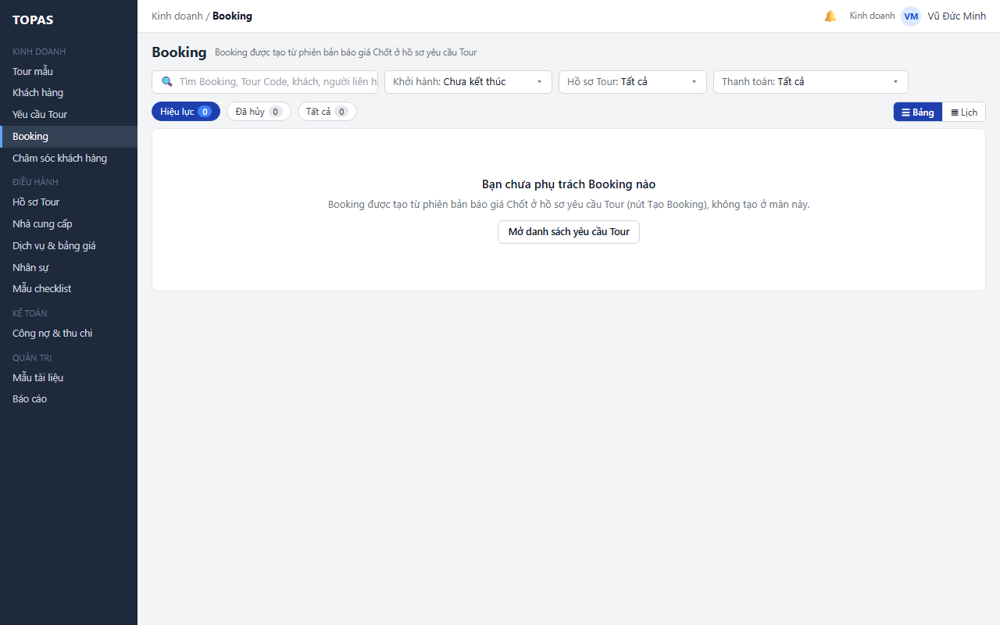

  > Hình chưa cập nhật: chưa có chip Của tôi và liên kết Tắt Của tôi.

- **E1.4 Không lấy được số liệu công nợ từ KT01 (W08).** Danh sách vẫn tải. Banner vàng nêu “Chưa lấy được số liệu công nợ từ Kế toán”, có Thử lại. Cột Còn phải thu ghi “Chưa có dữ liệu công nợ”, không ghi 0; Booking chưa có lịch thanh toán vẫn ghi “— Chưa có lịch thanh toán”; cột Hồ sơ Tour không đổi vì không phụ thuộc KT01. Bộ lọc Thanh toán tạm khóa (đang lọc thì về Tất cả và ghi trong banner) (quyết định 12/11/2026, R04). Thử lại thành công thì banner mất, cột cập nhật, bộ lọc mở lại.

  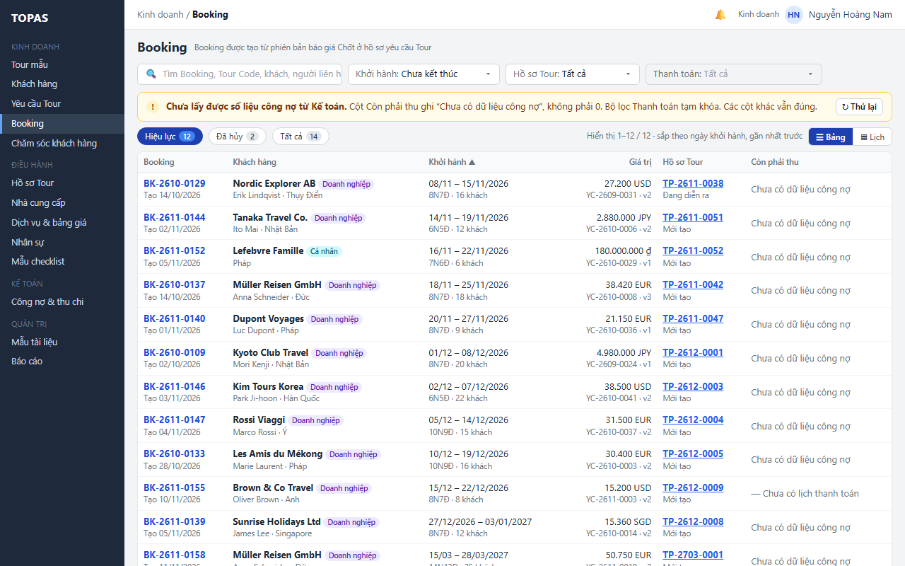

- **E1.5 Khoảng ngày không hợp lệ.** Từ ngày sau Đến ngày, hoặc ngày sai định dạng: nút Áp dụng khóa, lỗi ghi dưới ô (“Từ ngày phải trước hoặc bằng Đến ngày”). Bỏ trống một đầu thì khoảng mở về phía đó.
- **E1.6 Không có quyền.** Vai trò không được cấp quyền xem KD07 (mặc định Điều hành) không có mục Booking; mở KD07 bằng đường dẫn thì hiện trang “Bạn không có quyền xem danh sách Booking” kèm liên kết Hồ sơ Tour (DH07).
- **E1.7 Một Booking không có số liệu công nợ.** KT01 trả được số liệu cho cả trang nhưng thiếu một Booking (chưa có bản ghi công nợ dù đã có lịch thanh toán): riêng dòng đó ghi “Chưa có dữ liệu công nợ”; Booking đó khớp bộ lọc Chưa có dữ liệu công nợ, không khớp Còn phải thu hay Đã thu đủ (R04).
- **E1.8 (Bỏ theo Q5.)** Hồ sơ Tour tạo trong cùng giao dịch lưu Booking nên không có tình trạng Tạo lỗi (R03).
- **E1.9 Người phụ trách đã ngừng hoạt động.** Vẫn có trong danh sách chọn Phụ trách, kèm “(ngừng hoạt động)”, để tìm Booking của người đã nghỉ.

### 3.2. Mở Booking để hủy hoặc xem chi tiết (SYS04.05 → SYS04.06)

**L2.1 Mở đúng chỗ cần xử lý.** *Điều kiện:* Kinh doanh.

1. **W01 · Bấm dòng (trừ Tour Code).** Người dùng bấm dòng BK-2610-0137.
2. **W09 · KD08 ở tab Thông tin và hủy Booking.** KD08 mở ở tab Thông tin và hủy Booking (R09). Hủy Booking, nhập điều khoản và lịch thanh toán làm ở KD08 theo RSD KD08 (SYS04.06, SYS04.03).

   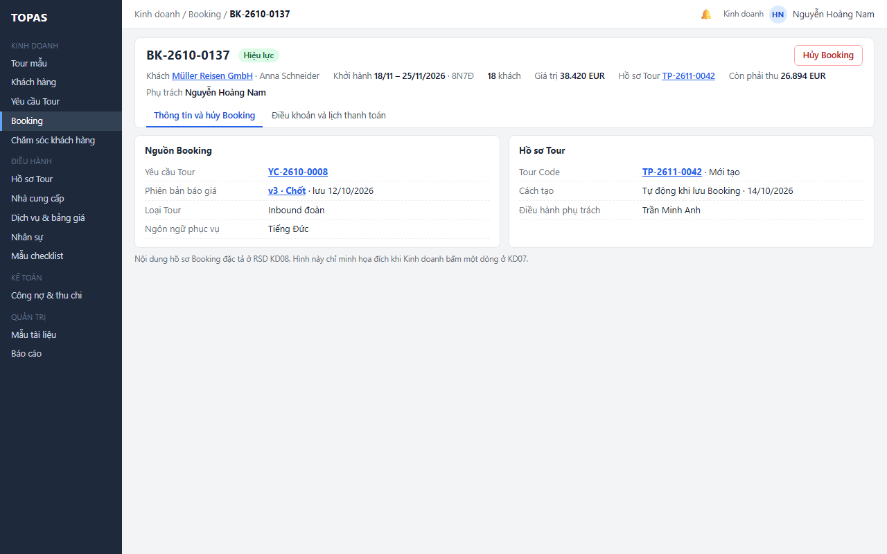

*Kết quả:* người dùng vào thẳng hồ sơ Booking cần xử lý.

**L2.2 Quay lại danh sách sau khi hủy Booking.** *Điều kiện:* đã mở KD08 từ KD07.

1. **W10 · Breadcrumb Booking hoặc nút quay lại.** Người dùng hủy BK-2611-0140 ở KD08 rồi bấm breadcrumb Booking. KD07 hiện lại với bộ lọc, chip, trang và vị trí cuộn như trước; dòng vừa mở được tải lại. Dòng không còn khớp chip Hiệu lực nên giữ tại chỗ, mờ, ghi Đã hủy và “Không còn khớp bộ lọc”; chip Hiệu lực 12 → 11, Đã hủy 2 → 3; thông báo ngắn có liên kết Xem ở chip Đã hủy. Dòng mờ ẩn ở lần tải lại kế tiếp (R09).

   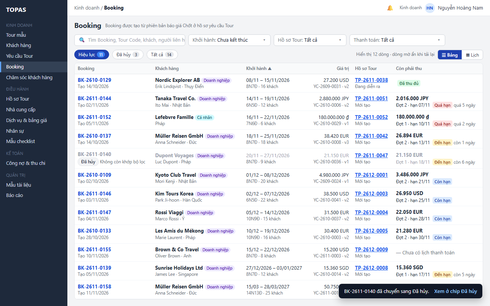

2. **W17 · Liên kết Xem ở chip Đã hủy trong thông báo.** Người dùng bấm Xem. Chip Đã hủy được chọn; BK-2611-0140 hiện với lý do vừa nhập và Chờ điều chỉnh vì Kế toán chưa ghi điều chỉnh ở KT01.1.

*Kết quả:* người dùng không mất vị trí và thấy kết quả của thao tác vừa làm.

**Ngoại lệ**

- **E2.1 (Bỏ theo Q1.)** Không có phạm vi bản ghi nên đổi người phụ trách ở phiên khác không chặn mở KD08. Khi quay lại, dòng không còn khớp chip Của tôi thì mờ tại chỗ như R09.
- **E2.2 Booking Đã hủy.** Mở KD08 ở tab Thông tin và hủy Booking, chỉ xem; không có nút Hủy Booking (RSD KD08).
- **E2.3 Booking không còn tồn tại.** Bản ghi bị xóa bằng công cụ quản trị trong lúc đang xem: thông báo ngắn “Booking này không còn tồn tại”, danh sách tải lại. KD07 và KD08 không có thao tác xóa Booking.
- **E2.4 Dữ liệu đổi ở phiên khác.** Ví dụ Kế toán vừa ghi khoản thu: KD08 luôn tải bản mới nhất; khi quay lại, KD07 tải lại trang đang xem và cột Còn phải thu đổi theo.
- **E2.5 Không có quyền xem DH08.** Tour Code hiện dạng chữ, không bấm được (U5); bấm phần còn lại của dòng vẫn mở KD08.
- **E2.6 Người dùng muốn tạo Booking.** Không có nút ở KD07. Tiêu đề và trạng thái rỗng (W07) nói rõ Booking tạo từ phiên bản Chốt ở KD06.3.

### 3.3. Kế toán theo dõi thu theo Booking (TN04.04 · SYS04.07)

**L3.1 Rà Booking theo hạn thu.** *Điều kiện:* Kế toán.

1. **W11 · Menu Kinh doanh → Booking.** Kế toán mở Booking. Danh sách ở chip Của tôi tắt, Phụ trách Tất cả, Khởi hành Tất cả, chip Hiệu lực, sắp theo hạn của đợt chưa thu sớm nhất (R08); dòng đầu là các đợt đã quá hạn (Tanaka Travel Co., Lefebvre Famille, Wagner Gruppe), tiếp theo là các đợt đến hạn trong 7 ngày. Cột Phụ trách cho biết hỏi Kinh doanh nào. Không có nút ghi trên danh sách.

   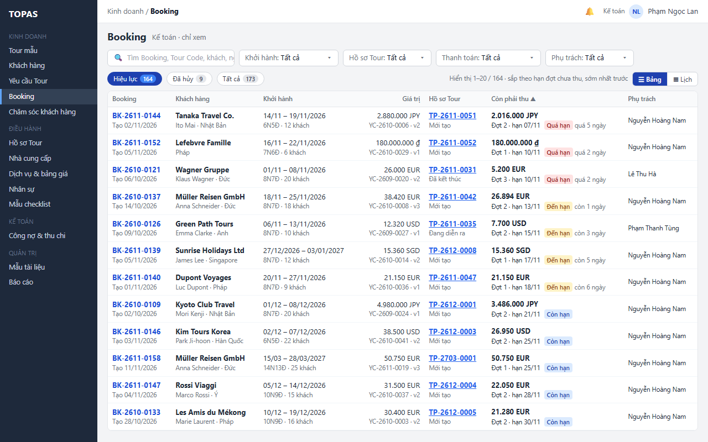

2. **W16 · Bấm dòng → KD08.2.** Kế toán bấm dòng BK-2610-0137. KD08 mở ở tab Điều khoản và lịch thanh toán, chỉ xem, đợt chưa thu sớm nhất (Đợt 2) được tô (R09). Kế toán bấm Xem công nợ để ghi khoản thu ở KT01.1 lọc theo Booking (RSD KD08, KT01).

   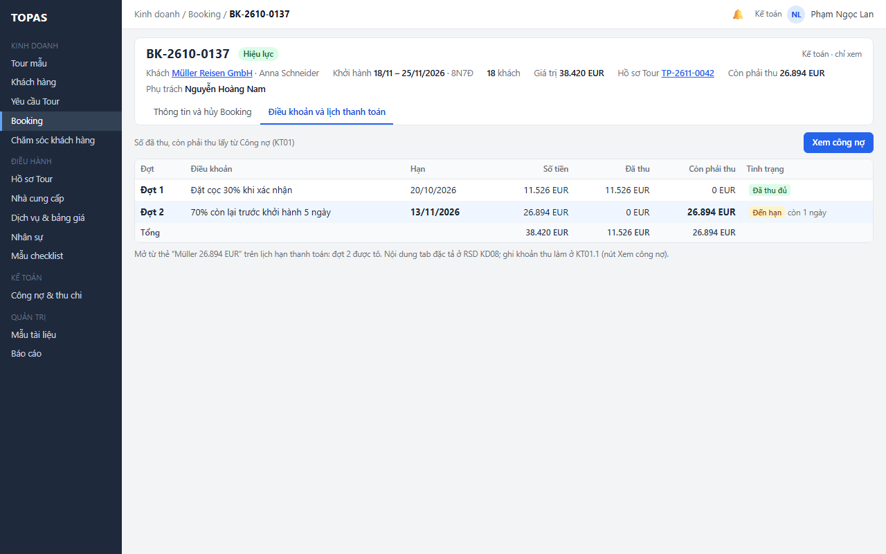

*Kết quả:* Kế toán biết Booking nào cần thu trước và đi thẳng tới đợt cần xử lý.

**Ngoại lệ**

- **E3.1 Kế toán chỉ xem.** KD08 mở không có nút ghi theo quyền mặc định của Kế toán: không có Hủy Booking, không sửa lịch thanh toán (RSD KD08 1.4).
- **E3.2 Quay lại sau khi ghi khoản thu ở KT01.1.** KD07 tải lại trang: đợt vừa thu đủ chuyển Đã thu đủ, dòng nhảy sang đợt kế tiếp hoặc Đã thu đủ. Nếu dòng không còn khớp bộ lọc Thanh toán đang chọn, dòng mờ tại chỗ như R09.
- **E3.3 Booking chưa có lịch thanh toán.** Dòng xếp cuối theo R08, ghi “— Chưa có lịch thanh toán”; Kế toán hỏi Kinh doanh ở cột Phụ trách. KD07 không gửi nhắc.

### 3.4. Dạng xem Lịch (quyết định 11/11/2026, 12/11/2026)

**L4.1 Lịch theo ngày khởi hành.** *Điều kiện:* Kinh doanh, Kế toán hoặc Quản trị.

1. **W12 · Bộ chuyển dạng xem cuối hàng chip → Lịch.** Kinh doanh bấm Lịch. Lịch mở ở tháng hiện tại (hoặc tháng đầu của bộ lọc Khởi hành nếu đang lọc khoảng ngày), dạng Tháng, mốc Ngày khởi hành (mặc định của Kinh doanh); dạng xem và mốc được ghi nhớ (R12). Hàng chip và bộ lọc giữ nguyên. Ví dụ tháng 12/2026: mỗi Booking là một thanh từ ngày khởi hành đến ngày kết thúc; thanh vắt qua tuần có dấu ◂ ▸; mọi thanh màu xanh lá (Booking Hiệu lực), kể cả Brown & Co Travel chưa có lịch thanh toán. Ghi chú cạnh chip: “6 Booking khởi hành trong tháng” (R13).

   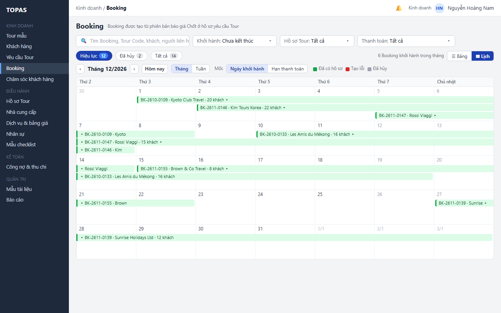

   > Hình chưa cập nhật: chú giải còn “Đã có hồ sơ”, “Tạo lỗi” (đỏ); nay chỉ có Hiệu lực (xanh lá) và Đã hủy (xám).

2. **W12 · Nút ‹ ›, Hôm nay, nhóm nút Tháng, Tuần.** Người dùng đổi tháng, về tháng hiện tại hoặc xem một tuần (mọi thanh hiện đủ, không gộp). Đổi tháng không đổi bộ lọc Khởi hành.
3. **W09 · Bấm thanh.** KD08 mở như bấm dòng (R09).

*Kết quả:* người dùng thấy lịch khởi hành của các Booking.

**L4.2 Lịch theo hạn thanh toán.** *Điều kiện:* Kế toán (mốc mặc định), Kinh doanh hoặc Quản trị.

1. **W13 · Bộ chuyển dạng xem → Lịch; nhóm nút Mốc → Hạn thanh toán.** Kế toán bấm Lịch; mốc mặc định của Kế toán là Hạn thanh toán (người khác bấm Hạn thanh toán ở nhóm nút Mốc). Mỗi đợt thanh toán của các Booking Hiệu lực khớp bộ lọc là một thẻ ở ngày hạn, ghi tên khách và số tiền đợt; màu theo tình trạng đợt: đỏ Quá hạn, vàng Đến hạn, xanh dương Còn hạn, xanh lá Đã thu đủ; di chuột hiện mã Booking, đợt, đã thu, người phụ trách (R14). Ô hôm nay (12/11) được đánh dấu. Khay bên phải liệt kê Booking Hiệu lực chưa có lịch thanh toán (BK-2611-0155). Ghi chú cạnh chip: “21 đợt có hạn trong tháng · 3 quá hạn · 5 đến hạn”.

   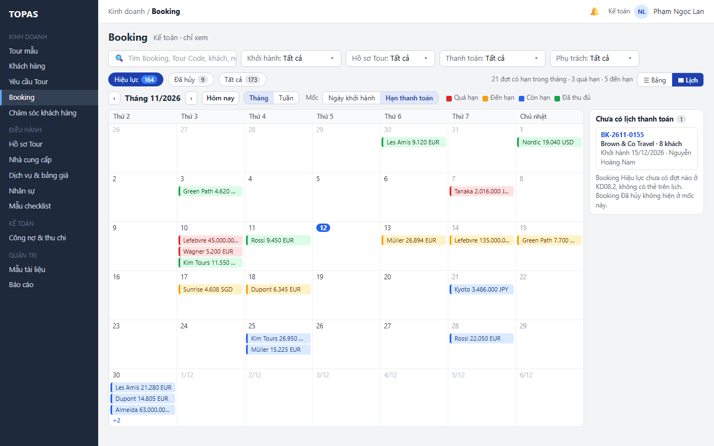

2. **W16 · Bấm thẻ đợt.** Kế toán bấm thẻ “Müller 26.894 EUR” ngày 13/11. KD08 mở ở tab Điều khoản và lịch thanh toán, Đợt 2 được tô (R09).

*Kết quả:* Kế toán thấy ngày nào phải thu và đợt nào quá hạn trên một màn.

**L4.3 Ngày có nhiều đợt hoặc nhiều Booking.** *Điều kiện:* dạng Lịch, tháng.

1. **W14 · Liên kết “+n” trong ô ngày → bảng nhỏ.** Mỗi tuần hiện tối đa 3 hàng thẻ hoặc thanh; ngày còn mục chưa hiện có “+n”. Kế toán bấm “+2” ở ngày 30/11; bảng nhỏ liệt kê đủ 5 đợt có hạn trong ngày, mỗi đợt có mã Booking, khách, đợt, số tiền, đã thu hay chưa và người phụ trách. Bấm một đợt mở KD08.2 như L4.2; bấm ra ngoài để đóng. Ở mốc Ngày khởi hành, “+n” liệt kê các Booking đang diễn ra trong ngày.

   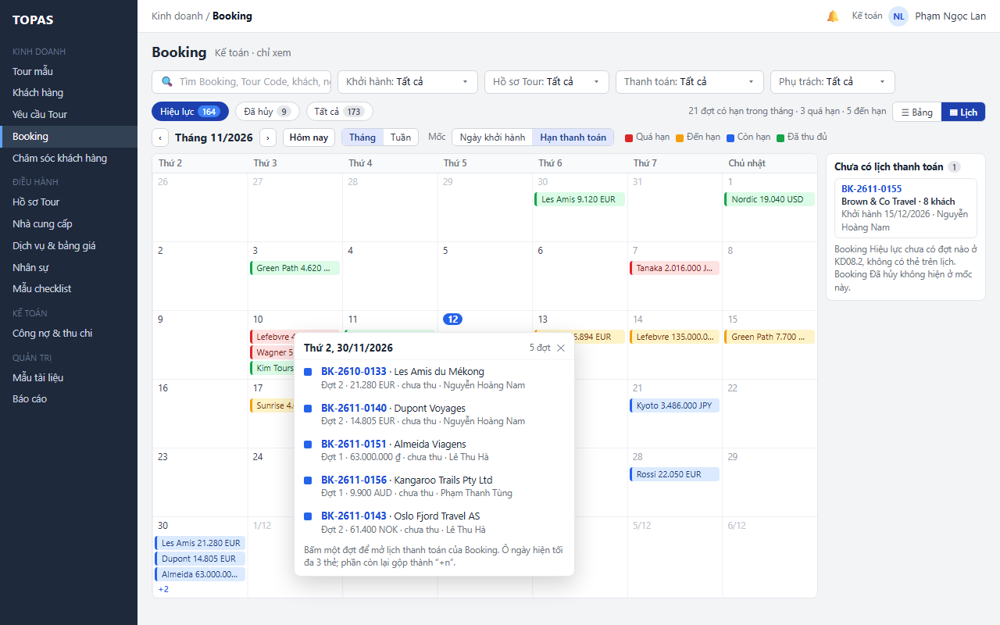

*Kết quả:* không đợt nào bị che mất trong ô ngày.

**Ngoại lệ**

- **E4.1 Chip Đã hủy ở mốc Hạn thanh toán (W15).** Đợt của Booking Đã hủy không hiện (quyết định 12/11/2026). Lịch vẫn hiện lưới, giữa lịch ghi “Booking Đã hủy không có đợt trên lịch hạn thanh toán” và lý do, kèm hai nút: Xem 9 Booking Đã hủy ở Bảng (đổi sang Bảng, giữ chip và bộ lọc) và Đổi mốc sang Ngày khởi hành. Chip Tất cả ở mốc này chỉ vẽ đợt của Booking Hiệu lực; ghi chú cạnh chip ghi thêm “Booking Đã hủy không hiện ở mốc này”.

  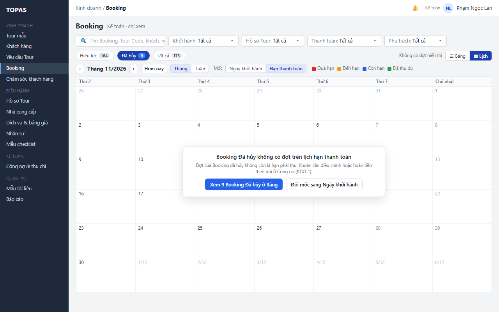

- **E4.2 Tháng không có mục nào.** Lịch vẫn hiện lưới, giữa lịch ghi “Không có Booking khởi hành trong tháng 02/2027” (hoặc “Không có đợt thanh toán có hạn trong tháng …”) kèm liên kết tới tháng gần nhất có dữ liệu, trước và sau. Khay Chưa có lịch thanh toán ẩn khi rỗng.
- **E4.3 Tháng ngoài khoảng Khởi hành.** Đang lọc Khởi hành mà đổi sang tháng ngoài khoảng ở mốc Ngày khởi hành: lịch rỗng, ghi “Tháng này ngoài khoảng Khởi hành đang lọc · Xóa lọc khởi hành”. Ở mốc Hạn thanh toán, bộ lọc Khởi hành lọc Booking chứ không lọc tháng, nên vẫn hiện đợt của các Booking đó ở mọi tháng (R14).
- **E4.4 Booking chưa có lịch thanh toán.** Không có thẻ trên lưới hạn thanh toán; nằm ở khay bên phải (W13). Bấm mục trong khay mở KD08.2 để thấy lịch trống.
- **E4.5 Không lấy được số liệu công nợ ở mốc Hạn thanh toán.** Thẻ vẫn vẽ theo hạn và số tiền đợt (đọc từ KD08) nhưng màu xám, không tô Quá hạn, Đến hạn, Đã thu đủ; banner như E1.4. Không suy ra tình trạng khi thiếu số đã thu (quyết định 12/11/2026).
- **E4.6 Quá nhiều mục trong tháng.** Hơn 500 Booking (hoặc đợt) trong tháng với bộ lọc hiện tại: lịch không vẽ, ghi “Có n mục, quá nhiều để hiện trên lịch · thu hẹp bộ lọc hoặc dùng Bảng”.
- **E4.7 Booking đổi sau khi quay lại từ KD08.** Thanh hoặc thẻ đổi màu theo dữ liệu mới; nếu không còn khớp chip (Booking vừa hủy) thì mờ tại chỗ đến lần tải lại kế tiếp; ở mốc Hạn thanh toán, đợt của Booking vừa hủy mờ rồi ẩn ở lần tải lại.
- **E4.8 Màn hẹp.** Dưới 1100 px chiều ngang, Lịch chuyển sang dạng Tuần; khay chuyển xuống dưới lưới.

---

## 4. Quy tắc triển khai chi tiết

### R01. Phạm vi xem và quyền

- Quyền theo màn và thao tác, gán cho vai trò ở QT02; giá trị mặc định ở 1.4. Không có phạm vi bản ghi (Q1): mặc định Kinh doanh, Kế toán, Quản trị hệ thống xem KD07 với mọi Booking; ở KD07 mọi vai trò chỉ xem.
- Chip Của tôi bật sẵn với Kinh doanh, tắt sẵn với Kế toán và Quản trị (không phụ trách Booking); người dùng bật, tắt được. Bộ lọc và cột Phụ trách có cho mọi vai trò.
- Điều hành mặc định không có quyền xem KD07; Booking mở từ DH07, DH08.
- Mở KD08: thao tác theo quyền ở RSD KD08 1.4 (mặc định Kinh doanh thao tác; Kế toán chỉ xem; Quản trị hệ thống xem và chuyển người phụ trách Booking, RSD KD08 R11). Mở DH08 từ Tour Code theo quyền xem DH08.
- Quyền được kiểm tra ở máy chủ khi tải danh sách và khi mở KD08.

### R02. Trạng thái Booking (đúng nguồn, quyết định 11/11/2026)

- Hai trạng thái do KD08 sở hữu: **Hiệu lực** (có khi lưu Booking từ phiên bản Chốt) và **Đã hủy** (Kinh doanh hủy kèm lý do ở KD08.1). KD07 chỉ đọc.
- Không thêm trạng thái hay giai đoạn. Booking Hiệu lực vẫn là Hiệu lực sau khi Tour kết thúc hay hồ sơ Tour đã đóng; tiến độ Tour xem ở cột Hồ sơ Tour.
- Tình trạng thanh toán không làm đổi trạng thái Booking (SYS04.09: không tạo trạng thái thanh toán chi tiết).

### R03. Hồ sơ Tour trên danh sách

Hồ sơ Tour tạo trong cùng giao dịch khi Booking được lưu ở KD08, không chờ thanh toán (RSD DH07 R01; quyết định 12/11/2026; Q5), nên mọi Booking đều có hồ sơ Tour.

- Cột hiện Tour Code (bấm mở DH08) và trạng thái hồ sơ (Mới tạo, Đang diễn ra, Đã kết thúc, Đã đóng). Booking Đã hủy vẫn hiện Tour Code.
- Không có tình trạng Tạo lỗi, không có “—” (Q5).
- Số liệu thanh toán từ KT01 (đã thu, còn phải thu, có lịch thanh toán hay chưa) không ảnh hưởng cột này. Kế toán không làm chốt chặn cho việc tạo hồ sơ Tour (quyết định 12/11/2026).
- Danh sách đọc lại trạng thái hồ sơ mỗi lần tải.

### R04. Số liệu thanh toán và tình trạng đợt (quyết định 12/11/2026)

- **Nguồn.** Đợt, số tiền, hạn đọc từ lịch thanh toán của Booking (KD08.2). Số đã thu (theo đợt và tổng), số còn phải thu, tình trạng điều chỉnh sau hủy đọc từ sổ công nợ KT01 (SYS04.09). KD07 không tự cộng khoản thu.
- **Còn phải thu** của Booking = số KT01 trả cho Booking. Không có số từ KT01 (KT01 lỗi, hoặc Booking chưa có bản ghi công nợ) thì ghi **“Chưa có dữ liệu công nợ”**, không ghi 0 và không tính vào Còn phải thu hay Đã thu đủ.
- **Chưa có lịch thanh toán.** Booking Hiệu lực chưa có đợt nào ở KD08.2: ghi “— Chưa có lịch thanh toán”; không phải 0, không phải Đã thu đủ.
- **Tình trạng đợt** (Booking Hiệu lực) đọc từ KT01, cùng cách tính với RSD KT01 R03 (KD07 không tự tính lại), tính lúc đọc theo hôm nay ở múi giờ Asia/Ho_Chi_Minh (Q6):
  1. **Đã thu đủ** nếu đã thu phân bổ cho đợt ≥ số tiền đợt.
  2. **Quá hạn** nếu hạn đợt trước hôm nay; dòng ghi “quá n ngày”.
  3. **Đến hạn** nếu hạn đợt từ hôm nay đến hôm nay + N ngày, N là ngưỡng Đến hạn (tham số chung, mặc định 7, R11); dòng ghi “còn n ngày” hoặc “hôm nay”.
  4. **Còn hạn** trong các trường hợp còn lại.
- **Đợt hiện trên dòng** là đợt chưa thu đủ có hạn sớm nhất, gồm cả khoản Phát sinh mà KT01 ghi vào Booking (RSD KT01 R11). Mọi đợt và khoản đã thu đủ mà Còn phải thu bằng 0 thì hiện Đã thu đủ.
- **Tình trạng thanh toán của dòng Booking** đọc từ KT01 (tình trạng hiển thị dùng chung, RSD KT01 R03), không tự suy từ các đợt. Các trường hợp phải hiện theo KT01:
  - **Còn phải thu > 0 dù mọi đợt của lịch thanh toán đã thu đủ**: Booking có khoản Phát sinh ngoài lịch chưa thu (RSD KT01 R11). Dòng hiện số còn phải thu và đợt “Phát sinh” kèm hạn, tình trạng; không hiện Đã thu đủ.
  - **Tiền thừa**: khách trả vượt tổng các đợt (RSD KT01 R06). Còn phải thu bằng 0 (không âm), dòng hiện Đã thu đủ kèm chỉ báo Tiền thừa và số tiền.
  - **Cần hoàn**: Booking Đã hủy đã điều chỉnh mà số đã thu vượt phí giữ lại (RSD KT01 R07). KT01 trả số âm; dòng hiện “Đã điều chỉnh · Cần hoàn …” với số dương kèm nhãn, không hiện số âm trần, không tính vào bộ lọc Còn phải thu.
- **Booking Đã hủy.** Không tính tình trạng đợt. Cột ghi số đã thu và nhãn **Chờ điều chỉnh** (Kế toán chưa ghi điều chỉnh nghĩa vụ ở KT01.1) hoặc **Đã điều chỉnh** kèm kết quả “Còn phải thu …”, “Cần hoàn …” hoặc “Không còn phải thu” (SYS04.10).
- **Tiền** theo loại tiền của lịch thanh toán, không quy đổi, không cộng giữa các Booking. Khoản phải thu phát sinh có loại tiền riêng (RSD KT01 R11; Q18): khác loại tiền Booking thì Còn phải thu hiện theo từng loại tiền, không cộng lẫn.
- **Ngưỡng Đến hạn** là tham số chung ở QT05 do Quản trị hệ thống sửa, mặc định 7 ngày; KD07 và KT01 cùng đọc một giá trị (quyết định sau rà soát 12/11/2026; R11). Nhãn “Cần thu trong 7 ngày” ở bộ lọc Thanh toán ghi theo giá trị đang cấu hình.

### R05. Tìm kiếm

- Tìm từ 2 ký tự, áp dụng sau 300 ms ngừng gõ; không phân biệt hoa thường, bỏ dấu (gõ “muller” tìm thấy “Müller”).
- Tìm chuỗi con trong: mã Booking, Tour Code, mã yêu cầu nguồn, tên khách hàng, tên giao dịch, mã khách hàng, tên và email người liên hệ của Booking.
- Tìm trên mọi Booking khớp bộ lọc và chip đang chọn, kể cả chip Của tôi (R01). Email chỉ dùng để tìm, không hiện trên danh sách.
- Tô vàng phần khớp ở cột Booking và Khách hàng.

### R06. Bộ lọc Khởi hành

- **Chọn nhanh** (áp dụng ngay): Chưa kết thúc = ngày kết thúc từ hôm nay trở đi (gồm Booking đang diễn ra); Đang diễn ra = ngày khởi hành ≤ hôm nay ≤ ngày kết thúc; Tháng này, Tháng sau = ngày khởi hành trong tháng; 3 tháng tới = ngày khởi hành từ hôm nay đến hôm nay + 3 tháng − 1 ngày; Đã kết thúc = ngày kết thúc trước hôm nay; Tất cả.
- **Khoảng ngày tùy chọn** theo ngày khởi hành, bỏ trống được một đầu; cần bấm Áp dụng (E1.5).
- Bộ lọc không làm đổi dữ liệu.

### R07. Bộ lọc Hồ sơ Tour, Thanh toán, Yêu cầu đổi lịch trình, Phụ trách

- **Hồ sơ Tour** (bỏ theo Q5): mọi Booking đều có hồ sơ Tour nên không còn bộ lọc riêng; lọc theo trạng thái hồ sơ dùng bộ lọc của cột (K2).
- **Thanh toán** lọc theo R04, ở cấp Booking:
  - Còn phải thu: Còn phải thu từ KT01 lớn hơn 0 (gồm Booking Đã hủy còn nghĩa vụ, và Booking có mọi đợt đã thu đủ nhưng còn khoản Phát sinh chưa thu). Booking Cần hoàn (số âm) không thuộc bộ lọc này.
  - Cần thu trong 7 ngày (gồm quá hạn; số ngày theo ngưỡng Đến hạn): Booking Hiệu lực có ít nhất một đợt hoặc khoản Phát sinh Quá hạn hoặc Đến hạn.
  - Có đợt quá hạn: Booking Hiệu lực có ít nhất một đợt hoặc khoản Phát sinh Quá hạn.
  - Đã thu đủ: Booking có lịch thanh toán và Còn phải thu bằng 0 (gồm Booking có Tiền thừa).
  - Chưa có lịch thanh toán: Booking Hiệu lực chưa có đợt nào.
  - Chưa có dữ liệu công nợ: Booking không có số từ KT01.
- Tình trạng đợt và các giá trị cấp Booking dùng cho bộ lọc đọc từ KT01 (RSD KT01 R03), cùng cách tính với KT01.1.
- Khi KT01 không trả số liệu, bộ lọc Thanh toán khóa kèm lý do và về Tất cả (E1.4).
- **Yêu cầu đổi lịch trình** (chọn một giá trị; đọc từ DH08, KD07 không tự tính; người dùng chốt 12/11/2026):
  - Đang chờ: Booking có ít nhất một yêu cầu đổi lịch trình ở trạng thái **Chờ Kinh doanh** (RSD DH08 2.3, R18), tức yêu cầu đang hiện trên banner W21 của KD08 (RSD KD08 R13). Yêu cầu Đã xử lý, Đã rút không tính. Yêu cầu Chờ Kinh doanh tự Đã rút khi Booking hủy (RSD DH08 E3.15), nên thực tế chỉ Booking Hiệu lực khớp.
  - Quá hạn phản hồi: trong số Booking Đang chờ, Booking có ít nhất một yêu cầu Chờ Kinh doanh đã quá hạn phản hồi, tức hôm nay sau ngày hạn phản hồi ghi trên yêu cầu; cùng cách tính với chỉ báo Quá hạn phản hồi của RSD DH08 E3.11 và dòng đỏ ở banner KD08 (RSD KD08 R13). Tính lúc đọc theo ngày ở Asia/Ho_Chi_Minh (Q6), không cần dữ liệu đổi.
  - Dòng không có cột riêng cho yêu cầu; bấm dòng mở KD08 (R09), nơi banner yêu cầu hiện trên mọi tab.
- **Phụ trách** (mọi vai trò): Tất cả hoặc một người dùng Kinh doanh, kể cả người đã ngừng hoạt động (ghi “(ngừng hoạt động)”). Chip Của tôi bật tương đương Phụ trách là người dùng; chọn người khác ở Phụ trách thì chip Của tôi tắt.

### R08. Chip, số trên chip, sắp xếp và phân trang

- Chip Của tôi (bật/tắt, Q1) đứng đầu hàng chip, sau đó ba chip trạng thái: Hiệu lực, Đã hủy, Tất cả. Số trên mỗi chip trạng thái tính theo tìm kiếm, chip Của tôi và các bộ lọc còn lại, không theo chip trạng thái đang chọn. Hiệu lực + Đã hủy = Tất cả.
- Sắp xếp mặc định: Kinh doanh, Quản trị theo ngày khởi hành tăng dần; Kế toán theo hạn của đợt chưa thu đủ sớm nhất, tăng dần (quá hạn lên đầu), Booking không có đợt chưa thu (Đã thu đủ, Chưa có lịch thanh toán, Chưa có dữ liệu công nợ, Đã hủy) xếp sau theo ngày khởi hành. Cột sắp xếp được: Booking (ngày tạo), Khởi hành, Còn phải thu (hạn đợt chưa thu).
- 20 dòng mỗi trang; dòng chữ bên phải chip ghi khoảng đang xem và cách sắp xếp.

### R09. Mở KD08 đúng tab và giữ ngữ cảnh

- Tab đích khi bấm dòng hoặc thanh: Kinh doanh → Thông tin và hủy Booking (KD08.1); Kế toán → Điều khoản và lịch thanh toán (KD08.2), tô đợt đang hiện trên dòng; Quản trị → KD08.1.
- Bấm thẻ đợt ở Lịch hạn thanh toán (mọi vai trò) → KD08.2, tô đúng đợt đó.
- Bộ lọc, chip, trang, vị trí cuộn, sắp xếp, dạng xem, mốc và tháng của KD07 được giữ trong phiên khi mở KD08 rồi quay lại. Khi quay lại, trang hoặc tháng đang xem được tải lại.
- Dòng, thanh hoặc thẻ không còn khớp bộ lọc sau khi tải lại thì giữ tại chỗ, mờ, có nhãn mới và “Không còn khớp bộ lọc”; thông báo ngắn có liên kết tới chip chứa Booking đó (W10). Phần mờ ẩn ở lần tải lại kế tiếp hoặc khi đổi bộ lọc.

### R10. Mã Booking

- Dạng `BK-YYMM-NNNN` do KD08 cấp khi lưu (YYMM là tháng tạo theo giờ Asia/Ho_Chi_Minh; NNNN đếm trong tháng, cho phép thủng số, Q7), như dữ liệu của RSD KD05, KD06, DH07. Quy tắc cấp mã thuộc RSD KD08; KD07 chỉ hiển thị và tìm theo mã.

### R11. Cấu hình phụ thuộc

| Cấu hình | Chủ sở hữu | Dùng ở đâu | Hành vi khi thiếu |
|---|---|---|---|
| Quyền xem KD07 theo vai trò | Quản trị hệ thống (QT02) | R01, 1.4 | Như mục 1.4 |
| Ngưỡng Đến hạn của đợt thanh toán | QT05, tham số chung, KD07 và KT01 cùng đọc (RSD KT01 R03, R16) | R04, R07, R14 | 7 ngày |
| Lịch thanh toán | KD08.2 | R04, R14 | “Chưa có lịch thanh toán” |
| Hồ sơ Tour | DH07, DH08 | R03 | Không xảy ra: hồ sơ tạo trong cùng giao dịch với Booking (Q5) |
| Số đã thu, còn phải thu, tình trạng đợt và dòng Booking, Tiền thừa, điều chỉnh sau hủy | KT01 (Số liệu công nợ của Booking, RSD KT01 5.1) | R04, R07, R14 | “Chưa có dữ liệu công nợ” |
| Trạng thái tài khoản người dùng | Quản trị hệ thống (QT01) | Bộ lọc Phụ trách, nhãn “(ngừng hoạt động)” | — |
| Số hàng tối đa mỗi tuần ở Lịch tháng; số mục tối đa vẽ trên Lịch | Tệp cấu hình hoặc dữ liệu khởi tạo (C2) | R13, R14, E4.6 | 3 hàng; 500 mục |

### R12. Dạng xem và ghi nhớ (quyết định 11/11/2026)

- KD07 có hai dạng xem: Bảng và Lịch. Lịch có hai mốc: Ngày khởi hành, Hạn thanh toán. Không có Kanban.
- Bộ chuyển dạng xem ở cuối hàng chip; nhóm nút Mốc ở đầu lịch, cạnh nhóm Tháng, Tuần.
- Hệ thống nhớ dạng xem, mốc và Tháng hay Tuần dùng lần cuối theo người dùng và màn, qua các phiên đăng nhập. Lần đầu là Bảng. Mốc lần đầu: Kế toán Hạn thanh toán; Kinh doanh, Quản trị Ngày khởi hành.
- Ô tìm, bộ lọc và chip dùng chung cho mọi dạng và mọi mốc.
- Không dạng xem nào có ô chọn, thanh hàng loạt hay thao tác ghi; không kéo thả thanh hay thẻ (quyết định 11/11/2026).

### R13. Lịch theo ngày khởi hành

- **Ngày dùng.** Thanh bắt đầu ở ngày khởi hành, kết thúc ở ngày kết thúc của Booking.
- **Lưới.** Tháng (mặc định) hoặc Tuần; tuần bắt đầu Thứ 2; cuối tuần chữ xám; ngày của tháng trước, tháng sau mờ nhưng vẫn vẽ thanh.
- **Màu:** xanh lá Booking Hiệu lực; Booking Đã hủy xám gạch ngang (khi chip là Đã hủy hoặc Tất cả). Chú giải ở đầu lịch.
- **Nhãn thanh.** Mã Booking · khách · số khách, cắt bớt khi thanh ngắn. Di chuột hiện đủ khách, thời gian, hồ sơ Tour, còn phải thu.
- **Xếp thanh.** Trong mỗi tuần, xếp theo ngày khởi hành rồi theo độ dài (dài trước). Tháng: tối đa 3 hàng mỗi tuần; ngày còn Booking chưa hiện có “+n”. Tuần: hiện đủ.
- **Tháng mở đầu.** Tháng hiện tại; nếu đang lọc khoảng ngày khởi hành thì tháng đầu của khoảng. Quay lại từ KD08 thì giữ tháng đang xem.
- **Ghi chú cạnh chip** là “n Booking khởi hành trong tháng”.

### R14. Lịch theo hạn thanh toán (quyết định 11/11/2026, 12/11/2026)

- **Mục vẽ.** Mỗi đợt trong lịch thanh toán của Booking **Hiệu lực** khớp tìm kiếm, bộ lọc và chip là một thẻ ở ngày hạn của đợt. Bộ lọc lọc Booking; mọi đợt của Booking khớp đều được vẽ, kể cả đợt đã thu đủ.
- **Booking Đã hủy không có thẻ** ở mốc này, kể cả khi chọn chip Đã hủy hay Tất cả (quyết định 12/11/2026). Chip Đã hủy cho lịch rỗng có giải thích (W15); tra cứu Booking đã hủy ở Bảng.
- **Màu** theo tình trạng đợt ở R04: đỏ Quá hạn, vàng Đến hạn, xanh dương Còn hạn, xanh lá Đã thu đủ. Không có số liệu KT01 thì thẻ xám, không suy ra tình trạng (E4.5).
- **Nhãn thẻ.** Tên khách · số tiền đợt và loại tiền, cắt bớt khi hẹp. Di chuột hiện mã Booking, đợt, số tiền, đã thu, tình trạng, người phụ trách.
- **Xếp thẻ.** Trong một ngày: Quá hạn, Đến hạn, Còn hạn, Đã thu đủ; cùng tình trạng thì số tiền lớn trước. Tháng: tối đa 3 hàng mỗi tuần, còn lại “+n” mở bảng nhỏ liệt kê mọi đợt của ngày (W14). Tuần: hiện đủ.
- **Khay Chưa có lịch thanh toán** liệt kê Booking Hiệu lực khớp bộ lọc chưa có đợt nào, không phụ thuộc tháng đang xem; ẩn khi rỗng.
- **Ghi chú cạnh chip** là “n đợt có hạn trong tháng · x quá hạn · y đến hạn”, chỉ đếm đợt có hạn trong tháng đang xem (không đếm ngày mờ của tháng khác).
- **Tháng mở đầu.** Tháng hiện tại. Quay lại từ KD08 thì giữ tháng đang xem.

---

## 5. Dữ liệu

### 5.1. Đối tượng dữ liệu

| Đối tượng | Khóa | Dữ liệu KD07 dùng | Nguồn hoặc tác động |
|---|---|---|---|
| Booking | Mã Booking (R10) | Ngày tạo, khách, người liên hệ, thời gian, số ngày đêm, số khách, giá trị, loại tiền, yêu cầu và phiên bản nguồn, người phụ trách, trạng thái, ngày và lý do hủy | KD08 sở hữu; KD07 chỉ đọc |
| Đợt thanh toán | Mã Booking + số đợt | Số đợt, số tiền, loại tiền, hạn | KD08.2; KD07 chỉ đọc |
| Số liệu công nợ của Booking | Mã Booking | Đã thu theo đợt, tổng đã thu, còn phải thu (gồm khoản Phát sinh), tình trạng đợt, tình trạng dòng Booking, tiền thừa, cần hoàn, tình trạng điều chỉnh sau hủy, kết quả điều chỉnh | KT01 (RSD KT01 5.1); KD07 chỉ đọc |
| Ngưỡng Đến hạn | Tham số chung | Số ngày | QT05, Quản trị hệ thống sửa; KD07, KT01 đọc |
| Yêu cầu đổi lịch trình (đọc) | ID yêu cầu | Booking (qua hồ sơ Tour), trạng thái, hạn phản hồi | DH08 sở hữu (RSD DH08 R18, mục 5.1); KD07 chỉ đọc cho bộ lọc Yêu cầu đổi lịch trình (R07) |
| Hồ sơ Tour | Tour Code | Tour Code, trạng thái hồ sơ | DH07 (tạo trong cùng giao dịch lưu Booking), DH08; KD07 chỉ đọc |
| Khách hàng, người liên hệ | Mã khách hàng | Tên, loại, quốc gia, tên và email người liên hệ (chỉ dùng để tìm) | KD04; KD07 chỉ đọc |
| Thiết lập dạng xem | Người dùng + màn | Dạng xem dùng lần cuối, mốc của Lịch, Tháng hay Tuần, bộ lọc và chip (U3) | KD07 ghi khi người dùng đổi; không ghi nhật ký QT03 |

### 5.2. Trường nhập

| Form | Trường | Bắt buộc | Mặc định hoặc điền sẵn | Kiểm tra |
|---|---|---|---|---|
| Thanh lọc | Tìm kiếm | Không | Trống | Từ 2 ký tự (R05) |
| Thanh lọc | Khởi hành | Không | Kinh doanh, Quản trị: Chưa kết thúc; Kế toán: Tất cả | Một giá trị (R06) |
| Thanh lọc | Khởi hành · khoảng tùy chọn | Không | Trống | dd/mm/yyyy; Từ ≤ Đến (E1.5) |
| Thanh lọc | Thanh toán | Không | Tất cả | Một giá trị; khóa khi KT01 lỗi (R07) |
| Thanh lọc | Yêu cầu đổi lịch trình | Không | Tất cả | Một giá trị (R07) |
| Thanh lọc | Phụ trách | Không | Tất cả | Người dùng Kinh doanh, kể cả đã ngừng hoạt động |
| Hàng chip | Của tôi | Không | Kinh doanh: Bật; Kế toán, Quản trị: Tắt | Bật hoặc Tắt (R08) |
| Lịch | Mốc | Có | Kế toán: Hạn thanh toán; khác: Ngày khởi hành | Ngày khởi hành hoặc Hạn thanh toán (R12) |

### 5.3. Dữ liệu gửi ra ngoài

KD07 không gửi email, tài liệu hay nhắc thanh toán cho khách hoặc NCC, và không xuất tệp.

---

## 6. Tiêu chí nghiệm thu

| Mã | Điều kiện và thao tác | Kết quả kiểm chứng được |
|---|---|---|
| AC01 | Kinh doanh mở Booking lần đầu | Dạng Bảng; chip Của tôi bật; Khởi hành Chưa kết thúc; chip Hiệu lực; sắp theo ngày khởi hành gần nhất; không có cột Phụ trách, Trạng thái; không có nút tạo (W01) |
| AC02 | Nam có 12 Booking Hiệu lực và 2 Đã hủy chưa kết thúc | Chip ghi 12, 2, 14; Hiệu lực + Đã hủy = Tất cả (W01) |
| AC03 | Kinh doanh gõ đúng mã một Booking do người khác phụ trách khi chip Của tôi bật | Không có kết quả; trạng thái rỗng ghi “Đang lọc Booking của tôi” kèm Tắt Của tôi; bấm Tắt Của tôi thì Booking đó hiện (E1.1, R01) |
| AC04 | Gõ “muller” (không dấu), Khởi hành Tất cả, chip Tất cả | Hiện 4 Booking của Müller Reisen GmbH, gồm 2 Booking có hồ sơ Đã đóng; phần khớp được tô; cột Trạng thái hiện (W02) |
| AC05 | Gõ Tour Code TP-2611-0042 | Hiện BK-2610-0137 (R05) |
| AC06 | Gõ email của người liên hệ Anna Schneider | Các Booking của Müller Reisen GmbH hiện ra; email không hiện trên dòng (R05) |
| AC07 | Booking có đợt 2 hạn 07/11 chưa thu, hôm nay 12/11 | Cột Còn phải thu ghi số còn phải thu, “Đợt 2 · hạn 07/11 · Quá hạn · quá 5 ngày” (W01, R04) |
| AC08 | Đợt hạn 19/11 chưa thu, hôm nay 12/11; đợt hạn 20/11 chưa thu | Đợt 19/11 là Đến hạn; đợt 20/11 là Còn hạn (R04) |
| AC09 | Đợt đã thu một phần | Đợt vẫn tính theo hạn (Quá hạn, Đến hạn hoặc Còn hạn), không là Đã thu đủ (R04) |
| AC10 | Mọi đợt đã thu đủ, không có khoản Phát sinh chưa thu | Cột ghi Đã thu đủ; Booking khớp bộ lọc Thanh toán Đã thu đủ (R04, R07) |
| AC11 | Booking Hiệu lực chưa có đợt nào | Cột Còn phải thu ghi “— Chưa có lịch thanh toán”, không ghi 0; cột Hồ sơ Tour vẫn hiện Tour Code, ví dụ BK-2611-0155 có TP-2612-0009 (W01, R03, R04) |
| AC12 | KT01 không trả số liệu khi tải danh sách | Danh sách vẫn hiện; banner có Thử lại; mọi dòng có lịch thanh toán ghi “Chưa có dữ liệu công nợ”, không có số 0; bộ lọc Thanh toán khóa (W08, E1.4) |
| AC13 | KT01 trả số liệu cho cả trang trừ một Booking | Riêng dòng đó ghi “Chưa có dữ liệu công nợ”; dòng khớp bộ lọc Chưa có dữ liệu công nợ, không khớp Còn phải thu, Đã thu đủ (E1.7) |
| AC14 | Chọn Thanh toán Cần thu trong 7 ngày vào 12/11/2026 | Còn 5 Booking: 2 có đợt quá hạn, 3 có đợt hạn đến 19/11; chip 5 / 0 / 5 (W04) |
| AC17 | Kinh doanh lưu Booking BK-2611-0158 ở KD08 (đợt 1 15.513 EUR chưa thu; số theo docs/rsd/BO-TINH-GIA, tính lại 13/11/2026); người dùng tải lại KD07 | Dòng BK-2611-0158 có Tour Code TP-2703-0001, trạng thái Mới tạo; cột Còn phải thu ghi đợt 1 chưa thu (W01, R03) |
| AC18 | Bấm Tour Code | DH08 mở hồ sơ Tour; bấm phần còn lại của dòng mở KD08 (R03, R09) |
| AC19 | Nhập khoảng Từ 20/12/2026 Đến 01/12/2026 | Áp dụng khóa, lỗi dưới ô (E1.5) |
| AC20 | Tìm “hoffmann” không có kết quả | “Không có Booking khớp bộ lọc”, khác trạng thái chưa có dữ liệu (W05, W07) |
| AC21 | Không tải được danh sách | Hiện lỗi, số trên chip “–”, bộ lọc giữ nguyên; Thử lại tải lại (W06) |
| AC22 | Kinh doanh chưa phụ trách Booking nào, chip Của tôi bật | Trạng thái rỗng giải thích Booking tạo từ phiên bản Chốt, có nút Mở danh sách yêu cầu Tour mở KD05 và liên kết Tắt Của tôi (W07) |
| AC23 | Kinh doanh bấm dòng | KD08 mở ở tab Thông tin và hủy Booking (W09, R09) |
| AC24 | Hủy BK-2611-0140 ở KD08 rồi quay lại KD07 đang ở chip Hiệu lực | Bộ lọc, trang, vị trí giữ nguyên; dòng mờ tại chỗ với nhãn Đã hủy; chip 11 / 3 / 14; thông báo có liên kết Xem ở chip Đã hủy (W10) |
| AC25 | Chip Đã hủy | Cột Trạng thái có ngày và lý do hủy; Booking chưa được điều chỉnh ghi Chờ điều chỉnh, đã điều chỉnh ghi kết quả (W17, R04) |
| AC26 | Người phụ trách Booking đổi ở phiên khác, người cũ (chip Của tôi bật) bấm dòng | KD08 mở bình thường theo quyền của vai trò; quay lại KD07 thì dòng mờ tại chỗ vì không còn khớp chip Của tôi, ẩn ở lần tải lại kế tiếp (E2.1, R09) |
| AC27 | Điều hành mở đường dẫn KD07 | Trang không có quyền, có liên kết sang Hồ sơ Tour (E1.6) |
| AC28 | Kế toán mở Booking lần đầu | Chip Của tôi tắt, Phụ trách Tất cả, Khởi hành Tất cả, chip Hiệu lực; có cột Phụ trách; sắp theo hạn đợt chưa thu, quá hạn lên đầu; tiêu đề ghi “Kế toán · chỉ xem” (W11, R08) |
| AC29 | Kế toán bấm dòng BK-2610-0137 | KD08 mở ở tab Điều khoản và lịch thanh toán, chỉ xem, Đợt 2 được tô (W16, R09, E3.1) |
| AC30 | Danh sách có Booking EUR, USD, JPY, VND | Mỗi dòng giữ loại tiền riêng; không có dòng tổng tiền (2.7, R04) |
| AC31 | Kinh doanh bấm Lịch lần đầu | Lịch tháng hiện tại, mốc Ngày khởi hành; hàng chip và bộ lọc giữ nguyên (W12, R12) |
| AC32 | Lịch ngày khởi hành tháng 12/2026 của Nam | 6 thanh từ ngày khởi hành đến ngày kết thúc, đều màu xanh lá (Hiệu lực), kể cả Brown & Co Travel chưa có lịch thanh toán; ghi chú “6 Booking khởi hành trong tháng” (W12) |
| AC33 | Booking khởi hành 27/12/2026, kết thúc 03/01/2027 | Hiện ở cả tháng 12/2026 và 01/2027; thanh vắt qua tuần có ◂ ▸ (W12) |
| AC34 | Kế toán bấm Lịch lần đầu | Mốc Hạn thanh toán; mỗi đợt một thẻ ở ngày hạn, màu theo tình trạng đợt; khay liệt kê BK-2611-0155 chưa có lịch thanh toán; ghi chú “21 đợt có hạn trong tháng · 3 quá hạn · 5 đến hạn” (W13, R14) |
| AC35 | Ngày 30/11 có 5 đợt, tuần đó đủ 3 hàng | Ô ngày hiện “+2”; bấm thì bảng nhỏ liệt kê đủ 5 đợt kèm số tiền, đã thu hay chưa, người phụ trách (W14) |
| AC36 | Bấm thẻ “Müller 26.894 EUR” ngày 13/11 | KD08.2 mở, Đợt 2 được tô (W16, R09) |
| AC37 | Ở mốc Hạn thanh toán, chọn chip Đã hủy | Không có thẻ nào; giữa lịch ghi lý do, có nút Xem Booking Đã hủy ở Bảng và Đổi mốc sang Ngày khởi hành (W15, R14) |
| AC38 | Ở mốc Hạn thanh toán, chip Tất cả, Booking BK-2611-0142 Đã hủy có đợt hạn trong tháng | Đợt của BK-2611-0142 không có thẻ; ghi chú cạnh chip nêu Booking Đã hủy không hiện ở mốc này (E4.1) |
| AC39 | KT01 lỗi khi đang ở mốc Hạn thanh toán | Thẻ vẫn ở ngày hạn với số tiền đợt nhưng màu xám, không có Quá hạn, Đến hạn, Đã thu đủ; banner có Thử lại (E4.5) |
| AC40 | Đổi sang Lịch mốc Hạn thanh toán, đăng xuất, đăng nhập lại, mở KD07 | KD07 mở ở Lịch, mốc Hạn thanh toán (R12) |
| AC41 | Mở KD08 từ một thanh, hủy Booking, quay lại | Vẫn ở Lịch, đúng tháng; thanh mờ tại chỗ (chip Hiệu lực); chip cập nhật (E4.7) |
| AC42 | Kéo một thanh hoặc thẻ trên Lịch | Không di chuyển; không có thay đổi nào được ghi (R12) |
| AC43 | Mở KD07 ở bất kỳ vai trò nào | Không có Kanban, không có ô chọn dòng, thanh hàng loạt hay nút tạo (1.3, R12) |
| AC44 | Quản trị đổi ngưỡng Đến hạn từ 7 sang 10 ngày; đợt hạn 20/11/2026 chưa thu, hôm nay 12/11 | Lần tải sau, đợt là Đến hạn ở KD07 và ở KT01.1; bộ lọc ghi “Cần thu trong 10 ngày” (R04, R11) |
| AC45 | Booking BK-2610-0129 có mọi đợt đã thu đủ, KT01 ghi khoản Phát sinh 120 USD chưa thu | Cột Còn phải thu ghi 120 USD và đợt Phát sinh kèm hạn, không ghi Đã thu đủ; Booking khớp bộ lọc Còn phải thu (R04, R07) |
| AC46 | Booking có Tiền thừa 84.000 JPY; Booking Đã hủy đã điều chỉnh Cần hoàn 2.400 USD | Dòng thứ nhất ghi Đã thu đủ kèm chỉ báo Tiền thừa 84.000 JPY; dòng thứ hai ghi “Đã điều chỉnh · Cần hoàn 2.400 USD”, không có số âm; cả hai không khớp bộ lọc Còn phải thu (R04) |
| AC47 | Quản trị bấm dòng ở KD07 | KD08 mở chỉ xem, có thao tác chuyển người phụ trách Booking theo RSD KD08 R11 (R01) |
| AC48 | Bỏ theo Q5 (không còn tình trạng Tạo lỗi; E1.8) | — |
| AC49 | Kế toán ghi khoản thu ở KT01.1 cho Booking đã có hồ sơ; người dùng tải lại KD07 | Chỉ cột Còn phải thu đổi; cột Hồ sơ Tour không đổi. Booking chưa thu đồng nào vẫn có Tour Code (R03, R04, E2.4) |
| AC50 | Nam (Kinh doanh) tắt chip Của tôi | Danh sách có cả Booking do Vũ Đức Minh phụ trách; cột Phụ trách hiện; số trên chip trạng thái tính lại; mở Booking của Minh thì KD08 cho thao tác theo quyền Kinh doanh (R01, R07, R08) |
| AC51 | Ngày 12/11/2026, chip Của tôi tắt, chip Hiệu lực, Khởi hành Tất cả: BK-2611-0151 có yêu cầu đổi lịch trình Chờ Kinh doanh hạn phản hồi 11/11/2026; BK-2611-0152 có yêu cầu Chờ Kinh doanh hạn 13/11/2026; BK-2611-0153 có một yêu cầu Đã xử lý và một yêu cầu Đã rút; chọn lần lượt Yêu cầu đổi lịch trình = Đang chờ, rồi Quá hạn phản hồi | Đang chờ: đúng 2 dòng BK-2611-0151, BK-2611-0152. Quá hạn phản hồi: đúng 1 dòng BK-2611-0151. BK-2611-0153 không khớp giá trị nào; số trên chip tính theo bộ lọc (R07) |
| AC52 | Từ AC51, đặt đồng hồ 14/11/2026, tải lại với Quá hạn phản hồi; sau đó Kinh doanh Chuyển sang Điều hành và Điều hành áp dụng thay đổi chạm hạng mục của BK-2611-0151 | Ngày 14/11: 2 dòng BK-2611-0151, BK-2611-0152, không dữ liệu nào đổi (Q6). Sau khi áp dụng, yêu cầu của BK-2611-0151 Đã xử lý; tải lại thì BK-2611-0151 không còn khớp Đang chờ, Quá hạn phản hồi (R07; RSD DH08 R18) |
