# RSD KD08 · Hồ sơ Booking

**TOPAS · Module Kinh doanh · Phiên bản 1.6 · 12/11/2026**
Phần mềm cho doanh nghiệp lữ hành chuyên Tour Inbound và Tour Customized.

- **Nguồn nghiệp vụ.** `docs/flows/danh-sach-man-hinh-level1.md` (KD08, KD08.1, KD08.2; vòng đời Booking), `docs/flows/danh-sach-tinh-nang-level1.md` (TN04.01, TN04.02, TN04.03, TN04.04), `docs/flows/level 1/sys04.md` (SYS04.01–SYS04.07, SYS04.10), RSD KD05 v1.4 (R08: chuyển người phụ trách yêu cầu), RSD KD06 v1.5 (R01, R02, R17–R20, R22, R27: quyền xem, trạng thái yêu cầu, kết quả, proposal, tạo và hủy Booking, mở lại yêu cầu, chế độ điều chỉnh, khóa loại tiền), RSD DH07 v1.7 (R01: hồ sơ Tour tự tạo khi lưu Booking), RSD DH08 v2.8 (L1.5, R14, R18, R19, E3.15, E3.21: Booking đã hủy, yêu cầu đổi lịch trình, thay đổi chương trình và trạng thái Không áp dụng, thời gian và số khách của hồ sơ đổi khi Áp dụng), RSD KD07 v1.3 (lối vào, tab đích), RSD KT01 v1.5 (R05, R07: nghĩa vụ theo đợt, chính sách hoàn hủy), RSD QT05 v1.2 (R06, R20: Chính sách mặc định luôn có), `docs/rsd/BOI-CANH-DU-AN.md`, `docs/QUYET-DINH-PHASE-CODING.md`.
- **Quyết định 12/11/2026.**
  - Thay đổi chương trình sau Booking làm bằng **tính giá lại ở KD06**: KD08 mở KD06 ở chế độ điều chỉnh; sửa hành trình thì giá tự tính lại, lưu thành phiên bản mới (Chưa có kết quả); không ghi kết quả ở chế độ này.
  - Kinh doanh tự trao đổi với khách. Bấm **Chuyển sang Điều hành** ở KD08 nghĩa là khách đã chốt: hệ thống tự ghi Chốt cho phiên bản điều chỉnh mới nhất của Booking (rà soát lần hai), Booking lên phiên bản đó (giữ mã Booking), phiên bản cũ của Booking thành Đã thay thế, hồ sơ Tour nhận thay đổi chương trình. Không hộp thoại. Không bao giờ có hai phiên bản cùng Chốt (sửa cùng ngày, thay cho “phiên bản mới nhất phải Chốt trước”).
  - **Rà soát lần hai (12/11/2026).** Phiên bản được Chuyển sang Điều hành là **phiên bản điều chỉnh mới nhất của chính Booking đó**, không phải phiên bản mới nhất của yêu cầu (suy từ RSD KD06 R19: Booking có thể tạo từ phiên bản Chốt cũ hơn). Ở chế độ điều chỉnh Kinh doanh **được publish proposal** của phiên bản điều chỉnh để gửi khách (người dùng chốt 12/11/2026, RSD KD06 R18, R27).
  - Lịch thanh toán: tổng các đợt khác giá trị Booking thì **cảnh báo, cho lưu kèm lý do**; đợt đã có khoản thu không xóa, không giảm dưới số đã thu; đợt chưa thu sửa tự do.
  - Hủy Booking được **đến khi hồ sơ Tour Đã kết thúc**, kể cả khi Tour đang diễn ra (có xác nhận).
  - Hủy Booking thì **yêu cầu Tour tự chuyển Đã hủy**. Khách muốn đặt lại thì Mở lại yêu cầu kèm lý do ở KD06, yêu cầu về Đang xử lý, rồi báo giá và tạo Booking mới (sửa cùng ngày).
  - Khi tạo, người phụ trách Booking là người đang phụ trách yêu cầu Tour nguồn, bất kể ai bấm tạo (người dùng chốt 12/11/2026); người có quyền Chuyển phụ trách **chuyển được** ở KD08 (quyền theo vai trò ở QT02, Q1). Chuyển Booking thì **người phụ trách yêu cầu Tour chuyển theo**; Điều hành phụ trách hồ sơ Tour không đổi (sửa cùng ngày).
  - Booking chụp **chính sách hoàn hủy** (QT05) lúc tạo; KT01 dùng khi điều chỉnh sau hủy.
  - **Không có luồng duyệt; Kế toán không làm chốt chặn cho Kinh doanh và Điều hành** (yêu cầu riêng của doanh nghiệp, người dùng chốt 12/11/2026). **Hồ sơ Tour tự tạo ngay khi Booking được lưu**, không chờ thanh toán (RSD DH07 R01). Số liệu KT01 chỉ để tham khảo; ràng buộc toàn vẹn của lịch thanh toán (R07) giữ nguyên.
- **Thay đổi ở v1.6 (12/11/2026).** Cập nhật theo quyết định phase coding (`docs/QUYET-DINH-PHASE-CODING.md`). Q1: bỏ phạm vi bản ghi và luật chỉ người phụ trách được thao tác; 1.4 thành bảng quyền mặc định theo vai trò, cấu hình ở QT02; chuyển phụ trách theo quyền. Q5: bỏ trạng thái Tạo lỗi của hồ sơ Tour (hồ sơ Tour, khoản công nợ, thông báo ghi trong cùng giao dịch với thao tác gốc); bỏ bước W06, AC15 viết lại. Q2: “báo Kế toán” và email nội bộ thành thông báo in-app. Q3: bỏ nhãn “suy ra, chờ xác nhận”. Q7: mã Booking cho phép thủng số. Q9: số tiền đợt làm tròn half-up theo đơn vị nhỏ nhất của loại tiền, không áp bội số. U5: trường kế thừa hiện dạng chữ. Sửa đầu tài liệu, 1.1–1.5, 2.1–2.4, L1.1–L1.5, L1.7, L1.8, E1.1, E1.4, E1.6, E2.6, L2.1, L2.3, R01, R02, R05, R07–R13, 5.1, 5.3, AC02, AC15, AC28, AC31. Không dựng lại hình.
- **Thay đổi ở v1.6 (bổ sung 12/11/2026).** Sửa sau rà chéo: mục 1.2 thống nhất nơi mở khi bấm thông báo theo RSD CH02 R07 và Phụ lục A: thông báo hồ sơ Tour đã tạo mở DH08 (RSD DH07 R09); thông báo lịch thanh toán thay đổi gửi Kế toán, mở KT01.1 (RSD KT01 mục 1.2); các thông báo về Booking gửi Kinh doanh mở KD08.1. Không đổi luồng.
- **Thay đổi ở v1.6 (bổ sung 12/11/2026 · sau rà soát HD01).** Mục 5.1 dòng Booking: thêm HD01 vào cột màn đọc (họ tên, điện thoại người liên hệ của Booking cho HDV được phân công; RSD HD01 R12). Không đổi luồng, quyền, AC.
- **Thay đổi ở v1.6 (bổ sung 13/11/2026 · tính lại ví dụ giá).** Ví dụ Müller v3 của RSD KD06 được tính lại theo bộ dữ liệu ví dụ `docs/rsd/BO-TINH-GIA/VI-DU-TINH-GIA-v1.0.md` (ví dụ A): giá trị Booking BK-2611-0158 đổi từ 50.750 EUR thành 51.710 EUR. AC06 tính lại lịch điền sẵn theo R05 (Đợt 1 30 % = 15.513 EUR hạn 25/11/2026; Đợt 2 phần còn lại 36.197 EUR hạn 13/02/2027); AC08 tính lại số thiếu (50.000 so với 51.710 → thiếu 1.710 EUR). Hình W01, W02, W03, W04 còn số cũ (50.750 EUR; 15.225, 35.525 EUR; thiếu 750 EUR). Không đổi quy tắc, không dựng lại hình.
- **Thay đổi ở v1.5 (12/11/2026).** Sửa theo rà soát mâu thuẫn lần ba, không đổi luồng, không đổi hình. (1) R09: Booking nhận thời gian và số khách của phiên bản mới ngay khi Chuyển sang Điều hành; hồ sơ Tour giữ giá trị của phiên bản chương trình đang áp dụng cho đến khi Điều hành bấm Áp dụng ở DH08 (người dùng chốt 12/11/2026, rà soát lần ba; RSD DH08 L1.5, R19). (2) R09, AC27: điều kiện khác loại tiền là kiểm tra phòng vệ ở máy chủ, vì KD06 R27 đã khóa loại tiền theo Booking ở chế độ điều chỉnh; AC27 thành kiểm thử API. (3) E1.6, R13: yêu cầu đổi lịch trình Chờ Kinh doanh tự Đã rút khi hồ sơ Tour sang Đã kết thúc (RSD DH08 E3.21; suy ra, chờ xác nhận). (4) E1.7: Booking mới tạo ở KD08 (bấm Tạo Booking ở KD06.3 mở KD08). (5) R11: “ngừng hoạt động” là tài khoản bị khóa hoặc không còn vai trò Kinh doanh (`BOI-CANH-DU-AN.md`). Cập nhật phiên bản các RSD nguồn ở đầu tài liệu.
- **Thay đổi ở v1.4 (12/11/2026).** Sửa theo kết quả rà soát lần hai. (1) Phiên bản được Chuyển sang Điều hành là phiên bản điều chỉnh mới nhất của chính Booking (phiên bản lưu ở chế độ điều chỉnh mở từ Booking này, nhãn “Điều chỉnh cho BK-…”, lưu sau lần tạo hoặc cập nhật gần nhất của Booking), không còn là phiên bản số lớn nhất của yêu cầu; nút bấm được khi có phiên bản như vậy, không có thì khóa kèm lý do “Chưa có phiên bản điều chỉnh cho Booking này”. (2) Ở chế độ điều chỉnh được publish proposal của phiên bản điều chỉnh (người dùng chốt, RSD KD06 R18, R27). (3) Hành trình khi vào chế độ điều chỉnh thống nhất theo RSD KD06 R27: chưa có phiên bản điều chỉnh chưa chuyển thì nạp từ bản chụp phiên bản của Booking; đã có thì tiếp tục từ hành trình đang lưu, không hỏi. (4) Liên kết sang KD06 (yêu cầu, phiên bản, Xem vN) chỉ hiện với Kinh doanh và Quản trị hệ thống; Kế toán, Điều hành thấy mã yêu cầu và số phiên bản dạng chữ (RSD KD06 R01, E2.6). (5) Thay đổi chương trình còn Chờ áp dụng thành Không áp dụng khi Booking hủy hoặc hồ sơ Tour Đã kết thúc (RSD DH08 R14, R19); yêu cầu đổi lịch trình tự Đã rút khi hủy Booking dẫn đúng RSD DH08 E3.15. (6) Bỏ trường hợp “QT05 chưa có chính sách nào” vì Chính sách mặc định luôn có (RSD QT05 R06, R20). Sửa đầu tài liệu, 1.2, 1.4, 1.5, 2.1, 2.2, 2.3, L1.2, L1.5, L1.6, L1.7, E1.6, E1.8, E1.9, E1.11, E1.13, R01, R03, R09, R10, R12, R13, 5.1, AC16, AC22, AC24, AC34. Thêm E1.14 (Booking tạo từ phiên bản Chốt cũ hơn), AC40–AC44. Dựng lại W05 (lý do khóa của Chuyển sang Điều hành), W13 (dòng v4 mang nhãn Điều chỉnh cho BK-…).
- **Thay đổi ở v1.3 (12/11/2026).** Theo quyết định “không có luồng duyệt, Kế toán không làm chốt chặn cho Kinh doanh và Điều hành”. Hồ sơ Tour tự tạo khi bấm Lưu Booking (Booking Hiệu lực), không chờ thanh toán; Điều hành nhận thông báo. Bỏ hẳn trường Điều kiện tạo hồ sơ Tour (Không chờ thanh toán, Thu đủ đến đợt n), dòng điều kiện dưới lịch thanh toán, cấu hình điều kiện mặc định của công ty, việc lưu hoặc sửa lịch kiểm tra lại điều kiện tạo hồ sơ, Tạo sớm và chỉ báo Tạo sớm. Khối Hồ sơ Tour chỉ còn hai dạng: Đã có hồ sơ, hoặc “Hệ thống chưa tạo được hồ sơ · Điều hành đang xử lý” (Tạo lỗi). Nới E2.6: KT01 không trả số liệu thì chỉ khóa giảm số tiền và xóa các đợt có thể đã có thu, không khóa cả lịch. Sửa đầu tài liệu, 1.1, 1.3 (thêm “Kế toán không làm chốt chặn”), 1.4, 1.5, 2.2, 2.3 (dòng Điều kiện tạo hồ sơ Tour thay bằng Hồ sơ Tour của Booking), L1.1, L1.2, L1.3, L1.7, L2.1, L2.3, E2.6, R05, R07 (bỏ gạch “Thu đủ đến đợt n…”), R08, R09, R10, R12 (bỏ dòng điều kiện tạo hồ sơ mặc định), 5.1, 5.2 (bỏ trường Điều kiện tạo hồ sơ Tour), AC02, AC07, AC12, AC15. Bỏ E2.2 (đổi điều kiện tạo hồ sơ), AC13, AC14; mã không dùng lại. Thêm AC38, AC39. Sửa và dựng lại W02, W03, W04, W05, W06 (nay là “Hồ sơ Tour chưa tạo được”, Booking BK-2611-0150), W07, W08, W09, W17, W18, W19.
- **Thay đổi ở v1.2 (12/11/2026).** Đồng bộ sau rà soát mâu thuẫn giữa các RSD. Chuyển sang Điều hành không còn đòi phiên bản mới nhất phải Chốt trước: bấm là hệ thống ghi Chốt cho phiên bản mới nhất rồi cập nhật Booking; nút khóa kèm lý do khi chưa có phiên bản mới hơn phiên bản của Booking, khi khác loại tiền, hoặc khi hồ sơ Tour Đã kết thúc. Nút luôn ở phần đầu cạnh Điều chỉnh chương trình (thôi chuyển Điều chỉnh chương trình vào ⋯). Bỏ hình “Phiên bản mới nhất chưa Chốt: không chuyển được” (mã W 13a, không dùng lại). Nhãn “Chốt · chưa chuyển Điều hành” đổi thành “Phiên bản mới · chưa chuyển Điều hành”. Hủy Booking: yêu cầu Tour tự chuyển Đã hủy, đặt lại bằng Mở lại yêu cầu. Chuyển người phụ trách Booking: người phụ trách yêu cầu chuyển theo. Booking chụp chính sách hoàn hủy lúc tạo, hiện chỉ đọc ở KD08.1. Số đợt thanh toán giữ cố định. Thêm lối vào và cách xử lý yêu cầu đổi lịch trình từ Điều hành. Sửa đầu tài liệu, 1.1–1.5, 2.1–2.4, L1.1–L1.7, E1.3, E1.6–E1.11, L2.3, R01, R03, R04, R07–R12, 5.1–5.3, AC02, AC16, AC17, AC19, AC22–AC24, AC26, AC28, AC29. Thêm L1.8, E1.13, R13, AC34–AC37, W21. Dựng lại mọi hình (phần đầu có nút Chuyển sang Điều hành).
- **Thay đổi ở v1.1 (12/11/2026).** Nút Cập nhật Booking theo vN đổi thành **Chuyển sang Điều hành**: bấm là Booking (phiên bản, hành trình áp dụng, số khách, giá trị) tự cập nhật lên phiên bản báo giá mới nhất của yêu cầu và hồ sơ Tour nhận thay đổi, không qua hộp thoại. Phiên bản mới nhất phải là Chốt; chưa Chốt thì nút khóa kèm lý do (hình mới, bỏ ở v1.2). Bỏ hộp thoại so sánh trước khi cập nhật (mã W của hộp thoại này không dùng lại). Sửa L1.5, L1.6, 2.1, 2.2, E1.7–E1.11, R09, AC22–AC27. Nhãn “Chốt · chờ cập nhật Booking” đổi thành “Chốt · chưa chuyển Điều hành”.
- **Thay đổi ở v1.0.** Bản đầu, viết mới từ danh sách màn.
- **Cách đọc.** Mục 3 mô tả luồng theo tab. Mỗi bước ghi mã W, chỗ bấm, thao tác của người dùng và phản hồi của hệ thống; hình wireframe nằm ngay dưới bước. Mục 4 ghi quy tắc (mã R).
- **Dữ liệu trên hình.** Minh họa. Hôm nay là 12/11/2026, trừ W01–W04 (11/11/2026, lúc tạo BK-2611-0158). Người dùng: Nguyễn Hoàng Nam, Lê Thu Hà (Kinh doanh), Phạm Ngọc Lan (Kế toán), Trần Minh Anh (Điều hành, người gửi yêu cầu ở W21). BK-2611-0158 có hồ sơ TP-2703-0001 (khớp KD07); W06 (hồ sơ Tạo lỗi) không còn dùng từ v1.6 (Q5). Thanh bên của mọi hình còn mục Chăm sóc khách hàng, đã bỏ theo C3. Số liệu khớp RSD KD05, KD06, KD07, DH07, DH08, KT01; bậc chính sách hoàn hủy “Chuẩn 2026” trên hình là ví dụ, khớp KT01. Ảnh 1280 × 800, dựng bằng `wireframes-src/` (`node build.js [Wxx]`); xem tất cả ở `wireframes/index.html`.

## Mục lục

1. Phạm vi và quyền
2. Khung màn, trạng thái và quy ước giao diện
3. Luồng thao tác kèm wireframe
4. Quy tắc triển khai chi tiết
5. Dữ liệu
6. Tiêu chí nghiệm thu

---

## 1. Phạm vi và quyền

### 1.1. Mục tiêu

KD08 là hồ sơ của một Booking: nơi Booking được tạo từ phiên bản báo giá Chốt, nơi Kinh doanh nhập điều khoản và lịch thanh toán, điều chỉnh chương trình, hủy Booking, và nơi Kế toán, Điều hành xem các thông tin đó. Mục tiêu thiết kế:

- **Tạo Booking không nhập lại.** Khách, thời gian, số khách, hành trình, giá trị kế thừa đúng phiên bản Chốt, chỉ đọc. Lưu Booking xong mở thẳng tab lịch thanh toán với các đợt điền sẵn (R03, R05).
- **Lịch thanh toán đúng tiền nhưng không cứng nhắc.** Tổng các đợt luôn được so với giá trị Booking; lệch thì cảnh báo và ghi lý do thay vì chặn (R06). Khoản đã thu không bị sửa mất (R07).
- **Có hồ sơ Tour ngay khi có Booking.** Lưu Booking là hệ thống tạo hồ sơ Tour và thông báo Điều hành trong cùng giao dịch, không chờ thanh toán (R08).
- **Đổi chương trình có giá.** Mọi thay đổi chương trình đi qua tính giá lại ở KD06, nên giá trị Booking luôn khớp phiên bản báo giá Chốt của yêu cầu (R09).
- **Hủy có hậu quả rõ.** Hộp thoại hủy nêu trước tác động lên yêu cầu, hồ sơ Tour và công nợ; hệ thống không tự hủy dịch vụ và không gửi gì ra ngoài (R10).
- **Yêu cầu của Điều hành không bị bỏ sót.** Yêu cầu đổi lịch trình từ Điều hành hiện ngay trên Booking, dẫn thẳng tới Điều chỉnh chương trình (R13).

### 1.2. Lối vào và lối ra

| Từ / đến | Hành vi |
|---|---|
| KD06.3 → KD08 (tạo mới) | Bấm Tạo Booking ở phiên bản Chốt: KD08 mở ở chế độ tạo mới, kế thừa phiên bản đó (W01). Booking có khi bấm Lưu Booking. |
| KD07 → KD08 | Bấm dòng: Kinh doanh, Quản trị mở KD08.1; Kế toán mở KD08.2, tô đợt chưa thu sớm nhất. Bấm thẻ đợt trên Lịch hạn thanh toán: KD08.2, tô đúng đợt (RSD KD07 R09). Quay lại giữ ngữ cảnh của KD07. |
| KD05, KD04.3, KD06 (Mở Booking), DH07, DH08 (liên kết Booking), KT01.1, QT07 → KD08 | Mở KD08.1 (Kế toán: KD08.2), theo quyền ở 1.4. |
| Thông báo → KD08 | Theo RSD CH02 R07, Phụ lục A: thông báo được giao Booking, Booking chuyển cho người khác, Booking đã hủy bởi người khác, thay đổi chương trình đã áp dụng, không áp dụng hoặc không áp dụng được vì chạm ngày đã qua, yêu cầu đổi lịch trình đã rút mở KD08.1 của Booking. Thông báo hồ sơ Tour đã tạo gửi Kinh doanh mở DH08 của hồ sơ (RSD DH07 R09), không mở KD08; thông báo lịch thanh toán thay đổi gửi Kế toán, mở KT01.1 (RSD KT01 mục 1.2). |
| Thông báo “Điều hành yêu cầu đổi lịch trình” (RSD DH08 R18) → KD08 | Mở KD08.1 với banner yêu cầu đổi lịch trình (W21, R13). |
| KD08 → KD06 | Liên kết yêu cầu và phiên bản nguồn (khối Nguồn Booking, khối Thay đổi chương trình, nút Xem vN trên banner W13) mở KD06.3; chỉ hiện với người có quyền xem KD06 (mặc định Kinh doanh và Quản trị hệ thống). Người không có quyền xem KD06 (mặc định Kế toán, Điều hành; RSD KD06 R01, E2.6) thấy mã yêu cầu và số phiên bản dạng chữ, không liên kết. Điều chỉnh chương trình mở KD06 ở chế độ điều chỉnh (W12). |
| KD08 → DH08 | Tour Code mở hồ sơ Tour; Mở danh sách khách đoàn mở DH08.4; Xem ở hồ sơ Tour trên banner yêu cầu đổi lịch trình mở DH08.3 tại hạng mục đó, chỉ xem. |
| KD08 → KD04 | Tên khách ở phần đầu mở hồ sơ khách hàng. |
| KD08.2 → KT01.1 | Xem công nợ mở Phải thu khách hàng lọc theo Booking. |

### 1.3. Ranh giới

- KD08 **sở hữu**: Booking (mã, trạng thái, người phụ trách, phiên bản hiện hành, lý do hủy); bản chụp chính sách hoàn hủy lúc tạo Booking; điều khoản thanh toán, các đợt (số đợt, số tiền, hạn); lịch sử thay đổi chương trình của Booking (lần cập nhật theo phiên bản mới).
- KD08 **không sở hữu** và chỉ đọc: khách hàng (KD04); yêu cầu Tour, hành trình, phiên bản báo giá, kết quả, giá (KD06; lúc Chuyển sang Điều hành, KD08 gọi KD06 ghi Chốt, R09); chính sách hoàn hủy Booking (QT05); số đã thu, còn phải thu, điều chỉnh sau hủy (KT01); hồ sơ Tour, Tour Code, việc áp dụng thay đổi chương trình, yêu cầu đổi lịch trình, khách đoàn (DH07, DH08).
- **Không sửa hành trình, số khách, giá trị trực tiếp ở KD08.** Mọi thay đổi đi qua KD06 rồi Chuyển sang Điều hành (R09). Thông tin từng khách trong đoàn ghi ở DH08.4.
- **Không ghi khoản thu** ở KD08; Kế toán ghi ở KT01.1 (SYS04.08).
- **Không tự hủy dịch vụ, không gửi email cho khách hay NCC.** Hủy Booking chỉ ghi tác động sang DH08 (RSD DH08 R14), KT01 và KD06 trong cùng giao dịch (R10).
- **Không phản hồi yêu cầu đổi lịch trình ở KD08.** KD08 chỉ hiện yêu cầu và dẫn tới Điều chỉnh chương trình; yêu cầu đóng ở DH08 (RSD DH08 R18, R19).
- Không có trạng thái thanh toán của Booking; tình trạng từng đợt chỉ để hiển thị (RSD KD07 R04).
- **Kế toán không làm chốt chặn.** Số liệu KT01 (đã thu, còn phải thu, điều chỉnh sau hủy) chỉ để tham khảo ở KD08; không là điều kiện để tạo Booking, tạo hồ sơ Tour, điều chỉnh chương trình hay hủy Booking. Chỉ ràng buộc toàn vẹn của lịch thanh toán dùng số đã thu (R07).

### 1.4. Quyền mặc định theo vai trò

Bảng dưới là quyền mặc định (màn hoặc phần × thao tác); Quản trị hệ thống cấu hình ở QT02. Không có phạm vi bản ghi: người có quyền một thao tác làm được trên mọi Booking (Q1). Người phụ trách chỉ là thông tin: chip Của tôi ở KD07, người nhận thông báo, Việc của tôi. Không có quyền thì ẩn nút; trường chỉ đọc hiện dạng chữ (U5).

| Phần × thao tác | Kinh doanh | Kế toán | Điều hành | Quản trị hệ thống |
|---|---|---|---|---|
| KD08.1, KD08.2 · Xem | Có | Có | Có | Có |
| Liên kết sang KD06 (yêu cầu, phiên bản, Xem vN) · theo quyền xem KD06 | Có | Không: mã và số phiên bản dạng chữ | Không: mã và số phiên bản dạng chữ | Có (KD06 chỉ đọc) |
| Tạo Booking (từ KD06.3) | Có | Không | Không | Không |
| KD08.2 · Sửa điều khoản, lịch thanh toán | Có (R06, R07) | Không | Không | Không |
| Điều chỉnh chương trình, Chuyển sang Điều hành | Có (R09) | Không | Không | Không |
| Hủy Booking | Có (R10) | Không | Không | Không |
| Chuyển phụ trách Booking (yêu cầu Tour chuyển theo) | Có (R11) | Không | Không | Có (R11) |
| Lịch sử thay đổi · Xem | Có | Có | Có | Có |

- **Người không có quyền xem KD08** (vai trò không được cấp ở QT02) mở bằng đường dẫn thấy trang không có quyền, không hiện dữ liệu Booking (E1.4).
- **Kiểm tra lúc ghi.** Mọi thao tác ghi kiểm tra lại quyền, trạng thái Booking và trạng thái hồ sơ Tour ở máy chủ.
- **Dữ liệu cá nhân.** KD08 không hiện email, điện thoại, hộ chiếu của khách; xem ở KD04 và DH08.4 theo quyền các màn đó.

### 1.5. Truy vết nguồn

| Mã nguồn | Nội dung | Luồng |
|---|---|---|
| TN04.01 · SYS04.01 · SYS04.02 · KD08 | Tạo Booking từ phiên bản Chốt; kế thừa khách, hành trình, giá trị; trường kế thừa chỉ đọc | L1.1, R02, R03 |
| KD08 · phần đầu | Trạng thái, Tour Code nếu có, số còn phải thu | 2.1 |
| KD08.1 · TN04.03 · SYS04.05 · SYS04.06 | Xem khách, hành trình, giá trị, phiên bản nguồn; hồ sơ Tour; khách đoàn; Hủy Booking kèm lý do; không tự hủy đặt dịch vụ | L1.2, L1.3, L1.4, R08, R10 |
| KD08.1 · lối vào TN05.02 (SYS04.04) · quyết định 12/11/2026 | Hồ sơ Tour tự tạo khi lưu Booking, không chờ thanh toán (RSD DH07 R01) | L1.1, R08 |
| KD08.2 · TN04.02 · SYS04.03 | Nhập điều khoản, đợt, số tiền, hạn; xem đã thu, còn phải thu; Xem công nợ | L2.1, L2.2, L2.3, R05–R07 |
| TN04.04 · SYS04.07 | Kế toán mở thanh toán của Booking | L2.4 |
| SYS04.06 → SYS04.10 | Hủy Booking dẫn tới điều chỉnh nghĩa vụ ở KT01 | R10 |
| RSD DH08 L1.5, R19 · quyết định 12/11/2026 · rà soát lần hai | Thay đổi chương trình: tính giá lại ở KD06, Chuyển sang Điều hành tự ghi Chốt cho phiên bản điều chỉnh mới nhất của Booking, cập nhật Booking và gửi hồ sơ Tour; publish proposal của phiên bản điều chỉnh (RSD KD06 R18, R27) | L1.5, L1.6, R09 |
| RSD DH08 R18 | Yêu cầu đổi lịch trình từ Điều hành gửi người phụ trách Booking | L1.8, R13 |
| Quyết định 12/11/2026 | Lịch thanh toán cảnh báo lệch; hủy đến khi hồ sơ Đã kết thúc, yêu cầu tự chuyển Đã hủy; chuyển người phụ trách, yêu cầu chuyển theo | R06, R07, R10, R11 |
| RSD KT01 R05, R07 · quyết định 12/11/2026 | Nghĩa vụ phải thu theo mã Booking + số đợt; chính sách hoàn hủy chụp vào Booking lúc tạo | R03, R07 |

---

## 2. Khung màn, trạng thái và quy ước giao diện

### 2.1. Phần đầu (W05)

| Vùng | Nội dung | Nguồn |
|---|---|---|
| Dòng 1 | Mã Booking, nhãn trạng thái; bên phải các nút theo trạng thái | R02, R04 |
| Dòng 2 | Khách (bấm mở KD04) · người liên hệ; khởi hành – kết thúc · số ngày đêm; số khách; giá trị · phiên bản hiện hành; Hồ sơ Tour (Tour Code bấm mở DH08, hoặc Chưa có); Còn phải thu; Phụ trách | KD06 (bản chụp phiên bản), DH07, KT01 |
| Tab | Thông tin và hủy Booking; Điều khoản và lịch thanh toán, kèm số đợt Quá hạn hoặc Đến hạn (đỏ nếu có Quá hạn), hoặc “!” khi tổng lệch giá trị | R06, RSD KD07 R04 |

**Nút theo trạng thái.** Chưa lưu: không có nút ở phần đầu; chân trang có Hủy, Lưu Booking. Hiệu lực, người có các quyền ghi (mặc định Kinh doanh, 1.4): Điều chỉnh chương trình · Chuyển sang Điều hành · Hủy Booking · ⋯ (Chuyển người phụ trách, Lịch sử thay đổi). Chuyển sang Điều hành là nút chính, bấm được khi Booking có phiên bản điều chỉnh chưa chuyển (2.3, R09; W13); không có thì khóa, di chuột hiện lý do “Chưa có phiên bản điều chỉnh cho Booking này · bấm Điều chỉnh chương trình để tính giá lại” (W05). Hồ sơ Tour Đã kết thúc hoặc Đã đóng: Điều chỉnh chương trình, Chuyển sang Điều hành, Hủy Booking khóa kèm lý do (W11). Người chỉ có quyền xem (mặc định Kế toán, Điều hành): không có nút ghi; ⋯ (Lịch sử thay đổi). Quản trị: ⋯ (Chuyển người phụ trách, Lịch sử thay đổi). Mỗi nút chỉ hiện khi người dùng có quyền tương ứng (U5). Đã hủy: ⋯ (Lịch sử thay đổi).

**Banner cấp hồ sơ.** Booking vừa tạo (W02), phiên bản mới chưa chuyển Điều hành (W13, L1.5), lịch thanh toán lệch giá trị sau khi chuyển (W15, L1.6), yêu cầu đổi lịch trình từ Điều hành đang chờ (W21, L1.8), Booking đã hủy (W09, L1.3), không lấy được số liệu công nợ (W18, E2.6). Banner hiện trên mọi tab, ngay dưới phần đầu. Người không có quyền xem KD06 (mặc định Kế toán, Điều hành) thấy banner phiên bản mới với số phiên bản dạng chữ, không có nút Xem vN (1.4).

### 2.2. Vòng đời Booking

| Từ → đến | Sự kiện và tác nhân | Điều kiện | Tác động | Ngoại lệ |
|---|---|---|---|---|
| (chưa có) → Hiệu lực | Kinh doanh bấm Lưu Booking (W01) | Phiên bản Chốt; yêu cầu Đang xử lý; chưa có Booking Hiệu lực; người dùng có quyền Tạo Booking (RSD KD06 R19) | Cấp mã; yêu cầu thành Đã có Booking; hệ thống tạo hồ sơ Tour, thông báo Điều hành trong cùng giao dịch (RSD DH07 R01; R08) | E1.1, E1.2 |
| Hiệu lực → Hiệu lực (phiên bản mới) | Kinh doanh bấm Chuyển sang Điều hành sau khi khách đồng ý (W13 → W15) | Booking có phiên bản điều chỉnh chưa chuyển; cùng loại tiền; hồ sơ chưa Đã kết thúc (R09) | Ghi Chốt cho phiên bản điều chỉnh mới nhất của Booking; đổi hành trình, số khách, giá trị; phiên bản cũ Đã thay thế; hồ sơ Tour nhận thay đổi | E1.8–E1.11 |
| Hiệu lực → Đã hủy | Kinh doanh bấm Hủy Booking (W08, W10) | Hồ sơ Tour Mới tạo hoặc Đang diễn ra (R10) | Yêu cầu tự chuyển Đã hủy; DH08 R14 (thay đổi chương trình còn Chờ áp dụng thành Không áp dụng); KT01 chờ điều chỉnh | E1.5–E1.7 |
| Đã hủy → (không) | — | Không mở lại Booking. Khách đặt lại: Mở lại yêu cầu kèm lý do ở KD06, báo giá, tạo Booking mới (RSD KD06 R20, R22) | — | — |

### 2.3. Đối tượng con

| Đối tượng | Giá trị | Cách có |
|---|---|---|
| Đợt thanh toán | Còn hạn, Đến hạn, Quá hạn, Đã thu đủ | Tính lúc đọc như RSD KD07 R04 (Q6) |
| So sánh tổng | Khớp giá trị; Thiếu x; Thừa x (kèm lý do đã lưu) | R06 |
| Hồ sơ Tour của Booking | Luôn có: tạo trong cùng giao dịch lưu Booking; không có trạng thái Tạo lỗi (Q5) | RSD DH07 R01; KD08 R08 |
| Phiên bản của Booking | Hiện hành; Đã thay thế (kết quả của phiên bản báo giá ở KD06, khi phiên bản Chốt bị phiên bản mới thay lúc Chuyển sang Điều hành) | R09; RSD KD06 R17 |
| Phiên bản mới chưa chuyển (phiên bản điều chỉnh của Booking) | Phiên bản mới · chưa chuyển Điều hành: phiên bản lưu ở chế độ điều chỉnh mở từ chính Booking này (nhãn “Điều chỉnh cho BK-…” của Booking), lưu sau lần tạo hoặc lần Chuyển sang Điều hành gần nhất của Booking, Chưa có kết quả. Phiên bản khác của yêu cầu, kể cả số lớn hơn phiên bản của Booking (ví dụ Booking tạo từ phiên bản Chốt cũ hơn, RSD KD06 E6.7, R19) hoặc gắn nhãn của Booking đã hủy trước đó, không phải phiên bản điều chỉnh của Booking | R09; chỉ là nhãn hiển thị |
| Thay đổi chương trình ở hồ sơ Tour | Chờ áp dụng; Đã áp dụng; Đã thay thế (bị lần Chuyển sang Điều hành sau thay khi chưa áp dụng); Không áp dụng (còn Chờ áp dụng khi Booking bị hủy hoặc hồ sơ Tour sang Đã kết thúc, kèm lý do) | RSD DH08 R14, R19, E1.6; KD08 chỉ đọc |
| Yêu cầu đổi lịch trình | Chờ Kinh doanh; Đã xử lý; Đã rút | RSD DH08 R18; KD08 chỉ đọc (R13) |
| Chính sách hoàn hủy của Booking | Bản chụp lúc tạo; không đổi | R03 |

“Đã thay thế” của thay đổi chương trình là trạng thái ở DH08 của một lần gửi chưa được áp dụng; khác “Đã thay thế” của phiên bản báo giá (kết quả ở KD06 của phiên bản Chốt cũ). Một lần Chuyển sang Điều hành có thể làm cả hai: phiên bản báo giá cũ của Booking thành Đã thay thế, và thay đổi chương trình đang chờ ở DH08 (nếu có) thành Đã thay thế.

### 2.4. Quy ước giao diện và xử lý dùng chung

- **Một thao tác, một chỗ bấm.** Hủy Booking, Điều chỉnh chương trình và Chuyển sang Điều hành chỉ ở phần đầu; banner phiên bản mới và banner yêu cầu đổi lịch trình chỉ có nút xem, không lặp các nút này. Sửa lịch chỉ ở KD08.2 (nút Sửa lịch thanh toán; banner lệch giá trị dẫn tới cùng nút). Ghi khoản thu chỉ ở KT01.1 qua Xem công nợ.
- **Không lặp phần đầu.** KD08.1 không nhắc lại khách, thời gian, giá trị, Tour Code; chỉ hiện những gì phần đầu không có (hành trình, nguồn, cơ cấu khách, chính sách hoàn hủy, chi tiết hồ sơ Tour, lịch sử chương trình).
- **Trường kế thừa** chỉ đọc, hiện dạng chữ (U5); trường điền sẵn có nhãn Mẫu mặc định hoặc Người tạo.
- **Sửa lịch** theo chế độ xem → sửa: bấm Sửa lịch thanh toán, bảng chuyển sang ô nhập, chân trang có Bỏ thay đổi, Lưu lịch thanh toán. Rời tab hoặc trang khi chưa lưu thì hỏi xác nhận.
- **Hộp thoại** chỉ cho: Hủy Booking, Chuyển người phụ trách, lưu lịch lệch tổng. Chuyển sang Điều hành không có hộp thoại (quyết định 12/11/2026): banner W13 đã nêu phiên bản sẽ chuyển và thay đổi chính; Kinh doanh trao đổi với khách trước, khách đồng ý rồi mới bấm; kết quả hiện ngay trên phần đầu, banner, thông báo ngắn. Thao tác khác dùng thông báo ngắn ở góc dưới phải.
- **Lỗi lưu** giữ nguyên dữ liệu đang nhập, hiện lỗi ở trên bảng và cho bấm lại. Mọi thao tác ghi có mã chống lặp; nút khóa khi đang lưu.
- **Đồng thời.** Mỗi lần lưu kiểm tra phiên bản bản ghi; Booking đã đổi ở phiên khác thì không ghi đè, hiện “Booking vừa được … cập nhật lúc …”, nút Tải lại (dữ liệu đang nhập giữ trong bảng để so) (E2.5).
- **Tiền.** Giá trị, số tiền đợt, đã thu theo loại tiền của Booking (loại tiền báo giá của phiên bản), không quy đổi. % và số tiền của đợt tính lẫn nhau, số tiền làm tròn half-up theo đơn vị nhỏ nhất của loại tiền; bội số làm tròn giá bán không áp cho đợt thanh toán (Q9); đợt cuối nhận phần dư khi người dùng nhập theo %.
- **Ngày giờ.** dd/mm/yyyy, múi giờ Asia/Ho_Chi_Minh.
- **Lịch sử.** Mọi sự kiện ghi lịch sử Booking (⋯ → Lịch sử thay đổi, W19) và nhật ký QT03.

---

## 3. Luồng thao tác kèm wireframe

### 3.1. Tab KD08.1 · Thông tin và hủy Booking (TN04.01 · TN04.03)

**L1.1 Tạo Booking từ phiên bản Chốt.** *Điều kiện:* người dùng có quyền Tạo Booking; phiên bản Chốt; yêu cầu Đang xử lý; chưa có Booking Hiệu lực.

1. **W01 · Nút Tạo Booking ở bảng trượt phiên bản KD06.3 → KD08 tạo mới.** KD08 mở với nhãn Chưa lưu, tab lịch thanh toán khóa 🔒. Khối Kế thừa từ yêu cầu YC-2611-0019 · phiên bản v3 Chốt hiện khách, thời gian, số khách và cơ cấu, hành trình, giá trị, ngôn ngữ phục vụ, loại Tour, tất cả chỉ đọc, dạng chữ (R03); chính sách hoàn hủy sẽ chụp (theo loại Tour, hoặc mặc định), chỉ đọc; người phụ trách Booking điền sẵn là người tạo. Không có trường phải nhập.

   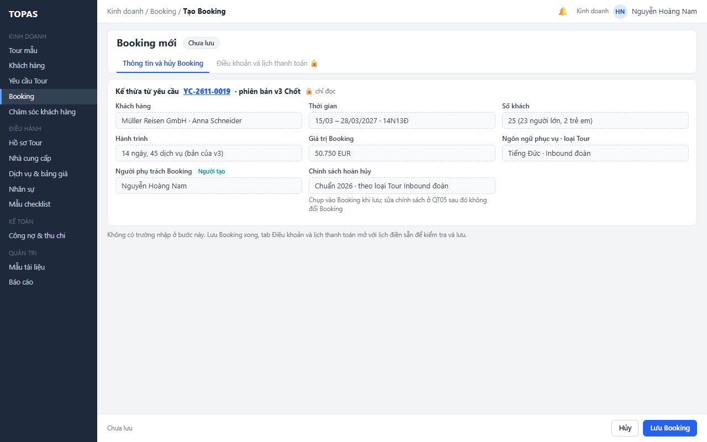

   > Hình chưa cập nhật: trường kế thừa còn vẽ dạng ô viền nét đứt; nay hiện dạng chữ (U5).

2. **W01 → W02 · Nút Lưu Booking ở chân trang.** Người dùng bấm Lưu Booking. Máy chủ kiểm tra lại điều kiện trong cùng giao dịch (RSD KD06 R19), cấp mã BK-2611-0158 (R02), ghi Booking Hiệu lực theo v3, chụp chính sách hoàn hủy vào Booking (R03), yêu cầu chuyển Đã có Booking; cũng trong giao dịch đó hệ thống tạo hồ sơ Tour TP-2703-0001 (RSD DH07 R01), không chờ thanh toán, và tạo thông báo cho Điều hành (Q5); phần đầu hiện Tour Code (R08). Giao dịch lỗi thì không ghi gì, người dùng bấm Lưu Booking lại. KD08 chuyển thẳng sang tab Điều khoản và lịch thanh toán (L2.1) với banner xanh “Đã tạo Booking … · đã tạo hồ sơ Tour …”. Bấm Hủy thay vì Lưu: không tạo gì, quay về KD06.3.

*Kết quả:* Booking Hiệu lực và hồ sơ Tour tồn tại; Điều hành đã nhận thông báo. Nếu người dùng rời đi trước khi lưu lịch, Booking ở trạng thái Chưa có lịch thanh toán (RSD KD07).

**L1.2 Xem thông tin Booking.** *Điều kiện:* người có quyền xem.

1. **W05 · Tab Thông tin và hủy Booking.** Cột trái: hành trình theo phiên bản hiện hành (bản chụp, chỉ đọc; mặc định 4 ngày đầu, Xem đủ mở toàn bộ); dưới là Thay đổi chương trình (lịch sử các lần cập nhật theo phiên bản mới và trạng thái ở hồ sơ Tour). Cột phải: Nguồn Booking (yêu cầu và phiên bản, bấm mở KD06.3 với người có quyền xem KD06; người không có quyền thấy mã và số phiên bản dạng chữ, 1.4; loại Tour; ngôn ngữ phục vụ; cơ cấu khách; chính sách hoàn hủy đã chụp, chỉ đọc: tên và các bậc, R03); Hồ sơ Tour (Tour Code và trạng thái, Điều hành phụ trách, Mở danh sách khách đoàn → DH08.4). Booking chưa có phiên bản điều chỉnh nên Chuyển sang Điều hành khóa; di chuột hiện lý do (R09).

   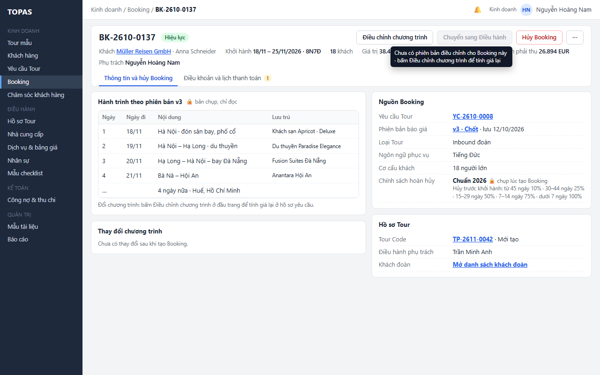

2. **W06 · (Bỏ theo Q5.)** Hồ sơ Tour tạo trong cùng giao dịch lưu Booking nên không còn dạng “Hồ sơ Tour chưa tạo được” (Tạo lỗi); tệp W06.png giữ lại, không nhúng.

*Kết quả:* người dùng biết Booking theo phiên bản nào và hồ sơ Tour đang ở đâu.

**L1.3 Hủy Booking.** *Điều kiện:* người có quyền Hủy Booking; Booking Hiệu lực; hồ sơ Tour Mới tạo hoặc Đang diễn ra (R10).

1. **W08 · Nút Hủy Booking ở phần đầu → hộp thoại.** Người dùng chọn Lý do hủy (danh mục QT05 “Lý do hủy Booking”), nhập ghi chú (bắt buộc khi Khác). Hộp thoại liệt kê tác động: Booking chỉ xem, không mở lại; yêu cầu YC-2610-0036 tự chuyển Đã hủy, khách đặt lại thì Mở lại yêu cầu ở KD06; hồ sơ Tour gắn chỉ báo Booking đã hủy, Điều hành gửi hủy từng dịch vụ; công nợ: số đã thu, Kế toán ghi điều chỉnh. Nút Hủy Booking (đỏ) khóa tới khi chọn lý do.

   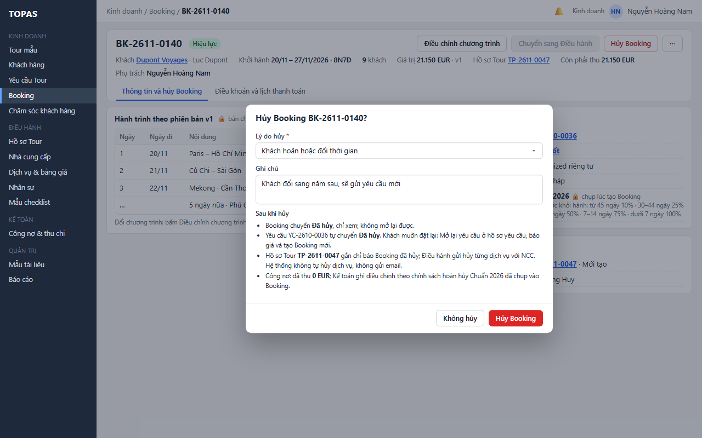

2. **W09 · Nút Hủy Booking trong hộp thoại.** Hệ thống ghi Đã hủy, lý do, người, thời điểm và các tác động ở R10 trong cùng một giao dịch; yêu cầu YC-2610-0036 tự chuyển Đã hủy. KD08 chỉ xem, banner vàng ghi lần hủy, yêu cầu đã chuyển Đã hủy và những ai đã được báo, nút Mở yêu cầu YC-2610-0036 (khách muốn đặt lại thì bấm Mở lại yêu cầu ở KD06, nhập lý do, rồi báo giá và tạo Booking mới; RSD KD06 R22). Tab lịch thanh toán chỉ xem; còn phải thu hiện Chờ điều chỉnh cho tới khi Kế toán ghi điều chỉnh.

   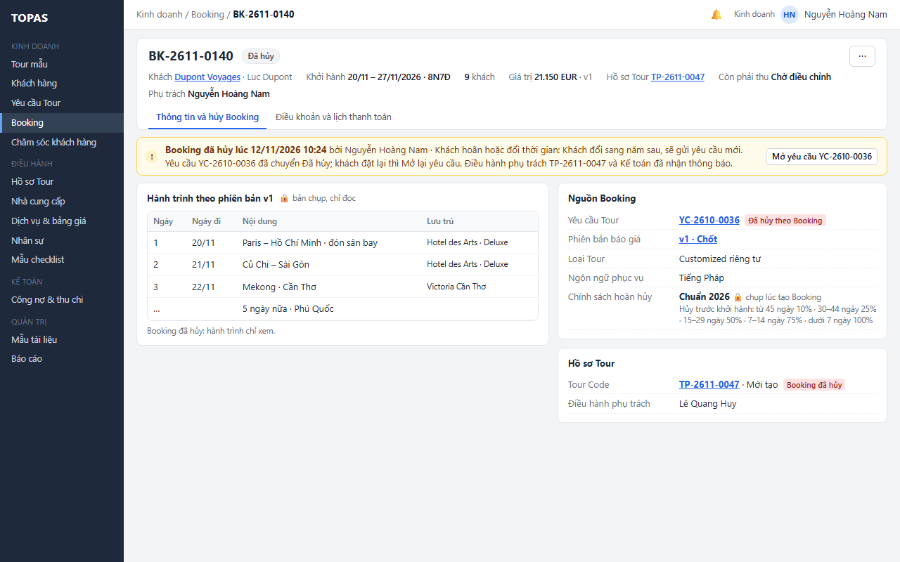

   > Hình chưa cập nhật: chip “Đã hủy theo Booking” của yêu cầu còn màu đỏ; Đã hủy dùng màu xám (K6).

*Kết quả:* Booking Đã hủy, yêu cầu Tour Đã hủy; hệ thống không gửi email và không tự hủy dịch vụ nào.

**L1.4 Chuyển người phụ trách Booking.** *Điều kiện:* người có quyền Chuyển phụ trách Booking (mặc định Kinh doanh và Quản trị hệ thống, 1.4); Booking Hiệu lực.

1. **W16 · ⋯ → Chuyển người phụ trách → hộp thoại.** Người dùng chọn người nhận (Kinh doanh đang hoạt động, khác người hiện tại; mỗi người kèm số Booking hiệu lực), nhập ghi chú tùy chọn, bấm Chuyển. Hộp thoại nêu yêu cầu Tour của Booking chuyển theo, Điều hành phụ trách hồ sơ Tour không đổi. Hệ thống đổi người phụ trách Booking và người phụ trách yêu cầu Tour trong một giao dịch, gửi thông báo cho người nhận (và người cũ khi người chuyển không phải người cũ), ghi lịch sử Booking và lịch sử yêu cầu (R11). Quyền của người cũ không đổi (theo vai trò); Booking và yêu cầu chỉ ra khỏi chip Của tôi của người cũ.

   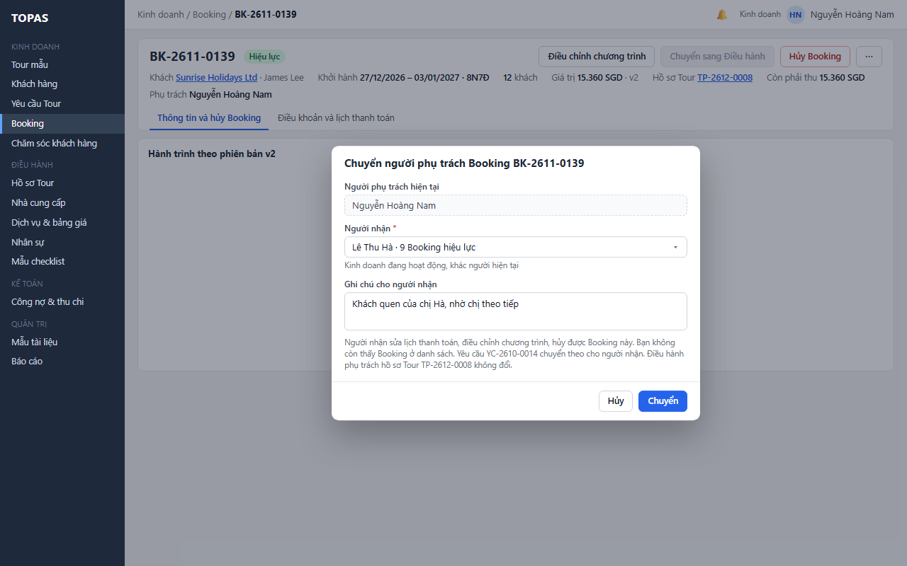

   > Hình chưa cập nhật: câu “Bạn không còn thấy Booking ở danh sách”; nay Booking chỉ ra khỏi chip Của tôi của người cũ (Q1).

*Kết quả:* người nhận thấy Booking ở chip Của tôi của KD07, yêu cầu ở KD05; Điều hành phụ trách hồ sơ Tour không đổi.

**L1.5 Điều chỉnh chương trình qua KD06.** *Điều kiện:* người có quyền Điều chỉnh chương trình; Booking Hiệu lực; hồ sơ Tour chưa Đã kết thúc hoặc Đã đóng (R09).

1. **W05 → W12 · Nút Điều chỉnh chương trình ở phần đầu.** KD06 của yêu cầu nguồn mở ở chế độ điều chỉnh cho Booking, tab Hành trình (RSD KD06 R27). Lần đầu vào chế độ điều chỉnh (Booking chưa có phiên bản điều chỉnh chưa chuyển, 2.3): hành trình nạp từ bản chụp của phiên bản hiện hành của Booking (không phải hành trình hiện tại của yêu cầu nếu khác). Đã có phiên bản điều chỉnh chưa chuyển: tiếp tục từ hành trình đang lưu (thường là của phiên bản điều chỉnh mới nhất), không hỏi. Banner nêu Booking và hồ sơ Tour chưa đổi cho tới khi bấm Chuyển sang Điều hành.

   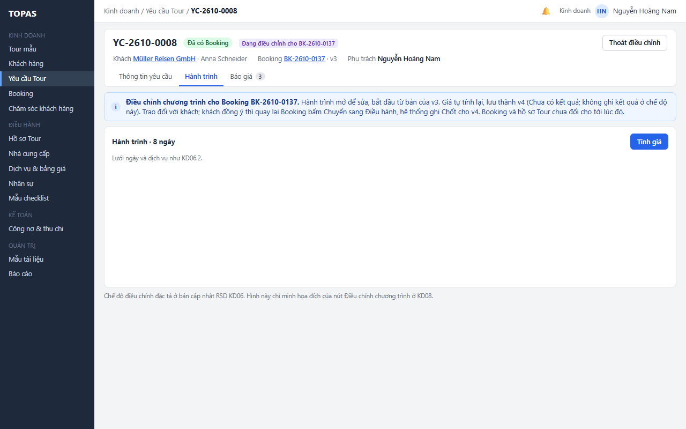

2. **W12 · Ở KD06.** Người dùng sửa hành trình, số khách; giá tự tính lại và lưu thành v4 (Chưa có kết quả, nhãn “Điều chỉnh cho BK-2610-0137”), publish proposal của v4 để gửi khách nếu cần (link riêng, có hạn, thu hồi được; RSD KD06 L6.5, R18, R27). Ở chế độ điều chỉnh không ghi kết quả, không tạo Booking: v3 (gắn Booking) vẫn Chốt, v4 là phiên bản điều chỉnh của Booking, KD08 gọi là “Phiên bản mới · chưa chuyển Điều hành” (R09). Kinh doanh tự trao đổi với khách về v4.
3. **W13 · Quay lại KD08.** KD08 hiện banner “Phiên bản mới v4 · chưa chuyển Điều hành” với thay đổi chính (số khách, giá trị, chênh lệch), lời nhắc “Kinh doanh trao đổi với khách trước, khách đồng ý rồi mới bấm” và nút Xem v4 (mở KD06.3; chỉ người có quyền xem KD06 thấy nút, 1.4). Chuyển sang Điều hành ở phần đầu bấm được. Khối Thay đổi chương trình có dòng v4 · Điều chỉnh cho BK-2610-0137 · chưa chuyển.

   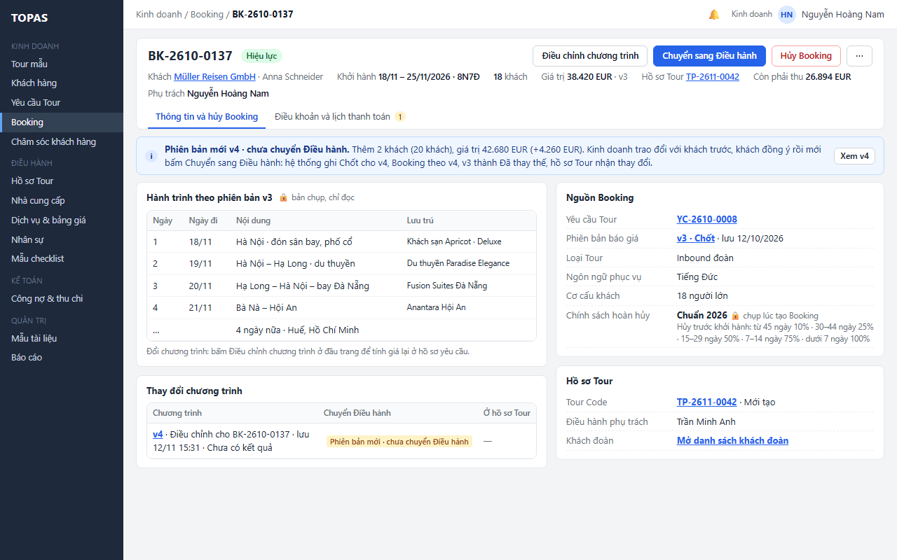

*Kết quả:* phiên bản mới v4 đã lưu, chờ khách đồng ý để chuyển sang Điều hành; Booking, hồ sơ Tour, công nợ chưa đổi.

**L1.6 Chuyển sang Điều hành.** *Điều kiện:* như L1.5; Booking có phiên bản điều chỉnh chưa chuyển (2.3); khách đã đồng ý với phiên bản điều chỉnh mới nhất.

1. **W13 → W15 · Nút Chuyển sang Điều hành ở phần đầu.** Kinh doanh trao đổi với khách trước, khách đồng ý rồi mới bấm. Người dùng bấm một lần, không có hộp thoại. Trong một giao dịch, hệ thống ghi Chốt cho phiên bản điều chỉnh mới nhất của Booking (v4) và chuyển v3 thành Đã thay thế (yêu cầu không lúc nào có hai phiên bản Chốt; RSD KD06 R17); cập nhật Booking lên v4: phiên bản áp dụng, hành trình áp dụng, số khách và cơ cấu, thời gian, giá trị; tạo phiên bản chương trình mới cho hồ sơ Tour TP-2611-0042 (RSD DH08 R19; Điều hành Trần Minh Anh nhận thông báo, hồ sơ hiện Chương trình có thay đổi) và ghi lịch sử (R09). Phần đầu đổi ngay: 20 khách, 42.680 EUR · v4; hành trình ở KD08.1 là bản của v4. Thông báo ngắn “Đã chuyển sang Điều hành · v4 Chốt · Booking theo v4”. Banner vàng nêu lịch thanh toán thiếu 4.260 EUR, nút Sửa lịch thanh toán mở KD08.2 ở chế độ sửa (L2.2). Khối Thay đổi chương trình ghi v4 · Chờ áp dụng; khi Điều hành áp dụng ở DH08, trạng thái đổi thành Đã áp dụng. Chuyển sang Điều hành khóa lại vì Booking chưa có phiên bản điều chỉnh nào lưu sau lần chuyển này.

   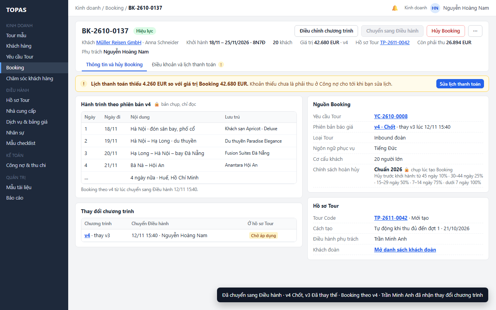

*Kết quả:* v4 Chốt, Booking theo v4, v3 Đã thay thế; hồ sơ Tour có thay đổi chờ Điều hành áp dụng; Kinh doanh còn việc sửa lịch thanh toán. Từ bấm Điều chỉnh chương trình tới khi Điều hành nhận thay đổi, ở KD08 chỉ có hai lần bấm.

**L1.7 Xem lịch sử thay đổi.** *Điều kiện:* người có quyền xem.

1. **W19 · ⋯ → Lịch sử thay đổi → bảng trượt.** Bảng trượt liệt kê sự kiện mới nhất trước, lọc theo loại: tạo Booking, lưu và sửa lịch thanh toán (kèm lý do lệch nếu có), chuyển sang Điều hành theo phiên bản điều chỉnh mới nhất (ghi Chốt, phiên bản bị thay), hồ sơ Tour đã áp dụng chương trình, thay đổi chương trình thành Không áp dụng kèm lý do (Booking đã hủy hoặc hồ sơ Tour Đã kết thúc; RSD DH08 R14, R19), tạo hồ sơ Tour khi lưu Booking, yêu cầu đổi lịch trình nhận từ Điều hành, chuyển người phụ trách, hủy.

   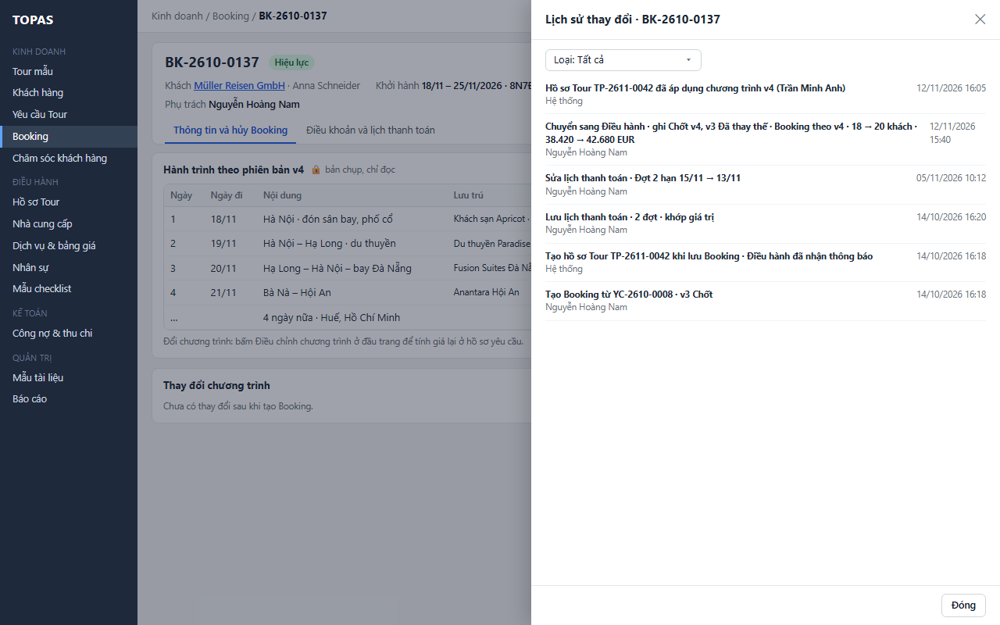

*Kết quả:* mọi thay đổi của Booking truy được người, thời điểm, nội dung.

**L1.8 Xử lý yêu cầu đổi lịch trình từ Điều hành.** *Điều kiện:* người có quyền Điều chỉnh chương trình (thông báo gửi người phụ trách Booking); Booking Hiệu lực; hồ sơ Tour có yêu cầu đổi lịch trình Chờ Kinh doanh (RSD DH08 R18).

1. **W21 · Thông báo “Điều hành yêu cầu đổi lịch trình” → KD08.1.** KD08 mở tab Thông tin và hủy Booking với banner vàng: hồ sơ Tour, hạng mục (ngày, dịch vụ, NCC), tình trạng (Cần đặt lại hoặc Xác nhận một phần), đề xuất của Điều hành, người gửi, hạn phản hồi; nhiều yêu cầu thì liệt kê từng dòng. Nút Xem ở hồ sơ Tour mở DH08.3 tại hạng mục đó, chỉ xem. Khối Thay đổi chương trình ghi số yêu cầu đang chờ (R13).

   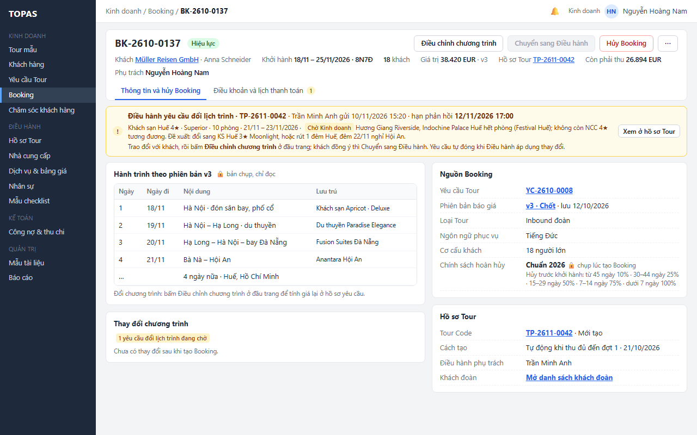

   > Hình chưa cập nhật: khối Hồ sơ Tour còn dòng “Cách tạo · Tự động khi thu đủ đến đợt 1” (đã bỏ từ v1.3).

2. **W21 → W12 · Nút Điều chỉnh chương trình ở phần đầu.** Kinh doanh trao đổi với khách hoặc đại lý về phương án của Điều hành, rồi điều chỉnh ở KD06 như L1.5 (đổi dịch vụ, ngày hoặc bỏ dịch vụ; giá tự tính lại thành phiên bản mới).
3. **W13 → W15 · Nút Chuyển sang Điều hành.** Khách đồng ý thì bấm như L1.6. Hồ sơ Tour nhận thay đổi chương trình; khi Điều hành áp dụng và thay đổi chạm tới hạng mục, yêu cầu đổi lịch trình tự chuyển Đã xử lý và banner W21 mất (RSD DH08 R19).

*Kết quả:* yêu cầu của Điều hành được xử lý bằng đúng một đường: Điều chỉnh chương trình rồi Chuyển sang Điều hành; giá bán Booking theo phiên bản mới.

**Ngoại lệ**

- **E1.1 Tạo Booking khi yêu cầu vừa có Booking Hiệu lực (W20).** Bấm Lưu Booking mà ở phiên khác vừa có Booking từ yêu cầu này: máy chủ từ chối, banner đỏ nêu Booking đã có và nút Mở BK-…; Lưu Booking khóa. Các điều kiện khác của RSD KD06 R19 không còn đúng (phiên bản không còn Chốt, yêu cầu Đã hủy, người dùng không còn quyền Tạo Booking) cũng bị từ chối với lý do tương ứng.

  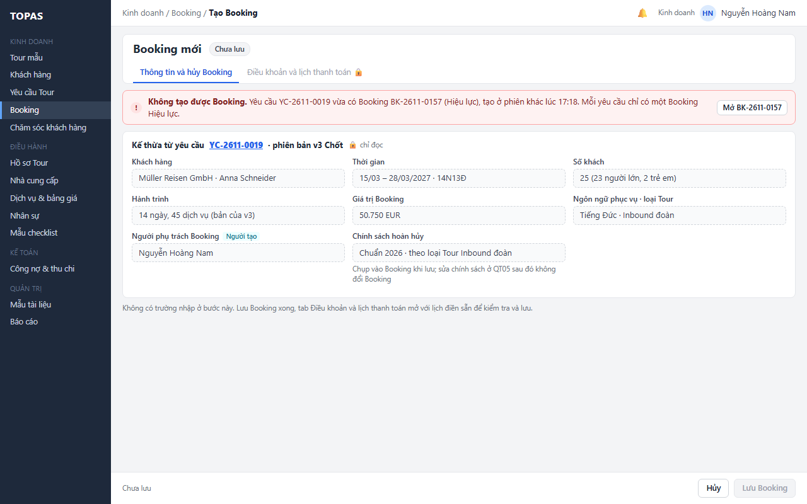

- **E1.2 Bấm Lưu Booking lặp hoặc mất kết nối.** Mã chống lặp: chỉ một Booking được tạo; nếu kết quả chưa rõ, KD08 kiểm tra theo mã thao tác và mở Booking đã tạo thay vì tạo lần hai.
- **E1.3 Booking Đã hủy.** Mọi tab chỉ xem; không có Điều chỉnh chương trình, Chuyển sang Điều hành, Hủy Booking, Chuyển người phụ trách (W09).
- **E1.4 Người dùng không có quyền xem.** Tài khoản mà vai trò không được cấp quyền xem KD08 mở bằng đường dẫn: trang không có quyền, không hiện dữ liệu Booking.
- **E1.5 Hủy khi Tour đang diễn ra (W10).** Hộp thoại có cảnh báo đỏ “đoàn đang ở Việt Nam”, ghi chú bắt buộc và ô xác nhận “đã thống nhất với Điều hành phụ trách”; hủy không dừng dịch vụ đã xác nhận, Điều hành xử lý và kết thúc Tour như bình thường (RSD DH08 R14).

  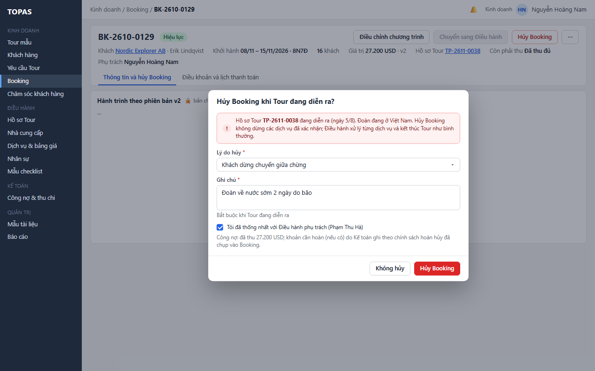

- **E1.6 Hồ sơ Tour Đã kết thúc hoặc Đã đóng (W11).** Hủy Booking, Điều chỉnh chương trình và Chuyển sang Điều hành khóa, ghi “Hồ sơ Tour đã kết thúc … · không hủy, không điều chỉnh chương trình”. Chênh lệch với khách sau Tour xử lý ở KT01 và quyết toán DH08.8. Phiên bản mới đã lưu mà chưa chuyển thì không chuyển được nữa, giữ Chưa có kết quả ở KD06. Thay đổi chương trình đã chuyển mà còn Chờ áp dụng khi hồ sơ sang Đã kết thúc thì DH08 chuyển Không áp dụng kèm lý do (RSD DH08 R19); khối Thay đổi chương trình và lịch sử Booking hiện trạng thái này. Yêu cầu đổi lịch trình còn Chờ Kinh doanh khi hồ sơ sang Đã kết thúc tự chuyển Đã rút với lý do “Hồ sơ đã kết thúc”; banner W21 bỏ dòng đó, lịch sử Booking ghi Đã rút (R13; RSD DH08 E3.21). Hồ sơ vừa chuyển Đã kết thúc trong lúc hộp thoại hủy đang mở hoặc lúc bấm Chuyển sang Điều hành: máy chủ từ chối, báo lý do.

  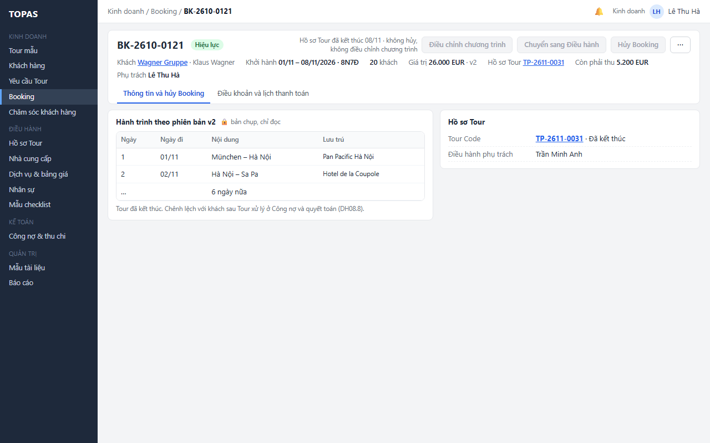

- **E1.7 Hủy khi có phiên bản mới chưa chuyển Điều hành.** Hộp thoại hủy ghi thêm “Phiên bản v4 chưa chuyển Điều hành sẽ không được dùng”. Sau khi hủy, yêu cầu Đã hủy như R10; v4 giữ Chưa có kết quả ở KD06. Khách muốn đặt lại thì Mở lại yêu cầu rồi báo giá, ghi kết quả ở KD06; bấm Tạo Booking ở KD06.3 mở KD08 để tạo Booking mới (L1.1).
- **E1.8 Thoát chế độ điều chỉnh ở KD06 khi chưa chuyển.** Booking không đổi; các phiên bản đã lưu giữ ở KD06, Chưa có kết quả; link proposal đã publish của chúng giữ nguyên (RSD KD06 R18). Chuyển sang Điều hành bấm được ngay vì Booking có phiên bản điều chỉnh chưa chuyển (banner W13). Bấm Điều chỉnh chương trình lần sau tiếp tục từ hành trình đang lưu (thường là của phiên bản điều chỉnh mới nhất), không hỏi (RSD KD06 R27, E6.12). Hành trình chỉ nạp lại từ bản chụp phiên bản của Booking ở lần vào đầu tiên, khi Booking chưa có phiên bản điều chỉnh chưa chuyển.
- **E1.9 Nhiều phiên bản điều chỉnh trước khi chuyển.** Ví dụ người dùng lưu v4 rồi v5 ở chế độ điều chỉnh: phiên bản được chuyển luôn là phiên bản điều chỉnh mới nhất của Booking, v5; banner W13 nêu v5 và chênh lệch so với phiên bản của Booking. Bấm Chuyển sang Điều hành: v5 Chốt, v3 Đã thay thế, v4 giữ Chưa có kết quả. Hệ thống không cho chọn v4. Khách chọn phương án v4 thì vào lại Điều chỉnh chương trình (hành trình đang lưu là của v5), sửa hành trình về phương án v4 (Kinh doanh xem v4 ở KD06.3), lưu thành phiên bản điều chỉnh mới nhất (v6) rồi chuyển.
- **E1.10 Hồ sơ Tour còn thay đổi chương trình chưa áp dụng.** Chuyển sang Điều hành lần nữa thay phiên bản chương trình đang chờ ở DH08; lần gửi cũ thành Đã thay thế ở DH08 (RSD DH08 E1.6); banner sau khi chuyển ghi “đã thay thay đổi v4 đang chờ Điều hành áp dụng”.
- **E1.11 Chuyển thất bại hoặc bấm lặp.** Giao dịch không ghi gì (không ghi Chốt; Booking, phiên bản, hồ sơ Tour giữ nguyên); banner đỏ báo lỗi, nút bấm lại được; nút khóa khi đang chuyển; mã chống lặp nên bấm lặp chỉ chuyển một lần. Lần bấm mang số phiên bản đang hiện trên banner; ở phiên khác vừa lưu phiên bản điều chỉnh mới hơn của Booking (ví dụ v5) thì máy chủ từ chối, KD08 tải lại với banner W13 của v5 để Kinh doanh kiểm tra lại với khách.
- **E1.12 Người nhận chuyển phụ trách không hợp lệ.** Tài khoản vừa ngừng hoạt động: từ chối, lỗi cạnh ô “chọn người khác”. Booking Đã hủy không chuyển được.
- **E1.13 Yêu cầu đổi lịch trình quá hạn hoặc đã rút.** Quá hạn phản hồi: dòng yêu cầu trên banner W21 đỏ, ghi “quá hạn phản hồi …”. Điều hành rút yêu cầu (RSD DH08 E3.14): banner bỏ dòng đó, lịch sử Booking ghi Đã rút. Khách không đồng ý đổi: Kinh doanh trao đổi trực tiếp với Điều hành phụ trách để Điều hành rút yêu cầu hoặc tìm phương án khác; KD08 không có nút phản hồi. Booking bị hủy khi còn yêu cầu Chờ Kinh doanh: yêu cầu tự chuyển Đã rút với lý do “Booking đã hủy” (RSD DH08 E3.15), lịch sử Booking ghi Đã rút.
- **E1.14 Booking tạo từ phiên bản Chốt cũ hơn.** Ví dụ yêu cầu có v2, v3; khách chọn lại v2, Booking tạo từ v2 (RSD KD06 E6.7, R19). v3 không phải phiên bản điều chỉnh của Booking nên Chuyển sang Điều hành khóa, lý do “Chưa có phiên bản điều chỉnh cho Booking này”; hệ thống không bao giờ ghi Chốt cho v3 từ KD08. Điều chỉnh chương trình lần đầu nạp hành trình từ bản chụp của v2; phiên bản lưu sau đó (v4, nhãn “Điều chỉnh cho BK-…”) mới chuyển được.

### 3.2. Tab KD08.2 · Điều khoản và lịch thanh toán (TN04.02 · TN04.04)

**L2.1 Nhập lịch thanh toán lần đầu.** *Điều kiện:* người có quyền sửa lịch thanh toán; Booking Hiệu lực chưa có đợt nào (ngay sau L1.1, hoặc mở lại Booking Chưa có lịch thanh toán).

1. **W02 · Tab Điều khoản và lịch thanh toán (chế độ sửa).** Hồ sơ Tour đã tạo khi lưu Booking (L1.1), nên tab không có ô nào về hồ sơ Tour. Điều khoản thanh toán và các đợt điền sẵn từ mẫu mặc định (R05): Đợt 1 30% hạn ngày tạo + 14 ngày, Đợt 2 70% hạn khởi hành − 30 ngày, nhãn Mẫu mặc định. Người dùng sửa điều khoản, thêm, bớt đợt, sửa hạn, % hoặc số tiền (nhập một bên, bên kia tự tính). Dòng Tổng so với giá trị Booking: Khớp giá trị, Thiếu x hoặc Thừa x, cập nhật ngay khi nhập.

   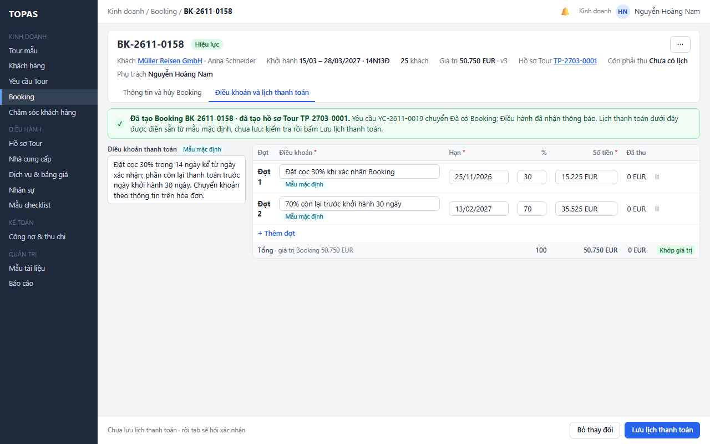

2. **W02 → W04 · Nút Lưu lịch thanh toán.** Tổng khớp: hệ thống lưu, ghi lịch sử, ghi nghĩa vụ phải thu ở KT01 và tạo thông báo cho Kế toán trong cùng giao dịch (Q2, Q5). Bảng về chế độ xem: mỗi đợt có số đã thu, còn phải thu, tình trạng (từ KT01, chỉ để tham khảo). Thông báo ngắn “Đã lưu lịch thanh toán”.

   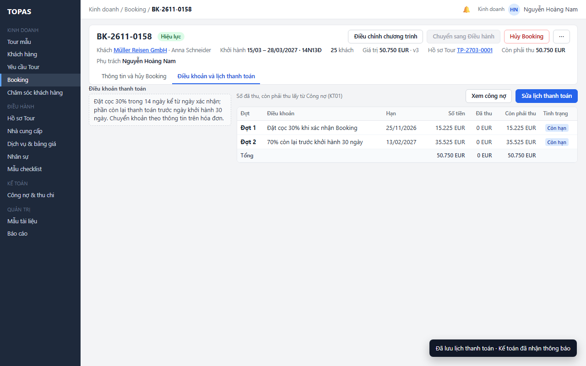

*Kết quả:* Booking có lịch thanh toán; Kế toán thu theo các đợt.

**L2.2 Lưu lịch khi tổng khác giá trị Booking.** *Điều kiện:* như L2.1 hoặc L2.3.

1. **W03 · Nút Lưu lịch thanh toán khi dòng Tổng ghi Thiếu hoặc Thừa → hộp thoại.** Hộp thoại nêu tổng các đợt, giá trị Booking và số chênh; khoản chênh không được tính là phải thu ở KT01. Người dùng nhập Lý do (bắt buộc) rồi bấm Lưu kèm lý do, hoặc Quay lại sửa (R06).

   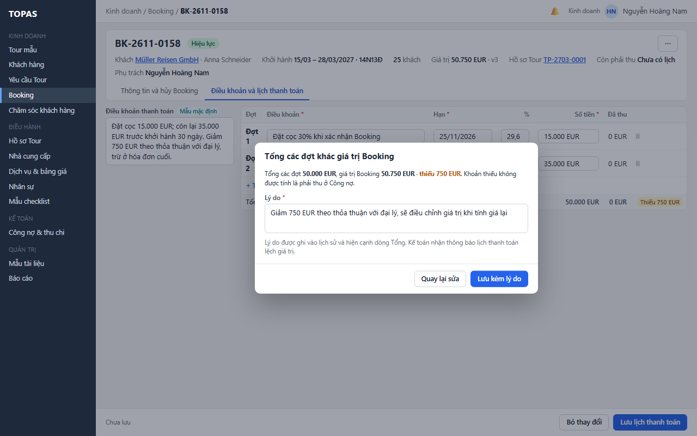

2. **W04 · Sau khi lưu kèm lý do.** Dòng Tổng giữ nhãn Thiếu x hoặc Thừa x kèm lý do khi di chuột; tab có dấu “!”; Kế toán nhận thông báo “lịch thanh toán lệch giá trị”.

*Kết quả:* lịch được lưu theo thỏa thuận thực tế với khách, phần lệch có lý do để Kế toán đối chiếu.

**L2.3 Sửa lịch khi đã có khoản thu.** *Điều kiện:* người có quyền sửa lịch thanh toán; Booking Hiệu lực; hồ sơ Tour chưa Đã đóng.

1. **W04 → W07 · Nút Sửa lịch thanh toán.** Bảng chuyển sang chế độ sửa. Banner xanh nêu quy tắc: đợt đã có khoản thu có 🔒 không xóa, số tiền không nhỏ hơn số đã thu; đợt chưa thu sửa, thêm, xóa tự do; số đợt giữ nguyên, xóa đợt không đánh số lại, đợt thêm mới lấy số tiếp theo (R07). Nhập số tiền nhỏ hơn số đã thu: lỗi ngay dưới ô “Không nhỏ hơn số đã thu 11.526 EUR”, Lưu lịch thanh toán khóa tới khi sửa. Chân trang tóm tắt thay đổi (ví dụ “đợt 2 dời hạn 13/11 → 15/11”).

   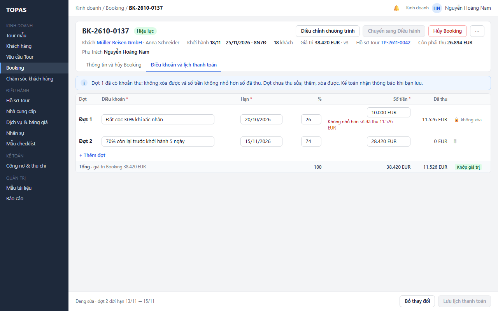

2. **W04 · Nút Lưu lịch thanh toán.** Tổng khớp thì lưu ngay; lệch thì qua hộp thoại W03. Hệ thống ghi lịch sử (giá trị cũ và mới từng đợt), cập nhật nghĩa vụ ở KT01 và tạo thông báo cho Kế toán trong cùng giao dịch.

*Kết quả:* lịch mới có hiệu lực; khoản đã thu không bị mất.

**L2.4 Kế toán xem lịch thanh toán.** *Điều kiện:* Kế toán (Điều hành, Quản trị tương tự).

1. **W17 · Mở từ KD07 hoặc KT01.1.** KD08.2 chỉ xem, đợt chưa thu sớm nhất (hoặc đợt được bấm ở Lịch KD07) được tô; đợt quá hạn đỏ, tab có số đỏ. Kế toán bấm Xem công nợ để mở KT01.1 lọc theo Booking và ghi khoản thu ở đó.

   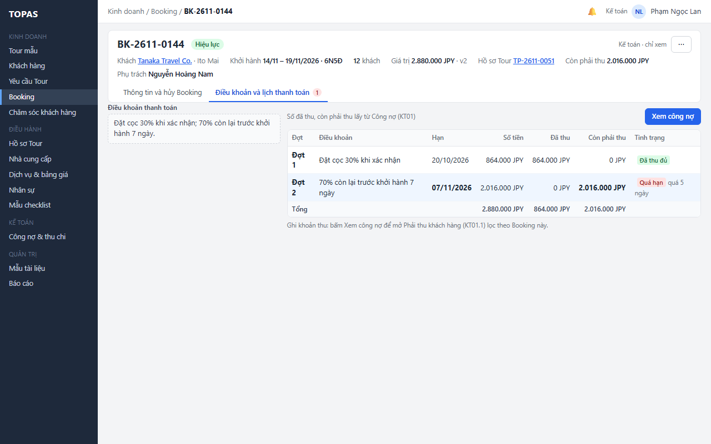

   > Hình chưa cập nhật: nhãn “Kế toán · chỉ xem” ở phần đầu và ô điều khoản viền nét đứt; nay ẩn nút ghi, trường chỉ đọc hiện dạng chữ (U5).

*Kết quả:* Kế toán thấy điều khoản và đợt cần thu, đi thẳng tới nơi ghi thu.

**Ngoại lệ**

- **E2.1 Dữ liệu đợt không hợp lệ.** Thiếu điều khoản, hạn hoặc số tiền; số tiền ≤ 0; hai đợt trùng hạn và trùng điều khoản: lỗi dưới ô, Lưu khóa. Hạn trước ngày tạo Booking: lỗi. Hạn sau ngày kết thúc Tour: chỉ cảnh báo dưới ô (đại lý trả sau Tour).
- **E2.3 Xóa hết đợt.** Không cho lưu lịch rỗng khi đã từng có đợt; muốn bỏ lịch thì hủy Booking.
- **E2.4 Rời trang khi đang sửa.** Hộp thoại “Bỏ các thay đổi chưa lưu?”; chọn Ở lại giữ nguyên dữ liệu.
- **E2.5 Kế toán ghi khoản thu trong lúc Kinh doanh đang sửa.** Khi lưu, máy chủ kiểm tra lại số đã thu: đợt vừa có thu mà bị giảm dưới số đã thu hoặc bị xóa thì từ chối, đánh dấu ô lỗi với số đã thu mới; dữ liệu đang nhập giữ nguyên.
- **E2.6 Không lấy được số liệu công nợ (W18).** Đã thu, Còn phải thu ghi “Chưa có dữ liệu”, tình trạng đợt để trống, phần đầu ghi “Chưa có dữ liệu công nợ” (không coi là 0, `BOI-CANH-DU-AN.md`). Banner có Thử lại. Sửa lịch thanh toán vẫn bấm được; chỉ khóa những thay đổi có thể chạm khoản đã thu (R07):
  - Booking mà lần tải trước đã biết chưa có khoản thu nào: sửa lịch như bình thường. Khi lưu, máy chủ kiểm tra lại R07 với số đã thu thực; đợt vừa có thu mà bị giảm dưới số đã thu hoặc bị xóa thì từ chối như E2.5.
  - Booking mà lần tải trước đã biết có khoản thu, hoặc chưa tải được lần nào: đợt chưa biết số đã thu thì không giảm số tiền và không xóa (ô số tiền ghi “Không giảm khi chưa có số liệu công nợ”, không có nút xóa). Vẫn được thêm đợt, sửa hạn, sửa điều khoản, tăng số tiền.

  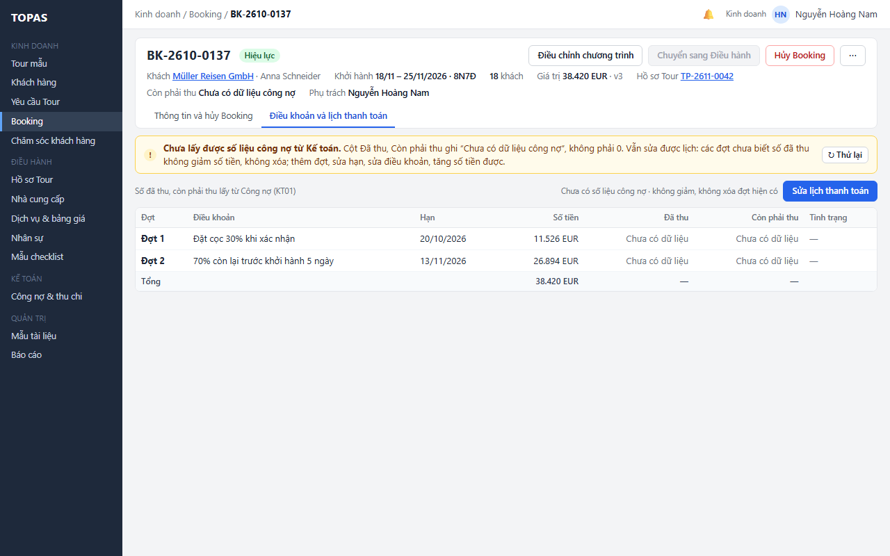

- **E2.7 Lưu lỗi hoặc mất kết nối.** Giữ dữ liệu đang nhập, banner lỗi, bấm lại được; mã chống lặp tránh lưu hai lần.
- **E2.8 Booking Đã hủy hoặc hồ sơ Tour Đã đóng.** Lịch chỉ xem, không có Sửa lịch thanh toán. Booking Đã hủy: còn phải thu hiện Chờ điều chỉnh hoặc kết quả điều chỉnh từ KT01 (SYS04.10).
- **E2.9 Sau khi chuyển sang Điều hành.** Tổng các đợt so với giá trị mới; lệch thì banner W15 tới khi sửa hoặc lưu kèm lý do (L2.2).

---

## 4. Quy tắc triển khai chi tiết

### R01. Phạm vi và quyền

- Quyền theo màn và thao tác, gán cho vai trò ở QT02; giá trị mặc định ở 1.4. Không có phạm vi bản ghi: ai có quyền một thao tác thì làm được trên mọi Booking (Q1).
- Mặc định Kinh doanh xem và thao tác mọi Booking; Kế toán, Điều hành xem mọi Booking, không có thao tác ghi; Quản trị hệ thống xem mọi Booking và chuyển được người phụ trách (R11).
- **Liên kết sang KD06** (mã yêu cầu, số phiên bản ở khối Nguồn Booking và khối Thay đổi chương trình, nút Xem vN trên banner W13) chỉ hiện với người có quyền xem KD06 (mặc định Kinh doanh và Quản trị hệ thống; KD06 mở chỉ đọc với Quản trị). Người không có quyền xem KD06 (mặc định Điều hành, Kế toán; RSD KD06 R01, E2.6) thấy mã yêu cầu và số phiên bản dạng chữ, không có liên kết, không có nút Xem vN.
- Tạo Booking: người có quyền Tạo Booking (RSD KD06 R19); người tạo thành người phụ trách Booking. Từ đó người phụ trách yêu cầu luôn là người phụ trách Booking (R11).

### R02. Mã Booking

- Dạng `BK-YYMM-NNNN`: YYMM là năm, tháng tạo theo giờ Asia/Ho_Chi_Minh; NNNN tăng trong tháng từ 0001, đủ 4 chữ số (quá 9999 thì thêm chữ số). Cấp trong giao dịch lưu; giao dịch lỗi thì số đó bỏ, cho phép thủng số (Q7). Không sửa, không dùng lại; không đổi khi cập nhật theo phiên bản mới.

### R03. Kế thừa khi tạo Booking

- Từ phiên bản Chốt: khách, người liên hệ, ngôn ngữ phục vụ, loại Tour, thời gian, số khách và cơ cấu, hành trình (bản chụp của phiên bản), giá trị và loại tiền. Chỉ đọc ở KD08.
- Booking chỉ có khi bấm Lưu Booking; máy chủ kiểm tra lại các điều kiện của RSD KD06 R19 trong cùng giao dịch; mỗi yêu cầu tối đa một Booking Hiệu lực.
- **Chụp chính sách hoàn hủy** (quyết định 12/11/2026) trong cùng giao dịch lưu: chính sách Đang dùng theo loại Tour của Booking ở QT05 (nhóm Chính sách hoàn hủy Booking); loại Tour không có chính sách riêng thì chính sách mặc định. Lưu tên, phiên bản chính sách, thời điểm chụp và các bậc (hủy trước ngày khởi hành từ N ngày → giữ lại X%).
- Bản chụp không đổi: sửa hoặc ngừng chính sách ở QT05 không đổi Booking đã tạo; Chuyển sang Điều hành không chụp lại. KD08 không có thao tác sửa. KD08.1 hiện chỉ đọc ở khối Nguồn Booking (tên, các bậc). KT01 đọc khi điều chỉnh sau hủy (RSD KT01 R07).
- QT05 luôn có Chính sách mặc định (giá trị hệ thống, không xóa, không ngừng dùng; RSD QT05 R06, R20) nên mọi Booking đều có bản chụp chính sách hoàn hủy; không có trường hợp lưu Booking mà không chụp được chính sách.

### R04. Trạng thái Booking

- Hai trạng thái: **Hiệu lực**, **Đã hủy**. Không có trạng thái thanh toán hay giai đoạn khác. Đã hủy không mở lại. Khách đặt lại thì Mở lại yêu cầu ở KD06, báo giá và tạo Booking mới (RSD KD06 R22).

### R05. Lịch thanh toán mặc định

- Lịch thanh toán không liên quan tới việc tạo hồ sơ Tour: hồ sơ đã tạo khi lưu Booking (R08; RSD DH07 R01). Lưu hoặc sửa lịch chỉ ghi nghĩa vụ ở KT01 và tạo thông báo cho Kế toán, trong cùng giao dịch.
- **Mẫu lịch mặc định** (tệp cấu hình hoặc dữ liệu khởi tạo, C2): Đợt 1 30% hạn ngày tạo + 14 ngày; Đợt 2 70% hạn ngày khởi hành − 30 ngày. Hạn tính ra trước ngày tạo thì lấy ngày tạo; khởi hành trong 14 ngày tới thì chỉ một đợt 100% hạn ngày tạo + 3 ngày (không muộn hơn ngày khởi hành). Điều khoản thanh toán điền sẵn từ mẫu. Mẫu chỉ điền sẵn; chưa lưu thì chưa có nghĩa vụ ở KT01.
- Số tiền theo % làm tròn half-up theo đơn vị nhỏ nhất của loại tiền, không áp bội số làm tròn giá bán (Q9); đợt cuối nhận phần dư để tổng khớp giá trị.

### R06. Tổng các đợt so với giá trị Booking (quyết định 12/11/2026)

- Tổng = Σ số tiền các đợt. So với giá trị Booking hiện hành: Khớp; Thiếu x; Thừa x.
- Lệch: không chặn. Lưu mở hộp thoại bắt buộc lý do; lý do ghi lịch sử, hiện cạnh dòng Tổng; Kế toán nhận thông báo in-app.
- KT01 ghi nghĩa vụ phải thu theo các đợt, không theo giá trị Booking; khoản chênh không thành phải thu.
- Tab KD08.2 có dấu “!” và (sau khi cập nhật theo phiên bản mới) banner lệch trên mọi tab cho tới khi tổng khớp hoặc lệch đã được lưu kèm lý do với giá trị hiện hành.

### R07. Sửa lịch sau khi có khoản thu (quyết định 12/11/2026)

- Đợt có số đã thu > 0 (theo KT01): không xóa; số tiền không nhỏ hơn số đã thu; được sửa điều khoản, hạn, tăng số tiền.
- Đợt chưa thu: sửa, thêm, xóa tự do.
- **Số đợt cố định.** Số đợt cấp khi đợt được tạo và không đổi. Xóa đợt chưa thu không đánh số lại các đợt sau (ví dụ xóa Đợt 2 thì còn Đợt 1, Đợt 3); đợt thêm mới lấy số tiếp theo sau số lớn nhất đã từng cấp của Booking, kể cả số của đợt đã xóa. Lý do: KT01 giữ nghĩa vụ và phân bổ khoản thu theo mã Booking + số đợt (RSD KT01 R05). Bảng hiện đợt theo hạn tăng dần.
- Máy chủ kiểm tra lại với số đã thu tại thời điểm lưu (E2.5). Không có số liệu KT01 thì chỉ khóa giảm số tiền và xóa các đợt có thể đã có thu; Booking lần tải trước đã biết chưa có thu thì sửa như bình thường (E2.6).
- Mỗi lần lưu: lịch sử ghi giá trị cũ và mới từng đợt; thông báo in-app cho Kế toán (chỉ là thông báo, Q2); cập nhật nghĩa vụ ở KT01 trong cùng giao dịch (Q5).
- Không sửa khi Booking Đã hủy hoặc hồ sơ Tour Đã đóng.

### R08. Khối Hồ sơ Tour

- **Hồ sơ Tour tự tạo khi lưu Booking** (quyết định 12/11/2026): bấm Lưu Booking thì hệ thống tạo hồ sơ Tour (RSD DH07 R01) và thông báo Điều hành trong cùng giao dịch với Booking: thành công cả hoặc không gì cả (Q5). Không chờ thanh toán, không phụ thuộc lịch thanh toán hay số liệu KT01.
- Khối Hồ sơ Tour chỉ có một dạng: Tour Code, trạng thái, Điều hành phụ trách, liên kết khách đoàn. Không có trạng thái Tạo lỗi, không có nút Thử lại (Q5).

### R09. Điều chỉnh chương trình và Chuyển sang Điều hành (quyết định 12/11/2026)

- **Điều kiện:** người có quyền Điều chỉnh chương trình; Booking Hiệu lực; hồ sơ Tour Mới tạo hoặc Đang diễn ra.
- **Điều chỉnh chương trình** mở KD06 ở chế độ điều chỉnh cho Booking: KD06.1–KD06.3 mở thao tác cho người bấm Điều chỉnh chương trình; mọi phiên bản tạo trong chế độ này gắn nhãn “Điều chỉnh cho BK-…” của Booking. Yêu cầu giữ trạng thái Đã có Booking.
- **Hành trình khi vào chế độ điều chỉnh** (theo RSD KD06 R27): Booking chưa có phiên bản điều chỉnh chưa chuyển (lần đầu vào, hoặc lần đầu sau một lần Chuyển sang Điều hành) thì hành trình hiện hành được nạp từ bản chụp phiên bản hiện hành của Booking; đã có thì tiếp tục từ hành trình đang lưu (thường là của phiên bản điều chỉnh mới nhất), không hỏi.
- **Ở chế độ điều chỉnh:** sửa hành trình thì giá tự tính lại, lưu thành phiên bản mới, kết quả Chưa có kết quả. Không ghi kết quả (Chốt, Cần điều chỉnh, Không chốt), không tạo Booking ở chế độ này. Phiên bản của Booking giữ Chốt.
- **Phiên bản điều chỉnh của Booking** là phiên bản thỏa cả ba: lưu ở chế độ điều chỉnh mở từ chính Booking này (nhãn “Điều chỉnh cho BK-…” với mã của Booking); lưu sau lần tạo Booking hoặc lần Chuyển sang Điều hành gần nhất của Booking; Chưa có kết quả. KD08 gọi các phiên bản này là “Phiên bản mới · chưa chuyển Điều hành”. Phiên bản khác của yêu cầu không bao giờ là phiên bản điều chỉnh của Booking, kể cả khi số lớn hơn phiên bản của Booking (Booking tạo từ phiên bản Chốt cũ hơn, RSD KD06 E6.7, R19; E1.14).
- **Trao đổi với khách:** Kinh doanh tự trao đổi với khách; nếu cần thì publish proposal của phiên bản điều chỉnh ngay ở chế độ điều chỉnh (link riêng, có hạn, thu hồi được; RSD KD06 R18, R27; người dùng chốt 12/11/2026, rà soát lần hai). Kinh doanh trao đổi với khách trước, khách đồng ý rồi mới bấm Chuyển sang Điều hành; bấm nghĩa là khách đã chốt.
- **Phiên bản được chuyển** luôn là phiên bản điều chỉnh mới nhất (số lớn nhất) của chính Booking. Nút Chuyển sang Điều hành luôn ở phần đầu khi Booking Hiệu lực và người dùng có quyền. Bấm được khi Booking có phiên bản điều chỉnh và phiên bản đó cùng loại tiền với Booking. Khóa kèm lý do khi: Booking không có phiên bản điều chỉnh (“Chưa có phiên bản điều chỉnh cho Booking này”); hồ sơ Tour Đã kết thúc hoặc Đã đóng (W11). Điều kiện cùng loại tiền là kiểm tra phòng vệ ở máy chủ: KD06 R27 đã khóa loại tiền báo giá theo loại tiền của Booking ở chế độ điều chỉnh nên trên giao diện không tạo được phiên bản điều chỉnh khác loại tiền; nếu dữ liệu vẫn khác loại tiền (ví dụ gọi thẳng API) thì máy chủ từ chối với lý do “đổi loại tiền: hủy Booking và tạo Booking mới”. Không có hộp thoại xác nhận.
- **Chuyển sang Điều hành** (một giao dịch gồm cả tác động sang KD06, DH08 và thông báo, Q5; kiểm tra lại điều kiện trên máy chủ, lần bấm mang số phiên bản đang hiện):
  - Ghi **Chốt** cho phiên bản điều chỉnh mới nhất của Booking (người ghi là người bấm, ghi chú “Chuyển sang Điều hành từ BK-…”) và chuyển phiên bản cũ của Booking thành **Đã thay thế** (không còn là Chốt) trong cùng giao dịch, nên yêu cầu không bao giờ có hai phiên bản cùng Chốt (RSD KD06 R17). Các phiên bản khác (phiên bản điều chỉnh cũ hơn, phiên bản ngoài chế độ điều chỉnh) giữ kết quả đang có. Máy chủ từ chối nếu số phiên bản mang theo lần bấm không còn là phiên bản điều chỉnh mới nhất của Booking (E1.11).
  - Booking nhận hành trình, thời gian, số khách và cơ cấu, giá trị của phiên bản mới ngay khi chuyển; giữ mã Booking. Hồ sơ Tour (DH08) giữ thời gian và số khách của phiên bản chương trình đang áp dụng cho đến khi Điều hành bấm Áp dụng ở DH08; trong thời gian chờ, KD08 và DH08 có thể hiện thời gian, số khách khác nhau (người dùng chốt 12/11/2026, rà soát lần ba; RSD DH08 L1.5, R19).
  - Tạo phiên bản chương trình mới cho hồ sơ Tour (RSD DH08 R19), thay phiên bản đang chờ áp dụng; Điều hành phụ trách nhận thông báo.
  - Lịch sử Booking ghi phiên bản cũ và mới, giá trị cũ và mới; lịch sử yêu cầu ghi kết quả Chốt.
- **Không tự đổi lịch thanh toán.** Sau khi chuyển, R06 áp dụng với giá trị mới.
- Trạng thái Chờ áp dụng, Đã áp dụng, Đã thay thế, Không áp dụng (kèm lý do) ở khối Thay đổi chương trình đọc từ DH08 (RSD DH08 R14, R19). Lịch sử Booking ghi lần thay đổi chương trình chuyển Không áp dụng.

### R10. Hủy Booking (TN04.03; quyết định 12/11/2026)

- **Điều kiện:** người có quyền Hủy Booking; Booking Hiệu lực; hồ sơ Tour Mới tạo hoặc Đang diễn ra. Chặn khi hồ sơ Đã kết thúc hoặc Đã đóng. Số đã thu ở KT01 không là điều kiện hủy.
- **Lý do** từ danh mục QT05 “Lý do hủy Booking” (ví dụ: Khách hủy chuyến, Khách hoãn hoặc đổi thời gian, Khách không thanh toán, Khách dừng chuyến giữa chừng, Khác); ghi chú bắt buộc khi Khác hoặc khi Tour đang diễn ra. Tour đang diễn ra cần đánh dấu xác nhận đã thống nhất với Điều hành.
- **Tác động** (ghi tất cả trong cùng một giao dịch, Q5):
  - Booking Đã hủy, chỉ xem; ghi lý do, người, thời điểm.
  - Yêu cầu Tour tự chuyển **Đã hủy**, lý do hệ thống “Booking đã hủy”, ghi chú là mã Booking và lý do hủy Booking; phiên bản của Booking giữ Chốt, ghi Booking đã hủy (RSD KD06 R02, R20, R21). Khách muốn đặt lại: người có quyền Mở lại yêu cầu (có thể chọn người phụ trách mới) Mở lại yêu cầu kèm lý do ở KD06, yêu cầu về Đang xử lý, rồi báo giá và tạo Booking mới (RSD KD06 R22).
  - Có phiên bản điều chỉnh chưa chuyển Điều hành: phiên bản đó giữ Chưa có kết quả, không được dùng (E1.7); link proposal của nó bị thu hồi cùng các link Đang mở khác của yêu cầu khi yêu cầu tự Đã hủy (RSD KD06 R20, R21).
  - Hồ sơ Tour: RSD DH08 R14 (chỉ báo, khóa đặt mới, email hủy NCC soạn sẵn, thông báo Điều hành).
  - Thay đổi chương trình đã chuyển mà còn Chờ áp dụng ở hồ sơ Tour: DH08 chuyển **Không áp dụng** kèm lý do (Booking đã hủy) và chặn Áp dụng (RSD DH08 R14, R19); khối Thay đổi chương trình ở KD08.1 và lịch sử Booking hiện trạng thái này.
  - Yêu cầu đổi lịch trình đang Chờ Kinh doanh tự chuyển Đã rút với lý do “Booking đã hủy” (RSD DH08 E3.15); banner W21 mất, lịch sử Booking ghi Đã rút (R13).
  - KT01: Booking vào bộ lọc chờ điều chỉnh ở KT01.1; Kế toán ghi điều chỉnh nghĩa vụ và khoản cần hoàn theo chính sách hoàn hủy đã chụp (R03; RSD KT01 R07; SYS04.10). Kế toán nhận thông báo.
- Hệ thống không gửi email cho khách, không tự hủy dịch vụ.

### R11. Người phụ trách Booking (quyết định 12/11/2026)

- Khi tạo, người phụ trách Booking là người đang phụ trách yêu cầu Tour nguồn, bất kể ai bấm Tạo Booking; không có chuyển phụ trách ngầm (người dùng chốt 12/11/2026).
- Người có quyền Chuyển phụ trách Booking (mặc định Kinh doanh và Quản trị hệ thống, QT02) chuyển được từng Booking Hiệu lực; người nhận là Kinh doanh đang hoạt động, khác người hiện tại.
- **Yêu cầu Tour chuyển theo.** Người phụ trách yêu cầu luôn là người phụ trách Booking: chuyển Booking thì người phụ trách yêu cầu nguồn (KD06) đổi sang người nhận trong cùng giao dịch (RSD KD06 R23); lịch sử yêu cầu ghi lần chuyển kèm “theo Booking BK-…”. Yêu cầu Đã có Booking không chuyển riêng ở KD05 (RSD KD05 R08).
- Điều hành phụ trách hồ sơ Tour (DH08) không đổi. Yêu cầu đổi lịch trình đang chờ (R13) chuyển sang người nhận.
- Thông báo cho người nhận; người chuyển không phải người cũ thì người cũ cũng nhận thông báo. Ghi lịch sử và QT03.
- Người phụ trách ngừng hoạt động (tài khoản bị khóa hoặc không còn vai trò Kinh doanh) mà còn phụ trách Booking: Booking không đổi gì; tên hiện “(ngừng hoạt động)” cho tới khi người có quyền Chuyển phụ trách chuyển.

### R12. Cấu hình phụ thuộc

| Cấu hình | Chủ sở hữu | Dùng ở đâu | Hành vi khi thiếu |
|---|---|---|---|
| Mẫu lịch thanh toán và điều khoản mặc định | Tệp cấu hình hoặc dữ liệu khởi tạo (C2) | R05 | 30% / 70% như R05; điều khoản trống |
| Danh mục Lý do hủy Booking | QT05 | R10 | Danh sách ví dụ ở R10 |
| Chính sách hoàn hủy Booking (mặc định, theo loại Tour) | QT05 | R03 | Không xảy ra: Chính sách mặc định là giá trị hệ thống, luôn có (RSD QT05 R06, R20); loại Tour không có chính sách riêng thì chụp Chính sách mặc định |
| Ngưỡng Đến hạn | QT05 (tham số chung, `BOI-CANH-DU-AN.md`) | 2.1 (số trên tab), 2.3 | 7 ngày |
| Đơn vị nhỏ nhất của loại tiền (làm tròn half-up số tiền đợt; không dùng bội số làm tròn giá bán, Q9) | QT05 (loại tiền) | 2.4, R05 | Không áp dụng |
| Quyền theo vai trò | QT02 | 1.4 | Như 1.4 |
| Số liệu công nợ | KT01 | KD08.2, 2.1, R07 | “Chưa có dữ liệu công nợ”; chỉ khóa giảm số tiền và xóa các đợt có thể đã có thu (E2.6) |
| Yêu cầu đổi lịch trình | DH08 (RSD DH08 R18) | R13 | Không hiện banner; lỗi tải thì banner ghi “Chưa lấy được yêu cầu đổi lịch trình” kèm Thử lại |

### R13. Yêu cầu đổi lịch trình từ Điều hành (RSD DH08 R18)

- **Nguồn.** Điều hành gửi yêu cầu đổi lịch trình cho một hạng mục ở DH08.3; người nhận là người phụ trách Booking hiện tại. DH08 sở hữu yêu cầu; KD08 chỉ đọc.
- **Lối vào.** Thông báo in-app dẫn vào KD08.1 của Booking (W21); không có email nội bộ (Q2).
- **Hiển thị.** Booking Hiệu lực có yêu cầu Chờ Kinh doanh: banner trên mọi tab, mỗi yêu cầu một dòng (hồ sơ Tour, ngày, dịch vụ, NCC, tình trạng hạng mục, đề xuất, người gửi, hạn phản hồi); quá hạn thì dòng đỏ. Nút Xem ở hồ sơ Tour mở DH08.3 tại hạng mục, chỉ xem. Khối Thay đổi chương trình ghi số yêu cầu đang chờ.
- **Xử lý.** Chỉ một đường: Kinh doanh trao đổi với khách hoặc đại lý, Điều chỉnh chương trình ở KD06 (R09), khách đồng ý thì Chuyển sang Điều hành. Giá bán thay đổi (nếu có) theo phiên bản mới. KD08 không có nút phản hồi hay đóng yêu cầu.
- **Đóng.** Yêu cầu chuyển Đã xử lý khi Điều hành áp dụng thay đổi chương trình có chạm tới hạng mục, hoặc Đã rút khi Điều hành rút (RSD DH08 R18, R19, E3.14), khi Booking bị hủy (lý do “Booking đã hủy”, RSD DH08 E3.15) hoặc khi hồ sơ Tour sang Đã kết thúc (lý do “Hồ sơ đã kết thúc”, RSD DH08 E3.21). Banner bỏ dòng đó; lịch sử Booking ghi lần nhận, xử lý hoặc rút.
- Người không có quyền Điều chỉnh chương trình (mặc định Kế toán, Điều hành, Quản trị) mở KD08 cũng thấy banner, không có nút ghi.

---

## 5. Dữ liệu

### 5.1. Đối tượng dữ liệu

| Đối tượng | Khóa | Dữ liệu chính | Nguồn hoặc tác động |
|---|---|---|---|
| Booking | Mã Booking | Yêu cầu nguồn, phiên bản hiện hành, khách, người liên hệ, ngôn ngữ, loại Tour, thời gian, số khách và cơ cấu, giá trị, loại tiền, trạng thái, người phụ trách, lý do và thời điểm hủy, người hủy | KD08 ghi; KD07, KD05, KD04, DH07, DH08, KT01 đọc; HD01 đọc họ tên và điện thoại của người liên hệ (nhãn “Người liên hệ của Booking”) cho HDV được phân công ở hồ sơ Tour của Booking, không đọc mã, giá trị hay trường nào khác (RSD HD01 R03, R12); lưu Booking tạo hồ sơ Tour trong cùng giao dịch (RSD DH07 R01; Q5) |
| Chính sách hoàn hủy của Booking | Mã Booking | Bản chụp lúc tạo: ID và phiên bản chính sách, tên, loại Tour áp dụng hoặc mặc định, các bậc (từ N ngày, % giữ lại), thời điểm chụp | KD08 ghi một lần khi tạo (R03); KD08.1, KT01 đọc (RSD KT01 R07) |
| Phiên bản của Booking | Mã Booking + số phiên bản | Phiên bản, thời điểm áp vào Booking, người cập nhật, Hiện hành hoặc Đã thay thế | KD08 ghi khi tạo và khi Chuyển sang Điều hành; kết quả Chốt, Đã thay thế ghi ở KD06 trong cùng giao dịch (R09) |
| Điều khoản và lịch thanh toán | Mã Booking | Điều khoản (văn bản), lý do lệch tổng | KD08 ghi; KT01 đọc |
| Đợt thanh toán | Mã Booking + số đợt | Số đợt (cấp một lần, không đánh số lại), điều khoản đợt, hạn, %, số tiền; số đợt lớn nhất đã cấp của Booking | KD08 ghi; KT01 nhận nghĩa vụ và phân bổ theo khóa này (R07) |
| Số liệu công nợ | Mã Booking | Đã thu theo đợt, còn phải thu, trạng thái điều chỉnh sau hủy | KT01; KD08 chỉ đọc |
| Thay đổi chương trình | Tour Code + phiên bản | Gửi từ KD08 khi bấm Chuyển sang Điều hành; trạng thái Chờ áp dụng, Đã áp dụng, Đã thay thế, Không áp dụng (kèm lý do) | DH08 sở hữu (RSD DH08 5.1, R14, R19) |
| Yêu cầu đổi lịch trình | ID yêu cầu | Hồ sơ Tour, hạng mục, đề xuất, người gửi, người nhận, hạn phản hồi, trạng thái | DH08 sở hữu (RSD DH08 R18); KD08 chỉ đọc (R13) |
| Lịch sử Booking | Mã Booking + thời điểm | Loại sự kiện, người, giá trị cũ, mới, lý do | KD08 ghi; QT03 |

### 5.2. Trường nhập

| Form | Trường | Bắt buộc | Mặc định hoặc điền sẵn | Kiểm tra |
|---|---|---|---|---|
| Tạo Booking | (không có trường nhập) | — | Kế thừa phiên bản Chốt; chụp chính sách hoàn hủy (R03) | RSD KD06 R19 khi lưu |
| KD08.2 | Điều khoản thanh toán | Không | Mẫu mặc định | Tối đa 2.000 ký tự |
| KD08.2 · đợt | Điều khoản đợt | Có | Mẫu mặc định | Tối đa 200 ký tự |
| KD08.2 · đợt | Hạn | Có | R05 | dd/mm/yyyy; ≥ ngày tạo Booking; sau ngày kết thúc thì cảnh báo |
| KD08.2 · đợt | % hoặc Số tiền | Có | R05 | > 0; ≥ số đã thu (R07); không có số liệu KT01 thì đợt chưa biết số đã thu không nhỏ hơn số tiền đang lưu (E2.6) |
| Lưu lệch tổng | Lý do | Có | — | Tối đa 500 ký tự |
| Hủy Booking | Lý do hủy | Có | — | Danh mục QT05 |
| Hủy Booking | Ghi chú | Khi Khác hoặc Tour đang diễn ra | — | Tối đa 500 ký tự |
| Hủy Booking | Đã thống nhất với Điều hành | Khi Tour đang diễn ra | Chưa chọn | Phải chọn |
| Chuyển phụ trách | Người nhận | Có | — | Kinh doanh đang hoạt động, khác người hiện tại |
| Chuyển phụ trách | Ghi chú | Không | — | Tối đa 500 ký tự |

### 5.3. Dữ liệu gửi ra ngoài

KD08 không gửi email, tài liệu hay thông báo cho khách hoặc NCC. Các thông báo (hồ sơ Tour đã tạo, Booking đã hủy, yêu cầu Tour đã hủy theo Booking, lịch thanh toán thay đổi, thay đổi chương trình, được giao Booking và yêu cầu Tour) là thông báo in-app, tạo trong cùng giao dịch với thao tác; không có email nội bộ (Q2). Thông báo yêu cầu đổi lịch trình do DH08 gửi (RSD DH08 R18).

---

## 6. Tiêu chí nghiệm thu

| Mã | Điều kiện và thao tác | Kết quả kiểm chứng được |
|---|---|---|
| AC01 | Bấm Tạo Booking ở v3 Chốt của YC-2611-0019 | KD08 tạo mới, mọi trường kế thừa chỉ đọc, tab lịch thanh toán khóa; chưa có Booking nào được ghi (W01) |
| AC02 | Bấm Lưu Booking | Booking BK-2611-0158 Hiệu lực theo v3, có bản chụp chính sách hoàn hủy theo loại Tour Inbound đoàn; yêu cầu Đã có Booking; hồ sơ Tour TP-2703-0001 được tạo trong cùng giao dịch, không chờ thanh toán, Điều hành nhận thông báo in-app, phần đầu hiện Tour Code; KD08 mở tab lịch thanh toán với lịch điền sẵn chưa lưu, không có ô nào về hồ sơ Tour (W02, R08) |
| AC03 | Bấm Hủy ở chế độ tạo mới | Không tạo Booking; quay về KD06.3 |
| AC04 | Lưu Booking khi yêu cầu vừa có Booking Hiệu lực ở phiên khác | Từ chối, banner nêu Booking đã có, nút mở Booking đó (W20, E1.1) |
| AC05 | Bấm Lưu Booking hai lần liên tiếp | Chỉ một Booking được tạo (E1.2) |
| AC06 | Booking tạo 11/11/2026, khởi hành 15/03/2027, giá trị 51.710 EUR (ví dụ A của `docs/rsd/BO-TINH-GIA/VI-DU-TINH-GIA-v1.0.md`) | Lịch điền sẵn: Đợt 1 15.513 EUR (30 %) hạn 25/11/2026; Đợt 2 36.197 EUR (phần còn lại) hạn 13/02/2027; Tổng Khớp giá trị (W02, R05) |
| AC07 | Lưu lịch khớp tổng | Lịch chỉ xem với đã thu, còn phải thu, tình trạng; KT01 có 2 nghĩa vụ; Kế toán nhận thông báo; hồ sơ Tour không đổi (W04) |
| AC08 | Tổng các đợt 50.000 EUR với giá trị 51.710 EUR, bấm Lưu | Hộp thoại nêu thiếu 1.710 EUR, lý do bắt buộc; lưu kèm lý do thì dòng Tổng ghi Thiếu 1.710 EUR, tab có “!”; KT01 ghi phải thu 50.000 EUR (W03, R06) |

| AC09 | Sửa đợt 1 đã thu 11.526 EUR thành 10.000 EUR | Lỗi dưới ô, Lưu khóa (W07, R07) |
| AC10 | Xóa đợt đã có khoản thu | Không có nút xóa trên đợt đó (W07) |
| AC11 | Kế toán ghi thu đợt 2 trong lúc Kinh doanh đang xóa đợt 2, rồi Kinh doanh bấm Lưu | Từ chối, ô đợt 2 báo số đã thu mới, dữ liệu đang nhập giữ (E2.5) |
| AC12 | KT01 không trả số liệu; BK-2610-0137 lần tải trước đã biết Đợt 1 có thu | Đã thu, còn phải thu ghi Chưa có dữ liệu, không có số 0; Sửa lịch thanh toán bấm được; đợt chưa biết số đã thu không giảm được số tiền, không có nút xóa; thêm đợt, sửa hạn, sửa điều khoản, tăng số tiền lưu được (W18, E2.6) |
| AC15 | Tạo hồ sơ Tour thất bại trong giao dịch lưu Booking (lỗi dựng sẵn) | Không có Booking, không có hồ sơ Tour, không có thông báo; yêu cầu giữ Đang xử lý; KD08 giữ chế độ tạo mới, báo lỗi, bấm Lưu Booking lại được; không có trạng thái Tạo lỗi (R08; Q5) |
| AC16 | KD08.1 của Booking có hồ sơ | Không lặp khách, thời gian, giá trị của phần đầu; có hành trình, nguồn, chính sách hoàn hủy chỉ đọc, chi tiết hồ sơ, liên kết khách đoàn mở DH08.4; Chuyển sang Điều hành khóa, lý do “Chưa có phiên bản điều chỉnh cho Booking này” (W05) |
| AC17 | Hủy BK-2611-0140 với lý do Khách hoãn hoặc đổi thời gian | Booking Đã hủy, chỉ xem; YC-2610-0036 tự chuyển Đã hủy, lý do ghi theo Booking; không tạo được Booking mới khi chưa Mở lại yêu cầu; TP-2611-0047 có chỉ báo Booking đã hủy; Điều hành và Kế toán nhận thông báo; KT01.1 có Booking ở chờ điều chỉnh; không email nào được gửi (W08, W09, R10) |
| AC18 | Hủy Booking của Tour đang diễn ra | Hộp thoại có cảnh báo, ghi chú và ô xác nhận bắt buộc; hủy được (W10) |
| AC19 | Hồ sơ Tour Đã kết thúc | Hủy Booking, Điều chỉnh chương trình, Chuyển sang Điều hành khóa kèm lý do (W11) |
| AC20 | Booking Đã hủy | Không có nút ghi nào; lịch thanh toán chỉ xem (W09, E1.3) |
| AC21 | Bấm Điều chỉnh chương trình | KD06 mở chế độ điều chỉnh, tab Hành trình, bắt đầu từ bản của v3; Booking không đổi (W12) |
| AC22 | Sửa hành trình ở chế độ điều chỉnh, lưu v4, rồi quay lại KD08 | v4 Chưa có kết quả, nhãn “Điều chỉnh cho BK-2610-0137”, không có thao tác ghi kết quả ở chế độ điều chỉnh; banner “Phiên bản mới v4 · chưa chuyển Điều hành” kèm câu nhắc trao đổi với khách; Chuyển sang Điều hành bấm được; v3 vẫn Chốt và là phiên bản của Booking (W13, R09) |
| AC23 | Bấm Chuyển sang Điều hành | Không có hộp thoại; v4 Chốt, v3 Đã thay thế, yêu cầu chỉ có một phiên bản Chốt; Booking giữ mã, tự cập nhật lên v4: 20 khách, 42.680 EUR, hành trình của v4; DH08 hiện Chương trình có thay đổi; banner lịch thiếu 4.260 EUR; khối Thay đổi chương trình ghi Chờ áp dụng (W15) |
| AC24 | Lưu v4 rồi v5 ở chế độ điều chỉnh, bấm Chuyển sang Điều hành | Banner nêu v5 (phiên bản điều chỉnh mới nhất của Booking); sau khi bấm v5 Chốt, Booking theo v5, v3 Đã thay thế, v4 giữ Chưa có kết quả (E1.9) |
| AC25 | Điều hành áp dụng thay đổi ở DH08 | Khối Thay đổi chương trình ở KD08 đổi thành Đã áp dụng |
| AC26 | Chuyển lỗi giữa chừng hoặc bấm hai lần | Không ghi Chốt; Booking, phiên bản, hồ sơ Tour không đổi gì khi lỗi; bấm lại được; bấm hai lần chỉ chuyển một lần (E1.11) |
| AC27 | Kiểm thử API: gọi thẳng API Chuyển sang Điều hành với phiên bản điều chỉnh có loại tiền khác Booking (dữ liệu dựng sẵn; giao diện KD06 không tạo được, RSD KD06 R27) | Máy chủ từ chối, lý do “đổi loại tiền: hủy Booking và tạo Booking mới”; không ghi Chốt, Booking, phiên bản và hồ sơ Tour không đổi (R09) |
| AC28 | Chuyển BK-2611-0139 cho Lê Thu Hà | Lê Thu Hà là người phụ trách Booking và yêu cầu YC-2610-0014, nhận thông báo; Booking và yêu cầu ra khỏi chip Của tôi của Nam, quyền của Nam không đổi; Điều hành phụ trách TP-2612-0008 không đổi (W16, R11) |
| AC29 | Quản trị chuyển Booking của tài khoản đã khóa | Chuyển được; yêu cầu Tour chuyển theo; người nhận nhận thông báo (R11) |
| AC30 | Kế toán mở từ thẻ đợt quá hạn ở KD07 | KD08.2 chỉ xem, đợt đó tô, có Xem công nợ mở KT01.1 lọc theo Booking (W17) |
| AC31 | Tài khoản có vai trò không được cấp quyền xem KD08 mở đường dẫn KD08 | Trang không có quyền, không lộ dữ liệu (E1.4) |
| AC32 | Mở Lịch sử thay đổi | Đủ các sự kiện của Booking, mới nhất trước, lọc theo loại (W19) |
| AC33 | Hai người cùng sửa lịch, người sau bấm Lưu | Không ghi đè; báo bản ghi vừa được cập nhật, có Tải lại (2.4) |
| AC34 | Booking BK-2610-0137 theo v3, chưa có phiên bản điều chỉnh nào của Booking | Chuyển sang Điều hành khóa, lý do “Chưa có phiên bản điều chỉnh cho Booking này”; bấm không được (W05, R09) |
| AC35 | Tạo Booking loại Tour Inbound đoàn khi QT05 có chính sách riêng cho loại Tour này, sau đó Quản trị sửa chính sách | Booking giữ bản chụp lúc tạo, KD08.1 hiện tên và các bậc chỉ đọc; KT01 điều chỉnh sau hủy dùng bản chụp (R03) |
| AC36 | Điều hành gửi yêu cầu đổi lịch trình cho hạng mục Khách sạn Huế 4★ của TP-2611-0042 | Nam nhận thông báo, bấm mở KD08.1 có banner yêu cầu; Xem ở hồ sơ Tour mở DH08.3 chỉ xem; sau khi Chuyển sang Điều hành và Điều hành áp dụng, banner mất (W21, R13) |
| AC37 | Lịch có Đợt 1 (đã thu), Đợt 2, Đợt 3; xóa Đợt 2 rồi thêm một đợt | Còn Đợt 1, Đợt 3; đợt mới là Đợt 4; KT01 giữ phân bổ của Đợt 1 (R07) |
| AC38 | Lưu Booking khi chưa có lịch thanh toán và chưa có khoản thu nào | Hồ sơ Tour vẫn được tạo ngay; lưu hay sửa lịch thanh toán sau đó không tạo thêm và không đổi hồ sơ Tour (R05, R08) |
| AC39 | KT01 không trả số liệu; Booking lần tải trước đã biết chưa có khoản thu nào; Kinh doanh giảm Đợt 1 rồi bấm Lưu | Sửa được như bình thường; máy chủ kiểm tra lại R07 với số đã thu thực; Đợt 1 vừa có thu mà bị giảm dưới số đã thu thì từ chối như E2.5 (E2.6) |
| AC40 | Yêu cầu có v2 Chốt, v3 Cần điều chỉnh (số lớn hơn); Booking tạo từ v2 | Chuyển sang Điều hành khóa, lý do “Chưa có phiên bản điều chỉnh cho Booking này”; gọi trực tiếp API chuyển với v3 bị máy chủ từ chối; v3 không bao giờ thành Chốt từ KD08. Điều chỉnh chương trình lần đầu nạp hành trình từ bản chụp v2; lưu v4 ở chế độ điều chỉnh thì nút bấm được và chuyển v4 (E1.14, R09) |
| AC41 | Lưu v4 ở chế độ điều chỉnh, thoát, rồi bấm Điều chỉnh chương trình lần nữa | KD06 không hỏi; hành trình là hành trình đang lưu (của v4), không nạp lại bản chụp v3. Sau khi Chuyển sang Điều hành v4, lần điều chỉnh kế tiếp nạp hành trình từ bản chụp v4 (E1.8, R09) |
| AC42 | Ở chế độ điều chỉnh, publish proposal English của v4 | Tạo link riêng cho v4, có hạn, thu hồi được; v4 vẫn Chưa có kết quả; Booking không đổi; banner W13 ở KD08 vẫn nêu v4 (R09; RSD KD06 R18, R27) |
| AC43 | Kế toán (hoặc Điều hành) mở KD08.1 của BK-2610-0137 khi có v4 chưa chuyển | Khối Nguồn Booking ghi YC-2610-0008, v3 dạng chữ, không có liên kết; banner phiên bản mới không có nút Xem v4; Quản trị mở cùng Booking thì có liên kết và Xem v4 (1.4, R01) |
| AC44 | Hủy Booking khi hồ sơ Tour còn thay đổi chương trình Chờ áp dụng và một yêu cầu đổi lịch trình Chờ Kinh doanh | Thay đổi chương trình hiện Không áp dụng kèm lý do ở khối Thay đổi chương trình và lịch sử Booking; yêu cầu đổi lịch trình thành Đã rút, lý do “Booking đã hủy” (R10; RSD DH08 R14, R19, E3.15) |
