# RSD KD09 · Danh sách chiến dịch chăm sóc

**TOPAS · Module Kinh doanh · Phiên bản 1.3 · 12/11/2026**
Phần mềm cho doanh nghiệp lữ hành chuyên Tour Inbound và Tour Customized.

- **Nguồn nghiệp vụ.** `luồng/danh-sach-man-hinh-level1.md` (KD09; lối ra KD10, QT06), `luồng/danh-sach-tinh-nang-level1.md` (TN10.02, TN10.04, TN10.05), `luồng/level 1/sys10.md` (SYS10.03, SYS10.04, SYS10.06, SYS10.07, SYS10.08), vòng đời Chiến dịch chăm sóc trong danh sách màn, RSD KD10 v1.2 (R08 số khách nhận được, R13 hủy nhận, 5.1 khóa hủy nhận, vòng đời chiến dịch), RSD KD03-KD04 v1.4 (R11 Nhận email chăm sóc; Gửi Survey, Remarketing chuyển từ KD04 sang KD09, KD10), `rsd/BOI-CANH-DU-AN.md` và các quyết định đã chốt với người dùng ngày 12/11/2026.
- **Quyết định 12/11/2026.** Chiến dịch chỉ có ba trạng thái của nguồn: Nháp, Đang chạy, Tạm dừng; không có trạng thái kết thúc. Mọi người Kinh doanh xem mọi chiến dịch; chỉ người phụ trách chiến dịch (mặc định người tạo) sửa, bật, tạm dừng; người phụ trách hiện tại và Quản trị hệ thống chuyển người phụ trách (người dùng xác nhận lại sau rà soát mâu thuẫn 12/11/2026); không có bước duyệt. KD09 chỉ có dạng Bảng.
- **Thay đổi ở v1.3 (12/11/2026).** Theo rà soát mâu thuẫn lần ba. Hủy nhận chỉ qua liên kết trong email, bỏ “hoặc trên trang Survey” (R03; RSD KD10 L6.2, R13). Đối tượng Hủy nhận khóa theo mã lần gửi như RSD KD10 5.1; KD10, không phải KD04, chuyển Nhận email chăm sóc của khách sang Không (R03, 5.1). Cập nhật phiên bản dẫn chiếu ở Nguồn nghiệp vụ. Không dựng lại wireframe (giao diện không đổi). Tên tệp lên v1.3.
- **Thay đổi ở v1.2 (12/11/2026).** KD09 không có nút Xem thống kê (người dùng chốt 12/11/2026, khi viết RSD QT06-QT12 v1.1). Thống kê theo kỳ xem ở QT06 qua menu Báo cáo; mọi vai trò xem được QT06. Bỏ lối ra KD09 → QT06, dòng quyền Xem thống kê, luồng mục 3.4 (L4.1, E4.1–E4.3) và ảnh đích của QT06; R10 chỉ còn câu quyết định; sửa 1.2, 1.4, 1.5, 2.1, 2.5, R03, R16, AC01, AC15, AC26, AC32. Dựng lại các ảnh có tiêu đề màn.
- **Thay đổi ở v1.1 (12/11/2026).** Đồng bộ sau rà soát mâu thuẫn giữa các RSD. Giữ R11: người phụ trách hiện tại và Quản trị hệ thống chuyển người phụ trách (người dùng chốt). Bảng trạng thái 2.4 thêm (mới) → Đang chạy và Nháp → (đã xóa); Tạm dừng ghi “Không gửi theo lịch” (khớp RSD KD10: không gửi lại khi Tạm dừng). Số khách nhận được dẫn thẳng RSD KD10 R08. Kết quả lần gửi “chưa có kết quả” đổi thành Đang gửi. Cột Kết quả của Survey thêm số Hủy nhận. Sửa đầu tài liệu, 1.5, 2.2, 2.4, R03, R04 (Survey đến hạn theo ngày đóng lần đầu như RSD KD10 R05), 5.1, AC05, AC41 mới. Dựng lại toàn bộ ảnh (W01, W02, W04, W05, W12, W14–W17 có cột Kết quả của Survey). Tên tệp lên v1.1.
- **Thay đổi ở v1.0.** Bản đầu tiên.
- **Cách đọc.** Mục 3 mô tả luồng. Mỗi bước ghi mã W, chỗ bấm, thao tác của người dùng và phản hồi của hệ thống; hình wireframe nằm ngay dưới bước. Mục 4 ghi quy tắc (mã R) mà các bước dẫn tới.
- **Dữ liệu trên hình.** Tên, mã và số liệu chỉ dùng để minh họa. Hôm nay trên hình là 11/11/2026, 10:15. Người dùng minh họa: Nguyễn Hoàng Nam, Lê Thu Hà, Phạm Thanh Tùng, Vũ Đức Minh (Kinh doanh), Trần Quốc Bảo (Kinh doanh, đã ngừng hoạt động), Đỗ Quang Huy (Quản trị hệ thống). Chiến dịch “Khảo sát sau Tour – Inbound châu Âu” và “Ưu đãi mùa xuân 2027 – Miền Bắc” khớp các lần gửi cho Müller Reisen GmbH ở RSD KD03-KD04 (KD04.4).
- **Ảnh.** 1280 × 800, dựng bằng HTML trong `wireframes-src/` và chụp lại bằng `node build.js` (hoặc `node build.js W05` cho từng ảnh). Xem nhanh mọi ảnh ở `wireframes/index.html`.

## Mục lục

1. Phạm vi và quyền
2. Khung màn, trạng thái và quy ước giao diện
3. Luồng thao tác kèm wireframe
4. Quy tắc triển khai chi tiết
5. Dữ liệu
6. Tiêu chí nghiệm thu

---

## 1. Phạm vi và quyền

### 1.1. Mục tiêu

KD09 là nơi người Kinh doanh thấy công ty đang gửi gì cho khách: chiến dịch Survey nào đang tự gửi sau Tour, chuỗi email Remarketing nào sắp gửi, chiến dịch nào có lỗi gửi, rồi mở đúng hồ sơ chiến dịch (KD10) để xử lý hoặc tạo chiến dịch mới. Mục tiêu thiết kế:

- **Biết ngay cái gì sắp đi ra ngoài.** Mỗi dòng có lần gửi tiếp theo (ngày giờ, số khách). Chip Đang chạy sắp theo lần gửi gần nhất.
- **Thấy đủ để quyết định mà không mở từng chiến dịch.** Đối tượng, kỳ gửi, số lần đã gửi, số gửi lỗi, phản hồi Survey hoặc số hủy nhận nằm ngay trên dòng.
- **Xem chung để tránh gửi chồng.** Mọi người Kinh doanh thấy mọi chiến dịch của công ty, kể cả của người khác, trước khi tạo chiến dịch mới cho cùng nhóm khách.
- **Tạo đúng loại ngay từ đầu.** Một nút Tạo chiến dịch, chọn Survey hoặc Remarketing, mở KD10 với loại đã điền sẵn.
- **Mở thẳng đúng chỗ.** Bấm dòng mở KD10 ở tab theo tiến độ; bấm số gửi lỗi mở thẳng các lần gửi lỗi.
- **Bàn giao gọn.** Người phụ trách và Quản trị chuyển nhiều chiến dịch một lần.

### 1.2. Lối vào và lối ra

| Từ / đến | Hành vi |
|---|---|
| Menu Kinh doanh → Chăm sóc khách hàng | Mở KD09 với bộ lọc lần trước trong phiên. Lần đầu: Phụ trách Tất cả, chip Tất cả (W01). |
| Thông báo “Bạn được giao n chiến dịch chăm sóc” | Mở KD09 với Phụ trách Của tôi, chip Tất cả; các chiến dịch vừa nhận có nhãn Mới giao trong ngày (R11). |
| KD09 → KD10 (tạo mới) | Bấm Tạo chiến dịch, chọn Survey hoặc Remarketing, mở KD10 ở chế độ tạo mới với loại đã chọn (W09, W10). |
| KD09 → KD10 (chiến dịch có sẵn) | Bấm dòng mở KD10 ở tab đích theo R08 (W11). Sửa, bật, tạm dừng, bật lại đều làm ở KD10. |
| KD09 → KD10.2 lọc Gửi lỗi | Bấm “n gửi lỗi” trong cột Đã gửi mở KD10 ở tab Lịch sử gửi, chip Gửi lỗi (R08). |
| KD10 → KD09 | Breadcrumb Chiến dịch chăm sóc hoặc nút quay lại trả về KD09 với bộ lọc, chip, trang và vị trí cuộn giữ nguyên; dòng vừa mở được tải lại (W12). |
| KD04.4, QT06 → KD10 | Không qua KD09; mở thẳng KD10. Ghi ở đây để biết KD09 không phải lối vào duy nhất. |

### 1.3. Ranh giới

- KD09 **sở hữu**: cách hiển thị, tìm, lọc danh sách chiến dịch; lối tạo chiến dịch theo loại; thao tác chuyển người phụ trách chiến dịch (hàng loạt).
- KD09 **không sở hữu** và chỉ đọc: chiến dịch, thiết lập, đối tượng, lịch gửi, trạng thái (KD10); lần gửi, kết quả gửi, phản hồi Survey, hủy nhận (KD10 ghi khi gửi và khi nhận phản hồi); mẫu Survey và email chăm sóc (QT04.1); trường Nhận email chăm sóc và liên hệ chính của khách (KD04, RSD KD03-KD04 R01, R11).
- **Không đổi trạng thái ở KD09.** Bật, tạm dừng, bật lại cần kiểm tra thiết lập và xác nhận hậu quả gửi ra ngoài, nên chỉ làm ở KD10. KD09 không có nút trên dòng hay thao tác hàng loạt nào làm đổi trạng thái.
- **Không có trạng thái kết thúc** (quyết định 12/11/2026). Remarketing đã gửi hết các bước vẫn Đang chạy, kèm chỉ báo phụ Đã gửi hết các bước (R02).
- **KD09 không gửi gì ra ngoài.** Email Survey và Remarketing do KD10 gửi theo thiết lập đã bật; KD09 chỉ hiển thị kết quả.
- **Không xóa chiến dịch ở KD09.** Xóa chiến dịch Nháp (nếu có) thuộc RSD KD10.
- **Chỉ một dạng xem** (quyết định 12/11/2026): Bảng. Không có Kanban, Lịch, Dòng thời gian (2.6).

### 1.4. Quyền theo khu vực

| Khu vực | Kinh doanh · người phụ trách chiến dịch | Kinh doanh · người khác | Quản trị hệ thống | Điều hành, Kế toán |
|---|---|---|---|---|
| Xem, tìm, lọc mọi chiến dịch | Có | Có | Có | Không có mục KD09 |
| Tạo chiến dịch | Có (trở thành người phụ trách) | Có (trở thành người phụ trách) | Không | — |
| Mở KD10 | Có, sửa, bật, tạm dừng được | Có, chỉ đọc (RSD KD10) | Có, chỉ đọc | — |
| Chọn dòng để chuyển phụ trách | Chiến dịch của mình, mọi trạng thái | Không | Mọi chiến dịch | — |

- **Ô chọn dòng** chỉ hiện trên dòng người dùng được chuyển (R11). Dòng khác không có ô chọn; cột Phụ trách cho biết lý do.
- **Kiểm tra lúc ghi.** Máy chủ kiểm tra quyền và người phụ trách hiện tại của từng chiến dịch khi chuyển (E5.2, E5.3).
- **Dữ liệu cá nhân.** KD09 không hiện tên, email hay điện thoại của khách nhận; chỉ hiện số khách. Danh sách người nhận nằm ở KD10.2.

### 1.5. Truy vết nguồn

| Mã nguồn | Nội dung | Luồng |
|---|---|---|
| KD09 · bộ lọc | Lọc theo loại Survey hoặc Remarketing, trạng thái, kỳ gửi | L1.1, L1.2, L1.3, R05–R07 |
| KD09 · Tạo mới theo loại | Chọn Tạo mới theo loại để mở KD10 | L2.1, R09 |
| KD09 · chọn dòng | Chọn dòng để mở KD10 | L3.1, L3.2, R08 |
| KD09 · Xem thống kê · TN10.05 · SYS10.08 | Không đặt ở KD09; thống kê theo kỳ ở QT06 (menu Báo cáo) | R10 |
| TN10.02 · SYS10.04 | Thiết lập và tự động gửi Survey: KD09 liệt kê, hiện lần gửi tiếp theo, số đã gửi, phản hồi; thiết lập ở KD10 | L1.1, L2.1, L3.1, R02–R04 |
| TN10.04 · SYS10.06, SYS10.07 | Phân nhóm khách, luồng email Remarketing và tự động gửi: KD09 liệt kê, hiện đối tượng, bước, lần gửi tiếp theo, hủy nhận; thiết lập ở KD10 | L1.1, L2.1, L3.1, R02–R04 |
| SYS10.03 · Gửi Survey, Remarketing | Chuyển từ KD04 sang KD09, KD10 (quyết định 11/11/2026, RSD KD03-KD04) | L2.1 |
| Vòng đời Chiến dịch chăm sóc | Nháp, Đang chạy, Tạm dừng (quyết định 12/11/2026) | 2.4, R02 |
| Quyết định 12/11/2026 · quyền | Xem chung, người phụ trách sửa; người phụ trách hiện tại và Quản trị chuyển phụ trách | R01, L5.1, L5.2, R11 |
| Quyết định 12/11/2026 · dạng xem | Chỉ Bảng | 2.6, R14 |

---

## 2. Khung màn, trạng thái và quy ước giao diện

### 2.1. Bố cục (W01)

| Vùng | Nội dung | Nguồn |
|---|---|---|
| Tiêu đề | Chiến dịch chăm sóc; bên phải là Tạo chiến dịch ▾ (nút chính). Với Quản trị: ghi “Quản trị · chỉ xem và chuyển người phụ trách”, không có nút | R09 |
| Thanh lọc | Ô tìm kiếm; Loại; Kỳ gửi; Phụ trách; liên kết Xóa bộ lọc khi có bộ lọc khác mặc định | R05, R06 |
| Banner kết quả | Chỉ hiện sau khi chuyển phụ trách | R11 |
| Chip | Đang chạy, Tạm dừng, Nháp, Tất cả, mỗi chip có số; bên phải ghi số dòng và cách sắp xếp | R02, R07 |
| Thanh hàng loạt | Hiện khi chọn ít nhất một dòng, giữa hàng chip và bảng | R11 |
| Bảng | Các cột ở mục 2.2, 20 dòng mỗi trang | KD10 |

- Chip là trạng thái chiến dịch; Loại và Phụ trách là bộ lọc thả xuống. Không dùng chip “Của tôi” để tránh hai hàng chip.
- Mặc định Phụ trách Tất cả và chip Tất cả, vì chiến dịch gửi cho khách của cả công ty và số chiến dịch thường ít (vài chục).

### 2.2. Cột của bảng

| Cột | Nội dung | Khi nào hiện |
|---|---|---|
| Ô chọn | Chọn dòng để chuyển phụ trách | Dòng người dùng được chuyển (R11) |
| Chiến dịch | Mã chiến dịch (đậm, màu liên kết) và nhãn loại Survey hoặc Remarketing; dòng dưới là tên chiến dịch | Luôn hiện |
| Đối tượng | Survey: “n ngày sau khi đóng Tour”; dòng dưới là phạm vi khách hoặc loại Tour áp dụng. Remarketing: tên nhóm mục tiêu; dòng dưới là “n khách nhận được” (R04) | Luôn hiện |
| Kỳ gửi | Khoảng ngày gửi (R04); dòng dưới: Survey “liên tục” (Đang chạy) hoặc “đã dừng”; Remarketing số bước, Nháp thêm “dự kiến” | Luôn hiện |
| Lần gửi tiếp theo | Ngày giờ (đậm); dòng dưới: Survey “n khách đến hạn”, Remarketing “Bước k/m · n khách”. Không có lần gửi tiếp theo: “Chưa bật”, “Tạm dừng”, “Tạm dừng · còn bước k”, hoặc “—” kèm chỉ báo Đã gửi hết các bước (R02, R04) | Luôn hiện |
| Đã gửi | Số lần gửi thành công; dòng dưới là “n gửi lỗi” (màu đỏ, bấm mở KD10.2 chip Gửi lỗi) hoặc “không lỗi”. Chưa gửi lần nào: “—” (R03) | Luôn hiện |
| Kết quả | Survey: “Phản hồi n”, dòng dưới “x% số đã gửi · Hủy nhận n”. Remarketing: “Hủy nhận n” (R03) | Luôn hiện |
| Phụ trách | Người phụ trách chiến dịch; tài khoản đã khóa ghi thêm “(ngừng hoạt động)” | Khi Phụ trách không phải Của tôi |
| Trạng thái | Nhãn trạng thái (R02); dòng dưới “từ dd/mm/yyyy” là ngày bắt đầu trạng thái | Chỉ ở chip Tất cả |

- Bấm bất kỳ đâu trên dòng (trừ ô chọn và “n gửi lỗi”) mở KD10. Mã chiến dịch có màu liên kết để báo dòng bấm được; không có nút “Mở” hay menu ⋯ trên dòng.
- Ở chip Đang chạy, Tạm dừng, Nháp, cột Trạng thái ẩn vì mọi dòng cùng trạng thái.

### 2.3. Bộ lọc và sắp xếp

| Bộ lọc | Giá trị | Mặc định |
|---|---|---|
| Tìm kiếm | Mã chiến dịch, tên chiến dịch, tên mẫu Survey hoặc email (R05) | Trống |
| Loại | Tất cả; Survey; Remarketing | Tất cả |
| Kỳ gửi | Tất cả; Tháng này; Tháng trước; Quý này; 30 ngày tới; khoảng ngày gửi tùy chọn (R06) | Tất cả |
| Phụ trách | Tất cả; Của tôi; từng người dùng Kinh doanh, kể cả người đã ngừng hoạt động | Tất cả |
| Chip trạng thái | Đang chạy, Tạm dừng, Nháp, Tất cả (R02) | Tất cả |

- Bộ lọc áp dụng ngay, trừ khoảng ngày tùy chọn (cần Áp dụng). Số trên chip tính theo tìm kiếm và các bộ lọc còn lại (R07).
- Sắp xếp mặc định ở R07. Người dùng bấm tiêu đề cột Chiến dịch (ngày tạo), Lần gửi tiếp theo, Đã gửi để đổi.

### 2.4. Trạng thái chiến dịch trên danh sách

KD09 chỉ đọc trạng thái do KD10 ghi (quyết định 12/11/2026):

| Từ → đến | Sự kiện và tác nhân | Điều kiện | Tác động | Ở đâu |
|---|---|---|---|---|
| (mới) → Nháp | Người dùng Kinh doanh bấm Lưu nháp khi tạo | Theo RSD KD10 | Chiến dịch có mã (R12), chưa gửi | KD10.1 |
| (mới) → Đang chạy | Người dùng Kinh doanh bấm Lưu và bật khi tạo, xác nhận | Thiết lập hợp lệ theo RSD KD10 | Chiến dịch có mã (R12), người tạo là người phụ trách; hệ thống bắt đầu gửi theo lịch | KD10.1 |
| Nháp → Đang chạy | Người phụ trách bấm Lưu và bật, xác nhận | Thiết lập hợp lệ theo RSD KD10 | Hệ thống bắt đầu gửi theo lịch | KD10.1 |
| Nháp → (đã xóa) | Người phụ trách bấm Xóa nháp, xác nhận | Chưa từng bật (RSD KD10) | Chiến dịch không còn trên danh sách; mã không dùng lại (R12) | KD10 |
| Đang chạy → Tạm dừng | Người phụ trách bấm Tạm dừng | — | Không gửi theo lịch, không gửi lại lần gửi lỗi khi đang Tạm dừng (RSD KD10); lần gửi đã có giữ nguyên | KD10 |
| Tạm dừng → Đang chạy | Người phụ trách bấm Bật lại | Thiết lập còn hợp lệ theo RSD KD10 | Gửi tiếp theo lịch | KD10 |

| Chỉ báo phụ | Cách có | Hiển thị |
|---|---|---|
| Đã gửi hết các bước | Remarketing Đang chạy, mọi bước đã gửi, không còn lần gửi theo lịch | Cột Lần gửi tiếp theo (R02) |
| Gửi lỗi | Có ít nhất một lần gửi kết quả Gửi lỗi | “n gửi lỗi” màu đỏ ở cột Đã gửi (R03) |
| Người phụ trách ngừng hoạt động | Tài khoản bị khóa ở QT01 | “(ngừng hoạt động)” ở cột Phụ trách |
| Mới giao, Vừa chuyển | Chiến dịch vừa được chuyển phụ trách | Nhãn cạnh tên chiến dịch (R11) |

### 2.5. Màu nhãn

| Nhãn | Màu |
|---|---|
| Đang chạy | Xanh lá |
| Tạm dừng | Vàng |
| Nháp | Xám |
| Survey | Tím |
| Remarketing | Xanh ngọc |
| Đã gửi hết các bước | Xanh dương nhạt |
| n gửi lỗi | Chữ đỏ, gạch dưới |

### 2.6. Dạng xem (quyết định 12/11/2026)

| Dạng | Dùng khi | Cách trình bày | Khác với Bảng |
|---|---|---|---|
| Bảng (mặc định, duy nhất) | Mọi việc của KD09 | Mục 2.2 | — |

- **Không có Kanban.** Số chiến dịch ít; ba trạng thái đã thấy đủ qua chip.
- **Không có Lịch, Dòng thời gian.** Survey chạy liên tục không có ngày kết thúc; kỳ gửi và lần gửi tiếp theo đã là cột.
- Vì chỉ có một dạng, KD09 không có bộ chuyển dạng xem.

### 2.7. Quy ước giao diện và xử lý dùng chung

- **Một thao tác, một chỗ bấm.** Tạo chiến dịch chỉ ở tiêu đề (trạng thái rỗng chỉ tới nút này, không lặp nút). Mở chiến dịch bằng bấm dòng. Mở các lần gửi lỗi bằng bấm “n gửi lỗi”. Chuyển phụ trách chỉ ở thanh hàng loạt, có sẵn ô chọn người nhận. Bật, tạm dừng, sửa chỉ ở KD10.
- **Không lặp thông tin.** Cột Trạng thái ẩn ở chip trạng thái cụ thể; cột Phụ trách ẩn khi lọc Của tôi.
- **Nút bị khóa có lý do** ngay cạnh nút (Chuyển phụ trách khi chưa chọn người nhận, W14) hoặc trên dòng (dòng bỏ qua, E5.2).
- **Giữ ngữ cảnh.** Sau khi mở KD10 rồi quay lại, sau khi chuyển phụ trách: giữ bộ lọc, chip, trang, vị trí cuộn; dòng ra khỏi bộ lọc giữ tại chỗ, mờ, kèm liên kết xem lại (R08).
- **Thông báo ngắn** ở góc dưới phải; banner kết quả hàng loạt ở trên chip, đóng được.
- **Tải.** Tải theo trang 20 dòng. Số trên chip và số liệu gửi (Đã gửi, Gửi lỗi, Phản hồi, Hủy nhận, số khách nhận được) tính ở máy chủ trong cùng lần tải, không tải riêng từng dòng.
- **Đang tải.** Lần tải đầu và khi đổi bộ lọc: bảng hiện dòng xám (khung chờ), bộ lọc vẫn dùng được; yêu cầu mới thay yêu cầu cũ nếu người dùng đổi bộ lọc lần nữa trước khi tải xong.
- **Đồng thời.** Danh sách là ảnh chụp lúc tải, không tự làm mới. Số liệu gửi có thể tăng trong lúc đang xem; lần tải lại kế tiếp cập nhật. Thao tác ghi duy nhất là chuyển phụ trách, kiểm tra lại người phụ trách của từng chiến dịch ngay khi ghi (R11).
- **Ngày giờ.** Hiển thị dd/mm/yyyy và HH:mm, múi giờ Asia/Ho_Chi_Minh. “Tháng này”, “30 ngày tới” tính theo ngày ở múi giờ này.
- **Lịch sử.** Chuyển phụ trách ghi lịch sử chiến dịch (hiện ở KD10) và nhật ký QT03.

---

## 3. Luồng thao tác kèm wireframe

Mỗi luồng có mã L, ngoại lệ có mã E. Mỗi bước ghi theo dạng **mã W · chỗ bấm**, sau đó là thao tác của người dùng và phản hồi của hệ thống. Hình wireframe nằm ngay dưới bước.

### 3.1. Xem, lọc và tìm (KD09 · TN10.02 · TN10.04)

**L1.1 Xem các chiến dịch của công ty.** *Điều kiện:* Kinh doanh hoặc Quản trị.

1. **W01 · Menu Kinh doanh → Chăm sóc khách hàng.** Người dùng mở mục từ menu. Danh sách ở Phụ trách Tất cả, chip Tất cả, 20 dòng mỗi trang, Đang chạy trước rồi Tạm dừng, Nháp (R07). Mỗi dòng cho biết loại, đối tượng, kỳ gửi, lần gửi tiếp theo, số đã gửi và lỗi, phản hồi Survey hoặc số hủy nhận, người phụ trách, trạng thái. Người dùng thấy ngay hai Survey sẽ gửi lúc 09:00 ngày 12/11, chiến dịch CD-2603-001 có 1 lần gửi lỗi, và CD-2606-001 đã gửi hết 3 bước nhưng vẫn Đang chạy, do một người đã nghỉ phụ trách.

   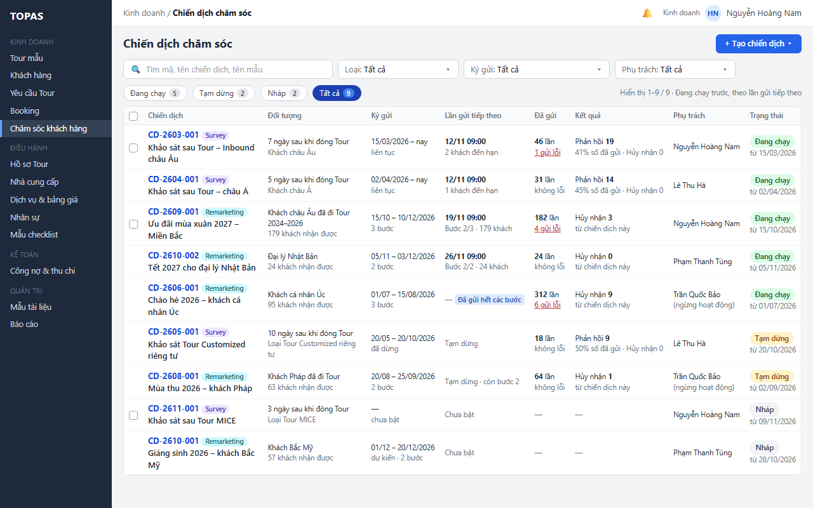

2. **W02 · Chip Đang chạy.** Người dùng bấm chip Đang chạy. Danh sách lọc ngay còn 5 chiến dịch; cột Trạng thái ẩn; sắp theo lần gửi tiếp theo, gần nhất trước, chiến dịch không có lần gửi tiếp theo xếp cuối (R07). Bấm chip Tạm dừng, Nháp tương tự; bấm Tất cả thì cột Trạng thái hiện lại.

   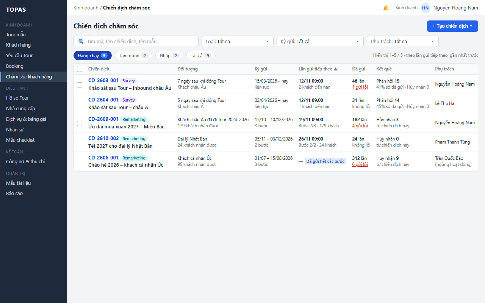

*Kết quả:* người dùng biết công ty đang có bao nhiêu chiến dịch chạy và email nào sắp gửi cho khách.

**L1.2 Lọc theo loại và kỳ gửi.** *Điều kiện:* Kinh doanh hoặc Quản trị.

1. **W03 · Ô chọn Kỳ gửi ở thanh lọc → bảng chọn.** Người dùng bấm Kỳ gửi. Bộ chọn hiện các khoảng chọn nhanh (Tháng này, Tháng trước, Quý này, 30 ngày tới), áp dụng ngay, và khoảng ngày gửi tùy chọn, nhập rồi bấm Áp dụng; khoảng tùy chọn được kiểm tra theo E1.4. Ghi chú dưới bộ chọn nhắc rằng kỳ gửi gồm lần đã gửi và lần đã lên lịch (R06).

   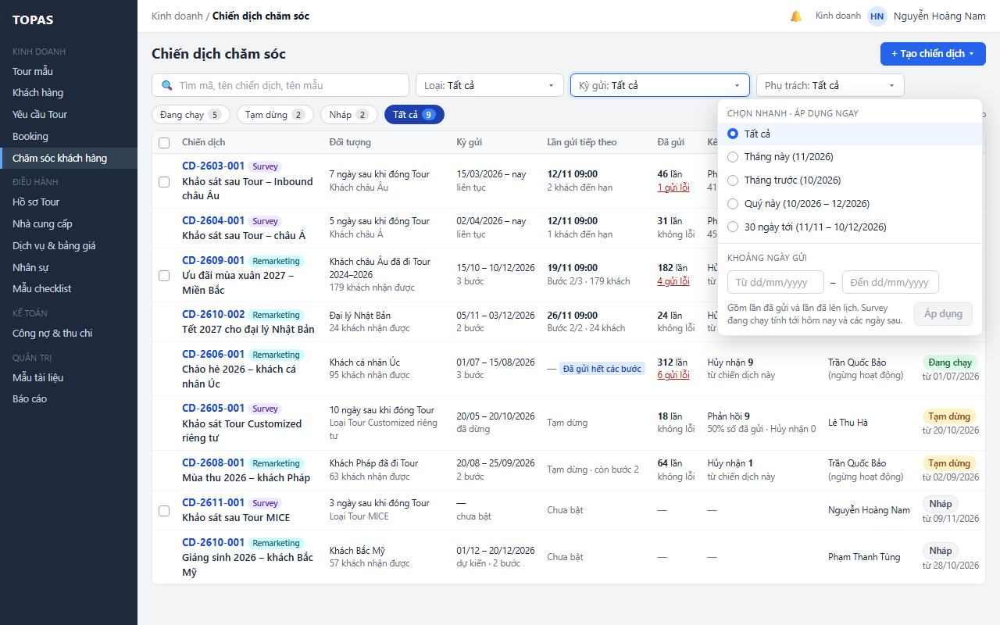

2. **W04 · Khoảng nhanh Tháng này, ô chọn Loại ở thanh lọc.** Người dùng chọn Tháng này (áp dụng ngay), rồi chọn Loại Remarketing. Danh sách còn hai chiến dịch có lần gửi trong tháng 11/2026: CD-2609-001 (bước 2 gửi 19/11) và CD-2610-002 (bước 1 đã gửi 05/11, bước 2 gửi 26/11). Số trên chip tính theo bộ lọc; liên kết Xóa bộ lọc xuất hiện.

   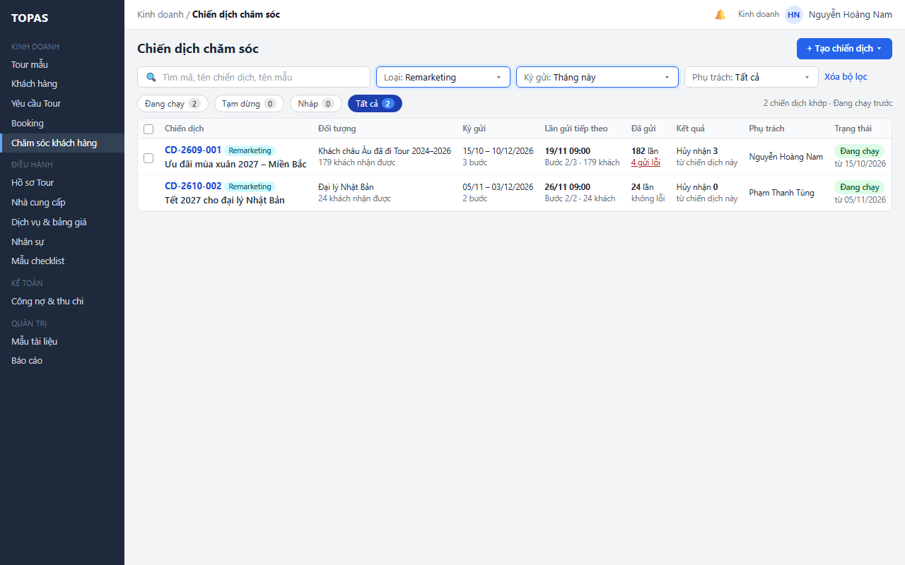

3. **W04 → W01 · Liên kết Xóa bộ lọc cuối thanh lọc.** Người dùng bấm Xóa bộ lọc. Ô tìm, Loại, Kỳ gửi và Phụ trách về mặc định; chip đang chọn giữ nguyên.

*Kết quả:* người dùng thấy những email nào đi ra trong một kỳ để tránh gửi dồn cho cùng nhóm khách.

**L1.3 Tìm chiến dịch theo tên.** *Điều kiện:* Kinh doanh hoặc Quản trị.

1. **W05 · Ô tìm kiếm.** Người dùng gõ “mùa” (từ 2 ký tự). Ô tìm áp dụng sau 300 ms ngừng gõ (R05). Danh sách hiện CD-2609-001 “Ưu đãi mùa xuân 2027 – Miền Bắc” và CD-2608-001 “Mùa thu 2026 – khách Pháp”; phần khớp được tô vàng; số trên chip cập nhật (Đang chạy 1, Tạm dừng 1).

   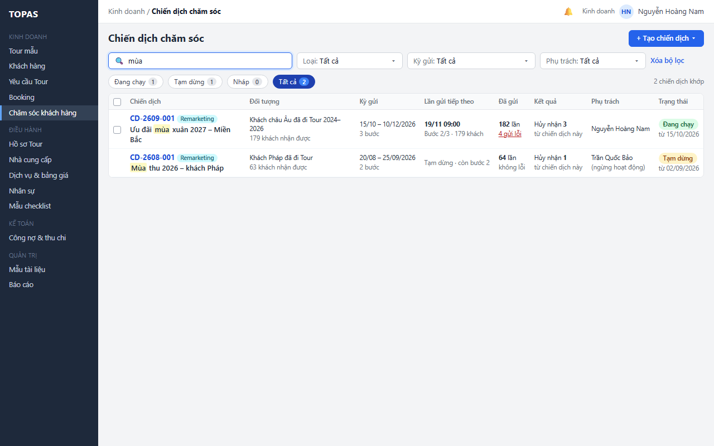

*Kết quả:* người dùng tìm lại chiến dịch cũ để tham khảo trước khi tạo chiến dịch tương tự.

**Ngoại lệ**

- **E1.1 Không khớp bộ lọc (W06).** Bảng hiện “Không có chiến dịch khớp bộ lọc” kèm gợi ý bỏ bớt bộ lọc hoặc tạo chiến dịch; mọi chip có số 0. Người dùng bấm Xóa bộ lọc.

  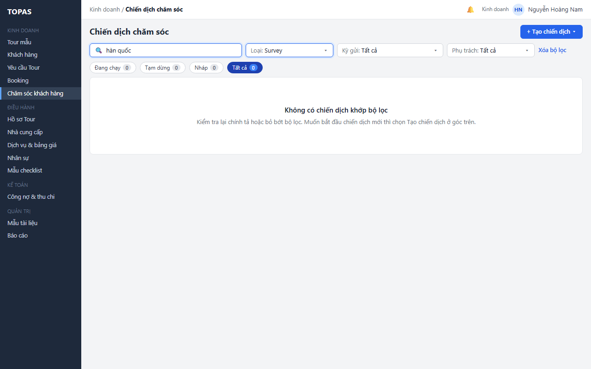

- **E1.2 Lỗi tải danh sách (W07).** Bảng hiện “Không tải được danh sách chiến dịch”, số trên chip là “–”, bộ lọc giữ nguyên. Người dùng bấm Thử lại.

  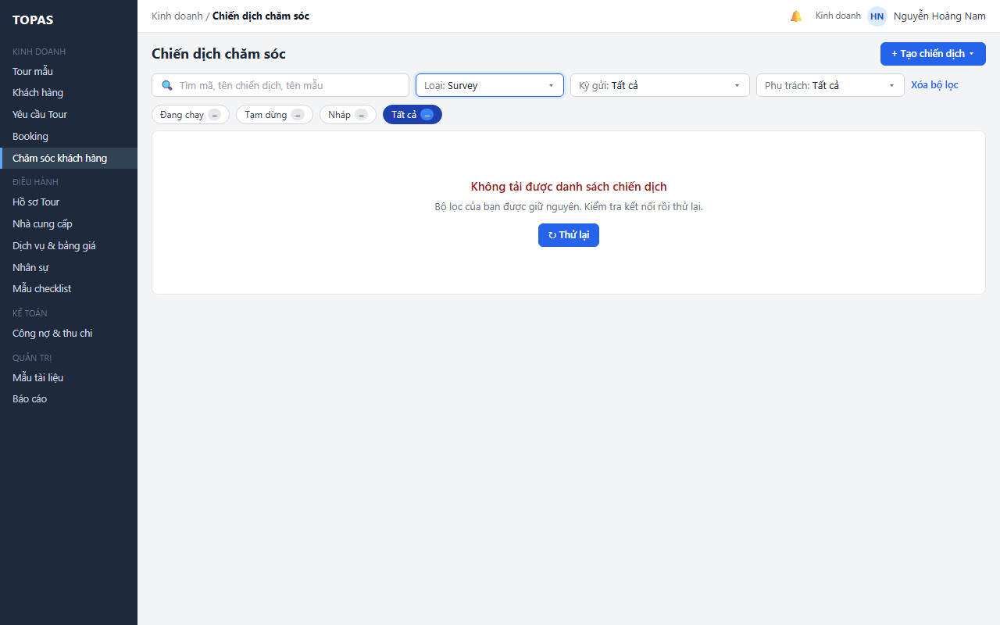

- **E1.3 Chưa có dữ liệu (W08).** Công ty chưa có chiến dịch nào: bảng ghi “Chưa có chiến dịch chăm sóc nào”, giải thích ngắn hai loại và nhắc chỉ khách bật Nhận email chăm sóc mới nhận được email; chỉ tới nút Tạo chiến dịch ở góc trên. Khác W06 vì không có bộ lọc nào ngoài mặc định. Người dùng lọc Phụ trách Của tôi mà chưa phụ trách chiến dịch nào thì bảng ghi “Bạn chưa phụ trách chiến dịch nào · Xem tất cả”.

  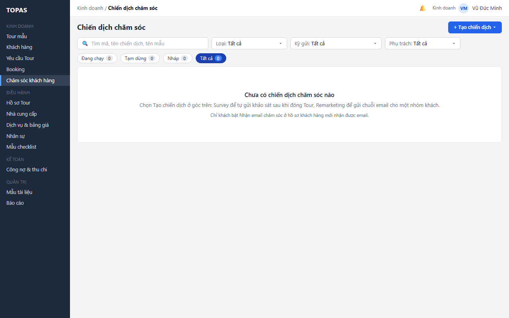

- **E1.4 Khoảng ngày không hợp lệ.** Từ ngày sau Đến ngày, hoặc ngày sai định dạng: nút Áp dụng khóa, lỗi ghi dưới ô (“Từ ngày phải trước hoặc bằng Đến ngày”). Bỏ trống một đầu thì khoảng mở về phía đó (W03).
- **E1.5 Chiến dịch Nháp khi lọc theo kỳ gửi.** Survey Nháp chưa có kỳ gửi nên không khớp bộ lọc Kỳ gửi nào khác Tất cả; Remarketing Nháp khớp theo lịch dự kiến đã nhập (R06).
- **E1.6 Người phụ trách đã ngừng hoạt động.** Vẫn có trong danh sách chọn Phụ trách, kèm “(ngừng hoạt động)”, để tìm chiến dịch cần bàn giao (L5.2).
- **E1.7 Không có quyền.** Điều hành, Kế toán không có mục Chăm sóc khách hàng; mở bằng đường dẫn thì hiện trang “Bạn không có quyền xem chiến dịch chăm sóc”.
- **E1.8 Nhiều trang.** Hơn 20 chiến dịch khớp bộ lọc: phân trang dưới bảng; dòng chữ bên phải chip ghi khoảng đang xem (“Hiển thị 21–34 / 34”).

### 3.2. Tạo chiến dịch theo loại (KD09 · SYS10.03 → KD10)

**L2.1 Tạo chiến dịch mới.** *Điều kiện:* Kinh doanh.

1. **W09 · Nút chính Tạo chiến dịch ▾ ở tiêu đề → danh sách loại.** Người dùng bấm Tạo chiến dịch. Danh sách nhỏ hiện hai loại, mỗi loại có một câu mô tả: Survey (tự gửi khảo sát sau khi đóng Tour, theo số ngày đặt) và Remarketing (gửi chuỗi email theo lịch cho một nhóm khách). Bấm ra ngoài hoặc Esc để đóng (R09).

   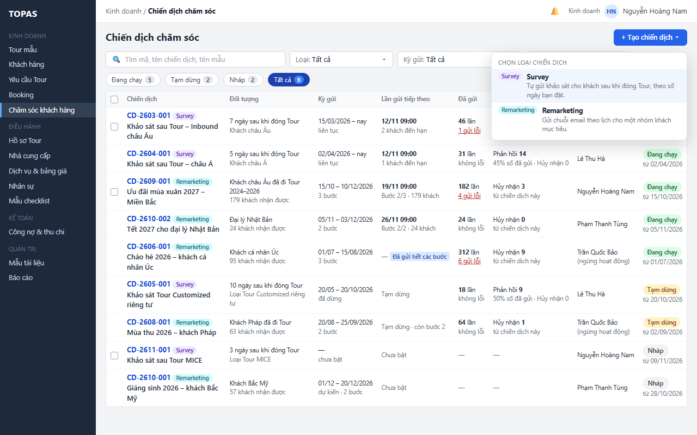

2. **W10 · Chọn Survey (hoặc Remarketing).** Người dùng chọn một loại. KD10 mở ở chế độ tạo mới, tab Thiết lập chiến dịch; Loại điền sẵn (nhãn Từ nút Tạo, chỉ đọc), Người phụ trách là người tạo (nhãn Người tạo). Người dùng nhập thiết lập và lưu theo RSD KD10 (SYS10.04 cho Survey; SYS10.06, SYS10.07 cho Remarketing).

   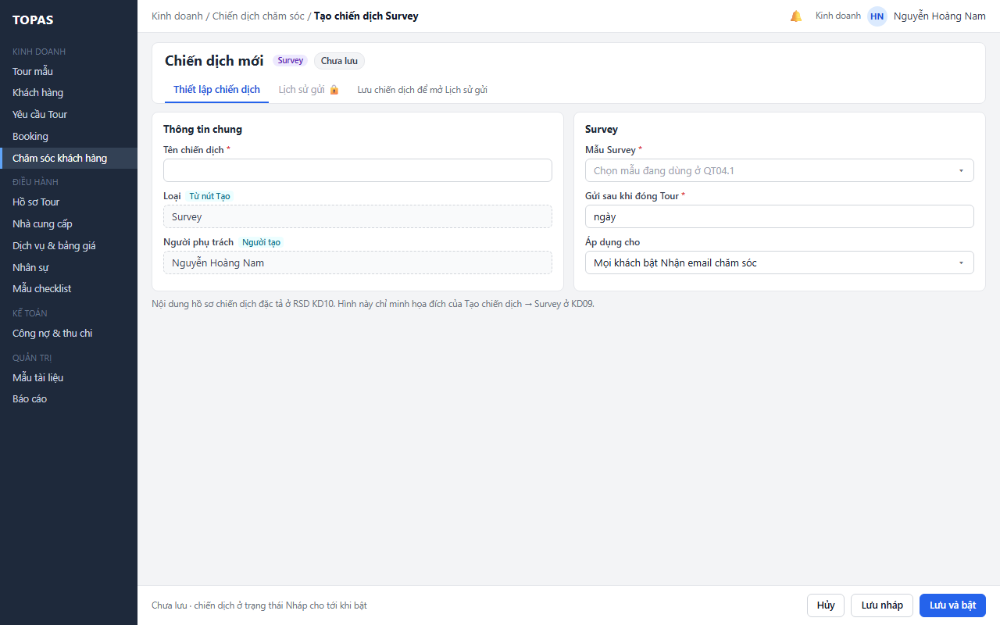

3. **W01 · Quay lại KD09.** Lưu xong và quay lại KD09: chiến dịch mới có trong danh sách ở vị trí theo R07 (chip Nháp nếu Lưu nháp, Đang chạy nếu Lưu và bật).

*Kết quả:* chiến dịch chỉ được tạo khi lưu ở KD10; người tạo là người phụ trách.

**Ngoại lệ**

- **E2.1 Hủy tạo ở KD10.** Người dùng bấm Hủy hoặc quay lại trước khi lưu: không có chiến dịch nào được tạo; KD09 hiện lại như trước (W01). Hỏi xác nhận khi đã nhập do KD10 quy định.
- **E2.2 Quản trị hệ thống.** Không có nút Tạo chiến dịch (W16).
- **E2.3 Chiến dịch mới không khớp bộ lọc đang dùng.** Ví dụ đang lọc Loại Survey mà vừa tạo Remarketing: thông báo ngắn “Đã tạo CD-…, không khớp bộ lọc hiện tại · Xem”, bấm Xem mở KD10 của chiến dịch đó.
- **E2.4 Chưa có mẫu đang dùng.** Không chặn ở KD09; KD10 báo khi chọn mẫu và chỉ tới QT04.1 (RSD KD10).

### 3.3. Mở chiến dịch để xem, sửa, bật hoặc tạm dừng (KD09 → KD10)

**L3.1 Mở đúng chỗ cần xem.** *Điều kiện:* Kinh doanh hoặc Quản trị.

1. **W01 · Bấm dòng (trừ ô chọn và “n gửi lỗi”).** Người dùng bấm dòng CD-2603-001.
2. **W11 · KD10 ở tab đích.** KD10 mở ở tab đích theo R08, chỉ đọc nếu người dùng không phụ trách chiến dịch (E3.1). CD-2603-001 đã có lần gửi nên mở thẳng tab Lịch sử gửi, chip Tất cả; chiến dịch Nháp hoặc chưa có lần gửi mở tab Thiết lập chiến dịch. Sửa, bật, tạm dừng, bật lại làm ở KD10 theo RSD KD10.

   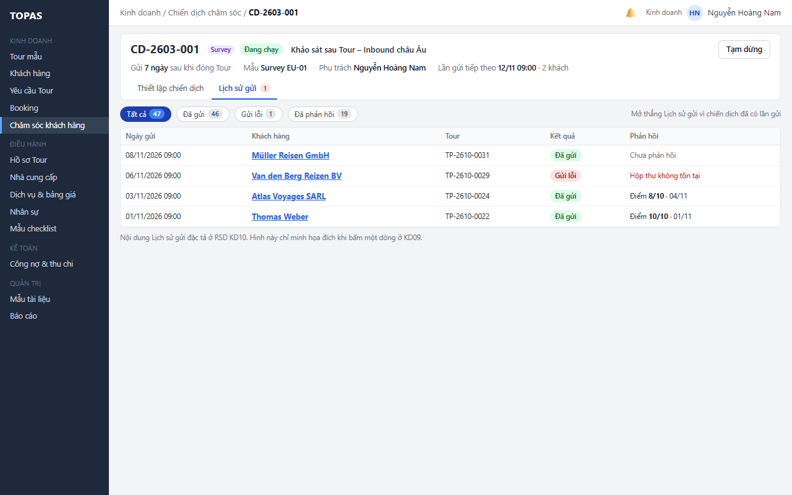

3. **W01 → W11 · Bấm “1 gửi lỗi” ở cột Đã gửi.** Người dùng quay lại và bấm “1 gửi lỗi” trên dòng CD-2603-001. KD10 mở ở tab Lịch sử gửi với chip Gửi lỗi đang chọn (cùng khung W11), chỉ còn lần gửi lỗi cho Van den Berg Reizen BV kèm lý do “Hộp thư không tồn tại”; người phụ trách sửa email ở hồ sơ khách (KD04) theo RSD KD10.

*Kết quả:* người dùng vào thẳng phần cần xem, không phải chọn lại tab hay lọc lại.

**L3.2 Quay lại danh sách sau khi xử lý.** *Điều kiện:* đã mở KD10 từ KD09.

1. **W12 · Breadcrumb Chiến dịch chăm sóc hoặc nút quay lại.** Người dùng bấm breadcrumb hoặc nút quay lại. KD09 hiện lại với bộ lọc, chip, trang và vị trí cuộn như trước; dòng vừa mở được tải lại.
2. **W12 · Dòng không còn khớp bộ lọc.** Ví dụ đang ở chip Đang chạy, người dùng vừa tạm dừng CD-2610-002 ở KD10: dòng giữ tại chỗ, mờ, ghi nhãn Tạm dừng và “Không còn khớp bộ lọc”; chip Đang chạy 5 → 4, Tạm dừng 2 → 3; thông báo ngắn có liên kết Xem ở chip Tạm dừng. Dòng mờ ẩn ở lần tải lại kế tiếp (R08).

   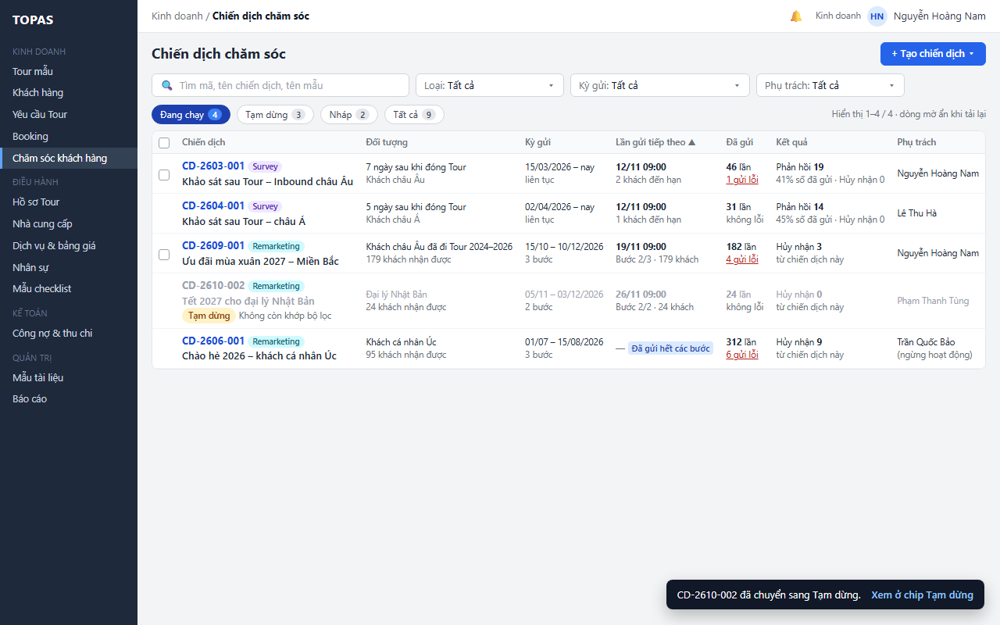

*Kết quả:* người dùng không mất vị trí và thấy kết quả của thao tác vừa làm.

**Ngoại lệ**

- **E3.1 Chiến dịch do người khác phụ trách.** Mở được; KD10 ở chế độ chỉ đọc kèm “🔒 Chỉ xem · do … phụ trách” (RSD KD10). Tab đích như R08.
- **E3.2 Chiến dịch không còn tồn tại.** Chiến dịch Nháp vừa bị xóa ở KD10 trong phiên khác: thông báo ngắn “Chiến dịch này không còn tồn tại”, danh sách tải lại.
- **E3.3 Dữ liệu đổi ở phiên khác.** Danh sách không tự làm mới. Khi mở dòng, KD10 luôn tải bản mới nhất; khi quay lại, KD09 tải lại trang đang xem. Số gửi lỗi trên dòng có thể nhỏ hơn số ở KD10 nếu có lần gửi mới sau lúc tải.
- **E3.4 Gửi lỗi đã được gửi lại thành công.** KD10 gửi lại lần lỗi (theo RSD KD10) thì lần đó không còn tính vào “n gửi lỗi” ở lần tải kế tiếp (R03).

### 3.5. Chuyển người phụ trách (quyết định 12/11/2026)

**L5.1 Kinh doanh chuyển chiến dịch của mình.** *Điều kiện:* người phụ trách chiến dịch.

1. **W14 · Ô chọn trên dòng hoặc đầu bảng → thanh hàng loạt.** Người dùng chọn các dòng cần chuyển (ví dụ CD-2609-001 và CD-2611-001 trước khi nghỉ phép dài). Thanh hàng loạt hiện giữa hàng chip và bảng, ghi số chiến dịch đã chọn, ô chọn người nhận ngay trên thanh và nút Chuyển phụ trách (khóa tới khi chọn người nhận, E5.1). Danh sách người nhận gồm người dùng Kinh doanh đang hoạt động trừ chính mình, mỗi người kèm số chiến dịch đang phụ trách. Nút Bỏ chọn ở cuối thanh ẩn thanh (E5.5).

   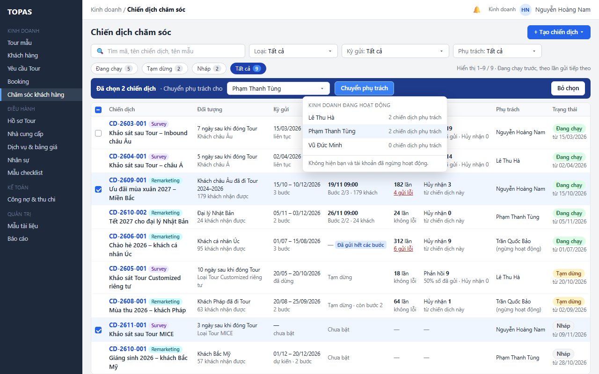

2. **W15 · Ô chọn người nhận, nút Chuyển phụ trách trên thanh hàng loạt.** Người dùng chọn Phạm Thanh Tùng rồi bấm Chuyển phụ trách. Hệ thống chuyển từng chiến dịch theo R11. Banner nêu số chiến dịch đã chuyển, người nhận và rằng lịch gửi, trạng thái không đổi; cột Phụ trách của hai dòng ghi người nhận và nhãn Vừa chuyển; dòng vẫn khớp bộ lọc Tất cả nên không mờ. Người nhận nhận một thông báo gộp.

   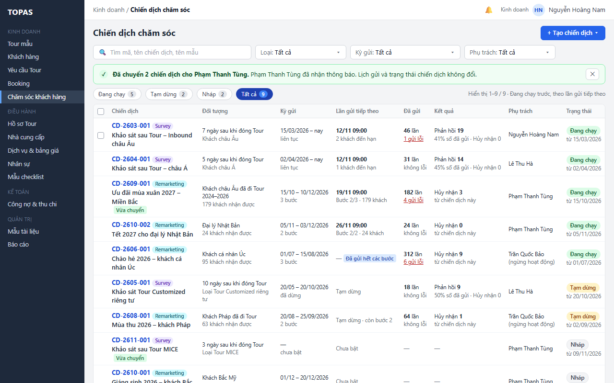

*Kết quả:* người nhận sửa, bật, tạm dừng được các chiến dịch đó; người cũ chỉ còn xem. Chiến dịch Đang chạy vẫn gửi theo lịch.

**L5.2 Quản trị chuyển chiến dịch của người đã nghỉ.** *Điều kiện:* Quản trị hệ thống.

1. **W16 · Ô chọn Phụ trách, ô chọn đầu bảng.** Quản trị chọn Phụ trách là người cần bàn giao (Trần Quốc Bảo, đã ngừng hoạt động), chip Tất cả, rồi chọn ô đầu bảng để chọn mọi dòng trong trang. Thanh hàng loạt hiện số đã chọn và ô chọn người nhận. Khi kết quả lọc nhiều hơn một trang, thanh có thêm liên kết “Chọn tất cả n chiến dịch khớp bộ lọc” (R11).

   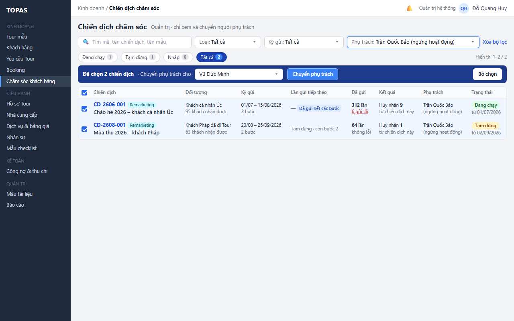

2. **W17 · Nút Chuyển phụ trách trên thanh hàng loạt.** Quản trị chọn Vũ Đức Minh rồi bấm Chuyển phụ trách. Banner nêu đã chuyển 2 chiến dịch và rằng chiến dịch Đang chạy vẫn gửi theo lịch; dòng đã chuyển mờ tại chỗ vì không còn khớp bộ lọc Trần Quốc Bảo, ghi người nhận và nhãn Vừa chuyển; chip về 0. Người nhận nhận một thông báo gộp.

   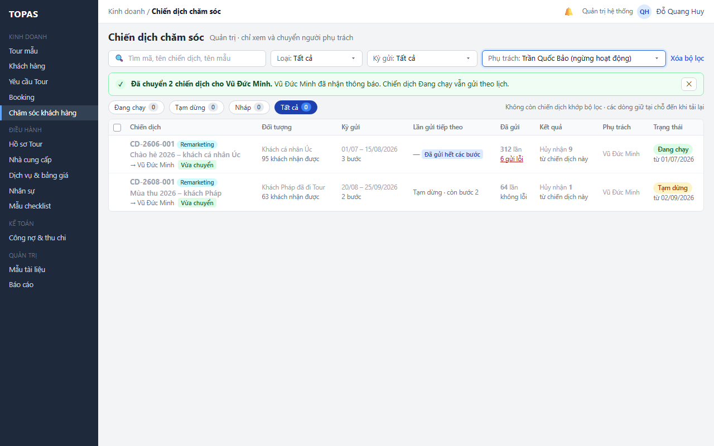

*Kết quả:* không còn chiến dịch nào nằm ở tài khoản đã khóa; người mới quyết định tạm dừng hay giữ chiến dịch Đang chạy.

**Ngoại lệ**

- **E5.1 Người nhận không hợp lệ.** Chưa chọn người nhận: nút Chuyển phụ trách khóa (W14 trước khi chọn). Người nhận vừa bị khóa ở QT01 sau khi chọn: chuyển bị từ chối, lỗi ghi cạnh ô “Tài khoản đã ngừng hoạt động, chọn người khác”; các dòng vẫn được chọn.
- **E5.2 Dòng đổi sau khi đã chọn.** Lúc ghi, người phụ trách đã khác lúc tải (ví dụ một Quản trị khác vừa chuyển) hoặc chiến dịch Nháp đã bị xóa: bỏ qua dòng đó, banner chuyển màu vàng nêu số bỏ qua, dòng ghi lý do (“Người phụ trách đã đổi thành … lúc …”). Các dòng khác vẫn được chuyển.
- **E5.3 Mất quyền giữa chừng.** Kinh doanh chọn chiến dịch của mình nhưng Quản trị vừa chuyển đi ở phiên khác: dòng bị bỏ qua như E5.2.
- **E5.4 Lỗi giữa chừng hoặc mất kết nối.** Mỗi chiến dịch là một giao dịch riêng. Banner nêu số đã chuyển; các dòng chưa chuyển vẫn được chọn, nút Chuyển phụ trách bấm lại được. Nút khóa khi đang chuyển; bấm lặp không chuyển hai lần (R11).
- **E5.5 Bỏ chọn hoặc đổi bộ lọc khi đang chọn.** Bỏ chọn, đổi chip, đổi bộ lọc hoặc sang trang khác thì xóa lựa chọn, không hỏi lại (chưa có gì được ghi).
- **E5.6 Người dùng không có dòng nào được chọn.** Kinh doanh xem chiến dịch của người khác: dòng không có ô chọn; ô chọn đầu bảng chỉ chọn các dòng có ô chọn trong trang.
- **E5.7 Chiến dịch đang gửi đúng lúc chuyển.** Chuyển phụ trách không chặn và không làm gián đoạn đợt gửi đang chạy; đợt gửi ghi người phụ trách tại thời điểm bắt đầu đợt (R11).

---

## 4. Quy tắc triển khai chi tiết

### R01. Phạm vi xem và quyền (quyết định 12/11/2026)

- Mọi người dùng Kinh doanh xem được mọi chiến dịch ở KD09 và mở được KD10 của mọi chiến dịch.
- Mỗi chiến dịch có đúng một người phụ trách là người dùng Kinh doanh; khi tạo là người tạo. Chỉ người phụ trách hiện tại được sửa, bật, tạm dừng, bật lại ở KD10 (RSD KD10 áp dụng). Không có bước duyệt trước khi bật.
- Quản trị hệ thống xem mọi chiến dịch và chuyển người phụ trách; không tạo, không sửa, không bật hay tạm dừng.
- Điều hành, Kế toán không có quyền vào KD09.

### R02. Trạng thái chiến dịch (đúng nguồn, quyết định 12/11/2026)

- Ba trạng thái: **Nháp**, **Đang chạy**, **Tạm dừng**. KD10 ghi trạng thái khi người phụ trách Lưu nháp, Lưu và bật, Tạm dừng, Bật lại (2.4). KD09 chỉ đọc.
- Không có trạng thái kết thúc. Chiến dịch không dùng nữa thì để Tạm dừng.
- **Đã gửi hết các bước** là chỉ báo phụ, không phải trạng thái: Remarketing Đang chạy mà mọi bước đã gửi và không còn lần gửi theo lịch. Survey Đang chạy không bao giờ có chỉ báo này vì gửi liên tục theo Tour đóng.
- Ngày “từ dd/mm/yyyy” dưới nhãn là thời điểm chiến dịch vào trạng thái hiện tại (ngày tạo với Nháp, ngày bật hoặc bật lại với Đang chạy, ngày tạm dừng với Tạm dừng).

### R03. Số liệu gửi trên dòng

- **Lần gửi** là một email Survey hoặc một email của một bước Remarketing gửi tới một khách. KD10 ghi mỗi lần gửi theo mã khách (RSD KD03-KD04 dùng để hiện ở KD04.4).
- **Đã gửi** = số lần gửi có kết quả Đã gửi. **Gửi lỗi** = số lần gửi có kết quả Gửi lỗi mà chưa được gửi lại thành công. Lần gửi có kết quả Đang gửi (đang chờ dịch vụ email trả lời) không tính vào hai số này.
- **Phản hồi** (Survey) = số lần gửi Survey có phản hồi của khách. Tỷ lệ = Phản hồi ÷ Đã gửi, làm tròn đến số nguyên phần trăm; Đã gửi bằng 0 thì ghi “—”.
- **Hủy nhận** (Survey và Remarketing) = số khách bấm liên kết hủy nhận trong email của chiến dịch này rồi xác nhận (RSD KD10 L6.2, R13; KD10 chuyển Nhận email chăm sóc của khách sang Không, RSD KD03-KD04 R11). Survey hiện số này ở dòng dưới cột Kết quả, cạnh tỷ lệ phản hồi.
- Số liệu tính cho toàn bộ đời chiến dịch, không theo bộ lọc Kỳ gửi. Số theo kỳ xem ở QT06 (menu Báo cáo, RSD QT06-QT12).
- Số liệu ở KD09 và QT06 lấy cùng một nguồn lần gửi do KD10 ghi, để hai màn khớp nhau.

### R04. Đối tượng, kỳ gửi và lần gửi tiếp theo

- **Số khách nhận được** (Remarketing) = số khách nhận được theo đúng định nghĩa của RSD KD10 R08 (khớp nhóm mục tiêu, trừ danh sách loại trừ, khách tắt Nhận email chăm sóc và khách dừng luồng; doanh nghiệp tính một khách, gửi tới email liên hệ chính). KD09 đọc số do KD10 tính, không tự tính. Tính lại mỗi lần tải. Tiêu chí nhóm do RSD KD10 quy định, không dùng hạng khách hàng (đã bỏ khỏi phạm vi).
- **Kỳ gửi**:
  - Remarketing: từ ngày gửi của bước đầu đến ngày gửi của bước cuối theo lịch đã lưu (Nháp ghi thêm “dự kiến”).
  - Survey Đang chạy: từ ngày bật lần đầu đến nay, ghi “liên tục”. Survey Tạm dừng: từ ngày bật lần đầu đến ngày tạm dừng gần nhất. Survey Nháp: không có kỳ gửi (“—”).
- **Lần gửi tiếp theo**:
  - Remarketing Đang chạy: ngày giờ của bước kế tiếp chưa gửi; số khách = số khách nhận được hiện tại.
  - Survey Đang chạy: đợt gửi hằng ngày kế tiếp theo giờ gửi của chiến dịch (RSD KD10); số khách đến hạn = số cặp khách–Tour đến hạn ở đợt đó theo RSD KD10 R05, R06 (Tour có ngày đóng lần đầu n ngày trước, không gồm hồ sơ kết thúc vì Booking đã hủy, khách bật Nhận email chăm sóc, chưa nhận Survey nào cho Tour đó, không thuộc Survey bật trước có phạm vi chồng). Không có khách đến hạn thì ghi “Chưa có khách đến hạn”.
  - Tạm dừng: “Tạm dừng”, Remarketing còn bước chưa gửi thì “Tạm dừng · còn bước k”. Nháp: “Chưa bật”.

### R05. Tìm kiếm

- Tìm từ 2 ký tự, áp dụng sau 300 ms ngừng gõ; không phân biệt hoa thường, bỏ dấu (gõ “mua” tìm thấy “mùa”).
- Tìm chuỗi con trong: mã chiến dịch, tên chiến dịch, tên mẫu Survey hoặc mẫu email đang dùng trong chiến dịch.
- Không tìm theo tên hay email của khách nhận (dữ liệu nằm ở KD10.2).
- Tô vàng phần khớp ở tên chiến dịch.

### R06. Bộ lọc Loại và Kỳ gửi

- **Loại**: Tất cả, Survey, Remarketing.
- **Kỳ gửi · chọn nhanh** (áp dụng ngay): Tháng này; Tháng trước; Quý này; 30 ngày tới = từ hôm nay đến hôm nay + 29 ngày.
- **Kỳ gửi · khoảng tùy chọn**: theo ngày gửi, có thể bỏ trống một đầu; cần bấm Áp dụng.
- Chiến dịch khớp khi kỳ gửi của nó (R04) giao với khoảng lọc. Survey Đang chạy coi như kéo dài đến vô hạn về sau. Survey Nháp chỉ khớp Tất cả (E1.5).
- Bộ lọc không làm đổi dữ liệu.

### R07. Chip, số trên chip, sắp xếp và phân trang

- Bốn chip: Đang chạy, Tạm dừng, Nháp, Tất cả. Số trên mỗi chip tính theo tìm kiếm và các bộ lọc còn lại, không theo chip đang chọn. Tổng ba chip đầu bằng chip Tất cả.
- Sắp xếp mặc định:
  - Tất cả: theo trạng thái Đang chạy → Tạm dừng → Nháp, trong mỗi nhóm như chip tương ứng.
  - Đang chạy: lần gửi tiếp theo tăng dần; chiến dịch không có lần gửi tiếp theo (Đã gửi hết các bước) xếp cuối.
  - Tạm dừng: ngày tạm dừng giảm dần. Nháp: ngày cập nhật giảm dần.
- Cột sắp xếp được: Chiến dịch (ngày tạo), Lần gửi tiếp theo, Đã gửi.
- 20 dòng mỗi trang; dòng chữ bên phải chip ghi khoảng đang xem và cách sắp xếp.

### R08. Mở KD10 đúng tab và giữ ngữ cảnh

- Tab đích khi bấm dòng: chiến dịch đã có ít nhất một lần gửi → Lịch sử gửi, chip Tất cả; còn lại (Nháp, hoặc đã bật nhưng chưa gửi lần nào) → Thiết lập chiến dịch. Áp dụng cho mọi vai trò.
- Bấm “n gửi lỗi” → Lịch sử gửi, chip Gửi lỗi.
- Bộ lọc, chip, trang, vị trí cuộn và sắp xếp của KD09 được giữ trong phiên khi mở KD10 rồi quay lại. Khi quay lại, trang đang xem được tải lại.
- Dòng không còn khớp bộ lọc sau khi tải lại thì giữ tại chỗ, mờ, có nhãn mới và “Không còn khớp bộ lọc”; thông báo ngắn có liên kết tới chip chứa dòng đó (W12). Dòng mờ ẩn ở lần tải lại kế tiếp hoặc khi đổi bộ lọc.

### R09. Tạo chiến dịch theo loại

- Một nút Tạo chiến dịch ▾ mở danh sách hai loại; chọn loại mở KD10 tạo mới với Loại điền sẵn, chỉ đọc. Loại không đổi sau khi lưu (RSD KD10).
- Bộ lọc Loại đang chọn không thay cho bước chọn loại: luôn hỏi loại để tránh tạo nhầm.
- Chỉ người dùng Kinh doanh có quyền tạo (QT02) thấy nút.

### R10. Thống kê theo kỳ (quyết định 12/11/2026)

- KD09 không có nút Xem thống kê. Số liệu theo kỳ xem ở QT06 mở từ menu Báo cáo; mọi vai trò xem được QT06 (RSD QT06-QT12 R01). Số ở KD09 và QT06 dùng cùng nguồn lần gửi (R03).

### R11. Chuyển người phụ trách chiến dịch (quyết định 12/11/2026)

- **Ai chuyển.** Người phụ trách hiện tại (chiến dịch của mình) và Quản trị hệ thống (mọi chiến dịch).
- **Chiến dịch được chuyển.** Mọi trạng thái, vì chiến dịch Tạm dừng và Nháp vẫn có thể được bật lại.
- **Người nhận.** Người dùng Kinh doanh đang hoạt động ở QT01, khác người thực hiện (khi Kinh doanh chuyển). Danh sách người nhận ghi số chiến dịch mỗi người đang phụ trách.
- **Phạm vi chọn.** Ô chọn đầu bảng chỉ chọn các dòng có ô chọn trong trang. Khi kết quả lọc nhiều hơn một trang, thanh hàng loạt có liên kết “Chọn tất cả n chiến dịch khớp bộ lọc”; chỉ khi bấm liên kết này hệ thống mới áp dụng cho mọi kết quả lọc, và số n được ghi trên thanh.
- **Ghi.** Mỗi chiến dịch là một giao dịch riêng. Ngay khi ghi, hệ thống kiểm tra lại: chiến dịch còn tồn tại, người phụ trách vẫn như lúc tải, người thực hiện còn quyền. Không đạt thì bỏ qua và ghi lý do. Mỗi lần bấm có mã thao tác; bấm lặp hoặc gửi lại sau mất kết nối không chuyển hai lần.
- **Không đổi.** Trạng thái, thiết lập, lịch gửi và các lần gửi đã có của chiến dịch; người phụ trách khách hàng (KD04). Chiến dịch Đang chạy tiếp tục gửi theo lịch.
- **Thông báo nội bộ.** Người nhận nhận một thông báo gộp, ví dụ “Bạn được giao 2 chiến dịch chăm sóc từ Nguyễn Hoàng Nam”; bấm mở KD09 (1.2). Khi Quản trị chuyển, người phụ trách cũ cũng nhận thông báo nếu tài khoản còn hoạt động. Nhãn Mới giao hiện trên dòng tới hết ngày với người nhận; nhãn Vừa chuyển hiện với người thực hiện tới lần tải lại.
- **Lịch sử.** Ghi lịch sử chiến dịch (hiện ở KD10) và nhật ký QT03: người cũ, người mới, người thực hiện, thời điểm, cách chuyển.
- **Không tự chuyển, không tự dừng.** Tài khoản bị khóa ở QT01 mà còn là người phụ trách thì chiến dịch không đổi gì và vẫn gửi nếu Đang chạy; tên hiện kèm “(ngừng hoạt động)” cho tới khi Quản trị chuyển ở L5.2.

### R12. Mã chiến dịch

- Dạng `CD-YYMM-NNN` do KD10 cấp khi lưu lần đầu (YYMM là tháng tạo; NNN đếm lại mỗi tháng), không dùng lại. Quy tắc cấp mã thuộc RSD KD10; KD09 chỉ hiển thị và tìm theo mã.

### R13. Cấu hình phụ thuộc

| Cấu hình | Chủ sở hữu | Dùng ở đâu | Hành vi khi thiếu |
|---|---|---|---|
| Vai trò và quyền Tạo chiến dịch, Chuyển phụ trách chiến dịch | Quản trị hệ thống (QT02) | R01, R09, R11 | Quyền như mục 1.4 |
| Trạng thái tài khoản người dùng | Quản trị hệ thống (QT01) | Danh sách người nhận, nhãn “(ngừng hoạt động)” | — |
| Giờ gửi Survey hằng ngày | KD10 (từng chiến dịch) | Lần gửi tiếp theo của Survey (R04) | Theo mặc định của RSD KD10 |
| Mẫu Survey, mẫu email chăm sóc | Kinh doanh (QT04.1) | Tìm theo tên mẫu (R05) | Chiến dịch không có mẫu thì không khớp theo tên mẫu |
| Nhận email chăm sóc, liên hệ chính của khách | KD04 | Số khách nhận được, số khách đến hạn (R04) | Khách tắt hoặc thiếu email không được tính |

### R14. Dạng xem (quyết định 12/11/2026)

- KD09 chỉ có dạng Bảng; không có bộ chuyển dạng xem, không lưu thiết lập dạng xem.
- Nếu sau này thêm dạng xem, áp dụng nguyên tắc chung của dự án: Kanban, Lịch chỉ để xem, không kéo thả đổi trạng thái (`BOI-CANH-DU-AN.md`).

---

## 5. Dữ liệu

### 5.1. Đối tượng dữ liệu

| Đối tượng | Khóa | Dữ liệu KD09 dùng | Nguồn hoặc tác động |
|---|---|---|---|
| Chiến dịch chăm sóc | Mã chiến dịch (R12) | Tên, loại, trạng thái và ngày vào trạng thái, đối tượng (số ngày sau đóng Tour, phạm vi, nhóm mục tiêu), lịch các bước, giờ gửi, mẫu, người phụ trách, ngày tạo, ngày cập nhật, phiên bản | KD10 sở hữu; KD09 đọc; KD09 chỉ ghi người phụ trách (R11) |
| Lần gửi | Mã lần gửi | Chiến dịch, bước, khách, Tour (Survey), thời điểm, kết quả (Đang gửi, Đã gửi, Gửi lỗi), đã gửi lại | KD10 ghi; KD09 chỉ đọc số tổng hợp (R03); KD04.4 đọc theo khách |
| Phản hồi Survey | Mã lần gửi | Có phản hồi, thời điểm | KD10 ghi khi khách gửi Survey; KD09 đọc số (R03) |
| Hủy nhận | Mã lần gửi | Khách, chiến dịch, thời điểm | Trang hủy nhận của KD10 ghi khi khách xác nhận; KD10 chuyển Nhận email chăm sóc của khách sang Không (RSD KD10 R13, 5.1; RSD KD03-KD04 R11); KD09 đọc số theo chiến dịch (R03) |
| Khách hàng | Mã khách hàng | Nhận email chăm sóc, liên hệ chính, Tour đã đóng và ngày đóng | KD04, DH08; KD09 chỉ dùng để đếm (R04) |
| Mẫu Survey, mẫu email | Mã mẫu | Tên mẫu | QT04.1; KD09 chỉ dùng để tìm |
| Lịch sử chuyển phụ trách | Mã chiến dịch + thời điểm | Người cũ, người mới, người thực hiện, cách chuyển (một hay hàng loạt) | KD09 ghi; KD10 hiện trong lịch sử chiến dịch; QT03 |

### 5.2. Trường nhập

| Form | Trường | Bắt buộc | Mặc định hoặc điền sẵn | Kiểm tra |
|---|---|---|---|---|
| Thanh lọc | Tìm kiếm | Không | Trống | Từ 2 ký tự (R05) |
| Thanh lọc | Loại | Có | Tất cả | Một giá trị |
| Thanh lọc | Kỳ gửi · khoảng tùy chọn | Không | Trống | dd/mm/yyyy; Từ ≤ Đến (E1.4) |
| Thanh lọc | Phụ trách | Có | Tất cả | Người dùng Kinh doanh, kể cả đã ngừng hoạt động |
| Danh sách loại | Loại chiến dịch khi tạo | Có | Không chọn sẵn | Survey hoặc Remarketing (R09) |
| Thanh hàng loạt | Người nhận | Có | Trống | Kinh doanh đang hoạt động, khác người dùng hiện tại (Kinh doanh) hoặc khác người phụ trách của mọi dòng đã chọn (Quản trị) |

### 5.3. Dữ liệu gửi ra ngoài

KD09 không gửi email, tài liệu hay tệp nào ra ngoài hệ thống. Survey và email Remarketing do KD10 gửi theo thiết lập đã bật (RSD KD10). Thông báo chuyển phụ trách là thông báo nội bộ.

---

## 6. Tiêu chí nghiệm thu

| Mã | Điều kiện và thao tác | Kết quả kiểm chứng được |
|---|---|---|
| AC01 | Kinh doanh mở Chiến dịch chăm sóc lần đầu trong phiên | Phụ trách Tất cả, chip Tất cả; Đang chạy trước, rồi Tạm dừng, Nháp; có cột Phụ trách và Trạng thái; có nút Tạo chiến dịch, không có nút Xem thống kê (W01) |
| AC02 | Công ty có 5 chiến dịch Đang chạy, 2 Tạm dừng, 2 Nháp | Chip ghi 5, 2, 2, 9; tổng ba chip bằng Tất cả (W01) |
| AC03 | Bấm chip Đang chạy | Còn 5 dòng, cột Trạng thái ẩn; sắp theo lần gửi tiếp theo, CD-2606-001 (Đã gửi hết các bước) ở cuối (W02, R07) |
| AC04 | Remarketing Đang chạy đã gửi hết 3 bước | Trạng thái vẫn Đang chạy; cột Lần gửi tiếp theo ghi “—” và chỉ báo Đã gửi hết các bước (R02, W01) |
| AC05 | Survey gửi 46 lần thành công, 1 lỗi, 19 phản hồi | Cột Đã gửi “46 lần · 1 gửi lỗi”; cột Kết quả “Phản hồi 19 · 41% số đã gửi · Hủy nhận 0” (R03) |
| AC06 | Lần gửi lỗi được KD10 gửi lại thành công, tải lại KD09 | Số gửi lỗi giảm 1, Đã gửi tăng 1 (E3.4) |
| AC07 | Nhóm mục tiêu của CD-2609-001 có 185 khách khớp tiêu chí, 6 khách đang tắt Nhận email chăm sóc (trong đó 3 khách hủy nhận từ chiến dịch này) | Cột Đối tượng ghi “179 khách nhận được”; cột Kết quả “Hủy nhận 3” (R04, R03, W01) |
| AC08 | Chọn Kỳ gửi Tháng này và Loại Remarketing ngày 11/11/2026 | Còn CD-2609-001 và CD-2610-002; chip 2 / 0 / 0 / 2; CD-2606-001 (gửi 07–08/2026) và CD-2610-001 (Nháp, dự kiến 12/2026) không hiện (W04, R06) |
| AC09 | Chọn Kỳ gửi Tháng trước, Loại Survey | Survey Đang chạy khớp; Survey Nháp CD-2611-001 không khớp (E1.5) |
| AC10 | Nhập khoảng tùy chọn Từ 20/12/2026 Đến 01/12/2026 | Áp dụng khóa, lỗi dưới ô (E1.4) |
| AC11 | Gõ “mua” (không dấu) | Hiện CD-2609-001 và CD-2608-001, phần khớp được tô; chip 1 / 1 / 0 / 2 (W05, R05) |
| AC12 | Gõ tên mẫu Survey đang dùng của một chiến dịch | Chiến dịch dùng mẫu đó hiện ra (R05) |
| AC13 | Tìm không có kết quả | Hiện “Không có chiến dịch khớp bộ lọc”, khác với trạng thái chưa có dữ liệu (W06, W08) |
| AC14 | Không tải được danh sách | Hiện lỗi, số trên chip “–”, bộ lọc giữ nguyên; Thử lại tải lại (W07) |
| AC15 | Công ty chưa có chiến dịch nào | Hiện “Chưa có chiến dịch chăm sóc nào”, chỉ tới Tạo chiến dịch (W08) |
| AC16 | Bấm Tạo chiến dịch | Danh sách hai loại Survey, Remarketing kèm mô tả (W09) |
| AC17 | Chọn Survey | KD10 mở ở chế độ tạo mới, tab Thiết lập chiến dịch, Loại Survey chỉ đọc, người phụ trách là người tạo (W10, R09) |
| AC18 | Đang lọc Loại Survey, bấm Tạo chiến dịch | Vẫn phải chọn loại; chọn Remarketing tạo được Remarketing (R09) |
| AC19 | Bấm Hủy ở KD10 khi đang tạo | Không có chiến dịch nào được tạo; KD09 như trước (E2.1) |
| AC20 | Bấm dòng của chiến dịch đã có lần gửi | KD10 mở ở tab Lịch sử gửi, chip Tất cả (W11, R08) |
| AC21 | Bấm dòng của chiến dịch Nháp hoặc đã bật nhưng chưa gửi lần nào | KD10 mở ở tab Thiết lập chiến dịch (R08) |
| AC22 | Bấm “1 gửi lỗi” trên dòng CD-2603-001 | KD10 mở ở tab Lịch sử gửi, chip Gửi lỗi, chỉ có lần gửi lỗi (L3.1, R08) |
| AC23 | Bấm dòng của chiến dịch do người khác phụ trách | KD10 mở chỉ đọc (E3.1) |
| AC24 | Đang ở chip Đang chạy, tạm dừng CD-2610-002 ở KD10 rồi quay lại | Bộ lọc, trang, vị trí giữ nguyên; dòng mờ tại chỗ với nhãn Tạm dừng; chip Đang chạy 5 → 4, Tạm dừng 2 → 3; thông báo có liên kết xem lại (W12) |
| AC25 | KD09 không có thao tác đổi trạng thái | Không có nút Bật, Tạm dừng trên dòng hay thanh hàng loạt (1.3) |
| AC26 | Kinh doanh mở KD09 | Không có nút Xem thống kê ở tiêu đề; thống kê theo kỳ mở từ menu Báo cáo → QT06 (R10) |
| AC27 | Kinh doanh xem chiến dịch của người khác | Dòng không có ô chọn; chỉ chiến dịch của mình có ô chọn, ở mọi trạng thái (E5.6, R11) |
| AC28 | Chọn 2 chiến dịch của mình | Thanh hàng loạt “Đã chọn 2 chiến dịch”; Chuyển phụ trách khóa tới khi chọn người nhận; danh sách người nhận không có chính mình và tài khoản đã khóa, có số chiến dịch mỗi người (W14) |
| AC29 | Chuyển 2 chiến dịch cho Phạm Thanh Tùng | Banner kết quả; cột Phụ trách đổi, nhãn Vừa chuyển; trạng thái và lịch gửi không đổi; Phạm Thanh Tùng nhận một thông báo gộp (W15, R11) |
| AC30 | Người cũ mở KD10 của chiến dịch vừa chuyển | KD10 chỉ đọc; người nhận sửa, tạm dừng được |
| AC31 | Chiến dịch Đang chạy vừa được chuyển phụ trách | Lần gửi theo lịch kế tiếp vẫn diễn ra đúng giờ (R11) |
| AC32 | Quản trị mở KD09 | Không có Tạo chiến dịch; ô chọn trên mọi chiến dịch (W16) |
| AC33 | Quản trị lọc Phụ trách Trần Quốc Bảo, chọn 2 chiến dịch, chuyển cho Vũ Đức Minh | Chuyển 2; dòng mờ tại chỗ vì không còn khớp bộ lọc; chip về 0; Vũ Đức Minh nhận một thông báo gộp (W16, W17) |
| AC34 | Một chiến dịch đã chọn vừa được chuyển ở phiên khác trước khi bấm | Dòng đó bị bỏ qua kèm lý do; các dòng khác được chuyển; banner nêu số bỏ qua (E5.2) |
| AC35 | Kết quả lọc 27 dòng, chọn ô đầu bảng | Chỉ 20 dòng của trang được chọn; liên kết “Chọn tất cả 27 chiến dịch khớp bộ lọc” hiện; bấm thì số trên thanh thành 27 (R11) |
| AC36 | Bấm Chuyển phụ trách hai lần liên tiếp hoặc mất kết nối giữa chừng | Không chuyển hai lần; dòng chưa chuyển vẫn được chọn để bấm lại (E5.4) |
| AC37 | Người nhận bấm thông báo “Bạn được giao 2 chiến dịch chăm sóc” | KD09 mở ở Phụ trách Của tôi, chip Tất cả; hai chiến dịch có nhãn Mới giao trong ngày (1.2) |
| AC38 | Điều hành hoặc Kế toán mở đường dẫn KD09 | Trang không có quyền (E1.7) |
| AC39 | Tài khoản người phụ trách bị khóa ở QT01 | Chiến dịch không đổi trạng thái, vẫn gửi nếu Đang chạy; cột Phụ trách ghi “(ngừng hoạt động)” (R11) |
| AC40 | Số liệu Đã gửi của một chiến dịch ở KD09 và QT06 với Kỳ Tất cả | Hai màn cho cùng một số (R03) |
| AC41 | Khách bấm hủy nhận trên email Survey của CD-2603-001; một lần gửi khác đang ở kết quả Đang gửi | Cột Kết quả của CD-2603-001 ghi Hủy nhận 1 ở dòng dưới; lần gửi Đang gửi không tính vào Đã gửi, Gửi lỗi (R03) |
