# RSD KD10 · Hồ sơ chiến dịch chăm sóc

**TOPAS · Module Kinh doanh · Phiên bản 1.2 · 12/11/2026**
Phần mềm cho doanh nghiệp lữ hành chuyên Tour Inbound và Tour Customized.

- **Nguồn nghiệp vụ.** `luồng/danh-sach-man-hinh-level1.md` (KD10, KD10.1, KD10.2; vòng đời Chiến dịch chăm sóc), `luồng/danh-sach-tinh-nang-level1.md` (TN10.02, TN10.04), `luồng/level 1/sys10.md` (SYS10.03, SYS10.04, SYS10.06, SYS10.07), `luồng/danh-sach-tinh-nang-ho-tro-level1.md` (CNHT05.02: mẫu Survey và email chăm sóc ở QT04.1), RSD KD09 v1.3 (danh sách, trạng thái, quyền, số liệu gửi, R11 chuyển người phụ trách), RSD KD03-KD04 v1.4 (R01 liên hệ chính, R05 điều kiện xóa khách, R11 Nhận email chăm sóc, KD04.4 đọc lần gửi), RSD KD05 v1.4 và KD06 v1.5 (trạng thái yêu cầu Tour, thời điểm tạo yêu cầu), RSD QT04 v1.3 (R02 loại mẫu, R11 bản chụp nội dung), RSD DH08 v2.8 (R16: đóng Tour, ngày đóng lần đầu, mở lại; hồ sơ kết thúc vì Booking đã hủy), `rsd/BOI-CANH-DU-AN.md` và các quyết định đã chốt với người dùng ngày 12/11/2026.
- **Quyết định 12/11/2026.** Ba trạng thái Nháp, Đang chạy, Tạm dừng; xem chung, người phụ trách sửa, bật, tạm dừng; không có bước duyệt (cùng RSD KD09). Khách trả lời Survey trên trang Survey của hệ thống qua link riêng của từng lần gửi; hệ thống tự ghi phản hồi. Nhóm khách Remarketing chọn theo tiêu chí và được tính lại ở mỗi bước gửi; bỏ được từng khách. Mỗi bước Remarketing có ngày giờ cố định; khách có yêu cầu Tour mới sau lần gửi đầu tiên khách nhận của chiến dịch, hoặc tắt nhận email, không nhận các bước sau; chỉ sửa thiết lập khi Nháp hoặc Tạm dừng.
- **Quyết định sau rà soát mâu thuẫn (12/11/2026).** Người phụ trách hiện tại và Quản trị hệ thống chuyển người phụ trách chiến dịch (ở KD09). Hủy Booking thì yêu cầu Tour tự chuyển Đã hủy; “Đang xử lý” là yêu cầu không Đã hủy và không có Booking Hiệu lực. Ngày đóng Tour có hai mốc; Survey dùng ngày đóng lần đầu; hồ sơ kết thúc vì Booking đã hủy không được xét.
- **Thay đổi ở v1.2 (12/11/2026).** Theo rà soát mâu thuẫn lần ba. Mẫu cho bước Remarketing là mẫu email chăm sóc của QT04.1 (QT04 không có loại mẫu remarketing riêng) (L2.2 bước 2, R16, 5.2). Theo quyết định người dùng về mẫu email chiến dịch: Survey chụp phiên bản mẫu hiện hành khi bật lần đầu, chặn bật khi mẫu đã ngừng dùng, bật lại không tự lấy bản mới; Remarketing điền và lưu nội dung mẫu vào bước lúc soạn, mẫu ngừng dùng không chặn bật (R10, R16, E3.3). L5.3 áp dụng cho cả Survey và Remarketing, khớp L5.1 và R13. Cập nhật phiên bản dẫn chiếu ở Nguồn nghiệp vụ, thêm RSD QT04 v1.3. Không dựng lại wireframe (giao diện, chú thích không đổi). Tên tệp lên v1.2.
- **Thay đổi ở v1.1 (12/11/2026).** Đồng bộ sau rà soát mâu thuẫn giữa các RSD. Quyền chuyển người phụ trách: người phụ trách hiện tại và Quản trị (R01). Không cho Gửi lại khi chiến dịch Tạm dừng (E5.4, khớp L3.1 và AC22). Dừng luồng tính từ lần gửi đầu tiên khách nhận của chiến dịch, kể cả khách vào nhóm từ bước sau, so với thời điểm tạo yêu cầu Tour (R09, 5.1); bỏ phần trừ khách dừng luồng lặp với R08. Survey chỉ xét Tour đóng mà không phải kết thúc vì Booking đã hủy, mốc n ngày theo ngày đóng lần đầu; mở lại rồi đóng lại không tính lại hạn (R05, E4.4); “Tour gần nhất” và “yêu cầu Tour Đang xử lý” ở nhóm khách theo định nghĩa mới (R08). Điều kiện xóa khách ghi “chưa có lần gửi nào, kể cả Gửi lỗi” (E5.6). Chip Hủy nhận có cả ở Survey (L5.1, W17). Tab Lịch sử gửi “mở khóa” khi lưu nháp (2.3). Sửa đầu tài liệu, 1.3, 1.4, 2.3, L5.1, L5.2, E4.4, E5.4, E5.6, R01, R05, R08, R09, R13, R16, 5.1, AC49–AC52 mới. Dựng lại W17, W20 (hàng chip Lịch sử gửi Survey có Hủy nhận). Tên tệp lên v1.1.
- **Thay đổi ở v1.0.** Bản đầu tiên.
- **Cách đọc.** Mục 3 mô tả luồng theo tab. Mỗi bước ghi mã W, chỗ bấm, thao tác của người dùng và phản hồi của hệ thống; hình wireframe nằm ngay dưới bước. Mục 4 ghi quy tắc (mã R) mà các bước dẫn tới.
- **Dữ liệu trên hình.** Tên, mã và số liệu chỉ dùng để minh họa. Hôm nay trên hình là 11/11/2026, 10:15. Chiến dịch, số lần gửi, lỗi, phản hồi, hủy nhận khớp RSD KD09 (W01); lần gửi cho Müller Reisen GmbH, Van den Berg Reizen BV khớp RSD KD03-KD04 (KD04.4). Người dùng minh họa: Nguyễn Hoàng Nam, Lê Thu Hà, Phạm Thanh Tùng (Kinh doanh).
- **Ảnh.** 1280 × 800, dựng bằng HTML trong `wireframes-src/` và chụp lại bằng `node build.js` (hoặc `node build.js W05`). Xem nhanh mọi ảnh ở `wireframes/index.html`.

## Mục lục

1. Phạm vi và quyền
2. Khung màn, trạng thái và quy ước giao diện
3. Luồng thao tác kèm wireframe
4. Quy tắc triển khai chi tiết
5. Dữ liệu
6. Tiêu chí nghiệm thu

---

## 1. Phạm vi và quyền

### 1.1. Mục tiêu

KD10 là nơi người Kinh doanh thiết lập một chiến dịch chăm sóc, bật để hệ thống tự gửi, theo dõi từng lần gửi và phản hồi. Mục tiêu thiết kế:

- **Biết chắc cái gì sẽ đi ra ngoài trước khi bật.** Xem trước email và trang Survey với dữ liệu thật, gửi thử tới email của mình, xem danh sách khách nhận được, hộp thoại xác nhận nêu đợt gửi đầu và số khách.
- **Ít nhập lại.** Loại, người phụ trách điền sẵn; tiêu đề và nội dung điền từ mẫu QT04.1; giờ gửi mặc định 09:00; người nhận tự lấy từ hồ sơ khách (liên hệ chính, ngôn ngữ giao tiếp).
- **Tự động nhưng có chủ.** Đã bật thì hệ thống tự gửi theo lịch; người phụ trách tạm dừng được bất kỳ lúc nào; sửa chỉ khi Nháp hoặc Tạm dừng để không đổi nội dung giữa chừng một bước.
- **Không làm phiền khách.** Chỉ gửi cho khách bật Nhận email chăm sóc; mỗi khách một Survey cho một Tour; dừng chuỗi email khi khách đã có yêu cầu Tour mới; mỗi email có liên kết hủy nhận.
- **Xử lý lỗi gọn.** Lần gửi lỗi có lý do; sửa email ở hồ sơ khách rồi gửi lại nhiều lần gửi một lúc.
- **Phản hồi vào đúng chỗ.** Câu trả lời Survey tự ghi vào lần gửi, hiện ở KD10.2, KD04.4 và thống kê QT06.

### 1.2. Lối vào và lối ra

| Từ / đến | Hành vi |
|---|---|
| KD09 → KD10 (tạo mới) | Tạo chiến dịch → Survey hoặc Remarketing mở KD10 tạo mới, tab Thiết lập chiến dịch, Loại điền sẵn (RSD KD09 R09; W01, W06). |
| KD09 → KD10 (có sẵn) | Bấm dòng mở tab đích: có lần gửi → Lịch sử gửi; còn lại → Thiết lập chiến dịch (RSD KD09 R08). Bấm “n gửi lỗi” mở Lịch sử gửi, chip Gửi lỗi (W18). |
| KD04.4 → KD10 | Bấm tên chiến dịch của một lần gửi mở KD10 tab Lịch sử gửi, ô tìm điền sẵn mã khách (RSD KD03-KD04). |
| QT06 → KD10 | Chọn chiến dịch mở KD10 tab Lịch sử gửi. |
| KD10 → KD09 | Breadcrumb Chiến dịch chăm sóc hoặc nút quay lại; KD09 giữ bộ lọc (RSD KD09 R08). |
| KD10.2 → KD04 | Bấm tên khách hoặc Mở hồ sơ khách mở KD04 tab Chăm sóc và phản hồi (RSD KD03-KD04). Sửa email khách làm ở KD04. |
| KD10.2 → DH08 | Bấm Tour Code trên lần gửi Survey mở DH08 chỉ đọc nếu thuộc phạm vi của người dùng. |
| Email → trang Survey, trang hủy nhận | Khách bấm link trong email mở trang công khai (W23, W26). |

### 1.3. Ranh giới

- KD10 **sở hữu**: chiến dịch (tên, loại, thiết lập, nhóm khách, bước, nội dung email của chiến dịch, trạng thái, người phụ trách khi tạo), lần gửi, kết quả gửi, gửi lại, phản hồi Survey, hủy nhận theo chiến dịch, trang Survey và trang hủy nhận.
- KD10 **không sở hữu** và chỉ đọc: mẫu Survey, mẫu email (QT04.1; KD10 sao chép tiêu đề, nội dung vào bước, sửa ở KD10 không đổi mẫu); khách hàng, liên hệ chính, ngôn ngữ giao tiếp, Nhận email chăm sóc (KD04); Tour đã đóng và ngày đóng (DH08); yêu cầu Tour (KD06); danh mục quốc gia, nguồn khách, loại Tour (QT05).
- **Chuyển người phụ trách làm ở KD09** (RSD KD09 R11: người phụ trách hiện tại và Quản trị hệ thống), không có nút ở KD10.
- **Không ghi vào hồ sơ khách** ngoài trường Nhận email chăm sóc khi khách tự hủy nhận (RSD KD03-KD04 R11). Ghi nhận chăm sóc thủ công làm ở KD04.4.
- **Không có trạng thái kết thúc** (RSD KD09 R02). Chiến dịch không dùng nữa để Tạm dừng; chỉ chiến dịch Nháp chưa từng bật mới xóa được.
- **Gửi ra ngoài chỉ khi người phụ trách bật** (hộp thoại xác nhận) hoặc bấm Gửi lại, Gửi thử. Gửi thử chỉ tới email của chính người dùng.

### 1.4. Quyền theo khu vực

| Khu vực | Kinh doanh · người phụ trách | Kinh doanh · người khác | Quản trị hệ thống | Điều hành, Kế toán |
|---|---|---|---|---|
| Tạo chiến dịch (từ KD09) | Có (trở thành người phụ trách) | Có | Không | Không có mục |
| Xem Thiết lập, Lịch sử gửi | Có | Có, chỉ đọc (W16) | Có, chỉ đọc | — |
| Sửa thiết lập, Lưu nháp | Khi Nháp hoặc Tạm dừng | Không | Không | — |
| Lưu và bật, Tạm dừng, Bật lại | Có | Không | Không | — |
| Xóa nháp | Chiến dịch Nháp chưa từng bật | Không | Không | — |
| Gửi lại lần gửi lỗi | Khi Đang chạy (không khi Tạm dừng, E5.4) | Không | Không | — |
| Gửi thử | Có, tới email của mình | Có, tới email của mình | Không | — |
| Xem email nhận, câu trả lời Survey | Có | Có | Có | — |

- **Kiểm tra lúc ghi.** Máy chủ kiểm tra quyền, người phụ trách hiện tại, trạng thái và phiên bản chiến dịch ở mọi thao tác ghi (E3.4, E3.5).
- **Dữ liệu cá nhân.** KD10.2 hiện tên khách và email nhận cho người dùng Kinh doanh vì cần để xử lý lỗi gửi; không có xuất tệp. Trang Survey chỉ hiện danh xưng, tên khách, Tour Code, thời gian và tuyến Tour; không hiện giá, số khách, thông tin hộ chiếu. Link Survey không chứa mã khách đọc được (R12).

### 1.5. Truy vết nguồn

| Mã nguồn | Nội dung | Luồng |
|---|---|---|
| KD10 | Dùng chung cho tạo mới và cập nhật Survey hoặc Remarketing | L1.1, L2.1, L3.1–L3.3 |
| TN10.02 · SYS10.04 · KD10.1 | Survey: chọn mẫu, điều kiện gửi (số ngày sau khi đóng Tour); hệ thống tự gửi | L1.1, L1.2, L4.1, R05–R07, R12 |
| TN10.04 · SYS10.06 · KD10.1 | Remarketing: phân nhóm mục tiêu, nội dung email, lịch gửi, các bước | L2.1, L2.2, L2.3, R08, R09 |
| TN10.04 · SYS10.07 | Tự động gửi email theo cấu hình | L4.2, R09–R11 |
| KD10.1 · “Lưu và bật; hệ thống tự gửi” | Bật với xác nhận | L1.1, L2.3, R04 |
| KD10.1 · “tiêu chí phân nhóm, tạm dừng chờ đặc tả” | Tiêu chí, tính lại mỗi bước; tạm dừng, bật lại (quyết định 12/11/2026) | R08, L3.1–L3.3, R14 |
| KD10.2 | Lần gửi, người nhận, kết quả gửi, phản hồi; chọn khách mở KD04.4 | L5.1–L5.3, R11, R12 |
| SYS10.03 | Gửi Survey, Remarketing (chuyển từ KD04 sang KD09, KD10) | L1.1, L2.3 |
| Vòng đời Chiến dịch chăm sóc | Nháp, Đang chạy, Tạm dừng | 2.3, R02 |
| RSD KD03-KD04 R11 | Liên kết hủy nhận cập nhật Nhận email chăm sóc | L6.2, R13 |
| Quyết định 12/11/2026 · Survey | Trang Survey của hệ thống, link riêng, tự ghi phản hồi | L6.1, R12 |

---

## 2. Khung màn, trạng thái và quy ước giao diện

### 2.1. Phần đầu hồ sơ (W05, W11)

| Vùng | Nội dung | Nguồn |
|---|---|---|
| Dòng 1 | Mã chiến dịch (hoặc “Chiến dịch mới”), nhãn loại, nhãn trạng thái, tên chiến dịch; “🔒 Chỉ xem · do … phụ trách” khi người dùng không được sửa; nút theo trạng thái ở bên phải | R02, R03 |
| Dòng 2 · Survey | Gửi n ngày sau khi đóng Tour · giờ gửi; mẫu; người phụ trách; lần gửi tiếp theo và số khách đến hạn (Tạm dừng: thời điểm và lý do tạm dừng) | R05 |
| Dòng 2 · Remarketing | Nhóm khách · số khách nhận được; số bước · kỳ gửi; người phụ trách; lần gửi tiếp theo · bước (Tạm dừng: thời điểm và lý do) | R08, R09 |
| Tab | Thiết lập chiến dịch; Lịch sử gửi, số đỏ là số lần gửi lỗi chưa gửi lại thành công (ẩn khi 0). Khi chưa lưu, Lịch sử gửi khóa kèm “Lưu chiến dịch để mở Lịch sử gửi” | R11 |

**Nút theo trạng thái** (chỉ người phụ trách thấy): Nháp có Xóa nháp ở phần đầu, Lưu nháp và Lưu và bật ở chân tab Thiết lập; Đang chạy có Tạm dừng ở phần đầu, thiết lập chỉ đọc; Tạm dừng có Bật lại ở phần đầu, chân tab có Lưu thay đổi khi đã sửa. Khi đang có thay đổi chưa lưu ở trạng thái Tạm dừng, nút phần đầu đổi thành Lưu và bật lại.

Banner cấp hồ sơ: Đang chạy có banner xanh “thiết lập chỉ đọc · Tạm dừng để sửa” ở tab Thiết lập (W05); Tạm dừng có banner vàng ở tab Thiết lập (W13). Nội dung ở luồng L1.1, L3.1.

### 2.2. Bố cục tab Thiết lập chiến dịch

Form tại tab, một nút lưu chung ở chân tab. Hai cột: Thông tin chung (tên, loại, người phụ trách, ghi chú nội bộ) và phần theo loại (Survey: Gửi Survey; Remarketing: Nhóm khách mục tiêu). Remarketing có thêm khối Các bước email bên dưới; mỗi bước sửa trong bảng trượt (W08). Chi tiết trường ở mục 5.2.

### 2.3. Vòng đời chiến dịch (quyết định 12/11/2026)

| Từ → đến | Sự kiện và tác nhân | Điều kiện | Tác động | Ngoại lệ |
|---|---|---|---|---|
| (mới) → Nháp | Người dùng Kinh doanh bấm Lưu nháp | Tên chiến dịch có | Cấp mã (R03); người tạo là người phụ trách; mở khóa tab Lịch sử gửi | E1.1 |
| (mới) hoặc Nháp → Đang chạy | Người phụ trách bấm Lưu và bật, xác nhận | Đạt R04 | Ghi thiết lập, thời điểm bật; lên lịch gửi (R05, R09) | E1.2, E1.3, E2.4, E2.5 |
| Nháp → (đã xóa) | Người phụ trách bấm Xóa nháp, xác nhận | Chưa từng bật (R15) | Xóa chiến dịch; mã không dùng lại | E1.6 |
| Đang chạy → Tạm dừng | Người phụ trách bấm Tạm dừng, xác nhận | — | Dừng mọi lần gửi chưa giao cho dịch vụ email; ghi thời điểm, lý do | E3.1, E3.2 |
| Tạm dừng → Đang chạy | Người phụ trách bấm Bật lại, xác nhận | Đạt R04 với các bước chưa gửi | Lên lịch lại; Survey có lựa chọn gửi bù (R07) | E3.3 |

Không có chuyển Đang chạy hay Tạm dừng → Nháp.

### 2.4. Trạng thái đối tượng con

| Đối tượng | Giá trị | Cách có giá trị |
|---|---|---|
| Bước Remarketing (tình trạng) | Sẵn sàng (Nháp, đủ nội dung); Thiếu nội dung; Ngày giờ đã qua; Chờ; Sắp gửi (bước kế tiếp khi Đang chạy) kèm số khách dự kiến; Đang gửi; Đã gửi kèm số lần gửi và lỗi; Chưa gửi · tạm dừng | Tính từ ngày giờ, nội dung, trạng thái chiến dịch và các lần gửi của bước (R09) |
| Lần gửi · kết quả gửi | Đang gửi; Đã gửi; Gửi lỗi | Theo phản hồi của dịch vụ email (R11) |
| Lần gửi Survey · phản hồi | Chưa phản hồi; Đã phản hồi (điểm, ý kiến); Hết hạn chưa phản hồi | R12 |
| Lần gửi · chỉ báo phụ | Email đã đổi (email ở hồ sơ khách khác email đã gửi); Đã gửi lại; Hủy nhận | R11, R13 |

### 2.5. Màu nhãn

| Nhãn | Màu |
|---|---|
| Đang chạy, Đã gửi, Đã phản hồi | Xanh lá |
| Tạm dừng, Chưa gửi · tạm dừng | Vàng |
| Nháp, Chờ, Chưa lưu | Xám |
| Sẵn sàng, Sắp gửi, Email đã đổi | Xanh dương |
| Gửi lỗi, Thiếu nội dung, Ngày giờ đã qua | Đỏ |
| Survey / Remarketing | Tím / Xanh ngọc |

### 2.6. Quy ước giao diện và xử lý dùng chung

- **Kiểu thao tác.** Form tại tab cho thiết lập (một nút lưu chung); bảng trượt cho xem trước mẫu, danh sách khách khớp, soạn bước, chi tiết lần gửi; hộp thoại cho Bật, Tạm dừng, Bật lại, Xóa nháp; trên bảng cho chọn lần gửi lỗi và Gửi lại; trang công khai cho khách.
- **Một thao tác, một chỗ bấm.** Bật, Tạm dừng, Bật lại, Xóa nháp chỉ ở phần đầu hoặc chân tab như 2.1, không lặp trong tab Lịch sử gửi. Gửi lại chỉ ở thanh hàng loạt (chọn một dòng cũng dùng thanh này). Xem trước mẫu là liên kết trong ô Mẫu; Gửi thử chỉ ở chân bảng trượt xem trước hoặc soạn bước. Không lặp thông tin phần đầu trong tab (lần gửi tiếp theo, người phụ trách).
- **Điền sẵn và chỉ đọc.** Nhãn nhỏ Từ nút Tạo, Người tạo, Mặc định, Từ mẫu, Từ mẫu, đã sửa; trường chỉ đọc viền nét đứt.
- **Nút bị khóa có lý do.** Lưu và bật khi thiếu dữ liệu vẫn bấm được và trả lỗi theo trường (W03), không khóa im lặng. Dòng lần gửi lỗi không gửi lại được ghi lý do thay ô chọn (W18).
- **Lưu và thông báo.** Lưu thành công: thông báo ngắn góc dưới phải, ở lại đúng tab và vị trí. Lỗi lưu: banner đỏ trên tab, giữ dữ liệu đã nhập, lỗi cạnh trường.
- **Rời trang khi chưa lưu.** Hỏi “Bỏ thay đổi chưa lưu?” với Ở lại, Bỏ thay đổi.
- **Đồng thời.** Chiến dịch có số phiên bản; lưu hoặc đổi trạng thái với phiên bản cũ bị từ chối kèm “Chiến dịch vừa được … thay đổi lúc …”, nút Tải lại; dữ liệu đang nhập được giữ để chép lại (E3.4).
- **Bấm lặp.** Mọi nút ghi khóa và hiện “Đang …” tới khi có kết quả; mỗi lần bấm có mã thao tác, máy chủ không ghi hai lần.
- **Tải.** Tab Lịch sử gửi tải 20 dòng mỗi trang; số trên chip tính ở máy chủ. Lỗi tải: “Không tải được lịch sử gửi” kèm Thử lại, bộ lọc giữ nguyên. Bảng rỗng phân biệt “Chưa có lần gửi nào” (W22) với “Không có lần gửi khớp bộ lọc”.
- **Ngày giờ.** dd/mm/yyyy HH:mm, múi giờ Asia/Ho_Chi_Minh, cả cho lịch gửi; email gửi khách hiển thị ngày theo dd/mm/yyyy.
- **Lịch sử.** Mọi lần lưu, bật, tạm dừng, bật lại, sửa bước, bỏ khách, gửi lại, chuyển phụ trách ghi lịch sử chiến dịch (mở bằng liên kết Lịch sử thay đổi ở cuối tab Thiết lập) và nhật ký QT03 (R17).

---

## 3. Luồng thao tác kèm wireframe

Mỗi luồng có mã L, ngoại lệ có mã E. Mỗi bước ghi theo dạng **mã W · chỗ bấm**, sau đó là thao tác của người dùng và phản hồi của hệ thống. Hình wireframe nằm ngay dưới bước.

### 3.1. Tab Thiết lập · Survey (TN10.02 · SYS10.04)

**L1.1 Tạo và bật chiến dịch Survey.** *Điều kiện:* Kinh doanh; mở từ KD09 → Tạo chiến dịch → Survey.

1. **W01 · KD10 tạo mới, tab Thiết lập chiến dịch.** Loại Survey (nhãn Từ nút Tạo) và Người phụ trách là người đang đăng nhập (nhãn Người tạo) chỉ đọc; Giờ gửi hằng ngày điền 09:00 (nhãn Mặc định). Người dùng nhập tên, chọn mẫu Survey đang dùng ở QT04.1, nhập số ngày gửi sau khi đóng Tour (5), chọn Loại Tour áp dụng (Inbound đoàn) và Quốc gia của khách (Tất cả). Khối Ước tính dưới form tính lại sau mỗi thay đổi: số Tour khớp phạm vi đã đóng 30 ngày qua, số khách sẽ nhận sau khi trừ khách tắt nhận email và phần chồng phạm vi (R06), đợt đầu nếu bật hôm nay. Ô thông tin nhắc người nhận theo R10.

   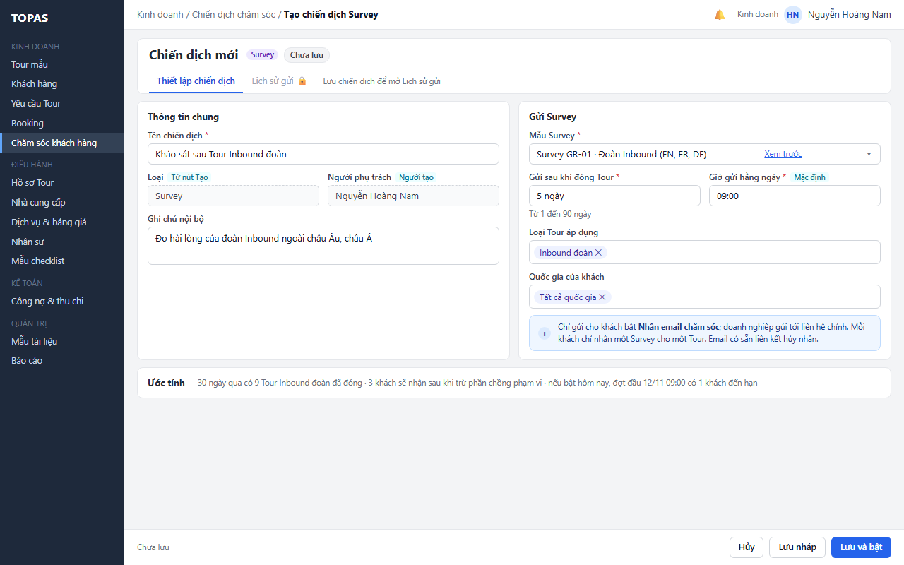

2. **W02 · Liên kết Xem trước trong ô Mẫu Survey → bảng trượt.** Người dùng bấm Xem trước. Bảng trượt hiện email mời và trang Survey của mẫu, mỗi ngôn ngữ của mẫu một thẻ; trường trộn được tô vàng (R10). Người dùng bấm Gửi thử tới email của tôi: hệ thống gửi nội dung đã trộn dữ liệu của một Tour đã đóng khớp phạm vi tới email tài khoản của người dùng, tiêu đề có tiền tố “[Gửi thử]”, link Survey trong bản thử mở trang ở chế độ xem trước, không ghi phản hồi; thông báo ngắn “Đã gửi thử tới …”. Gửi thử không tạo lần gửi. Bấm Đóng về W01.

   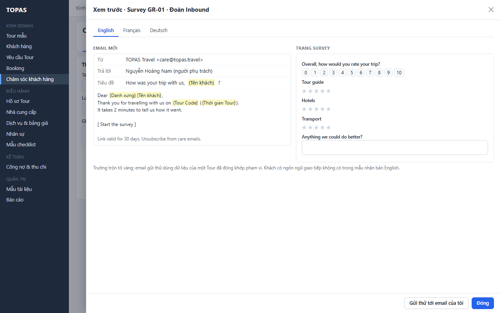

3. **W01 → W04 · Nút Lưu và bật ở chân tab → hộp thoại.** Hệ thống kiểm tra theo R04 (lỗi thì E1.2). Đạt thì hộp thoại tóm tắt: điều kiện gửi bằng lời, đợt đầu và số khách đến hạn, địa chỉ gửi và người nhận trả lời (R10); nếu chồng phạm vi với Survey đang chạy, banner vàng nêu từng chiến dịch và cách xử lý (R06). Người dùng bấm Bật chiến dịch, hoặc Quay lại sửa để về W01 với dữ liệu giữ nguyên.

   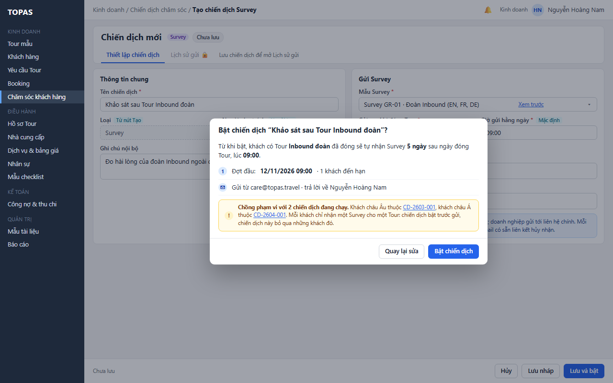

4. **W05 · Sau khi bật.** Hệ thống lưu chiến dịch, cấp mã CD-2611-002 (R03), ghi trạng thái Đang chạy và thời điểm bật, lên lịch đợt gửi hằng ngày (R05). Phần đầu hiện mã, trạng thái, lần gửi tiếp theo 12/11 09:00 · 1 khách; tab Thiết lập chỉ đọc với banner “Bấm Tạm dừng ở góc trên để sửa”; tab Lịch sử gửi mở được (W22). Thông báo ngắn “Đã bật CD-2611-002. Đợt đầu 12/11 09:00 · 1 khách.” Chiến dịch hiện ở KD09 chip Đang chạy.

   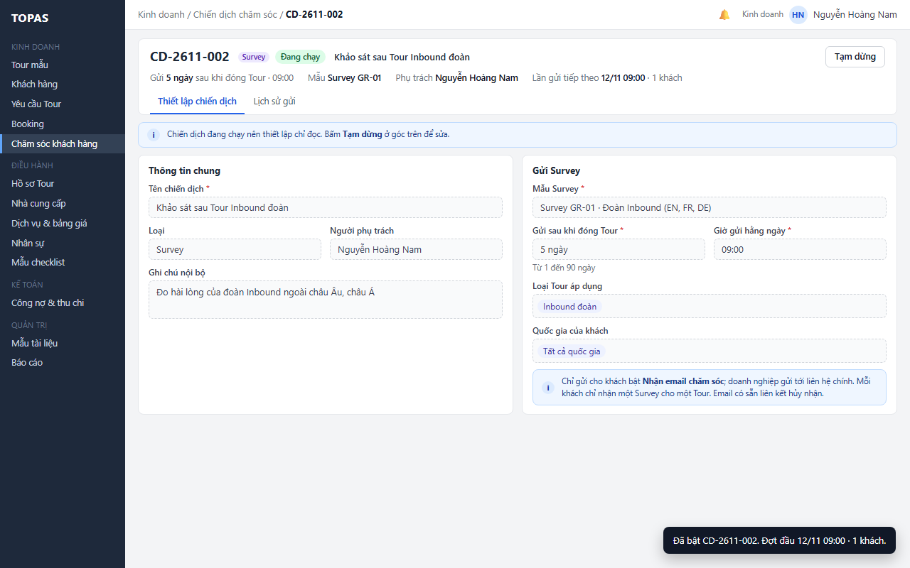

*Kết quả:* chiến dịch Đang chạy; từ đợt 12/11 09:00 hệ thống tự gửi Survey cho khách đến hạn (L4.1).

**L1.2 Lưu nháp rồi bật sau.** *Điều kiện:* như L1.1.

1. **W01 → W15 · Nút Lưu nháp ở chân tab.** Người dùng bấm Lưu nháp. Hệ thống chỉ kiểm tra tên chiến dịch (E1.1), lưu, cấp mã, trạng thái Nháp; phần đầu hiện mã, nhãn Nháp và nút Xóa nháp; chân tab ghi “Lưu lần cuối …”. Bố cục như W15 (không có hộp thoại). Không gửi gì.
2. **W15 → W04 · Mở lại chiến dịch Nháp, Lưu và bật.** Người phụ trách mở lại từ KD09 (tab Thiết lập), bổ sung rồi bấm Lưu và bật; tiếp tục như L1.1 bước 3–4.

*Kết quả:* chiến dịch nằm ở chip Nháp của KD09 cho tới khi bật.

**L1.3 Xóa chiến dịch nháp.** *Điều kiện:* người phụ trách; chiến dịch Nháp chưa từng bật (R15).

1. **W15 · Nút Xóa nháp ở phần đầu → hộp thoại.** Người dùng bấm Xóa nháp. Hộp thoại nêu chiến dịch chưa từng bật, chưa gửi lần nào, xóa không khôi phục, mã không dùng lại. Bấm Xóa nháp: hệ thống xóa, ghi nhật ký QT03, về KD09 với thông báo “Đã xóa chiến dịch nháp CD-2611-001”. Bấm Giữ lại để đóng.

   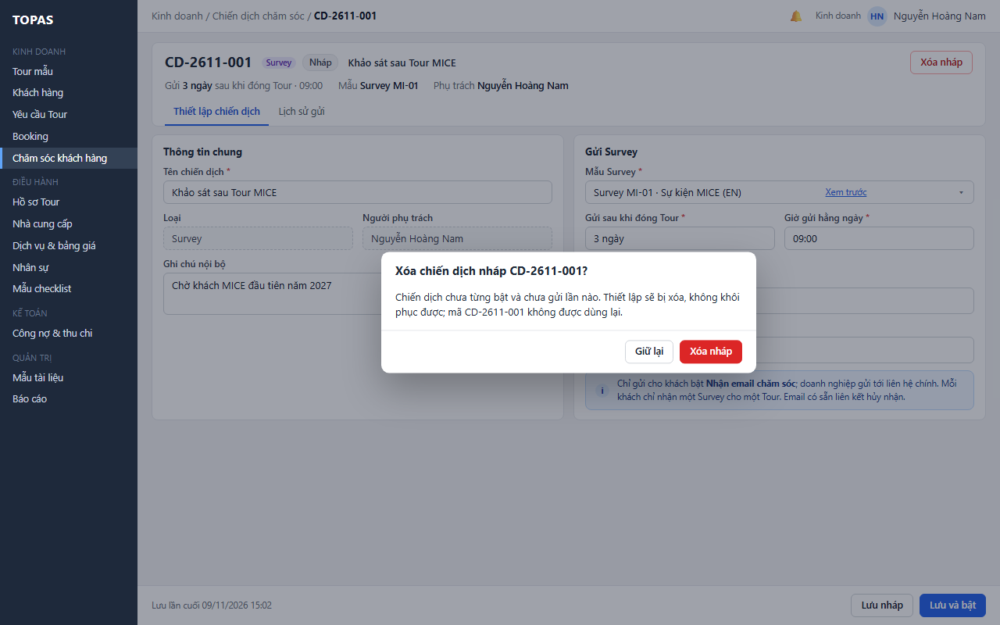

*Kết quả:* chiến dịch không còn ở KD09.

**Ngoại lệ**

- **E1.1 Lưu nháp thiếu tên.** Lỗi dưới ô Tên “Nhập tên chiến dịch”; không lưu. Tên trùng chiến dịch khác chỉ cảnh báo dưới ô (“Đã có CD-… cùng tên”), vẫn lưu được.
- **E1.2 Lưu và bật thiếu hoặc sai dữ liệu (W03).** Banner đỏ nêu số trường cần sửa; lỗi dưới từng trường (chưa chọn mẫu, số ngày ngoài 1–90, giờ sai định dạng, không có loại Tour hay quốc gia nào); không mở hộp thoại, không lưu; dữ liệu giữ nguyên. Người dùng sửa rồi bấm lại.

  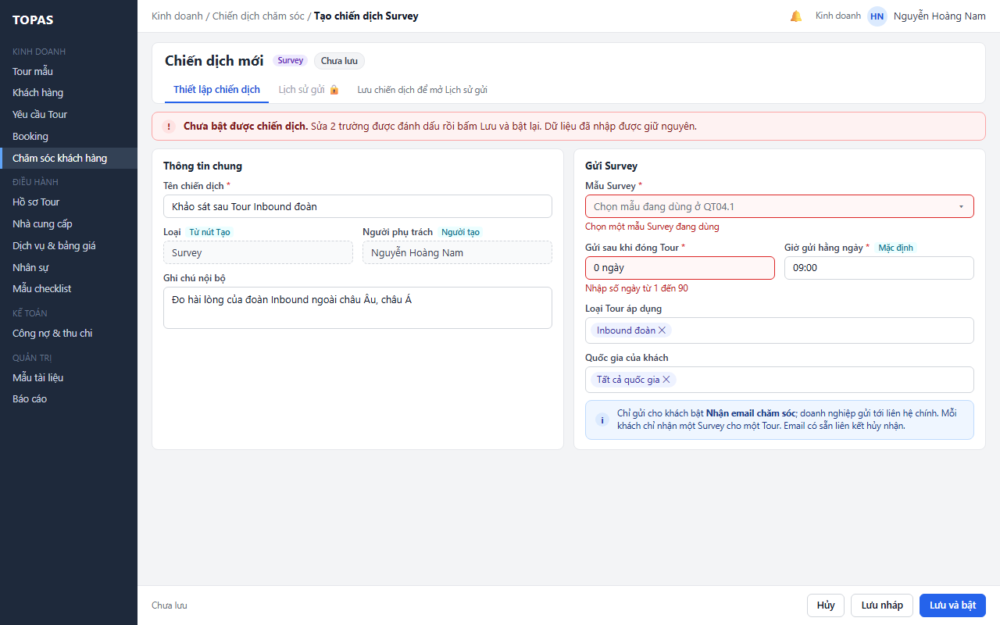

- **E1.3 Mẫu bị tắt ở QT04.1.** Khi chọn: mẫu đã tắt không có trong danh sách. Mẫu bị tắt sau khi chọn: Lưu và bật báo lỗi dưới ô Mẫu “Mẫu đã ngừng sử dụng, chọn mẫu khác”. Chiến dịch Đang chạy mà mẫu bị tắt vẫn gửi bằng bản nội dung đã sao chép lúc bật (R10).
- **E1.4 Gửi thử lỗi.** Thông báo “Chưa gửi thử được. Thử lại” kèm lý do; tài khoản không có email thì nút Gửi thử khóa, ghi “Tài khoản chưa có email”.
- **E1.5 Ước tính không tải được.** Khối Ước tính ghi “Chưa tính được ước tính · Thử lại”; không chặn lưu hay bật.
- **E1.6 Xóa nháp khi chiến dịch vừa được bật ở phiên khác.** Từ chối, “Chiến dịch đã được bật lúc …, không xóa được”; hồ sơ tải lại.
- **E1.7 Hủy tạo.** Bấm Hủy hoặc rời trang khi chưa lưu: hỏi theo 2.6; bỏ thì không tạo chiến dịch, về KD09.

### 3.2. Tab Thiết lập · Remarketing (TN10.04 · SYS10.06)

**L2.1 Chọn nhóm khách mục tiêu.** *Điều kiện:* người phụ trách; chiến dịch Remarketing Nháp hoặc Tạm dừng (ví dụ CD-2610-001 do Phạm Thanh Tùng phụ trách).

1. **W06 · Khối Nhóm khách mục tiêu.** Người dùng đặt tên nhóm (Khách Bắc Mỹ) và chọn tiêu chí theo R08: quốc gia (Hoa Kỳ, Canada), loại khách, ngôn ngữ giao tiếp, nguồn khách, đã đi Tour, Tour gần nhất; công tắc Bỏ khách đang có yêu cầu Tour Đang xử lý bật sẵn. Dòng cuối khối tính lại sau mỗi thay đổi: 64 khách khớp tiêu chí · 57 khách nhận được, ghi “tính lại mỗi bước gửi”.

   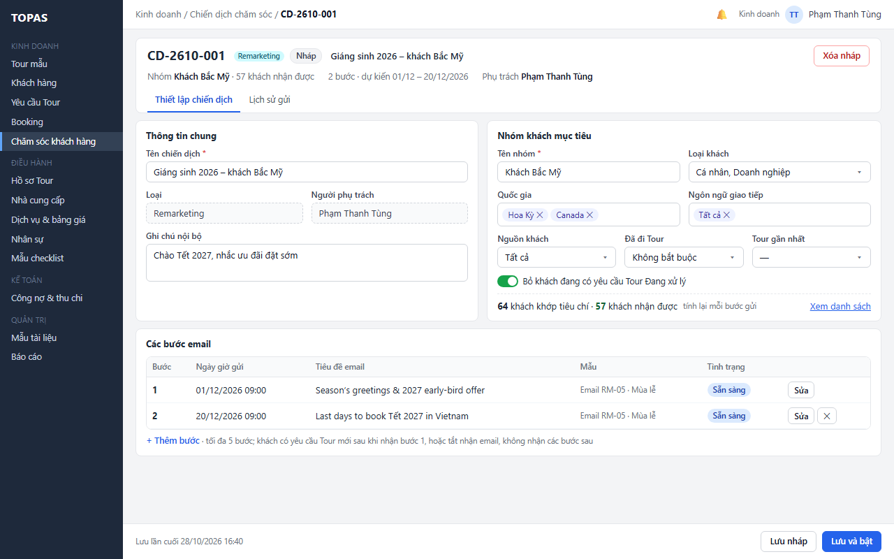

2. **W07 · Liên kết Xem danh sách → bảng trượt.** Người dùng bấm Xem danh sách. Bảng trượt liệt kê khách khớp, chip Tất cả, Nhận được, Tắt Nhận email chăm sóc, Thiếu email, Đã bỏ khỏi chiến dịch; mỗi dòng có mã, quốc gia, liên hệ chính, email sẽ nhận và tình trạng. Người dùng bấm Bỏ khỏi chiến dịch trên một dòng: dòng chuyển sang Đã bỏ, số Nhận được giảm 1, có Hoàn tác 10 giây (R08). Khách thiếu email có liên kết Mở hồ sơ khách (KD04 ở thẻ mới). Bấm Đóng về W06.

   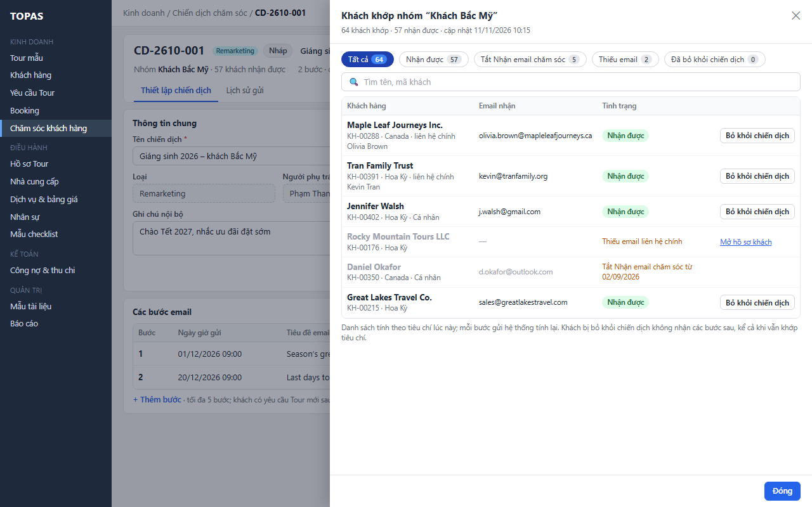

*Kết quả:* nhóm khách và danh sách loại trừ được lưu khi người dùng bấm Lưu nháp, Lưu thay đổi hoặc Lưu và bật.

**L2.2 Soạn các bước email.** *Điều kiện:* như L2.1.

1. **W06 · Khối Các bước email.** Bảng liệt kê bước theo ngày giờ: ngày giờ gửi, tiêu đề, mẫu, tình trạng (R09), nút Sửa và ✕ (bước chưa gửi). Người dùng bấm + Thêm bước (tối đa 5) hoặc Sửa.
2. **W08 · Bảng trượt soạn bước.** Người dùng nhập ngày giờ gửi, chọn mẫu email (QT04.1, mẫu email chăm sóc). Hệ thống điền tiêu đề và nội dung của mẫu cho mọi ngôn ngữ mẫu có (nhãn Từ mẫu; sửa thì thành Từ mẫu, đã sửa). Người dùng sửa nội dung, chèn trường trộn; bên phải xem trước với một khách nhận được thật của nhóm. Liên kết hủy nhận và dòng lý do nhận email được hệ thống tự thêm cuối email, không xóa được (R13). Gửi thử tới email của tôi như L1.1 bước 2. Bấm Lưu bước: bảng trượt đóng, bước cập nhật trong bảng ở W06 (chưa lưu chiến dịch cho tới khi bấm nút ở chân tab).

   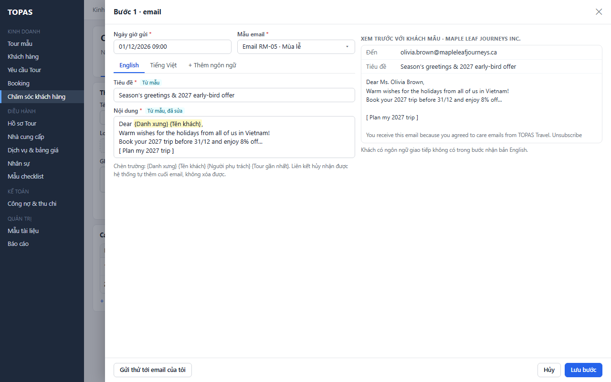

*Kết quả:* chiến dịch có các bước đủ nội dung, tình trạng Sẵn sàng.

**L2.3 Bật chiến dịch Remarketing.** *Điều kiện:* người phụ trách; Nháp.

1. **W06 → W09 · Nút Lưu và bật ở chân tab → hộp thoại.** Hệ thống kiểm tra theo R04 (lỗi thì E2.4). Đạt thì hộp thoại liệt kê các bước với ngày giờ, tiêu đề, số khách dự kiến (bước 1 là số nhận được hiện tại; bước sau “≤” vì tính lại lúc gửi), địa chỉ gửi và người nhận trả lời. Người dùng bấm Bật chiến dịch hoặc Quay lại.

   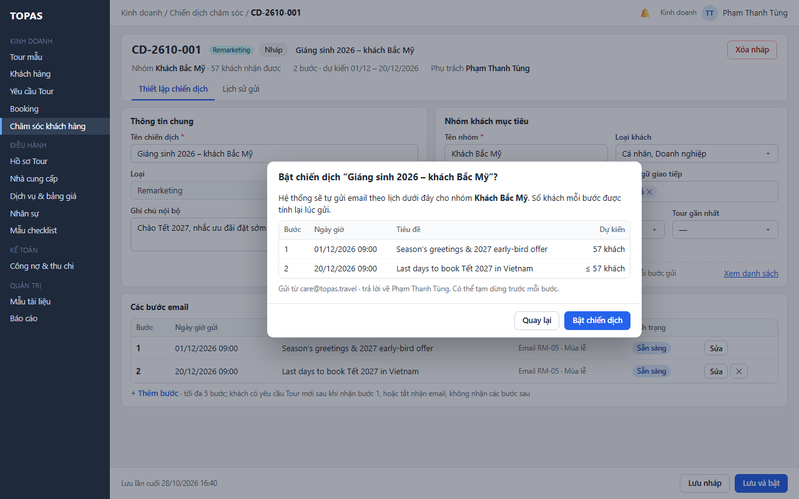

2. **W11 · Sau khi bật.** Trạng thái Đang chạy; bước 1 Sắp gửi kèm số khách dự kiến; thiết lập chỉ đọc với banner như W05; phần đầu ghi lần gửi tiếp theo. Thông báo ngắn “Đã bật CD-2610-001. Bước 1 gửi 01/12 09:00.” (W11 minh họa CD-2609-001 sau khi bước 1 đã gửi: bước 1 Đã gửi 182 lần · 4 lỗi, bước 2 Sắp gửi dự kiến 179 khách, bước 3 Chờ.)

   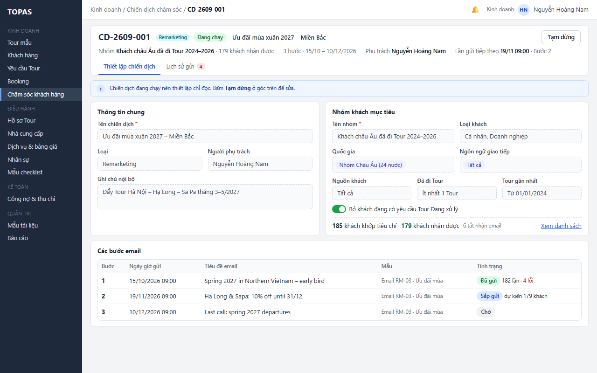

*Kết quả:* hệ thống tự gửi từng bước theo lịch (L4.2).

**Ngoại lệ**

- **E2.1 Nhóm không có khách nhận được.** Dòng số khách ghi “0 khách nhận được” màu đỏ; Lưu và bật báo lỗi “Nhóm chưa có khách nhận được”. Lưu nháp vẫn được.
- **E2.2 Tiêu chí không tính được.** Dòng số khách ghi “Chưa tính được · Thử lại”; Lưu và bật bị chặn tới khi tính được để hộp thoại có số khách đúng.
- **E2.3 Danh sách khách lớn.** Bảng trượt W07 tải 50 dòng mỗi lần, có ô tìm; chip vẫn là tổng.
- **E2.4 Bước không hợp lệ khi bật (W10).** Bước có ngày giờ đã qua hoặc cách hiện tại dưới 15 phút, bước thiếu tiêu đề hoặc nội dung ở ngôn ngữ English (bắt buộc), hai bước cùng ngày giờ, hoặc bước sau không muộn hơn bước trước: dòng bước tô đỏ, cột Tình trạng ghi lỗi, banner đỏ nêu cách sửa; không mở hộp thoại.

  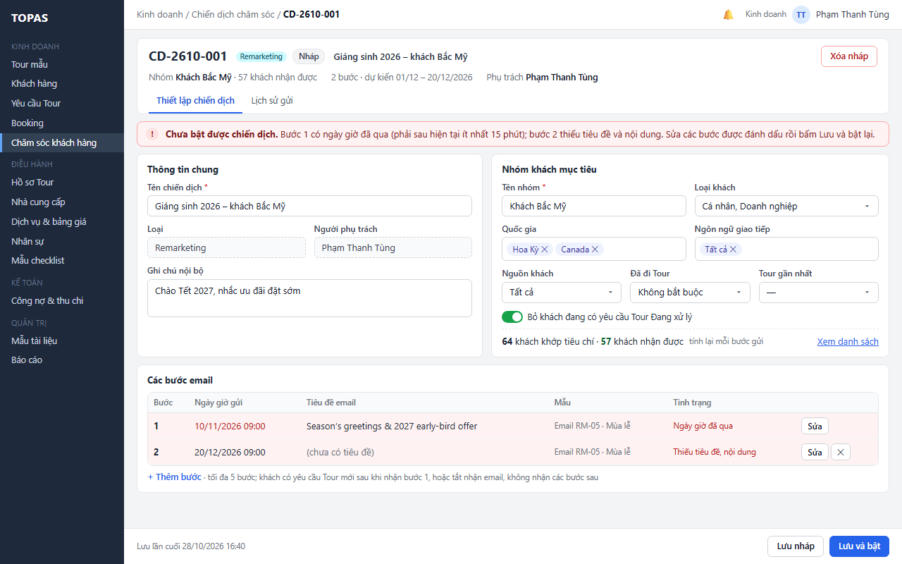

- **E2.5 Ngày giờ gửi trùng chiến dịch khác của cùng khách.** Không chặn, không cảnh báo ở bản này; khách có thể nhận hai email trong một ngày từ hai chiến dịch.
- **E2.6 Bỏ khách rồi khách không còn khớp tiêu chí.** Khách vẫn ở danh sách loại trừ; nếu khớp lại thì vẫn bị bỏ cho tới khi người phụ trách bấm Đưa lại vào chiến dịch ở chip Đã bỏ.
- **E2.7 Xóa bước.** Chỉ xóa được bước chưa gửi (✕); bước đã gửi khóa 🔒. Xóa bước cuối cùng khi chiến dịch Nháp thì chiến dịch không còn bước, Lưu và bật báo lỗi theo R04.

### 3.3. Tạm dừng, sửa và bật lại

**L3.1 Tạm dừng chiến dịch đang chạy.** *Điều kiện:* người phụ trách; Đang chạy.

1. **W11 → W12 · Nút Tạm dừng ở phần đầu → hộp thoại.** Hộp thoại nêu bước hoặc đợt gửi sẽ không gửi, các lần gửi đã có giữ nguyên; ô Lý do tạm dừng không bắt buộc. Bấm Giữ chạy để đóng.

   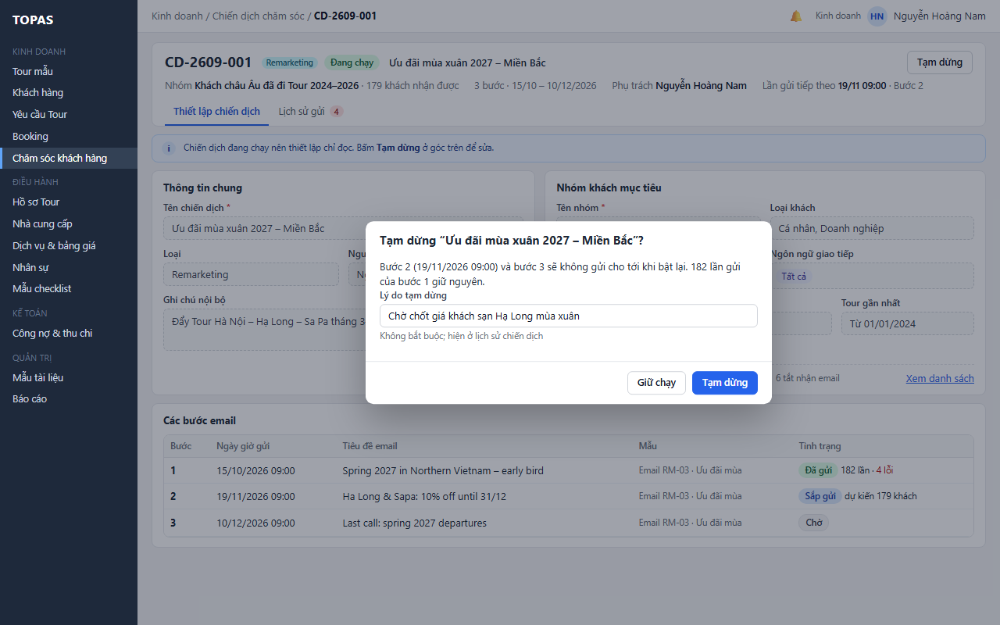

2. **W13 · Nút Tạm dừng trong hộp thoại.** Hệ thống ghi Tạm dừng, thời điểm, lý do; hủy các lần gửi đã lên lịch mà chưa giao cho dịch vụ email (R11). Phần đầu đổi nút thành Bật lại, dòng 2 ghi thời điểm và lý do; banner vàng nêu những gì sửa được; nhóm khách và bước chưa gửi mở để sửa, bước đã gửi khóa 🔒, bước chưa gửi ghi Chưa gửi · tạm dừng. Thông báo ngắn “Đã tạm dừng CD-2609-001.”

   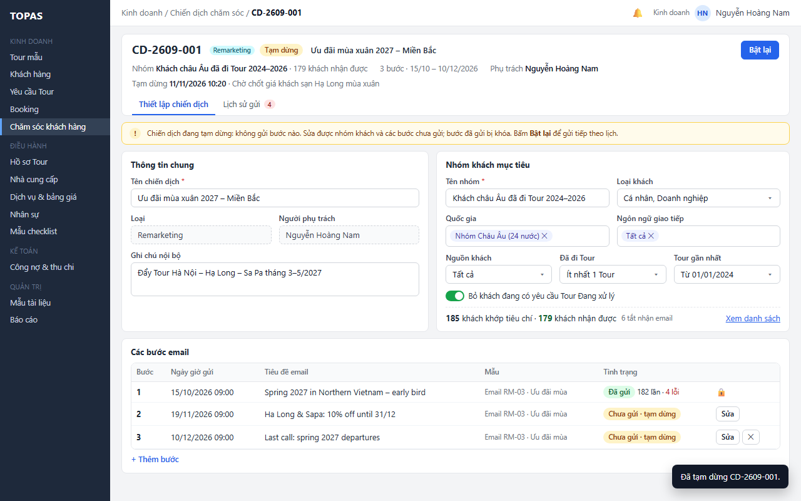

*Kết quả:* không có email nào của chiến dịch được gửi cho tới khi bật lại.

**L3.2 Sửa và bật lại Remarketing.** *Điều kiện:* người phụ trách; Tạm dừng.

1. **W13 · Sửa nhóm khách hoặc bước chưa gửi.** Người dùng sửa như L2.1, L2.2. Nút ở phần đầu đổi thành Lưu và bật lại; chân tab hiện Lưu thay đổi. Bấm Lưu thay đổi: lưu, vẫn Tạm dừng.
2. **W13 → W09 · Nút Bật lại (hoặc Lưu và bật lại).** Hệ thống kiểm tra R04 cho các bước chưa gửi (bước có ngày giờ đã qua trong lúc tạm dừng thì báo như E2.4, W10). Đạt thì hộp thoại như W09, chỉ liệt kê các bước chưa gửi. Bấm Bật chiến dịch: trạng thái Đang chạy, lần gửi tiếp theo theo bước chưa gửi gần nhất (W11).

*Kết quả:* chiến dịch chạy tiếp; bước đã gửi không gửi lại.

**L3.3 Bật lại Survey sau thời gian tạm dừng.** *Điều kiện:* người phụ trách; Survey Tạm dừng (ví dụ CD-2605-001 do Lê Thu Hà phụ trách, tạm dừng 20/10).

1. **W14 · Nút Bật lại ở phần đầu → hộp thoại.** Hộp thoại nêu đợt gửi kế tiếp; nếu trong lúc tạm dừng có khách đến hạn mà chưa gửi, banner vàng nêu số khách và ô chọn “Gửi bù cho n khách này ở đợt …” (mặc định không chọn, R07). Người dùng chọn hoặc không rồi bấm Bật lại. Hệ thống ghi Đang chạy; phần đầu như W05 với lần gửi tiếp theo cộng số khách gửi bù nếu chọn.

   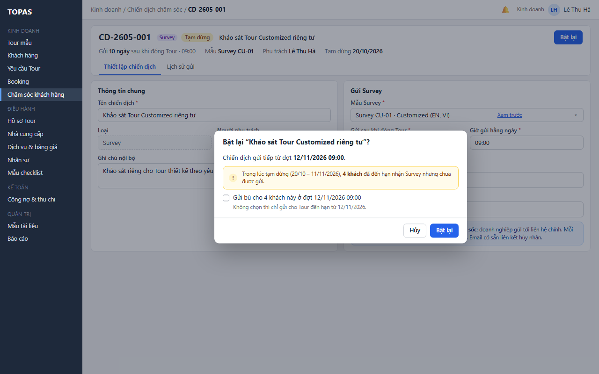

*Kết quả:* Survey gửi tiếp; khách đến hạn trong lúc tạm dừng chỉ nhận khi người phụ trách chọn gửi bù.

**L3.4 Người khác xem chiến dịch.** *Điều kiện:* Kinh doanh không phụ trách, hoặc Quản trị.

1. **W16 · Mở KD10 từ KD09.** Phần đầu ghi “🔒 Chỉ xem · do Nguyễn Hoàng Nam phụ trách”; không có Tạm dừng, Bật lại, Lưu, Xóa nháp, Gửi lại; mọi trường chỉ đọc. Vẫn xem được Lịch sử gửi, chi tiết lần gửi và Xem trước mẫu, Gửi thử tới email của mình.

   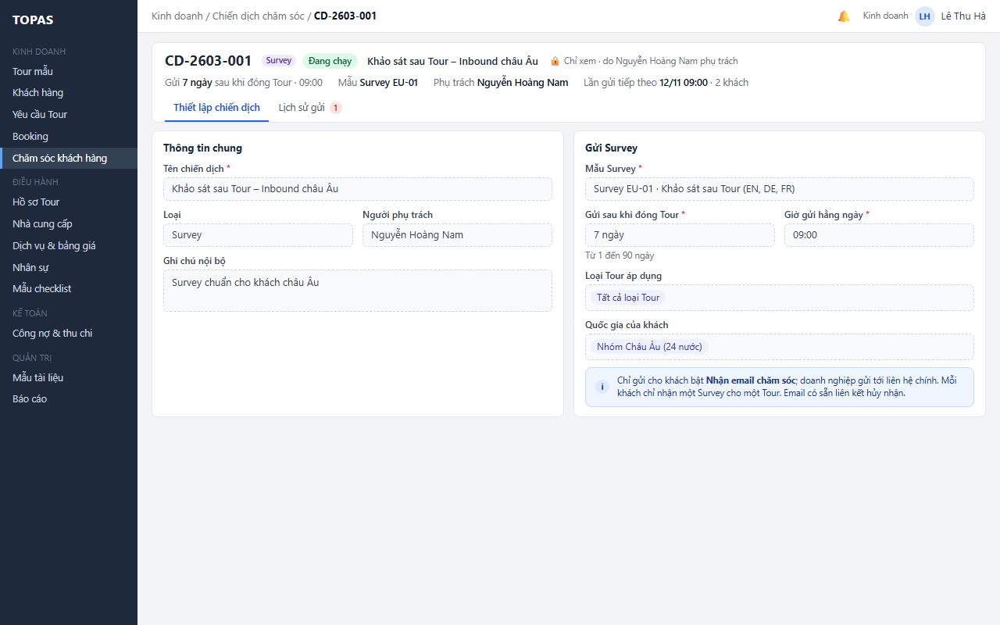

*Kết quả:* người khác tham khảo chiến dịch mà không thay đổi được.

**Ngoại lệ**

- **E3.1 Tạm dừng đúng lúc đang gửi một bước.** Lần gửi đã giao cho dịch vụ email vẫn đi và được ghi kết quả; lần chưa giao bị hủy. Bước ghi “Đã gửi một phần · n / m” và Chưa gửi · tạm dừng cho phần còn lại; bật lại thì gửi phần còn lại ngay ở đợt kế tiếp nếu ngày giờ của bước đã qua dưới 24 giờ, quá 24 giờ thì người phụ trách đặt lại ngày giờ cho phần còn lại (E2.4).
- **E3.2 Tạm dừng khi đã gửi hết các bước.** Vẫn cho tạm dừng (không có bước nào bị ảnh hưởng); hộp thoại ghi “Chiến dịch đã gửi hết các bước”.
- **E3.3 Bật lại khi mẫu Survey, nhóm hoặc bước không còn hợp lệ.** Báo lỗi như E1.2, E1.3, E2.1, E2.4; chiến dịch giữ Tạm dừng. Mẫu của bước Remarketing đã ngừng dùng không phải lỗi (R10).
- **E3.4 Hai người cùng thao tác.** Ví dụ Quản trị vừa chuyển người phụ trách ở KD09 khi người cũ đang sửa: lưu bị từ chối theo 2.6, hồ sơ chuyển chỉ đọc sau khi tải lại.
- **E3.5 Bấm Tạm dừng hoặc Bật lại hai lần.** Chỉ ghi một lần; lần sau thấy trạng thái đã đổi thì trả về trạng thái hiện tại, không báo lỗi.
- **E3.6 Người phụ trách bị khóa tài khoản.** Chiến dịch không đổi, vẫn gửi nếu Đang chạy (RSD KD09 R11); email trả lời về người phụ trách thì chuyển tới địa chỉ chung care@… (R10).

### 3.4. Hệ thống tự gửi (SYS10.07)

**L4.1 Đợt gửi Survey hằng ngày.** *Điều kiện:* Survey Đang chạy; đến giờ gửi.

1. **W17 · Hệ thống tạo đợt gửi.** Đến giờ gửi của chiến dịch, hệ thống chọn khách đến hạn theo R05, R06, R10; với mỗi khách tạo một lần gửi có link Survey riêng (R12), giao cho dịch vụ email, ghi kết quả (R11). Lần gửi hiện ở đầu tab Lịch sử gửi; số liệu ở KD09, KD04.4, QT06 cập nhật ở lần tải kế tiếp.

*Kết quả:* mỗi khách đến hạn nhận đúng một Survey cho Tour đó.

**L4.2 Gửi một bước Remarketing.** *Điều kiện:* Remarketing Đang chạy; đến ngày giờ của bước.

1. **W11 → W17 · Hệ thống gửi bước.** Hệ thống tính lại nhóm theo R08, bỏ khách dừng luồng theo R09, gửi cho mỗi khách nhận được một lần gửi; bước chuyển Đang gửi rồi Đã gửi kèm số lần gửi và lỗi; bước kế tiếp thành Sắp gửi. Gửi xong bước cuối, KD09 hiện chỉ báo Đã gửi hết các bước (RSD KD09 R02).

*Kết quả:* bước được gửi một lần duy nhất cho mỗi khách.

**Ngoại lệ**

- **E4.1 Dịch vụ email không phản hồi.** Lần gửi ở Đang gửi; hệ thống tra lại theo mã lần gửi trước khi thử lại, không gửi trùng (R11). Quá 2 giờ chưa xác định thì ghi Gửi lỗi “Không xác định được kết quả” và không tự gửi lại.
- **E4.2 Hệ thống ngừng đúng giờ gửi.** Khi chạy lại trong 24 giờ, đợt hoặc bước bị lỡ được gửi ngay; quá 24 giờ thì không gửi, ghi lịch sử chiến dịch “Đợt … bị lỡ” và thông báo người phụ trách để quyết định (với Remarketing: đặt lại ngày giờ khi tạm dừng).
- **E4.3 Khách đổi email hoặc tắt nhận email giữa lúc tính và lúc gửi.** Hệ thống đọc lại ngay trước khi giao từng lần gửi; tắt thì bỏ, đổi thì gửi email mới.
- **E4.4 Tour được mở lại sau khi đóng (DH08).** Survey chưa gửi bị bỏ khi mở lại, như RSD DH08 R16: không gửi trong lúc mở lại và không gửi khi Tour đóng lại, vì mốc n ngày luôn tính từ ngày đóng lần đầu, không tính lại hạn. Survey đã gửi thì không gửi lại (R05). Hồ sơ kết thúc vì Booking đã hủy không được xét.
- **E4.5 Doanh nghiệp đổi liên hệ chính trước khi gửi.** Gửi tới liên hệ chính tại lúc gửi.

### 3.5. Tab Lịch sử gửi (KD10.2)

**L5.1 Xem lần gửi và phản hồi.** *Điều kiện:* mọi người xem được chiến dịch; đã lưu.

1. **W17 · Tab Lịch sử gửi.** Thanh lọc: ô tìm (khách, mã khách, email nhận), Ngày gửi, Bước (Remarketing). Chip: Tất cả, Đã gửi, Gửi lỗi, Hủy nhận (cả Survey và Remarketing, vì khách hủy nhận được từ email Survey, L6.2), và theo loại: Survey có Đã phản hồi, Chưa phản hồi. Mỗi dòng: ngày giờ gửi; khách (bấm mở KD04.4) và email nhận; Tour Code và ngày đóng (Survey) hoặc Bước (Remarketing); kết quả gửi; phản hồi hoặc lý do lỗi. Mới nhất trước, 20 dòng mỗi trang.

   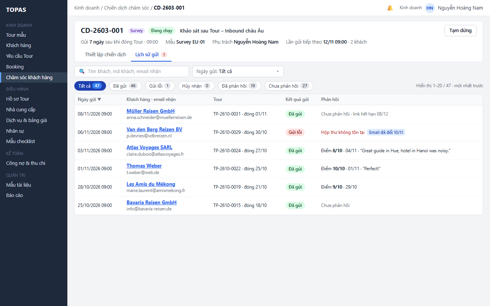

2. **W20 · Bấm một dòng → bảng trượt chi tiết.** Bảng trượt hiện mốc thời gian (đã gửi, khách mở trang Survey, khách gửi phản hồi), câu trả lời đầy đủ, bản lưu email đã gửi, liên kết khách và Tour. Mở hồ sơ khách mở KD04.4 để ghi nhận chăm sóc tiếp.

   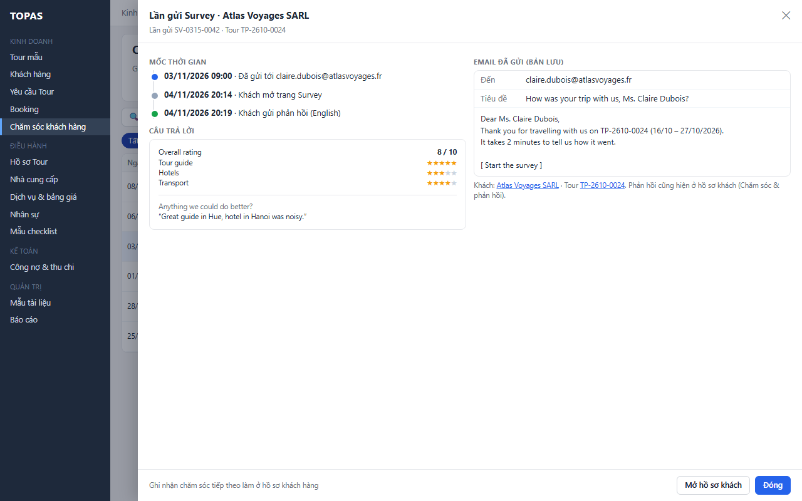

*Kết quả:* người dùng thấy ai đã nhận, ai phản hồi gì mà không phải mở từng hồ sơ khách.

**L5.2 Gửi lại các lần gửi lỗi.** *Điều kiện:* người phụ trách; chiến dịch Đang chạy (Tạm dừng thì không gửi lại, E5.4); có lần gửi lỗi.

1. **W18 · Chip Gửi lỗi, ô chọn trên dòng → thanh hàng loạt.** Người dùng bấm chip Gửi lỗi (hoặc mở từ “n gửi lỗi” ở KD09). Dòng gửi lại được có ô chọn; dòng không gửi lại được (hộp thư không tồn tại mà email chưa đổi) không có ô chọn, ghi “sửa email ở hồ sơ khách để gửi lại” (R11). Dòng có email đã đổi ghi email cũ → email mới và chỉ báo Email đã đổi. Người dùng chọn ô đầu bảng (chọn mọi dòng có ô chọn trong trang); thanh hàng loạt ghi số đã chọn, nội dung sẽ gửi lại và nút Gửi lại n lần.

   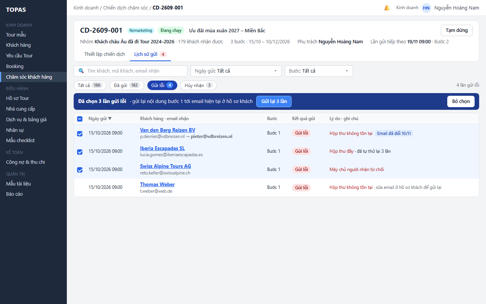

2. **W19 · Nút Gửi lại trên thanh hàng loạt.** Hệ thống gửi lại từng lần với nội dung đã lưu của lần gửi gốc (bước hoặc Survey, link Survey mới cùng hạn mới) tới email hiện tại ở hồ sơ khách, theo R11. Banner nêu số thành công và số vẫn lỗi kèm lý do; dòng thành công đổi Đã gửi, mờ tại chỗ (không còn khớp chip Gửi lỗi) tới lần tải lại; số trên chip, trên tab và ở KD09 cập nhật. Thông báo ngắn “Đã gửi lại 2 / 3 lần gửi lỗi.”

   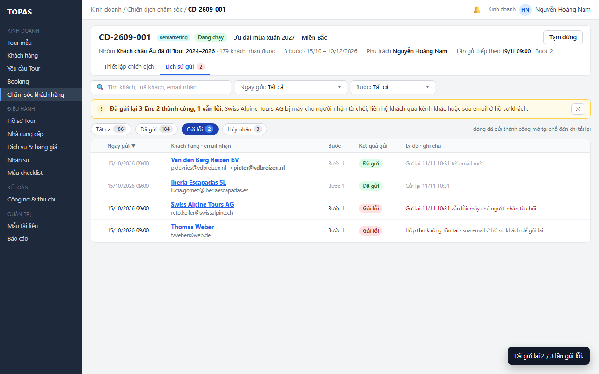

*Kết quả:* lần gửi lỗi được xử lý; lần vẫn lỗi còn ở chip Gửi lỗi.

**L5.3 Xem khách hủy nhận.** *Điều kiện:* Survey hoặc Remarketing; mọi người xem được.

1. **W21 · Chip Hủy nhận.** Danh sách lần gửi mà khách bấm hủy nhận từ email của chiến dịch này, ghi thời điểm hủy và hệ quả (Remarketing: không nhận các bước sau; Nhận email chăm sóc của khách đã chuyển Không, R13).

   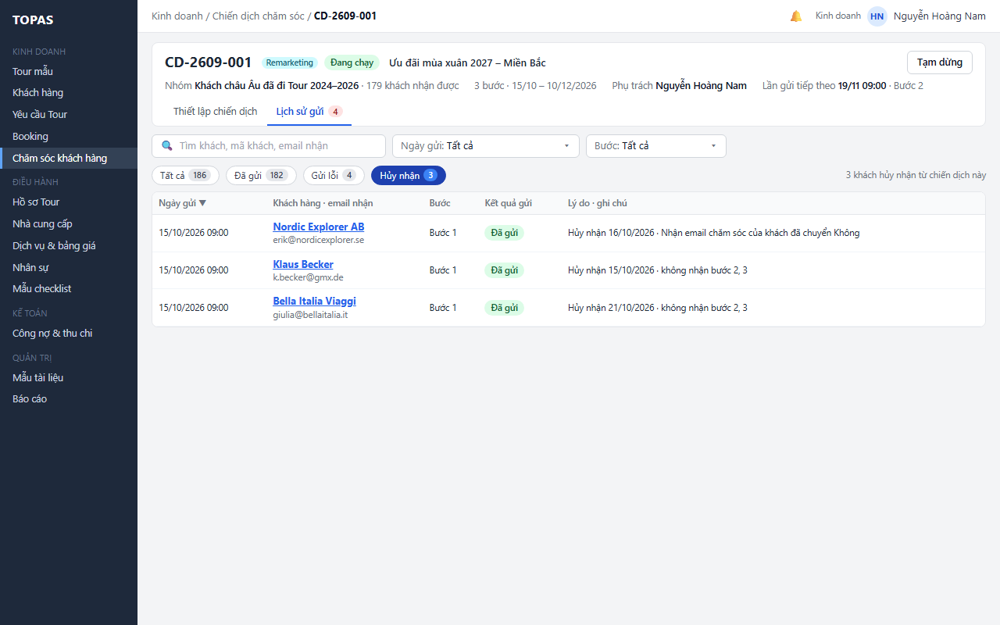

*Kết quả:* người phụ trách biết khách nào không muốn nhận để không liên hệ lại bằng email chăm sóc.

**Ngoại lệ**

- **E5.1 Chưa có lần gửi (W22).** Chiến dịch vừa bật hoặc Tạm dừng trước khi gửi: bảng ghi “Chưa có lần gửi nào” và đợt gửi đầu (nếu Đang chạy). Khác “Không có lần gửi khớp bộ lọc” khi đang lọc.

  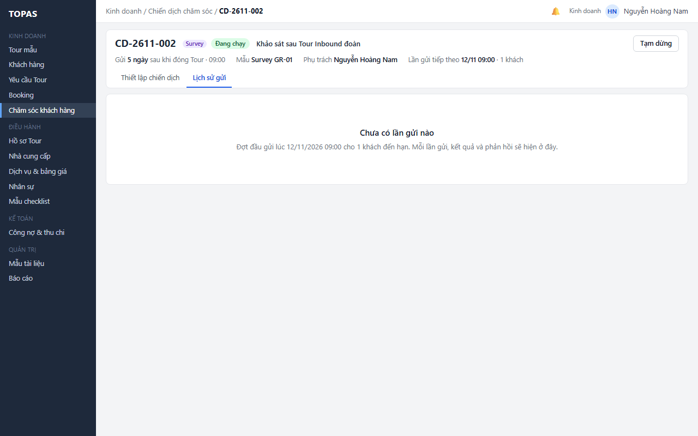

- **E5.2 Gửi lại thành công một phần, mất kết nối giữa chừng.** Mỗi lần gửi lại là một giao dịch riêng; dòng chưa xử lý vẫn được chọn để bấm lại; bấm lặp không gửi hai lần (mã thao tác).
- **E5.3 Lần gửi lỗi đổi trạng thái sau khi đã chọn.** Ví dụ hệ thống tự thử lại thành công: lúc ghi bỏ qua dòng đó, banner ghi “1 lần đã được gửi trước đó”.
- **E5.4 Gửi lại khi chiến dịch Tạm dừng.** Không cho: Tạm dừng nghĩa là không email nào của chiến dịch được gửi cho tới khi bật lại (L3.1, AC22). Ở chip Gửi lỗi, ô chọn và nút Gửi lại khóa kèm lý do “Chiến dịch đang Tạm dừng · bật lại để gửi lại”; máy chủ từ chối nếu trạng thái đổi sang Tạm dừng trong lúc đang chọn. Lần gửi lỗi giữ nguyên, gửi lại được sau khi Bật lại. Gửi lại cho khách đã tắt Nhận email chăm sóc bị bỏ qua kèm lý do.
- **E5.5 Gửi lại Survey cho Tour đã có phản hồi từ link khác.** Không xảy ra vì mỗi khách–Tour chỉ một lần gửi; nếu lần gửi gốc đã có phản hồi thì dòng không ở chip Gửi lỗi.
- **E5.6 Khách đã bị xóa ở KD04.** Không xảy ra: chỉ xóa được khách chưa có lần gửi chiến dịch nào, kể cả Gửi lỗi (RSD KD03-KD04 R05), nên khách có lần gửi luôn còn. Khách bị gộp (nếu sau này có) thì lần gửi giữ mã khách cũ, hiện tên kèm “(đã gộp)”.
- **E5.7 Lỗi tải tab.** Như 2.6.

### 3.6. Trang khách nhìn thấy

**L6.1 Khách trả lời Survey.** *Điều kiện:* khách nhận email Survey; link còn hạn, chưa trả lời.

1. **W23 · Khách bấm nút trong email → trang Survey.** Trang mở bằng ngôn ngữ của lần gửi (đổi được ở góc trên nếu mẫu có ngôn ngữ khác), chào bằng danh xưng và tên, nêu Tour Code, thời gian và tuyến; câu hỏi theo mẫu; câu bắt buộc có dấu *. Hệ thống ghi thời điểm mở trang lần đầu. Khách trả lời và bấm Submit; thiếu câu bắt buộc thì lỗi dưới câu, giữ các câu đã trả lời.

   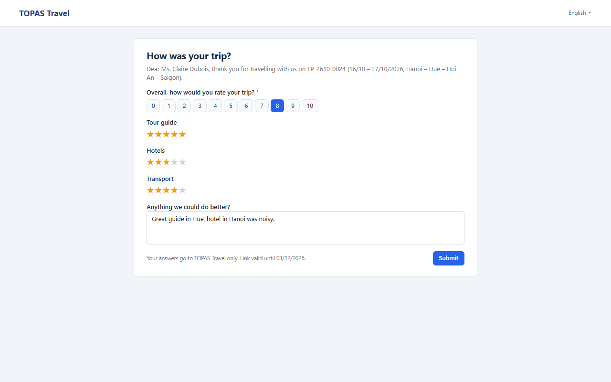

2. **W24 · Sau khi gửi.** Hệ thống ghi phản hồi vào lần gửi (điểm, từng câu, ý kiến, thời điểm, ngôn ngữ), đóng link; trang cảm ơn kèm tên người phụ trách. Lần gửi chuyển Đã phản hồi ở KD10.2, KD04.4; QT06 tính lại.

   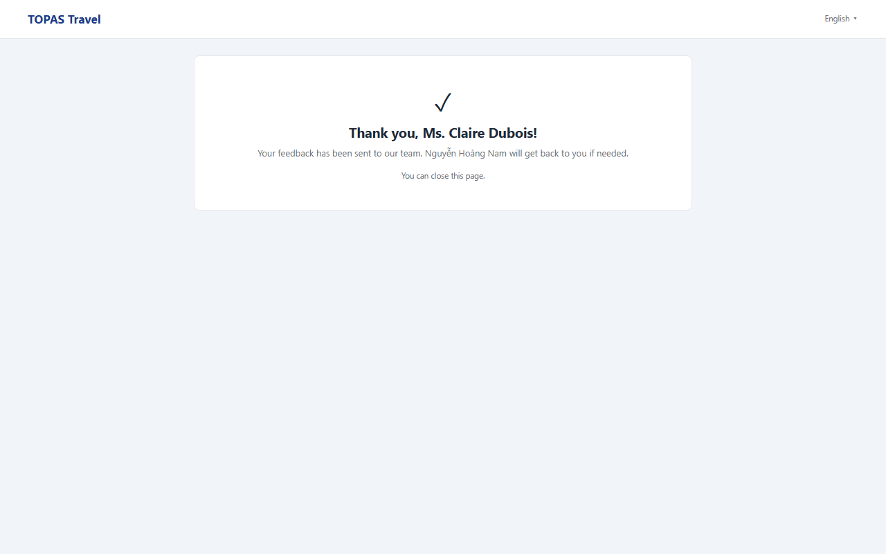

*Kết quả:* phản hồi được ghi tự động, không ai phải nhập tay.

**L6.2 Khách hủy nhận email chăm sóc.** *Điều kiện:* khách bấm Unsubscribe ở cuối email Survey hoặc Remarketing.

1. **W26 · Trang hủy nhận.** Trang nêu email sẽ không nhận Survey và ưu đãi nữa, email về Booking và chuyến đi không bị ảnh hưởng; khách bấm Unsubscribe một lần để xác nhận (tránh trình quét thư tự hủy). Hệ thống chuyển Nhận email chăm sóc của khách sang Không, ghi “Khách tự hủy nhận” và chiến dịch nguồn (RSD KD03-KD04 R11), ghi hủy nhận vào lần gửi (W21); trang hiện câu xác nhận.

   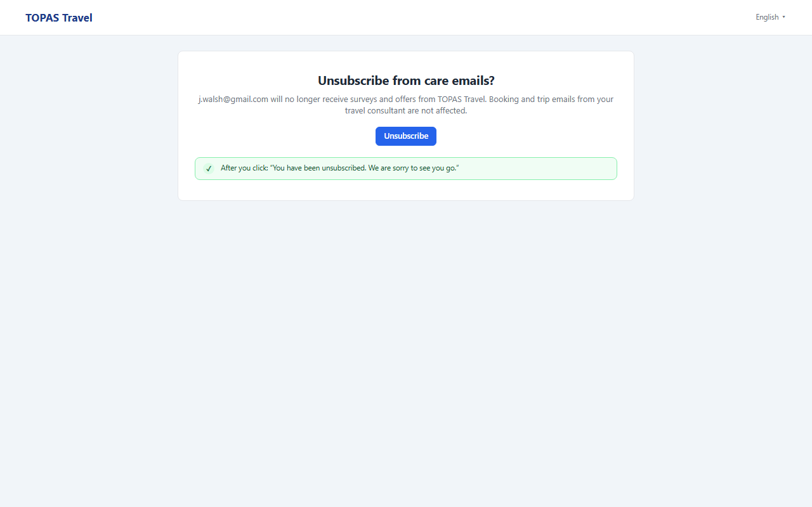

*Kết quả:* khách không nhận email của mọi chiến dịch chăm sóc từ lúc hủy.

**Ngoại lệ**

- **E6.1 Link hết hạn hoặc đã trả lời (W25).** Trang báo link không còn dùng được và chỉ cách gửi ý kiến bằng trả lời email; không ghi gì.

  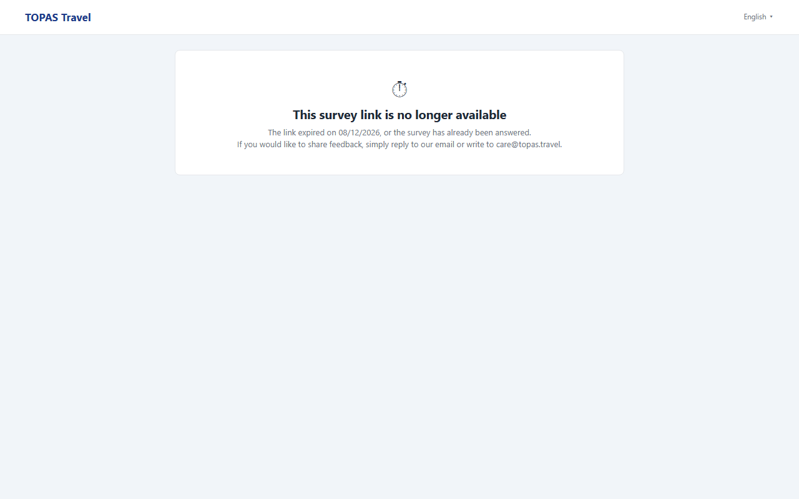

- **E6.2 Gửi phản hồi lỗi mạng.** Trang giữ câu trả lời, báo “Chưa gửi được, thử lại”; gửi lặp chỉ ghi một phản hồi (khóa theo link).
- **E6.3 Mở link Survey từ email gửi thử.** Trang ở chế độ xem trước, nút Submit ghi “Bản xem trước · không ghi phản hồi”.
- **E6.4 Hủy nhận lặp.** Khách đã hủy mà bấm lại: trang ghi “Bạn đã hủy nhận từ …”, không ghi thêm.
- **E6.5 Link bị sửa hoặc không tồn tại.** Trang chung “Link không hợp lệ”, không lộ thông tin chiến dịch hay khách.

---

## 4. Quy tắc triển khai chi tiết

### R01. Quyền (quyết định 12/11/2026)

- Mọi người dùng Kinh doanh xem mọi chiến dịch; chỉ người phụ trách hiện tại sửa, bật, tạm dừng, bật lại, xóa nháp, gửi lại. Không có bước duyệt.
- Người phụ trách hiện tại và Quản trị hệ thống chuyển người phụ trách chiến dịch ở KD09 (RSD KD09 R11; người dùng chốt 12/11/2026). Quản trị hệ thống xem KD10 chỉ đọc.
- Gửi lại lần gửi lỗi chỉ khi chiến dịch Đang chạy; Tạm dừng thì không gửi gì ra ngoài, kể cả Gửi lại (E5.4).
- Điều hành, Kế toán không có quyền vào KD10.

### R02. Trạng thái và nút

- Ba trạng thái Nháp, Đang chạy, Tạm dừng; chuyển theo bảng 2.3. Không có trạng thái kết thúc.
- Thiết lập chỉ sửa được khi Nháp hoặc Tạm dừng (quyết định 12/11/2026). Đang chạy thì mọi trường chỉ đọc; muốn sửa phải Tạm dừng.
- Ngày “từ …” của trạng thái (hiện ở KD09) là thời điểm lưu nháp lần đầu, bật hoặc bật lại, tạm dừng.

### R03. Mã chiến dịch

- Dạng `CD-YYMM-NNN`, cấp khi lưu lần đầu (Lưu nháp hoặc Lưu và bật); YYMM là tháng lưu lần đầu, NNN đếm lại mỗi tháng; không dùng lại, kể cả khi xóa nháp.

### R04. Điều kiện để bật hoặc bật lại

- Chung: tên có; người phụ trách là tài khoản Kinh doanh đang hoạt động.
- Survey: mẫu Survey đang dùng; số ngày từ 1 đến 90; giờ gửi HH:mm; ít nhất một loại Tour và một quốc gia (hoặc Tất cả).
- Remarketing: 1–5 bước; mỗi bước chưa gửi có ngày giờ sau hiện tại ít nhất 15 phút, muộn hơn bước trước, có tiêu đề và nội dung English; nhóm có ít nhất 1 khách nhận được.
- Không đạt thì không lưu trạng thái, hiện lỗi theo trường (W03, W10).

### R05. Survey đến hạn và đợt gửi

- Mỗi ngày, ở giờ gửi của chiến dịch, hệ thống chọn các cặp khách–Tour thỏa: Tour đã đóng ở DH08 và không phải hồ sơ kết thúc vì Booking đã hủy, loại Tour và quốc gia của khách khớp phạm vi, ngày đóng lần đầu + n ngày ≤ ngày đợt gửi, ngày đóng lần đầu + n ngày ≥ ngày bật lần đầu của chiến dịch, cặp khách–Tour chưa nhận Survey nào, khách đang bật Nhận email chăm sóc. Cặp của Tour đã được mở lại (RSD DH08 R16) trước khi Survey được gửi thì bị bỏ, không xét lại khi Tour đóng lại (E4.4).
- Khách của Tour là khách hàng của Booking (cá nhân hoặc doanh nghiệp); doanh nghiệp gửi tới liên hệ chính. Không gửi cho từng thành viên đoàn.
- Lần gửi tiếp theo hiện ở phần đầu là đợt kế tiếp và số cặp đến hạn tính tới đợt đó.

### R06. Chồng phạm vi giữa các Survey

- Mỗi cặp khách–Tour chỉ nhận một Survey trên toàn hệ thống.
- Khi nhiều Survey Đang chạy cùng khớp một cặp, chiến dịch có thời điểm bật lần đầu sớm hơn gửi; chiến dịch khác bỏ qua cặp đó.
- Lúc bật, hộp thoại cảnh báo các chiến dịch Đang chạy có phạm vi giao nhau (W04); không chặn. Khối Ước tính đã trừ phần chồng.

### R07. Gửi bù khi bật lại Survey

- Cặp khách–Tour đến hạn trong lúc tạm dừng mặc định không được gửi.
- Hộp thoại Bật lại nêu số cặp như vậy (chỉ tính cặp đến hạn trong 30 ngày gần nhất) và cho chọn gửi bù ở đợt kế tiếp. Chọn thì các cặp đó vào đợt kế tiếp; không chọn thì không bao giờ gửi cho các cặp đó từ chiến dịch này.

### R08. Nhóm khách Remarketing (quyết định 12/11/2026)

- **Tiêu chí** (kết hợp VÀ giữa các tiêu chí, HOẶC giữa các giá trị của một tiêu chí): quốc gia hoặc nhóm quốc gia (QT05); loại khách; ngôn ngữ giao tiếp; nguồn khách; đã đi Tour (Không bắt buộc, Chưa đi Tour nào, Ít nhất n Tour); Tour gần nhất trong khoảng ngày; loại Tour đã đi; công tắc Bỏ khách đang có yêu cầu Tour Đang xử lý (mặc định bật). “Tour gần nhất” và “đã đi Tour” tính theo Tour đã đóng không phải kết thúc vì Booking đã hủy, theo ngày đóng lần đầu. “Đang xử lý” theo RSD KD05, KD06: yêu cầu không Đã hủy và không có Booking Hiệu lực (yêu cầu có Booking bị hủy đã tự chuyển Đã hủy nên không tính). Không dùng hạng khách hàng.
- **Khách nhận được** = khớp tiêu chí, đang bật Nhận email chăm sóc, có email (cá nhân: email; doanh nghiệp: email liên hệ chính), không nằm trong danh sách loại trừ, không bị dừng luồng (R09).
- **Tính lại** ở mỗi lần mở tab, mỗi thay đổi tiêu chí và ngay trước khi gửi mỗi bước. Khách mới khớp ở bước sau thì nhận từ bước đó, không nhận bù bước trước.
- **Bỏ khỏi chiến dịch** ghi vào danh sách loại trừ của chiến dịch, có Hoàn tác 10 giây; đưa lại ở chip Đã bỏ.

### R09. Bước Remarketing và dừng luồng (quyết định 12/11/2026)

- Mỗi bước có ngày giờ cố định; tối đa 5 bước; thứ tự theo ngày giờ.
- **Dừng luồng.** Một khách không nhận các bước sau lần gửi đầu tiên khách nhận của chiến dịch (bước 1, hoặc bước khách vào nhóm nếu khách mới khớp từ bước sau, R08) nếu: có yêu cầu Tour có thời điểm tạo (RSD KD06) sau thời điểm của lần gửi đầu tiên đó (bất kể trạng thái yêu cầu); hoặc đã tắt Nhận email chăm sóc; hoặc bị bỏ khỏi chiến dịch. Mốc so là lần gửi có kết quả Đã gửi; lần Gửi lỗi chưa gửi lại thành công không làm mốc.
- Tình trạng bước: theo 2.4. Số dự kiến của bước Sắp gửi = số khách nhận được hiện tại (R08, đã không gồm khách dừng luồng).
- Bước đã gửi (kể cả một phần) không sửa, không xóa.

### R10. Người nhận, ngôn ngữ, người gửi và nội dung

- Người nhận theo R05 (Survey) và R08 (Remarketing); một email cho mỗi khách mỗi lần gửi.
- Ngôn ngữ: theo ngôn ngữ giao tiếp của khách nếu mẫu (Survey) hoặc bước (Remarketing) có ngôn ngữ đó; không có thì English.
- Người gửi: địa chỉ chung chăm sóc khách hàng do Quản trị cấu hình (minh họa care@topas.travel); trả lời về email của người phụ trách tại lúc gửi; người phụ trách ngừng hoạt động thì trả lời về địa chỉ chung.
- Nội dung: chiến dịch giữ bản chụp nội dung mẫu Survey (email mời và câu hỏi) và nội dung từng bước; sửa hoặc tắt mẫu ở QT04.1 sau đó không đổi chiến dịch đang chạy. Muốn dùng mẫu mới thì tạm dừng và chọn lại.
  - **Survey:** chụp phiên bản hiện hành của mẫu khi bật lần đầu; mẫu đã ngừng dùng thì không bật được (R04, E1.3). Bật lại sau Tạm dừng không tự lấy phiên bản mới của mẫu; chỉ khi người phụ trách chọn lại mẫu trong lúc Tạm dừng thì bản chụp mới được lấy lúc bật lại.
  - **Remarketing:** nội dung mẫu được điền vào bước lúc soạn (L2.2 bước 2) và lưu cùng bước khi lưu bước, sửa được; bước không còn phụ thuộc mẫu, nên mẫu của bước đã ngừng dùng không chặn bật hay bật lại.
- Trường trộn: danh xưng, tên khách (doanh nghiệp: danh xưng và tên liên hệ chính), Tour Code, thời gian và tuyến Tour (Survey), Tour gần nhất, tên người phụ trách. Trường thiếu dữ liệu thì bỏ trống cả cụm theo cấu hình của mẫu; không gửi chuỗi `{…}`.
- Mọi email có dòng lý do nhận email và liên kết hủy nhận (R13), không xóa được.

### R11. Kết quả gửi, thử lại và gửi lại

- Mỗi lần gửi có mã duy nhất theo (chiến dịch, khách, Tour hoặc bước); hệ thống không tạo hai lần gửi cho cùng khóa.
- Kết quả: Đang gửi (đã giao, chưa có kết quả); Đã gửi (dịch vụ email nhận và giao); Gửi lỗi (kèm lý do của dịch vụ email).
- **Thử lại tự động** với lỗi tạm thời (hộp thư đầy, máy chủ tạm từ chối, quá tải): 3 lần trong 1 giờ; vẫn lỗi thì Gửi lỗi, ghi “đã tự thử lại 3 lần”.
- **Gửi lại thủ công** (người phụ trách, L5.2) được với: lỗi tạm thời; máy chủ người nhận từ chối; lỗi không xác định; hoặc email ở hồ sơ khách đã đổi sau lần gửi. Không được với hộp thư không tồn tại hoặc địa chỉ sai khi email chưa đổi.
- Gửi lại dùng nội dung đã lưu của lần gửi gốc, tới email hiện tại; ghi trên cùng lần gửi (số lần gửi lại, thời điểm, kết quả mới), không tạo lần gửi mới. Survey gửi lại có link mới, hạn tính lại từ lúc gửi lại; link cũ vô hiệu.
- **Số trên tab Lịch sử gửi** và “n gửi lỗi” ở KD09 = số lần gửi có kết quả hiện tại Gửi lỗi.
- Tạm dừng hủy các lần đã lên lịch mà chưa giao; lần đã giao không thu hồi.

### R12. Link Survey và phản hồi (quyết định 12/11/2026)

- Mỗi lần gửi Survey có một link riêng, mã ngẫu nhiên không đoán được, không chứa mã khách hay mã Tour.
- Hạn link 30 ngày từ lúc gửi (Quản trị cấu hình); mỗi link nhận một phản hồi; gửi xong link đóng.
- Phản hồi ghi: thời điểm mở trang đầu tiên, thời điểm gửi, ngôn ngữ, câu trả lời từng câu, điểm tổng thể (câu điểm 0–10 của mẫu, nếu có), ý kiến. Không sửa được sau khi gửi.
- Hết hạn chưa phản hồi thì lần gửi ghi Hết hạn chưa phản hồi; vẫn tính vào Đã gửi, không tính vào Phản hồi (RSD KD09 R03).
- Hệ thống không theo dõi mở email (không chèn ảnh theo dõi); chỉ ghi lần mở trang Survey.

### R13. Hủy nhận

- Liên kết hủy nhận riêng cho từng lần gửi; trang yêu cầu bấm xác nhận một lần.
- Khi khách xác nhận: Nhận email chăm sóc của khách chuyển Không, ghi ngày, “Khách tự hủy nhận”, chiến dịch và lần gửi nguồn (RSD KD03-KD04 R11); lần gửi ghi Hủy nhận; khách không nhận email của mọi chiến dịch chăm sóc từ lúc đó.
- Doanh nghiệp: hủy nhận áp dụng cho cả khách doanh nghiệp (vì email chăm sóc gửi tới liên hệ chính).
- Số Hủy nhận của chiến dịch đếm khách hủy từ email của chính chiến dịch đó, cả Survey và Remarketing (RSD KD09 R03); tab Lịch sử gửi có chip Hủy nhận ở cả hai loại.

### R14. Sửa khi tạm dừng và phiên bản

- Khi Tạm dừng sửa được: tên, ghi chú, nhóm khách và danh sách loại trừ, bước chưa gửi, thêm bước; Survey sửa được mẫu, số ngày, giờ gửi, phạm vi.
- Sửa Survey chỉ áp dụng cho các đợt sau khi bật lại; lần gửi đã có giữ nội dung và link của chúng.
- Mỗi lần lưu tăng phiên bản chiến dịch; lịch sử ghi giá trị trước và sau.

### R15. Xóa nháp

- Chỉ chiến dịch Nháp chưa từng bật (không có thời điểm bật, không có lần gửi) mới xóa được; xóa hẳn, nhật ký QT03 giữ mã, tên, người xóa. Chiến dịch đã từng bật chỉ để Tạm dừng.

### R16. Cấu hình phụ thuộc

| Cấu hình | Chủ sở hữu | Dùng ở đâu | Hành vi khi thiếu |
|---|---|---|---|
| Mẫu Survey, mẫu email chăm sóc (nội dung, câu hỏi, ngôn ngữ, trường trộn) | Kinh doanh (QT04.1) | W01, W02, W08, R10 | Survey: mẫu không còn Đang dùng thì không bật được (E1.3). Remarketing: không có mẫu email chăm sóc Đang dùng thì không chọn được mẫu cho bước mới; bước đã soạn giữ nội dung, không chặn bật (R10) |
| Địa chỉ gửi chung, tên hiển thị người gửi | Quản trị hệ thống | R10 | Không gửi được; Lưu và bật báo “Chưa cấu hình địa chỉ gửi email chăm sóc” |
| Hạn link Survey | Quản trị hệ thống | R12 | 30 ngày |
| Số lần, khoảng thử lại tự động | Quản trị hệ thống | R11 | 3 lần trong 1 giờ |
| Giờ gửi mặc định | Quản trị hệ thống | W01 | 09:00 |
| Danh mục quốc gia, nhóm quốc gia, nguồn khách, loại Tour | QT05 | R05, R08 | Tiêu chí tương ứng chỉ có Tất cả |
| Nhận email chăm sóc, liên hệ chính, ngôn ngữ giao tiếp | KD04 | R08, R10, R13 | Khách không nhận được; ngôn ngữ English |
| Tour đã đóng, ngày đóng lần đầu, kết thúc vì Booking đã hủy, loại Tour | DH08, KD08 | R05, R08 | Tour không được xét |
| Dịch vụ gửi email | Quản trị hệ thống | R11 | Lần gửi Gửi lỗi “Dịch vụ email không sẵn sàng” sau thử lại |

### R17. Lịch sử và nhật ký

- Lịch sử chiến dịch: tạo, lưu (giá trị trước, sau), bật, tạm dừng (lý do), bật lại (có gửi bù hay không), bỏ hoặc đưa lại khách, sửa, thêm, xóa bước, gửi lại (số lần, kết quả), chuyển phụ trách (từ KD09), đợt bị lỡ.
- Nhật ký QT03: mọi thao tác ghi của người dùng ở KD10, kể cả Gửi thử (người, thời điểm, email nhận).

---

## 5. Dữ liệu

### 5.1. Đối tượng dữ liệu

| Đối tượng | Khóa | Dữ liệu chính | Nguồn hoặc tác động |
|---|---|---|---|
| Chiến dịch | Mã chiến dịch (R03) | Tên, loại, trạng thái và thời điểm, người phụ trách, ghi chú, phiên bản, thời điểm bật lần đầu, lý do tạm dừng | KD10 tạo, sửa; KD09 đọc, ghi người phụ trách |
| Thiết lập Survey | Mã chiến dịch | Mẫu và bản chụp nội dung, số ngày, giờ gửi, loại Tour, quốc gia | KD10 |
| Nhóm khách | Mã chiến dịch | Tên nhóm, tiêu chí (R08), danh sách loại trừ (mã khách, người bỏ, thời điểm) | KD10 |
| Bước Remarketing | Mã chiến dịch + số bước | Ngày giờ, mẫu, tiêu đề và nội dung theo ngôn ngữ, tình trạng | KD10 |
| Lần gửi | Mã lần gửi (R11) | Chiến dịch, khách, Tour (Survey) hoặc bước, email nhận, ngôn ngữ, bản lưu nội dung đã gửi, thời điểm, kết quả, lý do, số lần thử lại, gửi lại | KD10 ghi; KD04.4, KD09, QT06 đọc |
| Link Survey | Mã link | Lần gửi, hạn, trạng thái (mở, đã dùng, hết hạn, vô hiệu) | KD10 |
| Phản hồi Survey | Mã lần gửi | Thời điểm mở, gửi, ngôn ngữ, câu trả lời, điểm tổng thể, ý kiến | Trang Survey ghi; KD10.2, KD04.4, QT06 đọc |
| Hủy nhận | Mã lần gửi | Khách, thời điểm | Trang hủy nhận ghi; cập nhật KD04 (R13) |
| Khách hàng | Mã khách hàng | Loại, quốc gia, ngôn ngữ giao tiếp, nguồn khách, Nhận email chăm sóc, email, liên hệ chính, danh xưng | KD04; KD10 đọc, chỉ ghi Nhận email chăm sóc khi khách hủy nhận |
| Tour đã đóng | Tour Code | Khách, loại Tour, thời gian, tuyến, ngày đóng lần đầu, ngày đóng gần nhất, kết thúc vì Booking đã hủy | DH08; KD10 đọc (R05, R08) |
| Yêu cầu Tour | Mã yêu cầu | Khách, thời điểm tạo (ngày giờ), trạng thái | KD06; KD10 đọc (R08, R09) |

### 5.2. Trường nhập

| Form | Trường | Bắt buộc | Mặc định hoặc điền sẵn | Kiểm tra |
|---|---|---|---|---|
| Thông tin chung | Tên chiến dịch | Có | Trống | ≤ 120 ký tự; trùng tên chỉ cảnh báo (E1.1) |
| Thông tin chung | Loại | Có | Từ nút Tạo ở KD09; chỉ đọc | Survey hoặc Remarketing |
| Thông tin chung | Người phụ trách | Có | Người tạo; chỉ đọc | Đổi ở KD09 |
| Thông tin chung | Ghi chú nội bộ | Không | Trống | ≤ 1.000 ký tự; không gửi khách |
| Gửi Survey | Mẫu Survey | Có khi bật | Trống | Mẫu Survey đang dùng ở QT04.1 |
| Gửi Survey | Gửi sau khi đóng Tour | Có khi bật | Trống | Số nguyên 1–90 |
| Gửi Survey | Giờ gửi hằng ngày | Có | 09:00 (Mặc định) | HH:mm |
| Gửi Survey | Loại Tour áp dụng | Có khi bật | Tất cả | Giá trị QT05 đang dùng |
| Gửi Survey | Quốc gia của khách | Có khi bật | Tất cả | Quốc gia hoặc nhóm quốc gia QT05 |
| Nhóm khách | Tên nhóm | Có khi bật | Trống | ≤ 80 ký tự |
| Nhóm khách | Tiêu chí (R08) | Không | Tất cả; công tắc yêu cầu Đang xử lý bật | Khoảng ngày Từ ≤ Đến; n ≥ 1 |
| Bước | Ngày giờ gửi | Có | Bước 1: trống; bước sau: bước trước + 14 ngày cùng giờ (Gợi ý) | R04 |
| Bước | Mẫu email | Có | Mẫu của bước trước (Gợi ý) | Mẫu email chăm sóc đang dùng |
| Bước | Tiêu đề, nội dung theo ngôn ngữ | English bắt buộc | Từ mẫu | Tiêu đề ≤ 150 ký tự; trường trộn hợp lệ |
| Hộp thoại Tạm dừng | Lý do | Không | Trống | ≤ 300 ký tự |
| Hộp thoại Bật lại Survey | Gửi bù | Không | Không chọn | R07 |
| Trang Survey | Câu trả lời | Theo mẫu | Trống | Câu bắt buộc; ý kiến ≤ 2.000 ký tự |

### 5.3. Dữ liệu gửi ra ngoài

| Tài liệu | Người nhận | Nội dung | Lúc gửi thật | Dữ liệu lưu lại |
|---|---|---|---|---|
| Email mời Survey | Khách của Tour đã đóng (cá nhân hoặc liên hệ chính của doanh nghiệp) đang bật Nhận email chăm sóc | Lời mời theo mẫu, trường trộn R10, nút mở link Survey riêng, liên kết hủy nhận | Đợt gửi hằng ngày sau khi người phụ trách bật chiến dịch (W04); gửi lại khi bấm Gửi lại | Lần gửi: email nhận, ngôn ngữ, bản nội dung đã gửi, thời điểm, kết quả, link |
| Trang Survey | Khách mở từ link | Danh xưng, tên, Tour Code, thời gian, tuyến; câu hỏi của mẫu | Khi khách mở link | Thời điểm mở, phản hồi |
| Email Remarketing (mỗi bước) | Khách nhận được của nhóm (R08, R09) | Tiêu đề, nội dung của bước theo ngôn ngữ, trường trộn, liên kết hủy nhận | Ngày giờ của bước sau khi người phụ trách bật (W09); gửi lại khi bấm Gửi lại | Như trên, theo bước |
| Email gửi thử | Chính người dùng | Như email thật, tiêu đề có “[Gửi thử]”, link ở chế độ xem trước | Khi bấm Gửi thử | Nhật ký QT03; không tạo lần gửi |
| Trang hủy nhận | Khách mở từ email | Email nhận, hệ quả hủy nhận | Khi khách mở | Hủy nhận, cập nhật KD04 |

Không gửi giá Tour, số khách, thông tin hộ chiếu hay dữ liệu của khách khác. Không có đính kèm.

---

## 6. Tiêu chí nghiệm thu

| Mã | Điều kiện và thao tác | Kết quả kiểm chứng được |
|---|---|---|
| AC01 | Từ KD09 chọn Tạo chiến dịch → Survey | KD10 tạo mới; Loại Survey, Người phụ trách là người tạo chỉ đọc; giờ gửi 09:00; tab Lịch sử gửi khóa (W01) |
| AC02 | Đổi loại Tour, quốc gia ở W01 | Khối Ước tính tính lại số Tour, số khách, đợt đầu |
| AC03 | Bấm Xem trước mẫu có English, Français, Deutsch | Bảng trượt có ba thẻ ngôn ngữ, email mời và trang Survey, trường trộn tô vàng (W02) |
| AC04 | Bấm Gửi thử | Email “[Gửi thử] …” tới email tài khoản; không có lần gửi mới; link mở trang xem trước không ghi phản hồi (E6.3) |
| AC05 | Lưu và bật khi chưa chọn mẫu, số ngày 0 | Banner đỏ, lỗi dưới hai trường; không lưu; dữ liệu giữ nguyên (W03) |
| AC06 | Lưu và bật hợp lệ, phạm vi giao với CD-2603-001 và CD-2604-001 đang chạy | Hộp thoại nêu đợt đầu, số khách, địa chỉ gửi và cảnh báo chồng phạm vi; Quay lại sửa không lưu gì (W04) |
| AC07 | Bấm Bật chiến dịch | Mã CD-2611-002, trạng thái Đang chạy, lần gửi tiếp theo 12/11 09:00 · 1 khách; thiết lập chỉ đọc; KD09 chip Đang chạy tăng 1 (W05) |
| AC08 | Khách châu Âu có Tour Inbound đoàn đóng 07/11, cả CD-2603-001 (bật trước) và CD-2611-002 khớp | Khách chỉ nhận Survey của CD-2603-001 (R06) |
| AC09 | Tour đóng 01/11, chiến dịch 7 ngày, giờ 09:00, khách bật nhận email | Lần gửi lúc 08/11 09:00; không có lần gửi thứ hai cho cùng Tour (R05) |
| AC10 | Khách tắt Nhận email chăm sóc trước đợt gửi | Không có lần gửi cho khách (R05, E4.3) |
| AC11 | Lưu nháp chỉ có tên | Cấp mã, trạng thái Nháp, nút Xóa nháp; không gửi gì (L1.2) |
| AC12 | Xóa nháp chiến dịch chưa từng bật | Hộp thoại W15; xác nhận thì chiến dịch bị xóa, về KD09; mã không được cấp lại |
| AC13 | Chiến dịch đã từng bật rồi tạm dừng | Không có nút Xóa nháp (R15) |
| AC14 | Remarketing chọn quốc gia Hoa Kỳ, Canada | Dòng số khách “64 khách khớp · 57 nhận được” (W06) |
| AC15 | Mở Xem danh sách, bỏ một khách | Số Nhận được giảm 1, có Hoàn tác; khách nằm ở chip Đã bỏ; khách thiếu email hoặc tắt nhận email ghi lý do (W07) |
| AC16 | Soạn bước chọn mẫu RM-05 | Tiêu đề, nội dung điền từ mẫu cho các ngôn ngữ của mẫu; sửa thì nhãn “Từ mẫu, đã sửa”; xem trước có liên kết hủy nhận không xóa được (W08) |
| AC17 | Bật Remarketing có bước 1 ngày đã qua, bước 2 thiếu nội dung | Hai dòng bước tô đỏ, banner lỗi; không mở hộp thoại (W10) |
| AC18 | Bật Remarketing hợp lệ | Hộp thoại liệt kê bước, ngày giờ, số khách dự kiến; bật thì Đang chạy, bước 1 Sắp gửi (W09, W11) |
| AC19 | Khách mới khớp nhóm sau bước 1 | Khách nhận từ bước 2, không nhận bù bước 1 (R08) |
| AC20 | Khách nhận bước 1 ngày 15/10, tạo yêu cầu Tour 20/10 | Khách không nhận bước 2, 3 (R09) |
| AC21 | Khách hủy nhận từ email bước 1 | Không nhận bước 2, 3; Nhận email chăm sóc ở KD04 là Không; chip Hủy nhận có dòng của khách (W21, R13) |
| AC22 | Đang chạy, người phụ trách bấm Tạm dừng, nhập lý do | Hộp thoại W12; sau đó Tạm dừng, nút Bật lại, bước chưa gửi sửa được, bước đã gửi khóa; không email nào được gửi tới khi bật lại (W13) |
| AC23 | Tạm dừng khi bước đang gửi dở | Lần đã giao vẫn có kết quả; lần chưa giao không gửi; bước ghi “Đã gửi một phần” (E3.1) |
| AC24 | Bật lại Remarketing có bước ngày đã qua trong lúc tạm dừng | Báo lỗi như AC17; giữ Tạm dừng (L3.2) |
| AC25 | Bật lại Survey tạm dừng 20/10 có 4 khách đến hạn trong lúc tạm dừng, không chọn gửi bù | 4 khách không nhận Survey của chiến dịch; đợt kế tiếp chỉ gồm khách đến hạn từ 12/11 (W14, R07) |
| AC26 | Như AC25 nhưng chọn gửi bù | 4 khách có lần gửi ở đợt 12/11 09:00 |
| AC27 | Đang chạy | Mọi trường thiết lập chỉ đọc, banner hướng dẫn Tạm dừng để sửa (W05, R02) |
| AC28 | Kinh doanh không phụ trách mở chiến dịch | Chỉ đọc, ghi người phụ trách; không có Tạm dừng, Lưu, Gửi lại; vẫn xem Lịch sử gửi, Gửi thử tới email của mình (W16) |
| AC29 | Lưu với phiên bản cũ sau khi người khác đã đổi | Từ chối, nút Tải lại, dữ liệu đang nhập giữ (E3.4) |
| AC30 | Mở tab Lịch sử gửi của CD-2603-001 | Chip Tất cả 47, Đã gửi 46, Gửi lỗi 1, Đã phản hồi 19; số đỏ trên tab là 1; khớp KD09 (W17) |
| AC31 | Bấm dòng có phản hồi | Bảng trượt có mốc thời gian, câu trả lời, bản lưu email (W20) |
| AC32 | Bấm tên khách trên dòng | KD04 mở ở tab Chăm sóc và phản hồi |
| AC33 | Chip Gửi lỗi có 4 dòng, 1 dòng hộp thư không tồn tại email chưa đổi | Dòng đó không có ô chọn, ghi cách xử lý; chọn ô đầu bảng chọn 3 dòng (W18) |
| AC34 | Gửi lại 3 lần, 2 thành công | Banner 2 thành công, 1 vẫn lỗi; Gửi lỗi 4 → 2, Đã gửi 182 → 184; số trên tab 2; KD09 cập nhật (W19) |
| AC35 | Gửi lại một lần gửi Survey | Link cũ vô hiệu, link mới hạn 30 ngày từ lúc gửi lại; không tạo lần gửi mới (R11) |
| AC36 | Bấm Gửi lại hai lần liên tiếp | Mỗi lần gửi chỉ được gửi lại một lần (E5.2) |
| AC37 | Dịch vụ email không phản hồi | Lần gửi ở Đang gửi; không gửi trùng; quá 2 giờ ghi Gửi lỗi “Không xác định được kết quả” (E4.1) |
| AC38 | Lỗi hộp thư đầy | Tự thử lại 3 lần trong 1 giờ trước khi ghi Gửi lỗi (R11) |
| AC39 | Chiến dịch vừa bật chưa gửi | Tab Lịch sử gửi “Chưa có lần gửi nào” kèm đợt đầu (W22) |
| AC40 | Khách mở link Survey còn hạn, trả lời đủ câu bắt buộc, Submit | Trang cảm ơn; lần gửi Đã phản hồi với điểm, câu trả lời, ngôn ngữ; hiện ở KD10.2, KD04.4 (W23, W24) |
| AC41 | Submit thiếu câu bắt buộc | Lỗi dưới câu, giữ câu đã trả lời |
| AC42 | Mở lại link đã trả lời hoặc quá 30 ngày | Trang “link không còn dùng được”, không ghi gì (W25) |
| AC43 | Khách có ngôn ngữ giao tiếp Tiếng Đức, mẫu có Deutsch | Email và trang Survey bằng tiếng Đức; khách tiếng Nhật với mẫu không có tiếng Nhật nhận English (R10) |
| AC44 | Khách bấm Unsubscribe, xác nhận | Nhận email chăm sóc của khách là Không, KD04.4 ghi “Khách tự hủy nhận”; không nhận email của mọi chiến dịch chăm sóc từ đó (W26, R13) |
| AC45 | Mẫu bị tắt ở QT04.1 khi chiến dịch đang chạy | Chiến dịch vẫn gửi nội dung đã chụp lúc bật (R10) |
| AC46 | Email gửi khách | Không có giá Tour, số khách, hộ chiếu; không có ảnh theo dõi mở email; có liên kết hủy nhận (5.3, R12) |
| AC47 | Điều hành hoặc Kế toán mở đường dẫn KD10 | Trang không có quyền (R01) |
| AC48 | Hệ thống ngừng lúc 09:00, chạy lại 11:00 | Đợt 09:00 được gửi ngay khi chạy lại; ngừng quá 24 giờ thì đợt bị lỡ ghi lịch sử và báo người phụ trách (E4.2) |
| AC49 | Khách mới khớp nhóm từ bước 2, nhận bước 2 ngày 19/11/2026 09:00, tạo yêu cầu Tour lúc 25/11/2026 10:00 | Khách không nhận bước 3 dù chưa từng nhận bước 1 (R09) |
| AC50 | Chiến dịch Tạm dừng có 2 lần gửi lỗi, người phụ trách mở chip Gửi lỗi | Ô chọn và nút Gửi lại khóa, lý do “Chiến dịch đang Tạm dừng · bật lại để gửi lại”; không email nào được gửi; sau Bật lại thì gửi lại được (E5.4) |
| AC51 | Tour đóng lần đầu 01/11, mở lại 03/11, đóng lại 06/11; Survey n = 7 chưa gửi trước khi mở lại | Không có lần gửi Survey cho cặp khách–Tour này, kể cả sau 08/11 hay 13/11 (E4.4, R05) |
| AC52 | Hồ sơ Tour kết thúc vì Booking đã hủy; khách hủy nhận từ email Survey của CD-2603-001 | Hồ sơ hủy không vào đợt Survey nào; chip Hủy nhận ở Lịch sử gửi của CD-2603-001 có dòng của khách, KD09 cột Kết quả ghi Hủy nhận 1 (R05, R13, L5.1) |

