# RSD KT01 · Công nợ và thu chi

**TOPAS · Module Kế toán · Phiên bản 1.5 · 12/11/2026**
Phần mềm cho doanh nghiệp lữ hành chuyên Tour Inbound và Tour Customized.

- **Nguồn nghiệp vụ.** `luồng/danh-sach-man-hinh-level1.md` (KT01, KT01.1, KT01.2, KT01.3; vòng đời Booking, Hồ sơ Tour, Chi phí phát sinh, Khoản công nợ), `luồng/danh-sach-tinh-nang-level1.md` (TN04.04, TN04.05, TN04.06, TN06.05, TN06.06, TN06.07, TN08.05, TN09.05), `luồng/level 1/sys04.md` (SYS04.07–SYS04.10), `sys06.md` (SYS06.07–SYS06.09), `sys08.md` (SYS08.09), `sys09.md` (SYS09.08, SYS09.09), `luonghotro.md` (HT01.07: điều khoản thanh toán của hợp đồng NCC). RSD liên quan: KD07 v1.3 (số liệu công nợ của Booking, tình trạng đợt), KD08 v1.5 (lịch thanh toán, chính sách hoàn hủy chụp vào Booking, Chuyển sang Điều hành, hủy Booking), KD06 v1.5 (R14: bội số làm tròn theo loại tiền), DH03 v1.4 (thông tin nhận thanh toán, điều khoản thanh toán R10, ẩn với Kinh doanh R04, quy ước tiền), DH07 v1.7 (hồ sơ Tour tự tạo khi Booking được lưu, R01; W08 đọc số đã thu để tham khảo), DH08 v2.8 (đặt dịch vụ, loại tiền giá xác nhận, chi phí phát sinh, quyết toán, đóng và mở lại Tour R16), QT05 v1.2 (bảng tỷ giá, tỷ giá có hiệu lực R13; chính sách hoàn hủy; phương thức thanh toán R20; tham số chung), `rsd/BOI-CANH-DU-AN.md`.
- **Thay đổi ở v1.5 (12/11/2026).** Đồng bộ sau rà soát mâu thuẫn lần ba.
  - **Loại tiền của khoản phải trả** (người dùng chốt 12/11/2026, rà soát lần ba): KT01 không đổi loại tiền của khoản, chỉ điều chỉnh giá trị; loại tiền chỉ sửa ở DH08.3. Bỏ “suy ra, chờ xác nhận” ở R04.
  - **Đợt Số tiền khác loại tiền** (người dùng chốt 12/11/2026, rà soát lần ba; RSD DH03 R10): khoản phải trả khác loại tiền với hợp đồng thì đợt Tỷ lệ vẫn điền sẵn; đợt Số tiền để trống số tiền, Kế toán nhập, kèm cảnh báo. Sửa R08, R11.
  - **Mọi Booking có bản chụp chính sách hoàn hủy** (RSD KD08 R03, QT05 R06): bỏ nhánh “không có chính sách mặc định thì nhập tay Phí giữ lại”; chỉ giữ trường hợp dữ liệu cũ hoặc lỗi. Sửa E1.7, R07, R16, AC18.
  - **Giá xác nhận luôn có** (RSD DH08 v2.8 mục 5.2: giá bắt buộc khi ghi kết quả, điền sẵn giá tham chiếu): bỏ nhánh “lần đặt không có giá xác nhận thì dùng giá tham chiếu”. Sửa R08, E2.1, R16. Dòng chân danh sách Chờ ghi phải trả bỏ “thiếu giá xác nhận thì giá tham chiếu”; dựng lại W17, W18, W22 (cùng danh sách nền).
  - **Mở lại hồ sơ Tour** theo RSD DH08 v2.8 R16: Điều hành phụ trách, hoặc Quản trị hệ thống khi hồ sơ không có người phụ trách hoặc người đó ngừng hoạt động. Sửa E3.8.
  - **Phương thức thanh toán:** bốn giá trị ở R15 là minh họa, không tự tạo (RSD QT05 R20); danh mục trống thì giao dịch lưu không có phương thức (nhóm không bắt buộc, RSD QT05 R05). Sửa R15, R16, 5.2.
  - Lối vào KT01 → KD08 theo RSD KD08 1.2: Kế toán mở KD08.2, vai trò khác mở KD08.1. Sửa 1.2.
  - Thêm QT07 vào các màn đọc KT01 (giao dịch thu và hoàn). Sửa 1.1, 5.1.
  - Dẫn phiên bản: KD07 v1.3, KD08 v1.5, KD06 v1.5, DH03 v1.4, DH07 v1.7, DH08 v2.8, QT05 v1.2. Sửa mục đầu, 1.3, E0.9, L1.2, E2.9, L3.3, L3.4, R04, R07, R12, R13, R14, 5.1, 5.2.
- **Thay đổi ở v1.4 (12/11/2026).** Đồng bộ sau rà soát lần hai.
  - **Tỷ giá có hiệu lực** (người dùng chốt 12/11/2026, RSD QT05 R13): số ≈ VND dùng tỷ giá của ngày gần nhất ≤ ngày cần quy đổi có tỷ giá của loại tiền đó, ghi ngày lấy tỷ giá khi khác ngày cần; chỉ ghi “Chưa có tỷ giá” khi không có ngày nào trước đó. Bảng tỷ giá thuộc QT05, Kế toán nhập. Sửa 2.4 (Tiền), E0.13, R04, R16; viết lại AC54; thêm AC60.
  - **Tiền thừa và chip Cần hoàn:** tình trạng của Booking có Tiền thừa theo các đợt (mọi đợt đã thu đủ thì Đã tất toán, KD07 hiện Đã thu đủ) kèm chỉ báo Tiền thừa, khớp RSD KD07 R04. Tình trạng Cần hoàn chỉ còn cho Booking đã điều chỉnh sau hủy có Cần hoàn. Chip Cần hoàn ở KT01.1 là **bộ lọc việc** của Kế toán, gồm Booking có Tiền thừa chưa xử lý và Booking đã điều chỉnh sau hủy có Cần hoàn; không phải tình trạng. Sửa 2.1 (Tab), 2.3, L1.3 bước 2 (W06), R03, AC08; thêm AC61. Dựng lại W09 (dòng chân danh sách ghi rõ bộ lọc).
  - Thêm lại DH07 vào các màn đọc số liệu KT01: DH07 W08 hiện số đã thu của Booking tạo hồ sơ lỗi để tham khảo (RSD DH07 v1.6); DH07 chỉ đọc khi tải, không nhận sự kiện R13 và không tạo hay đổi hồ sơ Tour theo số liệu này. Sửa 1.1, 5.1.
  - Nguồn nghiệp vụ: KD08 v1.4, KD06 v1.4, DH03 v1.3, DH07 v1.6, DH08 v2.7, thêm QT05 v1.1.
- **Quyết định 12/11/2026.**
  - Giao dịch đã ghi **không sửa số tiền, không xóa**; ghi nhầm thì **Hủy giao dịch kèm lý do** rồi ghi lại. Chỉ sửa trực tiếp ngày chứng từ, tệp chứng từ và ghi chú.
  - Công nợ theo **loại tiền gốc** của khoản (Booking, hoặc lần đặt dịch vụ NCC theo quyết định sau rà soát). Giao dịch **cùng loại tiền** với khoản, không nhập tỷ giá. Tổng ở phần đầu tách theo từng loại tiền. Bổ sung cùng ngày: kèm **≈ VND chỉ để tham khảo** (cột ≈ VND trong danh sách, dòng ≈ tổng VND ở phần đầu), không ghi vào sổ.
  - Khoản thu **tự phân bổ** vào đợt chưa thu đủ có hạn sớm nhất, Kế toán sửa được; phần vượt tổng các đợt thành **Tiền thừa** của Booking.
  - Thêm **Chính sách hoàn hủy Booking** là một nhóm trong QT05: bậc theo số ngày hủy trước ngày khởi hành → % giữ lại. Chính sách được **chụp vào Booking lúc tạo**. Khi ghi điều chỉnh sau hủy, phí giữ lại **điền sẵn theo chính sách, Kế toán sửa được kèm lý do**.
  - Kinh doanh, Điều hành **xem mọi tab**, chỉ xem; Kinh doanh chỉ thấy dữ liệu của Booking mình phụ trách.
  - KT01 **chỉ có dạng Bảng** ở cả ba tab.
- **Quyết định sau rà soát mâu thuẫn (12/11/2026).**
  - Loại tiền của khoản phải trả NCC **theo lần đặt**: điền sẵn theo loại tiền của dòng giá DH03, Điều hành sửa được khi ghi giá xác nhận hoặc phí hủy ở DH08.3; KT01 tạo khoản phải trả theo loại tiền đó.
  - **Ngưỡng Đến hạn** là tham số chung do Quản trị hệ thống cấu hình, mặc định 7 ngày; KT01 và KD07 cùng đọc.
- **Yêu cầu riêng của doanh nghiệp (người dùng chốt 12/11/2026).**
  - **Không có luồng duyệt.** KT01 không có bước gửi duyệt, phê duyệt hay chờ cấp trên xác nhận.
  - **Kế toán không làm chốt chặn cho Kinh doanh và Điều hành.** Số liệu và thao tác ở KT01 (khoản thu, công nợ, quyết toán) chỉ để tham khảo ở KD và DH, không là điều kiện cho thao tác nào của hai module này. Ràng buộc toàn vẹn dữ liệu vẫn giữ.
  - **Hồ sơ Tour tự tạo ngay khi Booking được lưu ở KD08**, không chờ thanh toán; không còn điều kiện tạo hồ sơ và Tạo sớm (RSD DH07 v1.7 R01). Khoản thu ở KT01 không tạo, không đổi hồ sơ Tour.
  - **Đóng Tour chỉ cần hồ sơ Đã kết thúc**, không cần quyết toán. Quyết toán (DH08.8) là việc của Kế toán, lưu được khi hồ sơ Đã kết thúc hoặc Đã đóng, không cần Mở lại Tour (RSD DH08 v2.8 R16).
- **Thay đổi ở v1.3 (12/11/2026).** Theo yêu cầu riêng của doanh nghiệp: không có luồng duyệt; Kế toán không làm chốt chặn cho Kinh doanh và Điều hành. (1) Hồ sơ Tour tự tạo khi Booking được lưu ở KD08; KT01 không còn kích hoạt DH07 kiểm tra hay tạo hồ sơ; bỏ DH07 khỏi màn nhận sự kiện khoản thu và khỏi màn đọc KT01. (2) Đóng Tour không cần quyết toán; chip Chưa quyết toán gồm Tour Đã kết thúc hoặc Đã đóng chưa có phiên bản quyết toán đã lưu; Kế toán lưu quyết toán ở DH08.8 cả khi Tour đã đóng, không cần Mở lại Tour. Tham chiếu lên DH07 v1.5, DH08 v2.5, KD07 v1.2, KD08 v1.3. Sửa mục đầu (quyết định mới, nguồn, dữ liệu trên hình), 1.1, 1.2, 1.3 (thêm “Không làm chốt chặn”), L1.1 (W02), L1.2 bước 4 và kết quả (W04), L0.3 (W11, W12), E0.9 (viết lại: hủy khoản thu không ảnh hưởng hồ sơ Tour), E2.9, L3.3 (W28), L3.4 (W29, đổi tên “Tour chưa quyết toán”), E3.8, R03 (chip Tour ở KT01.3), R12, R13, R14, 5.1 (bỏ DH07 khỏi bên đọc khoản công nợ), AC43, AC49; thêm AC58, AC59; bỏ AC06 (khoản thu tạo hồ sơ Tour cho Booking Chờ đủ điều kiện), mã không dùng lại. Wireframe: mọi Booking trên hình có Tour Code (BK-2611-0151 TP-2702-0003, BK-2611-0158 TP-2703-0001, BK-2611-0156 TP-2703-0002, BK-2610-0125 TP-2701-0004); KT01.3 thêm 4 Tour, chip Tất cả 10; W11 bỏ dòng “hồ sơ Tour không bị ảnh hưởng”; W29 ghi Đã kết thúc hoặc Đã đóng. Dựng lại toàn bộ 30 hình (cột Hồ sơ Tour của danh sách phải thu nằm nền nhiều hình). Tên tệp lên v1.3.
- **Thay đổi ở v1.2 (12/11/2026).** Đồng bộ sau rà soát mâu thuẫn giữa các RSD. Loại tiền khoản phải trả theo lần đặt ở DH08.3, không theo hợp đồng áp dụng. Ngưỡng Đến hạn đọc tham số chung (thẻ ở phần đầu ghi “Đến hạn trong 7 ngày” theo giá trị mặc định). Kinh doanh không thấy điều khoản thanh toán của đợt trả NCC, chỉ thấy hạn và số tiền. “Dùng tiền thừa” là thao tác phân bổ lại tiền thừa sang đợt, ghi lịch sử, không phải giao dịch (không mã GD, không số chứng từ). Lịch phải thu chỉ đổi khi Kinh doanh lưu lịch thanh toán ở KD08.2; Chuyển sang Điều hành không tự đổi lịch. Tình trạng cấp dòng Booking (Đã tất toán, Cần hoàn…) ghi rõ là tình trạng hiển thị dùng chung, KD07 đọc cùng cách. Mặc định làm tròn thống nhất với RSD KD06 R14 (đơn vị nhỏ nhất của loại tiền); số chữ số thập phân thống nhất với RSD DH03. Mặc định làm tròn của DH03 (1.000 ₫ khi điều chỉnh giá lúc gia hạn) còn khác, chờ người dùng chốt. Sửa 1.4, 2.1, 2.3, 2.4, L1.3, L1.6, L2.1, L2.2, E1.5, E2.3, E2.9, R01, R03, R04, R05, R06, R07, R09, R12, R13, R14, R16, 5.1, 5.2, AC09, AC28, AC55–AC57 mới. Dựng lại W18 (dòng phụ của bảng trượt ghi “loại tiền theo lần đặt”). Tên tệp lên v1.2.
- **Thay đổi ở v1.1 (12/11/2026).** Thêm số quy đổi **≈ VND** để tham khảo: cột ≈ VND cạnh số còn phải thu, còn phải trả ở cả ba tab và cạnh số tiền giao dịch trong bảng trượt; dòng ≈ tổng VND trong các thẻ ở phần đầu. Số còn lại quy theo tỷ giá hôm nay, giao dịch quy theo tỷ giá ngày giao dịch, lấy từ bảng tỷ giá của Kế toán; thiếu tỷ giá thì ghi “Chưa có tỷ giá”, không ghi 0. Sổ, giao dịch và hộp thoại Ghi giao dịch vẫn chỉ theo loại tiền gốc. Sửa 1.1, 2.1, 2.4, L0.1, L1.1, E0.13 mới, R04, R16, AC50, AC53, AC54 mới; chụp lại mọi ảnh có danh sách hoặc phần đầu. Tên tệp lên v1.1.
- **Thay đổi ở v1.0.** Bản đầu, viết mới từ danh sách màn.
- **Cách đọc.** Mục 3 mô tả luồng theo tab. Mỗi bước ghi mã W, chỗ bấm, thao tác của người dùng và phản hồi của hệ thống; hình wireframe nằm ngay dưới bước. Mục 4 ghi quy tắc (mã R).
- **Dữ liệu trên hình.** Minh họa. Hôm nay là 12/11/2026. Người dùng: Phạm Ngọc Lan (Kế toán), Nguyễn Hoàng Nam, Lê Thu Hà (Kinh doanh), Trần Minh Anh (Điều hành). Ảnh của mỗi luồng thể hiện dữ liệu lúc bắt đầu luồng đó; W01, W17, W24 là đầu ngày 12/11/2026, trước mọi thao tác trong tài liệu. Số liệu Booking khớp RSD KD07, KD08 (BK-2610-0137, BK-2611-0140, BK-2611-0144, BK-2611-0158, BK-2610-0129). Mọi Booking trên hình đều có hồ sơ Tour vì hồ sơ tự tạo khi Booking được lưu (BK-2611-0158 là TP-2703-0001 như RSD KD07); Tour Code và thời gian Tour của BK-2611-0151, BK-2611-0156, BK-2610-0125 là minh họa. Bậc chính sách hoàn hủy trên hình là ví dụ. Tỷ giá minh họa ngày 12/11/2026: EUR 27.480, USD 25.400, JPY 168, AUD 16.650, GBP 32.900; 21/10: EUR 27.350; 22/10: JPY 171; 24/10: USD 25.300. Ảnh 1280 × 800, dựng bằng `wireframes-src/` (`node build.js [Wxx]`); xem tất cả ở `wireframes/index.html`.

## Mục lục

1. Phạm vi và quyền
2. Khung màn, trạng thái và quy ước giao diện
3. Luồng thao tác kèm wireframe
4. Quy tắc triển khai chi tiết
5. Dữ liệu
6. Tiêu chí nghiệm thu

---

## 1. Phạm vi và quyền

### 1.1. Mục tiêu

KT01 là **sổ công nợ dùng chung** của công ty: mọi khoản phải thu khách, phải trả NCC và mọi giao dịch thu chi thực tế đều ghi ở đây, theo Booking, NCC và Tour Code. Các màn khác (KD07, KD08, DH07, DH08, QT07, QT10) chỉ đọc số liệu từ KT01, để tham khảo (DH07 chỉ hiện số đã thu ở bảng trượt Booking tạo hồ sơ lỗi); không thao tác nào của Kinh doanh hay Điều hành chờ số liệu KT01. Mục tiêu thiết kế:

- **Biết ngay việc cần làm.** Phần đầu cho thấy còn phải thu, phải trả, đến hạn, quá hạn theo từng loại tiền. Số trên tab là số việc Kế toán cần xử lý: Booking quá hạn, chờ điều chỉnh, cần hoàn; dịch vụ chờ ghi phải trả; chi phí phát sinh chờ ghi.
- **Không nhập lại.** Nghĩa vụ phải thu tự có từ lịch thanh toán KD08.2. Phải trả điền sẵn từ giá NCC xác nhận ở DH08.3 và lịch trả theo điều khoản hợp đồng (DH03). Công nợ phát sinh điền sẵn từ DH08.7. Phí giữ lại khi hủy Booking điền sẵn theo chính sách hoàn hủy.
- **Một hộp thoại Ghi giao dịch cho mọi tab.** Loại giao dịch, đối tượng, số tiền, phân bổ điền sẵn theo nơi mở; lưu là số dư cập nhật ngay ở mọi màn đọc (R06, R10).
- **Sổ có dấu vết.** Giao dịch không sửa số tiền, không xóa; chỉ hủy kèm lý do và vẫn hiện trong lịch sử (R12).
- **Tiền đúng loại tiền.** Sổ ghi theo loại tiền gốc, không cộng lẫn loại tiền; số ≈ VND chỉ để so sánh và ước tổng (R04).

### 1.2. Lối vào và lối ra

| Từ / đến | Hành vi |
|---|---|
| Menu Kế toán → KT01 | Mở KT01.1, chip Tất cả (W01). Kinh doanh, Điều hành mở chỉ xem (W15). |
| KD08.2 → KT01.1 | Nút Xem công nợ: KT01.1 lọc theo Booking và mở sẵn bảng trượt của Booking đó (W02). |
| DH03 → KT01.2 | Nút Xem công nợ ở phần đầu hồ sơ NCC: KT01.2, chip Tất cả khoản, lọc theo NCC. |
| DH08.3 → KT01.2 | Không có nút; dịch vụ Đã xác nhận và phí hủy tự vào chip Chờ ghi phải trả (W17) (RSD DH08 1.2). |
| DH08.7 → KT01.3 | Kế toán chọn khoản rồi bấm Ghi công nợ (n): KT01.3 mở công nợ của Tour và bảng trượt Ghi công nợ phát sinh với các khoản đã chọn (W26). |
| DH08 (đã đóng, nút Xem công nợ Tour) → KT01.3 | Công nợ của Tour đó (W28). |
| QT10 → KT01 | Bấm dòng báo cáo: đúng tab và bộ lọc của dòng. |
| Thông báo nội bộ (lịch thanh toán thay đổi, Booking đã hủy, lịch lệch giá trị) → KT01.1 | Mở bảng trượt của Booking liên quan. |
| KT01 → KD08 | Mở Booking trong bảng trượt Booking; mã Booking ở KT01.3. Mở KD08.1, riêng Kế toán mở KD08.2, theo quyền ở RSD KD08 1.4 (RSD KD08 1.2). |
| KT01 → DH08 | Tour Code trên dòng; Mở hồ sơ Tour (DH08) ở KT01.3; Mở quyết toán → DH08.8 (W29; banner Tour đã đóng chưa quyết toán ở W28), kể cả khi hồ sơ Đã đóng; Mở đặt dịch vụ (DH08.3) ở bảng trượt khoản phải trả. |
| KT01 → DH03 | Tên NCC ở bảng trượt khoản phải trả; liên kết bổ sung điều khoản thanh toán (W18). |

Mọi lối vào giữ bộ lọc được truyền; quay lại màn nguồn giữ ngữ cảnh của màn nguồn.

### 1.3. Ranh giới

- KT01 **sở hữu**: khoản công nợ (phải thu, phải trả) và các đợt của nó; giao dịch thu chi và phân bổ; điều chỉnh sau hủy Booking; Tiền thừa; điều chỉnh khoản phải trả; liên kết công nợ của chi phí phát sinh; lịch sử của các đối tượng này.
- KT01 **không sở hữu** và chỉ đọc:
  - Booking, giá trị, lịch thanh toán, chính sách hoàn hủy đã chụp, trạng thái hủy (KD08). Nghĩa vụ phải thu theo đợt do KD08 gửi sang; KT01 không sửa đợt, hạn, số tiền của lịch thanh toán.
  - Lần đặt dịch vụ, giá NCC xác nhận, phí hủy (DH08.3); chi phí phát sinh (DH08.7); trạng thái hồ sơ, quyết toán (DH08).
  - NCC, thông tin nhận thanh toán, hợp đồng áp dụng, điều khoản thanh toán (DH03, RSD DH03 R02, R10).
  - Chính sách hoàn hủy Booking (QT05).
- **Không chuyển tiền, không gửi gì ra ngoài.** Ghi giao dịch chỉ ghi sổ; không tạo lệnh chuyển khoản, không gửi email cho khách hay NCC.
- **Không có trạng thái thanh toán chi tiết.** Tình trạng khoản (Còn hạn, Đến hạn, Quá hạn, Đã tất toán) chỉ tính để hiển thị (nguồn: vòng đời Khoản công nợ; R03).
- **Không quyết toán.** Đối chiếu AR, AP và P&L làm ở DH08.8; KT01 chỉ cung cấp số liệu và lối mở. Quyết toán là việc của Kế toán, không là điều kiện đóng Tour (RSD DH08 v2.8 R16).
- **Không làm chốt chặn cho Kinh doanh và Điều hành.** Khoản thu, công nợ, quyết toán không là điều kiện để tạo, chuyển trạng thái, bắt đầu, kết thúc hay đóng Booking, hồ sơ Tour. Hồ sơ Tour tự tạo khi Booking được lưu ở KD08, không phụ thuộc khoản thu (RSD DH07 v1.7 R01).
- **Ngoài phạm vi:** xuất Excel, báo cáo tuổi nợ (QT10), kỳ khóa sổ, hạch toán tài khoản kế toán, hóa đơn.

### 1.4. Quyền theo khu vực

| Khu vực | Kế toán | Kinh doanh | Điều hành | Quản trị hệ thống |
|---|---|---|---|---|
| Xem KT01.1 | Mọi Booking | Booking mình phụ trách | Mọi Booking | Mọi Booking |
| Xem KT01.2 | Mọi khoản | Khoản của Tour thuộc Booking mình phụ trách; ẩn thông tin nhận thanh toán NCC và điều khoản thanh toán của đợt trả, chỉ thấy hạn và số tiền | Mọi khoản | Mọi khoản |
| Xem KT01.3 | Mọi Tour | Tour của Booking mình phụ trách | Mọi Tour | Mọi Tour |
| Ghi giao dịch, Hủy giao dịch | Có | Không | Không | Không |
| Ghi điều chỉnh sau hủy, Sửa điều chỉnh | Có | Không | Không | Không |
| Ghi phải trả, điều chỉnh khoản phải trả | Có | Không | Không | Không |
| Ghi công nợ phát sinh | Có | Không | Không | Không |
| Sửa ngày chứng từ, tệp, ghi chú của giao dịch | Có | Không | Không | Không |

- **Chỉ xem** (Kinh doanh, Điều hành, Quản trị): không có nút Ghi giao dịch ở phần đầu, không có nút ghi trong bảng trượt, không có ô chọn dòng; phần đầu ghi “… · chỉ xem” (W15). Số trên tab chỉ hiện ở tab có dữ liệu trong phạm vi của người đó.
- **Kiểm tra lúc ghi.** Mọi thao tác ghi kiểm tra lại quyền, trạng thái khoản và số dư ở máy chủ.
- **Dữ liệu nhạy cảm.** Số tài khoản NCC chỉ hiện với Kế toán, Điều hành (RSD DH03 R04: Kinh doanh không thấy). Điều khoản thanh toán của hợp đồng NCC (cột Theo điều khoản của đợt trả, ví dụ “50% sau khi NCC xác nhận 3 ngày”) cũng không hiện với Kinh doanh (RSD DH03 R04); Kinh doanh chỉ thấy hạn và số tiền của từng đợt. Tài khoản nhận hoàn của khách chỉ hiện với Kế toán.

### 1.5. Truy vết nguồn

| Mã nguồn | Nội dung | Luồng |
|---|---|---|
| KT01 · phần đầu | Tổng phải thu, phải trả, đến hạn, quá hạn theo bộ lọc; hộp thoại Ghi giao dịch dùng chung; mở từ KD08.2, DH03, DH08.7, QT10 giữ bộ lọc | L0.1, L0.2, 2.1 |
| TN04.04 · SYS04.07 · KT01.1 | Mở thanh toán của Booking: lịch, khoản đã thu, còn phải thu; lọc theo khách, Booking, đợt, đến hạn, quá hạn, chờ điều chỉnh | L1.1 |
| TN04.05 · SYS04.08 · SYS04.09 | Ghi khoản thu liên kết Booking, đợt; tự cập nhật đã thu, còn phải thu | L1.2, L1.3, R06 |
| TN04.06 · SYS04.10 | Booking đã hủy: điều chỉnh nghĩa vụ và khoản cần hoàn theo điều khoản hủy; ghi giao dịch hoàn kèm chứng từ | L1.4, L1.5, R07 |
| TN06.05 · SYS06.07 · KT01.2 | Ghi, điều chỉnh phải trả theo NCC, dịch vụ, Tour, gồm phí hủy và khoản cần hoàn; lịch trả điền sẵn từ điều khoản hợp đồng áp dụng | L2.1, L2.4, R08, R09 |
| TN06.06 · SYS06.08 | Theo dõi phải trả, đã trả, còn phải trả, phải nhận hoàn, sắp đến hạn, quá hạn; truy cập trực tiếp | L2.2 |
| TN06.07 · SYS06.09 | Ghi chi trả hoặc nhận hoàn kèm chứng từ, nhiều lần, cả sau khi đóng Tour | L2.3, L2.4, R10 |
| TN08.05 · SYS08.09 · KT01.3 | Từ chi phí phát sinh ghi phải thu, phải trả và thu chi theo Tour Code | L3.2, R11 |
| TN09.05 · SYS09.08 · SYS09.09 | Công nợ của Tour độc lập với đóng hồ sơ; ghi thu chi sau khi đóng; lọc Tour chưa quyết toán mở DH08.8 | L3.1, L3.3, L3.4, R14 |
| Vòng đời Khoản công nợ | Còn phải thu hoặc phải trả, Đến hạn, Quá hạn, Đã tất toán (chỉ báo); không tạo trạng thái thanh toán chi tiết | R03 |
| Quyết định 12/11/2026 | Hủy giao dịch kèm lý do; loại tiền gốc; tự phân bổ và Tiền thừa; chính sách hoàn hủy QT05 chụp vào Booking; quyền xem; chỉ Bảng | L0.3, R04, R06, R07, R01, 2.3 |

---

## 2. Khung màn, trạng thái và quy ước giao diện

### 2.1. Phần đầu (W01)

| Vùng | Nội dung | Nguồn |
|---|---|---|
| Dòng 1 | Tên màn, phạm vi (“Sổ công nợ dùng chung…” hoặc “Booking bạn phụ trách…”); bên phải nút Ghi giao dịch (Kế toán) hoặc “… · chỉ xem” | R01 |
| Thẻ số liệu | Bốn thẻ theo tab đang mở và bộ lọc hiện tại, mỗi thẻ liệt kê số tiền theo từng loại tiền, dưới cùng là dòng ≈ tổng VND (chỉ hiện khi có ngoại tệ; thẻ có cả Thu và Trả thì quy đổi riêng từng dòng). KT01.1: Còn phải thu · Đến hạn trong 7 ngày · Quá hạn · Cần hoàn và số Booking chờ điều chỉnh. KT01.2: Còn phải trả · Đến hạn trong 7 ngày · Quá hạn · Phải nhận hoàn. KT01.3: Phải thu còn · Phải trả còn · Đến hạn · Quá hạn (mỗi dòng ghi Thu hoặc Trả); khi đang xem một Tour, các thẻ tính cho Tour đó. Số ngày trong nhãn “Đến hạn trong … ngày” lấy từ ngưỡng Đến hạn (tham số chung, mặc định 7) | R03, R04 |
| Tab | Phải thu khách hàng, kèm số Booking khác nhau ở chip Quá hạn, Chờ điều chỉnh, Cần hoàn (chip Cần hoàn là bộ lọc việc, gồm cả Booking có Tiền thừa chưa xử lý; đỏ nếu có Quá hạn); Phải trả nhà cung cấp, kèm số dịch vụ Chờ ghi phải trả; Công nợ theo Tour, kèm số Tour có chi phí phát sinh chờ ghi | R03 |

**Nút ở phần đầu.** Kế toán: Ghi giao dịch (L0.2). Khi đang xem công nợ của một Tour ở KT01.3, nút đổi nhãn thành “Ghi giao dịch cho TP-…” và điền sẵn Tour đó (W25). Người chỉ xem: không có nút.

**Banner.** Banner hiện trong bảng trượt hoặc trong khung công nợ của Tour, không hiện ở phần đầu: lịch thanh toán vừa đổi ở KD08 (W16, L1.6), Booking đã hủy chờ điều chỉnh (W07, L1.4), tiền thừa (W06), cần hoàn (W09), phí hủy chờ ghi (W22), chi phí phát sinh chờ ghi (W25), Tour đã đóng (W28).

### 2.2. Dạng xem

| Dạng | Dùng khi | Cách trình bày | Khác với Bảng |
|---|---|---|---|
| Bảng | Mọi tab, mặc định và duy nhất (quyết định 12/11/2026) | KT01.1: mỗi dòng một Booking. KT01.2: chip Chờ ghi phải trả là danh sách dịch vụ; các chip khác là khoản phải trả, nhóm theo NCC. KT01.3: mỗi dòng một Tour Code | — |

Không có Kanban vì khoản công nợ không có trạng thái người dùng chuyển; không có Lịch theo quyết định. Khoản sắp đến hạn xem bằng chip Đến hạn, Quá hạn. Không có bộ chuyển dạng xem.

### 2.3. Tình trạng của khoản công nợ và Booking

| Đối tượng | Giá trị | Cách có |
|---|---|---|
| Đợt hoặc khoản | Còn hạn, Đến hạn, Quá hạn, Đã tất toán (phải thu ghi Đã thu đủ, phải trả ghi Đã trả đủ ở mức đợt) | Tính theo R03 |
| Đợt của Booking đã hủy chưa điều chỉnh | Hết hiệu lực (sau điều chỉnh); trước đó dòng Booking ghi Chờ điều chỉnh | R07 |
| Dòng Booking ở KT01.1 | Quá hạn, Chờ điều chỉnh, Cần hoàn (chỉ Booking đã điều chỉnh sau hủy có Cần hoàn > 0), Đến hạn, Còn hạn, Đã tất toán (theo thứ tự ưu tiên R03); tình trạng hiển thị dùng chung, KT01 xuất cho KD07 đọc cùng cách tính. Booking có Tiền thừa giữ tình trạng theo các đợt (thường Đã tất toán) kèm chỉ báo Tiền thừa. Chip Cần hoàn là bộ lọc việc, không phải tình trạng (R03) | R03 |
| Khoản phải trả | Như đợt; thêm Phải nhận hoàn khi đã trả > giá trị phải trả | R09 |
| Chỉ báo phụ | Tiền thừa (Booking); Phí hủy chờ ghi (khoản phải trả); Booking đã hủy (Tour); Sau đóng Tour (giao dịch) | R06, R09, R14 |
| Giao dịch | Hiệu lực; Đã hủy (gạch ngang, kèm lý do) | R12 |
| Chi phí phát sinh (đọc từ DH08.7) | Chưa ghi công nợ, Đã ghi công nợ | R11 |

Giao dịch chỉ có hai trạng thái: **Hiệu lực** khi lưu và **Đã hủy** khi Kế toán bấm Hủy giao dịch (L0.3); không mở lại giao dịch đã hủy. Khoản công nợ không có vòng đời do người dùng chuyển; tình trạng luôn tính lại sau mỗi giao dịch, điều chỉnh hoặc thay đổi lịch.

### 2.4. Quy ước giao diện và xử lý dùng chung

- **Một thao tác, một chỗ bấm.** Ghi giao dịch không có ngữ cảnh chỉ ở phần đầu. Khi đã mở một Booking hoặc khoản, nút ghi nằm ở chân bảng trượt (Ghi khoản thu, Ghi hoàn tiền cho khách, Ghi nhận hoàn) và nút ở phần đầu bị che bởi bảng trượt. Hủy giao dịch chỉ ở menu ⋯ của dòng giao dịch. Ghi phải trả chỉ ở thanh hàng loạt của chip Chờ ghi phải trả. Ghi chi trả ở thanh hàng loạt khi chọn khoản trong danh sách, hoặc ở chân bảng trượt khi đang mở một khoản (hai trạng thái màn khác nhau). Bấm dòng mở bảng trượt; không có nút Xem trên dòng.
- **Không lặp phần đầu.** Bảng trượt Booking không nhắc lại số liệu tổng của tab; tiêu đề bảng trượt nêu Booking, khách, Tour Code, khởi hành, người phụ trách.
- **Kiểu thao tác.** Bảng trượt: xem Booking, khoản phải trả, ghi phải trả, ghi công nợ phát sinh, điều chỉnh sau hủy, điều chỉnh khoản phải trả. Hộp thoại: Ghi giao dịch, Hủy giao dịch, Dùng tiền thừa (xác nhận phân bổ lại, không phải giao dịch). Thanh hàng loạt: Ghi phải trả (n), Ghi chi trả (n).
- **Điền sẵn** có nhãn nhỏ màu riêng (Tự điền, Hôm nay, Còn phải thu, Giá NCC xác nhận, Theo chính sách, Theo HĐ, Từ DH08.7, Gợi ý thu khách). Trường chỉ đọc có viền nét đứt và 🔒.
- **Bảng rỗng.** Phân biệt “Chưa có khoản công nợ” với “Không có dòng khớp bộ lọc · Xóa lọc”. Chip có số 0 vẫn hiện (W08).
- **Tải.** Danh sách 20 dòng mỗi trang; phần đầu và danh sách tải song song; phần đầu lỗi thì các thẻ ghi “Chưa tải được” và có Thử lại, danh sách vẫn dùng được.
- **Lưu.** Nút khóa khi đang lưu; mỗi thao tác ghi có mã chống lặp. Thành công: thông báo ngắn ở góc dưới phải, bảng trượt ở lại và cập nhật tại chỗ. Lỗi: giữ dữ liệu đã nhập, lỗi cạnh ô, banner nêu số lỗi (W14).
- **Giữ ngữ cảnh.** Sau khi lưu giữ tab, chip, bộ lọc, trang, dòng đang chọn. Dòng ra khỏi chip sau thao tác (ví dụ Booking vừa tất toán khi đang ở chip Đến hạn) mờ tại chỗ kèm nhãn mới cho tới khi tải lại; chip trống thì hiện liên kết tới chip mới (W08).
- **Đồng thời.** Mỗi lần ghi kiểm tra phiên bản của khoản và số dư. Khoản vừa có giao dịch hoặc điều chỉnh ở phiên khác: không ghi, hộp thoại báo “Khoản vừa được … cập nhật lúc …, số còn lại …”, nút Tải lại giữ dữ liệu đang nhập để so.
- **Tiền.** Mọi số tiền ghi kèm loại tiền gốc, không cộng lẫn loại tiền (R04). Cạnh số còn phải thu, còn phải trả và số tiền giao dịch có cột **≈ VND** chữ xám nhỏ, ô để trống khi khoản là VND hoặc số bằng 0; đầu màn ghi tỷ giá ngày nào. Tỷ giá là tỷ giá có hiệu lực (RSD QT05 R13): loại tiền nào lấy tỷ giá của ngày khác ngày cần quy đổi thì ghi kèm ngày lấy tỷ giá (ví dụ “JPY theo tỷ giá 22/10/2026”). VND hiện ký hiệu ₫. Số âm ở cột Còn nghĩa là cần hoàn hoặc phải nhận hoàn và luôn kèm nhãn.
- **Ngày giờ.** dd/mm/yyyy, múi giờ Asia/Ho_Chi_Minh.
- **Lịch sử.** Mọi giao dịch, hủy, điều chỉnh ghi lịch sử của khoản (hiện trong bảng trượt) và nhật ký QT03.

---

## 3. Luồng thao tác kèm wireframe

### 3.1. Màn KT01 · phần đầu và thao tác dùng chung

**L0.1 Mở KT01.** *Điều kiện:* người có quyền xem (1.4).

1. **W01 · Menu Kế toán → Công nợ & thu chi.** KT01 mở tab Phải thu khách hàng, chip Tất cả. Phần đầu: Còn phải thu 77.644 EUR · 33.000 AUD · 2.016.000 JPY · 1.250 GBP · 210.000.000 ₫, ≈ 3.272.920.120 ₫; Đến hạn trong 7 ngày 26.894 EUR · 63.000.000 ₫ (2 đợt); Quá hạn 2.016.000 JPY (1 đợt); Cần hoàn 2.400 USD và 1 Booking chờ điều chỉnh. Tab Phải thu có số 3 đỏ (1 Quá hạn, 1 Chờ điều chỉnh, 1 Cần hoàn), Phải trả có số 6 (dịch vụ chờ ghi), Công nợ theo Tour có số 1. Cột ≈ VND cạnh Còn phải thu (ví dụ BK-2610-0137: 26.894 EUR ≈ 739.047.120 ₫ theo tỷ giá EUR 27.480 ngày 12/11/2026). Danh sách xếp theo R03: Quá hạn, Chờ điều chỉnh, Cần hoàn, Đến hạn, Còn hạn, Đã tất toán; trong cùng tình trạng, hạn sớm trước.

   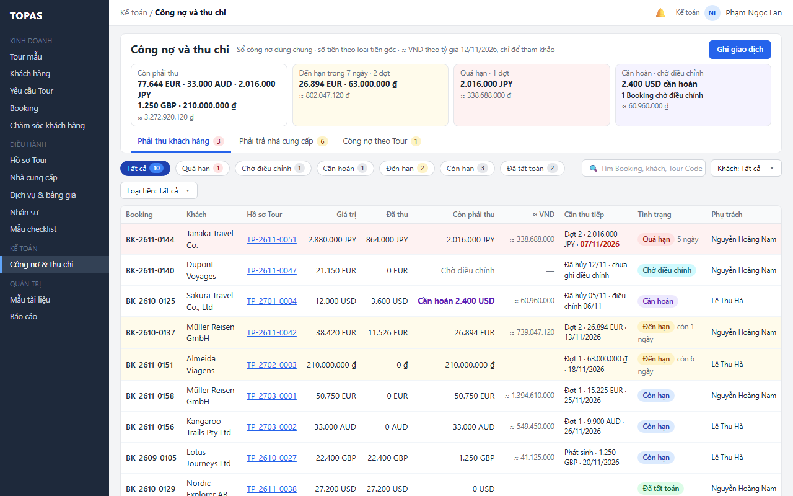

2. **W01 · Đổi tab, chip, bộ lọc.** Người dùng bấm tab hoặc chip; các thẻ ở phần đầu tính lại theo tab và bộ lọc mới (2.1). Ô tìm nhận mã Booking, tên khách, Tour Code (KT01.1), NCC, Tour Code, dịch vụ (KT01.2), Tour Code, Booking, khách (KT01.3).

*Kết quả:* người dùng thấy ngay số cần thu, cần trả, khoản trễ hạn và việc cần xử lý theo từng loại tiền.

**L0.2 Ghi giao dịch từ phần đầu.** *Điều kiện:* Kế toán; chưa mở Booking hay khoản nào (ví dụ nhận báo có ngân hàng và tìm Booking theo tên khách).

1. **W13 · Nút Ghi giao dịch ở phần đầu → hộp thoại.** Hộp thoại mở với bốn loại giao dịch: Thu từ khách, Hoàn cho khách, Chi trả NCC, Nhận hoàn từ NCC (mặc định Thu từ khách). Kế toán chọn loại, gõ vào ô đối tượng: hai loại đầu tìm theo Booking, khách, Tour Code; hai loại sau tìm theo NCC. Danh sách gợi ý ưu tiên đối tượng còn số dư, mỗi dòng kèm số còn và hạn gần nhất. Các trường khác mờ, Lưu giao dịch khóa cho tới khi chọn đối tượng.

   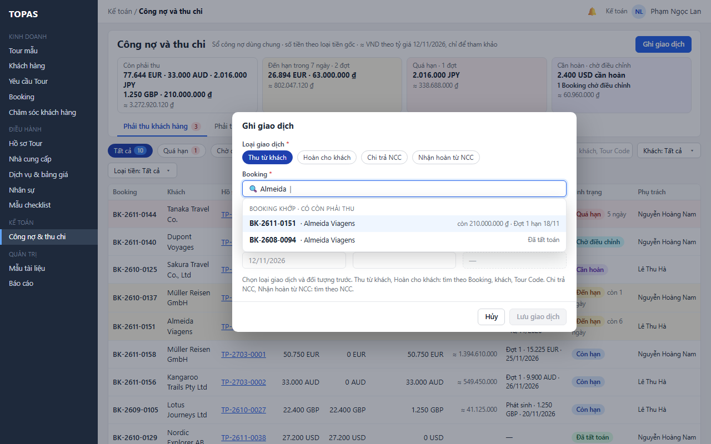

2. **W13 → W03 · Chọn BK-2611-0151.** Hộp thoại chuyển sang dạng đã có ngữ cảnh như W03: loại tiền khóa theo Booking, số tiền điền sẵn số còn phải thu, bảng Phân bổ liệt kê các đợt chưa thu đủ. Kế toán nhập ngày, số tiền, phương thức, số chứng từ, tệp, rồi bấm Lưu giao dịch; xử lý như L1.2 bước 3–4.

*Kết quả:* giao dịch được ghi đúng đối tượng mà không phải mở danh sách trước.

**L0.3 Hủy giao dịch.** *Điều kiện:* Kế toán; giao dịch Hiệu lực.

1. **W11 · ⋯ trên dòng giao dịch → Hủy giao dịch → hộp thoại.** Hộp thoại nêu giao dịch (loại, số tiền, ngày, phân bổ, chứng từ, người ghi) và tác động: giao dịch giữ trong lịch sử, gạch ngang, không còn tính vào số dư; đợt hoặc khoản được phân bổ trở lại số còn trước đó. Hộp thoại không nêu tác động lên hồ sơ Tour vì khoản thu không là điều kiện của hồ sơ (R12). Lý do hủy bắt buộc. Nút Hủy giao dịch (đỏ) khóa cho tới khi có lý do.

   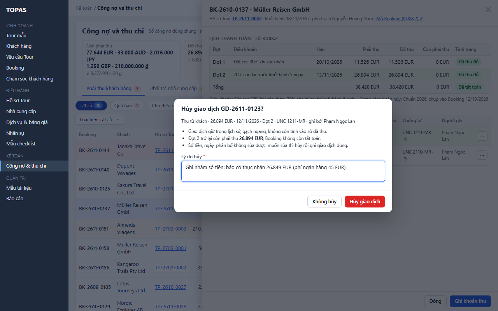

2. **W12 · Nút Hủy giao dịch.** Hệ thống ghi Đã hủy, lý do, người, thời điểm; bỏ phân bổ của giao dịch; tính lại số dư và tình trạng (R03); phát sự kiện cho KD07, KD08, DH08 (R13). Dòng giao dịch gạch ngang kèm nhãn Đã hủy và lý do rút gọn; Đợt 2 trở lại Đến hạn, 26.894 EUR. Thông báo ngắn có liên kết Ghi khoản thu để ghi lại giao dịch đúng.

   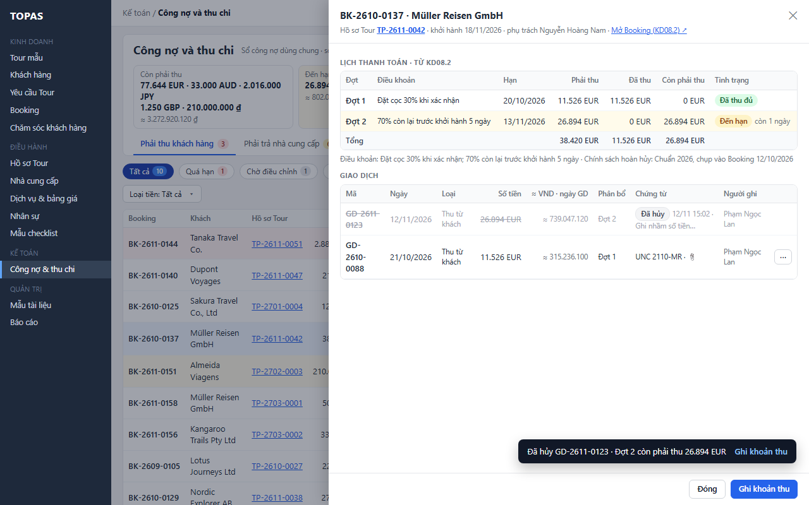

*Kết quả:* số dư đúng theo giao dịch còn hiệu lực; dấu vết của giao dịch nhầm vẫn còn. Muốn sửa số tiền thì ghi giao dịch mới (L1.2).

**Ngoại lệ**

- **E0.1 Dữ liệu nhập không hợp lệ (W14).** Ngày giao dịch sau hôm nay; số tiền ≤ 0; tổng phân bổ khác số tiền; phân bổ vào một đợt vượt số còn của đợt (với phải thu, phần vượt chỉ được vào Tiền thừa); thiếu số chứng từ; thiếu tệp khi bắt buộc (R15). Lỗi hiện cạnh ô, banner nêu số lỗi, Lưu giao dịch khóa; dữ liệu đã nhập được giữ.

  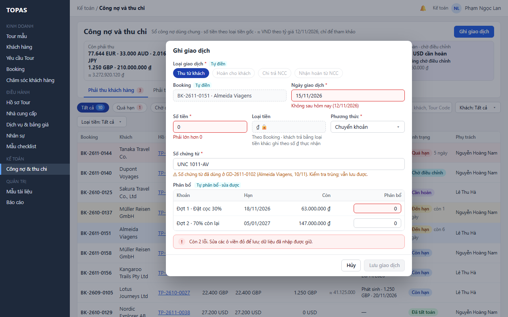

- **E0.2 Số chứng từ đã dùng.** Cùng số chứng từ, cùng đối tượng đã có ở giao dịch Hiệu lực khác: cảnh báo vàng dưới ô nêu giao dịch đó (W14), vẫn cho lưu (một chứng từ ngân hàng có thể trả cho nhiều Booking).
- **E0.3 Khách hoặc NCC trả bằng loại tiền khác.** Loại tiền trong hộp thoại khóa theo khoản (R04). Kế toán ghi số tiền theo loại tiền của khoản, lấy từ chứng từ ngân hàng (số ghi có hoặc ghi nợ của tài khoản cùng loại tiền); chênh lệch do ngân hàng quy đổi hoặc thu phí xử lý ở DH08.8. Gợi ý này hiện dưới ô Loại tiền.
- **E0.4 Số tiền chi vượt số còn.** Hoàn cho khách vượt số cần hoàn và tiền thừa; Chi trả NCC vượt tổng còn phải trả của các khoản đã chọn; Nhận hoàn vượt số phải nhận hoàn: lỗi cạnh ô “Tối đa …”, không lưu.
- **E0.5 Bấm Lưu lặp hoặc mất kết nối.** Mã chống lặp nên chỉ một giao dịch được ghi. Kết quả chưa rõ: hộp thoại ghi “Đang kiểm tra kết quả…”, tra theo mã thao tác; đã ghi thì hiện giao dịch đã ghi, chưa ghi thì cho bấm lại.
- **E0.6 Lưu lỗi.** Banner đỏ trong hộp thoại, dữ liệu giữ nguyên, bấm lại được; không có giao dịch nào được ghi một phần (giao dịch và phân bổ ghi trong một giao dịch cơ sở dữ liệu).
- **E0.7 Khoản đổi ở phiên khác.** Trong lúc hộp thoại mở, khoản vừa có giao dịch, điều chỉnh, hoặc KD08 vừa sửa lịch: khi lưu, máy chủ từ chối, hộp thoại hiện số còn mới và nút Tải lại phân bổ; số tiền đã nhập giữ nguyên (2.4).
- **E0.8 Hủy giao dịch đã hủy, hoặc hai người cùng hủy.** Chỉ một lần hủy được ghi; người sau thấy “Giao dịch đã được … hủy lúc …”.
- **E0.9 Hủy khoản thu của Booking đã có hồ sơ Tour.** Cho hủy như mọi giao dịch. Hồ sơ Tour không đổi: hồ sơ tạo khi Booking được lưu, không phụ thuộc khoản thu (RSD DH07 v1.7 R01). KD07, KD08 và phần đầu DH08 đọc lại số đã thu, còn phải thu.
- **E0.10 Hủy giao dịch có phần Tiền thừa đã được hoàn.** Chặn: “Tiền thừa từ giao dịch này đã được hoàn ở GD-…; hủy giao dịch hoàn trước.”
- **E0.11 Người chỉ xem mở bằng đường dẫn có thao tác ghi.** Mở đúng bản ghi ở chế độ chỉ xem; không có hộp thoại ghi. Kinh doanh mở Booking ngoài phạm vi: trang “Bạn không phụ trách Booking này”, không lộ số liệu.
- **E0.12 Lối vào với bản ghi không còn (Booking, NCC, Tour không tìm thấy).** Mở tab tương ứng, chip Tất cả, banner “Không tìm thấy … · đã xóa bộ lọc”.
- **E0.13 Thiếu tỷ giá cho số ≈ VND.** Bảng tỷ giá ở QT05 chưa có tỷ giá của một loại tiền ở ngày cần quy đổi (hôm nay, hoặc ngày giao dịch): hệ thống dùng **tỷ giá có hiệu lực**, tức tỷ giá của ngày gần nhất trước đó có tỷ giá của loại tiền đó (RSD QT05 R13), và ghi ngày lấy tỷ giá cạnh số ≈ VND và ở đầu màn (ví dụ “≈ 344.736.000 ₫ · tỷ giá 22/10/2026”). Chỉ khi không có ngày nào ≤ ngày cần quy đổi có tỷ giá của loại tiền đó thì ô ≈ VND ghi “Chưa có tỷ giá” và dòng ≈ tổng VND ở phần đầu ghi “≈ … ₫ · chưa gồm JPY (chưa có tỷ giá)”. Không coi là 0, không chặn thao tác nào; Kế toán nhập tỷ giá ở QT05 rồi tải lại.

### 3.2. Tab KT01.1 · Phải thu khách hàng (TN04.04 · TN04.05 · TN04.06)

**L1.1 Xem thanh toán của Booking.** *Điều kiện:* người có quyền xem.

1. **W01 → W02 · Bấm dòng BK-2610-0137 → bảng trượt.** Bảng trượt nêu Hồ sơ Tour TP-2611-0042 (mọi Booking đều có hồ sơ vì hồ sơ tạo khi Booking được lưu; KT01 chỉ hiện liên kết, không đổi hồ sơ), khởi hành, người phụ trách, liên kết Mở Booking (KD08.2). Khối Lịch thanh toán (từ KD08.2) liệt kê từng đợt: điều khoản, hạn, phải thu, đã thu, còn phải thu, tình trạng; dòng Tổng. Dưới lịch: điều khoản thanh toán và chính sách hoàn hủy đã chụp vào Booking (tên, ngày chụp). Khối Giao dịch liệt kê mọi giao dịch của Booking, mới nhất trước, kèm ≈ VND theo tỷ giá ngày giao dịch (GD-2610-0088: 11.526 EUR ≈ 315.236.100 ₫, tỷ giá 27.350 ngày 21/10), phân bổ, chứng từ, người ghi, ⋯ (Hủy giao dịch, Sửa chứng từ và ghi chú). Chân bảng trượt: Đóng, Ghi khoản thu. Mở từ KD08.2 (Xem công nợ) thì KT01.1 lọc theo Booking và mở thẳng bảng trượt này.

   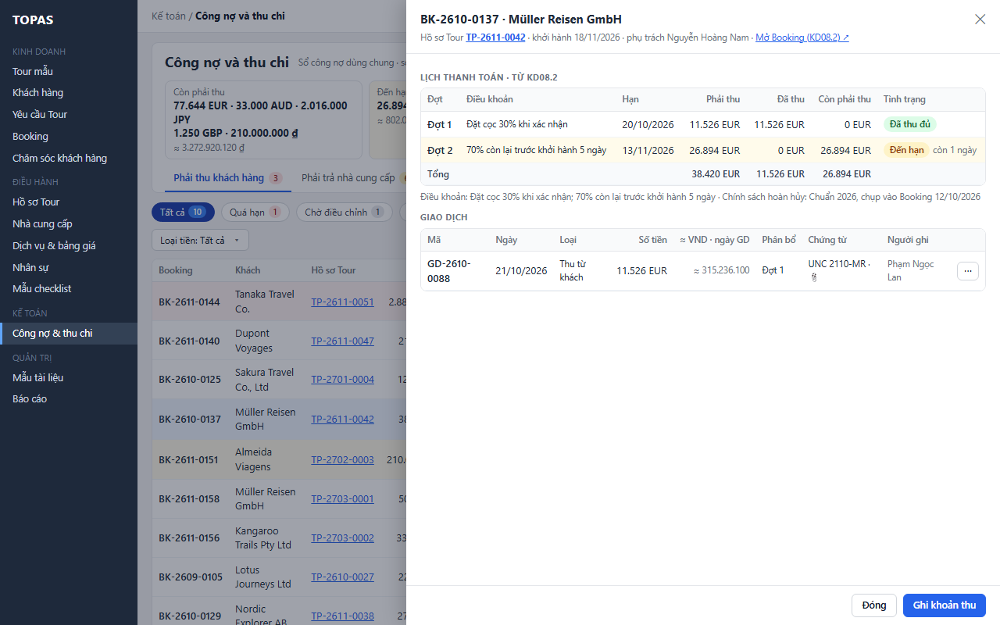

*Kết quả:* Kế toán thấy đợt nào đã thu, đợt nào cần thu, theo đúng loại tiền của Booking.

**L1.2 Ghi khoản thu.** *Điều kiện:* Kế toán; Booking Hiệu lực có còn phải thu, hoặc Booking đã hủy đã điều chỉnh còn phải thu.

1. **W02 → W03 · Nút Ghi khoản thu ở chân bảng trượt → hộp thoại Ghi giao dịch.** Loại Thu từ khách và Booking điền sẵn, khóa. Ngày giao dịch mặc định hôm nay. Số tiền điền sẵn bằng còn phải thu của các đợt đến hạn và quá hạn (không có thì bằng đợt chưa thu đủ sớm nhất), nhãn Còn phải thu. Loại tiền khóa theo Booking. Phân bổ tự điền: số tiền chia vào đợt chưa thu đủ có hạn sớm nhất, tràn sang đợt kế tiếp (R06); Kế toán sửa được từng dòng. Dòng gợi ý dưới bảng nêu kết quả sau khi lưu.

   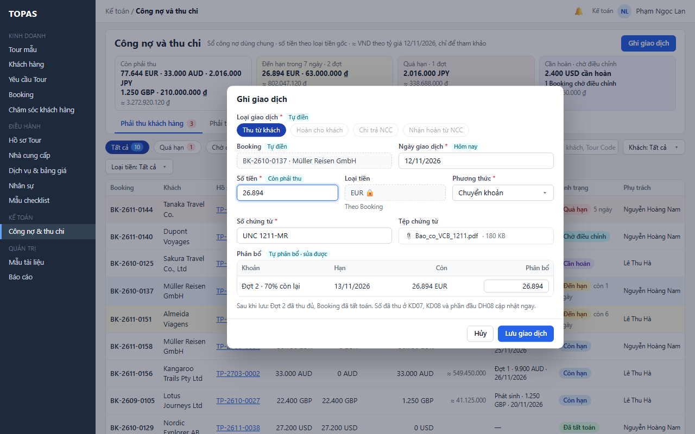

2. **W03 · Nhập chứng từ.** Kế toán nhập phương thức, số chứng từ, đính kèm tệp (không bắt buộc với khoản thu), ghi chú. Đổi số tiền thì phân bổ tính lại ngay, trừ những dòng Kế toán đã sửa tay.
3. **W03 → W04 · Nút Lưu giao dịch.** Máy chủ kiểm tra R06, R15, ghi giao dịch GD-2611-0123 và phân bổ trong một giao dịch, tính lại số dư (SYS04.09). Bảng trượt cập nhật tại chỗ: Đợt 2 Đã thu đủ, dòng Tổng Đã tất toán, giao dịch mới ở đầu khối Giao dịch. Thông báo ngắn “Đã ghi GD-2611-0123 · 26.894 EUR · BK-2610-0137 đã tất toán”. Dòng Booking trong danh sách chuyển Đã tất toán (mờ tại chỗ nếu không còn khớp chip).

   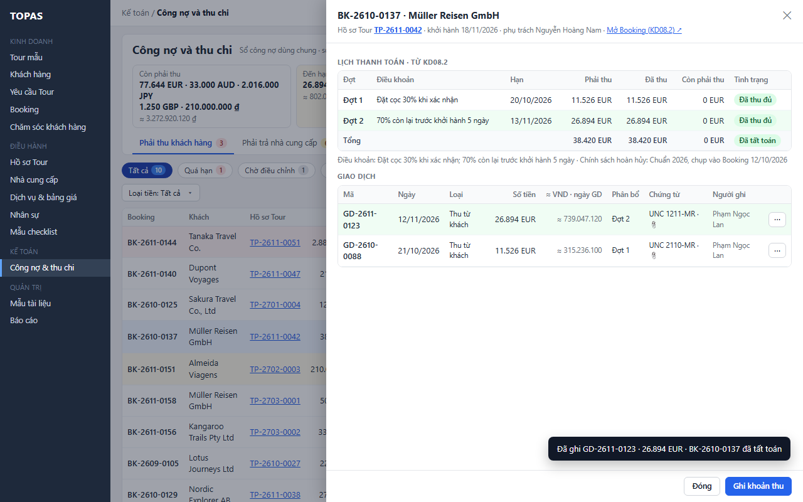

4. **W04 · Sự kiện sau khi lưu.** Hệ thống phát sự kiện “khoản thu đã ghi” (R13): KD07, KD08 đọc số đã thu mới; phần đầu DH08 cập nhật phải thu còn. Khoản thu không tạo, không đổi hồ sơ Tour (hồ sơ đã tạo khi Booking được lưu, RSD DH07 v1.7 R01).

*Kết quả:* số đã thu, còn phải thu của Booking đúng ở mọi màn.

**L1.3 Khách trả thừa.** *Điều kiện:* như L1.2; số tiền nhập lớn hơn tổng còn phải thu của Booking.

1. **W05 · Nhập số tiền 2.100.000 JPY cho BK-2611-0144 (còn 2.016.000 JPY).** Phân bổ điền 2.016.000 vào Đợt 2 và thêm dòng Tiền thừa của Booking 84.000 JPY. Banner vàng giải thích phần vượt được giữ làm Tiền thừa. Không chặn lưu (R06).

   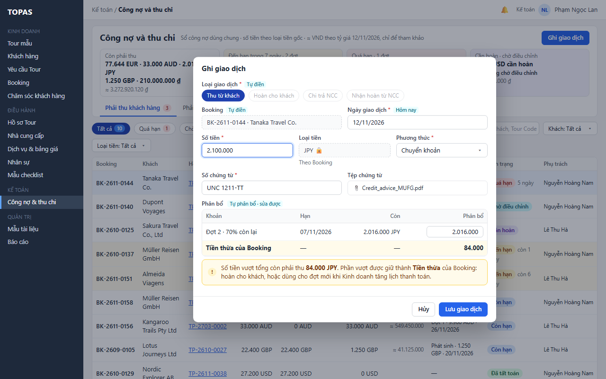

2. **W06 · Nút Lưu giao dịch.** Booking có tình trạng Đã tất toán kèm chỉ báo Tiền thừa 84.000 JPY (KD07 hiện Đã thu đủ kèm chỉ báo Tiền thừa); dòng Booking nằm ở chip Đã tất toán và cả ở chip Cần hoàn, vì chip Cần hoàn là bộ lọc việc gồm Booking có Tiền thừa chưa xử lý (R03). Bảng trượt có banner xanh “Tiền thừa 84.000 JPY từ GD-2611-0124” với nút Ghi hoàn tiền thừa; Ghi khoản thu khóa kèm lý do “Không còn khoản phải thu”.

   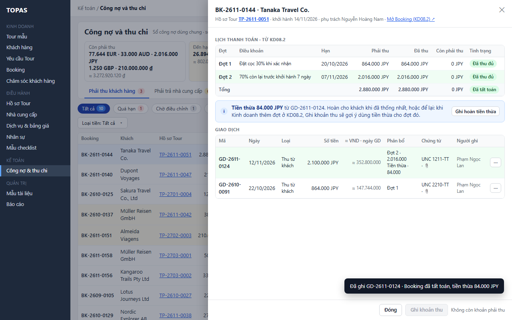

3. **W06 → W10 · Nút Ghi hoàn tiền thừa.** Mở hộp thoại Hoàn cho khách như L1.5 bước 2, số tiền điền sẵn 84.000 JPY. Nếu Kế toán không hoàn: khi Kinh doanh thêm đợt hoặc tăng số tiền đợt ở KD08.2, banner Tiền thừa trong bảng trượt có thêm nút Dùng tiền thừa; bấm thì hộp thoại xác nhận nêu phân bổ điền sẵn (“84.000 JPY → Đợt 3”, sửa được), Kế toán bấm Dùng tiền thừa để chuyển tiền thừa thành số đã thu của đợt đó. Đây là thao tác phân bổ lại tiền thừa, không phải giao dịch: không có mã GD, không có số tiền mới, không nhập số chứng từ; hệ thống ghi lịch sử của Booking và phát sự kiện như khoản thu (R06, R13).

*Kết quả:* tiền khách trả dư không bị mất và không làm số còn phải thu âm; Kế toán quyết định hoàn hay dùng cho đợt sau.

**L1.4 Ghi điều chỉnh sau hủy Booking.** *Điều kiện:* Kế toán; Booking Đã hủy ở KD08, chưa ghi điều chỉnh (chip Chờ điều chỉnh).

1. **W07 · Chip Chờ điều chỉnh → bấm dòng BK-2611-0140 → bảng trượt Điều chỉnh sau hủy.** Banner vàng nêu thời điểm hủy, người hủy, lý do, ngày khởi hành dự kiến; các đợt chưa thu đã tạm dừng tính hạn (R07). Cột trái: chính sách hoàn hủy đã chụp vào Booking (tên, ngày chụp, bảng bậc), bậc áp dụng được tô kèm số ngày (8 ngày, 12/11 → 20/11/2026); lịch thanh toán trước khi hủy. Cột phải: giá trị Booking, số ngày trước khởi hành (chỉ đọc), Phí giữ lại điền sẵn 15.862,50 EUR (nhãn Theo chính sách · 75%), khối Kết quả (Đã thu 0 EUR, Phí giữ lại, Kết quả Còn phải thu 15.862,50 EUR), Hạn thu khoản còn phải thu mặc định hôm nay + 14 ngày, Ghi chú.

   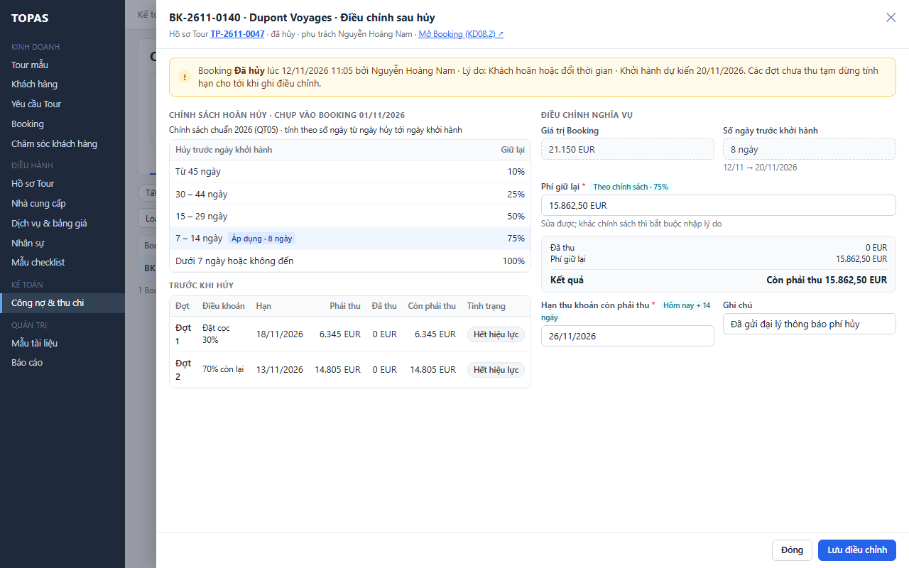

2. **W07a · Sửa Phí giữ lại (khi cần).** Kế toán nhập số khác, ví dụ 10.575 EUR. Nhãn đổi thành Đã sửa, dưới ô ghi số theo chính sách và số chênh; ô Lý do khác chính sách hiện ra, bắt buộc. Kết quả tính lại ngay.

   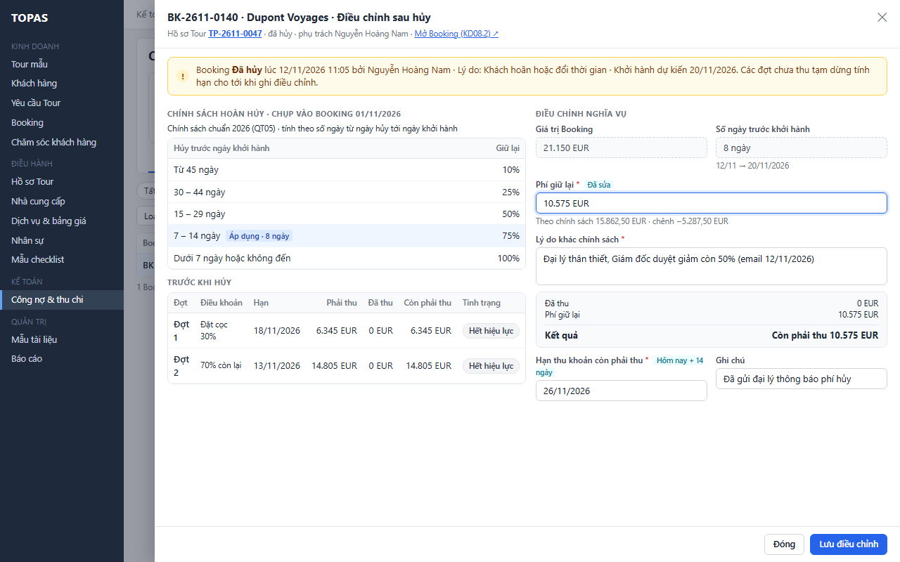

3. **W07 → W08 · Nút Lưu điều chỉnh.** Hệ thống ghi điều chỉnh trong một giao dịch (R07): các đợt cũ thành Hết hiệu lực (gạch ngang); tạo khoản phải thu “Phí hủy” bằng phí giữ lại; khoản thu đã có được phân bổ lại vào khoản Phí hủy; phần đã thu vượt phí là Cần hoàn. Bảng trượt hiện banner xanh, khối Khoản phải thu mới, Lịch sử ghi điều chỉnh. Chip Chờ điều chỉnh về 0, danh sách hiện “Không còn Booking chờ điều chỉnh” và liên kết tới chip của Booking vừa điều chỉnh. Phần đầu cộng 15.862,50 EUR vào Còn phải thu. Thông báo ngắn nêu KD07, KD08 đã hiện Đã điều chỉnh. Chân bảng trượt: Sửa điều chỉnh, Ghi khoản thu.

   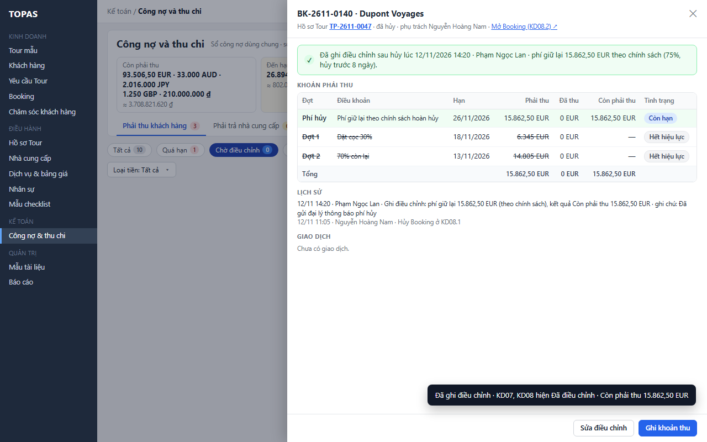

*Kết quả:* nghĩa vụ của Booking đã hủy được chốt theo chính sách; KD07, KD08 hiện “Đã điều chỉnh · Còn phải thu …”, “Cần hoàn …” hoặc “Không còn phải thu” (RSD KD07 R04).

**L1.5 Hoàn tiền cho khách.** *Điều kiện:* Kế toán; Booking có Cần hoàn (sau điều chỉnh) hoặc Tiền thừa.

1. **W09 · Chip Cần hoàn → bấm dòng BK-2610-0125.** Bảng trượt hiện khoản Phí hủy 1.200 USD (10%, hủy trước 76 ngày) đã thu đủ, các đợt cũ Hết hiệu lực, dòng Tổng −2.400 USD, banner tím “Cần hoàn 2.400 USD = đã thu 3.600 USD − phí giữ lại 1.200 USD”. Chân bảng trượt: Ghi hoàn tiền cho khách.

   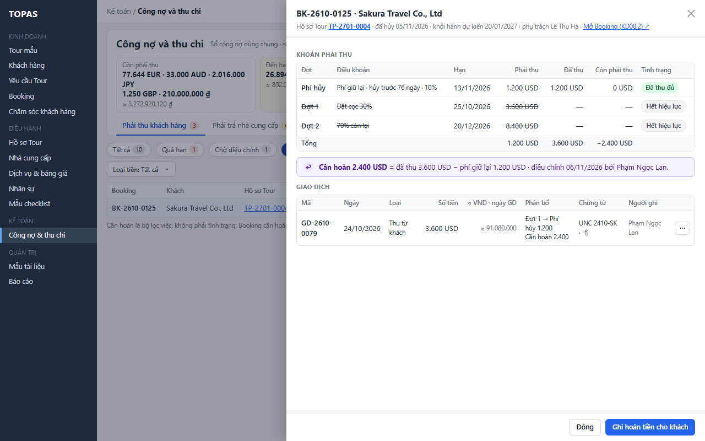

2. **W10 · Nút Ghi hoàn tiền cho khách → hộp thoại Ghi giao dịch.** Loại Hoàn cho khách, Booking điền sẵn và khóa; số tiền điền sẵn 2.400 USD (tối đa bằng số cần hoàn cộng tiền thừa). Tài khoản nhận hoàn của khách điền theo lần nhận tiền gần nhất, sửa được. Số chứng từ và tệp chứng từ bắt buộc (R15). Kế toán bấm Lưu giao dịch: Cần hoàn về 0, Booking Đã tất toán; thông báo ngắn. Hệ thống không chuyển tiền, không gửi email cho khách.

   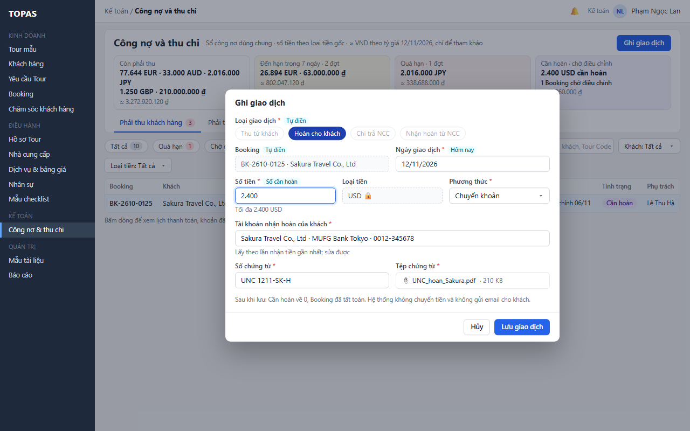

*Kết quả:* khoản hoàn được ghi bằng giao dịch thực tế có chứng từ (SYS04.10); Booking ra khỏi chip Cần hoàn.

**L1.6 Lịch thanh toán thay đổi từ KD08.** *Điều kiện:* Kinh doanh lưu lịch thanh toán ở KD08.2 (lần đầu hoặc sửa). Chuyển sang Điều hành ở KD08 làm giá trị Booking đổi nhưng không tự đổi lịch thanh toán (RSD KD08 R09): nghĩa vụ ở KT01 giữ nguyên cho tới khi Kinh doanh lưu lịch mới; nếu tổng các đợt lệch giá trị mới thì xử lý như E1.3.

1. **W16 · Hệ thống cập nhật nghĩa vụ và báo Kế toán.** Ngay khi KD08 lưu, nghĩa vụ phải thu theo đợt được thay bằng lịch mới trong cùng sự kiện (R05); giao dịch đã ghi giữ nguyên, phân bổ giữ theo số đợt. Kế toán nhận thông báo; bấm thông báo mở bảng trượt của Booking. Banner xanh trong bảng trượt nêu người sửa, thời điểm, đợt thay đổi (giá trị cũ → mới); ô thay đổi được tô. Banner hiện 7 ngày kể từ lần sửa, không cần thao tác xác nhận.

   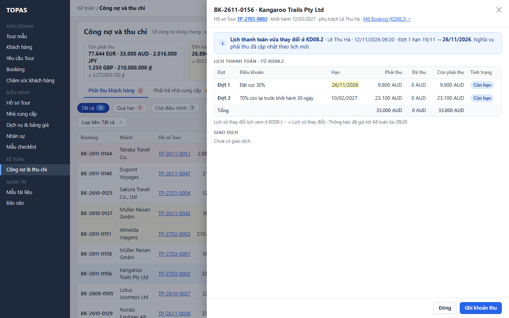

*Kết quả:* KT01 luôn thu theo lịch hiện hành của KD08; Kế toán biết lịch đã đổi mà không phải mở KD08.

**L1.7 Kinh doanh, Điều hành xem phải thu.** *Điều kiện:* Kinh doanh, Điều hành, Quản trị hệ thống.

1. **W15 · Mở KT01 từ menu hoặc từ KD08.2.** Kinh doanh thấy chỉ Booking mình phụ trách (5 Booking); phần đầu tính theo phạm vi đó và ghi “Booking bạn phụ trách”; nút ở phần đầu thay bằng “Kinh doanh · chỉ xem”. Bấm dòng mở bảng trượt chỉ xem: không có Ghi khoản thu, ⋯ trên giao dịch, Lưu điều chỉnh. Điều hành, Quản trị thấy mọi Booking, cùng chế độ chỉ xem.

   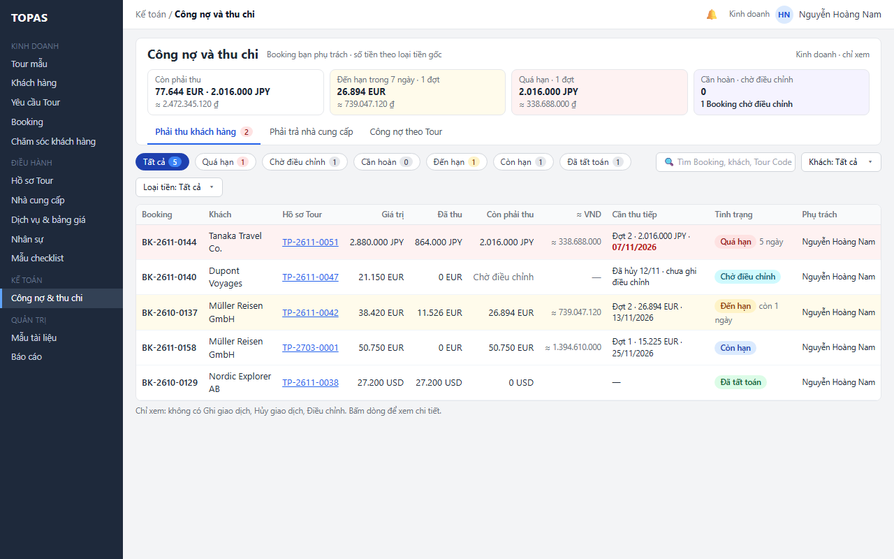

*Kết quả:* Kinh doanh trả lời khách về tình hình thanh toán mà không cần hỏi Kế toán.

**Ngoại lệ**

- **E1.1 Booking chưa có lịch thanh toán.** Booking Hiệu lực chưa lưu lịch ở KD08.2: dòng ghi “Chưa có lịch thanh toán”, không có số còn phải thu; Ghi khoản thu khóa kèm lý do “Kinh doanh chưa lưu lịch thanh toán ở KD08.2”. Booking này không tính vào các thẻ ở phần đầu.
- **E1.2 Khách trả trước khi có lịch.** Kế toán vẫn cần ghi khoản thu: chặn như E1.1; Kế toán báo Kinh doanh lưu lịch. Không có khoản thu treo không gắn Booking.
- **E1.3 Lịch thanh toán lệch giá trị Booking (RSD KD08 R06).** Bảng trượt ghi dưới dòng Tổng “Lịch thiếu 750 EUR so với giá trị Booking · lý do: …”; KT01 chỉ thu theo các đợt, khoản chênh không là phải thu.
- **E1.4 KD08 sửa lịch khi khoản thu đã phân bổ.** KD08 không cho giảm đợt dưới số đã thu (RSD KD08 R07), nên phân bổ luôn hợp lệ. Đợt bị xóa chỉ là đợt chưa có thu.
- **E1.5 Booking có Tiền thừa, KD08 thêm đợt.** Banner Tiền thừa có nút Dùng tiền thừa (L1.3 bước 3); Kế toán không bấm thì tiền thừa giữ nguyên. Tiền thừa lớn hơn số còn của các đợt chưa thu đủ thì chỉ dùng tới số còn, phần dư vẫn là Tiền thừa. Ghi khoản thu không gộp dòng Dùng tiền thừa vì giao dịch luôn có số tiền > 0 (5.2).
- **E1.6 Booking hủy khi đã có Tiền thừa hoặc khoản thu.** Điều chỉnh sau hủy tính Đã thu gồm cả tiền thừa; Kết quả là Cần hoàn nếu đã thu vượt phí giữ lại.
- **E1.7 Booking không có chính sách hoàn hủy đã chụp** (dữ liệu cũ tạo trước khi có nhóm Chính sách hoàn hủy ở QT05, hoặc bản chụp lỗi). QT05 luôn có Chính sách mặc định nên mọi Booking mới đều có bản chụp (RSD KD08 R03, QT05 R06). Bảng trượt điều chỉnh ghi “Booking chưa có chính sách đã chụp · dùng chính sách mặc định đang dùng: …”, Phí giữ lại điền theo chính sách mặc định với nhãn Theo chính sách mặc định; Kế toán sửa được kèm lý do như mọi trường hợp (R07).
- **E1.8 Hủy sau ngày khởi hành** (Tour đang diễn ra, RSD KD08 R10). Số ngày trước khởi hành là 0 hoặc âm: áp dụng bậc thấp nhất (100% trong ví dụ); Kế toán sửa kèm lý do nếu cần.
- **E1.9 Sửa điều chỉnh sau khi đã lưu.** Nút Sửa điều chỉnh mở lại form với giá trị đã lưu; lý do sửa bắt buộc; lịch sử giữ bản trước. Không cho sửa khi đã có giao dịch Hoàn cho khách Hiệu lực của Booking: “Đã hoàn … ở GD-…; hủy giao dịch hoàn trước”.
- **E1.10 Phí giữ lại không hợp lệ.** Âm, hoặc lớn hơn giá trị Booking: lỗi cạnh ô, không lưu. Bằng 0 được phép (miễn phí hủy), cần lý do nếu khác chính sách.
- **E1.11 Hai Kế toán cùng điều chỉnh một Booking.** Người lưu sau bị từ chối, thấy điều chỉnh của người trước, nút Tải lại.
- **E1.12 Ghi hoàn khi số cần hoàn vừa đổi** (người khác vừa sửa điều chỉnh hoặc hủy giao dịch). Máy chủ từ chối vượt số cần hoàn mới (E0.4, E0.7).
- **E1.13 Không lấy được lịch thanh toán từ KD08.** Bảng trượt ghi “Chưa tải được lịch thanh toán” với Thử lại; khối Giao dịch vẫn hiện; Ghi khoản thu khóa vì không phân bổ được.

### 3.3. Tab KT01.2 · Phải trả nhà cung cấp (TN06.05 · TN06.06 · TN06.07)

**L2.1 Ghi phải trả từ dịch vụ đã xác nhận.** *Điều kiện:* Kế toán; DH08.3 có dịch vụ Đã xác nhận chưa ghi phải trả.

1. **W17 · Tab Phải trả nhà cung cấp → chip Chờ ghi phải trả.** Danh sách dịch vụ từ DH08.3: Tour Code, NCC, dịch vụ, ngày sử dụng, loại (Đã xác nhận hoặc Phí hủy), giá trị phải trả (giá NCC xác nhận × số lượng, R08), lúc xác nhận và người xác nhận. Kế toán tích ô chọn các dịch vụ cần ghi; thanh hàng loạt hiện số dịch vụ, số NCC, tổng theo loại tiền và nút Ghi phải trả (n). Dòng Phí hủy không có ô chọn (ghi riêng ở L2.4).

   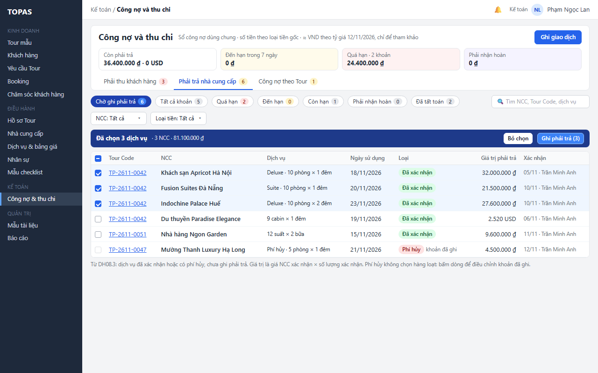

2. **W18 · Nút Ghi phải trả (3) → bảng trượt.** Mỗi dịch vụ một khối: NCC, Tour Code, dịch vụ, ngày sử dụng; Giá trị phải trả điền sẵn (nhãn Giá NCC xác nhận), loại tiền theo lần đặt ở DH08.3 (R04); hợp đồng áp dụng cho ngày sử dụng (RSD DH03 R02); bảng Đợt trả điền sẵn theo điều khoản thanh toán của hợp đồng (RSD DH03 R10), mỗi đợt ghi điều khoản, hạn tính sẵn, số tiền. Ví dụ Fusion Suites: Đợt 1 50% sau khi NCC xác nhận 3 ngày → 13/11/2026; Đợt 2 Phần còn lại sau khi kết thúc Tour 7 ngày → 02/12/2026. Hợp đồng của Indochine Palace chưa có điều khoản: khối tô vàng, một đợt 100% với ô Hạn bắt buộc và liên kết bổ sung điều khoản ở DH03. Chân bảng trượt nêu số lỗi còn lại; Lưu 3 khoản phải trả khóa cho tới khi hết lỗi.

   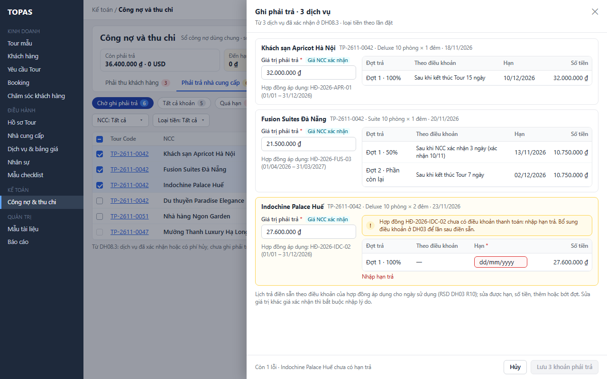

3. **W18 · Kế toán sửa (khi cần).** Nhập hạn 30/11/2026 cho Indochine Palace; sửa hạn, số tiền, thêm hoặc bớt đợt ở khối khác. Sửa Giá trị phải trả khác giá xác nhận (ví dụ hóa đơn NCC khác) thì ô Lý do hiện ra, bắt buộc (R08).
4. **W18 → W19 · Nút Lưu 3 khoản phải trả.** Hệ thống tạo 3 khoản phải trả, mỗi khoản liên kết lần đặt ở DH08.3 (R02 chống trùng). Bảng trượt đóng, KT01.2 chuyển sang chip Tất cả khoản, các khoản mới tô xanh; chip Chờ ghi phải trả còn 3, số trên tab còn 3. Thông báo ngắn nêu tổng đã ghi. Phần đầu: Còn phải trả 117.500.000 ₫, Đến hạn 10.750.000 ₫ (Fusion Đợt 1).

   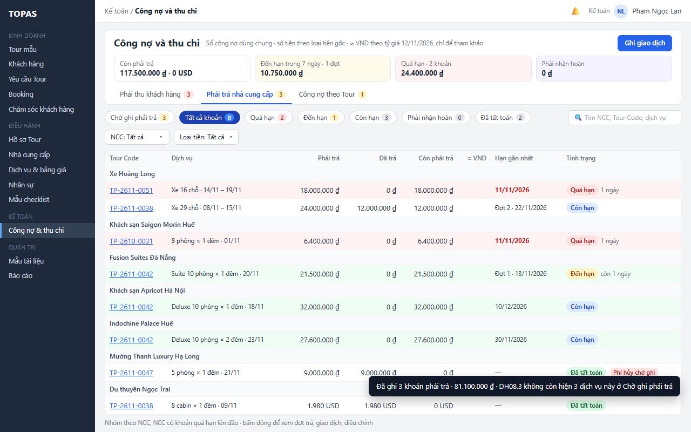

*Kết quả:* dịch vụ đã xác nhận thành khoản phải trả có lịch trả; DH08.3 không còn liệt kê chúng ở Chờ ghi phải trả.

**L2.2 Theo dõi phải trả.** *Điều kiện:* người có quyền xem.

1. **W19 · Chip Tất cả khoản, Quá hạn, Đến hạn, Còn hạn, Phải nhận hoàn, Đã tất toán.** Khoản phải trả nhóm theo NCC; NCC có khoản quá hạn lên đầu. Mỗi dòng: Tour Code, dịch vụ, phải trả, đã trả, còn phải trả, hạn gần nhất (đợt chưa trả đủ sớm nhất), tình trạng, chỉ báo phụ (Phí hủy chờ ghi). Lọc theo NCC, loại tiền, tìm theo NCC, Tour Code, dịch vụ. Mở từ DH03 (Xem công nợ) thì lọc sẵn theo NCC. Bấm dòng mở bảng trượt khoản: đợt trả, giao dịch, lịch sử điều chỉnh, thông tin nhận thanh toán của NCC (Kế toán, Điều hành), Mở đặt dịch vụ (DH08.3). Kinh doanh mở bảng trượt khoản thì bảng Đợt trả không có cột Theo điều khoản, chỉ có đợt, hạn, số tiền, đã trả (R01).

*Kết quả:* Kế toán biết cần trả ai, bao nhiêu, khi nào, theo từng loại tiền (SYS06.08).

**L2.3 Ghi chi trả NCC.** *Điều kiện:* Kế toán; khoản còn phải trả > 0.

1. **W20 · Tích ô chọn các khoản của Xe Hoàng Long.** Thanh hàng loạt nêu NCC, số khoản, tổng còn phải trả 30.000.000 ₫ và nút Ghi chi trả (2). Khi đã chọn một khoản, ô chọn của khoản thuộc NCC khác, loại tiền khác hoặc không còn phải trả tạm khóa (R10). Muốn trả một khoản thì bấm dòng rồi bấm Ghi chi trả ở chân bảng trượt.

   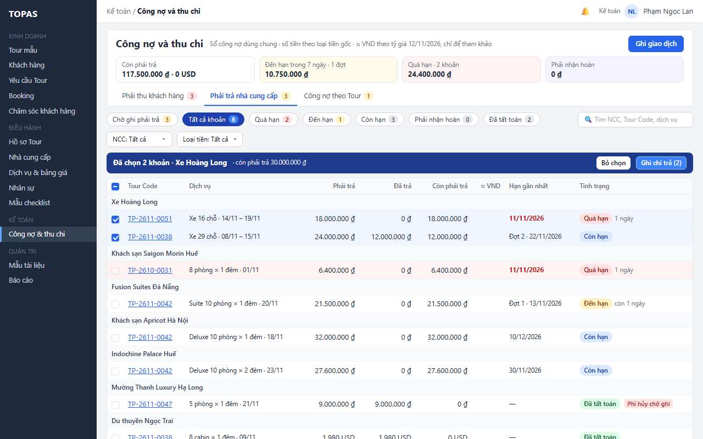

2. **W21 · Nút Ghi chi trả (2) → hộp thoại Ghi giao dịch.** Loại Chi trả NCC khóa. Thẻ NCC hiện thông tin nhận thanh toán từ DH03.1 (thụ hưởng, ngân hàng, số tài khoản, mã số thuế). Số tiền điền sẵn tổng còn phải trả; phân bổ ưu tiên khoản quá hạn, rồi hạn sớm nhất (R10): TP-2611-0051 18.000.000 ₫, TP-2611-0038 Đợt 2 12.000.000 ₫. Số chứng từ, tệp chứng từ bắt buộc. Bấm Lưu giao dịch: hai khoản Đã tất toán; phần đầu Còn phải trả 87.500.000 ₫, Quá hạn còn 6.400.000 ₫; thông báo ngắn. Hệ thống không tạo lệnh chuyển tiền.

   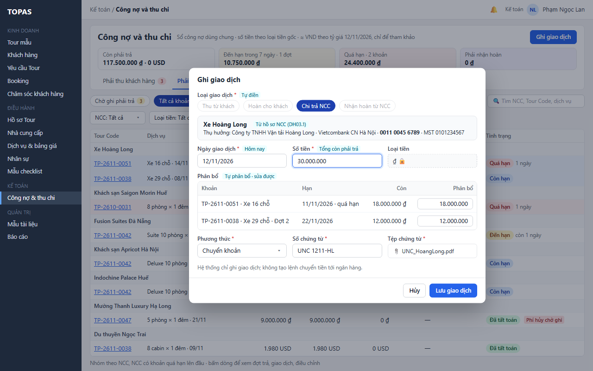

*Kết quả:* một lần chi trả cho nhiều khoản của cùng NCC được ghi và phân bổ đúng; DH08 cập nhật phải trả còn của từng Tour.

**L2.4 Điều chỉnh khoản phải trả theo phí hủy và nhận hoàn.** *Điều kiện:* Kế toán; DH08.3 ghi kết quả hủy có phí cho dịch vụ đã có khoản phải trả, hoặc Kế toán cần điều chỉnh giá trị phải trả (hóa đơn NCC khác, NCC giảm giá).

1. **W22 · Chip Chờ ghi phải trả → bấm dòng Phí hủy của Mường Thanh Luxury Hạ Long → bảng trượt khoản.** Banner vàng nêu dịch vụ đã hủy ở DH08.3 (thời điểm, lý do: Booking BK-2611-0140 hủy), NCC chấp nhận, phí hủy 4.500.000 ₫. Khối Khoản phải trả hiện đợt, đã trả 9.000.000 ₫. Form Điều chỉnh khoản phải trả: Giá trị phải trả mới điền sẵn 4.500.000 ₫ (nhãn Phí hủy từ DH08.3), giá trị hiện tại chỉ đọc, Lý do điều chỉnh tự điền; khối Kết quả tính ngay: đã trả 9.000.000 ₫ > giá trị mới, nên Phải nhận hoàn 4.500.000 ₫. Với điều chỉnh không do phí hủy, Kế toán mở bảng trượt khoản từ chip Tất cả khoản rồi bấm Điều chỉnh ở chân bảng trượt; form giống vậy, giá trị mới và lý do để trống.

   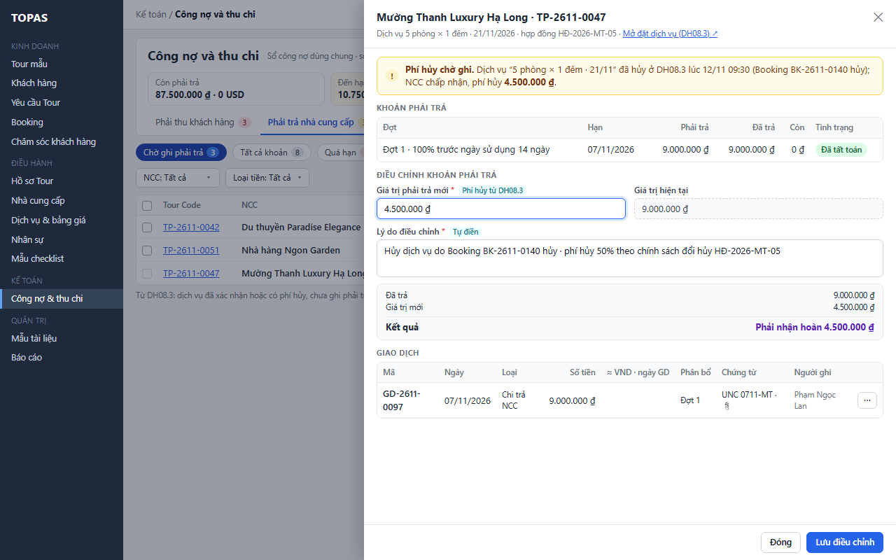

2. **W22 → W23 · Nút Lưu điều chỉnh.** Hệ thống ghi điều chỉnh (giá trị cũ, mới, lý do), tính lại đợt (R09); khoản chuyển Phải nhận hoàn; dòng Phí hủy ra khỏi Chờ ghi phải trả; DH08.3 ghi phí hủy đã vào công nợ. Bảng trượt hiện banner xanh và nút Ghi nhận hoàn ở chân.
3. **W23 · Nút Ghi nhận hoàn → hộp thoại Ghi giao dịch.** Loại Nhận hoàn từ NCC khóa; NCC và khoản điền sẵn; số tiền điền sẵn 4.500.000 ₫ (tối đa bằng số phải nhận hoàn). NCC hoàn nhiều lần thì ghi nhiều giao dịch. Lưu: khoản Đã tất toán khi số phải nhận hoàn về 0.

   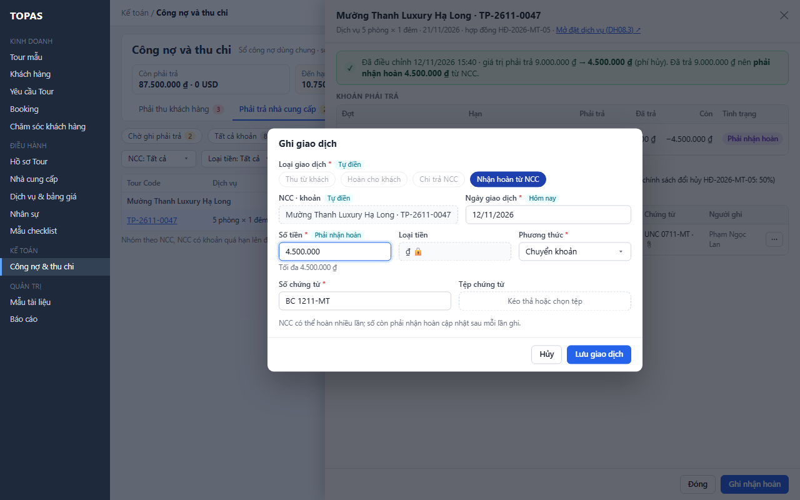

*Kết quả:* phí hủy NCC thay giá trị dịch vụ trong khoản phải trả; tiền NCC hoàn được ghi bằng giao dịch có chứng từ (SYS06.07, SYS06.09).

**Ngoại lệ**

- **E2.1 Dịch vụ thiếu giá xác nhận** (dữ liệu cũ hoặc lỗi; DH08.3 bắt buộc nhập giá khi ghi kết quả, RSD DH08 v2.8 mục 5.2). Giá trị phải trả để trống, ô đỏ, bắt buộc nhập kèm lý do; không dùng giá 0 (`BOI-CANH-DU-AN.md`, thiếu giá thì hiện rõ phần thiếu).
- **E2.2 Hợp đồng áp dụng thiếu điều khoản thanh toán (W18).** Một đợt 100%, Kế toán nhập hạn; liên kết mở DH03.2 để bổ sung. Bổ sung sau không đổi lịch trả đã ghi (RSD DH03 R10).
- **E2.3 Không có hợp đồng áp dụng cho ngày sử dụng.** Khối ghi “Không có hợp đồng của NCC chứa ngày …”, loại tiền vẫn theo lần đặt ở DH08.3 như mọi khoản phải trả (R04), một đợt 100% Kế toán nhập hạn.
- **E2.4 Hạn tính ra đã qua.** Điền đúng hạn tính theo điều khoản (có thể trước hôm nay); khoản lưu xong vào Quá hạn ngay. Ví dụ Fusion Đợt 1 hạn 13/11 vào Đến hạn.
- **E2.5 Dịch vụ vừa được ghi ở phiên khác, hoặc DH08 vừa sửa kết quả xác nhận.** Khi lưu, máy chủ bỏ qua dịch vụ đã có khoản (R02) và báo “1 dịch vụ đã được … ghi lúc …”; các dịch vụ còn lại lưu bình thường (kết quả từng phần). Dịch vụ có giá xác nhận vừa đổi ở DH08.3: từ chối khối đó, hiện giá mới, nút Dùng giá mới.
- **E2.6 Dịch vụ bị hủy sau khi đã chọn nhưng trước khi lưu.** Khối đó báo “Dịch vụ đã hủy ở DH08.3 · bỏ khỏi lần ghi này”; không tạo khoản.
- **E2.7 Ghi chi trả khi một khoản vừa đổi** (người khác vừa trả, vừa điều chỉnh). Từ chối cả giao dịch, hộp thoại tải lại số còn từng khoản (E0.7).
- **E2.8 Điều chỉnh giá trị dưới số đã trả khi không phải phí hủy.** Cho lưu kèm lý do; khoản chuyển Phải nhận hoàn như L2.4.
- **E2.9 Điều chỉnh khoản đã có kết quả quyết toán đã lưu ở DH08.8.** Cho lưu, kể cả khi hồ sơ Đã đóng; DH08.8 hiện chỉ báo “KT01 có giao dịch mới” và đọc lại số khi Kế toán lưu phiên bản quyết toán mới. Kế toán lưu phiên bản mới ngay ở DH08.8, không cần Mở lại Tour, kể cả Tour đã đóng (RSD DH08 v2.8 R16, E8.8).
- **E2.10 NCC Ngừng sử dụng.** Vẫn ghi phải trả, chi trả, nhận hoàn (RSD DH03 R05); tên NCC có nhãn Ngừng sử dụng.
- **E2.11 NCC thiếu thông tin nhận thanh toán.** Thẻ NCC trong hộp thoại Chi trả ghi “Chưa có thông tin nhận thanh toán · bổ sung ở DH03.1”; vẫn cho ghi chi trả (tiền mặt, bù trừ).
- **E2.12 Phí hủy cho dịch vụ chưa ghi phải trả.** Dòng Phí hủy có ô chọn như dịch vụ thường; khi ghi tạo khoản phải trả bằng phí hủy.
- **E2.13 DH08.3 sửa kết quả sau khi đã có khoản phải trả.** DH08 chỉ cho sửa ghi chú, mã (RSD DH08 R10); thay đổi số lượng, giá, phí làm ở KT01 bằng điều chỉnh (L2.4).

### 3.4. Tab KT01.3 · Công nợ theo Tour (TN08.05 · TN09.05)

**L3.1 Xem công nợ của Tour.** *Điều kiện:* người có quyền xem.

1. **W24 · Tab Công nợ theo Tour.** Mỗi dòng một Tour Code: Booking, khách, thời gian, trạng thái hồ sơ Tour (và chỉ báo Booking đã hủy), phải thu còn, phải trả còn (theo loại tiền), việc chờ. Chip: Tất cả, Chờ ghi phát sinh, Chưa quyết toán, Đã đóng · còn công nợ, Không có việc chờ (mỗi Tour thuộc một chip theo R03). Lọc trạng thái hồ sơ; tìm theo Tour Code, Booking, khách.

   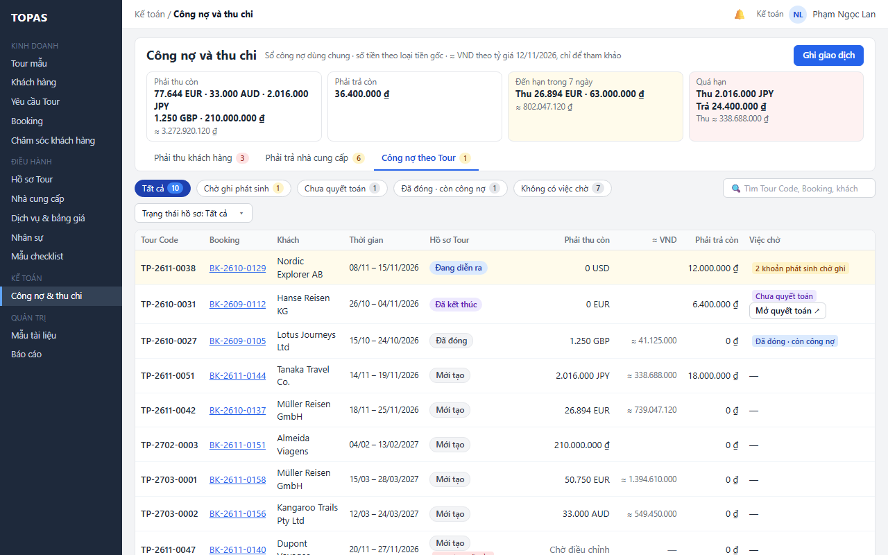

2. **W25 · Bấm dòng TP-2611-0038.** Khung công nợ của Tour thay danh sách (liên kết ‹ Danh sách Tour để quay lại; Mở hồ sơ Tour (DH08) bên phải). Phần đầu tính cho Tour này; nút ở phần đầu thành “Ghi giao dịch cho TP-2611-0038”. Banner vàng nếu có chi phí phát sinh chưa ghi công nợ, kèm nút Ghi công nợ (n). Các khối: Chi phí phát sinh (đọc từ DH08.7, chỉ báo Chưa ghi hoặc Đã ghi công nợ); Khoản công nợ của Tour (phải thu và phải trả, mỗi khoản một dòng); Giao dịch (mới nhất trước, Xem đủ). Bấm khoản mở bảng trượt của Booking (W02) hoặc khoản phải trả (như W22).

   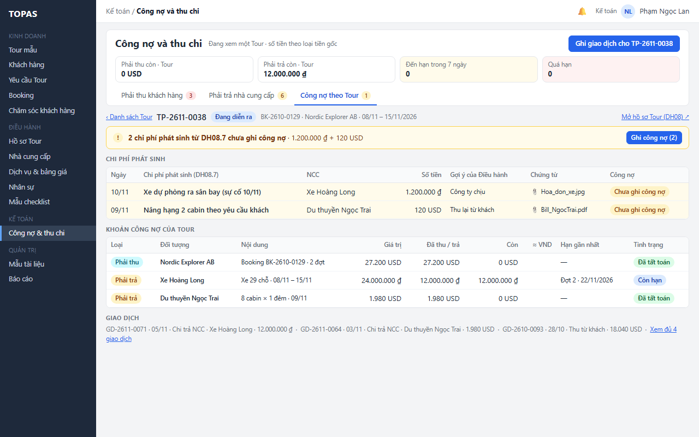

*Kết quả:* Kế toán thấy mọi khoản thu chi của một Tour ở một chỗ (SYS09.08).

**L3.2 Ghi công nợ từ chi phí phát sinh.** *Điều kiện:* Kế toán; Tour có chi phí phát sinh Chưa ghi công nợ ở DH08.7.

1. **W26 · Nút Ghi công nợ (2) ở banner (hoặc Ghi công nợ (n) ở DH08.7) → bảng trượt.** Mỗi chi phí phát sinh một khối: ngày, số tiền, liên quan sự cố, chứng từ. Hai phần bật tắt: Phải trả NCC (bật sẵn khi khoản có NCC; NCC, số tiền, hạn trả theo điều khoản hợp đồng như L2.1) và Phải thu khách (bật sẵn khi Điều hành gợi ý Thu lại từ khách; khách và Booking của Tour, số tiền bằng khoản phát sinh, hạn thu hôm nay + 14 ngày). Kế toán đổi bật tắt, NCC, số tiền, hạn. Chân bảng trượt nêu số khoản sẽ tạo.

   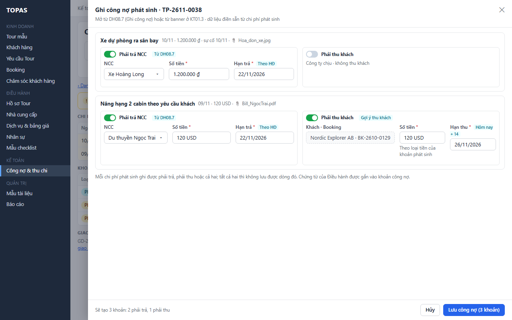

2. **W26 → W27 · Nút Lưu công nợ (3 khoản).** Hệ thống tạo các khoản, liên kết từng khoản với chi phí phát sinh (R11). DH08.7 chuyển chỉ báo sang Đã ghi công nợ ngay sau khi lưu (RSD DH08 L7.2). Khoản phải thu phát sinh cũng hiện ở KT01.1 trong Booking của Tour. Khung công nợ của Tour hiện banner xanh, khoản mới tô xanh, phần đầu cập nhật; số trên tab giảm.

   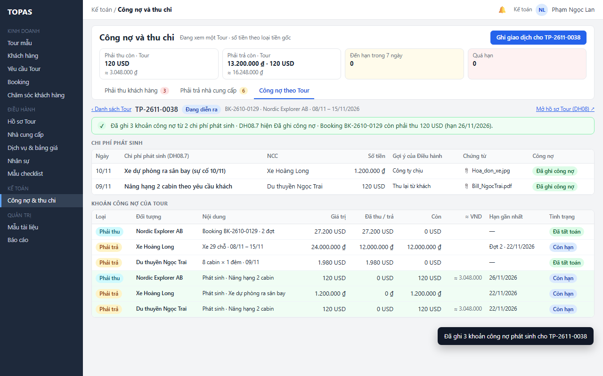

*Kết quả:* chi phí phát sinh thành phải trả, phải thu theo Tour Code, mỗi khoản chỉ ghi một lần (SYS08.09).

**L3.3 Ghi thu chi sau khi đóng Tour.** *Điều kiện:* Kế toán; hồ sơ Tour Đã đóng.

1. **W28 · Mở công nợ của TP-2610-0027 (từ chip Đã đóng · còn công nợ, hoặc nút Xem công nợ Tour ở DH08 đã đóng).** Banner xanh nêu ngày đóng và phiên bản quyết toán hiện hành; Tour đóng khi chưa quyết toán thì banner ghi “Chưa quyết toán” kèm nút Mở quyết toán ↗ (suy ra, chờ xác nhận; mở DH08.8; Kế toán lưu được quyết toán khi hồ sơ đã đóng, RSD DH08 v2.8 R16). Hồ sơ điều hành chỉ đọc nhưng công nợ vẫn ghi theo Tour Code. Mọi thao tác ghi giống Tour chưa đóng (nút Ghi giao dịch cho TP-2610-0027, Ghi khoản thu, Ghi chi trả, điều chỉnh, ghi công nợ phát sinh). Giao dịch ghi sau ngày đóng có nhãn Sau đóng Tour.

   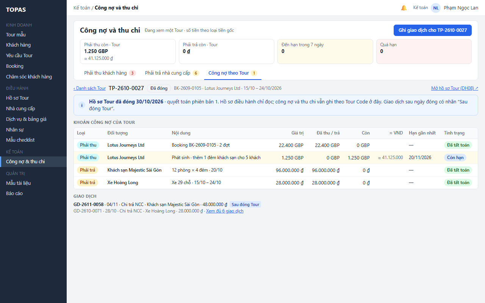

*Kết quả:* đóng Tour không chặn thu chi; số liệu sau đóng có dấu để đối chiếu với quyết toán (SYS09.09, R14).

**L3.4 Tour chưa quyết toán.** *Điều kiện:* người có quyền xem.

1. **W29 · Chip Chưa quyết toán.** Danh sách Tour có hồ sơ Đã kết thúc hoặc Đã đóng, chưa có phiên bản quyết toán đã lưu ở DH08.8 (Tour đóng không cần quyết toán, RSD DH08 v2.8 R16). Nút Mở quyết toán ↗ trên dòng mở DH08.8 của Tour (theo quyền DH08); Kế toán lưu quyết toán được cả khi hồ sơ đã đóng, không cần Mở lại Tour. Bấm dòng mở công nợ của Tour như L3.1. Chip chỉ là việc của Kế toán, không chặn thao tác nào của Điều hành.

   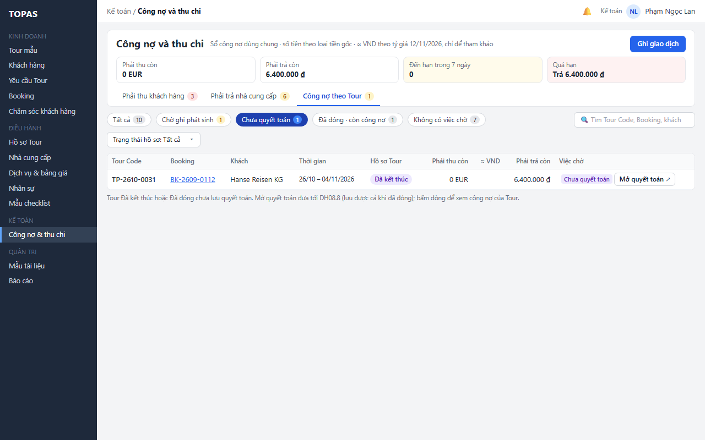

*Kết quả:* Kế toán biết Tour nào cần quyết toán và đi thẳng tới tab quyết toán.

**Ngoại lệ**

- **E3.1 Mở KT01.3 từ DH08.7 rồi thoát trước khi lưu.** Không tạo khoản; DH08.7 giữ Chưa ghi công nợ (RSD DH08 AC29).
- **E3.2 Chi phí phát sinh vừa được ghi ở phiên khác.** Khối đó báo đã ghi bởi ai, lúc nào và bị bỏ khỏi lần lưu; các khối khác lưu bình thường.
- **E3.3 Tắt cả Phải trả và Phải thu của một khối.** Khối báo “Chọn ít nhất một” và nút Lưu khóa; muốn bỏ qua khoản đó thì bấm Bỏ khỏi lần ghi trên khối (khoản vẫn Chưa ghi ở DH08.7).
- **E3.4 Chi phí phát sinh không có NCC.** Phần Phải trả cho chọn NCC hoặc “Người chi khác” (nhân sự tạm ứng, ghi tên); không chọn thì tắt Phải trả.
- **E3.5 Booking của Tour đã hủy.** Phải thu phát sinh vẫn ghi được; Booking đang Chờ điều chỉnh thì khoản phát sinh không bị tạm dừng tính hạn (R07 chỉ áp dụng cho các đợt của lịch thanh toán).
- **E3.6 Điều hành sửa hoặc xóa khoản phát sinh sau khi đã ghi công nợ.** DH08 chặn sửa số tiền, xóa (RSD DH08 E7.2); thay đổi làm ở KT01 bằng điều chỉnh khoản.
- **E3.7 Tour không có giao dịch, không có khoản.** Khung công nợ hiện “Tour chưa có khoản công nợ”; thẻ phần đầu ghi 0 theo loại tiền của Booking.
- **E3.8 Hồ sơ Tour mở lại ở DH08 sau khi đóng.** Banner Tour đã đóng biến mất; giao dịch đã có nhãn Sau đóng Tour giữ nhãn. Mở lại do Điều hành phụ trách hồ sơ; hồ sơ không có người phụ trách hoặc người đó ngừng hoạt động thì Quản trị hệ thống mở lại, kèm chọn Điều hành phụ trách mới (RSD DH08 v2.8 R16). Kế toán không mở lại; KT01 không cần mở lại hồ sơ để ghi thu chi hay để Kế toán quyết toán.

---

## 4. Quy tắc triển khai chi tiết

### R01. Phạm vi và quyền

- Kế toán xem và ghi mọi tab, mọi bản ghi. Kinh doanh, Điều hành, Quản trị hệ thống chỉ xem (quyết định 12/11/2026).
- Kinh doanh: KT01.1 chỉ Booking mình phụ trách (người phụ trách Booking ở KD08, RSD KD08 R11); KT01.2, KT01.3 chỉ khoản và Tour gắn Booking mình phụ trách; không thấy thông tin nhận thanh toán NCC và điều khoản thanh toán của đợt trả (RSD DH03 R04), chỉ thấy hạn và số tiền; máy chủ không trả các trường này cho Kinh doanh. Chuyển người phụ trách Booking ở KD08 thì phạm vi đổi theo.
- Mọi thao tác ghi kiểm tra quyền ở máy chủ; quyền theo QT02 (thao tác “ghi giao dịch” theo màn và tab).

### R02. Sổ công nợ và chống trùng

- **Khoản công nợ** có loại Phải thu hoặc Phải trả, đối tượng (khách hoặc NCC), liên kết (Booking, đợt, Tour Code, lần đặt dịch vụ, chi phí phát sinh), loại tiền, các đợt (hạn, số tiền), nguồn: Lịch thanh toán (KD08), Phí hủy Booking (R07), Dịch vụ đã xác nhận (DH08.3), Phí hủy NCC (R09), Phát sinh (DH08.7).
- **Một nguồn một khoản.** Mỗi lần đặt dịch vụ chỉ có một khoản phải trả; mỗi chi phí phát sinh tối đa một khoản phải trả và một khoản phải thu; mỗi Booking một bộ nghĩa vụ theo lịch thanh toán hiện hành. Máy chủ chặn tạo khoản thứ hai cho cùng nguồn (E2.5, E3.2).
- **Số dư** của khoản = Σ số tiền các đợt hiệu lực − Σ phân bổ của giao dịch Hiệu lực. Không lưu số dư nhập tay.

### R03. Tình trạng và thứ tự

- **Tình trạng đợt** (theo thứ tự): **Đã tất toán** khi còn = 0 (đợt hiện Đã thu đủ hoặc Đã trả đủ); **Quá hạn** khi hạn < hôm nay; **Đến hạn** khi hôm nay ≤ hạn ≤ hôm nay + N ngày, N là **ngưỡng Đến hạn** (tham số chung do Quản trị hệ thống cấu hình, mặc định 7; KD07 đọc cùng tham số, RSD KD07 R04); **Còn hạn** còn lại. Đổi ngưỡng thì tình trạng tính lại ở lần tải sau, không đổi dữ liệu đã ghi.
- **Tình trạng khoản hoặc Booking** = tình trạng xấu nhất của các đợt chưa tất toán; tất cả tất toán thì Đã tất toán.
- **Tình trạng dòng Booking ở KT01.1**, theo thứ tự ưu tiên: (1) Quá hạn; (2) Chờ điều chỉnh (Booking Đã hủy chưa ghi điều chỉnh); (3) Cần hoàn (Booking Đã hủy đã ghi điều chỉnh, Cần hoàn > 0); (4) Đến hạn; (5) Còn hạn; (6) Đã tất toán. Tiền thừa không phải tình trạng: Booking có Tiền thừa mang tình trạng theo các đợt (mọi đợt đã thu đủ thì Đã tất toán) kèm chỉ báo Tiền thừa. Đợt “Phát sinh” (R11) và khoản Phí hủy (R07) tính như đợt của Booking.
- **Chip ở KT01.1.** Tất cả, Quá hạn, Chờ điều chỉnh, Cần hoàn, Đến hạn, Còn hạn, Đã tất toán. Các chip Quá hạn, Chờ điều chỉnh, Đến hạn, Còn hạn, Đã tất toán lọc theo tình trạng. Chip **Cần hoàn là bộ lọc việc** của Kế toán, không phải tình trạng: gồm Booking có tình trạng Cần hoàn (đã điều chỉnh sau hủy, Cần hoàn > 0) và Booking có Tiền thừa chưa xử lý (Tiền thừa > 0, chưa hoàn, chưa dùng hết). Booking có Tiền thừa vì thế hiện ở cả chip tình trạng của nó (thường là Đã tất toán) và chip Cần hoàn; Booking có tình trạng Cần hoàn chỉ ở chip Cần hoàn. Tổng các chip tình trạng cộng số Booking có tình trạng Cần hoàn bằng Tất cả.
- **Tình trạng dòng Booking là tình trạng hiển thị dùng chung**: KT01 tính một lần và xuất trong Số liệu công nợ của Booking (5.1) để KD07, KD08 đọc, không tự tính lại. Hệ quả cần đọc cùng cách: Đã tất toán khi mọi đợt và khoản phải thu của Booking còn = 0 và không có Cần hoàn, kể cả khi có Tiền thừa (KD07 hiện Đã thu đủ kèm chỉ báo Tiền thừa, RSD KD07 R04); Tiền thừa không làm còn phải thu âm (còn phải thu 0 kèm chỉ báo Tiền thừa), còn Cần hoàn sau điều chỉnh hiện là số âm kèm nhãn Cần hoàn (W09); Booking có khoản Phát sinh chưa thu thì còn phải thu > 0 dù mọi đợt của lịch thanh toán đã thu đủ. Chip Cần hoàn là bộ lọc riêng của KT01.1, không xuất như tình trạng. Không phải trạng thái Booking.
- **Khoản phải trả ở KT01.2**: Quá hạn → Phải nhận hoàn → Đến hạn → Còn hạn → Đã tất toán. Chip Chờ ghi phải trả đếm dịch vụ, không thuộc tổng Tất cả khoản.
- **Tour ở KT01.3**: Chờ ghi phát sinh (có chi phí phát sinh Chưa ghi công nợ) → Chưa quyết toán (hồ sơ Đã kết thúc hoặc Đã đóng, chưa có phiên bản quyết toán đã lưu) → Đã đóng · còn công nợ (hồ sơ Đã đóng đã có quyết toán, còn phải thu hoặc phải trả ≠ 0) → Không có việc chờ. Tour đã đóng chưa quyết toán vào chip Chưa quyết toán dù còn công nợ (suy ra, chờ xác nhận). KT01.3 liệt kê Tour có ít nhất một khoản công nợ hoặc chi phí phát sinh.
- **Số trên tab**: KT01.1 = số Booking khác nhau ở chip Quá hạn, Chờ điều chỉnh, Cần hoàn (bộ lọc việc, gồm Tiền thừa chưa xử lý); KT01.2 = số dịch vụ Chờ ghi phải trả; KT01.3 = số Tour Chờ ghi phát sinh. Theo phạm vi người xem.
- **Thứ tự dòng** trong cùng tình trạng: hạn gần nhất tăng dần; không có hạn xếp cuối.

### R04. Loại tiền (quyết định 12/11/2026)

- Khoản phải thu theo loại tiền của Booking; khoản phải trả theo loại tiền của **lần đặt** ở DH08.3 (điền sẵn theo loại tiền của dòng giá DH03, Điều hành sửa được khi ghi giá xác nhận hoặc phí hủy; quyết định sau rà soát 12/11/2026, RSD DH08 v2.8), kể cả khi khác loại tiền của hợp đồng áp dụng. KT01 không đổi loại tiền của khoản phải trả, chỉ điều chỉnh giá trị (R09); loại tiền chỉ sửa ở DH08.3 (người dùng chốt 12/11/2026, rà soát lần ba). Lần đặt đã có khoản phải trả thì phí hủy ghi theo loại tiền của khoản đó, không đổi được (RSD DH08 v2.8 R10, mục 5.2); khoản phát sinh theo loại tiền của chi phí phát sinh.
- Giao dịch cùng loại tiền với khoản (gồm khoản phải trả theo lần đặt); hộp thoại khóa loại tiền. Một giao dịch chi trả nhiều khoản chỉ gồm khoản cùng loại tiền. Không nhập tỷ giá ở KT01.
- Tổng ở phần đầu, dòng tổng, thanh hàng loạt tách theo loại tiền; không cộng lẫn loại tiền. Thứ tự hiện: EUR, USD, AUD, GBP, JPY, các loại khác theo mã, VND cuối.
- **≈ VND để tham khảo (quyết định 12/11/2026).** Hệ thống tính lúc hiển thị, không lưu vào sổ, không dùng để ghi giao dịch hay phân bổ, không hiện trong hộp thoại Ghi giao dịch. Số còn phải thu, còn phải trả, cần hoàn, phải nhận hoàn quy theo tỷ giá có hiệu lực của hôm nay; số tiền giao dịch quy theo tỷ giá có hiệu lực của ngày giao dịch. Tỷ giá lấy từ bảng tỷ giá theo ngày ở QT05, do Kế toán nhập (cùng nguồn với RSD DH08 R15). **Tỷ giá có hiệu lực** của một loại tiền tại ngày D là tỷ giá ở ngày gần nhất ≤ D có tỷ giá của loại tiền đó (RSD QT05 R13; BOI-CANH “Tỷ giá có hiệu lực”); khác ngày D thì ghi ngày lấy tỷ giá. Dòng ≈ tổng VND ở phần đầu = Σ (số theo loại tiền × tỷ giá có hiệu lực của hôm nay) + số VND, theo cùng bộ lọc; thẻ có dòng Thu và Trả thì quy đổi riêng từng dòng. Làm tròn tới 1 ₫. Không có ngày nào ≤ D có tỷ giá: E0.13.
- Số ≈ VND không thay số quyết toán; quyết toán dùng tỷ giá theo RSD DH08 R15 và có thể khác số ≈ VND ở KT01.
- Quy đổi về VND cho quyết toán làm ở DH08.8: phần đã thu, đã trả theo tỷ giá ngày giao dịch ở KT01; phần còn lại theo tỷ giá ngày lưu quyết toán; tỷ giá từ bảng tỷ giá ở QT05 (tỷ giá có hiệu lực, RSD QT05 R13), sửa được (RSD DH08 R15).

### R05. Nghĩa vụ phải thu từ lịch thanh toán KD08

- Mỗi lần Kinh doanh lưu lịch thanh toán ở KD08.2 (tạo hoặc sửa), KT01 thay toàn bộ nghĩa vụ theo đợt của Booking bằng lịch mới trong cùng sự kiện (RSD KD08 R07). Chuyển sang Điều hành không tự đổi lịch (RSD KD08 R09): nghĩa vụ giữ nguyên cho tới lần lưu lịch kế tiếp; chênh với giá trị mới xử lý như RSD KD08 R06 (E1.3). Khóa đợt: mã Booking + số đợt.
- Phân bổ của giao dịch giữ theo số đợt. Đợt bị xóa chỉ là đợt chưa có thu (KD08 chặn xóa đợt đã thu).
- KT01 ghi phải thu theo các đợt, không theo giá trị Booking; khoản chênh (RSD KD08 R06) không thành phải thu.
- Thay đổi lịch gửi thông báo cho Kế toán (RSD KD08) và hiện banner trong bảng trượt 7 ngày (L1.6).

### R06. Ghi khoản thu và phân bổ (quyết định 12/11/2026)

- **Điền sẵn số tiền:** Σ còn của các đợt Quá hạn và Đến hạn; không có thì còn của đợt chưa thu đủ sớm nhất.
- **Tự phân bổ:** lần lượt vào đợt chưa thu đủ theo hạn tăng dần (cùng hạn thì số đợt nhỏ trước), mỗi đợt tối đa bằng số còn. Kế toán sửa được từng dòng; tổng phân bổ (gồm Tiền thừa) phải bằng số tiền.
- **Tiền thừa:** phần số tiền vượt tổng còn của mọi đợt hiệu lực. Cảnh báo, không chặn. Tiền thừa thuộc Booking; không tự phân bổ. Tiền thừa được hoàn bằng giao dịch Hoàn cho khách.
- **Dùng tiền thừa:** khi Booking có đợt mới hoặc đợt tăng, Kế toán dùng tiền thừa cho đợt đó bằng nút Dùng tiền thừa trên banner Tiền thừa (L1.3 bước 3). Đây là **thao tác phân bổ lại** phần Tiền thừa của giao dịch nguồn sang đợt, **không phải giao dịch**: không có mã GD, không có số tiền mới, không có số chứng từ, không thuộc bốn loại giao dịch (R12). Phân bổ điền sẵn vào đợt chưa thu đủ theo hạn tăng dần, mỗi đợt tối đa bằng số còn, tổng tối đa bằng Tiền thừa; Kế toán sửa được. Lưu thì phân bổ của giao dịch nguồn đổi từ dòng Tiền thừa sang đợt; ghi lịch sử của Booking (người, thời điểm, số tiền, đợt nhận, giao dịch nguồn); phát sự kiện R13.
- **Chỉ ghi khoản thu cho Booking có lịch thanh toán** (E1.1) hoặc Booking Đã hủy đã điều chỉnh còn phải thu.
- **Sau khi lưu:** số dư tính lại ngay (SYS04.09); phát sự kiện R13.

### R07. Điều chỉnh sau hủy Booking (SYS04.10; quyết định 12/11/2026)

- **Chờ điều chỉnh:** khi KD08 hủy Booking, các đợt chưa thu đủ ngừng tính Đến hạn, Quá hạn và không cộng vào Còn phải thu; Booking vào chip Chờ điều chỉnh; Kế toán nhận thông báo (RSD KD08 R10).
- **Chính sách áp dụng:** chính sách hoàn hủy KD08 chụp vào Booking lúc tạo Booking (RSD KD08 v1.5 R03; hiện chỉ đọc ở KD08.1), lấy từ QT05, nhóm Chính sách hoàn hủy Booking. KT01 đọc bản chụp, không đọc lại chính sách hiện hành ở QT05. QT05 luôn có Chính sách mặc định (RSD QT05 R06) nên mọi Booking có bản chụp; chỉ dữ liệu cũ hoặc bản chụp lỗi mới thiếu, khi đó dùng chính sách mặc định đang dùng (E1.7).
- **Số ngày** = ngày khởi hành − ngày hủy (theo ngày lịch, múi giờ công ty). Bậc áp dụng: bậc có ngưỡng lớn nhất ≤ số ngày; số ngày ≤ 0 áp dụng bậc thấp nhất.
- **Phí giữ lại theo chính sách** = giá trị Booking × % của bậc, làm tròn theo bội của loại tiền (RSD KD06 R14). Kế toán sửa được; khác số theo chính sách thì bắt buộc lý do; lưu cả hai số.
- **Kết quả:** Đã thu (gồm Tiền thừa) − Phí giữ lại. Dương: **Cần hoàn**. Âm: **Còn phải thu** bằng trị tuyệt đối, hạn do Kế toán nhập (mặc định hôm nay + 14 ngày). Bằng 0: **Không còn phải thu**.
- **Ghi (một giao dịch):** các đợt cũ chuyển Hết hiệu lực; tạo khoản Phí hủy bằng phí giữ lại, một đợt với hạn đã nhập; phân bổ lại các khoản đã thu vào khoản Phí hủy; phần vượt là Cần hoàn; ghi lịch sử; phát sự kiện cho KD07, KD08 (Đã điều chỉnh kèm kết quả).
- **Sửa điều chỉnh** được khi chưa có giao dịch Hoàn cho khách Hiệu lực; lý do bắt buộc; lịch sử giữ bản trước (E1.9).

### R08. Ghi phải trả từ dịch vụ đã xác nhận (SYS06.07)

- **Chờ ghi phải trả** = lần đặt ở DH08.3 có kết quả Đã xác nhận (kể cả Xác nhận một phần, theo số lượng xác nhận) chưa có khoản phải trả, cộng phí hủy > 0 chưa ghi (R09).
- **Giá trị phải trả** = giá NCC xác nhận × số lượng xác nhận. Giá xác nhận luôn có vì DH08.3 bắt buộc nhập giá khi ghi kết quả, điền sẵn giá tham chiếu để Điều hành giữ hoặc sửa (RSD DH08 v2.8 mục 5.2). Thiếu giá (dữ liệu cũ hoặc lỗi): E2.1. Kế toán sửa được, khác giá điền sẵn thì bắt buộc lý do.
- **Lịch trả** điền sẵn theo điều khoản thanh toán của hợp đồng áp dụng cho ngày sử dụng (RSD DH03 R02, R10): mỗi đợt theo loại (Tỷ lệ, Số tiền, Phần còn lại) và mốc (Sau khi NCC xác nhận = ngày ghi kết quả ở DH08.3; Trước ngày sử dụng = ngày sử dụng đầu tiên; Sau khi kết thúc Tour = ngày kết thúc của hồ sơ Tour) cộng hoặc trừ số ngày. Đợt Số tiền ghi theo loại tiền của hợp đồng (RSD DH03 R10); khoản phải trả khác loại tiền với hợp đồng (R04) thì đợt Tỷ lệ vẫn điền sẵn, đợt Số tiền để trống số tiền, ô tô vàng kèm cảnh báo “Điều khoản ghi … <loại tiền hợp đồng>, khoản phải trả bằng … · nhập số tiền”, Kế toán nhập; đợt Phần còn lại tính lại sau khi nhập (người dùng chốt 12/11/2026, rà soát lần ba). Kế toán sửa hạn, số tiền, thêm, bớt đợt; tổng các đợt phải bằng giá trị phải trả.
- Sửa điều khoản ở DH03 sau đó không đổi lịch trả đã ghi.
- Ghi nhiều dịch vụ: mỗi dịch vụ một khoản; lưu từng khoản độc lập, báo kết quả từng phần (E2.5).

### R09. Điều chỉnh khoản phải trả và phí hủy NCC

- **Phí hủy** do DH08.3 ghi khi NCC chấp nhận hủy có phí (RSD DH08 AC17, AC44). Dịch vụ đã có khoản phải trả: dòng Phí hủy ở Chờ ghi phải trả mở form điều chỉnh với giá trị mới = phí hủy. Chưa có khoản: ghi như dịch vụ thường với giá trị = phí hủy (E2.12). Hủy không phí với khoản đã có: dòng “Hủy không phí” vào Chờ ghi phải trả, giá trị mới = 0. Giá trị mới, Phải nhận hoàn và giao dịch Nhận hoàn từ NCC theo loại tiền của khoản, tức loại tiền của lần đặt (R04).
- **Điều chỉnh** đổi giá trị phải trả; lý do bắt buộc; lịch sử lưu giá trị cũ, mới, người, thời điểm. Hệ thống phân bổ lại đợt: giảm từ đợt có hạn muộn nhất chưa trả; nếu đã trả > giá trị mới thì phần chênh là **Phải nhận hoàn**.
- **Phải nhận hoàn** = Σ đã trả − giá trị phải trả, khi dương. Ghi bằng giao dịch Nhận hoàn từ NCC, nhiều lần, tối đa bằng số còn phải nhận hoàn.

### R10. Giao dịch chi trả và nhận hoàn (SYS06.09)

- Chi trả một hoặc nhiều khoản của **cùng NCC, cùng loại tiền**, còn phải trả > 0. Số tiền điền sẵn = tổng còn của khoản đã chọn; tối đa bằng tổng đó (không có tiền trả thừa cho NCC).
- Phân bổ tự điền: khoản quá hạn trước, rồi hạn tăng dần; trong một khoản, đợt hạn sớm trước. Kế toán sửa được.
- Thông tin nhận thanh toán đọc từ DH03.1 tại lúc ghi và lưu bản chụp vào giao dịch (đổi tài khoản ở DH03 sau đó không đổi giao dịch đã ghi; RSD DH03 E3.4).

### R11. Công nợ phát sinh theo Tour (SYS08.09)

- Mỗi chi phí phát sinh (DH08.7) ghi tối đa một khoản phải trả và một khoản phải thu (R02). Phải trả bật sẵn khi khoản có NCC; Phải thu bật sẵn khi Điều hành chọn “Thu lại từ khách”. Kế toán quyết định cuối.
- Phải trả: lịch trả điền sẵn theo điều khoản hợp đồng áp dụng như R08, kể cả đợt Số tiền khác loại tiền (để trống số tiền, Kế toán nhập, kèm cảnh báo); không có hợp đồng thì một đợt, hạn hôm nay + 14 ngày. Phải thu: gắn Booking của Tour, hạn mặc định hôm nay + 14 ngày; khoản này hiện ở KT01.1 trong Booking đó như một đợt “Phát sinh”.
- Chỉ báo ở DH08.7 đổi thành Đã ghi công nợ khi ít nhất một khoản liên kết được lưu (RSD DH08 2.3: chỉ báo tính từ liên kết với khoản công nợ).
- Chứng từ của chi phí phát sinh được gắn vào khoản công nợ (tham chiếu, không chép tệp).

### R12. Hủy và sửa giao dịch (quyết định 12/11/2026)

- Giao dịch Hiệu lực không sửa loại, đối tượng, số tiền, loại tiền, phân bổ; không xóa. Sửa trực tiếp được: ngày chứng từ (không đổi ngày giao dịch), tệp chứng từ, ghi chú; mỗi lần sửa ghi lịch sử.
- **Hủy giao dịch:** lý do bắt buộc; giao dịch chuyển Đã hủy, giữ trong danh sách (gạch ngang, nhãn, lý do); bỏ toàn bộ phân bổ; số dư tính lại; không mở lại giao dịch đã hủy.
- Chặn hủy khi tiền thừa từ giao dịch đã được hoàn (E0.10); hủy giao dịch hoàn trước. Tiền thừa từ giao dịch đã được Dùng tiền thừa cho đợt khác (R06) thì cho hủy: phần dùng tiền thừa bị bỏ cùng phân bổ của giao dịch, đợt nhận trở lại số còn trước đó; hộp thoại Hủy giao dịch nêu rõ đợt bị ảnh hưởng.
- Dùng tiền thừa không phải giao dịch nên không có trong danh sách giao dịch, không có Hủy giao dịch; chỉ hiện trong lịch sử của Booking và trong phân bổ của giao dịch nguồn.
- Hủy không đổi quyết toán đã lưu (DH08.8 đọc lại khi Kế toán lưu phiên bản mới). Ghi hay hủy giao dịch không tác động tới hồ sơ Tour: hồ sơ tạo khi Booking được lưu, không phụ thuộc khoản thu (RSD DH07 v1.7 R01).

### R13. Sự kiện phát cho màn khác

| Sự kiện | Màn nhận | Tác động |
|---|---|---|
| Ghi hoặc hủy khoản thu, Dùng tiền thừa | KD07, KD08, DH08 | Đã thu, còn phải thu, tình trạng đợt; phần đầu DH08 cập nhật phải thu còn. Chỉ để hiển thị, không đổi trạng thái Booking hay hồ sơ Tour |
| Lưu hoặc sửa điều chỉnh sau hủy | KD07, KD08 | Đã điều chỉnh kèm kết quả (Còn phải thu, Cần hoàn, Không còn phải thu) |
| Ghi phải trả, điều chỉnh, chi trả, nhận hoàn | DH08, DH03 | Phải trả còn ở phần đầu DH08; DH08.3 ghi dịch vụ đã vào công nợ; số lần dùng hợp đồng ở DH03 (RSD DH03 R13) |
| Ghi công nợ phát sinh | DH08.7 | Chỉ báo Đã ghi công nợ |
| Mọi giao dịch, Dùng tiền thừa, điều chỉnh của Tour đã lưu quyết toán | DH08.8 | Chỉ báo “KT01 có giao dịch mới”; Kế toán lưu phiên bản quyết toán mới ngay, không cần Mở lại Tour, kể cả Tour đã đóng (RSD DH08 v2.8 R16, E8.8) |

Sự kiện phát sau khi giao dịch cơ sở dữ liệu thành công; màn nhận đọc lại số liệu từ KT01, không tự cộng. Sự kiện chỉ cập nhật số liệu hiển thị; không sự kiện nào của KT01 là điều kiện cho thao tác của Kinh doanh hay Điều hành, ngoài ràng buộc toàn vẹn dữ liệu (dịch vụ, chi phí phát sinh đã vào công nợ thì điều chỉnh ở KT01: E2.13, E3.6; đợt đã có thu không xóa ở KD08). KT01 không gửi thông báo cho khách hay NCC.

### R14. Sau khi đóng Tour

- Hồ sơ Tour Đã đóng không chặn bất kỳ thao tác nào ở KT01 (SYS09.08, SYS06.09), kể cả Mở quyết toán. Ngược lại, KT01 không chặn đóng Tour: đóng chỉ cần hồ sơ Đã kết thúc, không đòi công nợ bằng 0, không đòi quyết toán (RSD DH08 v2.8 R16).
- Tour đóng khi chưa quyết toán: KT01.3 xếp vào chip Chưa quyết toán (R03); Kế toán lưu quyết toán ở DH08.8 khi hồ sơ đã đóng, không cần Mở lại Tour.
- Giao dịch có ngày ghi sau thời điểm đóng hồ sơ mang nhãn **Sau đóng Tour**. Nhãn giữ nguyên khi hồ sơ mở lại.

### R15. Mã giao dịch, chứng từ và dữ liệu nhập

- Mã giao dịch `GD-YYMM-NNNN` (YYMM theo ngày ghi, NNNN tăng trong tháng), cấp khi lưu; không dùng lại kể cả khi giao dịch bị hủy.
- Ngày giao dịch ≤ hôm nay; được lùi ngày (nhập chứng từ muộn).
- Số chứng từ bắt buộc mọi giao dịch. Tệp chứng từ bắt buộc với Hoàn cho khách và Chi trả NCC (tiền ra); không bắt buộc với Thu từ khách, Nhận hoàn từ NCC. Tệp PDF, JPG, PNG, tối đa 10 MB mỗi tệp, tối đa 5 tệp.
- Trùng số chứng từ cùng đối tượng: cảnh báo, cho lưu (E0.2).
- Phương thức: theo danh mục QT05 “Phương thức thanh toán”, giá trị Đang dùng theo thứ tự của QT05. Giá trị minh họa: Chuyển khoản, Tiền mặt, Thẻ, Bù trừ; nhập lúc triển khai, không tự tạo (RSD QT05 R20).

### R16. Cấu hình phụ thuộc

| Cấu hình | Chủ sở hữu | Dùng ở đâu | Hành vi khi thiếu |
|---|---|---|---|
| Chính sách hoàn hủy Booking (bậc ngày → % giữ lại; mặc định và theo loại Tour) | QT05, nhóm mới; KD08 chụp vào Booking khi tạo | R07 | Chính sách mặc định luôn có (RSD QT05 R06); Booking thiếu bản chụp (dữ liệu cũ, lỗi) dùng chính sách mặc định đang dùng (E1.7) |
| Lịch thanh toán của Booking | KD08.2 | R05, R06 | Booking “Chưa có lịch thanh toán”, không ghi được khoản thu (E1.1) |
| Lần đặt, giá xác nhận, phí hủy | DH08.3 | R08, R09 | Giá xác nhận bắt buộc ở DH08.3; thiếu (dữ liệu cũ, lỗi) thì nhập tay kèm lý do (E2.1) |
| Hợp đồng áp dụng, điều khoản thanh toán | DH03.2 (RSD DH03 R02, R10) | R08, R11 | Một đợt 100%, Kế toán nhập hạn (E2.2, E2.3) |
| Thông tin nhận thanh toán NCC | DH03.1 | R10 | Ghi “Chưa có thông tin nhận thanh toán”, vẫn ghi được (E2.11) |
| Chi phí phát sinh | DH08.7 | R11 | — |
| Bảng tỷ giá theo ngày | QT05 (Kế toán nhập; RSD QT05 R13, R14) | R04 (≈ VND) | Ngày cần quy đổi chưa có tỷ giá: dùng tỷ giá có hiệu lực (ngày gần nhất trước đó), ghi ngày lấy tỷ giá; không có ngày nào trước đó thì “Chưa có tỷ giá” và tổng VND ghi loại tiền còn thiếu (E0.13) |
| Bội số làm tròn theo loại tiền | Quản trị hệ thống (QT05, cùng cấu hình RSD KD06 R14) | R07 | Làm tròn tới đơn vị nhỏ nhất của loại tiền, như RSD KD06 (cấu hình phụ thuộc của R14): ngoại tệ 0,01, JPY và VND 1 (số chữ số thập phân theo 5.2) |
| Ngưỡng Đến hạn | Quản trị hệ thống; tham số chung, KD07 và KT01 cùng đọc (quyết định sau rà soát 12/11/2026) | R03, 2.1 | 7 ngày |
| Phương thức thanh toán | QT05 (Kế toán nhập lúc triển khai, RSD QT05 R20) | R15 | Nhóm không bắt buộc (RSD QT05 R05): danh mục trống thì ô Phương thức ghi “Chưa có phương thức thanh toán · thêm ở QT05”, giao dịch vẫn lưu, không có phương thức |
| Quyền theo vai trò | QT02 | 1.4 | Như 1.4 |

---

## 5. Dữ liệu

### 5.1. Đối tượng dữ liệu

| Đối tượng | Khóa | Dữ liệu chính | Nguồn hoặc tác động |
|---|---|---|---|
| Khoản công nợ | ID khoản | Loại (Phải thu, Phải trả), nguồn (Lịch thanh toán, Phí hủy Booking, Dịch vụ đã xác nhận, Phí hủy NCC, Phát sinh), khách hoặc NCC, Booking, Tour Code, ID lần đặt, ID chi phí phát sinh, loại tiền (phải trả theo lần đặt, R04), giá trị, hợp đồng áp dụng, lý do khác giá điền sẵn | KT01 ghi; KD07, KD08, DH08, DH03, QT07, QT10 đọc |
| Đợt của khoản | ID khoản + số đợt | Điều khoản, hạn, số tiền, hiệu lực (Hiệu lực, Hết hiệu lực) | Phải thu: từ KD08.2 (R05) hoặc R07; phải trả: R08 |
| Giao dịch | Mã giao dịch | Loại (Thu từ khách, Hoàn cho khách, Chi trả NCC, Nhận hoàn từ NCC), đối tượng, ngày giao dịch, số tiền, loại tiền, phương thức, số chứng từ, ngày chứng từ, tệp, tài khoản nhận (bản chụp), ghi chú, trạng thái (Hiệu lực, Đã hủy), lý do và người, lúc hủy, nhãn Sau đóng Tour, người ghi, lúc ghi, mã thao tác | KT01 ghi; QT07 đọc giao dịch thu, hoàn; QT10 đọc |
| Phân bổ | Mã giao dịch + ID khoản + số đợt | Số tiền; dòng Tiền thừa (ID Booking); cách có (Ghi giao dịch hoặc Dùng tiền thừa), người, lúc | KT01 ghi |
| Dùng tiền thừa (lịch sử) | Mã Booking + thời điểm | Giao dịch nguồn, số tiền, đợt nhận, người; không phải giao dịch, không có mã GD, không có số chứng từ (R06) | KT01 ghi; KD07, KD08 đọc qua số đã thu |
| Tiền thừa | Mã Booking | Số tiền theo loại tiền Booking, giao dịch nguồn | Tính từ phân bổ |
| Điều chỉnh sau hủy | Mã Booking + phiên bản | Chính sách áp dụng (bản chụp), số ngày, bậc, phí theo chính sách, phí giữ lại, lý do khác chính sách, kết quả, hạn, ghi chú, người, lúc | KT01 ghi; KD07, KD08 đọc |
| Điều chỉnh khoản phải trả | ID khoản + thời điểm | Giá trị cũ, mới, lý do, nguồn (Phí hủy NCC, Hủy không phí, Kế toán), người | KT01 ghi |
| Chính sách hoàn hủy Booking (đọc) | ID chính sách + phiên bản | Tên, loại Tour áp dụng, mặc định, các bậc (từ số ngày, % giữ lại) | QT05 sở hữu; KD08 chụp vào Booking |
| Số liệu công nợ của Booking (xuất) | Mã Booking | Đã thu theo đợt, tổng đã thu, còn phải thu (gồm khoản Phát sinh), tình trạng đợt, tình trạng dòng Booking (R03, hiển thị dùng chung), Chờ điều chỉnh hoặc Đã điều chỉnh và kết quả, tiền thừa, cần hoàn | KT01; KD07, KD08 đọc, không tự tính lại; DH07 đọc tổng đã thu và giá trị Booking để hiện tham khảo ở W08 (RSD DH07 v1.7 mục 5.1), không dùng để tạo hồ sơ Tour |
| Lịch sử | ID đối tượng + thời điểm | Sự kiện, người, giá trị cũ, mới, lý do | KT01; QT03 |

### 5.2. Trường nhập

| Form | Trường | Bắt buộc | Mặc định hoặc điền sẵn | Kiểm tra |
|---|---|---|---|---|
| Ghi giao dịch | Loại giao dịch | Có | Theo nơi mở; phần đầu: Thu từ khách | Bốn loại |
| Ghi giao dịch | Booking hoặc NCC, khoản | Có | Theo nơi mở | Trong phạm vi; còn số dư phù hợp loại giao dịch |
| Ghi giao dịch | Ngày giao dịch | Có | Hôm nay | ≤ hôm nay |
| Ghi giao dịch | Số tiền | Có | R06, R07, R09, R10 | > 0; tối đa theo E0.4; ngoại tệ tối đa 2 chữ số thập phân, trừ JPY 0; VND 0 (thống nhất với RSD DH03 v1.4, quy ước Tiền ở 2.5) |
| Ghi giao dịch | Loại tiền | — | Theo khoản, khóa | R04 |
| Ghi giao dịch | Phân bổ | Có | Tự phân bổ (R06, R10) | Tổng = số tiền; mỗi dòng ≤ số còn |
| Ghi giao dịch | Phương thức | Có, khi danh mục có giá trị | Giá trị đầu tiên Đang dùng của danh mục (minh họa Chuyển khoản) | Danh mục R15; danh mục trống: R16 |
| Ghi giao dịch | Số chứng từ | Có | — | Tối đa 50 ký tự; trùng thì cảnh báo |
| Ghi giao dịch | Tệp chứng từ | Hoàn cho khách, Chi trả NCC | — | R15 |
| Ghi giao dịch | Tài khoản nhận hoàn của khách | Hoàn cho khách, khi phương thức Chuyển khoản | Lần nhận tiền gần nhất | Tối đa 200 ký tự |
| Ghi giao dịch | Ghi chú | Không | — | Tối đa 500 ký tự |
| Hủy giao dịch | Lý do hủy | Có | — | Tối đa 500 ký tự |
| Điều chỉnh sau hủy | Phí giữ lại | Có | Theo chính sách (R07) | 0 ≤ phí ≤ giá trị Booking |
| Điều chỉnh sau hủy | Lý do khác chính sách | Khi phí khác số theo chính sách | — | Tối đa 500 ký tự |
| Điều chỉnh sau hủy | Hạn thu khoản còn phải thu | Khi Kết quả là Còn phải thu | Hôm nay + 14 ngày | ≥ hôm nay |
| Điều chỉnh sau hủy | Ghi chú | Không | — | Tối đa 500 ký tự |
| Ghi phải trả | Giá trị phải trả | Có | R08 | > 0 |
| Ghi phải trả | Lý do khác giá điền sẵn | Khi khác | — | Tối đa 500 ký tự |
| Ghi phải trả · đợt | Hạn | Có | R08 | dd/mm/yyyy |
| Ghi phải trả · đợt | Số tiền | Có | R08 | > 0; Σ = giá trị phải trả |
| Điều chỉnh khoản phải trả | Giá trị phải trả mới | Có | Phí hủy từ DH08.3 (R09) | ≥ 0; khác giá trị hiện tại |
| Điều chỉnh khoản phải trả | Lý do điều chỉnh | Có | Tự điền khi từ phí hủy | Tối đa 500 ký tự |
| Ghi công nợ phát sinh | Phải trả · NCC, số tiền, hạn | Khi bật | R11 | Số tiền > 0 |
| Ghi công nợ phát sinh | Phải thu · số tiền, hạn | Khi bật | R11 | Số tiền > 0; hạn ≥ hôm nay |

### 5.3. Dữ liệu gửi ra ngoài

KT01 không gửi email, tài liệu, lệnh thanh toán hay thông báo cho khách hoặc NCC. Mọi thông báo (lịch thanh toán thay đổi, Booking đã hủy chờ điều chỉnh, dịch vụ chờ ghi phải trả) là thông báo nội bộ.

---

## 6. Tiêu chí nghiệm thu

| Mã | Điều kiện và thao tác | Kết quả kiểm chứng được |
|---|---|---|
| AC01 | Kế toán mở KT01 đầu ngày 12/11/2026 | Tab Phải thu, chip Tất cả 10; thẻ Còn phải thu 77.644 EUR · 33.000 AUD · 2.016.000 JPY · 1.250 GBP · 210.000.000 ₫; tổng các chip = 10; tab Phải thu có số 3 đỏ (W01) |
| AC02 | Đổi sang tab Phải trả | Bốn thẻ đổi thành Còn phải trả 36.400.000 ₫, Đến hạn 0 ₫, Quá hạn 24.400.000 ₫, Phải nhận hoàn 0 ₫ (W17) |
| AC03 | Mở KT01.1 từ Xem công nợ ở KD08.2 của BK-2610-0137 | Lọc theo Booking, bảng trượt mở sẵn với 2 đợt và GD-2610-0088 (W02) |
| AC04 | Bấm Ghi khoản thu ở bảng trượt BK-2610-0137 | Loại, Booking khóa; số tiền 26.894; loại tiền EUR khóa; phân bổ Đợt 2 26.894 (W03) |
| AC05 | Lưu khoản thu 26.894 EUR | GD-2611-0123 được ghi; Đợt 2 Đã thu đủ; Booking Đã tất toán; KD07, KD08 hiện đã thu 38.420 EUR (W04, R13) |
| AC07 | Nhập 2.100.000 JPY cho BK-2611-0144 còn 2.016.000 JPY | Phân bổ 2.016.000 vào Đợt 2, Tiền thừa 84.000; cảnh báo nhưng Lưu bấm được (W05) |
| AC08 | Lưu khoản thu có tiền thừa | Tình trạng Booking Đã tất toán, chỉ báo Tiền thừa 84.000 JPY; Booking có ở chip Đã tất toán và chip Cần hoàn (bộ lọc việc); KD07 đọc Đã thu đủ kèm chỉ báo Tiền thừa; Ghi khoản thu khóa kèm lý do (W06, R03) |
| AC09 | KD08 thêm Đợt 3 100.000 JPY cho Booking có tiền thừa 84.000 JPY, Kế toán bấm Dùng tiền thừa trên banner Tiền thừa rồi xác nhận | Đợt 3 đã thu 84.000 JPY, còn 16.000 JPY; Tiền thừa về 0; không có giao dịch mới, không cấp mã GD, không hỏi số chứng từ; lịch sử Booking ghi lần dùng kèm giao dịch nguồn GD-2611-0124 (L1.3, R06) |
| AC10 | Kinh doanh hủy BK-2611-0140 ở KD08 | KT01.1 chip Chờ điều chỉnh có BK-2611-0140; các đợt không còn tính vào Còn phải thu, Đến hạn, Quá hạn; Kế toán nhận thông báo (R07) |
| AC11 | Mở bảng trượt điều chỉnh của BK-2611-0140 (hủy 12/11, khởi hành 20/11, 21.150 EUR, đã thu 0) | Bậc 7–14 ngày tô, Phí giữ lại 15.862,50 EUR, Kết quả Còn phải thu 15.862,50 EUR, hạn 26/11/2026 (W07) |
| AC12 | Sửa phí giữ lại thành 10.575 EUR | Nhãn Đã sửa; hiện số theo chính sách và chênh −5.287,50 EUR; Lý do bắt buộc; không có lý do thì không lưu được (W07a) |
| AC13 | Lưu điều chỉnh theo chính sách | Đợt 1, 2 Hết hiệu lực; khoản Phí hủy 15.862,50 EUR Còn hạn; chip Chờ điều chỉnh 0; Còn phải thu tăng 15.862,50 EUR; KD07 hiện Đã điều chỉnh · Còn phải thu 15.862,50 EUR (W08) |
| AC14 | Điều chỉnh Booking 12.000 USD đã thu 3.600 USD, hủy trước 76 ngày | Phí 1.200 USD (10%); Kết quả Cần hoàn 2.400 USD; Booking ở chip Cần hoàn (W09) |
| AC15 | Ghi hoàn 2.400 USD không đính kèm tệp | Lưu khóa, lỗi tệp bắt buộc (R15) |
| AC16 | Ghi hoàn 2.400 USD có tệp | Cần hoàn 0; Booking Đã tất toán; không có email hay lệnh chuyển tiền nào được tạo (W10) |
| AC17 | Ghi hoàn 2.500 USD khi cần hoàn 2.400 USD | Lỗi “Tối đa 2.400 USD”, không lưu (E0.4) |
| AC18 | Booking dữ liệu cũ (tạo trước khi có chính sách hoàn hủy, không có bản chụp) bị hủy | Form điều chỉnh dùng chính sách mặc định đang dùng, ghi rõ nguồn; Phí giữ lại điền sẵn, không để trống (E1.7) |
| AC19 | Sửa điều chỉnh khi đã có giao dịch hoàn | Chặn kèm mã giao dịch hoàn (E1.9) |
| AC20 | Hủy GD-2611-0123 không nhập lý do | Nút Hủy giao dịch khóa (W11) |
| AC21 | Hủy GD-2611-0123 có lý do | Giao dịch gạch ngang, Đã hủy, giữ trong danh sách; Đợt 2 Đến hạn 26.894 EUR; hồ sơ TP-2611-0042 không đổi (W12) |
| AC22 | Tìm số tiền, loại tiền, phân bổ trong ⋯ của giao dịch Hiệu lực | Không có thao tác sửa các trường này; chỉ Sửa chứng từ và ghi chú, Hủy giao dịch (R12) |
| AC23 | Ghi giao dịch từ phần đầu, chọn Thu từ khách, gõ “Almeida” | Gợi ý BK-2611-0151 với còn 210.000.000 ₫; trường khác mờ, Lưu khóa tới khi chọn (W13) |
| AC24 | Ngày giao dịch 15/11/2026, số tiền 0 | Lỗi cạnh hai ô, banner “Còn 2 lỗi”, Lưu khóa, dữ liệu giữ (W14) |
| AC25 | Số chứng từ trùng giao dịch khác của cùng khách | Cảnh báo vàng nêu giao dịch đó; vẫn lưu được (E0.2) |
| AC26 | Bấm Lưu giao dịch hai lần liên tiếp | Chỉ một giao dịch được ghi (E0.5) |
| AC27 | Kinh doanh Nguyễn Hoàng Nam mở KT01 | Chỉ 5 Booking mình phụ trách; không có nút Ghi giao dịch, không có ⋯ trên giao dịch; phần đầu tính theo phạm vi (W15) |
| AC28 | Kinh doanh mở KT01.2, bấm khoản Fusion Suites | Chỉ khoản của Tour thuộc Booking mình phụ trách; không thấy số tài khoản NCC; bảng Đợt trả không có cột Theo điều khoản (không thấy “50% sau khi NCC xác nhận 3 ngày”), chỉ có hạn 13/11/2026, 02/12/2026 và số tiền (R01) |
| AC29 | Kinh doanh mở bằng đường dẫn Booking của người khác | Trang “Bạn không phụ trách Booking này”, không lộ số liệu (E0.11) |
| AC30 | KD08 dời hạn Đợt 1 BK-2611-0156 từ 19/11 sang 26/11 | Nghĩa vụ KT01 đổi ngay; Kế toán nhận thông báo; bảng trượt có banner thay đổi, ô hạn tô (W16) |
| AC31 | Booking chưa có lịch thanh toán | Dòng ghi Chưa có lịch thanh toán; Ghi khoản thu khóa kèm lý do (E1.1) |
| AC32 | Chọn 3 dịch vụ ở Chờ ghi phải trả | Thanh hàng loạt: 3 dịch vụ, 3 NCC, 81.100.000 ₫; dòng Phí hủy không có ô chọn (W17) |
| AC33 | Bấm Ghi phải trả (3) | Fusion Suites: Đợt 1 10.750.000 ₫ hạn 13/11/2026, Đợt 2 10.750.000 ₫ hạn 02/12/2026; Apricot một đợt hạn 10/12/2026; Indochine thiếu điều khoản, ô hạn đỏ, Lưu khóa (W18) |
| AC34 | Nhập hạn 30/11/2026 cho Indochine rồi Lưu | 3 khoản được tạo; Chờ ghi phải trả còn 3; Còn phải trả 117.500.000 ₫; Fusion vào Đến hạn (W19) |
| AC35 | Sửa giá trị phải trả khác giá xác nhận không có lý do | Không lưu được (R08) |
| AC36 | Người khác vừa ghi một trong 3 dịch vụ trước khi lưu | 2 khoản được tạo; báo 1 dịch vụ đã được ghi bởi ai, lúc nào (E2.5) |
| AC37 | Chọn khoản Xe Hoàng Long rồi thử chọn khoản Fusion | Ô chọn khoản Fusion khóa (W20) |
| AC38 | Ghi chi trả 30.000.000 ₫ cho 2 khoản Xe Hoàng Long | Phân bổ 18.000.000 ₫ vào khoản quá hạn trước, 12.000.000 ₫ vào Đợt 2 TP-2611-0038; hai khoản Đã tất toán; Còn phải trả 87.500.000 ₫ (W21) |
| AC39 | Ghi chi trả không có tệp chứng từ | Lưu khóa (R15) |
| AC40 | Điều chỉnh khoản Mường Thanh 9.000.000 ₫ đã trả đủ theo phí hủy 4.500.000 ₫ | Giá trị mới, lý do điền sẵn; Kết quả Phải nhận hoàn 4.500.000 ₫ (W22) |
| AC41 | Lưu điều chỉnh rồi Ghi nhận hoàn 4.500.000 ₫ | Khoản Phải nhận hoàn rồi Đã tất toán; dòng Phí hủy ra khỏi Chờ ghi phải trả (W23) |
| AC42 | Mở KT01.2 từ Xem công nợ ở DH03 của Xe Hoàng Long | Chip Tất cả khoản lọc theo NCC (1.2) |
| AC43 | Mở tab Công nợ theo Tour | 10 Tour, gồm Tour của Booking chưa thu đồng nào (TP-2702-0003, TP-2703-0001, TP-2703-0002) vì mọi Booking có hồ sơ khi được lưu; tổng các chip = 10; TP-2611-0038 ở Chờ ghi phát sinh; thẻ Phải thu còn bằng thẻ Còn phải thu ở KT01.1 (W24) |
| AC44 | Bấm TP-2611-0038 | Khung công nợ của Tour, nút phần đầu “Ghi giao dịch cho TP-2611-0038”, banner 2 khoản phát sinh chờ ghi (W25) |
| AC45 | Ghi công nợ (2) từ DH08.7 | Bảng trượt điền sẵn: xe dự phòng phải trả Xe Hoàng Long 1.200.000 ₫; nâng hạng cabin phải trả Ngọc Trai 120 USD và phải thu Nordic 120 USD (W26) |
| AC46 | Lưu công nợ (3 khoản) | DH08.7 hai khoản Đã ghi công nợ; BK-2610-0129 ở KT01.1 còn phải thu 120 USD; số trên tab Công nợ theo Tour về 0 (W27) |
| AC47 | Ghi công nợ cho khoản phát sinh đã được ghi ở phiên khác | Khối đó bị bỏ, báo đã ghi; khối khác lưu (E3.2) |
| AC48 | Ghi chi trả cho TP-2610-0027 Đã đóng | Ghi được; giao dịch có nhãn Sau đóng Tour (W28, R14) |
| AC49 | Chip Chưa quyết toán, bấm Mở quyết toán | Chip gồm Tour Đã kết thúc hoặc Đã đóng chưa có phiên bản quyết toán đã lưu; bấm Mở quyết toán mở DH08.8 của TP-2610-0031 (W29) |
| AC50 | Thẻ phần đầu với dữ liệu nhiều loại tiền | Các số theo loại tiền hiện riêng, không cộng lẫn; dòng ≈ 3.272.920.120 ₫ ở thẻ Còn phải thu bằng Σ quy đổi theo tỷ giá 12/11/2026 cộng 210.000.000 ₫ (W01, R04) |
| AC51 | Hai Kế toán cùng ghi khoản thu cho một đợt, người sau vượt số còn | Người sau bị từ chối, hộp thoại hiện số còn mới, nút Tải lại (E0.7) |
| AC52 | KT01 có ở các tab dạng xem nào | Chỉ Bảng; không có bộ chuyển dạng xem (2.2) |
| AC53 | Xem cột ≈ VND ở KT01.1 và bảng trượt BK-2610-0137 | 26.894 EUR ≈ 739.047.120 ₫ (tỷ giá hôm nay); GD-2610-0088 11.526 EUR ≈ 315.236.100 ₫ (tỷ giá 21/10); dòng VND như BK-2611-0151 để trống cột ≈ VND; hộp thoại Ghi giao dịch không có số VND (W01, W02, W03) |
| AC54 | Bảng tỷ giá ở QT05 chưa có JPY ngày 12/11/2026; JPY gần nhất trước đó là ngày 22/10/2026, 171 | Ô ≈ VND của BK-2611-0144 (còn 2.016.000 JPY) ghi ≈ 344.736.000 ₫ kèm “tỷ giá 22/10/2026”, không ghi Chưa có tỷ giá; dòng ≈ tổng VND ở thẻ Còn phải thu ≈ 3.278.968.120 ₫, đầu màn ghi “JPY theo tỷ giá 22/10/2026”; Ghi khoản thu vẫn dùng được (R04, E0.13; RSD QT05 R13) |
| AC55 | Hợp đồng áp dụng của NCC bằng USD, Điều hành ghi giá xác nhận của lần đặt bằng ₫ ở DH08.3, Kế toán Ghi phải trả | Khoản phải trả tạo bằng ₫ theo lần đặt, không theo loại tiền hợp đồng; giao dịch Chi trả NCC cho khoản này khóa loại tiền ₫ (R04) |
| AC56 | Quản trị đổi ngưỡng Đến hạn từ 7 sang 10 ngày; đợt hạn 20/11/2026 (hôm nay 12/11) | Ở lần tải sau, đợt chuyển từ Còn hạn sang Đến hạn ở KT01; KD07 hiện cùng tình trạng; nhãn thẻ ghi “Đến hạn trong 10 ngày” (R03) |
| AC57 | Kinh doanh bấm Chuyển sang Điều hành ở KD08 làm giá trị BK-2610-0137 tăng, chưa lưu lịch thanh toán mới | Nghĩa vụ ở KT01 giữ nguyên các đợt cũ, không có banner lịch vừa đổi; bảng trượt ghi lịch thiếu so với giá trị Booking (E1.3); khi Kinh doanh lưu lịch ở KD08.2 thì nghĩa vụ mới thay (L1.6, R05) |
| AC58 | Điều hành đóng TP-2610-0031 (Đã kết thúc, chưa quyết toán, còn phải trả 6.400.000 ₫) | Đóng được, KT01 không chặn; Tour vào chip Chưa quyết toán, khung công nợ có banner Tour đã đóng ghi Chưa quyết toán và nút Mở quyết toán; Kế toán lưu quyết toán ở DH08.8 không cần Mở lại Tour; sau khi lưu Tour chuyển sang chip Đã đóng · còn công nợ (R03, R14) |
| AC59 | Ghi rồi hủy khoản thu 15.225 EUR cho BK-2611-0158 | Hồ sơ TP-2703-0001 có từ khi Booking được lưu, không đổi trạng thái khi ghi hay hủy; hộp thoại Hủy giao dịch không nêu hồ sơ Tour; KD07, KD08, DH08 chỉ cập nhật số đã thu (R12, R13, E0.9) |
| AC60 | Bảng tỷ giá ở QT05 không có ngày nào ≤ 12/11/2026 có tỷ giá JPY | Ô ≈ VND của BK-2611-0144 ghi Chưa có tỷ giá, không ghi 0; dòng ≈ tổng VND ở thẻ Còn phải thu ≈ 2.934.232.120 ₫ · chưa gồm JPY (chưa có tỷ giá); không thao tác nào bị chặn (E0.13) |
| AC61 | Từ dữ liệu đầu ngày (AC01), Kế toán lưu khoản thu 2.100.000 JPY cho BK-2611-0144 (AC08), rồi xem các chip KT01.1 | Chip Quá hạn 0, Đã tất toán 3 (gồm BK-2611-0144 kèm chỉ báo Tiền thừa), Cần hoàn 2 (BK-2610-0125 có tình trạng Cần hoàn; BK-2611-0144 có Tiền thừa chưa xử lý); Tất cả vẫn 10; số trên tab Phải thu 3. Ghi hoàn 84.000 JPY thì BK-2611-0144 rời chip Cần hoàn, tình trạng vẫn Đã tất toán (R03) |
