# RSD QT01 · Người dùng

**TOPAS · Module Quản trị · Phiên bản 1.3 · 12/11/2026**
Phần mềm cho doanh nghiệp lữ hành chuyên Tour Inbound và Tour Customized.

- **Nguồn nghiệp vụ.** `docs/flows/danh-sach-man-hinh-level1.md` (QT01; QT02, QT03; DH06), `docs/rsd/BOI-CANH-DU-AN.md` (vai trò, thuật ngữ, nguyên tắc), `docs/QUYET-DINH-PHASE-CODING.md` (Q1, Q2, Q3, Q5, Q8, Q24, Q25, C3, U2, U5, K6), RSD DH06 v1.3 (R01, R03), RSD KD03-KD04 v1.4 (E4.1, E4.3, R04), RSD KD05 (R08), RSD KD07 v1.3 (R01, bảng cấu hình), RSD KD08 (R11), RSD QT03 v1.1 (R01, R07, R13), RSD DH07 v1.7 (giao lại người phụ trách ngừng hoạt động), RSD DH08 v2.8 (R16 Mở lại Tour Đã đóng kèm chọn người phụ trách mới), RSD QT02 v1.0 (R03, R04, R13, R16), `docs/adr/0007-hdv-chi-thay-tour-duoc-phan-cong.md`, BOI-CANH “Vai trò HDV” và các quyết định đã chốt với người dùng ngày 12/11/2026.
- **Thay đổi ở v1.3 (12/11/2026).** Cập nhật theo quyết định phase coding. Q1: quyền là hợp các vai trò, không có phạm vi bản ghi; mục 1.4 thành quyền mặc định theo vai trò, cấu hình ở QT02; người phụ trách ngừng hoạt động do người có quyền Chuyển phụ trách của màn sở hữu chuyển, không chỉ Quản trị (1.2, 1.3, L5.1, E3.1, R03, R06, R08, AC28, AC38, AC39). C3: bỏ chiến dịch chăm sóc khỏi phép đếm, hộp thoại khóa và cảnh báo bỏ vai trò (KD09, KD10). Q24: màn Đăng nhập và Đổi mật khẩu có đặc tả riêng; R04 chỉ tham chiếu; thêm Tạm khóa đăng nhập khác Bị khóa (R03). Q5: nhật ký QT03 ghi cùng giao dịch (R09). Q3: bỏ nhãn chờ xác nhận ở R06. Q8: xung đột chỉ có nút Tải lại (E3.3). U2: Gỡ liên kết làm ngay kèm Hoàn tác, bỏ hộp thoại W15. K6: Bị khóa màu xám. U5: trường chỉ đọc hiện dạng chữ. Không dựng lại wireframe; hình lệch có ghi chú ngay dưới hình.
- **Thay đổi ở v1.3 (bổ sung 12/11/2026).** Sau rà chéo với CH01, QT02 và chuẩn giao diện; không dựng lại wireframe. Vai trò tự tạo khai “thuộc phòng” (RSD QT02 R13, người dùng chốt 12/11/2026): chỗ cần vai trò Kinh doanh, Điều hành để chọn người phụ trách, tính Ngừng hoạt động, cảnh báo bỏ vai trò nay đọc là “vai trò thuộc phòng Kinh doanh, Điều hành” (1.5, E3.1, R02, R03, R05, R08; thêm AC43). Khóa làm mật khẩu tạm mất hiệu lực; mở khóa tài khoản có mật khẩu tạm lúc khóa thì bắt đặt mật khẩu tạm mới (2.5, L5.2, L5.3, R04, R06, R07, 5.2, AC34; thêm AC41). Quy tắc mật khẩu dẫn RSD CH01 R05, cả mật khẩu tạm (E2.1, E4.3, R04, 5.2; thêm AC42). Chỉ báo Tạm khóa đăng nhập (2.1, 2.4, R03; thêm AC40). Đổi mật khẩu do người dùng tự đổi ghi lịch sử (2.6, R04, R09; thêm AC44). Thông điệp khi mất quyền giữa phiên kèm nút Tải lại trang (R02). Trang không có quyền theo CGD K0.09 (2.6).
- **Thay đổi ở v1.3 (bổ sung 12/11/2026 · vai trò HDV).** Theo quyết định của người dùng 12/11/2026 (BOI-CANH “Vai trò HDV”, ADR 0007): năm vai trò hệ thống, thêm HDV (R02); nhân sự Cộng tác viên được liên kết tài khoản, nhưng chỉ khi tài khoản chỉ có vai trò thuộc phòng HDV; chặn gán vai trò khác cho tài khoản liên kết Cộng tác viên và chặn liên kết Cộng tác viên với tài khoản có vai trò khác, máy chủ kiểm tra ở mọi lần ghi (R05). Gợi ý vai trò HDV cho nhóm Hướng dẫn viên và cho mọi Cộng tác viên. Không dựng lại wireframe; W05 có ghi chú hình chưa cập nhật. Sửa 1.1, 1.4, 1.5, 2.1, L2.1, E2.3, E2.4, L3.2, E5.7, R02, R05, R06, R08, cấu hình phụ thuộc, 5.2, AC07, AC43 (VT-005 → VT-006 theo RSD QT02); thêm L2.2, E2.8, E2.9, E3.10–E3.12, AC45–AC52.
- **Thay đổi ở v1.2 (12/11/2026).** Bổ sung sau kiểm tra chéo cuối đợt: 1.5, R05: điều kiện chọn theo RSD DH06 v1.3 R03 (vai trò Điều hành; người thực hiện checklist không có tài khoản Bị khóa). Đồng bộ sau rà soát mâu thuẫn lần ba. R06: bỏ KD07 khỏi các màn Quản trị chuyển được bản ghi, vì KD07 chỉ đọc (RSD KD07 R01); Booking của người bị khóa chuyển từng Booking ở KD08 (RSD KD08 R11). Sửa cùng ý ở 1.2 (dòng QT01 → KD03, KD05, KD07, KD09, DH07). Dẫn phiên bản theo bảng phiên bản mới (mục đầu, R06). Không đổi giao diện, không dựng lại wireframe.
- **Thay đổi ở v1.1 (12/11/2026).** Theo rà soát lần hai: bỏ câu “người mở là Quản trị nên thấy và chuyển được mọi bản ghi” vì mâu thuẫn RSD DH07 (Quản trị chỉ xem, không giao người cho hồ sơ Tour). Hồ sơ Tour của người ngừng hoạt động: chưa đóng thì Điều hành giao lại ở DH07 (liên kết mở DH07 lọc theo người đó, Quản trị chỉ xem); Đã đóng thì Quản trị hệ thống Mở lại Tour ở DH08 kèm chọn người phụ trách mới (RSD DH08 R16). Các loại bản ghi khác giữ nguyên (Quản trị chuyển ở màn sở hữu). Sửa 1.2, 1.3, L5.1 (bước 2, Kết quả), E3.1, R03, R06, R08; thêm AC38, AC39. Không đổi giao diện, không dựng lại wireframe (dữ liệu minh họa W12, W18 không có hồ sơ Tour).
- **Thay đổi ở v1.0 (12/11/2026).** Bản đầu tiên. Danh sách màn ghi QT01 là “Đề xuất, ngoài Level 1”; tài liệu này chốt nghiệp vụ theo bốn quyết định của người dùng: (1) **Quản trị đặt mật khẩu tạm**, hệ thống không gửi email; người dùng phải đổi ở lần đăng nhập đầu. (2) Một tài khoản có **nhiều vai trò**; quyền là hợp các vai trò. (3) Khóa tài khoản của người đang phụ trách bản ghi thì **cảnh báo rồi cho khóa**; bản ghi giữ nguyên, Quản trị chuyển sau. (4) **Mật khẩu tạm không hết hạn**; dùng được tới khi người dùng đổi, hoặc Quản trị đặt lại, hoặc khóa tài khoản.
- **Cách đọc.** Mục 3 mô tả luồng. Mỗi bước ghi mã W, chỗ bấm, thao tác của người dùng và phản hồi của hệ thống; hình wireframe nằm ngay dưới bước. Mục 4 ghi quy tắc (mã R) mà các bước dẫn tới.
- **Wireframe.** Ảnh chụp từ khung HTML desktop, 1280 × 800 px. Chụp lại bằng `node build.js` trong `wireframes-src`. Tên, email, mật khẩu và số liệu trên hình chỉ dùng để minh họa. Ngày giờ hiện tại trên hình là 11/11/2026 09:30. Người đăng nhập trên hình là Đỗ Quang Huy (Quản trị hệ thống). Nhân sự và mã NS khớp dữ liệu minh họa của RSD DH06; người dùng Kinh doanh khớp RSD KD03-KD04, KD05. Mỗi luồng bắt đầu từ dữ liệu của W01. Mọi hình còn mục menu Chăm sóc khách hàng, chữ “chăm sóc” trong mô tả vai trò Kinh doanh và “KD10” trong dòng nguồn của ô Đang phụ trách; các phần này đã bỏ theo C3. Chuẩn component K1–K6 thắng khi hình khác chuẩn.

## Mục lục

1. Phạm vi và quyền
2. Khung màn, trạng thái và quy ước giao diện
3. Luồng thao tác kèm wireframe
4. Quy tắc triển khai chi tiết
5. Dữ liệu
6. Tiêu chí nghiệm thu

---

## 1. Phạm vi và quyền

### 1.1. Mục tiêu

QT01 là nơi duy nhất tạo và quản lý **tài khoản đăng nhập** TOPAS: thông tin đăng nhập, vai trò, liên kết với nhân sự DH06, mật khẩu tạm, khóa và mở khóa. Quyền chi tiết của từng vai trò cấu hình ở QT02; QT01 chỉ gán vai trò cho tài khoản. Mục tiêu thiết kế:

- **Cấp tài khoản cho người mới trong một lần nhập.** Chọn nhân sự Nội bộ từ DH06 là họ tên, email, điện thoại được điền sẵn và vai trò được gợi ý theo nhóm công việc. Mật khẩu tạm do hệ thống tự sinh; sao chép một lần bấm để gửi qua kênh nội bộ.
- **Không để lộ mật khẩu.** Mật khẩu tạm chỉ hiện một lần, bắt đổi ở lần đăng nhập đầu; Quản trị thấy ngay ai chưa đổi. Hệ thống không gửi email, lịch sử không ghi mật khẩu.
- **Nghỉ việc, chuyển bộ phận mà không làm mất việc đang chạy.** Trước khi khóa hoặc bỏ vai trò, Quản trị thấy ngay người đó đang phụ trách bao nhiêu khách hàng, yêu cầu Tour, Booking, hồ sơ Tour, và mở thẳng màn để chuyển người phụ trách. Bản ghi không bị đổi, không bị mất.
- **Không tự khóa mình ra ngoài.** Hệ thống luôn giữ ít nhất một Quản trị hệ thống đang hoạt động; Quản trị không tự khóa, không tự bỏ vai trò Quản trị khi là người cuối cùng.
- **Doanh nghiệp vừa và nhỏ hay kiêm nhiệm.** Một người có thể vừa Kinh doanh vừa Điều hành, hoặc vừa Kinh doanh vừa Quản trị hệ thống.
- **Người dẫn đoàn có tài khoản riêng.** Nhân sự Nội bộ hoặc Cộng tác viên dẫn đoàn được cấp tài khoản vai trò HDV để dùng Tour của tôi trên điện thoại. Cộng tác viên chỉ mang vai trò thuộc phòng HDV, nên chỉ thấy Tour mình được phân công (RSD QT02 R04, R16).

### 1.2. Lối vào và lối ra

| Từ / đến | Hành vi |
|---|---|
| Menu Quản trị → Người dùng | Mở QT01 với bộ lọc lần trước của người dùng, nhớ cả sau khi đăng xuất (U3). Lần đầu mở ở chip Đang hoạt động, sắp theo họ tên (W01). |
| DH06 → QT01 | Banner “chưa liên kết tài khoản” ở bảng trượt nhân sự DH06 (RSD DH06 W08) ghi “Quản trị hệ thống liên kết ở QT01”. Người có quyền QT01 bấm thì mở QT01 với bảng trượt Tạo tài khoản đã chọn sẵn nhân sự đó (W06). |
| QT01 → KD03, KD05, KD07, DH07 | Liên kết trong hộp thoại khóa (W18) và cảnh báo bỏ vai trò (W12) mở màn ở thẻ mới, lọc sẵn Phụ trách là người đang xét. Người có quyền Chuyển phụ trách của màn đó (QT02) chuyển theo quy tắc của màn; Quản trị xem được mọi màn (Q25). Riêng KD07 chỉ đọc: bấm dòng mở KD08 rồi chuyển từng Booking (RSD KD07 R01, KD08 R11). Riêng DH07: hồ sơ Tour chưa đóng giao lại theo quyền ở DH07, mặc định Điều hành (R06). |
| QT01 → QT03 | Liên kết “Xem thao tác của người này” ở tab Lịch sử (W16) mở QT03 với Người dùng là tài khoản đó, Thời gian 30 ngày qua (RSD QT03 mục 1.2). |
| QT02 → QT01 | QT02 cung cấp danh sách vai trò và quyền của từng vai trò. QT01 chỉ chọn vai trò. |
| QT01 → mọi màn | Trạng thái tài khoản và vai trò quyết định ai đăng nhập được, thấy menu nào, có trong danh sách chọn người phụ trách, người nhận ở các màn khác (R06, R08). |

### 1.3. Ranh giới

- QT01 **sở hữu**: tài khoản (họ tên, email đăng nhập, điện thoại, vai trò, trạng thái Đang hoạt động hoặc Bị khóa, lý do khóa), liên kết tài khoản ↔ nhân sự, mật khẩu tạm, lịch sử của các dữ liệu này.
- QT01 **không sở hữu** và chỉ đọc:
  - nhân sự, loại Nội bộ hoặc Cộng tác viên, nhóm công việc (DH06, QT05);
  - quyền của từng vai trò (QT02);
  - người phụ trách khách hàng (KD04), yêu cầu Tour (KD06), Booking (KD08), hồ sơ Tour và công việc (DH08, qua nhân sự liên kết); chỉ dùng để đếm ở R06;
  - lần đăng nhập gần nhất và phiên đăng nhập (dịch vụ xác thực; QT03 không ghi đăng nhập, RSD QT03 R01);
  - kho nhật ký thao tác và cách che giá trị nhạy cảm (QT03); tab Lịch sử chỉ đọc kho này.
- QT01 **không chuyển người phụ trách**. Việc chuyển làm ở màn sở hữu bản ghi, bởi người có quyền Chuyển phụ trách của màn đó (RSD KD03-KD04 L4.2, KD05 R08, KD08 R11; hồ sơ Tour: giao lại ở DH07, hồ sơ Đã đóng thì Mở lại Tour ở RSD DH08 R16). QT01 chỉ đếm và mở màn đó.
- **Ngoài phạm vi:** màn Đăng nhập và Đổi mật khẩu (có đặc tả riêng, Q2, Q24; R04 chỉ tham chiếu); xác thực hai lớp; đăng nhập bằng Google hay Microsoft; xóa tài khoản; thao tác hàng loạt; xuất tệp.
- QT01 **không gửi gì ra ngoài hệ thống** (mục 5.3).

### 1.4. Quyền mặc định theo vai trò

Bảng dưới là giá trị mặc định của ma trận quyền; cấu hình ở QT02 (Q1). Tài khoản có nhiều vai trò thì quyền là hợp các vai trò. Quyền không giới hạn theo bản ghi: ai có quyền một thao tác thì làm được trên mọi tài khoản, trừ các ràng buộc nghiệp vụ ghi trong ngoặc.

| Màn hoặc phần · thao tác | Quản trị hệ thống | Kinh doanh, Điều hành, Kế toán, HDV |
|---|---|---|
| QT01 · Xem danh sách, tìm, lọc, xem lịch sử | Có | — (không có mục QT01) |
| QT01 · Tạo tài khoản, sửa thông tin và vai trò | Có | — |
| QT01 · Liên kết, gỡ liên kết nhân sự | Có | — |
| QT01 · Đặt lại mật khẩu | Có (tài khoản đang hoạt động, trừ của chính mình, R04) | — |
| QT01 · Khóa, mở khóa | Có (trừ tài khoản của chính mình, R06) | — |

- **Nguồn quyền.** Danh sách màn ghi QT01 dành cho Quản trị hệ thống. Quyền QT01 gắn cố định với vai trò Quản trị hệ thống; QT02 không cấp QT01 cho vai trò khác, để người không phải Quản trị không tự nâng quyền của mình (giữ từ v1.0).
- **Không có quyền** thì ẩn nút; trường chỉ đọc hiện dạng chữ (U5).
- **Kiểm tra lúc ghi.** Máy chủ kiểm tra quyền và phiên bản bản ghi mỗi lần lưu, đặt lại mật khẩu, khóa, mở khóa, liên kết.
- **Dữ liệu cá nhân và bảo mật.** Mật khẩu chỉ lưu dạng băm, không ai xem được; mật khẩu tạm hiện đúng một lần trong hộp thoại W08. Lịch sử và QT03 không ghi mật khẩu, chỉ ghi “đã đổi”; email và điện thoại trong lịch sử ở dạng đã che (RSD QT03 R07). Điện thoại và email của tài khoản chỉ hiện ở QT01.

### 1.5. Truy vết nguồn

| Mã nguồn | Nội dung | Luồng |
|---|---|---|
| QT01 (danh sách màn) | Tìm và lọc tài khoản | L1.1 |
| QT01 (danh sách màn) | Tạo tài khoản, gán vai trò | L2.1, L3.1 |
| QT01 (danh sách màn) | Khóa hoặc mở khóa | L5.1, L5.2, L5.3 |
| QT01 (danh sách màn) | Đặt lại mật khẩu | L4.1 |
| QT01 (danh sách màn) · RSD DH06 R01 | Liên kết tài khoản với nhân sự DH06, một – một; Nội bộ với mọi vai trò, Cộng tác viên chỉ với tài khoản chỉ có vai trò thuộc phòng HDV (người dùng chốt 12/11/2026) | L2.1, L2.2, L3.2; R05 |
| BOI-CANH “Vai trò HDV”; RSD QT02 R03, R04, R16; ADR 0007 | Năm vai trò hệ thống, có HDV; HDV chỉ thấy Tour được phân công qua nhân sự liên kết | R02, R05 |
| RSD KD03-KD04 E4.3 · Q1 | Tài khoản bị khóa vẫn là người phụ trách, tên kèm “(ngừng hoạt động)”; người có quyền Chuyển phụ trách của màn đó chuyển sau | L5.1; R06 |
| RSD DH06 R03, DH02 R08; RSD QT02 R13 | Phụ trách hồ sơ và nhận thông báo nhóm Điều hành cần tài khoản liên kết đang hoạt động và có vai trò thuộc phòng Điều hành; người thực hiện checklist không được có tài khoản liên kết Bị khóa | L3.2, L5.1; R05, R06 |
| Quyết định 12/11/2026 | Mật khẩu tạm do Quản trị đặt; nhiều vai trò; khóa người đang phụ trách thì cảnh báo rồi cho khóa | R02, R04, R06 |
| Quyết định phase coding Q1, Q24, C3 | Quyền theo màn và thao tác, không phạm vi bản ghi; đăng nhập và mật khẩu; bỏ chăm sóc khách | 1.4; R02–R04, R06 |

---

## 2. Khung màn, trạng thái và quy ước giao diện

### 2.1. Cột của bảng

| Cột | Nội dung | Ghi chú |
|---|---|---|
| Người dùng | Họ tên (đậm, màu liên kết); nhãn Bạn (tài khoản đang đăng nhập), nhãn Mới (tạo trong 24 giờ qua), chỉ báo mật khẩu và chỉ báo Tạm khóa đăng nhập (mục 2.4). Dòng dưới ghi email đăng nhập | Bấm bất kỳ đâu trên dòng để mở bảng trượt tài khoản |
| Vai trò | Thẻ vai trò; Quản trị hệ thống màu tím | QT02; R02 |
| Nhân sự liên kết | Mã nhân sự và nhóm công việc, nhãn Cộng tác viên khi nhân sự là Cộng tác viên; “—” khi chưa liên kết | DH06; R05 |
| Trạng thái | Đang hoạt động (xanh) hoặc Bị khóa (xám, K6); Bị khóa có dòng phụ “từ dd/mm/yyyy” | R03 |
| Đăng nhập gần nhất | dd/mm/yyyy hh:mm; “Chưa đăng nhập” khi chưa có lần nào | Dịch vụ xác thực |

### 2.2. Bộ lọc và sắp xếp

| Bộ lọc | Giá trị | Mặc định |
|---|---|---|
| Tìm kiếm | Họ tên, email, mã nhân sự liên kết. Chuỗi con, không phân biệt hoa thường và dấu | Trống |
| Vai trò | Tất cả, hoặc chọn nhiều vai trò. Tài khoản khớp khi có ít nhất một vai trò đã chọn | Tất cả |
| Nhân sự liên kết | Tất cả, Đã liên kết, Chưa liên kết | Tất cả |
| Chip | Đang hoạt động, Bị khóa, Tất cả | Đang hoạt động |

- Bộ lọc áp dụng ngay. Số trên chip tính theo tìm kiếm và các bộ lọc còn lại; Đang hoạt động + Bị khóa = Tất cả.
- Danh sách sắp theo họ tên A–Z theo thứ tự chữ cái tiếng Việt; bấm tiêu đề Người dùng để đảo thứ tự. 20 dòng mỗi trang.
- Bộ lọc được nhớ theo người dùng, cả sau khi đăng xuất (U3); trang và vị trí cuộn giữ trong phiên.

### 2.3. Dạng xem

| Dạng | Có không | Lý do |
|---|---|---|
| Bảng | Có, duy nhất | Rà, lọc, mở tài khoản |
| Kanban | Không | Tài khoản chỉ có 2 trạng thái (Đang hoạt động, Bị khóa); đây là màn cấu hình |
| Lịch, Dòng thời gian | Không | Tài khoản không có ngày nghiệp vụ, chỉ có ngày tạo và ngày đăng nhập |

Màn không có bộ chuyển dạng xem.

### 2.4. Trạng thái và chỉ báo

| Loại | Giá trị | Cách có giá trị |
|---|---|---|
| Trạng thái tài khoản | Đang hoạt động, Bị khóa | Quản trị khóa, mở khóa (R03, R06, R07). Không có trạng thái khác |
| Chỉ báo mật khẩu (chỉ khi Đang hoạt động) | **Chờ đổi mật khẩu** (vàng): tài khoản đang dùng mật khẩu tạm, người dùng chưa đổi | Tính từ loại mật khẩu (R04). Đổi xong thì chỉ báo mất. Không có chỉ báo hết hạn vì mật khẩu tạm không hết hạn |
| Chỉ báo Tạm khóa đăng nhập (chỉ khi Đang hoạt động) | **Tạm khóa đăng nhập, tự hết lúc hh:mm** (vàng, CGD K6.02): email của tài khoản vừa nhập sai mật khẩu 5 lần liên tiếp | Đọc lúc tải từ bộ đếm theo email của RSD CH01 R03: hiện khi giờ hết khóa lớn hơn giờ hiện tại; hh:mm là giờ hết khóa. Tự hết sau 15 phút, không có nút mở sớm; không đổi trạng thái tài khoản (R03). Hiện ở cột Người dùng và phần đầu bảng trượt |
| Nhãn Bạn | Tài khoản đang đăng nhập | — |
| Nhãn Mới | Tài khoản tạo trong 24 giờ qua | Thời điểm tạo |

Dòng Bị khóa vẫn đọc rõ; chỉ dòng vừa đổi trạng thái mới mờ đi tạm thời (mục 2.6, Giữ ngữ cảnh).

### 2.5. Vòng đời tài khoản

| Từ | Đến | Sự kiện và tác nhân | Điều kiện | Tác động | Ngoại lệ |
|---|---|---|---|---|---|
| (chưa có) | Đang hoạt động · Chờ đổi mật khẩu | Quản trị bấm Tạo tài khoản (W06) | Đủ trường bắt buộc, email không trùng, ít nhất một vai trò (R01, R02) | Sinh mật khẩu tạm, hiện W08; ghi liên kết nhân sự nếu có | Lỗi nhập: W07 |
| Chờ đổi mật khẩu | (không chỉ báo) | Người dùng đăng nhập bằng mật khẩu tạm và đổi mật khẩu | Tài khoản Đang hoạt động | Mật khẩu tạm mất hiệu lực | — |
| Đang hoạt động (mọi chỉ báo) | Chờ đổi mật khẩu | Quản trị bấm Đặt lại mật khẩu (W17) | Không phải tài khoản của mình | Mật khẩu cũ mất hiệu lực; đăng xuất mọi phiên; hiện W08 (R04) | Của chính mình: nút khóa (W13) |
| Đang hoạt động | Bị khóa | Quản trị bấm Khóa tài khoản (W18, W20) | Không phải tài khoản của mình; không phải Quản trị hệ thống đang hoạt động cuối cùng; có lý do | Đăng xuất mọi phiên; mật khẩu tạm (nếu có) mất hiệu lực (R04); bản ghi phụ trách giữ nguyên (R06) | W13; E5.1–E5.4 |
| Bị khóa | Đang hoạt động (mặc định kèm Chờ đổi mật khẩu) | Quản trị bấm Mở khóa (W22) | — | Vai trò giữ nguyên; mặc định sinh mật khẩu tạm mới, bắt buộc khi tài khoản có mật khẩu tạm lúc bị khóa (R07) | E5.5 |

Tài khoản không bị xóa (R01). Nút trên phần đầu bảng trượt theo trạng thái: Đang hoạt động có **Đặt lại mật khẩu** và **Khóa tài khoản**; Bị khóa chỉ có **Mở khóa tài khoản**; tài khoản của chính mình có hai nút đầu nhưng khóa kèm lý do (W13).

### 2.6. Quy ước giao diện và xử lý dùng chung

- **Kiểu thao tác.**
  - *Trên bảng:* lọc, tìm, mở bảng trượt. Không có nút trên dòng, không có thao tác hàng loạt (R10).
  - *Bảng trượt* (rộng 760 px, mở bên phải): tạo, sửa và xem lịch sử một tài khoản. Tab Thông tin có một nút Lưu; tab Lịch sử chỉ xem.
  - *Hộp thoại:* chỉ dùng cho thao tác không hoàn tác được (U2): hiện mật khẩu tạm (W08), đặt lại mật khẩu (W17), khóa (W18, W20), mở khóa (W22), đóng bảng trượt khi chưa lưu. Gỡ liên kết nhân sự làm ngay, kèm thông báo ngắn có Hoàn tác (L3.2).
- **Một thao tác, một chỗ bấm.** Tạo bằng nút trên tiêu đề màn; mở tài khoản bằng dòng; đặt lại mật khẩu, khóa, mở khóa bằng nút ở phần đầu bảng trượt; gỡ liên kết bằng liên kết cạnh ô Nhân sự liên kết. Thông tin ở phần đầu bảng trượt (họ tên, trạng thái, email, ngày tạo, đăng nhập gần nhất) không lặp lại trong tab.
- **Trường điền sẵn** có nhãn nhỏ màu xanh ngọc (Từ DH06, Gợi ý theo nhóm công việc, Mặc định). **Trường chỉ đọc** hiện dạng chữ, không có khung nhập (U5). **Ô lỗi** có viền đỏ, lý do nằm dưới trường.
- **Nút bị khóa có lý do:** Tạo tài khoản khi Họ tên hoặc Email trống; Lưu khi chưa có thay đổi (“Chưa có thay đổi”); Khóa tài khoản khi chưa nhập lý do (“Nhập lý do”); Đặt lại mật khẩu và Khóa tài khoản trên tài khoản của chính mình; ô vai trò Quản trị hệ thống của Quản trị đang hoạt động cuối cùng (W13).
- **Ô Đang phụ trách** ở tab Thông tin: số bản ghi tài khoản đang phụ trách, tính lúc mở bảng trượt theo R06; “Không phụ trách bản ghi nào” khi bằng 0. Chỉ để đọc.
- **Tải.** Danh sách tải theo trang 20 dòng. Khi đang tải, vùng bảng hiện khung xám; thanh lọc vẫn thao tác được. Số trên chip tải cùng lượt.
- **Lưu.** Tab Thông tin lưu mọi trường trong một lần, gửi kèm phiên bản bản ghi (R11). Đang lưu thì nút hiện “Đang lưu…” và khóa.
- **Thông báo ngắn** hiện ở góc phải dưới trong 5 giây.
- **Giữ ngữ cảnh.** Sau khi lưu, bảng trượt ở lại đúng tab. Sau khi khóa hoặc mở khóa, bảng trượt đóng; danh sách giữ bộ lọc, trang, vị trí cuộn. Dòng vừa đổi giữ tại chỗ, mờ đi, mang trạng thái mới đến khi đổi bộ lọc, đổi trang hoặc tải lại; thông báo ngắn có liên kết sang chip chứa dòng đó (W19, W23).
- **Rỗng.** Phân biệt “Không có tài khoản khớp bộ lọc” (W03) với chip Bị khóa chưa có ai (“Chưa có tài khoản bị khóa”). Danh sách không bao giờ rỗng hoàn toàn vì luôn có ít nhất một Quản trị hệ thống.
- **Lỗi lưu chung.** Mất kết nối khi lưu, đặt lại, khóa, mở khóa: thông báo đỏ “Chưa lưu được. Thử lại”; dữ liệu trên form giữ nguyên; trạng thái tài khoản không đổi. Kết quả chưa xác định thì tra theo mã thao tác trước khi cho bấm lại (R11).
- **Không có quyền.** Người không có quyền xem QT01 (mặc định chỉ Quản trị hệ thống, mục 1.4) không thấy mục Người dùng; mở bằng đường dẫn thì hiện trang không có quyền theo CGD K0.09 (“Bạn không có quyền xem trang này”, tên màn Người dùng, nút Về Việc của tôi), không tải dữ liệu.
- **Ngày giờ.** dd/mm/yyyy hh:mm theo múi giờ Asia/Ho_Chi_Minh.
- **Lịch sử.** Mọi lần tạo, sửa, đổi vai trò, liên kết, gỡ liên kết, đặt lại mật khẩu, khóa, mở khóa (ghi từ QT01) và mọi lần người dùng đổi mật khẩu tạm hoặc tự đổi mật khẩu (ghi từ RSD CH01 R12) đều ghi vào nhật ký QT03 trong cùng giao dịch và hiện ở tab Lịch sử (R09).

---

## 3. Luồng thao tác kèm wireframe

Mỗi luồng có mã L, ngoại lệ có mã E. Mỗi bước ghi theo dạng **mã W · chỗ bấm**, sau đó là thao tác của người dùng và phản hồi của hệ thống. Hình wireframe nằm ngay dưới bước.

### 3.1. Xem, tìm và lọc tài khoản

**L1.1 Xem và lọc danh sách.** *Điều kiện:* Quản trị hệ thống.

1. **W01 · Menu Quản trị → Người dùng.** Quản trị mở màn. Danh sách mở ở chip Đang hoạt động, sắp theo họ tên. Màn gồm:
   - **Tiêu đề:** Người dùng, kèm dòng phụ “Tài khoản đăng nhập TOPAS · vai trò · liên kết nhân sự”. Bên phải là nút Tạo tài khoản.
   - **Thanh lọc:** ô tìm kiếm; bộ chọn Vai trò, Nhân sự liên kết (mục 2.2); liên kết Xóa bộ lọc khi có bộ lọc khác mặc định.
   - **Chip:** Đang hoạt động, Bị khóa, Tất cả, có số đếm (W01: 10 + 2 = 12). Bên phải ghi số dòng đang hiện và cách sắp xếp.
   - **Bảng:** các cột ở mục 2.1. Chỉ báo Chờ đổi mật khẩu cho Quản trị biết ngay ai chưa đổi mật khẩu tạm (Vũ Đức Minh, Nguyễn Thị Hằng).

   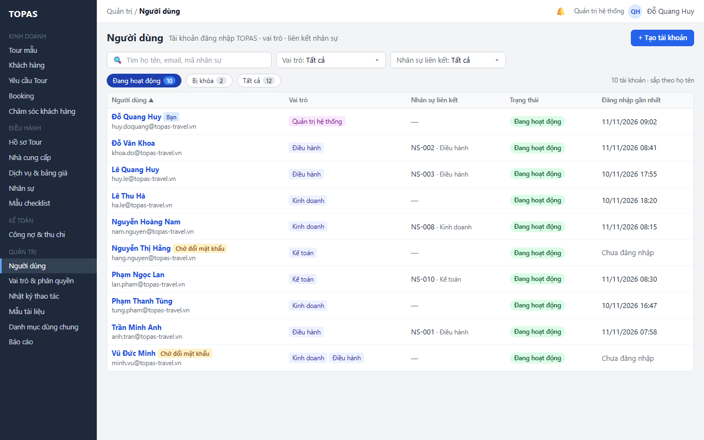

2. **W02 · Thanh lọc và chip.** Quản trị chọn Vai trò: Điều hành rồi chip Tất cả. Danh sách và số trên chip cập nhật ngay (4 + 1 = 5); tài khoản kiêm nhiệm (Vũ Đức Minh: Kinh doanh, Điều hành) có trong kết quả. Liên kết Xóa bộ lọc hiện ra.

   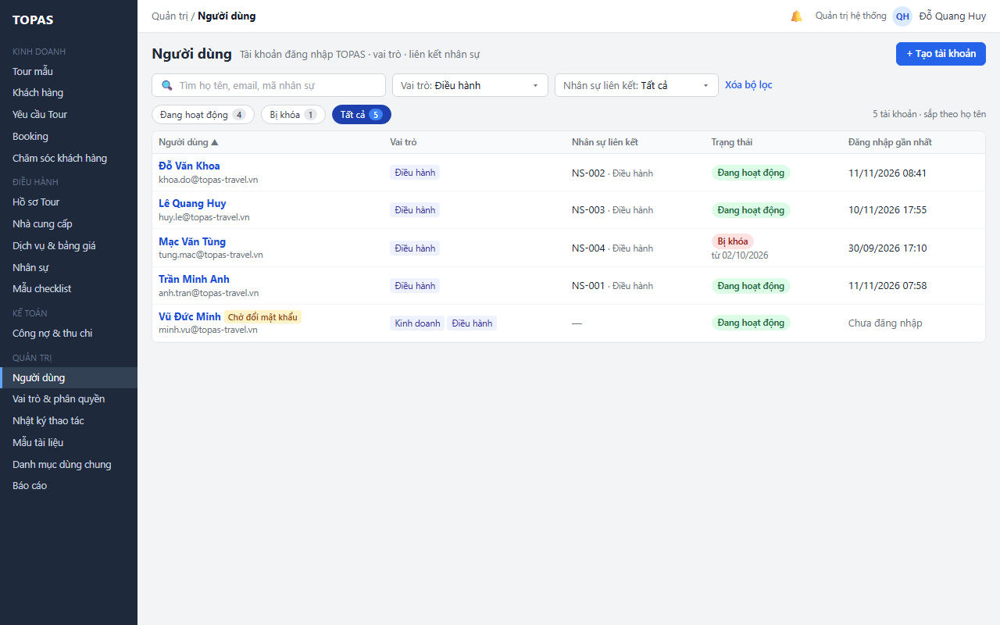

   > Hình chưa cập nhật: thẻ Bị khóa còn màu đỏ; nay màu xám (K6).

3. **W03 · Vùng bảng khi không có dòng khớp.** Quản trị gõ tên người chưa có tài khoản. Bảng hiện “Không có tài khoản khớp bộ lọc” và gợi ý Tạo tài khoản; số trên chip về 0. Quản trị bấm Xóa bộ lọc ở thanh lọc để về mặc định, hoặc bấm Tạo tài khoản (L2.1).

   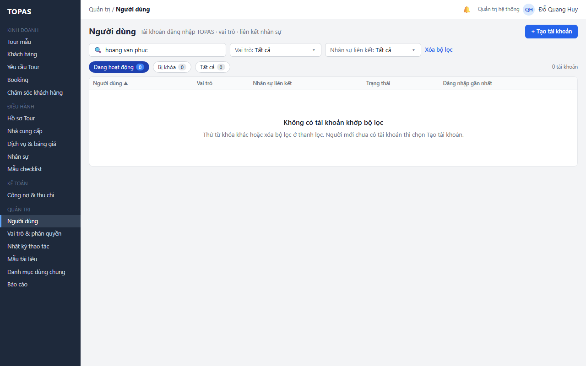

*Kết quả:* Quản trị thấy đúng tập tài khoản cần xem; bấm một dòng để mở bảng trượt (L3.1).

**Ngoại lệ**

- **E1.1 · W04.** Không tải được danh sách: vùng bảng thay bằng thông báo lỗi và nút Thử lại; thanh lọc giữ nguyên giá trị; số trên chip hiện “–”. Bấm Thử lại thì tải lại với bộ lọc cũ.

  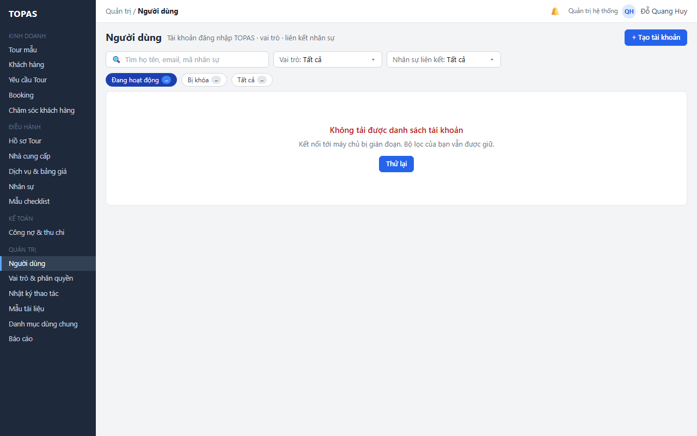

- **E1.2.** Người không có quyền xem QT01 mở QT01 bằng đường dẫn: mục 2.6, Không có quyền.
- **E1.3.** Tìm kiếm dưới 2 ký tự: chưa chạy tìm, ô tìm hiện gợi ý “Nhập ít nhất 2 ký tự”.
- **E1.4.** Vai trò trong bộ lọc vừa bị đổi tên ở QT02: bộ lọc vẫn áp dụng theo mã vai trò, hiện tên mới ở lần tải sau.
- **E1.5.** Tài khoản bị khóa hoặc đổi vai trò ở phiên khác trong lúc danh sách đang mở: danh sách không tự nhảy; dữ liệu mới hiện khi đổi bộ lọc, đổi trang hoặc mở bảng trượt của dòng đó.
- **E1.6.** Chip Bị khóa chưa có ai: bảng hiện “Chưa có tài khoản bị khóa”, không có gợi ý Tạo tài khoản.

### 3.2. Tạo tài khoản

**L2.1 Tạo tài khoản cho nhân sự Nội bộ.** *Điều kiện:* Quản trị hệ thống. Ví dụ: Phan Thu Hà (NS-026, nhóm Điều hành) đã có ở DH06 nhưng chưa có tài khoản, nên chưa được chọn làm phụ trách hồ sơ (RSD DH06 AC12).

1. **W05 · Nút Tạo tài khoản ở góc phải tiêu đề → bảng trượt.** Bảng trượt mở với ô Nhân sự liên kết ở đầu form, đang mở danh sách nhân sự chưa có tài khoản (R05): Nội bộ trước, Cộng tác viên sau (nhãn Cộng tác viên); mỗi dòng ghi tên, mã, nhóm công việc, email. Dòng cuối là Không liên kết nhân sự. Mật khẩu tạm mặc định Hệ thống tự sinh. Nút Tạo tài khoản khóa khi Họ tên hoặc Email trống.

   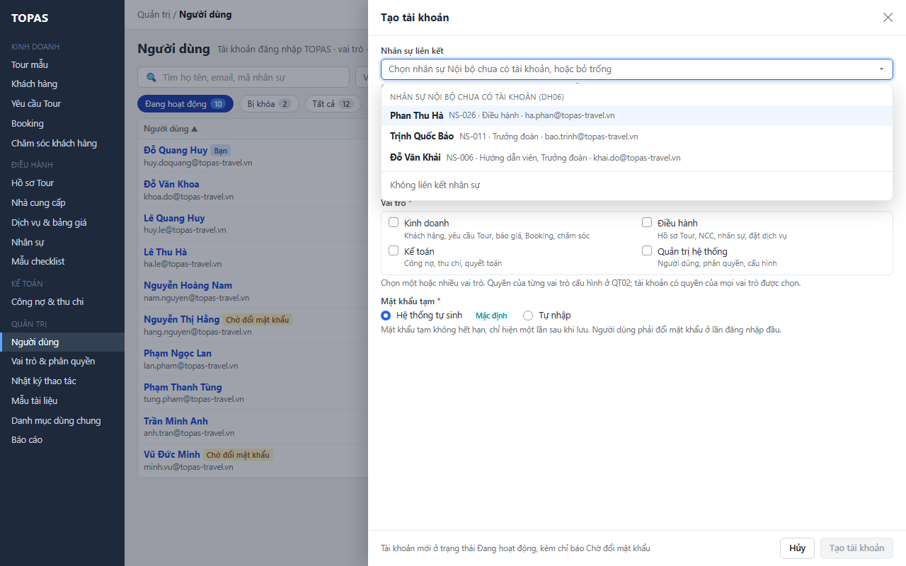

   > Hình chưa cập nhật: danh sách chỉ có nhân sự Nội bộ; nay có thêm nhóm Cộng tác viên chưa có tài khoản, mỗi dòng có nhãn Cộng tác viên (R05, bổ sung 12/11/2026).

2. **W06 · Chọn nhân sự trong danh sách.** Quản trị chọn Phan Thu Hà. Hệ thống điền Họ tên, Email đăng nhập, Điện thoại từ DH06 (nhãn Từ DH06) và tích sẵn vai trò Điều hành theo nhóm công việc (nhãn Gợi ý theo nhóm công việc, R05). Quản trị sửa được mọi trường điền sẵn, chọn thêm hoặc bỏ vai trò (R02). Muốn tự nhập mật khẩu tạm thì chọn Tự nhập; ô mật khẩu hiện ra (R04). Người không có trong DH06 (ví dụ Quản trị thuê ngoài) thì chọn Không liên kết nhân sự và nhập tay.

   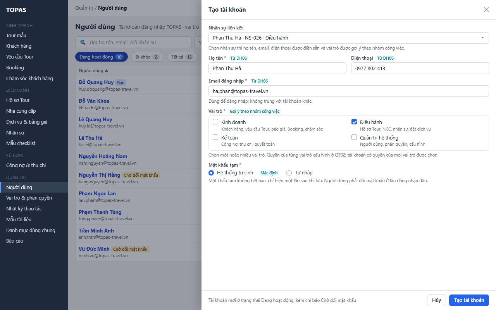

3. **W06 → W08 · Nút Tạo tài khoản ở chân bảng trượt.** Quản trị bấm Tạo tài khoản. Hệ thống kiểm tra theo mục 5.2, R01 và R02; tạo tài khoản Đang hoạt động, ghi liên kết NS-026, sinh mật khẩu tạm (R04). Bảng trượt đóng; hộp thoại Thông tin đăng nhập tạm mở trên danh sách đã có dòng mới. Hộp thoại ghi họ tên, địa chỉ đăng nhập, email, mật khẩu tạm và lưu ý mật khẩu chỉ hiện một lần, hệ thống không gửi email.

   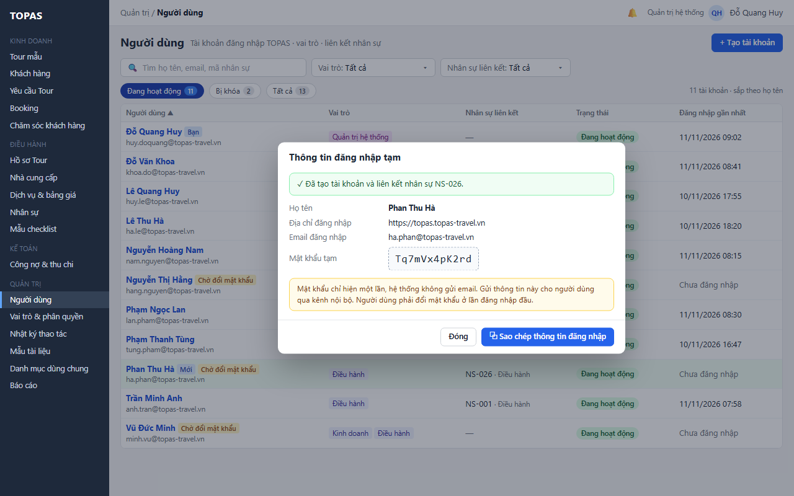

4. **W08 · Nút Sao chép thông tin đăng nhập.** Quản trị bấm; hệ thống chép vào bộ nhớ tạm một đoạn gồm địa chỉ đăng nhập, email, mật khẩu tạm; nút đổi thành “✓ Đã sao chép” trong 3 giây. Quản trị gửi đoạn này cho người dùng qua kênh nội bộ (ngoài hệ thống).
5. **W09 · Nút Đóng của hộp thoại.** Hộp thoại đóng. Tài khoản mới nằm đúng vị trí theo tên, tô nền xanh nhạt trong 5 giây, có nhãn Mới và chỉ báo Chờ đổi mật khẩu. Số trên chip tăng (11 + 2 = 13). Thông báo ngắn “Đã tạo tài khoản Phan Thu Hà · liên kết NS-026” có liên kết Mở.

   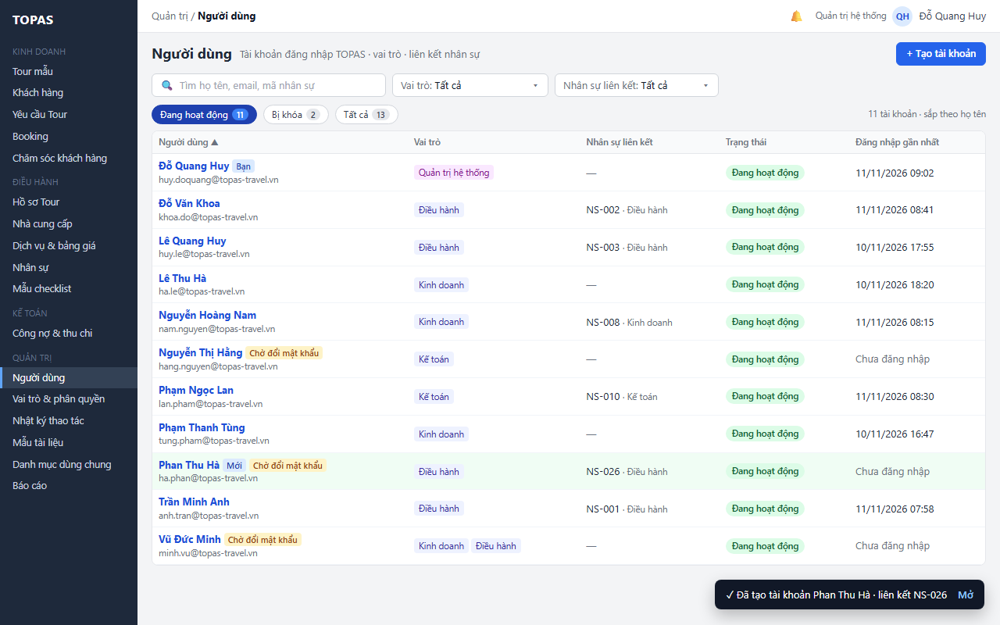

*Kết quả:* Phan Thu Hà đăng nhập được bằng mật khẩu tạm và phải đổi mật khẩu ngay lần đầu. Ở DH06, cột Tài khoản của NS-026 hiện “✓ Đã liên kết” từ lần tải sau; người này có trong danh sách chọn phụ trách hồ sơ ở DH07 (RSD DH06 R03, AC13).

**L2.2 Tạo tài khoản HDV cho Cộng tác viên.** *Điều kiện:* Quản trị hệ thống. Ví dụ: Ngô Thị Mai (NS-015, Cộng tác viên, nhóm Hướng dẫn viên) dẫn đoàn TP-2611-0042 và cần ghi nhật ký, chi phí trên điện thoại.

1. **W05 · Nút Tạo tài khoản ở góc phải tiêu đề → bảng trượt, ô Nhân sự liên kết.** Quản trị chọn Ngô Thị Mai ở nhóm Cộng tác viên của danh sách. Hệ thống điền Họ tên, Email đăng nhập, Điện thoại từ DH06 (nhãn Từ DH06) và tích sẵn vai trò HDV (nhãn Gợi ý theo nhóm công việc, R05).
2. **W06 · Ô Vai trò.** Vì nhân sự là Cộng tác viên, ô Vai trò chỉ cho chọn vai trò thuộc phòng HDV (HDV và vai trò tự tạo thuộc phòng HDV); các vai trò khác hiện mờ kèm lý do “Cộng tác viên chỉ có vai trò thuộc phòng HDV” (R05). Dưới ô ghi “Tài khoản chỉ thấy Tour được phân công ở DH08.5 (Tour của tôi)”.
3. **W06 → W08 · Nút Tạo tài khoản ở chân bảng trượt.** Như L2.1 bước 3–5: tài khoản Đang hoạt động, liên kết NS-015, mật khẩu tạm hiện một lần ở W08. Máy chủ kiểm tra lại ràng buộc Cộng tác viên (R05) trong cùng giao dịch.

*Kết quả:* Ngô Thị Mai đăng nhập được trên điện thoại (RSD CH01), đổi mật khẩu tạm, rồi vào Tour của tôi với các Tour NS-015 đang được phân công (RSD QT02 R16). Ở DH06, cột Tài khoản của NS-015 hiện trạng thái liên kết theo RSD DH06.

**Ngoại lệ**

- **E2.1 · W07.** Bấm Tạo tài khoản khi có lỗi (email đã dùng cho tài khoản khác kể cả tài khoản Bị khóa; email sai định dạng; chưa chọn vai trò; mật khẩu tự nhập không đạt quy tắc mật khẩu của RSD CH01 R05): hệ thống không tạo. Banner đầu form nêu số lỗi; mỗi lỗi hiện cạnh trường; dữ liệu đã nhập được giữ. Lỗi email trùng có liên kết Mở tài khoản để mở bảng trượt của tài khoản đó (ví dụ người cũ đã bị khóa thì mở khóa thay vì tạo mới, L5.3).

  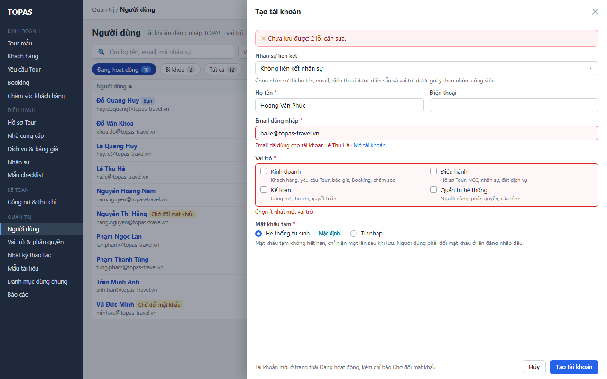

- **E2.2.** Nhân sự vừa được liên kết với tài khoản khác ở phiên khác trong lúc đang nhập: khi bấm Tạo tài khoản, ô Nhân sự liên kết báo lỗi “NS-026 vừa được liên kết với tài khoản khác”; Quản trị chọn lại hoặc chọn Không liên kết nhân sự.
- **E2.3.** Nhân sự vừa bị xóa ở DH06: lỗi cạnh ô Nhân sự liên kết “<mã nhân sự> không còn tồn tại”. Nhân sự vừa đổi sang Cộng tác viên trong khi form có vai trò không thuộc phòng HDV: lỗi như E2.8. Giữ các trường khác.
- **E2.4.** Không còn nhân sự nào (Nội bộ hoặc Cộng tác viên) chưa có tài khoản: danh sách ở W05 chỉ có dòng “Không còn nhân sự chưa có tài khoản · Thêm ở DH06” và Không liên kết nhân sự.
- **E2.5.** Bấm Đóng ở W08 khi chưa bấm Sao chép: dưới nút hiện “Chưa sao chép. Đóng thì mật khẩu này không xem lại được; cần mật khẩu mới thì Đặt lại mật khẩu”; nút đổi thành Vẫn đóng. Bấm Vẫn đóng thì đóng như bước 5.
- **E2.6.** Đóng bảng trượt hoặc bấm Hủy khi đã nhập: hộp thoại “Bỏ thông tin đang nhập?” với hai nút Bỏ và Ở lại.
- **E2.7.** Lỗi lưu hoặc kết quả chưa xác định: mục 2.6, Lỗi lưu chung. Nếu tra thấy tài khoản đã được tạo thì không tạo lần hai; hộp thoại W08 không hiện lại được, Quản trị dùng Đặt lại mật khẩu (L4.1).
- **E2.8 · W07.** Bấm Tạo tài khoản với nhân sự Cộng tác viên và một vai trò không thuộc phòng HDV (gửi thẳng tới máy chủ, hoặc vai trò vừa đổi phòng ở QT02 sau khi form mở): hệ thống không tạo; lỗi cạnh ô Vai trò “Cộng tác viên chỉ có vai trò thuộc phòng HDV · bỏ <tên vai trò> hoặc chọn nhân sự Nội bộ” (R05).
- **E2.9.** Đổi ô Nhân sự liên kết từ Cộng tác viên sang nhân sự Nội bộ hoặc Không liên kết nhân sự trong form tạo: các vai trò khác mở lại để chọn; vai trò đã tích giữ nguyên. Đổi từ Nội bộ sang Cộng tác viên khi đã tích vai trò khác phòng HDV: các vai trò đó bị bỏ tích, dưới ô Vai trò ghi “Đã bỏ <tên vai trò> vì Cộng tác viên chỉ có vai trò thuộc phòng HDV”.

### 3.3. Sửa tài khoản, liên kết nhân sự, xem lịch sử

**L3.1 Sửa thông tin và vai trò.** *Điều kiện:* Quản trị hệ thống; tài khoản đã có. Ví dụ: Nguyễn Hoàng Nam (Kinh doanh) kiêm thêm Quản trị hệ thống.

1. **W10 · Bấm dòng trên bảng → bảng trượt, tab Thông tin.** Bảng trượt gồm:
   - **Phần đầu:** họ tên, trạng thái, nhãn Bạn và chỉ báo mật khẩu nếu có; nút Đặt lại mật khẩu và Khóa tài khoản (hoặc Mở khóa tài khoản khi Bị khóa, W21). Dòng phụ ghi email, ngày tạo, đăng nhập gần nhất; tài khoản Bị khóa ghi thêm ngày khóa, người khóa, lý do.
   - **Tab:** Thông tin (form, một nút Lưu) và Lịch sử (L3.3).
   - **Form Thông tin:** Nhân sự liên kết (kèm Gỡ liên kết khi đã có, L3.2), Họ tên, Điện thoại, Email đăng nhập, Vai trò, ô Đang phụ trách (chỉ đọc, R06).
   - **Chân:** “● Có thay đổi chưa lưu” hoặc thời điểm cập nhật cuối; Đóng (Hủy thay đổi khi đang sửa); Lưu.

   Quản trị tích thêm Quản trị hệ thống. Chân bảng trượt hiện “● Có thay đổi chưa lưu”.

   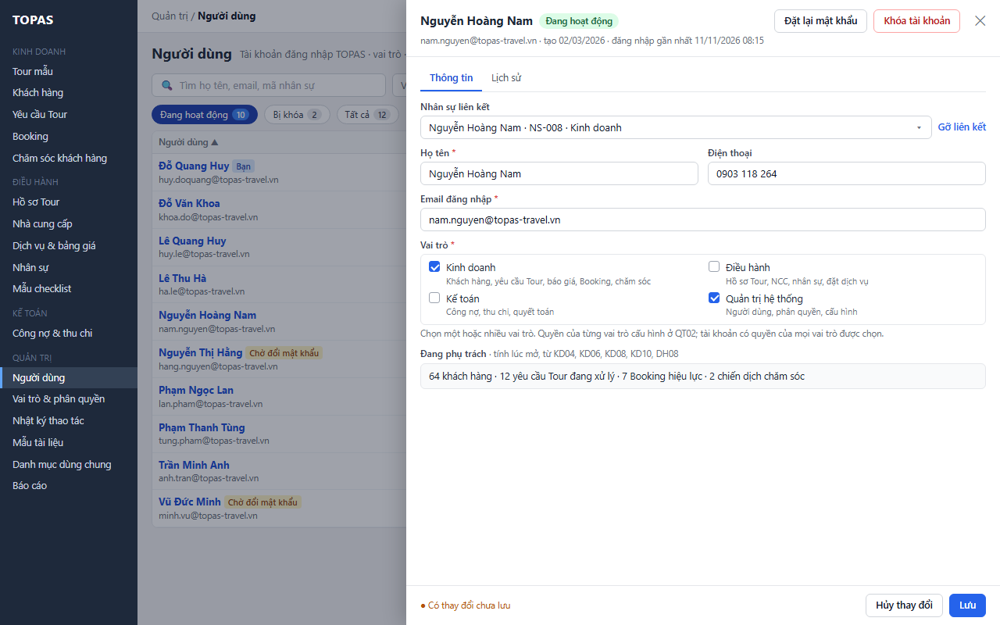

   > Hình chưa cập nhật: ô Đang phụ trách còn “2 chiến dịch chăm sóc” (bỏ theo C3); ô này là trường chỉ đọc, hiện dạng chữ (U5).

2. **W11 · Nút Lưu.** Hệ thống kiểm tra theo mục 5.2, R01, R02 và R08 rồi lưu. Bảng trượt ở lại tab Thông tin; chân ghi “Cập nhật lúc 09:35 bởi Đỗ Quang Huy”, nút Lưu khóa với “Chưa có thay đổi”. Dòng phía sau cập nhật cột Vai trò. Thông báo ngắn “Đã lưu vai trò của Nguyễn Hoàng Nam. Quyền mới áp dụng từ thao tác tiếp theo của người dùng” (R02). Lịch sử có thêm một dòng (W16).

   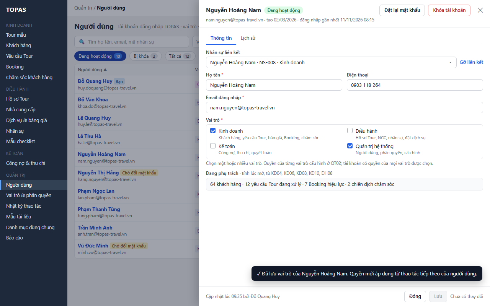

   > Hình chưa cập nhật: ô Đang phụ trách còn “2 chiến dịch chăm sóc” (bỏ theo C3).

*Kết quả:* Nguyễn Hoàng Nam có quyền của cả hai vai trò từ thao tác tiếp theo; menu Quản trị hiện ở lần tải trang tiếp theo. Sửa họ tên, điện thoại, email cũng theo hai bước trên; đổi email thì lần đăng nhập sau dùng email mới, phiên hiện tại giữ nguyên (R01).

**L3.2 Liên kết và gỡ liên kết nhân sự.** *Điều kiện:* Quản trị hệ thống; tài khoản đã có.

1. **W10 · Ô Nhân sự liên kết.** Với tài khoản chưa liên kết, ô ghi “Chưa liên kết · chọn nhân sự chưa có tài khoản” (W12). Quản trị bấm ô; danh sách nhân sự chưa có tài khoản mở ra như W05 (R05). Tài khoản đang có vai trò không thuộc phòng HDV thì các dòng Cộng tác viên hiện mờ kèm lý do “Cộng tác viên chỉ liên kết với tài khoản chỉ có vai trò thuộc phòng HDV” (E3.11). Chọn một nhân sự: chỉ ô liên kết đổi, họ tên và điện thoại của tài khoản giữ nguyên; nếu khác DH06, cạnh trường hiện gợi ý “DH06: … · Dùng” để Quản trị bấm lấy. Bấm Lưu như L3.1 bước 2.
2. **W15 · Liên kết Gỡ liên kết cạnh ô Nhân sự liên kết.** Gỡ liên kết hoàn tác được nên không có hộp thoại (U2). Hệ thống gỡ ngay (không cần bấm Lưu), ghi lịch sử. Ô Nhân sự liên kết về “Chưa liên kết”; cột Nhân sự liên kết của dòng phía sau hiện “—”. Thông báo ngắn “Đã gỡ liên kết NS-001 khỏi tài khoản Trần Minh Anh” kèm nút Hoàn tác; khi nhân sự đang phụ trách hồ sơ Tour hoặc công việc chưa hoàn tất, thông báo ghi thêm số đó, ví dụ “6 hồ sơ Tour, 9 công việc giữ nguyên người phụ trách”. Sau khi gỡ: tài khoản vẫn đăng nhập được; ở DH06 nhân sự hiện Tài khoản “Chưa có”, không còn được chọn làm phụ trách hồ sơ mới, không nhận thông báo nhóm Điều hành; hồ sơ và công việc giữ nguyên người phụ trách (RSD DH06 R03). Gỡ liên kết của tài khoản HDV: phân công phục vụ ở DH08.5 giữ nguyên; tài khoản vẫn đăng nhập được nhưng Tour của tôi không còn Tour nào (RSD QT02 R16).

   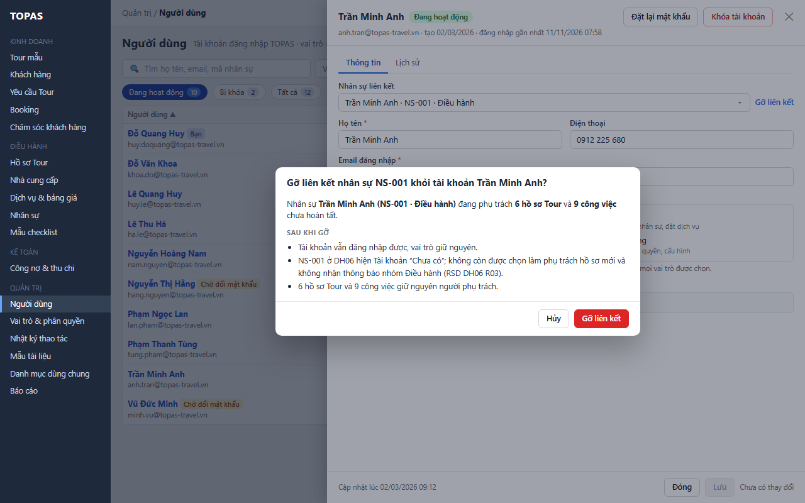

   > Hình chưa cập nhật: hình còn hộp thoại xác nhận; nay gỡ ngay, nội dung về hồ sơ và công việc chuyển vào thông báo ngắn có Hoàn tác (U2).

3. **W10 · Nút Hoàn tác trên thông báo ngắn.** Quản trị bấm Hoàn tác khi thông báo còn hiện: hệ thống liên kết lại nhân sự cũ, ghi lịch sử. Nhân sự vừa được liên kết với tài khoản khác ở phiên khác thì không hoàn tác được, báo như E2.2.

*Kết quả:* liên kết tài khoản ↔ nhân sự luôn một – một (R05). Đổi sang nhân sự khác = gỡ liên kết cũ rồi chọn nhân sự mới.

**L3.3 Xem lịch sử tài khoản.** *Điều kiện:* Quản trị hệ thống.

1. **W16 · Tab Lịch sử của bảng trượt.** Quản trị chọn tab. Danh sách sự kiện mới nhất trước: loại sự kiện, thời điểm, người thực hiện, giá trị trước và sau (vai trò, email, nhân sự liên kết, lý do khóa); với đặt lại mật khẩu ghi số phiên bị đăng xuất. Email, điện thoại hiện dạng đã che; mật khẩu chỉ ghi “đã đổi” (RSD QT03 R07). Liên kết “Xem thao tác của người này (QT03)” mở QT03 với Người dùng là tài khoản này, 30 ngày qua, để xem người đó đã làm gì trong hệ thống (R09).

   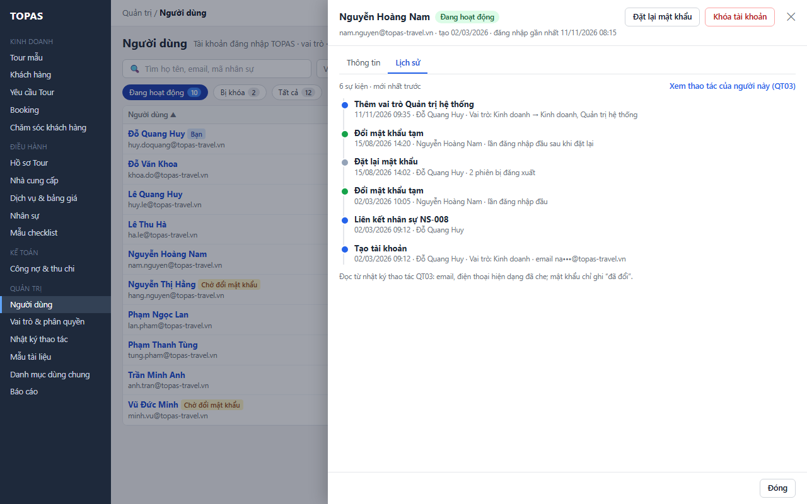

*Kết quả:* Quản trị biết ai đã đổi gì trên tài khoản và lúc nào, không phải sang QT03.

**Ngoại lệ**

- **E3.1 · W12.** Bỏ vai trò thuộc phòng Kinh doanh hoặc Điều hành (vai trò hệ thống cùng tên hoặc vai trò tự tạo thuộc phòng đó, RSD QT02 R13) mà tài khoản không còn vai trò nào khác thuộc phòng đó, khi người đó đang phụ trách bản ghi của phòng đó (ví dụ Lê Thu Hà chuyển từ Kinh doanh sang Điều hành, còn 12 khách hàng, 9 yêu cầu Tour, 4 Booking): bấm Lưu thì chưa lưu; chân bảng trượt hiện cảnh báo vàng nêu số bản ghi theo từng loại, hệ quả (bản ghi giữ nguyên, tên kèm “(ngừng hoạt động)”, người đó mất các quyền của vai trò đã bỏ) và liên kết mở từng màn ở thẻ mới, lọc sẵn theo người này. Bỏ vai trò Điều hành khi nhân sự liên kết còn hồ sơ Tour chưa đóng: liên kết Mở Hồ sơ Tour mở DH07 để người có quyền giao lại (R06). Hai nút Quay lại sửa và Vẫn lưu. Bấm Vẫn lưu thì lưu như L3.1 bước 2 (R08).

  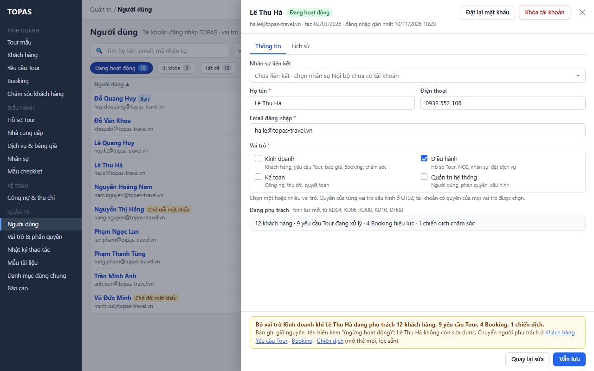

  > Hình chưa cập nhật: cảnh báo và ô Đang phụ trách còn “1 chiến dịch” và liên kết Chiến dịch (bỏ theo C3).

- **E3.2 · W13.** Quản trị mở tài khoản của chính mình: nút Đặt lại mật khẩu khóa, dưới nút ghi “Tự đổi ở màn Đổi mật khẩu”; nút Khóa tài khoản khóa, ghi “Không tự khóa tài khoản của mình”. Khi đây là Quản trị hệ thống đang hoạt động duy nhất, ô vai trò Quản trị hệ thống khóa ở trạng thái đã tích, ghi “Quản trị hệ thống đang hoạt động duy nhất · gán cho người khác trước khi bỏ” (R02, R06). Quản trị vẫn sửa được họ tên, điện thoại, email và vai trò khác của mình.

  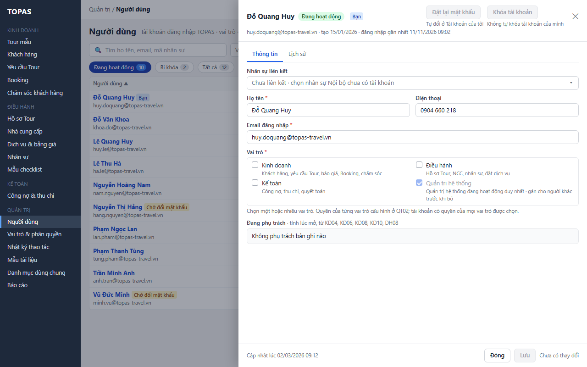

  > Hình chưa cập nhật: dòng dưới nút Đặt lại mật khẩu còn ghi “Tài khoản của tôi”; nay là màn Đổi mật khẩu (Q24).

- **E3.3 · W14.** Tài khoản vừa được sửa ở phiên khác (Quản trị khác, hoặc chính Quản trị ở thẻ khác) sau khi bảng trượt mở: bấm Lưu thì không ghi đè. Banner đỏ đầu form nêu thời điểm, người sửa và phần bị đổi; dữ liệu đang nhập giữ trên form. Chỉ có nút Tải lại, không có nút ghi đè (Q8). Bấm Tải lại thì form nạp bản mới, Quản trị nhập lại phần cần đổi (R11).

  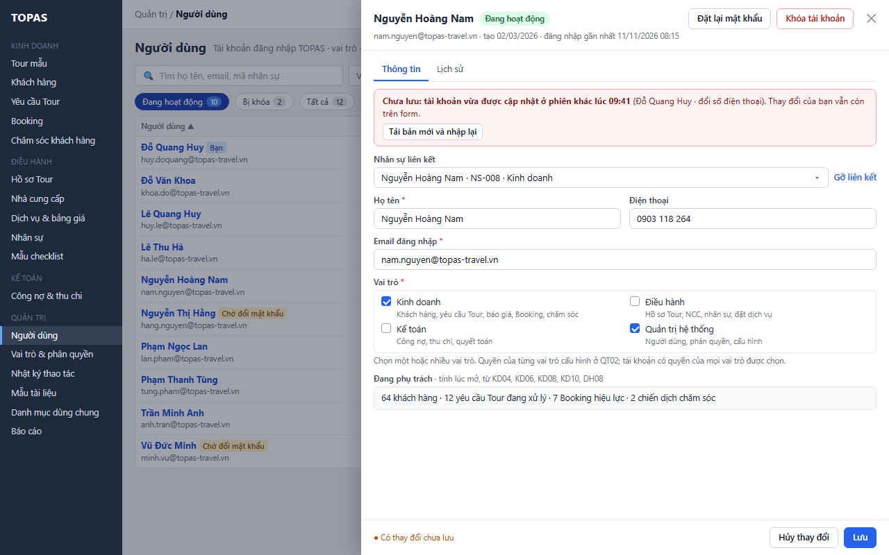

  > Hình chưa cập nhật: nút trong banner còn ghi “Tải bản mới và nhập lại”; nay là Tải lại (Q8). Ô Đang phụ trách còn “2 chiến dịch chăm sóc” (bỏ theo C3).

- **E3.4.** Đổi email trùng tài khoản khác hoặc sai định dạng; bỏ hết vai trò: lỗi cạnh trường như W07; không lưu.
- **E3.5.** Bỏ vai trò Quản trị hệ thống của người khác khi người đó là Quản trị đang hoạt động cuối cùng ngoài mình: được, vì mình vẫn còn. Trường hợp duy nhất bị chặn là E3.2.
- **E3.6.** Tài khoản đang mở bị khóa hoặc mở khóa ở phiên khác: trạng thái và nút ở phần đầu cập nhật khi lưu (E3.3) hoặc mở lại bảng trượt.
- **E3.7.** Không tải được tab Lịch sử hoặc ô Đang phụ trách: tab hoặc ô hiện lỗi kèm Thử lại; tab Thông tin vẫn sửa được. Ô Đang phụ trách lỗi thì khi bỏ vai trò, cảnh báo E3.1 vẫn chạy lại phép đếm lúc bấm Lưu.
- **E3.8.** Gỡ liên kết khi nhân sự vừa bị xóa hoặc đổi loại ở DH06: vẫn gỡ được; hệ thống bỏ liên kết, ghi lịch sử; thông báo ngắn không có Hoàn tác vì không liên kết lại được.
- **E3.9.** Rời bảng trượt khi còn thay đổi chưa lưu: như E2.6.
- **E3.10 · W10.** Tài khoản đang liên kết Cộng tác viên: ô Vai trò chỉ cho tích vai trò thuộc phòng HDV; vai trò khác (kể cả Quản trị hệ thống) hiện mờ kèm lý do “Nhân sự liên kết là Cộng tác viên · chỉ có vai trò thuộc phòng HDV” (R05). Yêu cầu lưu gửi thẳng với vai trò khác bị máy chủ từ chối, lỗi cạnh ô Vai trò, không lưu. Muốn cấp vai trò khác thì gỡ liên kết trước, hoặc Điều hành đổi nhân sự sang Nội bộ ở DH06.
- **E3.11.** Liên kết Cộng tác viên với tài khoản có vai trò không thuộc phòng HDV (chọn ở ô Nhân sự liên kết, gửi thẳng, hoặc Hoàn tác gỡ liên kết sau khi tài khoản vừa được thêm vai trò khác): không lưu; lỗi cạnh ô Nhân sự liên kết, hoặc thông báo ngắn khi Hoàn tác, “Cộng tác viên chỉ liên kết với tài khoản chỉ có vai trò thuộc phòng HDV” (R05).
- **E3.12.** Vai trò tự tạo thuộc phòng HDV đổi sang phòng khác ở QT02 chỉ được khi chưa gán cho tài khoản nào (RSD QT02 R03), nên tài khoản liên kết Cộng tác viên không thể mang vai trò ngoài phòng HDV qua QT02.

### 3.4. Đặt lại mật khẩu

**L4.1 Đặt lại mật khẩu.** *Điều kiện:* Quản trị hệ thống; tài khoản Đang hoạt động, không phải của chính mình. Ví dụ: Nguyễn Thị Hằng (Kế toán) báo đã làm mất mật khẩu tạm trước khi đăng nhập lần đầu.

1. **W10 · Bấm dòng Nguyễn Thị Hằng trên W01 → bảng trượt.** Phần đầu có chỉ báo Chờ đổi mật khẩu.
2. **W17 · Nút Đặt lại mật khẩu ở phần đầu bảng trượt → hộp thoại.** Hộp thoại ghi email, tình trạng mật khẩu (Chờ đổi mật khẩu, mật khẩu tạm đặt 05/11/2026 10:15) và hệ quả: mật khẩu hiện tại mất hiệu lực, mọi phiên đăng nhập bị đăng xuất, hệ thống không gửi email. Mật khẩu tạm mặc định Hệ thống tự sinh; chọn Tự nhập thì hiện ô nhập (R04).

   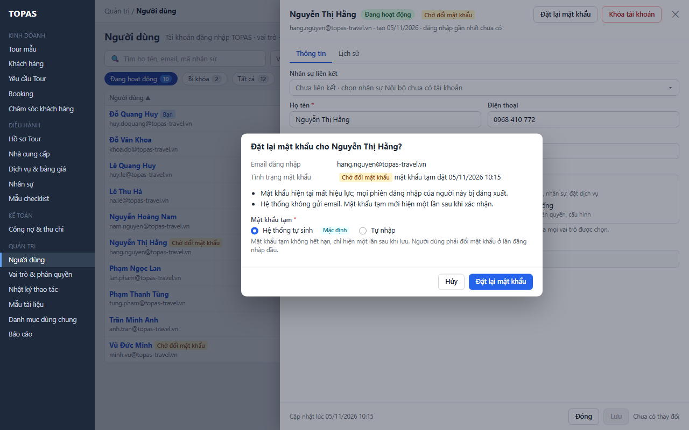

3. **W08 · Nút Đặt lại mật khẩu trong hộp thoại.** Hệ thống thay mật khẩu bằng mật khẩu tạm mới, đăng xuất mọi phiên của người này, ghi lịch sử. Hộp thoại Thông tin đăng nhập tạm (dạng W08) hiện với dữ liệu của Nguyễn Thị Hằng, dòng xác nhận “Đã đặt lại mật khẩu”. Quản trị sao chép và đóng như L2.1 bước 4–5.
4. **W10 · Sau khi đóng hộp thoại.** Bảng trượt ở lại; chỉ báo Chờ đổi mật khẩu giữ nguyên ở phần đầu và trên dòng phía sau (như dòng Phan Thu Hà ở W09); mật khẩu tạm cũ không còn dùng được.

*Kết quả:* người dùng đăng nhập bằng mật khẩu tạm mới và phải đổi ngay. Dùng cùng luồng khi người dùng quên mật khẩu: họ báo Quản trị qua kênh nội bộ; màn Đăng nhập không có tự đặt lại qua email (quyết định 12/11/2026).

**Ngoại lệ**

- **E4.1.** Tài khoản của chính mình: nút khóa (E3.2, W13).
- **E4.2.** Tài khoản Bị khóa: không có nút Đặt lại mật khẩu; đặt mật khẩu tạm mới khi mở khóa (L5.3).
- **E4.3.** Mật khẩu tự nhập không đạt quy tắc mật khẩu (RSD CH01 R05, ví dụ chứa phần trước @ của email): lỗi dưới ô trong hộp thoại; không đặt lại.
- **E4.4.** Tài khoản vừa bị khóa ở phiên khác: hộp thoại báo “Tài khoản vừa bị khóa lúc …”, không đặt lại; bảng trượt tải lại.
- **E4.5.** Bấm Đặt lại hai lần hoặc lỗi mạng sau khi bấm: hệ thống chỉ đặt lại một lần theo mã thao tác; nếu kết quả chưa xác định mà tra thấy đã đặt lại, báo “Đã đặt lại lúc …; mật khẩu không xem lại được. Đặt lại lần nữa?” (R11).

### 3.5. Khóa và mở khóa

**L5.1 Khóa tài khoản của người đang phụ trách bản ghi.** *Điều kiện:* Quản trị hệ thống; tài khoản Đang hoạt động, không phải của chính mình. Ví dụ: Lê Thu Hà (Kinh doanh) nghỉ việc từ 11/11/2026.

1. **W10 · Bấm dòng Lê Thu Hà → bảng trượt.** Ô Đang phụ trách ghi 12 khách hàng · 9 yêu cầu Tour đang xử lý · 4 Booking hiệu lực (cùng số ở W12).
2. **W18 · Nút Khóa tài khoản ở phần đầu bảng trượt → hộp thoại.** Hệ thống đếm lại bản ghi đang phụ trách theo R06. Hộp thoại liệt kê từng loại kèm số và liên kết mở màn ở thẻ mới, lọc sẵn Phụ trách: Lê Thu Hà (Mở Khách hàng → KD03; Mở Yêu cầu Tour → KD05; Mở Booking → KD07; khi có hồ sơ Tour hoặc công việc qua nhân sự liên kết: Mở Hồ sơ Tour → DH07). Hộp thoại nêu hệ quả (bản ghi giữ nguyên, tên kèm “(ngừng hoạt động)”, người có quyền Chuyển phụ trách của từng màn chuyển được; đăng xuất ngay, số phiên đang mở; không nhận thông báo; không có trong danh sách chọn người phụ trách) và ô Lý do khóa bắt buộc. Quản trị có thể bấm các liên kết để chuyển người phụ trách trước nếu có quyền ở màn đó, rồi quay lại thẻ này; hoặc khóa ngay (R06).

   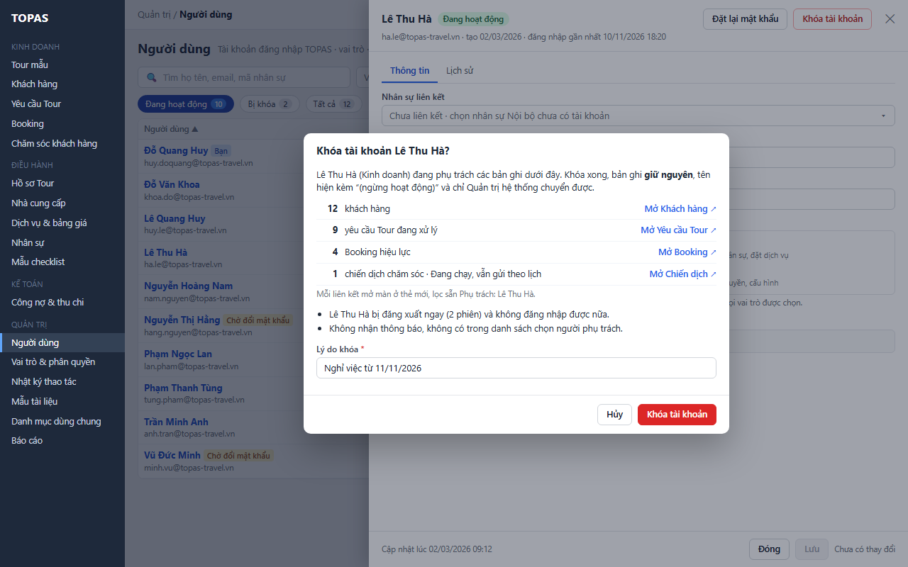

   > Hình chưa cập nhật: còn dòng “1 chiến dịch chăm sóc · Đang chạy, vẫn gửi theo lịch” và liên kết Mở Chiến dịch (bỏ theo C3); câu “chỉ Quản trị hệ thống chuyển được” nay là “người có quyền Chuyển phụ trách của từng màn chuyển được” (Q1).

3. **W19 · Nút Khóa tài khoản trong hộp thoại.** Hệ thống kiểm tra lại quyền và R06, chuyển tài khoản sang Bị khóa, ghi lý do, thu hồi mọi phiên, ghi lịch sử. Hộp thoại và bảng trượt đóng. Ở chip Đang hoạt động, dòng Lê Thu Hà mờ đi, giữ tại chỗ với trạng thái Bị khóa “từ 11/11/2026”; số trên chip đổi (9 + 3 = 12). Thông báo ngắn “Đã khóa tài khoản Lê Thu Hà · đã đăng xuất 2 phiên” có liên kết Xem ở Bị khóa.

   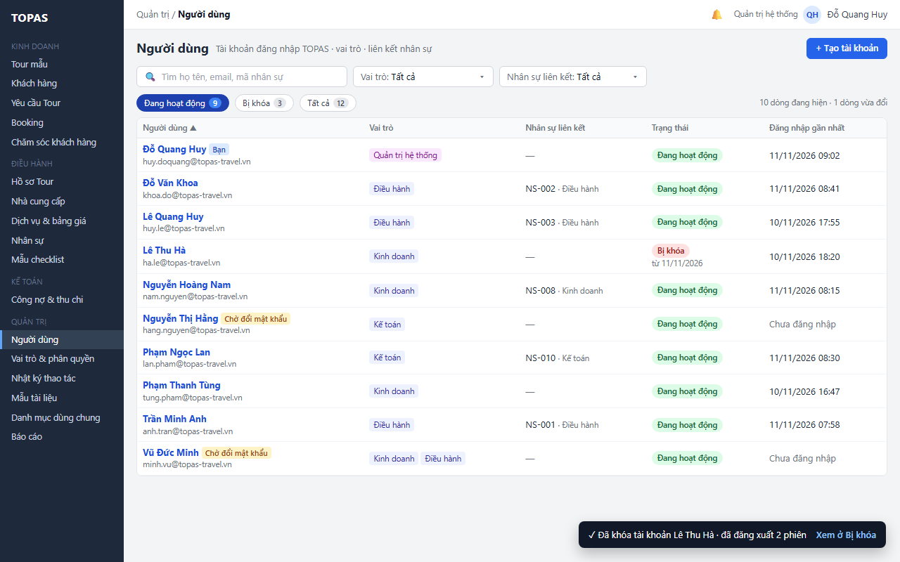

   > Hình chưa cập nhật: thẻ Bị khóa còn màu đỏ; nay màu xám (K6).

*Kết quả:* Lê Thu Hà không đăng nhập được. 12 khách hàng, 9 yêu cầu và 4 Booking giữ nguyên người phụ trách; ở các màn đó tên hiện kèm “(ngừng hoạt động)” và người có quyền Chuyển phụ trách của màn đó chuyển được (RSD KD03-KD04 E4.3, Q1). (Nếu người bị khóa phụ trách hồ sơ Tour thì xử lý theo R06: giao lại ở DH07, hồ sơ Đã đóng thì Mở lại Tour ở DH08.)

**L5.2 Khóa tài khoản không phụ trách bản ghi nào.** *Điều kiện:* như L5.1. Ví dụ: Nguyễn Thị Hằng (Kế toán) tạm hoãn nhận việc.

1. **W20 · Nút Khóa tài khoản ở phần đầu bảng trượt → hộp thoại.** Hộp thoại ghi “Nguyễn Thị Hằng không phụ trách bản ghi nào”, hệ quả và ô Lý do khóa. Nút Khóa tài khoản khóa tới khi nhập lý do, cạnh nút ghi “Nhập lý do”.

   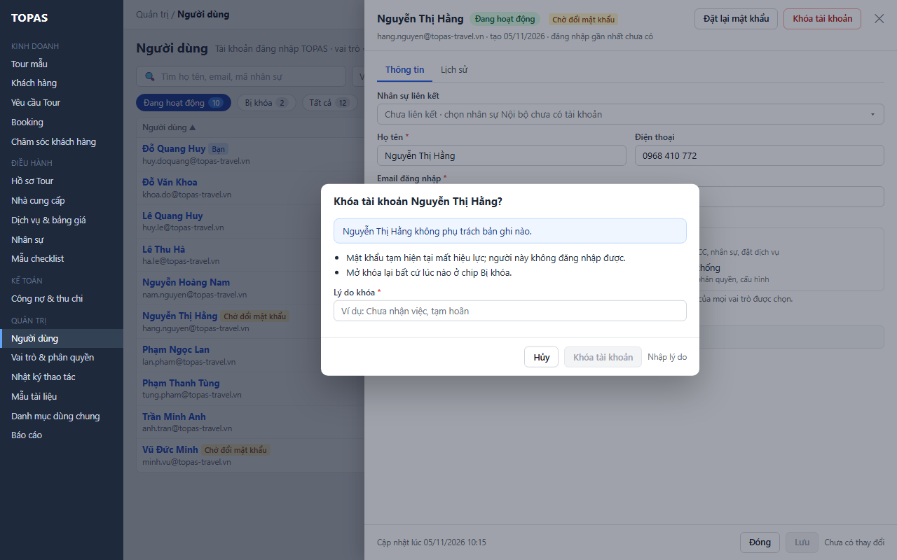

2. **W19 · Nhập lý do, bấm Khóa tài khoản.** Như L5.1 bước 3.

*Kết quả:* tài khoản Bị khóa; mật khẩu tạm (nếu tài khoản đang Chờ đổi mật khẩu, như Nguyễn Thị Hằng) mất hiệu lực ngay (R04); mật khẩu chính thức (nếu có) giữ để dùng lại khi mở khóa không đặt mật khẩu tạm mới (R07).

**L5.3 Mở khóa tài khoản.** *Điều kiện:* Quản trị hệ thống; tài khoản Bị khóa. Ví dụ: Trần Quốc Bảo (Kinh doanh) quay lại làm việc.

1. **W21 · Chip Bị khóa, bấm dòng → bảng trượt.** Phần đầu có trạng thái Bị khóa, dòng phụ ghi ngày khóa, người khóa và lý do. Nút duy nhất ở phần đầu là Mở khóa tài khoản. Tab Thông tin vẫn sửa được, để Quản trị đổi vai trò trước khi mở khóa nếu người đó đổi vị trí.

   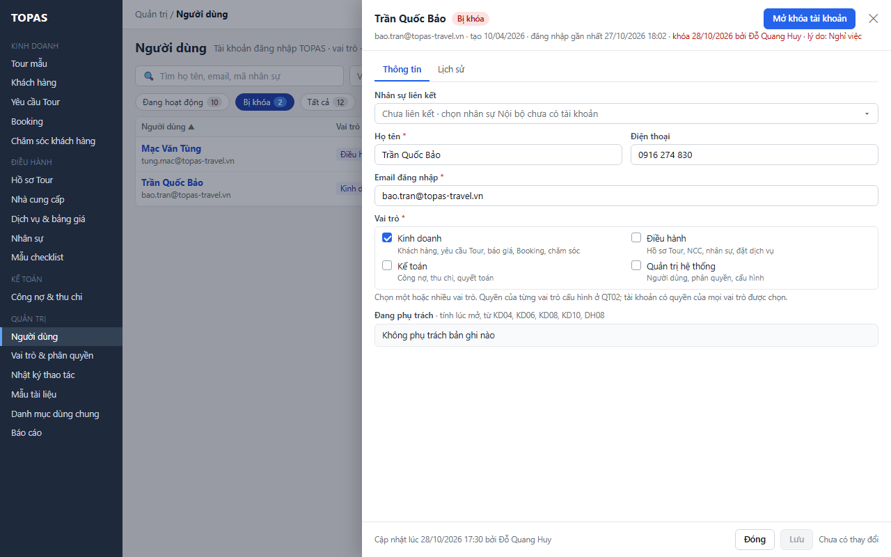

   > Hình chưa cập nhật: thẻ Bị khóa và dòng phụ ngày khóa, lý do ở phần đầu còn màu đỏ; nay màu xám (K6).

2. **W22 · Nút Mở khóa tài khoản → hộp thoại.** Hộp thoại ghi email, vai trò giữ nguyên, ngày và lý do khóa. Ô Đặt mật khẩu tạm mới được tích sẵn (nhãn Mặc định, R07). Tài khoản có mật khẩu tạm lúc bị khóa thì ô này tích sẵn và khóa, dưới ô ghi “Mật khẩu tạm cũ đã mất hiệu lực khi khóa · cần mật khẩu tạm mới” (R07).

   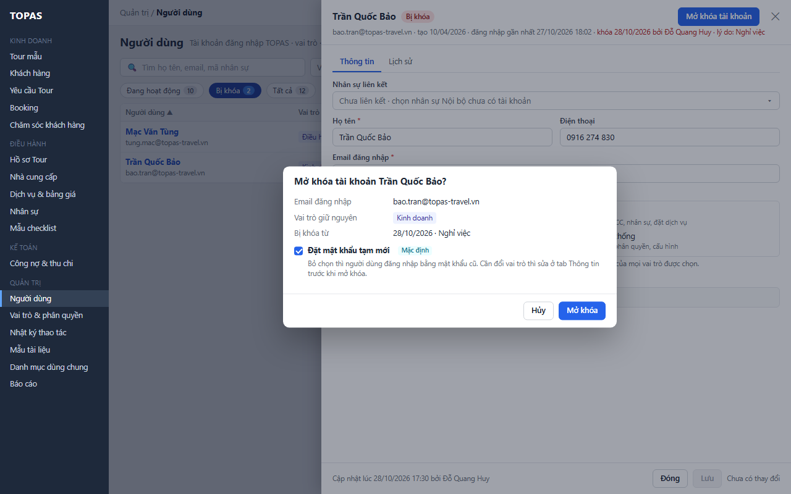

3. **W08 · Nút Mở khóa.** Hệ thống chuyển tài khoản sang Đang hoạt động, sinh mật khẩu tạm mới, ghi lịch sử. Bảng trượt đóng; hộp thoại Thông tin đăng nhập tạm (dạng W08) hiện với dữ liệu của Trần Quốc Bảo, dòng xác nhận “Đã mở khóa tài khoản”. Quản trị sao chép rồi đóng như L2.1 bước 4–5. Nếu đã bỏ tích Đặt mật khẩu tạm mới (chỉ được với tài khoản có mật khẩu chính thức lúc bị khóa) thì không có hộp thoại này; đi thẳng bước 4.
4. **W23 · Sau khi đóng hộp thoại.** Ở chip Bị khóa, dòng Trần Quốc Bảo mờ đi, giữ tại chỗ với trạng thái Đang hoạt động và chỉ báo Chờ đổi mật khẩu; số trên chip đổi (11 + 1 = 12). Thông báo ngắn ghi đã đặt mật khẩu tạm mới và liên kết Xem ở Đang hoạt động.

   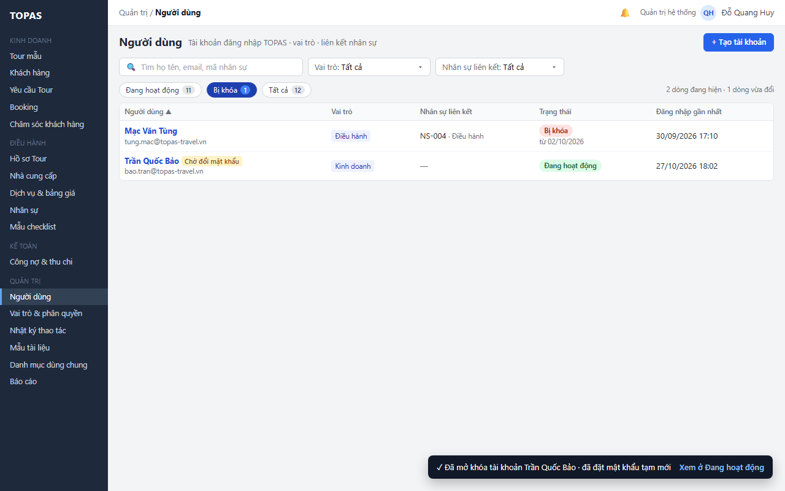

   > Hình chưa cập nhật: thẻ Bị khóa còn màu đỏ; nay màu xám (K6).

*Kết quả:* Trần Quốc Bảo đăng nhập được với vai trò cũ. Các bản ghi còn mang tên người này không tự đổi; nhãn “(ngừng hoạt động)” ở các màn khác mất từ lần tải sau.

**Ngoại lệ**

- **E5.1.** Tài khoản của chính mình: nút Khóa tài khoản khóa (E3.2, W13).
- **E5.2.** Khóa tài khoản là Quản trị hệ thống đang hoạt động cuối cùng (chỉ xảy ra khi đó là chính mình): đã chặn ở E5.1. Máy chủ vẫn kiểm tra R06 lúc ghi, phòng hai Quản trị khóa nhau cùng lúc: lần ghi sau bị từ chối với “Phải còn ít nhất một Quản trị hệ thống đang hoạt động”.
- **E5.3.** Số bản ghi đang phụ trách đổi giữa lúc mở hộp thoại W18 và lúc bấm Khóa (ví dụ đã chuyển xong ở thẻ khác): hệ thống khóa theo trạng thái hiện tại, không hỏi lại; thông báo ngắn ghi số bản ghi còn mang tên người này nếu khác 0.
- **E5.4.** Không đếm được bản ghi ở một màn (lỗi tải): dòng đó trong W18 ghi “Chưa đếm được · Thử lại”; nút Khóa tài khoản vẫn dùng được vì khóa không đổi bản ghi.
- **E5.5.** Tài khoản đã được khóa hoặc mở khóa ở phiên khác: hệ thống không làm lại, báo “Tài khoản đã … lúc … bởi …”, tải lại bảng trượt.
- **E5.6.** Người bị khóa đang thao tác: lần gọi máy chủ tiếp theo bị từ chối, trình duyệt chuyển về màn Đăng nhập với thông báo “Tài khoản đã bị khóa. Liên hệ Quản trị hệ thống.” Dữ liệu đang nhập chưa lưu bị mất.
- **E5.7.** Mở khóa tài khoản có nhân sự liên kết đã bị xóa ở DH06, hoặc đã đổi sang Cộng tác viên trong khi tài khoản có vai trò không thuộc phòng HDV, trong thời gian bị khóa: hệ thống mở khóa, tự gỡ liên kết, ghi lịch sử; thông báo ngắn nêu đã gỡ liên kết.

---

## 4. Quy tắc triển khai chi tiết

### R01. Tài khoản và email đăng nhập

- Mỗi tài khoản có email đăng nhập duy nhất trong mọi tài khoản, kể cả tài khoản Bị khóa. So sánh không phân biệt hoa thường, bỏ khoảng trắng hai đầu.
- Email sửa được. Đổi email không đổi mật khẩu, không đăng xuất phiên hiện tại; lần đăng nhập sau dùng email mới. Lịch sử ghi email cũ và mới ở dạng đã che (RSD QT03 R07).
- **Không xóa tài khoản.** Người nghỉ việc thì khóa. Tài khoản tạo nhầm thì sửa email, họ tên, vai trò, hoặc khóa. Lý do: tài khoản là người thực hiện trong lịch sử, nhật ký và người phụ trách ở mọi màn.
- Họ tên tài khoản do QT01 sở hữu; điền sẵn từ DH06 khi tạo; không tự đồng bộ khi DH06 đổi (L3.2 bước 1 có gợi ý Dùng).

### R02. Vai trò (quyết định 12/11/2026)

- Vai trò lấy từ QT02. Mặc định có năm vai trò hệ thống: Kinh doanh, Điều hành, Kế toán, HDV, Quản trị hệ thống (Admin) (RSD QT02 R03; HDV thêm theo người dùng chốt 12/11/2026).
- Một tài khoản có **ít nhất một** vai trò, có thể nhiều. Quyền của tài khoản là **hợp** quyền các vai trò. Quyền không giới hạn theo bản ghi; người phụ trách chỉ là thông tin, không quyết định ai được sửa (Q1).
- Hệ thống luôn có **ít nhất một tài khoản Đang hoạt động có vai trò Quản trị hệ thống**. Chặn mọi lần lưu, khóa làm vi phạm điều này (W13, E5.2).
- Quản trị không bỏ được vai trò Quản trị hệ thống của chính mình khi mình là Quản trị đang hoạt động duy nhất; còn Quản trị khác thì bỏ được.
- Vai trò tự tạo ở QT02 khai **thuộc phòng** Kinh doanh, Điều hành, Kế toán hoặc HDV và mang mọi hành vi gắn với phòng đó như vai trò hệ thống cùng tên (người phụ trách, Ngừng hoạt động, chip Của tôi bật sẵn, người nhận thông báo theo nhóm, thẻ Việc của tôi; RSD QT02 R13). Trong RSD này, “vai trò thuộc phòng X” gồm vai trò hệ thống X và mọi vai trò tự tạo thuộc phòng X.
- **Vai trò thuộc phòng HDV** chỉ có quyền Tour của tôi (HD01) và chỉ thấy Tour mà nhân sự liên kết được phân công (RSD QT02 R04, R16). Tài khoản liên kết Cộng tác viên chỉ được có vai trò thuộc phòng HDV (R05). Nhân sự Nội bộ được có HDV cùng vai trò khác.
- **Hiệu lực:** quyền kiểm tra ở máy chủ mỗi lần tải và ghi, nên thay đổi vai trò có hiệu lực từ thao tác tiếp theo của người dùng. Menu cập nhật ở lần tải trang tiếp theo. Người dùng bị mất quyền đúng lúc đang thao tác thì lần ghi bị từ chối, thông báo “Quyền của bạn vừa thay đổi” kèm nút **Tải lại trang**; dữ liệu trên form giữ để chép; giao diện đổi theo quyền mới ở lần tải trang sau (CGD U5.05, RSD QT02 R07).

### R03. Trạng thái tài khoản

- Hai trạng thái: **Đang hoạt động**, **Bị khóa**. Chỉ Quản trị hệ thống đổi, qua L5.1–L5.3.
- Chỉ báo Chờ đổi mật khẩu là chỉ báo phụ, tính theo R04, không phải trạng thái.
- **Tạm khóa đăng nhập** (15 phút sau 5 lần nhập sai mật khẩu liên tiếp, Q24) do màn Đăng nhập xử lý theo RSD CH01 R03; không phải trạng thái Bị khóa, không đổi trạng thái tài khoản ở QT01. QT01 chỉ hiện chỉ báo “Tạm khóa đăng nhập, tự hết lúc hh:mm” (mục 2.4); tự hết sau 15 phút, không có nút mở sớm. Đặt lại mật khẩu, mở khóa tài khoản không xóa Tạm khóa đăng nhập (RSD CH01 E3.3).
- **Ngừng hoạt động** (cách các màn khác ghi cạnh tên người phụ trách): tài khoản Bị khóa, hoặc tài khoản không còn vai trò nào thuộc phòng mà bản ghi đó cần (phòng Kinh doanh với khách hàng, yêu cầu Tour, Booking; phòng Điều hành với hồ sơ Tour; RSD QT02 R13). Người có quyền Chuyển phụ trách của màn sở hữu bản ghi chuyển được, không chỉ Quản trị (Q1). Hồ sơ Tour chưa đóng giao lại ở DH07; hồ sơ Tour Đã đóng thì Mở lại Tour kèm chọn người phụ trách mới ở DH08. Xem R06, R08.

### R04. Mật khẩu tạm (quyết định 12/11/2026)

- Mật khẩu tạm được sinh khi tạo tài khoản (L2.1), đặt lại mật khẩu (L4.1) và mở khóa có tích Đặt mật khẩu tạm mới (L5.3).
- **Hệ thống tự sinh** (mặc định): 12 ký tự gồm chữ hoa, chữ thường và số, bỏ các ký tự dễ nhầm 0, O, 1, l, I. **Tự nhập:** theo quy tắc mật khẩu của RSD CH01 R05 (nguồn duy nhất: 10–128 ký tự, có chữ và số, không chứa phần trước @ của email đăng nhập); mật khẩu tự sinh cũng phải đạt R05 đó.
- Mật khẩu tạm **không hết hạn** (quyết định 12/11/2026): dùng được tới khi người dùng đổi ở lần đăng nhập đầu, Quản trị đặt lại, hoặc tài khoản bị khóa. **Khóa tài khoản làm mật khẩu tạm mất hiệu lực ngay** và không có lại khi mở khóa; mở khóa tài khoản đó bắt buộc đặt mật khẩu tạm mới (R07). Tài khoản Chờ đổi mật khẩu lâu ngày được nhận ra bằng chỉ báo và cột Đăng nhập gần nhất “Chưa đăng nhập”; Quản trị tự quyết đặt lại hoặc khóa. Chỉ lưu dạng băm. Hiện đúng một lần ở hộp thoại W08; đóng hộp thoại là không xem lại được.
- Sinh mật khẩu tạm mới làm mật khẩu cũ (tạm hay chính thức) mất hiệu lực ngay và **đăng xuất mọi phiên** của tài khoản.
- **Hệ thống không gửi email** mật khẩu, không gửi link đặt lại. Quản trị tự chuyển thông tin cho người dùng qua kênh nội bộ.
- Màn Đăng nhập và Đổi mật khẩu có đặc tả riêng (Q2, Q24); QT01 chỉ tham chiếu: phiên 7 ngày, gia hạn theo hoạt động; tạm khóa đăng nhập 15 phút sau 5 lần sai (khác Bị khóa, R03); quy tắc mật khẩu theo RSD CH01 R05; đăng nhập bằng mật khẩu tạm thì bắt đổi mật khẩu trước khi vào hệ thống. Mỗi lần người dùng đổi mật khẩu ghi một dòng vào lịch sử tài khoản: **Đổi mật khẩu tạm** (chế độ bắt buộc) hoặc **Đổi mật khẩu** (người dùng tự đổi ở màn Đổi mật khẩu) (RSD CH01 R12).
- Quản trị không đặt lại mật khẩu của chính mình ở QT01; tự đổi ở màn Đổi mật khẩu.

### R05. Liên kết tài khoản ↔ nhân sự (theo RSD DH06 R01)

- Nhân sự **Nội bộ** liên kết được với tài khoản có mọi vai trò. Nhân sự **Cộng tác viên** chỉ liên kết được với tài khoản **chỉ có vai trò thuộc phòng HDV** (VT-005 HDV hoặc vai trò tự tạo thuộc phòng HDV, RSD QT02 R03) (người dùng chốt 12/11/2026; BOI-CANH “Nội bộ, Cộng tác viên”). Một tài khoản liên kết tối đa một nhân sự và ngược lại. Danh sách chọn gồm nhân sự chưa liên kết với tài khoản nào (kể cả tài khoản Bị khóa): Nội bộ trước, Cộng tác viên sau, mỗi nhóm sắp theo tên; mỗi dòng ghi mã, nhóm công việc, email, nhãn Cộng tác viên khi có.
- **Ràng buộc Cộng tác viên, máy chủ kiểm tra ở mọi lần ghi** (tạo, lưu tab Thông tin, liên kết, Hoàn tác gỡ liên kết, mở khóa): tài khoản liên kết Cộng tác viên mà có ít nhất một vai trò không thuộc phòng HDV (kể cả Quản trị hệ thống, vốn không thuộc phòng nào) thì từ chối, không ghi gì. Giao diện chặn trước: tài khoản liên kết Cộng tác viên thì vai trò khác hiện mờ kèm lý do (L2.2, E3.10); tài khoản có vai trò khác thì dòng Cộng tác viên trong danh sách chọn hiện mờ kèm lý do (L3.2, E3.11).
- Liên kết không bắt buộc (ví dụ tài khoản Kế toán, Quản trị không cần phân công thì có thể không liên kết). Nhưng nhân sự nhóm Điều hành chỉ được chọn làm phụ trách hồ sơ và nhận thông báo nhóm Điều hành khi có tài khoản liên kết **đang hoạt động và có vai trò thuộc phòng Điều hành** (vai trò Điều hành hoặc vai trò tự tạo thuộc phòng Điều hành, RSD QT02 R13); người thực hiện công việc checklist không được có tài khoản liên kết Bị khóa (RSD DH06 R03). Tài khoản HDV không liên kết nhân sự thì Tour của tôi rỗng, vì phạm vi tính qua nhân sự liên kết (RSD QT02 R16).
- Khi chọn nhân sự lúc **tạo** tài khoản: điền sẵn họ tên, email, điện thoại từ DH06; gợi ý vai trò theo nhóm công việc: Kinh doanh → Kinh doanh, Điều hành → Điều hành, Kế toán → Kế toán, Hướng dẫn viên → HDV; nhóm khác (Trưởng đoàn…) không gợi ý. Nhân sự Cộng tác viên luôn được gợi ý HDV, bất kể nhóm công việc. Gợi ý chỉ là tích sẵn; Quản trị sửa được.
- **Gỡ liên kết** ghi ngay khi bấm, không hộp thoại, không chờ nút Lưu; thông báo ngắn có Hoàn tác (U2, L3.2). Hồ sơ Tour, công việc, phân công phục vụ đã giao cho nhân sự giữ nguyên.
- Nhân sự liên kết bị xóa ở DH06, hoặc đổi sang Cộng tác viên khi tài khoản có vai trò không thuộc phòng HDV (DH06 chặn các trường hợp này, RSD DH06 E3.2, R08): nếu vẫn xảy ra do dữ liệu cũ thì liên kết được gỡ ở lần ghi tiếp theo của QT01 (E3.8, E5.7). Đổi sang Cộng tác viên khi tài khoản chỉ có vai trò thuộc phòng HDV: liên kết giữ nguyên.

### R06. Khóa tài khoản (quyết định 12/11/2026)

- Không khóa tài khoản của chính mình. Không khóa Quản trị hệ thống đang hoạt động cuối cùng (R02). Lý do khóa bắt buộc, tối đa 200 ký tự.
- **Hiệu lực ngay:** thu hồi mọi phiên; mật khẩu tạm (nếu có) mất hiệu lực (R04); từ chối đăng nhập; không nhận thông báo; không có trong danh sách chọn người phụ trách, người nhận, người thực hiện ở mọi màn. Khóa tài khoản HDV không đổi phân công phục vụ ở DH08.5.
- **Bản ghi phụ trách giữ nguyên.** Hệ thống không tự chuyển, không tự dừng. Các màn khác hiện tên kèm “(ngừng hoạt động)”. Khách hàng, yêu cầu Tour, Booking: người có quyền Chuyển phụ trách của màn sở hữu chuyển được, không chỉ Quản trị (Q1; RSD KD03-KD04 E4.3, KD05 R08, KD08 R11). Hồ sơ Tour (theo `BOI-CANH-DU-AN.md` “Ngừng hoạt động”): hồ sơ chưa đóng **giao lại ở DH07** như giao thường, theo quyền ở DH07 (mặc định Điều hành); hồ sơ **Đã đóng** không giao lại ở DH07, **Mở lại Tour ở DH08 kèm lý do và chọn Điều hành phụ trách mới**, theo quyền Mở lại (mặc định Điều hành và Quản trị hệ thống) (RSD DH07 v1.7, DH08 v2.8 R16). Công việc chưa hoàn tất giao lại ở DH08 theo quyền ở DH08 (mặc định Điều hành).
- **Đếm bản ghi đang phụ trách** (W10 ô Đang phụ trách, W12, W18), tính lúc mở và tính lại lúc bấm:

  | Loại | Điều kiện đếm | Nguồn | Liên kết mở |
  |---|---|---|---|
  | Khách hàng | Người phụ trách khách hàng là tài khoản này | KD04 | KD03 lọc Phụ trách |
  | Yêu cầu Tour đang xử lý | Người phụ trách yêu cầu, trạng thái Đang xử lý | KD06 | KD05 lọc Phụ trách, chip Đang xử lý |
  | Booking hiệu lực | Người phụ trách Booking, Booking Hiệu lực | KD08 | KD07 lọc Phụ trách |
  | Hồ sơ Tour chưa đóng, công việc chưa hoàn tất | Qua nhân sự liên kết: người phụ trách hồ sơ chưa Đã đóng; người thực hiện công việc chưa Hoàn tất | DH08 | DH07 lọc Phụ trách (giao lại theo quyền ở DH07, mặc định Điều hành) |

  Yêu cầu Tour Đã có Booking không đếm riêng vì đi theo Booking (RSD KD08 R11). Hồ sơ Tour Đã đóng không đếm: không cần giao lại; khi cần sửa thì người có quyền Mở lại Tour ở DH08 mở lại kèm chọn người phụ trách mới (RSD DH08 R16). Loại có số 0 không hiện trong hộp thoại.
- Liên kết trong hộp thoại mở ở thẻ mới. Quản trị xem được mọi màn (Q25). Ở KD03, KD05 người có quyền Chuyển phụ trách chuyển được mọi bản ghi của người bị khóa (KD05 chỉ chuyển yêu cầu Đang xử lý, RSD KD05 R08). KD07 chỉ đọc (RSD KD07 R01): bấm dòng mở KD08 rồi chuyển từng Booking ở KD08 (RSD KD08 R11). Ở DH07 người có quyền giao người phụ trách hồ sơ (mặc định Điều hành) giao lại (RSD DH07 v1.7). Người mở liên kết không có quyền chuyển ở màn đó thì chỉ xem; nút chuyển ẩn (U5).

### R07. Mở khóa

- Mở khóa giữ nguyên vai trò, nhân sự liên kết, họ tên, email.
- Mặc định tích **Đặt mật khẩu tạm mới**: sinh mật khẩu tạm theo R04, hiện W08.
- Bỏ tích chỉ được khi tài khoản có **mật khẩu chính thức** lúc bị khóa; mật khẩu chính thức đó dùng lại được.
- Tài khoản có **mật khẩu tạm** lúc bị khóa (Chờ đổi mật khẩu): mật khẩu tạm đã mất hiệu lực khi khóa (R04), nên ô Đặt mật khẩu tạm mới tích sẵn và khóa, ghi “Mật khẩu tạm cũ đã mất hiệu lực khi khóa · cần mật khẩu tạm mới”. Máy chủ từ chối yêu cầu mở khóa không kèm mật khẩu tạm mới của tài khoản này.
- Không có Hoàn tác cho khóa và mở khóa; muốn đảo lại thì làm thao tác ngược với hộp thoại tương ứng.

### R08. Bỏ vai trò khi đang phụ trách

- Bỏ vai trò thuộc phòng Kinh doanh (tài khoản không còn vai trò nào khác thuộc phòng Kinh doanh) khi còn khách hàng, yêu cầu Tour đang xử lý, Booking hiệu lực; bỏ vai trò thuộc phòng Điều hành (không còn vai trò nào khác thuộc phòng Điều hành) khi nhân sự liên kết còn hồ sơ Tour chưa đóng hoặc công việc chưa hoàn tất: **cảnh báo rồi cho lưu** (W12), cùng tinh thần R06. Đổi giữa hai vai trò cùng phòng (ví dụ Kinh doanh sang Trưởng nhóm Kinh doanh thuộc phòng Kinh doanh) không cảnh báo, vì người đó không ngừng hoạt động.
- Sau khi lưu, bản ghi giữ nguyên người phụ trách; người đó mất các quyền của vai trò đã bỏ (giữ quyền của vai trò còn lại); các màn khác coi như ngừng hoạt động (R03) và hiện “(ngừng hoạt động)”. Người chuyển bản ghi theo R06 (người có quyền Chuyển phụ trách của màn đó; hồ sơ Tour chưa đóng giao lại ở DH07; Đã đóng thì Mở lại Tour ở DH08).
- Bỏ vai trò thuộc phòng Kế toán, thuộc phòng HDV hoặc vai trò Quản trị hệ thống không cảnh báo (không có người phụ trách), trừ ràng buộc Quản trị cuối cùng ở R02. Bỏ vai trò thuộc phòng HDV: phân công phục vụ ở DH08.5 giữ nguyên; tài khoản mất Tour của tôi từ yêu cầu kế tiếp nếu không còn `HD01.xem` từ vai trò khác.

### R09. Lịch sử và nhật ký

- Ghi một sự kiện cho mỗi lần: tạo, sửa họ tên, điện thoại, email, đổi vai trò, liên kết, gỡ liên kết, đặt lại mật khẩu, khóa (kèm lý do), mở khóa (kèm có đặt mật khẩu tạm hay không). Hai sự kiện do người dùng làm ở màn Đổi mật khẩu cũng hiện ở tab Lịch sử: **Đổi mật khẩu tạm** và **Đổi mật khẩu** (tự đổi); RSD CH01 R12 ghi hai sự kiện này vào kho QT03, QT01 chỉ đọc.
- Mỗi sự kiện ghi vào kho nhật ký QT03 trong cùng giao dịch với dữ liệu (Q5), có thời điểm, người thực hiện, giá trị trước và sau, mã thao tác, và cờ Thao tác nhạy cảm (RSD QT03 R13). Mật khẩu chỉ ghi “đã đổi”; email, điện thoại che theo RSD QT03 R07.
- Tab Lịch sử đọc kho nhật ký QT03 với đối tượng là tài khoản này. Đăng nhập, đăng xuất không có trong lịch sử vì QT03 không ghi (RSD QT03 R01); phần đầu bảng trượt chỉ hiện Đăng nhập gần nhất từ dịch vụ xác thực.

### R10. Dạng xem, hàng loạt, xuất tệp

- Chỉ dạng Bảng (mục 2.3). Không có bộ chuyển dạng xem.
- Không có thao tác hàng loạt: số tài khoản của doanh nghiệp vừa và nhỏ thường dưới 50; mỗi lần khóa hay đổi vai trò cần xem bản ghi đang phụ trách của từng người.
- Không xuất tệp danh sách tài khoản.

### R11. Đồng thời và chống lặp

- Mọi lần ghi gửi kèm phiên bản bản ghi (khóa lạc quan, Q8). Phiên bản đã đổi thì từ chối và hiện W14 (sửa form, chỉ có nút Tải lại, không có nút ghi đè) hoặc thông báo E4.4, E5.5 (thao tác ở hộp thoại).
- Mỗi lần bấm Tạo tài khoản, Đặt lại mật khẩu, Khóa, Mở khóa, Gỡ liên kết có mã thao tác; bấm lặp hoặc gửi lại sau lỗi mạng với cùng mã chỉ thực hiện một lần.
- Kết quả chưa xác định: tra theo mã thao tác; đã thực hiện thì hiện kết quả, chưa thì cho bấm lại.

### Cấu hình phụ thuộc

| Cấu hình | Chủ sở hữu | Dùng ở | Khi thiếu |
|---|---|---|---|
| Danh sách vai trò, quyền theo vai trò | Quản trị hệ thống (QT02) | Ô Vai trò, bộ lọc Vai trò, R02 | Năm vai trò hệ thống |
| Phòng của vai trò | Quản trị hệ thống (QT02) | Ràng buộc Cộng tác viên (R05), R08 | Vai trò hệ thống có phòng cố định; Quản trị hệ thống không thuộc phòng nào |
| Nhân sự (Nội bộ, Cộng tác viên), nhóm công việc | Điều hành (DH06), QT05 | Ô Nhân sự liên kết, gợi ý vai trò (R05) | Danh sách chọn rỗng (E2.4); không gợi ý vai trò |
| Người phụ trách bản ghi | KD04, KD06, KD08, DH08 | R06, R08 | Dòng đếm ghi “Chưa đếm được · Thử lại” (E5.4) |
| Địa chỉ đăng nhập của hệ thống | Cấu hình triển khai | Hộp thoại W08 | Hộp thoại không có dòng Địa chỉ đăng nhập |

---

## 5. Dữ liệu

### 5.1. Đối tượng

| Đối tượng | Khóa | Dữ liệu chính | Nguồn hoặc tác động |
|---|---|---|---|
| Tài khoản | ID tài khoản | Họ tên, email đăng nhập (duy nhất), điện thoại, trạng thái (Đang hoạt động, Bị khóa), ngày giờ khóa, người khóa, lý do khóa, ngày tạo, người tạo, phiên bản bản ghi | QT01 ghi |
| Vai trò của tài khoản | ID tài khoản + mã vai trò | Danh sách vai trò (≥ 1) | QT01 ghi; mã vai trò từ QT02 |
| Liên kết nhân sự | ID tài khoản, ID nhân sự (cùng duy nhất) | Ngày liên kết, người liên kết | QT01 ghi; DH06 đọc (RSD DH06 R01) |
| Mật khẩu | ID tài khoản | Giá trị băm, là mật khẩu tạm hay chính thức, thời điểm đặt | QT01 ghi khi sinh mật khẩu tạm; màn Đổi mật khẩu ghi khi người dùng đổi |
| Phiên đăng nhập (đọc, thu hồi) | ID phiên | Tài khoản, thời điểm, đăng nhập gần nhất | Dịch vụ xác thực; QT01 thu hồi khi khóa, đặt lại mật khẩu |
| Sự kiện lịch sử tài khoản | Mã thao tác QT03 | Tài khoản (đối tượng), loại sự kiện, giá trị trước, sau (đã che), người thực hiện, thời điểm, cờ nhạy cảm | QT01 ghi vào kho nhật ký QT03; tab Lịch sử đọc |
| Số bản ghi đang phụ trách (đọc) | ID tài khoản | Số khách hàng, yêu cầu Đang xử lý, Booking Hiệu lực, hồ sơ Tour chưa đóng, công việc chưa hoàn tất | Tính lúc mở từ KD04, KD06, KD08, DH08 (R06) |
| Nhân sự (đọc) | ID nhân sự | Mã, họ tên, loại, nhóm công việc, email, điện thoại | DH06 |

### 5.2. Trường nhập

| Form | Trường | Bắt buộc | Mặc định hoặc điền sẵn | Kiểm tra |
|---|---|---|---|---|
| Tạo, sửa tài khoản | Nhân sự liên kết | Không | Trống; từ DH06 khi mở từ DH06 | Chưa liên kết; Cộng tác viên chỉ khi mọi vai trò thuộc phòng HDV (R05) |
| Tạo, sửa tài khoản | Họ tên | Có | Từ DH06 khi chọn nhân sự lúc tạo | 2–100 ký tự |
| Tạo, sửa tài khoản | Email đăng nhập | Có | Từ DH06 khi chọn nhân sự lúc tạo | Định dạng email; duy nhất (R01) |
| Tạo, sửa tài khoản | Điện thoại | Không | Từ DH06 khi chọn nhân sự lúc tạo | 8–15 chữ số sau khi bỏ dấu cách, dấu +, dấu chấm |
| Tạo, sửa tài khoản | Vai trò | Có | Gợi ý theo nhóm công việc (R05) | Ít nhất một; ràng buộc Quản trị cuối cùng (R02); liên kết Cộng tác viên thì chỉ vai trò thuộc phòng HDV (R05) |
| Tạo tài khoản, Đặt lại mật khẩu | Mật khẩu tạm | Có | Hệ thống tự sinh | Theo RSD CH01 R05 (R04) |
| Khóa tài khoản | Lý do khóa | Có | Trống | 1–200 ký tự |
| Mở khóa | Đặt mật khẩu tạm mới | — | Có | Bắt buộc Có, ô khóa, khi tài khoản có mật khẩu tạm lúc bị khóa (R07) |

### 5.3. Dữ liệu gửi ra ngoài

QT01 không gửi email, tin nhắn hay tài liệu ra ngoài hệ thống (quyết định 12/11/2026). Mật khẩu tạm chỉ hiện trong hộp thoại W08 cho Quản trị; Quản trị tự chuyển cho người dùng qua kênh nội bộ. Nút Sao chép chỉ ghi vào bộ nhớ tạm của máy Quản trị.

---

## 6. Tiêu chí nghiệm thu

| Mã | Điều kiện và thao tác | Kết quả kiểm chứng được |
|---|---|---|
| AC01 | Quản trị mở QT01 lần đầu trong phiên | Chip Đang hoạt động, sắp theo họ tên; 10 + 2 = 12; dòng Đỗ Quang Huy có nhãn Bạn (W01) |
| AC02 | Kinh doanh mở QT01 bằng đường dẫn | Không thấy mục menu; màn không có quyền, không tải dữ liệu (E1.2) |
| AC03 | Lọc Vai trò Điều hành, chip Tất cả | 5 dòng gồm Vũ Đức Minh (kiêm nhiệm); chip 4 + 1 = 5 (W02) |
| AC04 | Tìm “hoang van phuc” | “Không có tài khoản khớp bộ lọc”, chip 0 (W03) |
| AC05 | Máy chủ lỗi khi tải danh sách | Thông báo lỗi, Thử lại, chip “–”, bộ lọc giữ nguyên (W04) |
| AC06 | Tạo tài khoản, chọn nhân sự NS-026 | Họ tên, email, điện thoại điền sẵn nhãn Từ DH06; vai trò Điều hành tích sẵn nhãn Gợi ý (W06) |
| AC07 | Danh sách Nhân sự liên kết khi tạo | Nhân sự Nội bộ chưa liên kết (Phan Thu Hà, Trịnh Quốc Bảo, Đỗ Văn Khải) đứng trước; sau đó Cộng tác viên chưa liên kết, mỗi dòng có nhãn Cộng tác viên (có Ngô Thị Mai NS-015); không có Trần Minh Anh (đã liên kết) (W05, R05) |
| AC08 | Bấm Tạo tài khoản với dữ liệu hợp lệ | Tài khoản Đang hoạt động; hộp thoại hiện mật khẩu 12 ký tự, không có hạn (W08); danh sách 11 + 2 = 13, dòng mới có nhãn Mới và Chờ đổi mật khẩu (W09) |
| AC09 | Sau AC08, mở DH06 | NS-026 cột Tài khoản “✓ Đã liên kết”; có trong danh sách chọn phụ trách hồ sơ ở DH07 |
| AC10 | Tạo với email ha.le@topas-travel.vn và không chọn vai trò | Không tạo; 2 lỗi cạnh trường; dữ liệu giữ; liên kết Mở tài khoản mở Lê Thu Hà (W07) |
| AC11 | Tạo với email trùng tài khoản Bị khóa (bao.tran@…) | Không tạo; lỗi trùng email |
| AC12 | Đóng W08 khi chưa sao chép | Cảnh báo, nút Vẫn đóng; đóng xong không cách nào xem lại mật khẩu (E2.5) |
| AC13 | Bấm Tạo tài khoản hai lần liên tiếp | Chỉ một tài khoản được tạo (R11) |
| AC14 | Người dùng đăng nhập bằng mật khẩu tạm | Bị bắt đổi mật khẩu trước khi vào; đổi xong chỉ báo Chờ đổi mật khẩu mất; lịch sử có “Đổi mật khẩu tạm” (R04) |
| AC15 | Tài khoản tạo từ 05/11/2026, tới 11/11/2026 chưa đổi mật khẩu tạm | Vẫn đăng nhập được bằng mật khẩu tạm (rồi bị bắt đổi); chỉ báo Chờ đổi mật khẩu, không có chỉ báo hết hạn (R04) |
| AC16 | Thêm vai trò Quản trị hệ thống cho Nguyễn Hoàng Nam, Lưu | Bảng trượt ở lại, thông báo quyền mới; cột Vai trò cập nhật (W11); Nam thấy menu Quản trị ở lần tải trang sau |
| AC17 | Bỏ vai trò của tài khoản có 2 vai trò, giữ 1 | Lưu được; quyền vai trò đã bỏ bị từ chối ở thao tác tiếp theo (R02) |
| AC18 | Bỏ hết vai trò | Lỗi “Chọn ít nhất một vai trò”; không lưu |
| AC19 | Bỏ vai trò Kinh doanh của Lê Thu Hà | Cảnh báo với 12 khách hàng, 9 yêu cầu, 4 Booking và 3 liên kết (W12); Vẫn lưu thì lưu; KD03 hiện “Lê Thu Hà (ngừng hoạt động)” |
| AC20 | Đỗ Quang Huy (Quản trị duy nhất) mở tài khoản của mình | Đặt lại mật khẩu, Khóa tài khoản khóa kèm lý do; ô Quản trị hệ thống khóa đã tích (W13) |
| AC21 | Hai phiên cùng sửa một tài khoản, phiên sau bấm Lưu | Không ghi đè; banner xung đột chỉ có nút Tải lại, không có nút ghi đè; dữ liệu giữ trên form (W14) |
| AC22 | Gỡ liên kết NS-001 khỏi Trần Minh Anh | Không có hộp thoại; gỡ ngay, thông báo ngắn nêu 6 hồ sơ, 9 việc giữ nguyên và có Hoàn tác (L3.2); sau khi gỡ, DH06 hiện “Chưa có”; 6 hồ sơ giữ nguyên phụ trách; NS-001 không có trong danh sách chọn phụ trách mới; bấm Hoàn tác thì liên kết lại NS-001 |
| AC23 | Liên kết nhân sự đã liên kết với tài khoản khác ở phiên khác | Lỗi “vừa được liên kết với tài khoản khác” (E2.2) |
| AC24 | Mở tab Lịch sử của Nguyễn Hoàng Nam | Sự kiện mới nhất trước, có người, thời điểm, trước và sau; email đã che; không có mật khẩu, không có lần đăng nhập (W16) |
| AC25 | Đặt lại mật khẩu Nguyễn Thị Hằng | Hộp thoại W17; xác nhận thì mật khẩu cũ mất hiệu lực, mọi phiên đăng xuất, hiện mật khẩu tạm mới (dạng W08); mật khẩu tạm cũ đăng nhập bị từ chối; chỉ báo Chờ đổi mật khẩu giữ nguyên |
| AC26 | Tài khoản Bị khóa | Không có nút Đặt lại mật khẩu (W21) |
| AC27 | Khóa Lê Thu Hà kèm lý do | Hộp thoại liệt kê 3 loại kèm liên kết (W18); sau khi khóa: 2 phiên bị đăng xuất, chip 9 + 3 = 12, dòng mờ giữ tại chỗ (W19) |
| AC28 | Sau AC27 | Bản ghi ở KD03, KD05, KD07 giữ người phụ trách Lê Thu Hà kèm “(ngừng hoạt động)”; một tài khoản không phải Quản trị nhưng có quyền Chuyển phụ trách ở KD03 chuyển được khách của Lê Thu Hà; Lê Thu Hà không có trong danh sách chọn người nhận khi chuyển |
| AC29 | Lê Thu Hà đang mở KD06 khi bị khóa, bấm Lưu | Bị từ chối, chuyển về Đăng nhập với “Tài khoản đã bị khóa…” (E5.6) |
| AC30 | Khóa Nguyễn Thị Hằng, chưa nhập lý do | Nút Khóa tài khoản khóa, ghi “Nhập lý do” (W20) |
| AC31 | Liên kết “Mở Khách hàng” trong W18 | Mở KD03 ở thẻ mới, lọc Phụ trách: Lê Thu Hà; hộp thoại khóa vẫn mở ở thẻ cũ |
| AC32 | Hai Quản trị khóa nhau cùng lúc khi chỉ còn hai Quản trị | Một lần khóa thành công, lần còn lại bị từ chối (E5.2) |
| AC33 | Mở khóa Trần Quốc Bảo, giữ tích Đặt mật khẩu tạm mới | Đang hoạt động, vai trò Kinh doanh giữ nguyên, hiện mật khẩu tạm (dạng W08); chip Bị khóa 11 + 1 = 12, dòng mờ với Chờ đổi mật khẩu (W23) |
| AC34 | Trần Quốc Bảo (mật khẩu chính thức lúc bị khóa): mở khóa, bỏ tích Đặt mật khẩu tạm mới | Không có hộp thoại mật khẩu; đăng nhập được bằng mật khẩu chính thức cũ, không bị bắt đổi (R07) |
| AC35 | Đổi email của Nguyễn Hoàng Nam | Phiên đang mở giữ nguyên; lần đăng nhập sau chỉ email mới dùng được; lịch sử ghi email cũ và mới ở dạng đã che (R01) |
| AC36 | Bất kỳ thao tác ghi nào ở QT01 | Có mục ở QT03 với cờ Thao tác nhạy cảm và ở tab Lịch sử; mật khẩu chỉ ghi “đã đổi” (R09) |
| AC37 | Mọi thao tác ở QT01 | Hệ thống không gửi email hay tin nhắn ra ngoài (mục 5.3) |
| AC38 | Khóa Trần Minh Anh (Điều hành, NS-001 phụ trách 6 hồ sơ Tour chưa đóng); Quản trị bấm Mở Hồ sơ Tour trong hộp thoại khóa | DH07 mở ở thẻ mới lọc Phụ trách: Trần Minh Anh; với quyền mặc định, Quản trị chỉ xem, không có ô chọn người; sau khi khóa, Điều hành mở DH07 thấy tên kèm “(ngừng hoạt động)” và giao lại được (R06) |
| AC39 | Sau AC38, một hồ sơ Tour Đã đóng có người phụ trách Trần Minh Anh cần sửa | Hộp thoại khóa không đếm hồ sơ Đã đóng; DH07 không giao lại được; người có quyền Mở lại Tour (mặc định Điều hành, Quản trị hệ thống) Mở lại Tour ở DH08, nhập lý do và chọn Điều hành phụ trách mới (R06, RSD DH08 R16) |
| AC40 | 09:00 nhập sai mật khẩu 5 lần liên tiếp với email của Vũ Đức Minh (RSD CH01 L1.3); 09:05 Quản trị mở QT01; 09:15 tải lại QT01 | 09:05: dòng và phần đầu bảng trượt của Vũ Đức Minh có chỉ báo vàng “Tạm khóa đăng nhập, tự hết lúc 09:15”; trạng thái vẫn Đang hoạt động; không có nút mở sớm. 09:15: chỉ báo không còn (R03, mục 2.4) |
| AC41 | Khóa Nguyễn Thị Hằng (Chờ đổi mật khẩu); thử đăng nhập bằng mật khẩu tạm; rồi mở hộp thoại Mở khóa | Đăng nhập nhận thông báo không đăng nhập được (RSD CH01 M01); trong hộp thoại, ô Đặt mật khẩu tạm mới tích sẵn và khóa, ghi “Mật khẩu tạm cũ đã mất hiệu lực khi khóa · cần mật khẩu tạm mới”; gửi thẳng yêu cầu mở khóa không kèm mật khẩu tạm mới thì bị từ chối; mở khóa xong mật khẩu tạm cũ vẫn bị từ chối, mật khẩu tạm mới đăng nhập được và bị bắt đổi (R04, R07) |
| AC42 | Đặt lại mật khẩu cho một tài khoản thử có email minh.vu@topas-travel.vn, chọn Tự nhập `Minh.Vu2026x`; rồi `abc12345` (8 ký tự) | Cả hai lỗi dưới ô theo RSD CH01 R05 (chứa phần trước @ của email; dưới 10 ký tự); không đặt lại (E4.3) |
| AC43 | Ở QT02 có VT-006 “Trưởng nhóm Kinh doanh” thuộc phòng Kinh doanh. Lê Thu Hà (Kinh doanh, đang phụ trách 12 khách hàng) được thêm VT-005 rồi bỏ vai trò Kinh doanh, Lưu; sau đó thêm vai trò Kế toán và bỏ VT-005, Lưu | Lần 1: không có cảnh báo W12; KD03 hiện “Lê Thu Hà” không kèm “(ngừng hoạt động)”; Lê Thu Hà vẫn có trong danh sách chọn người phụ trách khách. Lần 2: cảnh báo W12 với 12 khách hàng; Vẫn lưu thì KD03 hiện “Lê Thu Hà (ngừng hoạt động)” (R03, R08; RSD QT02 R13) |
| AC44 | Nguyễn Hoàng Nam tự đổi mật khẩu ở màn Đổi mật khẩu (RSD CH01 L2.2); Quản trị mở tab Lịch sử của Nam | Có sự kiện “Đổi mật khẩu”, người thực hiện là Nam, trường Mật khẩu ghi “đã đổi”, không có giá trị mật khẩu (R09; RSD CH01 R12) |
| AC45 | Tạo tài khoản, chọn Ngô Thị Mai (NS-015, Cộng tác viên, nhóm Hướng dẫn viên) | Họ tên, email, điện thoại điền sẵn nhãn Từ DH06; HDV tích sẵn nhãn Gợi ý; Kinh doanh, Điều hành, Kế toán, Quản trị hệ thống hiện mờ kèm “Cộng tác viên chỉ có vai trò thuộc phòng HDV”; bấm Tạo tài khoản thì tạo tài khoản liên kết NS-015 chỉ với HDV, hiện W08 (L2.2) |
| AC46 | Gửi thẳng yêu cầu tạo tài khoản liên kết NS-014 (Cộng tác viên) với hai vai trò HDV và Kế toán | Bị từ chối; không có tài khoản mới; không có mục QT03 (E2.8, R05) |
| AC47 | Tài khoản của Ngô Thị Mai (HDV, liên kết NS-015): mở ô Vai trò; gửi thẳng yêu cầu lưu với HDV và Điều hành | Ô Điều hành mờ, không tích được, có lý do; yêu cầu gửi thẳng bị từ chối, vai trò vẫn chỉ HDV, không có mục QT03 (E3.10) |
| AC48 | Tài khoản Nguyễn Thị Hằng (Kế toán, chưa liên kết): mở ô Nhân sự liên kết; gửi thẳng yêu cầu liên kết NS-014 | Các dòng Cộng tác viên hiện mờ kèm lý do; yêu cầu gửi thẳng bị từ chối, không liên kết (L3.2, E3.11) |
| AC49 | Tài khoản thử chỉ có vai trò tự tạo “HDV thử việc” thuộc phòng HDV (RSD QT02 AC60); liên kết NS-014 (Cộng tác viên), Lưu | Lưu được; cột Nhân sự liên kết ghi NS-014 kèm nhãn Cộng tác viên (R05) |
| AC50 | Tài khoản của Ngô Thị Mai: gỡ liên kết NS-015; trong 10 giây, ở phiên khác Quản trị thêm vai trò Kế toán cho tài khoản này; bấm Hoàn tác ở thông báo ngắn | Hoàn tác bị từ chối, thông báo “Cộng tác viên chỉ liên kết với tài khoản chỉ có vai trò thuộc phòng HDV”; tài khoản vẫn chưa liên kết (E3.11) |
| AC51 | Tạo tài khoản cho Đỗ Văn Khải (Nội bộ, nhóm Hướng dẫn viên): giữ HDV được gợi ý, tích thêm Điều hành | HDV tích sẵn nhãn Gợi ý; mọi vai trò chọn được; lưu được với hai vai trò (R02, R05) |
| AC52 | Tài khoản Nội bộ có Điều hành và HDV, nhân sự liên kết đang được phân công ở 2 Tour; bỏ vai trò HDV, Lưu | Không có cảnh báo W12; 2 phân công ở DH08.5 giữ nguyên; tài khoản không còn mục Tour của tôi ở menu sau lần tải trang kế tiếp (R08) |
