# RSD QT03 · Nhật ký thao tác người dùng

**TOPAS · Module Hệ thống · Phiên bản 1.2 · 12/11/2026**
Phần mềm cho doanh nghiệp lữ hành chuyên Tour Inbound và Tour Customized.

- **Nguồn nghiệp vụ.** `docs/flows/danh-sach-man-hinh-level1.md` (QT03: “Lọc theo người dùng, đối tượng, thao tác và thời gian. Xem giá trị trước và sau. Chọn dòng để mở bản ghi liên quan. Tách với nhật ký điều hành ở DH08.6”; nguồn ghi “Đề xuất, ngoài Level 1”), các RSD đã có ghi vào QT03 (DH01, DH02, DH03, DH06, DH07, DH08, KD01-KD02, KD03-KD04, KD05, KD06, KD08, KT01 v1.5, QT01 v1.2, QT04 v1.3, QT05 v1.2, QT07-QT12), `docs/rsd/BOI-CANH-DU-AN.md`, `docs/QUYET-DINH-PHASE-CODING.md` (Q1, Q3, Q5, Q7, Q25, C3, U3, K6) và các quyết định đã chốt với người dùng ngày 12/11/2026.
- **Quyết định 12/11/2026.** QT03 chỉ ghi thao tác ghi dữ liệu (không ghi đăng nhập, không ghi lượt xem). Mặc định chỉ Quản trị hệ thống xem QT03; quyền cấu hình ở QT02 (Q1). Nhật ký giữ 24 tháng rồi tự xóa; không ai sửa hay xóa nhật ký; giá trị nhạy cảm được che; xuất Excel theo bộ lọc và lần xuất cũng được ghi nhật ký; xóa khách hàng thì nhật ký cũ của khách bỏ giá trị cá nhân.
- **Thay đổi ở v1.2 (12/11/2026).** Cập nhật theo quyết định phase coding. Q1: mục 1.4 thành quyền mặc định theo vai trò, cấu hình ở QT02; “chỉ Quản trị xem” là quyền mặc định (1.4, 1.5, E1.7, E2.4, R10, R14, R16, AC02, AC26). C3: bỏ chiến dịch chăm sóc (KD09, KD10) và ghi nhận chăm sóc (1.3, L2.3, E2.3, R08, R12, R15); QT06 bỏ, báo cáo còn QT07–QT12 (R12, R15). Q5: nhật ký ghi trong cùng giao dịch; bỏ “thử lại khi tạo lỗi” ở dòng DH07 (R15). Q7: mã thao tác cho phép thủng số, YYMM theo giờ Asia/Ho_Chi_Minh (R02). U3: bộ lọc nhớ theo người dùng, cả sau khi đăng xuất (1.2, R11, AC01). K6: nhãn Xóa, Hủy màu xám (2.3). R07 bỏ “khóa API (cấu hình AI)” vì cấu hình AI nằm ở tệp (C2). Không dựng lại wireframe; hình lệch có ghi chú ngay dưới hình.
- **Thay đổi ở v1.2 (bổ sung 12/11/2026).** Thêm vai trò HDV (người dùng chốt 12/11/2026; BOI-CANH “Vai trò HDV”): R15 thêm dòng HD01 (HDV ghi nhật ký, sự cố, chi phí phát sinh, chi phí thực tế; ghi QT03 như DH08); Mở bản ghi của mục HD01 mở DH08 ở tab tương ứng (R10). Mục 1.3 nêu nhật ký và sự cố cũng do HDV nhập ở HD01; cột Màn có giá trị HD01 (2.2). QT03 không có bộ lọc theo màn: mục HD01 tìm bằng Đối tượng Hồ sơ Tour, Người dùng hoặc thẻ Bản ghi; không thêm bộ lọc mới. Thêm AC36, AC37.
- **Thay đổi ở v1.2 (bổ sung 12/11/2026 · HDV chốt thêm).** Người dùng chốt thêm (BOI-CANH “Vai trò HDV”, đoạn “Người dùng chốt thêm (12/11/2026, sau khi viết RSD HD01)”): HDV xem được số hộ chiếu đầy đủ ở HD01 bằng nút Hiện số, mỗi lần hiện được ghi vào QT03; đây là **ngoại lệ duy nhất** của quy tắc “QT03 không ghi lượt xem”. Sửa 1.3, 1.5, 2.3 (nhóm thao tác mới Xem dữ liệu cá nhân, nhãn Hiện số hộ chiếu, nhạy cảm), R01, R10, R13, R15 (dòng HD01: Hiện số hộ chiếu, Xuất tệp PDF chương trình; dòng DH08: Điều hành sửa, xóa mục Do HDV ghi, mặc định Q3 của BOI-CANH); thêm AC38–AC40. Không dựng lại hình; bộ lọc Thao tác ở W01 chưa có nhóm mới.
- **Thay đổi ở v1.1 (12/11/2026).** Đồng bộ sau rà soát mâu thuẫn lần ba. R15 thêm dòng QT06–QT12 (xuất Excel báo cáo, đối tượng “Báo cáo QTxx”, RSD QT07-QT12 R13) và các dòng QT01, QT04, QT05 theo RSD của các màn này; dòng KT01 liệt kê đủ sự kiện theo RSD KT01 2.4, R12 (thêm sửa chứng từ và ghi chú, Dùng tiền thừa, sửa điều chỉnh, điều chỉnh khoản phải trả, ghi công nợ phát sinh); QT02 vẫn chờ RSD. R12 bộ lọc Đối tượng thêm nhóm Báo cáo. Mục 1.2 thêm lối vào QT05 → QT03 (RSD QT05 1.3) và sửa lối vào QT01 → QT03 theo RSD QT01 1.2 (đã có ở QT01). Không đổi hình.
- **Thay đổi ở v1.0.** Bản đầu tiên.
- **Cách đọc.** Mục 3 mô tả luồng. Mỗi bước ghi mã W, chỗ bấm, thao tác của người dùng và phản hồi của hệ thống; hình wireframe nằm ngay dưới bước. Mục 4 ghi quy tắc (mã R) mà các bước dẫn tới.
- **Dữ liệu trên hình.** Tên, mã và số liệu chỉ dùng để minh họa. Hôm nay trên hình là 11/11/2026, 10:15; nhật ký giữ từ 11/11/2024. Người dùng minh họa: Nguyễn Hoàng Nam, Lê Thu Hà, Vũ Đức Minh (Kinh doanh), Trần Quốc Bảo (Kinh doanh, đã ngừng hoạt động), Trần Minh Anh (Điều hành), Phạm Ngọc Lan (Kế toán), Đỗ Quang Huy (Quản trị hệ thống). Booking BK-2610-0137 của Müller Reisen GmbH, hồ sơ Tour TP-2611-0042 khớp các RSD KD08, DH08. Mọi hình còn mục menu Chăm sóc khách hàng (bỏ theo C3); danh sách nền ở các hình bảng trượt còn nhãn Xóa, Hủy màu đỏ (nay xám, K6) và dòng KH-00412 “Xóa hồ sơ và 2 ghi nhận chăm sóc” (nay “Xóa hồ sơ”, C3).
- **Ảnh.** 1280 × 800, dựng bằng HTML trong `wireframes-src/` và chụp lại bằng `node build.js` (hoặc `node build.js W05` cho từng ảnh). Xem nhanh mọi ảnh ở `wireframes/index.html`.

## Mục lục

1. Phạm vi và quyền
2. Khung màn, trạng thái và quy ước giao diện
3. Luồng thao tác kèm wireframe
4. Quy tắc triển khai chi tiết
5. Dữ liệu
6. Tiêu chí nghiệm thu

---

## 1. Phạm vi và quyền

### 1.1. Mục tiêu

QT03 là nơi Quản trị hệ thống trả lời câu hỏi “ai đã làm gì, trên bản ghi nào, lúc nào, đổi từ gì sang gì” cho mọi màn của TOPAS, để đối soát khi có sai lệch, rà các thao tác có rủi ro và bàn giao khi nhân sự nghỉ. Mục tiêu thiết kế:

- **Trả lời trong một lần lọc.** Thanh lọc có đủ thời gian, người dùng, đối tượng, thao tác và ô tìm mã; mặc định 7 ngày qua, mới nhất trước.
- **Thấy đủ trên dòng.** Mỗi dòng có thời điểm, người và vai trò, thao tác, đối tượng, màn và tóm tắt thay đổi; chỉ mở bảng trượt khi cần giá trị trước và sau.
- **Rà nhanh việc có rủi ro.** Chip Thao tác nhạy cảm gom xóa, hủy, mở lại, chuyển phụ trách, xuất tệp, publish link, sửa người dùng và phân quyền.
- **Đi thẳng tới bản ghi.** Từ bảng trượt, Mở bản ghi đưa tới đúng hồ sơ và tab; Xem mọi thao tác trên bản ghi lọc toàn bộ lịch sử của bản ghi đó.
- **Tin được.** Nhật ký ghi trong cùng giao dịch với dữ liệu (Q5), không sửa, không xóa bằng tay; giá trị nhạy cảm được che ngay khi ghi.

### 1.2. Lối vào và lối ra

| Từ / đến | Hành vi |
|---|---|
| Menu Quản trị → Nhật ký thao tác | Mở QT03 với bộ lọc lần trước của người dùng, nhớ cả sau khi đăng xuất (U3). Lần đầu: Thời gian 7 ngày qua, các bộ lọc khác Tất cả, chip Tất cả (W01). |
| QT01 → QT03 | Ở tab Lịch sử của hồ sơ người dùng QT01, liên kết “Xem thao tác của người này” mở QT03 với Người dùng là tài khoản đó, Thời gian 30 ngày qua (RSD QT01 1.2). |
| QT05 → QT03 | Menu ⋯ của một giá trị danh mục → Lịch sử thay đổi mở QT03 lọc sẵn theo giá trị đó; QT05 không có lịch sử riêng (RSD QT05 1.3). |
| QT03 → màn nguồn | Bảng trượt → Mở bản ghi mở màn đã ghi thao tác, đúng bản ghi và tab, theo quyền của người xem ở màn đó; Quản trị xem được mọi màn (W10, R10, Q25). |
| QT03 → QT03 lọc theo bản ghi | Bảng trượt → Xem mọi thao tác trên … lọc theo bản ghi, Thời gian Toàn bộ (W08, R09). |
| Màn nguồn → QT03 | Quay lại bằng nút quay lại của trình duyệt hoặc menu: QT03 giữ bộ lọc, chip, trang, vị trí cuộn trong phiên (R11). |

### 1.3. Ranh giới

- QT03 **sở hữu**: kho nhật ký thao tác dùng chung (cách ghi, nội dung, che dữ liệu, thời gian lưu, tự xóa khi hết hạn) và màn tra cứu, xuất Excel.
- QT03 **không sở hữu**: dữ liệu nghiệp vụ của các màn. QT03 không sửa, không hoàn tác, không khôi phục bản ghi. Muốn sửa thì mở màn nguồn (Mở bản ghi).
- **Lịch sử trong hồ sơ** (lịch sử Booking ở KD08, lịch sử NCC ở DH03, lịch sử khoản ở KT01…) là của màn nguồn, dành cho người dùng nghiệp vụ. QT03 là bản tổng hợp toàn hệ thống, mặc định cho Quản trị; hai nơi ghi cùng một sự kiện nhưng không thay nhau.
- **Tách với nhật ký điều hành DH08.6.** Nhật ký và sự cố của Tour là dữ liệu nghiệp vụ do Điều hành nhập ở DH08.6 hoặc HDV nhập ở HD01; QT03 chỉ ghi việc thêm, sửa các mục đó như mọi thao tác ghi khác.
- **Không ghi** (quyết định 12/11/2026): đăng nhập, đăng xuất, đăng nhập lỗi, lượt mở màn hay xem hồ sơ, đổi bộ lọc và thiết lập dạng xem (như RSD KD05, KD07, DH07 đã ghi “không ghi QT03”). Nhật ký truy cập nếu có thuộc hạ tầng, không hiện ở QT03.
- **Ngoại lệ duy nhất của “không ghi lượt xem”** (người dùng chốt thêm 12/11/2026): mỗi lần HDV bấm Hiện số để xem số hộ chiếu đầy đủ của một khách ở HD01 được ghi một mục QT03 (R01, R15; RSD HD01 R11). Không có lượt xem nào khác được ghi.
- **Việc hệ thống tự chạy theo lịch** (tự xóa nhật ký hết hạn, tạo thông báo theo lịch) không ghi QT03; trạng thái theo thời gian tính lúc đọc nên không có gì để ghi (Q6); màn sở hữu tự lưu kết quả. Thay đổi hệ thống tự làm **do một thao tác của người dùng gây ra** (hủy Booking làm yêu cầu Tour chuyển Đã hủy, lưu Booking làm hồ sơ Tour được tạo) ghi kèm thao tác đó (R03).
- **Không có dạng xem khác** ngoài Bảng (2.5).

### 1.4. Quyền mặc định theo vai trò

Bảng dưới là giá trị mặc định của ma trận quyền; cấu hình ở QT02 (Q1). Tài khoản có nhiều vai trò thì quyền là hợp. Ai có quyền xem QT03 thì xem được mọi mục nhật ký, không giới hạn theo người hay bản ghi. Không có quyền thì ẩn mục menu và nút (U5).

| Màn hoặc phần · thao tác | Quản trị hệ thống | Kinh doanh, Điều hành, Kế toán |
|---|---|---|
| QT03 · Xem, tìm, lọc nhật ký, xem bảng trượt chi tiết | Có, mọi thao tác của mọi người, kể cả của chính mình | — (không có mục menu; mở đường dẫn thì trang không có quyền, W16) |
| QT03 · Mở bản ghi | Theo quyền xem màn nguồn ở QT02; Quản trị xem được mọi màn (Q25, R10) | — |
| QT03 · Xuất Excel | Có | — |
| QT03 · Sửa, xóa nhật ký | Không có thao tác này, kể cả Quản trị (R05) | Không |

- **Dữ liệu cá nhân.** Giá trị nhạy cảm đã che khi ghi (R07); QT03 và tệp Excel không có cách xem bản đầy đủ.
- **Kiểm tra lúc tải.** Máy chủ kiểm tra quyền ở mỗi lần tải danh sách, bảng trượt và xuất tệp; quyền bị thu hồi giữa phiên thì lần tải kế tiếp trả trang không có quyền (E1.7).

### 1.5. Truy vết nguồn

| Mã nguồn | Nội dung | Luồng |
|---|---|---|
| QT03 · lọc | Lọc theo người dùng, đối tượng, thao tác và thời gian | L1.1, L1.2, L1.3, R12, R13 |
| QT03 · trước và sau | Xem giá trị trước và sau | L2.1, L2.2, R02, R07 |
| QT03 · mở bản ghi | Chọn dòng để mở bản ghi liên quan | L2.1, L2.4, R10 |
| QT03 · tách DH08.6 | Tách với nhật ký điều hành | 1.3 |
| Quyết định 12/11/2026 · phạm vi ghi | Chỉ thao tác ghi dữ liệu | 1.3, R01, R03 |
| BOI-CANH “Vai trò HDV”, người dùng chốt thêm 12/11/2026 | Mỗi lần HDV hiện số hộ chiếu đầy đủ được ghi QT03; ngoại lệ của “không ghi lượt xem” | 1.3, 2.3, R01, R13, R15 |
| Quyết định 12/11/2026 · quyền; Q1 | Mặc định chỉ Quản trị hệ thống; cấu hình ở QT02 | 1.4, E1.7, R14 |
| Quyết định 12/11/2026 · lưu, che, xuất | 24 tháng, che giá trị nhạy cảm, xuất Excel có ghi nhật ký, xóa khách bỏ giá trị cá nhân | L3.1, R06, R07, R08, R14 |
| RSD các màn · “ghi QT03” | Sự kiện ghi do từng màn liệt kê | R01, R15 |
| RSD KD03-KD04 R05 · xóa khách | Nhật ký giữ mã, tên, người xóa | L2.3, R08 |
| RSD KD05 R09 · xuất Excel | Ghi người xuất, thời điểm, bộ lọc, số dòng, tên tệp | R01, L1.3 |

---

## 2. Khung màn, trạng thái và quy ước giao diện

### 2.1. Bố cục (W01)

| Vùng | Nội dung | Nguồn |
|---|---|---|
| Tiêu đề | Nhật ký thao tác; dòng phụ “Chỉ thao tác ghi dữ liệu · giữ 24 tháng (từ dd/mm/yyyy) · không sửa, không xóa”; bên phải là nút Xuất Excel | R06, R14 |
| Thanh lọc | Ô tìm mã hoặc tên đối tượng (hoặc thẻ Bản ghi khi lọc theo một bản ghi); Thời gian; Người dùng; Đối tượng; Thao tác; liên kết Xóa bộ lọc khi có bộ lọc khác mặc định | R12, R13 |
| Chip | Tất cả, ⚑ Thao tác nhạy cảm, mỗi chip có số; bên phải ghi khoảng đang xem và cách sắp xếp | R13 |
| Bảng | Các cột ở mục 2.2, 50 dòng mỗi trang | R13 |
| Bảng trượt | Chi tiết một thao tác (W05) | R02 |

### 2.2. Cột của bảng

| Cột | Nội dung |
|---|---|
| Thời điểm | Ngày; dòng dưới là giờ:phút:giây. Bấm tiêu đề để đổi chiều sắp xếp |
| Người dùng | Họ tên; dòng dưới là vai trò lúc thao tác (R02). Tài khoản đã khóa vẫn hiện tên, không ghi thêm |
| Thao tác | Nhãn thao tác (R03); thao tác nhạy cảm có thêm cờ ⚑ Nhạy cảm |
| Đối tượng | Loại đối tượng · mã (đậm, màu liên kết); dòng dưới là tên hoặc ghi chú (khách, NCC, “liên quan BK-…”). Thao tác hàng loạt ghi “n <loại>” và “Thao tác hàng loạt”; xuất danh sách ghi “Danh sách” |
| Màn | Mã màn hoặc tab đã ghi thao tác (KD08.2, DH08.3, HD01…) |
| Thay đổi | Tóm tắt: các trường đổi (tối đa 3 tên, còn lại “+n”), hoặc trước → sau với một trường, lý do người dùng nhập, tác động kèm theo, “đã che” khi có giá trị nhạy cảm |

- Bấm bất kỳ đâu trên dòng mở bảng trượt chi tiết. Mã đối tượng có màu liên kết để báo dòng bấm được; không có nút trên dòng.
- Mã trên dòng không mở thẳng màn nguồn: Mở bản ghi chỉ có trong bảng trượt để người xem thấy chi tiết trước (một thao tác, một chỗ bấm).

### 2.3. Nhãn thao tác và màu

| Nhóm thao tác (bộ lọc Thao tác) | Nhãn trên dòng (ví dụ) | Màu | Nhạy cảm |
|---|---|---|---|
| Tạo | Tạo | Xanh lá | Không |
| Sửa | Sửa, Chuyển sang Điều hành, Áp dụng thay đổi, Bật, Tắt | Xanh dương | Có khi đối tượng là Người dùng, Vai trò, Cấu hình hệ thống |
| Xóa | Xóa | Xám (K6) | Có |
| Hủy | Hủy (Booking, yêu cầu Tour, giao dịch, lần đặt dịch vụ) | Xám (K6) | Có |
| Mở lại | Mở lại (yêu cầu Tour, hồ sơ Tour) | Vàng | Có |
| Chuyển phụ trách | Chuyển phụ trách | Tím | Có |
| Gửi ra ngoài | Gửi ra ngoài (email đặt dịch vụ, email điều chỉnh, gửi thử) | Xanh ngọc | Không |
| Publish link | Publish link, Thu hồi link | Xanh ngọc | Có |
| Nhập, xuất tệp | Nhập tệp, Xuất tệp | Vàng | Xuất tệp: Có |
| Gọi AI | Gọi AI | Xám nhạt | Không |
| Xem dữ liệu cá nhân | Hiện số hộ chiếu (HD01, RSD HD01 R11) | Vàng | Có |

Danh sách nhãn đầy đủ theo từng màn ở R15. Thao tác nhạy cảm theo R13. Màu đỏ không dùng cho nhãn thao tác vì mục nhật ký không phải việc phải xử lý (K6); thao tác rủi ro nhận ra bằng cờ ⚑ Nhạy cảm.

### 2.4. Trạng thái

Mỗi mục nhật ký không có vòng đời: được tạo cùng thao tác, không đổi về sau, tự xóa khi quá thời gian lưu.

| Từ → đến | Sự kiện và tác nhân | Điều kiện | Tác động | Ngoại lệ |
|---|---|---|---|---|
| (mới) → Đã ghi | Người dùng lưu một thao tác ghi ở bất kỳ màn nào (R01) | Thao tác ghi thành công | Mục nhật ký ghi trong cùng giao dịch với dữ liệu (R05) | Ghi nhật ký lỗi thì thao tác nghiệp vụ không lưu (E1.9) |
| Đã ghi → Đã bỏ giá trị cá nhân | Hệ thống, khi khách hàng bị xóa ở KD04 | Mục thuộc khách đó | Bỏ giá trị cá nhân; giữ mã, tên, người, thời điểm (R08) | — |
| Đã ghi → (đã xóa) | Hệ thống, hằng ngày | Thời điểm thao tác cũ hơn 24 tháng | Xóa hẳn (R06) | — |

### 2.5. Dạng xem

| Dạng | Dùng khi | Cách trình bày | Khác với Bảng |
|---|---|---|---|
| Bảng (mặc định, duy nhất) | Mọi việc của QT03 | Mục 2.2 | — |

- **Không có Kanban.** Mục nhật ký không có trạng thái để theo dõi.
- **Không có Lịch, Dòng thời gian.** Mục nhật ký chỉ có thời điểm ghi, không có ngày nghiệp vụ hay khoảng ngày; lọc Thời gian và sắp theo thời điểm đã đủ.
- Vì chỉ có một dạng, QT03 không có bộ chuyển dạng xem.

### 2.6. Quy ước giao diện và xử lý dùng chung

- **Một thao tác, một chỗ bấm.** Mở chi tiết bằng bấm dòng. Mở bản ghi và Xem mọi thao tác trên bản ghi chỉ ở chân bảng trượt. Xuất Excel chỉ ở tiêu đề. Xóa bộ lọc chỉ ở cuối thanh lọc; trạng thái rỗng (W13) chỉ nhắc tới liên kết này, không lặp nút.
- **Chỉ đọc.** QT03 không có nút sửa, xóa, hoàn tác trên dòng hay trong bảng trượt.
- **Nút bị khóa có lý do** ngay cạnh nút: Xuất Excel khi vượt giới hạn (W12), Mở bản ghi khi bản ghi đã xóa hoặc không có quyền (W07, E2.4), Áp dụng khi khoảng ngày sai (W15).
- **Giữ ngữ cảnh.** Đóng bảng trượt, quay lại từ màn nguồn: giữ bộ lọc, chip, trang, vị trí cuộn, dòng đang chọn tô xanh nhạt.
- **Thông báo ngắn** ở góc dưới phải (xuất Excel thành công).
- **Tải.** 50 dòng mỗi trang. Số trên chip tính ở máy chủ cùng lần tải. Bảng trượt tải chi tiết khi mở.
- **Đang tải.** Lần tải đầu và khi đổi bộ lọc: bảng hiện dòng xám (khung chờ), bộ lọc vẫn dùng được; yêu cầu mới thay yêu cầu cũ khi người dùng đổi bộ lọc trước khi tải xong.
- **Đồng thời.** Danh sách là ảnh chụp lúc tải, không tự làm mới; thao tác mới xảy ra trong lúc xem chỉ hiện ở lần tải kế tiếp. Không có thao tác ghi nên không có xung đột.
- **Ngày giờ.** Hiển thị dd/mm/yyyy và HH:mm:ss, múi giờ Asia/Ho_Chi_Minh. Máy chủ lưu thời điểm theo UTC.
- **Tiền.** Hiển thị theo loại tiền gốc của trường (EUR, USD, VND), như màn nguồn.
- **Lịch sử.** Chính lần xuất Excel ở QT03 được ghi vào QT03 (R14). Mở danh sách, mở bảng trượt không ghi.

---

## 3. Luồng thao tác kèm wireframe

Mỗi luồng có mã L, ngoại lệ có mã E. Mỗi bước ghi theo dạng **mã W · chỗ bấm**, sau đó là thao tác của người dùng và phản hồi của hệ thống. Hình wireframe nằm ngay dưới bước.

### 3.1. Xem, lọc và tìm (QT03 · lọc)

**L1.1 Xem các thao tác gần đây.** *Điều kiện:* Quản trị hệ thống.

1. **W01 · Menu Quản trị → Nhật ký thao tác.** Quản trị mở mục từ menu. Danh sách ở Thời gian 7 ngày qua (05/11 – 11/11/2026), các bộ lọc khác Tất cả, chip Tất cả, mới nhất trước, 50 dòng mỗi trang (R13). Mỗi dòng cho biết thời điểm, người và vai trò, thao tác, đối tượng, màn và tóm tắt thay đổi. Quản trị thấy ngay Phạm Ngọc Lan vừa ghi thu 3.000 EUR cho BK-2610-0137, Nguyễn Hoàng Nam vừa sửa lịch thanh toán của Booking đó, và sáu thao tác có cờ Nhạy cảm.

   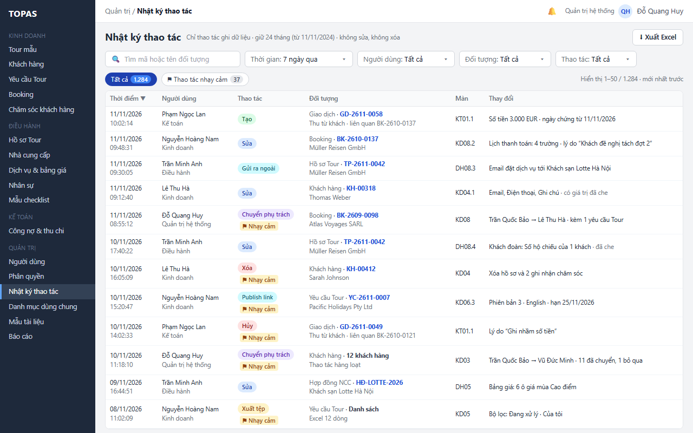

   > Hình chưa cập nhật: nhãn Xóa, Hủy còn màu đỏ (nay xám, K6); dòng KH-00412 còn “2 ghi nhận chăm sóc” (bỏ theo C3).

2. **W04 · Chip ⚑ Thao tác nhạy cảm.** Quản trị bấm chip. Danh sách lọc còn 37 thao tác trong 7 ngày qua: chuyển phụ trách, xóa, publish link, hủy giao dịch và Booking, xuất tệp, sửa phân quyền QT02, khóa tài khoản QT01, mở lại yêu cầu Tour (R13). Bấm Tất cả để về đủ danh sách.

   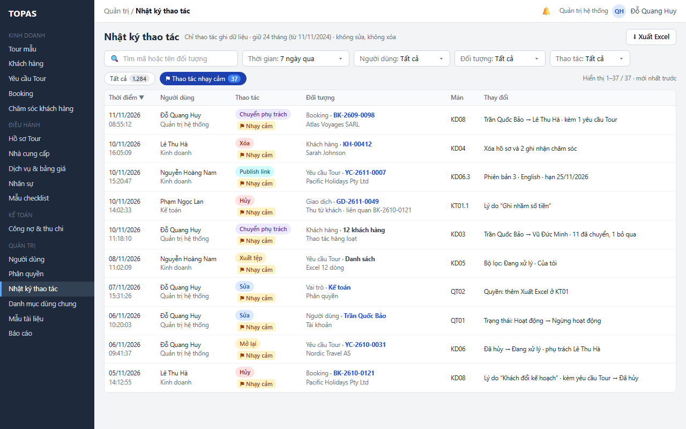

   > Hình chưa cập nhật: nhãn Xóa, Hủy còn màu đỏ (nay xám, K6); dòng KH-00412 còn “2 ghi nhận chăm sóc” (bỏ theo C3).

*Kết quả:* Quản trị biết trong tuần ai đã làm những thao tác có rủi ro mà không phải lọc từng loại.

**L1.2 Lọc theo thời gian, người dùng, đối tượng và thao tác.** *Điều kiện:* Quản trị hệ thống.

1. **W02 · Ô chọn Thời gian ở thanh lọc → bảng chọn.** Quản trị bấm Thời gian. Bảng chọn hiện các khoảng chọn nhanh, áp dụng ngay: Hôm nay, 7 ngày qua, 30 ngày qua, Tháng này, Tháng trước, Toàn bộ thời gian lưu (24 tháng); và khoảng tùy chọn, nhập rồi bấm Áp dụng; khoảng tùy chọn được kiểm tra theo E1.4. Ghi chú nhắc thao tác trước mốc 24 tháng đã tự xóa (R06, R12).

   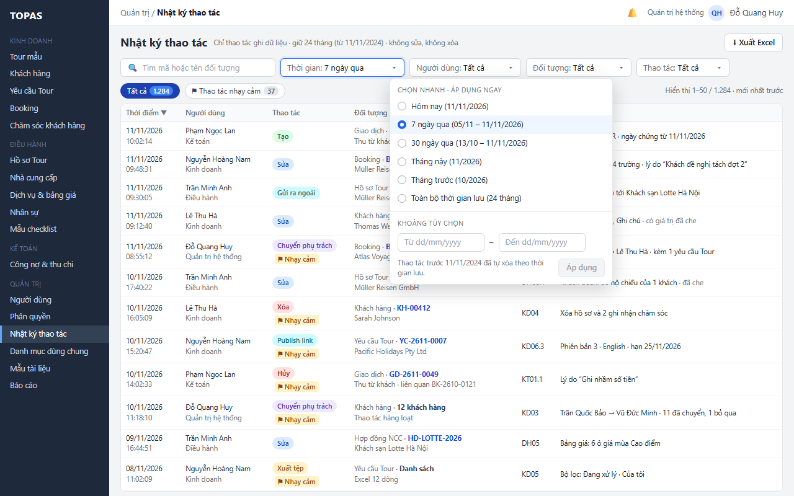

2. **W03 · Ô chọn Người dùng và Đối tượng ở thanh lọc.** Quản trị chọn Người dùng Lê Thu Hà rồi Đối tượng Khách hàng. Danh sách áp dụng ngay, còn 4 thao tác của Lê Thu Hà trên khách hàng trong 7 ngày: sửa KH-00318, xóa KH-00412, tạo KH-00419, sửa người liên hệ KH-00301; chip ghi Tất cả 4, Nhạy cảm 1; liên kết Xóa bộ lọc xuất hiện. Danh sách Người dùng gồm cả tài khoản đã ngừng hoạt động; danh sách Đối tượng nhóm theo module (R12). Ô Thao tác lọc theo nhóm ở 2.3.

   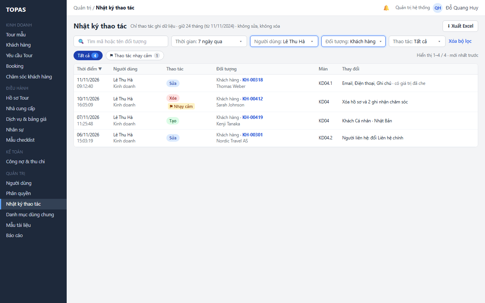

   > Hình chưa cập nhật: nhãn Xóa còn màu đỏ (nay xám, K6); dòng KH-00412 còn “2 ghi nhận chăm sóc” (bỏ theo C3).

3. **W03 → W01 · Liên kết Xóa bộ lọc cuối thanh lọc.** Quản trị bấm Xóa bộ lọc. Ô tìm, Người dùng, Đối tượng, Thao tác về Tất cả, Thời gian về 7 ngày qua; chip đang chọn giữ nguyên.

*Kết quả:* Quản trị khoanh được đúng tập thao tác cần rà.

**L1.3 Tìm theo mã hoặc tên đối tượng.** *Điều kiện:* Quản trị hệ thống.

1. **W01 · Ô tìm kiếm.** Quản trị gõ “BK-2610-0137” (từ 3 ký tự). Ô tìm áp dụng sau 300 ms ngừng gõ (R12). Danh sách hiện các thao tác có đối tượng chính hoặc đối tượng liên quan khớp chuỗi, trong khoảng Thời gian đang chọn; phần khớp ở cột Đối tượng được tô vàng (cùng khung W01). Tìm theo tên khách “Müller” cho kết quả trên mọi loại đối tượng có tên khách đó. Muốn xem đủ lịch sử của một bản ghi trong 24 tháng thì dùng L2.1 bước 3.

*Kết quả:* Quản trị tìm được thao tác trên một bản ghi khi đã biết mã.

**Ngoại lệ**

- **E1.1 Không khớp bộ lọc (W13).** Bảng hiện “Không có thao tác khớp bộ lọc” kèm gợi ý mở rộng Thời gian hoặc bấm Xóa bộ lọc ở cuối thanh lọc; mọi chip có số 0; Xuất Excel khóa. Ví dụ Vũ Đức Minh không xóa gì trong 7 ngày qua.

  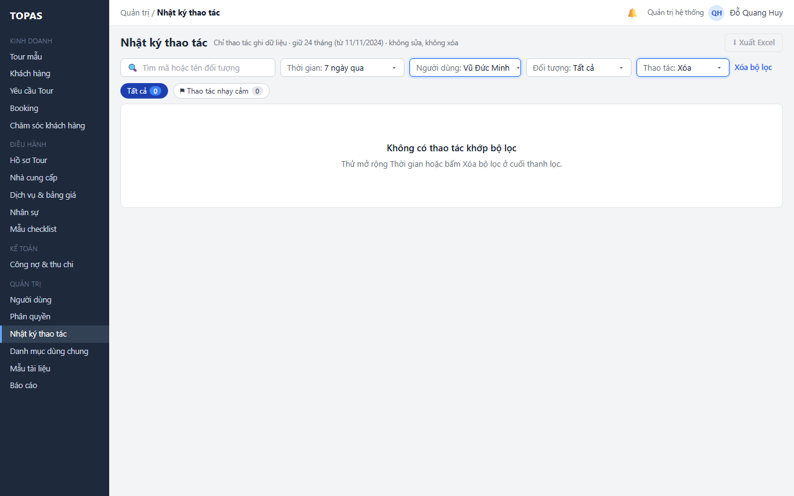

- **E1.2 Lỗi tải nhật ký (W14).** Bảng hiện “Không tải được nhật ký thao tác”, số trên chip là “–”, bộ lọc giữ nguyên, Xuất Excel khóa. Quản trị bấm Thử lại.

  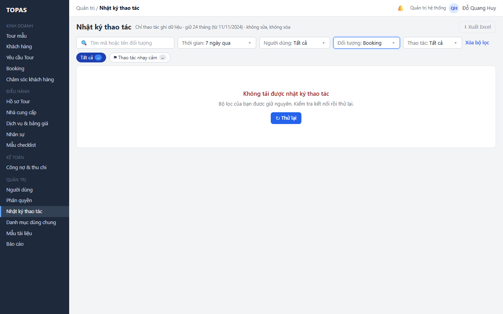

- **E1.3 Chưa có dữ liệu.** Hệ thống mới đưa vào dùng, chưa có thao tác ghi nào: bảng ghi “Chưa có thao tác nào được ghi”, không có liên kết Xóa bộ lọc; dùng khung W13 với nội dung này.
- **E1.4 Khoảng thời gian không hợp lệ (W15).** Từ ngày trước mốc lưu (hôm nay − 24 tháng): lỗi dưới ô “Nhật ký chỉ giữ 24 tháng. Chọn Từ ngày từ 11/11/2024 trở đi.”, Áp dụng khóa. Từ ngày sau Đến ngày hoặc ngày sai định dạng: lỗi “Từ ngày phải trước hoặc bằng Đến ngày”. Đến ngày sau hôm nay được chấp nhận, coi là hôm nay. Bỏ trống một đầu thì khoảng mở về phía đó trong thời gian lưu.

  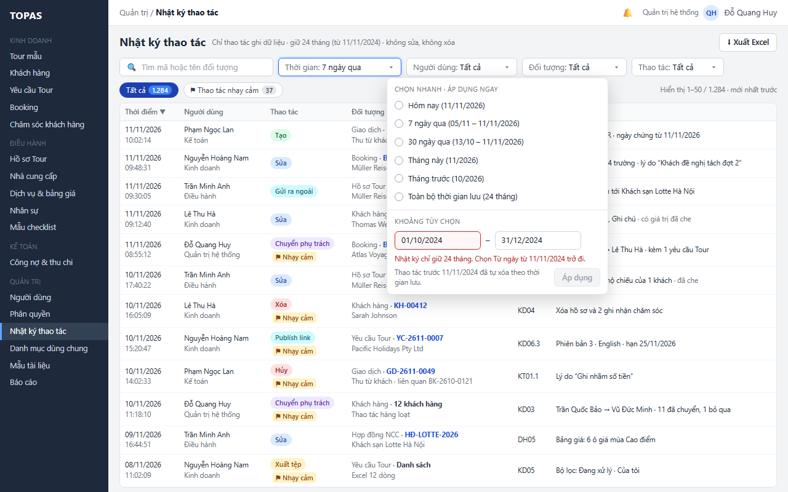

- **E1.5 Ô tìm quá ngắn.** Dưới 3 ký tự: không tìm, ghi gợi ý dưới ô “Nhập ít nhất 3 ký tự”.
- **E1.6 Người dùng đã ngừng hoạt động.** Vẫn có trong danh sách chọn Người dùng, kèm “(ngừng hoạt động)”, để rà thao tác của người đã nghỉ.
- **E1.7 Không có quyền (W16).** Người không có quyền xem QT03 (mặc định Kinh doanh, Điều hành, Kế toán) không có mục menu; mở đường dẫn QT03 thì hiện trang “Bạn không có quyền xem Nhật ký thao tác”, kèm câu chỉ cách xem lịch sử trong hồ sơ. Người bị thu hồi quyền giữa phiên: lần tải hoặc lần mở bảng trượt kế tiếp hiện trang này.

  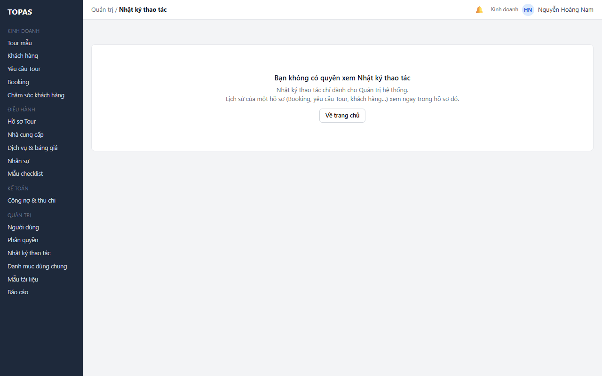

  > Hình chưa cập nhật: câu “chỉ dành cho Quản trị hệ thống” nay là quyền mặc định, cấu hình ở QT02 (Q1); menu trái còn mục Nhật ký thao tác và các mục Quản trị cho người dùng Kinh doanh, nay ẩn khi không có quyền (U5).

- **E1.8 Kết quả lớn.** Phân trang 50 dòng; dòng chữ bên phải chip ghi khoảng đang xem (“Hiển thị 51–100 / 1.284”). Tải một trang quá 10 giây thì xử lý như E1.2 kèm gợi ý thu hẹp Thời gian.
- **E1.9 Ghi nhật ký lỗi ở màn nguồn.** Không thuộc giao diện QT03: thao tác nghiệp vụ không được lưu, màn nguồn báo lỗi lưu chung và giữ dữ liệu đã nhập để thử lại (R05).

### 3.2. Xem chi tiết và mở bản ghi (QT03 · trước và sau · mở bản ghi)

**L2.1 Xem giá trị trước và sau rồi mở bản ghi.** *Điều kiện:* Quản trị hệ thống.

1. **W05 · Bấm dòng → bảng trượt.** Quản trị bấm dòng “Sửa · Booking BK-2610-0137” lúc 11/11/2026 09:48:31. Bảng trượt bên phải hiện: thời điểm, người thực hiện và vai trò lúc thao tác, màn và tab (KD08.2 · Lịch thanh toán), đối tượng, mã thao tác; bảng Thay đổi 4 trường với Trước và Sau (Đợt 2 · Hạn 15/11/2026 → 20/11/2026; Đợt 2 · Số tiền 13.200 EUR → 10.200 EUR; Đợt 3 thêm mới); lý do người dùng nhập; tác động kèm theo (KT01 cập nhật nghĩa vụ phải thu, thông báo Kế toán) (R02, R03). Dòng đang mở tô xanh nhạt. Bấm ✕, Esc hoặc ra ngoài để đóng.

   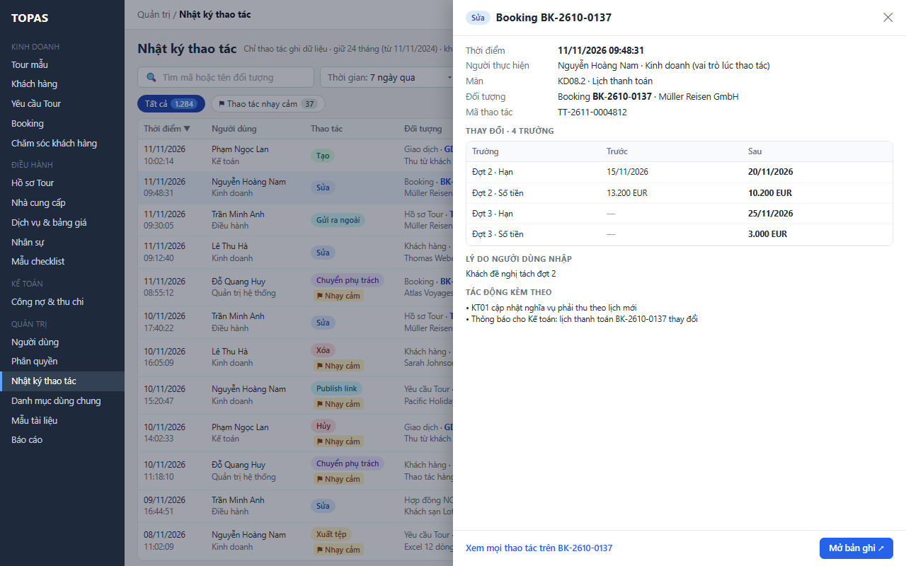

2. **W05 → W10 · Nút Mở bản ghi ↗ ở chân bảng trượt.** Quản trị bấm Mở bản ghi. KD08 của BK-2610-0137 mở ở tab Lịch thanh toán, theo quyền của Quản trị ở KD08 (Quản trị xem được mọi màn, Q25); dữ liệu là bản hiện tại, không phải bản lúc thao tác (R10). Quay lại thì QT03 giữ nguyên ngữ cảnh (R11).

   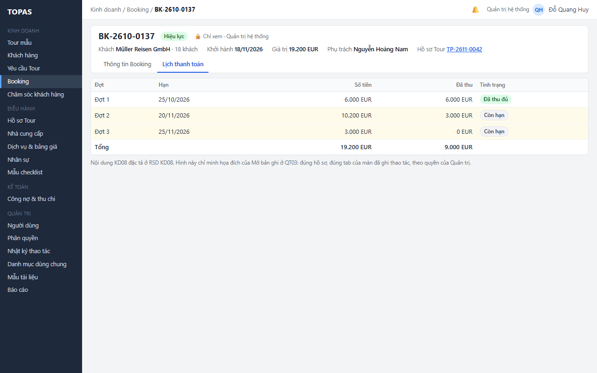

3. **W05 → W08 · Liên kết Xem mọi thao tác trên BK-2610-0137 ở chân bảng trượt.** Quản trị bấm liên kết. Bảng trượt đóng; ô tìm đổi thành thẻ “Bản ghi: BK-2610-0137 ✕”, Thời gian đổi thành Toàn bộ (24 tháng), các bộ lọc khác về Tất cả. Danh sách hiện 5 thao tác: tạo Booking 20/10 (kèm tạo hồ sơ Tour TP-2611-0042), ghi thu đợt 1 ngày 02/11, Chuyển sang Điều hành 04/11, sửa lịch thanh toán và ghi thu 3.000 EUR ngày 11/11. Giao dịch có nhãn “liên quan BK-2610-0137” vì Booking là đối tượng liên quan (R09). Bấm ✕ trên thẻ để bỏ lọc bản ghi, Thời gian về giá trị trước đó.

   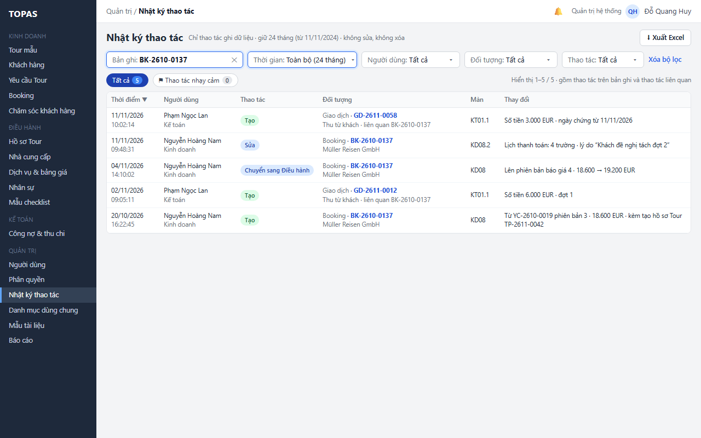

*Kết quả:* Quản trị biết chính xác ai đổi lịch thanh toán, đổi gì, vì sao, và đối chiếu với bản hiện tại của Booking.

**L2.2 Xem thao tác có dữ liệu nhạy cảm.** *Điều kiện:* Quản trị hệ thống.

1. **W06 · Bấm dòng “Sửa · Khách hàng KH-00318”.** Bảng trượt hiện 3 trường: Email và Điện thoại ở dạng đã che cả Trước và Sau, có biểu tượng 🔒; Ghi chú hiện đầy đủ. Hộp thông tin dưới bảng nêu các loại trường được che và rằng QT03, tệp Excel không có bản đầy đủ; xem giá trị hiện tại ở hồ sơ khách (Mở bản ghi theo R10) (R07). Không có nút hiện giá trị đầy đủ.

   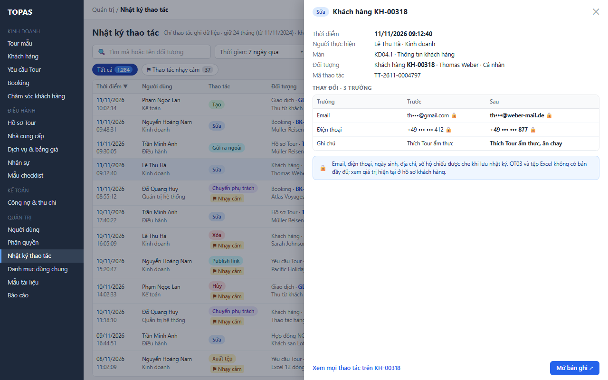

*Kết quả:* Quản trị biết trường nào đổi và đổi khi nào mà dữ liệu cá nhân của khách không lộ qua nhật ký.

**L2.3 Xem thao tác xóa.** *Điều kiện:* Quản trị hệ thống.

1. **W07 · Bấm dòng “Xóa · Khách hàng KH-00412”.** Bảng trượt có cờ Nhạy cảm và mục Dữ liệu trước khi xóa: mã, tên, loại, quốc gia, người phụ trách; email, điện thoại, ngày sinh, địa chỉ ghi “Không lưu · đã xóa cùng khách hàng” (R08). Ghi chú dưới bảng: các thao tác trước đây trên KH-00412 cũng đã bỏ giá trị cá nhân. Nút Mở bản ghi khóa, bên cạnh ghi “Bản ghi đã bị xóa lúc 10/11/2026 16:05”. Liên kết Xem mọi thao tác trên KH-00412 vẫn dùng được.

   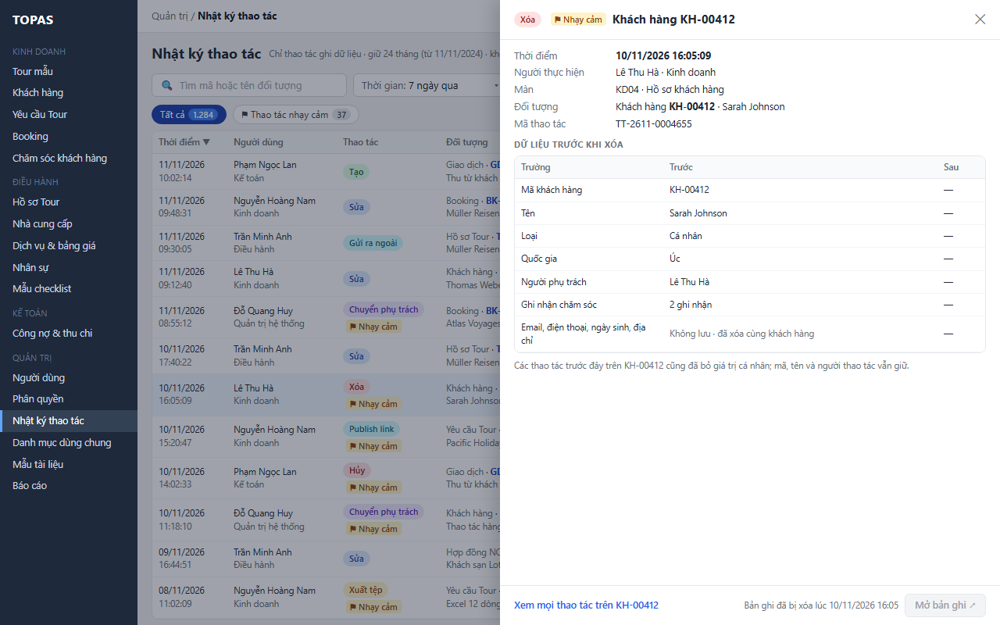

   > Hình chưa cập nhật: còn dòng “Ghi nhận chăm sóc · 2 ghi nhận” (bỏ theo C3); nhãn Xóa, Hủy còn màu đỏ (nay xám, K6).

*Kết quả:* Quản trị biết ai xóa khách nào, lúc nào, khách đó thuộc ai phụ trách, mà không còn giữ dữ liệu cá nhân của khách đã xóa.

**L2.4 Xem thao tác hàng loạt.** *Điều kiện:* Quản trị hệ thống.

1. **W09 · Bấm dòng “Chuyển phụ trách · 12 khách hàng”.** Thao tác hàng loạt là một dòng trên danh sách (R04). Bảng trượt ghi thay đổi chung (Người phụ trách: Trần Quốc Bảo → Vũ Đức Minh), mã thao tác kèm số bản ghi, chip Tất cả 12, Đã chuyển 11, Bỏ qua 1, và bảng từng khách: KH-00098 Bỏ qua kèm lý do “Người phụ trách đã đổi thành Lê Thu Hà lúc 11:10” (RSD KD03-KD04), các khách khác Đã chuyển. Bấm chip để lọc trong bảng trượt; bấm mã khách hàng để mở hồ sơ khách (R10). Không có nút Mở bản ghi chung vì lô có nhiều bản ghi.

   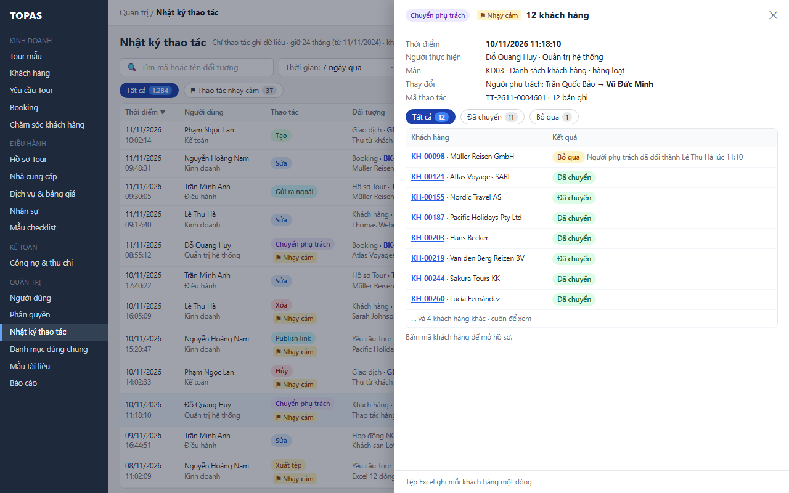

*Kết quả:* Quản trị kiểm được từng bản ghi của một thao tác hàng loạt và lý do bản ghi bị bỏ qua.

**Ngoại lệ**

- **E2.1 Chi tiết không tải được.** Bảng trượt hiện “Không tải được chi tiết thao tác” và nút Thử lại; danh sách phía sau giữ nguyên.
- **E2.2 Mục đã quá hạn lưu trong lúc xem.** Danh sách đã tải trước mốc tự xóa hằng ngày, Quản trị bấm dòng sau khi mục bị xóa: bảng trượt ghi “Thao tác này đã quá thời gian lưu 24 tháng và đã bị xóa”; danh sách tải lại.
- **E2.3 Bản ghi đã bị xóa (W07).** Mở bản ghi khóa kèm thời điểm xóa; lịch sử vẫn xem được bằng Xem mọi thao tác trên bản ghi. Áp dụng cho mọi đối tượng xóa được (khách hàng, NCC, hợp đồng, dịch vụ, mẫu checklist, nhân sự).
- **E2.4 Người xem không có quyền xem màn nguồn.** Không xảy ra với Quản trị (xem được mọi màn, Q25); xảy ra khi QT02 cấp quyền xem QT03 cho một vai trò khác không có quyền xem màn nguồn, ví dụ không xem KT01: Mở bản ghi khóa, bên cạnh ghi “Bạn không có quyền xem KT01 · giá trị trước và sau ở trên đã đủ để đối chiếu”. Mã bản ghi trong bảng hàng loạt hiện chữ thường, không bấm được.
- **E2.5 Bản ghi đã đổi nhiều lần sau thao tác.** Mở bản ghi luôn mở bản hiện tại; bảng trượt ghi “Bản ghi đã có n thao tác sau thao tác này” kèm liên kết Xem mọi thao tác trên bản ghi khi n > 0.
- **E2.6 Thao tác có nhiều trường.** Bảng Thay đổi hiện tối đa 50 trường, cuộn trong bảng trượt; quá 50 thì ghi “+n trường khác · xem đủ trong tệp Excel” (lưu bảng giá nhiều ô ở DH05, lưu lịch trình ở KD02).
- **E2.7 Trường dài.** Giá trị dài hơn 300 ký tự (nội dung email, mô tả) cắt ngắn kèm “Xem đủ” mở rộng tại chỗ. Nội dung email đã gửi chỉ ghi tiêu đề, người nhận và mã lần gửi; bản đầy đủ ở màn nguồn (R02).
- **E2.8 Lọc theo bản ghi không có kết quả.** Bản ghi chưa có thao tác nào trong 24 tháng: khung W13 với câu “Chưa có thao tác nào trên BK-… trong thời gian lưu”.

### 3.3. Xuất Excel (QT03 · quyết định 12/11/2026)

**L3.1 Xuất nhật ký theo bộ lọc.** *Điều kiện:* Quản trị hệ thống; kết quả lọc có từ 1 đến 20.000 thao tác.

1. **W01 · Nút Xuất Excel ở tiêu đề.** Quản trị bấm Xuất Excel khi đang ở bộ lọc mặc định (1.284 thao tác). Nút đổi thành “Đang xuất…” và khóa tới khi xong; bộ lọc và bảng vẫn dùng được.
2. **W11 · Tệp tải về, thông báo ngắn.** Hệ thống tạo tệp gồm mọi thao tác khớp tìm kiếm, bộ lọc và chip đang chọn (mọi trang), mỗi trường thay đổi một dòng, thao tác hàng loạt mỗi bản ghi một dòng, giá trị nhạy cảm giữ dạng đã che (R14). Thông báo ngắn nêu số thao tác, số dòng thay đổi và tên tệp. Lần xuất được ghi vào QT03 với thao tác Xuất tệp, đối tượng Nhật ký thao tác, kèm bộ lọc và số dòng.

   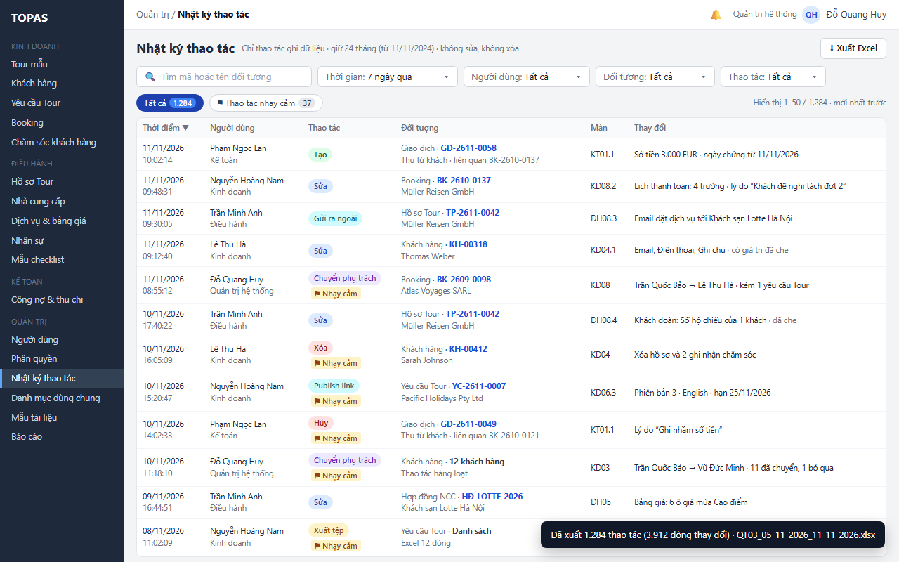

*Kết quả:* Quản trị có tệp để lưu hồ sơ đối soát hoặc gửi kiểm toán nội bộ; chính lần xuất cũng có dấu vết.

**Ngoại lệ**

- **E3.1 Vượt giới hạn (W12).** Kết quả lọc quá 20.000 thao tác (ví dụ 12 tháng qua: 61.240): Xuất Excel khóa, cạnh nút ghi “Kết quả 61.240 thao tác, vượt giới hạn xuất 20.000 · thu hẹp Thời gian hoặc thêm bộ lọc”.

  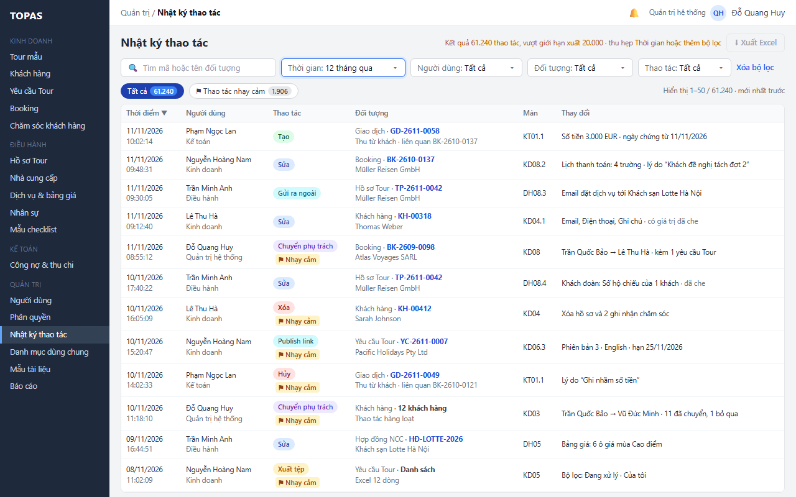

- **E3.2 Không có dòng nào.** Xuất Excel khóa khi kết quả lọc là 0 (W13) hoặc khi tải lỗi (W14).
- **E3.3 Lỗi tạo tệp hoặc mất kết nối.** Thông báo ngắn “Không xuất được tệp · Thử lại”; không ghi nhật ký xuất vì chưa có tệp. Bấm Xuất Excel lặp khi đang xuất không tạo tệp thứ hai (R14).
- **E3.4 Dữ liệu đổi trong lúc xuất.** Tệp lấy ảnh chụp tại thời điểm bắt đầu xuất; thao tác mới phát sinh sau đó không có trong tệp. Số thao tác trong tệp có thể khác số trên chip nếu danh sách đã tải từ trước; thông báo ghi số thực tế trong tệp.

---

## 4. Quy tắc triển khai chi tiết

### R01. Thao tác được ghi (quyết định 12/11/2026)

- Ghi mọi **thao tác ghi dữ liệu** do người dùng thực hiện ở mọi màn: tạo, sửa, xóa, bật, tắt, đổi trạng thái, hủy, mở lại, chuyển phụ trách, áp dụng thay đổi, gửi ra ngoài (email đặt dịch vụ, email điều chỉnh, email hủy, gửi thử), publish và thu hồi link, nhập tệp, xuất tệp, gọi AI (KD06), thao tác ở QT01, QT02, QT04, QT05 và tham số cấu hình (ngưỡng Đến hạn, ngưỡng hợp đồng sắp hết hạn).
- Không ghi: đăng nhập, đăng xuất, đăng nhập lỗi, mở màn, xem hồ sơ, đổi bộ lọc, lưu thiết lập dạng xem, lưu nháp tạm của trình duyệt.
- **Ngoại lệ duy nhất của “không ghi lượt xem”** (người dùng chốt thêm 12/11/2026; BOI-CANH “Vai trò HDV”): mỗi lần HDV bấm **Hiện số** ở HD01 để xem số hộ chiếu đầy đủ của một khách, hệ thống ghi một mục: nhóm Xem dữ liệu cá nhân, nhãn Hiện số hộ chiếu, cờ nhạy cảm, đối tượng chính Hồ sơ Tour (Tour Code), đối tượng liên quan là khách (họ tên); trường Số hộ chiếu ghi giá trị đã che theo R07 ở cột Sau, Trước là “—”. Mục ghi trong cùng giao dịch với yêu cầu Hiện số; ghi lỗi thì máy chủ không trả số (R05; RSD HD01 R11). Mỗi lần bấm là một mục, không gộp. Không lượt xem nào khác (mở hồ sơ, xem danh sách khách, gọi điện) được ghi.
- Thao tác bị chặn hoặc lưu lỗi không ghi, vì không có gì thay đổi.
- Sự kiện ghi của từng màn lấy theo RSD của màn đó (R15). Màn mới phải khai sự kiện ghi QT03 trong RSD của mình.

### R02. Nội dung một mục nhật ký

- **Ai:** mã người dùng, họ tên và vai trò **tại thời điểm thao tác** (đổi vai trò về sau không đổi mục cũ).
- **Khi nào:** thời điểm máy chủ ghi, chính xác đến giây.
- **Ở đâu:** mã màn và tab (KD08.2), kiểu thao tác (trên dòng, bảng trượt, hộp thoại, hàng loạt).
- **Làm gì:** nhãn thao tác (R03), nhóm thao tác (2.3), cờ nhạy cảm (R13).
- **Trên gì:** đối tượng chính (loại, mã, tên hiển thị lúc thao tác); đối tượng liên quan (ví dụ giao dịch → Booking; khoản công nợ → Booking hoặc NCC; hạng mục dịch vụ → hồ sơ Tour; dịch vụ → NCC).
- **Đổi gì:** danh sách trường đổi, mỗi trường có nhãn hiển thị, giá trị trước, giá trị sau (đã che theo R07). Tạo: Trước là “—”. Xóa: lưu toàn bộ giá trị trước khi xóa theo R08, Sau là “—”. Trường bảng con (đợt thanh toán, dòng giá, thành viên đoàn) ghi theo định danh dòng (“Đợt 2 · Hạn”).
- **Vì sao:** lý do, ghi chú người dùng nhập trong thao tác (lý do hủy, lý do mở lại, lý do vẫn lưu khi trùng).
- **Gửi ra ngoài:** người nhận, tiêu đề, mã lần gửi; không lưu thân email hay tệp đính kèm (đã lưu ở màn nguồn).
- **Xuất tệp:** bộ lọc, số dòng, tên tệp; không lưu tệp.
- **Mã thao tác** `TT-YYMM-NNNNNNN`, duy nhất; YYMM theo giờ Asia/Ho_Chi_Minh; số không dùng lại nhưng được phép thủng (Q7); thao tác hàng loạt dùng một mã cho cả lô.

### R03. Tác động kèm theo

- Thay đổi hệ thống tự làm trong cùng giao dịch do thao tác của người dùng gây ra được ghi vào **cùng mục** ở phần Tác động kèm theo, mỗi tác động một dòng (đối tượng, trước → sau). Ví dụ: hủy Booking → yêu cầu Tour Đã hủy (RSD KD06 R02); lưu Booking → hồ sơ Tour được tạo (RSD DH07 R01); chuyển phụ trách Booking → người phụ trách yêu cầu Tour chuyển theo (RSD KD08 R11); sửa lịch thanh toán → thông báo Kế toán.
- Đối tượng của tác động kèm theo cũng là đối tượng liên quan, nên lọc theo bản ghi (R09) tìm thấy mục đó.
- Việc hệ thống tự chạy theo lịch, không do thao tác cụ thể, không ghi QT03 (1.3).

### R04. Thao tác hàng loạt

- Một lần bấm trên thanh hàng loạt là **một mục** nhật ký trên danh sách, đối tượng ghi “n <loại>”, kèm danh sách từng bản ghi với trước, sau và kết quả (Đã chuyển, Bỏ qua kèm lý do) (W09).
- Tìm theo mã, lọc theo bản ghi tìm thấy mục hàng loạt chứa bản ghi đó.
- Tệp Excel ghi mỗi bản ghi của lô một dòng (R14).
- Số trên chip đếm theo mục, không theo số bản ghi trong lô.

### R05. Toàn vẹn nhật ký

- Mục nhật ký được ghi **trong cùng giao dịch** với thay đổi dữ liệu (Q5): ghi nhật ký lỗi thì thay đổi dữ liệu không được lưu và màn nguồn báo lỗi lưu (E1.9). Không có thay đổi dữ liệu nào thiếu nhật ký.
- Không có giao diện hay API để sửa, xóa mục nhật ký, kể cả cho Quản trị. Chỉ tiến trình tự xóa hết hạn (R06) và bỏ giá trị cá nhân khi xóa khách (R08) được thay đổi kho nhật ký; hai tiến trình này không ghi QT03 nhưng ghi nhật ký kỹ thuật (số mục đã xử lý, thời điểm).
- Thời điểm lấy theo đồng hồ máy chủ, không theo máy người dùng.

### R06. Thời gian lưu (quyết định 12/11/2026)

- Giữ mục nhật ký **24 tháng** tính từ thời điểm thao tác. Mỗi ngày lúc 02:00 (Asia/Ho_Chi_Minh), hệ thống xóa hẳn các mục cũ hơn 24 tháng.
- Mốc lưu hiện ở dòng phụ của tiêu đề và trong bảng chọn Thời gian (“từ 11/11/2024”).
- Thời gian lưu không có cấu hình trên giao diện; muốn đổi thì làm yêu cầu thay đổi.
- Lịch sử trong hồ sơ ở màn nguồn có thời gian lưu riêng, không bị ảnh hưởng.

### R07. Che giá trị nhạy cảm (quyết định 12/11/2026)

- Che **ngay khi ghi**; kho nhật ký không lưu bản đầy đủ của các trường sau, ở cả Trước và Sau:

| Trường | Cách che | Ví dụ |
|---|---|---|
| Số hộ chiếu, số giấy tờ | Giữ 4 ký tự đầu và 2 ký tự cuối (như danh sách ở RSD DH08) | C123•••••89 |
| Email | Giữ 2 ký tự đầu của phần trước @ và toàn bộ tên miền | th•••@gmail.com |
| Điện thoại | Giữ mã quốc gia và 3 số cuối | +49 ••• ••• 412 |
| Ngày sinh | Chỉ giữ năm | ••/••/1978 |
| Địa chỉ | Chỉ giữ quốc gia, tỉnh hoặc thành phố | •••, Berlin, Đức |
| Thông tin nhận thanh toán của NCC (số tài khoản) | Giữ 4 số cuối | •••• 6789 |
| Mật khẩu (QT01) | Không lưu giá trị, chỉ ghi “đã đổi” | đã đổi |

- Áp dụng cho khách hàng, người liên hệ, thành viên đoàn (DH08.4), nhân sự (DH06), người dùng (QT01), NCC.
- Hai giá trị đã che giống nhau nhưng giá trị gốc khác (ví dụ chỉ đổi giữa số) vẫn hiện là một dòng thay đổi.
- Tên khách, tên người liên hệ, quốc gia không che vì cần để tìm và đối chiếu; khi khách bị xóa thì xử lý theo R08.

### R08. Xóa khách hàng và dữ liệu cá nhân

- Khi khách hàng bị xóa ở KD04 (RSD KD03-KD04 R05): mục Xóa giữ mã, tên, loại, quốc gia, người phụ trách, người xóa, thời điểm; không lưu email, điện thoại, ngày sinh, địa chỉ.
- Cùng giao dịch xóa, hệ thống bỏ giá trị của các trường cá nhân (R07) trong **mọi mục cũ** có đối tượng chính hoặc liên quan là khách đó và người liên hệ của khách; giá trị thay bằng “[đã xóa cùng khách hàng]”. Mã, tên, người thao tác, thời điểm, nhãn trường giữ nguyên.
- Mở bản ghi của khách đã xóa khóa (E2.3).

### R09. Lọc theo một bản ghi

- Liên kết Xem mọi thao tác trên … đặt bộ lọc Bản ghi = mã đó, Thời gian = Toàn bộ thời gian lưu, bỏ ô tìm, Người dùng, Đối tượng, Thao tác về Tất cả, chip Tất cả.
- Khớp khi bản ghi là đối tượng chính, đối tượng liên quan (R02), tác động kèm theo (R03) hoặc một bản ghi trong lô hàng loạt (R04).
- Bỏ thẻ Bản ghi thì bộ lọc về như trước khi bấm liên kết.

### R10. Mở bản ghi

- Mở màn và tab đã ghi thao tác (mã màn ở R02), đúng bản ghi; với tab không còn tồn tại thì mở tab đầu của hồ sơ.
- Mở bản hiện tại của bản ghi, theo quyền của người xem ở màn nguồn (QT02); Quản trị xem được mọi màn (Q25). QT03 không cấp thêm quyền.
- Khóa kèm lý do khi: bản ghi đã xóa (E2.3); người xem không có quyền xem màn nguồn (E2.4); đối tượng là danh sách (xuất tệp) hoặc lô hàng loạt (mở từng bản ghi trong bảng trượt).
- Mục ghi từ HD01 (HDV): Mở bản ghi mở DH08 của hồ sơ ở tab tương ứng (DH08.6 nhật ký và sự cố, DH08.7 chi phí phát sinh, DH08.8 chi phí thực tế, DH08.4 với mục Hiện số hộ chiếu, DH08.1 với mục Xuất tệp PDF chương trình) theo quyền `DH08.xem` của người xem, vì HD01 chỉ hiện Tour mà chính người xem được phân công (RSD QT02 R16).
- Mở trong cùng tab trình duyệt; quay lại giữ ngữ cảnh (R11).

### R11. Giữ ngữ cảnh

- Bộ lọc, chip, trang, vị trí cuộn, chiều sắp xếp và dòng đang chọn được giữ trong phiên khi mở màn nguồn rồi quay lại, khi đóng bảng trượt.
- Bộ lọc và chip được nhớ theo người dùng, cả sau khi đăng xuất (U3): lần mở QT03 sau từ menu dùng lại bộ lọc cuối; lần đầu dùng mặc định (L1.1).

### R12. Tìm kiếm và bộ lọc

- **Tìm:** từ 3 ký tự, áp dụng sau 300 ms ngừng gõ; không phân biệt hoa thường, bỏ dấu; tìm chuỗi con trong mã và tên hiển thị của đối tượng chính, đối tượng liên quan, bản ghi trong lô. Không tìm trong giá trị trước, sau (tránh dò dữ liệu đã che).
- **Thời gian · chọn nhanh** (áp dụng ngay): Hôm nay; 7 ngày qua = hôm nay và 6 ngày trước; 30 ngày qua; Tháng này; Tháng trước; Toàn bộ thời gian lưu. **Khoảng tùy chọn**: theo ngày thao tác, có thể bỏ trống một đầu, cần Áp dụng, kiểm tra theo E1.4.
- **Người dùng:** Tất cả; từng tài khoản QT01, kể cả đã ngừng hoạt động; sắp theo tên.
- **Đối tượng:** Tất cả; nhóm theo module: Kinh doanh (Tour mẫu, Khách hàng, Yêu cầu Tour, Booking), Điều hành (Mẫu checklist, NCC, Hợp đồng NCC, Dịch vụ và bảng giá, Nhân sự, Hồ sơ Tour), Kế toán (Khoản công nợ, Giao dịch), Hệ thống (Người dùng, Vai trò, Mẫu tài liệu, Danh mục dùng chung, Cấu hình, Nhật ký thao tác), Báo cáo (Báo cáo QT07 … QT12; chỉ có thao tác Xuất tệp, RSD QT07-QT12 R13). Chọn tên module chọn mọi loại trong module.
- **Thao tác:** Tất cả hoặc một nhóm ở 2.3.
- Bộ lọc kết hợp theo “và”. Bộ lọc không làm đổi dữ liệu.

### R13. Chip, thao tác nhạy cảm, sắp xếp và phân trang

- Hai chip: Tất cả, ⚑ Thao tác nhạy cảm. Số trên chip tính theo tìm kiếm và các bộ lọc, đếm theo mục (R04).
- **Thao tác nhạy cảm:** Xóa; Hủy; Mở lại; Chuyển phụ trách; Xuất tệp; Publish link, Thu hồi link; Hiện số hộ chiếu (HD01); mọi thao tác trên Người dùng, Vai trò (QT01, QT02) và Cấu hình hệ thống. Cờ được gán lúc ghi, không đổi về sau.
- Sắp xếp mặc định theo thời điểm giảm dần; bấm tiêu đề Thời điểm để đổi sang tăng dần. Không sắp theo cột khác.
- 50 dòng mỗi trang; dòng chữ bên phải chip ghi khoảng đang xem và cách sắp xếp.

### R14. Xuất Excel (quyết định 12/11/2026)

- Người có quyền Xuất Excel QT03 (mặc định chỉ Quản trị hệ thống, 1.4). Phạm vi: mọi mục khớp tìm kiếm, bộ lọc, thẻ Bản ghi và chip đang chọn, mọi trang. Tối đa **20.000 mục** mỗi lần; vượt thì nút khóa kèm lý do (E3.1).
- Một dòng cho mỗi trường thay đổi; mục không có trường (xuất tệp, gửi ra ngoài) một dòng; lô hàng loạt một dòng cho mỗi bản ghi và trường. Cột: Mã thao tác, Thời điểm, Người dùng, Vai trò, Màn, Thao tác, Nhạy cảm, Loại đối tượng, Mã đối tượng, Tên đối tượng, Đối tượng liên quan, Trường, Trước, Sau, Lý do, Tác động kèm theo, Kết quả (lô).
- Giá trị nhạy cảm giữ dạng đã che (R07); không có tùy chọn xuất bản đầy đủ.
- Tên tệp `QT03_<từ ngày>_<đến ngày>.xlsx`. Hệ thống không lưu tệp sau khi tải.
- Mỗi lần xuất thành công ghi một mục QT03: thao tác Xuất tệp (nhạy cảm), đối tượng Nhật ký thao tác, bộ lọc, số mục, số dòng, tên tệp.
- Mỗi lần bấm có mã yêu cầu; bấm lặp khi đang xuất không tạo tệp thứ hai.

### R15. Sự kiện ghi của các màn đã có RSD

QT03 nhận sự kiện theo RSD của từng màn; bảng dưới tổng hợp để kiểm thử, không thay RSD nguồn.

| Màn | Sự kiện ghi QT03 (theo RSD màn) |
|---|---|
| DH01 | Tạo, lưu phiên bản, bật tắt, xóa mẫu checklist |
| DH02 | Bật, tắt công tắc Đang dùng của NCC, Hoàn tác, nhập Excel |
| DH03, DH05 | Tạo, sửa, xóa, bật tắt, gia hạn hợp đồng, nhập tệp bảng giá |
| DH06 | Thêm, sửa, bật, tắt nhận phân công, Hoàn tác, xóa nhân sự |
| DH07 | Tạo hồ sơ (tác động kèm theo của thao tác lưu Booking, cùng giao dịch, Q5), giao người phụ trách |
| DH08 | Mọi thao tác ghi ở các tab (đặt, hủy dịch vụ, gửi email, khách đoàn, phân phòng, nhân sự, nhật ký và sự cố, chi phí, quyết toán, đóng, mở lại, áp dụng thay đổi), gồm Điều hành sửa, xóa mục Do HDV ghi và Bỏ số HDV ở chi phí thực tế (nhãn Sửa, Xóa; Xóa có cờ nhạy cảm; RSD DH08 L6.4, L7.3, L8.1, R20) |
| HD01 | Thêm, sửa, xóa mục nhật ký, sự cố, chi phí phát sinh, chi phí thực tế do HDV ghi (kèm tệp chứng từ), ghi như DH08.6–DH08.8: đối tượng Hồ sơ Tour (Tour Code), màn HD01, nhãn Tạo, Sửa, Xóa (2.3), vai trò lúc thao tác (R02); Xóa có cờ Thao tác nhạy cảm như mọi Xóa (R13); **Hiện số hộ chiếu** của một khách (nhóm Xem dữ liệu cá nhân, nhạy cảm, số đã che; ngoại lệ duy nhất của “không ghi lượt xem”, R01; RSD HD01 R11); **Xuất tệp** PDF chương trình (đối tượng Hồ sơ Tour, tên tệp, phiên bản chương trình; RSD HD01 R13); Mở bản ghi theo R10 (RSD HD01; BOI-CANH “Vai trò HDV”) |
| KD01-KD02 | Tạo, lưu thông tin chung, lưu lịch trình, bật, tắt, Hoàn tác Tour mẫu |
| KD03-KD04 | Tạo, sửa, chuyển phụ trách (kể cả hàng loạt), xóa khách, lý do lưu khi trùng |
| KD05 | Chuyển phụ trách yêu cầu (kể cả hàng loạt), xuất Excel |
| KD06 | Mọi thao tác ghi; publish, thu hồi link; gọi AI; hủy, mở lại |
| KD08 | Mọi sự kiện ghi lịch sử Booking; chuyển phụ trách; hủy |
| KT01 | Ghi, hủy giao dịch; sửa ngày chứng từ, tệp, ghi chú của giao dịch; phân bổ, Dùng tiền thừa; ghi, sửa điều chỉnh sau hủy; ghi phải trả, điều chỉnh khoản phải trả; ghi công nợ phát sinh (RSD KT01 2.4, R12) |
| QT01 | Tạo, sửa tài khoản, đổi vai trò, liên kết, gỡ liên kết nhân sự, đặt lại mật khẩu, đổi mật khẩu tạm, khóa, mở khóa; mọi mục có cờ Thao tác nhạy cảm, mật khẩu chỉ ghi “đã đổi” (RSD QT01 R09) |
| QT02 | Tạo, đổi tên, đổi phòng, ngừng dùng, dùng lại, xóa vai trò; bật tắt quyền; khôi phục ma trận mặc định; mọi mục có cờ Thao tác nhạy cảm (RSD QT02 R14) |
| CH01 | Đổi mật khẩu (người dùng tự đổi) và đổi mật khẩu tạm ở lần đăng nhập đầu; cờ Thao tác nhạy cảm, mật khẩu chỉ ghi “đã đổi”; không ghi đăng nhập, đăng xuất, tạm khóa (RSD CH01) |
| QT04 | Tạo, lưu, bật tắt (kèm mẫu bị thay), khôi phục, xóa mẫu; gửi thử (kèm email nhận), tải thử (RSD QT04 R16) |
| QT05 | Thêm (kể cả Thêm nhiều, dán Excel), sửa, bật, tắt, Hoàn tác, xóa, đổi thứ tự giá trị; nhập, sửa tỷ giá; lưu chính sách hoàn hủy; sửa tham số chung (RSD QT05 R19) |
| QT07–QT12 | Xuất Excel báo cáo: thao tác Xuất tệp (nhạy cảm), đối tượng “Báo cáo QTxx”, bộ lọc, số dòng, tên tệp (RSD QT07-QT12 R13) |

### R16. Cấu hình phụ thuộc

| Cấu hình | Chủ sở hữu | Dùng ở đâu | Hành vi khi thiếu |
|---|---|---|---|
| Quyền xem, xuất Excel QT03 | Quản trị hệ thống (QT02) | 1.4, E1.7, R14 | Mặc định chỉ Quản trị hệ thống |
| Quyền xem từng màn nguồn | QT02 | Mở bản ghi (R10) | Mở bản ghi khóa kèm lý do |
| Tài khoản và vai trò người dùng | QT01, QT02 | Bộ lọc Người dùng, cột vai trò (R02) | — |
| Danh sách trường nhạy cảm | Cố định theo R07 | Ghi nhật ký, xuất Excel | Trường mới chứa dữ liệu cá nhân phải bổ sung vào R07 trước khi phát hành |
| Thời gian lưu 24 tháng, giờ chạy xóa 02:00 | Cố định theo R06 | Tự xóa, bộ chọn Thời gian | — |
| Giới hạn xuất 20.000 mục | Cố định theo R14 | Xuất Excel | — |

---

## 5. Dữ liệu

### 5.1. Đối tượng dữ liệu

| Đối tượng | Khóa | Dữ liệu chính | Nguồn hoặc tác động |
|---|---|---|---|
| Mục nhật ký | Mã thao tác `TT-YYMM-NNNNNNN` | Thời điểm, người dùng, vai trò lúc thao tác, màn và tab, kiểu thao tác, nhãn và nhóm thao tác, cờ nhạy cảm, đối tượng chính (loại, mã, tên), lý do, thông tin gửi hoặc xuất (R02) | Ghi bởi màn nguồn trong cùng giao dịch (R05); QT03 chỉ đọc; tự xóa sau 24 tháng (R06) |
| Dòng thay đổi | Mã thao tác + thứ tự | Nhãn trường, định danh dòng con, giá trị trước, giá trị sau (đã che theo R07) | Cùng mục; bỏ giá trị cá nhân khi xóa khách (R08) |
| Đối tượng liên quan | Mã thao tác + loại + mã | Loại, mã, vai trò (liên quan, tác động kèm theo, bản ghi trong lô), kết quả và lý do (lô) | Dùng cho R03, R04, R09 |
| Người dùng | Mã người dùng | Họ tên, vai trò, trạng thái tài khoản | QT01; QT03 đọc cho bộ lọc |
| Lần xuất Excel | Mã thao tác của mục Xuất tệp | Bộ lọc, số mục, số dòng, tên tệp | QT03 ghi (R14); không lưu tệp |

### 5.2. Trường nhập

| Form | Trường | Bắt buộc | Mặc định hoặc điền sẵn | Kiểm tra |
|---|---|---|---|---|
| Thanh lọc | Tìm kiếm | Không | Trống | Từ 3 ký tự (E1.5) |
| Thanh lọc | Thời gian · chọn nhanh | Có | 7 ngày qua | Một giá trị |
| Thanh lọc | Thời gian · khoảng tùy chọn | Không | Trống | dd/mm/yyyy; Từ ≤ Đến; Từ ≥ hôm nay − 24 tháng (E1.4) |
| Thanh lọc | Người dùng | Có | Tất cả | Tài khoản QT01, kể cả đã ngừng hoạt động |
| Thanh lọc | Đối tượng | Có | Tất cả | Loại hoặc module ở R12 |
| Thanh lọc | Thao tác | Có | Tất cả | Nhóm ở 2.3 |
| Thanh lọc | Bản ghi (thẻ) | Không | Điền khi bấm Xem mọi thao tác trên … | Mã bản ghi (R09) |

### 5.3. Dữ liệu gửi ra ngoài

QT03 không gửi email hay tài liệu ra ngoài hệ thống.

| Tài liệu | Người nhận | Nội dung | Lúc gửi thật | Dữ liệu lưu lại |
|---|---|---|---|---|
| Tệp Excel nhật ký | Chính Quản trị (tải về máy) | Cột theo R14, giá trị nhạy cảm đã che | Khi bấm Xuất Excel | Mục QT03 Xuất tệp: người, thời điểm, bộ lọc, số mục, số dòng, tên tệp; không lưu tệp |

---

## 6. Tiêu chí nghiệm thu

| Mã | Điều kiện và thao tác | Kết quả kiểm chứng được |
|---|---|---|
| AC01 | Quản trị mở Nhật ký thao tác lần đầu; sau đó đổi bộ lọc, đăng xuất, đăng nhập lại và mở lại | Lần đầu: Thời gian 7 ngày qua, bộ lọc khác Tất cả, chip Tất cả, mới nhất trước, 50 dòng mỗi trang; tiêu đề ghi mốc lưu (W01). Lần mở lại: bộ lọc cuối được giữ (R11, U3) |
| AC02 | Kinh doanh, Điều hành, Kế toán (quyền mặc định) tìm mục Nhật ký thao tác | Không có mục menu; mở đường dẫn thì hiện trang không có quyền (W16, E1.7) |
| AC03 | Kinh doanh sửa lịch thanh toán BK-2610-0137 ở KD08.2 | QT03 có một mục Sửa, đối tượng BK-2610-0137, màn KD08.2, 4 dòng thay đổi đúng trước và sau, lý do người dùng nhập (W05, R02) |
| AC04 | Lưu thao tác ở màn nguồn khi kho nhật ký không ghi được | Dữ liệu nghiệp vụ không thay đổi; màn nguồn báo lỗi lưu, giữ dữ liệu đã nhập (E1.9, R05) |
| AC05 | Người dùng đăng nhập, mở KD04, đổi bộ lọc KD05, đổi dạng xem DH07 | Không có mục nào trong QT03 (R01) |
| AC06 | Thao tác bị chặn (ví dụ lưu hợp đồng NCC chồng kỳ) | Không có mục nào trong QT03 (R01) |
| AC07 | Kinh doanh lưu Booking mới, hồ sơ Tour được tạo tự động | Một mục Tạo Booking, phần Tác động kèm theo có “Tạo hồ sơ Tour TP-…”; lọc theo mã hồ sơ Tour tìm thấy mục này (R03, R09) |
| AC08 | Hủy Booking có yêu cầu Tour | Một mục Hủy Booking, cờ Nhạy cảm; tác động kèm theo ghi yêu cầu Tour → Đã hủy (R03) |
| AC09 | Bấm chip Thao tác nhạy cảm | Chỉ còn Xóa, Hủy, Mở lại, Chuyển phụ trách, Xuất tệp, Publish/Thu hồi link, thao tác trên Người dùng, Vai trò, Cấu hình; số khớp chip (W04, R13) |
| AC10 | Lọc Người dùng Lê Thu Hà, Đối tượng Khách hàng | Còn 4 mục; chip Tất cả 4, Nhạy cảm 1; Xóa bộ lọc xuất hiện (W03) |
| AC11 | Chọn khoảng tùy chọn Từ 01/10/2024 khi hôm nay là 11/11/2026 | Lỗi dưới ô, Áp dụng khóa (W15, E1.4) |
| AC12 | Chọn Người dùng là tài khoản đã ngừng hoạt động | Có trong danh sách, kèm “(ngừng hoạt động)”; hiện các mục của người đó (E1.6) |
| AC13 | Gõ “BK-2610-0137” vào ô tìm | Hiện mục có Booking là đối tượng chính hoặc liên quan trong khoảng Thời gian đang chọn, phần khớp tô vàng (L1.3, R12) |
| AC14 | Gõ một phần email của khách vào ô tìm | Không tìm trong giá trị trước, sau; không có kết quả theo email (R12) |
| AC15 | Tìm không có kết quả | Hiện “Không có thao tác khớp bộ lọc”, chip 0, Xuất Excel khóa (W13) |
| AC16 | Không tải được danh sách | Lỗi, chip “–”, bộ lọc giữ nguyên; Thử lại tải lại (W14) |
| AC17 | Bấm Xem mọi thao tác trên BK-2610-0137 | Thẻ Bản ghi, Thời gian Toàn bộ; 5 mục gồm 2 giao dịch liên quan và mục Chuyển sang Điều hành (W08, R09) |
| AC18 | Bỏ thẻ Bản ghi | Bộ lọc về như trước khi bấm liên kết (R09) |
| AC19 | Bấm Mở bản ghi trên mục sửa lịch thanh toán | KD08 của BK-2610-0137 mở ở tab Lịch thanh toán, bản hiện tại, chỉ xem theo quyền Quản trị (W10, R10) |
| AC20 | Quay lại QT03 từ KD08 | Bộ lọc, chip, trang, vị trí cuộn, dòng đang chọn giữ nguyên (R11) |
| AC21 | Sửa email, điện thoại của khách | Bảng trượt và tệp Excel chỉ có dạng đã che ở Trước và Sau; kho nhật ký không có bản đầy đủ (W06, R07) |
| AC22 | Sửa số hộ chiếu một thành viên đoàn ở DH08.4 | Giá trị trước, sau giữ 4 ký tự đầu và 2 ký tự cuối (R07) |
| AC23 | Xóa khách hàng KH-00412 có 3 mục cũ chứa email | Mục Xóa giữ mã, tên, loại, quốc gia, người phụ trách; 3 mục cũ thay email bằng “[đã xóa cùng khách hàng]”; Mở bản ghi khóa kèm thời điểm xóa (W07, R08) |
| AC24 | Quản trị chuyển phụ trách 12 khách hàng, 1 khách bị bỏ qua | QT03 có một mục Chuyển phụ trách · 12 khách hàng; bảng trượt chip 12 / 11 / 1, dòng Bỏ qua có lý do (W09, R04) |
| AC25 | Lọc theo mã KH-00121 nằm trong lô ở AC24 | Mục hàng loạt hiện trong kết quả (R04, R09) |
| AC26 | QT02 cấp quyền xem QT03 cho một vai trò không có quyền xem KT01; người có vai trò đó mở mục giao dịch | Mở bản ghi khóa kèm lý do; bảng Thay đổi vẫn xem đủ (E2.4). Với Quản trị, Mở bản ghi luôn mở được (Q25) |
| AC27 | Mục nhật ký có thời điểm 25 tháng trước | Bị xóa ở lần chạy 02:00 kế tiếp; không còn trong Toàn bộ thời gian lưu (R06) |
| AC28 | Quản trị tìm cách sửa hoặc xóa một mục | Không có nút nào; gọi API sửa, xóa bị từ chối (R05) |
| AC29 | Bấm Xuất Excel với 1.284 mục | Tệp gồm 1.284 mục, mỗi trường thay đổi một dòng, giá trị nhạy cảm đã che; thông báo ghi số mục, số dòng, tên tệp; QT03 có mục Xuất tệp, cờ Nhạy cảm (W11, R14) |
| AC30 | Kết quả lọc 61.240 mục | Xuất Excel khóa, lý do ghi cạnh nút (W12, E3.1) |
| AC31 | Bấm Xuất Excel hai lần liên tiếp | Chỉ một tệp, một mục Xuất tệp (E3.3, R14) |
| AC32 | Người dùng đổi vai trò từ Kinh doanh sang Điều hành ở QT02 | Mục cũ vẫn ghi vai trò Kinh doanh; mục mới ghi Điều hành (R02) |
| AC33 | Thao tác Gửi ra ngoài email đặt dịch vụ ở DH08.3 | Mục ghi người nhận, tiêu đề, mã lần gửi; không có thân email (R02) |
| AC34 | Mục sửa bảng giá có 80 ô thay đổi | Bảng trượt hiện 50 trường và “+30 trường khác · xem đủ trong tệp Excel”; tệp có đủ 80 dòng (E2.6) |
| AC35 | Quản trị bị thu hồi quyền QT03 giữa phiên rồi bấm một dòng | Hiện trang không có quyền (E1.7) |
| AC36 | Ngô Thị Mai (HDV) thêm một khoản chi phí phát sinh kèm ảnh chứng từ ở HD01 cho TP-2611-0042; Quản trị mở QT03, bấm mục đó, bấm Mở bản ghi | Có đúng một mục: người Ngô Thị Mai, vai trò HDV, màn HD01, thao tác Tạo, đối tượng Hồ sơ Tour TP-2611-0042, các trường của khoản và tên tệp; Mở bản ghi mở DH08.7 của TP-2611-0042 (R15, R10) |
| AC37 | Mai xóa một mục nhật ký do mình ghi ở HD01 | Mục QT03 nhãn Xóa, màn HD01, có cờ ⚑ Nhạy cảm, lưu toàn bộ giá trị trước khi xóa (R02, R13, R15) |
| AC38 | Ngô Thị Mai (HDV, phân công ở TP-2611-0042) bấm Hiện số cho khách Anna Müller (hộ chiếu C01234567) hai lần; mở danh sách khách, mở tab Chương trình, chạm gọi một số | QT03 có đúng hai mục: người Ngô Thị Mai, vai trò HDV, màn HD01, nhãn Hiện số hộ chiếu, nhóm Xem dữ liệu cá nhân, cờ ⚑ Nhạy cảm, đối tượng Hồ sơ Tour TP-2611-0042, liên quan Anna Müller, Số hộ chiếu Sau “C012•••67”; kho nhật ký không có chuỗi “C01234567”. Mở danh sách, mở tab, gọi điện không tạo mục nào (1.3, R01, R07, R13) |
| AC39 | Quản trị lọc Thao tác = Xem dữ liệu cá nhân; bấm một mục Hiện số hộ chiếu, bấm Mở bản ghi; chip ⚑ Thao tác nhạy cảm | Danh sách chỉ có mục Hiện số hộ chiếu; Mở bản ghi mở DH08.4 của TP-2611-0042; mục có trong chip nhạy cảm (2.3, R10, R12, R13) |
| AC40 | Trần Minh Anh xóa ở DH08.6 một nhật ký Do HDV ghi của Mai; Mai tải PDF chương trình ở HD01 | Mục Xóa: người Trần Minh Anh, màn DH08.6, cờ nhạy cảm, lưu giá trị trước khi xóa gồm nguồn HDV và người ghi Ngô Thị Mai. Mục Xuất tệp: người Ngô Thị Mai, màn HD01, đối tượng Hồ sơ Tour, tên tệp `TP-2611-0042_chuong-trinh_v<N>.pdf`, cờ nhạy cảm (R13, R15) |
