# RSD QT04 · Mẫu tài liệu và email

- **Module.** Quản trị (menu Quản trị → Mẫu tài liệu). Màn QT04 gồm hai tab: QT04.1 Kinh doanh · Survey và email chăm sóc; QT04.2 Điều hành · Email đặt dịch vụ, Pax list, Rooming list.
- **Phiên bản.** v1.3 · 12/11/2026.
- **Nguồn nghiệp vụ.** `luồng/danh-sach-man-hinh-level1.md` (QT04, QT04.1, QT04.2), `luồng/danh-sach-tinh-nang-ho-tro-level1.md` (CNHT05.01, CNHT05.02, CNHT05.03; DX03, DX07), `luồng/level 1/luonghotro.md` (HT05.01–HT05.05), RSD DH08 v2.8 (R04 khóa gộp email, R06 yêu cầu riêng, mục 4 cấu hình phụ thuộc, 5.3 dữ liệu gửi ra ngoài; ghi chú làm việc: trường `{yeu_cau_rieng}`, mẫu email hủy và cập nhật, tập cột Pax list theo loại NCC), RSD DH03 v1.4 (trường Ngôn ngữ giao dịch của NCC), RSD QT05 v1.2 (danh mục Ngôn ngữ, Loại dịch vụ), RSD KD10 v1.2 (R04 điều kiện bật, R10 trường trộn và bản chụp nội dung, L2.2 soạn bước, R12 điểm tổng thể, R13 hủy nhận, R16), RSD KD09 v1.3 (tìm theo mã, tên mẫu), RSD KD06 v1.5 (R18 proposal), RSD DH01 v1.4 (cách làm phiên bản mẫu), `rsd/BOI-CANH-DU-AN.md` và các quyết định người dùng chốt ngày 12/11/2026 (Q1 quyền, Q2 proposal, Q3 phiên bản, Q4 KD06 dùng mẫu proposal riêng không cấu hình, Q5 DH08 tự khớp mẫu).
- **Thay đổi so với nguồn.**
  - Proposal báo giá **không cấu hình ở QT04**: hệ thống tự dựng theo mẫu của công ty (quyết định 12/11/2026). Nhóm “báo giá” của nguồn được bỏ khỏi QT04.1; tab chỉ còn một dòng chỉ dẫn.
  - “Xem trước với dữ liệu mẫu (đề xuất)” được làm thành xem trước với dữ liệu thật của một hồ sơ Tour hoặc khách, không ghi gì (R13).
  - Mẫu email đặt dịch vụ có ba mục đích (Đặt dịch vụ, Điều chỉnh, Hủy) để đáp ứng email hủy và cập nhật của RSD DH08. Email gửi kèm Pax list, Rooming list nằm trong chính mẫu tài liệu đó.
- **Thay đổi ở v1.3 (12/11/2026).** Bổ sung sau kiểm tra chéo cuối đợt: R13 trường {Yêu cầu riêng}: bỏ “theo nhãn”, theo hai ô Ăn uống, Phòng nhập tự do của RSD DH08 v2.8 R06. Theo rà soát mâu thuẫn lần ba và quyết định của người dùng về mẫu email chiến dịch (theo RSD KD10, nơi sở hữu chiến dịch): mẫu Survey được chụp phiên bản hiện hành khi bật lần đầu, chặn bật nếu mẫu đã ngừng dùng, bật lại sau Tạm dừng không tự lấy bản mới; mẫu email chăm sóc được điền và chụp vào bước Remarketing lúc soạn hoặc lưu bước, sửa được, ngừng dùng mẫu không chặn bật (1.2, 2.5, E4.5, L5.1 kết quả, L6.1, 3.8, R09, R11, R12). Sửa dẫn chiếu KD10 L2.1 thành L2.2 (L5.1, 3.8). Bỏ KD09 khỏi nơi hiện điểm tổng thể (R09; KD09 không hiện điểm). Cập nhật phiên bản dẫn chiếu ở Nguồn nghiệp vụ và 1.5. Dựng lại W21–W24 (ô thông tin bản chụp ở cột trái; ghi chú mẫu GR-01 bỏ KD09).
- **Thay đổi ở v1.2 (12/11/2026).** Theo rà soát lần hai và quyết định của người dùng “luôn một email cho mỗi (NCC, loại việc)”: email gộp chứa dịch vụ của nhiều loại dịch vụ của cùng NCC thì dùng mẫu dự phòng Mọi loại dịch vụ của mục đích đó; email một loại dịch vụ dùng mẫu khớp theo (mục đích, loại dịch vụ), không có thì mẫu Mọi loại dịch vụ; không bao giờ tách email theo mẫu hay loại dịch vụ (R07, 3.8). Ngôn ngữ email lấy từ trường Ngôn ngữ giao dịch của NCC nay đã có ở RSD DH03 v1.3 (bỏ chữ “trường cần bổ sung”) (R03, R07, E8.4). Pax list, Rooming list giữ nguyên: DH08 không cho chọn mẫu, mỗi loại một mẫu Đang dùng. Thêm E8.5, AC55, AC56; sửa 3.8, E6.1, E8.4, R03, R07. Không dựng lại wireframe (giao diện QT04 không đổi).
- **Thay đổi ở v1.1 (12/11/2026).** Theo quyết định “DH08, hệ thống tự khớp mẫu”: bỏ khái niệm Chọn sẵn và ô chọn mẫu ở DH08; mỗi phạm vi khớp (mục đích, loại dịch vụ; Pax list; Rooming list) chỉ có một mẫu Đang dùng, mẫu Mọi loại dịch vụ là dự phòng (R07). Tạo mẫu trùng phạm vi thì mẫu ở Ngừng dùng để soạn trước (L2.3, W12); bật mẫu thay mẫu đang dùng bằng một hộp thoại (L6.3, W28a mới); tắt mẫu email chỉ nêu hệ quả, không phải chọn mẫu thay (L6.2, W28); mẫu Pax list, Rooming list đang dùng không tắt trực tiếp (E3.5). Ngôn ngữ email NCC tự khớp theo ngôn ngữ giao dịch của NCC (R03, R07). Thêm E2.11, E6.6a, E6.7, AC42a, AC42b, AC53, AC54; sửa 1.2, 1.3, 1.4, 2.2, 2.4, 2.5, 2.6, 3.8, R11, R12, R14, R16, 5.1, 5.2, AC01, AC16, AC19, AC20, AC40–AC43, AC49. Dựng lại W01–W32 (PL-02 nay Ngừng dùng; bỏ nhãn Chọn sẵn).
- **Thay đổi ở v1.0.** Bản đầu, viết mới từ danh sách màn.

**Cách đọc.** Mục 3 là luồng theo nhóm mẫu. Mỗi bước ghi theo dạng **mã W · chỗ bấm**, sau đó là thao tác và phản hồi của hệ thống; hình nằm ngay dưới bước. Mục 4 là quy tắc (mã R), luồng chỉ dẫn mã R. Ảnh 1280 × 800, dữ liệu trên ảnh là minh họa (hôm nay 12/11/2026, 10:15; hồ sơ TP-2611-0042 khớp RSD DH08; mẫu Survey, email chăm sóc khớp RSD KD09, KD10). Chụp lại: `node wireframes-src/build.js [Wxx …]`; xem tất cả ở `wireframes/index.html`.

## Mục lục

1. Phạm vi và quyền
2. Khung màn, trạng thái và quy ước giao diện
3. Luồng thao tác kèm wireframe
4. Quy tắc triển khai chi tiết
5. Dữ liệu
6. Tiêu chí nghiệm thu

---

## 1. Phạm vi và quyền

### 1.1. Mục tiêu

QT04 là nơi mỗi bộ phận khai báo một lần các mẫu nội dung mà hệ thống dùng để soạn sẵn email và tài liệu: Kinh doanh khai mẫu Survey và email chăm sóc cho KD10; Điều hành khai mẫu email đặt dịch vụ, Pax list, Rooming list cho DH08. Người dùng ở DH08, KD10 không phải soạn lại nội dung. Mục tiêu thiết kế:

- **Biết mẫu nào đang được dùng ở đâu.** Danh sách cho thấy loại dịch vụ áp dụng, mẫu nào DH08 đang tự khớp, phiên bản và số lần đã dùng; bảng trượt nêu chiến dịch hoặc màn đang dùng mẫu.
- **Ít nhập lại.** Tạo mẫu bằng cách sao chép mẫu có sẵn (mọi ngôn ngữ); mã mẫu gợi ý; trường tự điền chèn từ menu, không gõ tay.
- **Thấy kết quả trước khi lưu.** Xem trước bằng dữ liệu thật của một hồ sơ Tour hoặc khách; gửi thử tới email của chính mình.
- **Không gửi sai.** Kiểm tra trường tự điền, tiêu đề, bản dịch khi lưu; cụm tùy chọn để email không còn câu cụt khi dữ liệu trống; khối hủy nhận của email chăm sóc không xóa được.
- **An toàn khi sửa.** Lưu là áp dụng ngay cho lần soạn sau, mỗi lần lưu một phiên bản; email đã gửi, tài liệu đã tạo, chiến dịch đang chạy giữ nguyên nội dung; khôi phục được phiên bản cũ.

### 1.2. Lối vào và lối ra

| Từ / đến | Hành vi |
|---|---|
| Menu Quản trị → Mẫu tài liệu | Mở QT04 ở tab của bộ phận người dùng: Kinh doanh mở QT04.1 (W02), Điều hành mở QT04.2 (W01). Người có cả hai vai trò mở tab dùng lần cuối. |
| QT04 → bảng trượt mẫu | Bấm một dòng để mở bảng trượt của mẫu (W11). Bấm + Tạo mẫu để mở bảng trượt tạo mẫu (W06). |
| DH08.3 → QT04.2 (đọc) | Khi soạn email đặt, đặt lại, điều chỉnh, hủy, DH08 tự khớp mẫu theo R07 và trộn trường theo R04, R05. |
| DH08.4 → QT04.2 (đọc) | Khi xem, tải, gửi Pax list hoặc Rooming list, DH08 tự dùng mẫu Pax list, Rooming list đang dùng (R07), tập cột theo R08. |
| KD10 → QT04.1 (đọc) | Ô Mẫu Survey và Mẫu email liệt kê mẫu Đang dùng. Survey: KD10 chụp nội dung phiên bản hiện hành khi bật lần đầu; Remarketing: KD10 điền nội dung mẫu vào bước lúc soạn và lưu cùng bước (RSD KD10 R10). |
| KD09 → QT04.1 (đọc) | Tìm chiến dịch theo mã, tên mẫu (RSD KD09 R05). |
| DH08 E3.1 → QT04.2 | Khi thiếu mẫu cho loại dịch vụ, người có quyền thấy liên kết Mở mẫu tài liệu, mở QT04.2 ở chip Email đặt dịch vụ. |
| KD10 E1.3 → QT04.1 | Lỗi “mẫu đã ngừng sử dụng” có liên kết mở QT04.1. |
| QT05 → QT04 | Danh mục Loại dịch vụ và Ngôn ngữ cung cấp giá trị cho Áp dụng cho loại dịch vụ, cột của Pax list và thẻ ngôn ngữ. |

### 1.3. Ranh giới

- QT04 **sở hữu**: mẫu (mã, tên, loại, mục đích, loại dịch vụ áp dụng, Đang dùng), nội dung theo ngôn ngữ, câu hỏi Survey, tập cột Pax list và Rooming list, các phiên bản và lịch sử của mẫu.
- QT04 **không sở hữu** và chỉ đọc: danh mục loại dịch vụ, ngôn ngữ (QT05); hồ sơ Tour, khách đoàn, hạng mục dịch vụ, phân phòng (DH08) để xem trước; khách, Tour đã đóng (KD04, DH08) để xem trước Survey và email chăm sóc; email đã gửi và tài liệu đã tạo (DH08), chiến dịch (KD10) để đếm Đã dùng; hộp thư chung, địa chỉ gửi email chăm sóc, logo công ty (cấu hình của Quản trị hệ thống).
- **Không thuộc QT04:** mẫu proposal báo giá (hệ thống dựng theo mẫu của công ty, RSD KD06 R18; quyết định 12/11/2026); mẫu checklist (DH01).
- Việc **soạn và gửi** thuộc DH08 (email NCC, Pax list, Rooming list) và KD10 (Survey, email chăm sóc). QT04 chỉ quy định nội dung và cách tự khớp mẫu. QT04 không gửi gì ra ngoài, trừ Gửi thử tới email của chính người dùng (R13).

### 1.4. Quyền theo khu vực (quyết định 12/11/2026)

| Khu vực | Kinh doanh | Điều hành | Kế toán | Quản trị hệ thống |
|---|---|---|---|---|
| QT04.1: xem danh sách, mở mẫu, lịch sử phiên bản | Có | Có, chỉ xem | Không có menu | Có, chỉ xem |
| QT04.1: tạo, sửa, lưu, bật tắt, xóa, khôi phục, xem trước, gửi thử | Có | Không | Không | Khi được cấp ở QT02 |
| QT04.2: xem danh sách, mở mẫu, lịch sử phiên bản | Có, chỉ xem | Có | Không có menu | Có, chỉ xem |
| QT04.2: tạo, sửa, lưu, bật tắt, xóa, khôi phục, xem trước, gửi thử, tải thử | Không | Có | Không | Khi được cấp ở QT02 |

- **Mặc định.** Vai trò Kinh doanh được cấp quyền Quản lý mẫu Kinh doanh; vai trò Điều hành được cấp quyền Quản lý mẫu Điều hành. Quản trị hệ thống thu hồi hoặc cấp lại ở QT02 (R01).
- **Chỉ xem.** Người chỉ xem không thấy + Tạo mẫu; công tắc mờ (W04); bảng trượt chỉ đọc, không có thẻ Xem trước, không có Lưu, Xóa (W32).
- **Kiểm tra lúc ghi.** Máy chủ kiểm tra quyền và phiên bản mẫu khi lưu, bật tắt, xóa (R14).
- **Dữ liệu cá nhân.** Mẫu không chứa dữ liệu cá nhân. Xem trước đọc dữ liệu thật nhưng che số hộ chiếu (giữ 4 ký tự đầu và 2 ký tự cuối, như danh sách DH08); tải thử cũng che (R13).

### 1.5. Truy vết nguồn

| Mã nguồn | Nội dung | Luồng, quy tắc |
|---|---|---|
| CNHT05.01 · HT05.01 | Xem, tìm, chọn mẫu báo giá, Pax list, Rooming list, Survey, email remarketing, email đặt dịch vụ theo phạm vi công việc | L1.1, L1.2, L1.3 |
| HT05.02 | Chọn nhóm mẫu theo bộ phận: báo giá, Survey, chăm sóc → HT05.03; hồ sơ Tour, đặt dịch vụ → HT05.04 | L1.1, R01, R02 |
| CNHT05.02 · HT05.03 | Tạo, cập nhật bố cục hoặc nội dung mẫu, trường tự điền, cho phép sử dụng; Kinh doanh | L4.1–L4.3, L5.1, L6.1–L6.4, L7.1, R04, R09, R12 |
| CNHT05.03 · HT05.04 | Tạo, cập nhật mẫu Pax list, Rooming list, email đặt dịch vụ, trường tự điền từ Tour, khách, dịch vụ, NCC; Điều hành | L2.1–L2.3, L3.1, L3.2, R04, R07, R08 |
| HT05.05 | Hệ thống lấy mẫu để xuất tài liệu hoặc soạn nội dung ở SYS03, SYS06, SYS07, SYS10 | 3.8, R07, R11 |
| QT04.1 (danh sách màn) · đề xuất | Xem trước với dữ liệu mẫu | L2.1 bước 4, L4.3, R13 |
| DX03, DX07 | Mẫu email đặt dịch vụ; mẫu tài liệu xuất Pax list, Rooming list (báo giá: không cấu hình, Q2) | L2.1, L3.1, L3.2 |
| RSD DH08 v2.8 · R06, ghi chú làm việc | Trường `{yeu_cau_rieng}`; mẫu email hủy và cập nhật; tập cột Pax list theo loại NCC | R04, R05, R07, R08 |
| RSD KD10 v1.2 · R04, R10, R12, R13 | Trường trộn, ngôn ngữ, bản chụp nội dung; điểm tổng thể; hủy nhận | R04, R09, R10, R11 |
| Quyết định 12/11/2026 | Q1 mỗi bộ phận sửa nhóm mẫu của mình; Q2, Q4 proposal dùng mẫu riêng của công ty, không cấu hình; Q3 lưu là áp dụng, có phiên bản, không duyệt; Q5 DH08 tự khớp mẫu | R01, 1.3, R11, R07 |

---

## 2. Khung màn, trạng thái và quy ước giao diện

### 2.1. Bố cục danh sách (W01, W02)

| Vùng | Nội dung | Nguồn |
|---|---|---|
| Tiêu đề | Mẫu tài liệu và email; nút + Tạo mẫu ở bên phải (chỉ người có quyền quản lý tab đang mở). Người chỉ xem thấy chữ “Chỉ xem nhóm mẫu này” | R01 |
| Tab | Kinh doanh · Survey và email chăm sóc (n); Điều hành · Email đặt dịch vụ, Pax list, Rooming list (n). n là số mẫu Đang dùng của nhóm | R02 |
| Thanh lọc | Ô tìm; bộ chọn Trạng thái (Đang dùng, Ngừng dùng, Tất cả); liên kết Xóa bộ lọc khi khác mặc định; chip loại mẫu ở bên phải | 2.3 |
| Chỉ dẫn (chỉ QT04.1) | Một dòng: proposal báo giá do hệ thống dựng, không cấu hình ở đây | 1.3 |
| Bảng | Các cột ở mục 2.2. Không phân trang (thường dưới 50 mẫu mỗi nhóm) | — |

- Tổng các chip loại bằng chip Tất cả, cùng bộ lọc Trạng thái và ô tìm.
- Sắp xếp: theo loại mẫu (thứ tự chip), rồi mục đích (Đặt dịch vụ, Điều chỉnh, Hủy), rồi mã tăng dần.
- **Dạng xem:** chỉ Bảng. Mẫu là đối tượng cấu hình, chỉ có cờ Đang dùng, không có ngày nghiệp vụ, nên không có Kanban, Lịch (quy tắc dạng xem của dự án).

### 2.2. Cột của bảng

| Cột | QT04.2 | QT04.1 |
|---|---|---|
| Mẫu | Mã · tên (đậm, màu liên kết); mờ khi Ngừng dùng | Như QT04.2 |
| Loại · mục đích | Email đặt dịch vụ · Đặt dịch vụ, Điều chỉnh hoặc Hủy; Pax list; Rooming list | Survey · n câu hỏi; Email chăm sóc |
| Áp dụng cho | Loại dịch vụ hoặc “Mọi loại dịch vụ”; Pax list: số loại dịch vụ có tập cột riêng. “Mọi loại dịch vụ” là mẫu dự phòng của mục đích đó (R07) | — |
| Ngôn ngữ | Mã ngôn ngữ của các bản nội dung (VI, EN…) | Như QT04.2 |
| Phiên bản hiện hành | vN · ngày lưu · người lưu | Như QT04.2 |
| Đã dùng / Dùng ở | Số email đã gửi (email đặt dịch vụ) hoặc số tài liệu đã tải, gửi (Pax list, Rooming list), mọi phiên bản; 0 thì “Chưa dùng” | Số chiến dịch đang tham chiếu mẫu, mọi trạng thái; 0 thì “Chưa dùng” |
| Đang dùng | Công tắc tại chỗ (R12) | Như QT04.2 |

### 2.3. Tìm, lọc

| Bộ lọc | Giá trị | Mặc định |
|---|---|---|
| Tìm | Mã, tên mẫu, tên loại dịch vụ áp dụng, nội dung tiêu đề và thân email của phiên bản hiện hành (mọi ngôn ngữ); chuỗi con, không phân biệt hoa thường và dấu | Trống |
| Trạng thái | Đang dùng, Ngừng dùng, Tất cả | Đang dùng |
| Chip loại | QT04.2: Tất cả, Email đặt dịch vụ, Pax list, Rooming list. QT04.1: Tất cả, Survey, Email chăm sóc | Tất cả |

Bộ lọc áp dụng ngay, được giữ riêng cho từng tab trong phiên, kể cả khi mở rồi đóng bảng trượt. Lối vào từ DH08 E3.1 mở QT04.2 với chip Email đặt dịch vụ.

### 2.4. Bảng trượt mẫu (W06, W11)

Bảng trượt bên phải, rộng 1060 px, dùng chung cho tạo mới, sửa và chỉ xem.

| Vùng | Nội dung |
|---|---|
| Tiêu đề | Tạo mới: “Tạo mẫu · {loại mẫu}”, dòng dưới ghi nhóm. Sửa: mã · tên và nhãn phiên bản hiện hành; dòng dưới ghi loại, áp dụng cho, Đang dùng, lần lưu cuối |
| Cột trái | Bắt đầu từ (chỉ khi tạo), Mã mẫu, Tên mẫu, Loại mẫu, Mục đích (email đặt dịch vụ), Áp dụng cho loại dịch vụ (kèm dòng cho biết DH08 đang khớp mẫu nào), các thiết lập riêng của loại mẫu, Ghi chú nội bộ, Dùng ở |
| Cột phải | Thẻ con theo loại mẫu (bảng dưới); thẻ ngôn ngữ ngay dưới thẻ con với các thẻ có nội dung theo ngôn ngữ |
| Chân | Trái: Xóa mẫu (chỉ khi sửa; khóa kèm lý do nếu đã dùng) hoặc câu nêu hậu quả khi tạo; Gửi thử ở thẻ Xem trước. Phải: số thay đổi chưa lưu, Hủy hoặc Đóng, nút chính (Tạo mẫu hoặc Lưu phiên bản vN+1) |

| Loại mẫu | Thẻ con |
|---|---|
| Email đặt dịch vụ | Nội dung · Xem trước · Lịch sử phiên bản |
| Pax list | Cột theo loại dịch vụ · Email gửi kèm · Xem trước · Lịch sử phiên bản |
| Rooming list | Cột và bố cục · Email gửi kèm · Xem trước · Lịch sử phiên bản |
| Survey | Câu hỏi · Email mời · Xem trước · Lịch sử phiên bản |
| Email chăm sóc | Nội dung · Xem trước · Lịch sử phiên bản |

Khi tạo mới chưa có thẻ Lịch sử phiên bản. Công tắc Đang dùng chỉ ở dòng danh sách, không lặp trong bảng trượt.

### 2.5. Trạng thái và vòng đời của mẫu

| Từ | Đến | Sự kiện và tác nhân | Điều kiện | Tác động | Ngoại lệ |
|---|---|---|---|---|---|
| (chưa có) | Đang dùng · v1 | Người có quyền bấm Tạo mẫu (L2.1, W06 → W10) | Qua kiểm tra R06; không trùng phạm vi khớp với mẫu Đang dùng (R07) | DH08 tự khớp hoặc KD10 chọn được ngay | Lỗi kiểm tra: W13 |
| (chưa có) | Ngừng dùng · v1 | Như trên (L2.3, W12) | Trùng phạm vi khớp với mẫu Đang dùng | Mẫu được soạn trước, chưa được dùng | — |
| Đang dùng · vN | Đang dùng · vN+1 | Bấm Lưu phiên bản (L2.2, W11 → W11a) | Có thay đổi; phiên bản trên máy chủ vẫn là vN | Lần soạn, xuất, bật lần đầu chiến dịch Survey sau dùng vN+1; nội dung đã gửi, đã chụp giữ nguyên (R11) | Phiên bản đã đổi: W14 |
| Ngừng dùng · vN | Ngừng dùng · vN+1 | Như trên | Như trên | Chỉ đổi nội dung; vẫn không được dùng | — |
| Đang dùng | Ngừng dùng | Tắt công tắc, xác nhận (L6.1, L6.2; W26, W28) | Không phải mẫu Pax list, Rooming list duy nhất đang dùng (E3.5) | Mẫu không còn được khớp, không hiện ở KD10; loại dịch vụ chuyển sang mẫu dự phòng nếu có (R07); chiến dịch Đang chạy vẫn gửi bản đã chụp | Lỗi lưu: công tắc trở về cũ |
| Ngừng dùng | Đang dùng | Bật công tắc (L6.3; W28a khi trùng phạm vi) | Mẫu trùng phạm vi chỉ áp dụng trong phạm vi của mẫu được bật (R07) | Được khớp ngay; mẫu trùng phạm vi tự chuyển Ngừng dùng trong cùng giao dịch | Trùng một phần: E6.7 |
| Đang dùng hoặc Ngừng dùng | (đã xóa) | Bấm Xóa mẫu, xác nhận (L6.4, W29) | Đã dùng bằng 0 | Xóa mẫu và mọi phiên bản | Vừa được dùng: E6.4 |

- **Đang dùng**, **Ngừng dùng** là trạng thái người dùng chọn. Ở QT04.2, mẫu Đang dùng là mẫu DH08 tự khớp; không có hai mẫu Đang dùng cùng phạm vi khớp (R07). **Đã dùng** là số tính từ dữ liệu nơi dùng, quyết định có xóa được hay không (R12).
- Mẫu không có trạng thái nháp và không có bước duyệt (quyết định 12/11/2026).

### 2.6. Quy ước giao diện và xử lý dùng chung

- **Kiểu thao tác.**
  - *Trên bảng:* lọc, mở mẫu. Bấm bất kỳ đâu trên dòng, trừ công tắc, để mở bảng trượt.
  - *Ô chọn tại chỗ:* công tắc Đang dùng. Bật lưu ngay; tắt mở hộp thoại xác nhận (W26 hoặc W28) và lưu sau khi xác nhận; lỗi thì công tắc trở về giá trị cũ.
  - *Bảng trượt* (1060 px): tạo, sửa, xem trước, lịch sử của một mẫu. Một nút Lưu cho cả mẫu, mọi ngôn ngữ, mọi thẻ.
  - *Hộp thoại:* chỉ cho ngừng dùng, xóa và đóng bảng trượt khi còn thay đổi chưa lưu.
- **Một thao tác, một chỗ bấm.** Mở mẫu bằng dòng. Bật tắt bằng công tắc trên dòng. Xóa chỉ ở chân bảng trượt. Tạo mẫu từ mẫu có sẵn dùng ô Bắt đầu từ, không có nút Nhân bản trên dòng. Chèn trường chỉ bằng menu Chèn trường trên thanh công cụ. Thông tin ở tiêu đề bảng trượt (loại, áp dụng, lần lưu cuối) không lặp trong các thẻ.
- **Nút bị khóa có lý do.** Xóa mẫu khóa thì ghi lý do ngay cạnh (đã dùng cho n email, ở n chiến dịch). Lưu khóa khi chưa có thay đổi.
- **Trường tự điền** hiện thành nhãn vàng `{Tên trường}` trong khung soạn; không gõ tay được dấu ngoặc nhọn thành trường. **Cụm tùy chọn** hiện trong ngoặc vuông, gạch chân nét đứt (R05). **Khối cố định** nền xám, viền nét đứt, không sửa (R10).
- **Trường điền sẵn** có nhãn nhỏ xanh ngọc (Gợi ý, Đã sao chép, Từ nhóm). Trường chỉ đọc viền nét đứt.
- **Thay đổi chưa lưu.** Dòng hoặc ô thay đổi nền xanh lá nhạt; thẻ ngôn ngữ có thay đổi có dấu •; chân bảng trượt đếm số thay đổi. Thẻ ngôn ngữ hoặc thẻ con có lỗi có số đỏ.
- **Tải.** Danh sách tải một lần. Bảng trượt tải phiên bản hiện hành khi mở; Xem trước và Lịch sử tải khi bấm vào thẻ. Đang tải: khung xám. Lỗi tải: dòng lỗi trong vùng tương ứng kèm Thử lại; vùng khác vẫn dùng được.
- **Rỗng.** Nhóm chưa có mẫu nào: “Chưa có mẫu {loại}” kèm nút + Tạo mẫu (người có quyền). Không khớp bộ lọc: W05.
- **Lưu.** Một giao dịch: thành công hết hoặc không đổi gì; gửi kèm số phiên bản đang sửa (R14). Lỗi thì giữ nguyên nội dung đang soạn, lỗi hiện cạnh trường.
- **Rời khi chưa lưu.** Đóng bảng trượt, đổi tab, rời trang khi còn thay đổi: hộp thoại W15.
- **Giữ ngữ cảnh.** Sau khi lưu, bảng trượt ở lại đúng thẻ và ngôn ngữ đang mở; danh sách giữ bộ lọc; dòng ra khỏi bộ lọc thì mờ tại chỗ kèm chú thích cho tới khi tải lại (W27).
- **Thông báo ngắn** ở góc phải dưới 5 giây; thông báo có Hoàn tác 10 giây.
- **Ngày giờ.** dd/mm/yyyy, múi giờ Asia/Ho_Chi_Minh.

---

## 3. Luồng thao tác kèm wireframe

Mỗi luồng có mã L, ngoại lệ có mã E. Lỗi tải, lưu, bảng rỗng đã quy định một lần ở mục 2.6.

### 3.1. Xem, tìm và chọn nhóm mẫu (CNHT05.01 · HT05.01, HT05.02)

**L1.1 Mở QT04 theo bộ phận.** *Điều kiện:* người dùng Kinh doanh, Điều hành hoặc Quản trị hệ thống.

1. **W01 · Menu Quản trị → Mẫu tài liệu (Điều hành).** Màn mở ở tab Điều hành, chip Tất cả, Trạng thái Đang dùng. Bảng nêu từng mẫu email đặt dịch vụ theo mục đích và loại dịch vụ; mỗi mẫu Đang dùng là mẫu DH08 tự khớp cho phạm vi đó, mẫu “Mọi loại dịch vụ” là dự phòng (R07); Pax list, Rooming list (mỗi loại một mẫu Đang dùng) ở cuối. Số trên tab và chip đếm mẫu Đang dùng.

   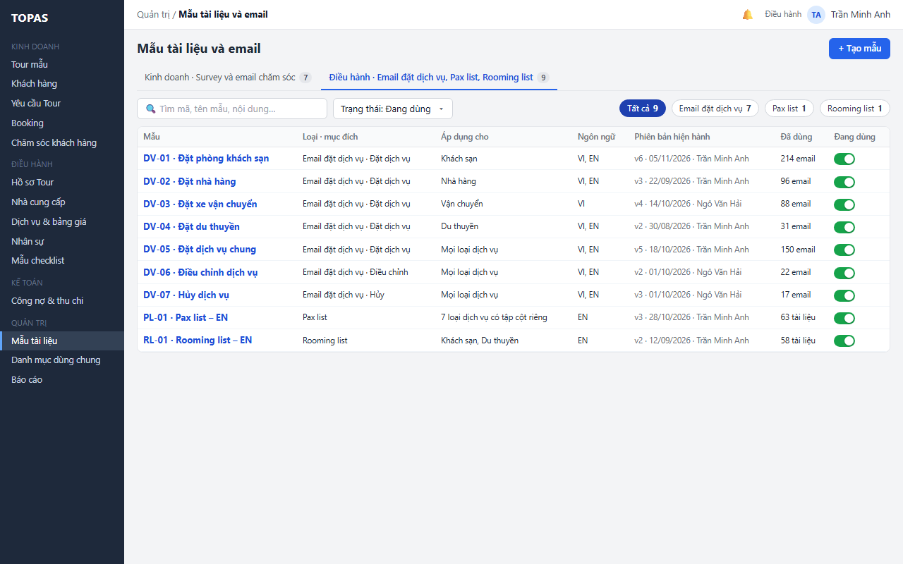

2. **W02 · Menu Quản trị → Mẫu tài liệu (Kinh doanh).** Màn mở ở tab Kinh doanh: mẫu Survey (kèm số câu hỏi) và email chăm sóc, cột Dùng ở đếm chiến dịch tham chiếu mẫu. Dòng chỉ dẫn dưới thanh lọc cho biết proposal báo giá không cấu hình ở đây. Người dùng bấm tab còn lại để chuyển nhóm (L1.3).

   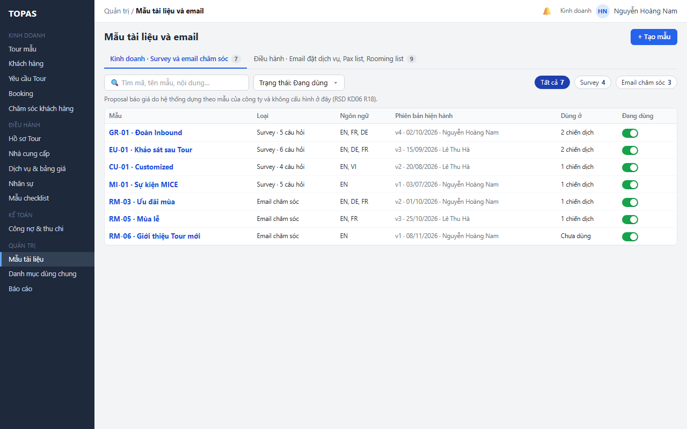

*Kết quả:* người dùng thấy các mẫu của bộ phận mình và mẫu nào DH08 đang tự khớp.

**L1.2 Tìm và lọc.**

1. **W03 · Ô tìm và bộ chọn Trạng thái.** Người dùng gõ “khách sạn” và chọn Trạng thái: Tất cả. Bảng lọc ngay; mẫu Ngừng dùng DV-08 hiện mờ; chip đếm lại theo bộ lọc; liên kết Xóa bộ lọc xuất hiện. Bấm chip loại để thu hẹp thêm.

   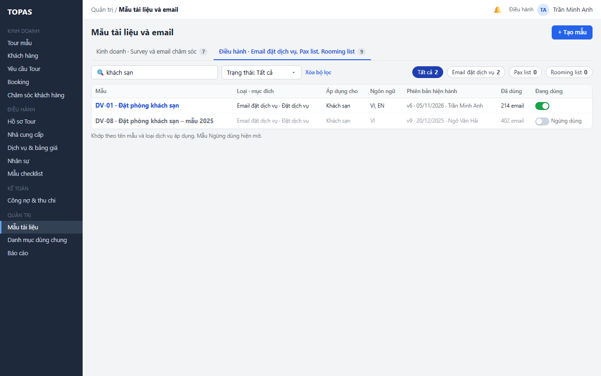

*Kết quả:* bộ lọc được giữ cho tab đó trong phiên.

**L1.3 Xem nhóm mẫu của bộ phận khác.** *Điều kiện:* người dùng không có quyền quản lý nhóm đó (R01).

1. **W04 · Tab của bộ phận khác.** Kinh doanh bấm tab Điều hành. Tiêu đề ghi “Chỉ xem nhóm mẫu này”, không có + Tạo mẫu, công tắc mờ; dòng chú thích dưới bảng nêu ai quản lý nhóm.

   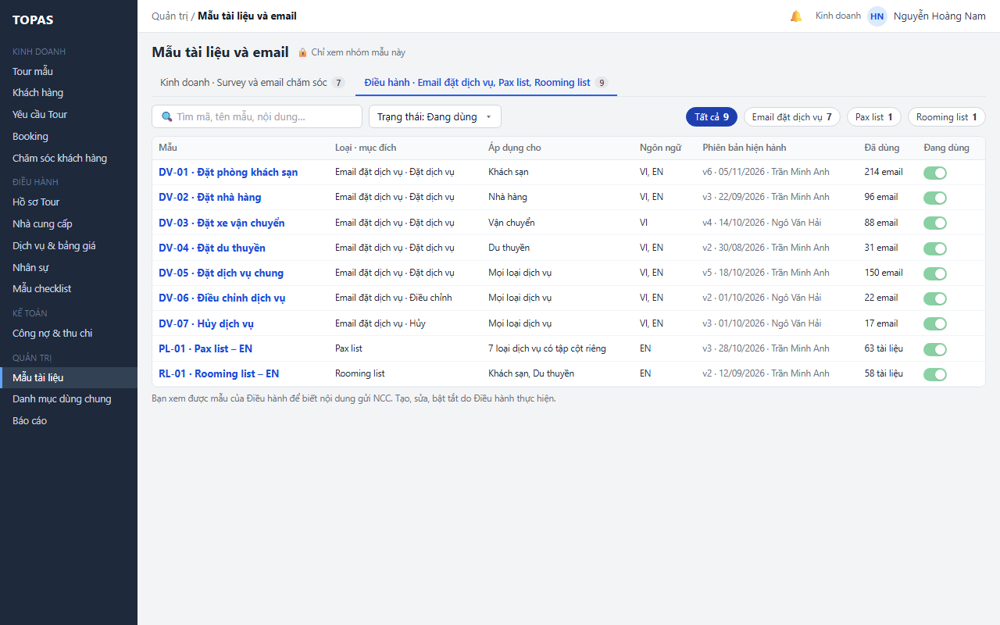

2. **W32 · Bấm một dòng.** Bảng trượt chỉ đọc: mọi trường viền nét đứt, chỉ có thẻ Nội dung và Lịch sử phiên bản, chân chỉ có Đóng và câu nêu quyền.

   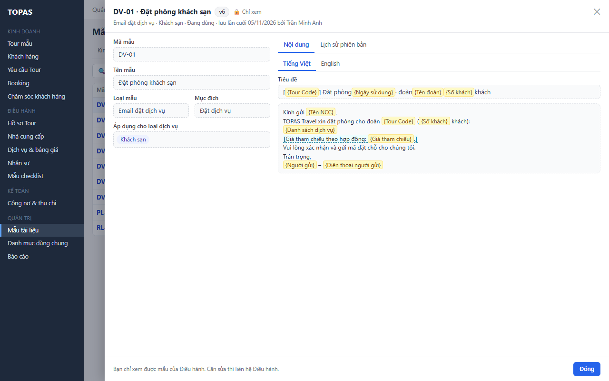

*Kết quả:* Kinh doanh biết nội dung Điều hành gửi NCC và ngược lại, không sửa được.

**Ngoại lệ**

- **E1.1 · W05.** Không có mẫu khớp tìm kiếm hoặc bộ lọc: bảng rỗng ghi rõ chuỗi tìm và trạng thái đang lọc, gợi ý chọn Trạng thái: Tất cả, nút Xóa bộ lọc.

  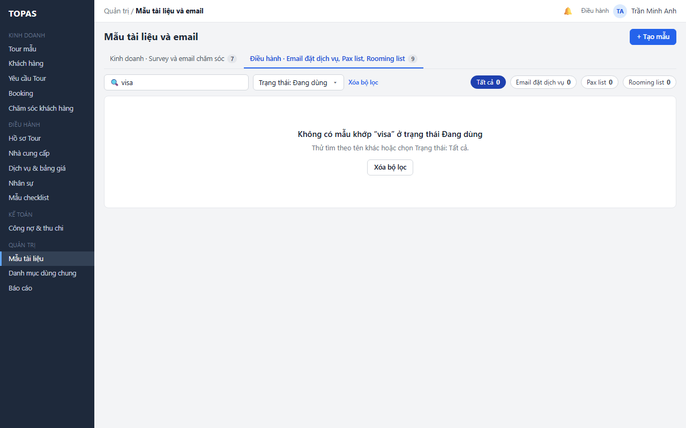

- **E1.2.** Nhóm chưa có mẫu nào (dự án mới): bảng rỗng “Chưa có mẫu …” kèm nút + Tạo mẫu cho người có quyền; người chỉ xem thấy “Bộ phận … chưa tạo mẫu”.
- **E1.3.** Kế toán, hoặc người không có quyền xem, mở QT04 bằng đường dẫn: trang “Bạn không có quyền xem Mẫu tài liệu và email” kèm liên kết về trang chủ; không lộ tên mẫu.
- **E1.4.** Mẫu bị xóa ở phiên khác khi người dùng bấm dòng: thông báo ngắn “Mẫu … đã bị xóa”, dòng biến mất, số chip cập nhật.
- **E1.5.** Quyền bị thu hồi ở QT02 khi đang mở màn: thao tác ghi tiếp theo bị máy chủ từ chối (R14), màn tải lại ở chế độ chỉ xem; nội dung đang soạn được giữ trong bảng trượt để sao chép.

### 3.2. Mẫu email đặt dịch vụ (CNHT05.03 · HT05.04)

**L2.1 Tạo mẫu email đặt dịch vụ.** *Điều kiện:* Điều hành có quyền quản lý mẫu Điều hành, đang ở QT04.2.

1. **W06 · Nút + Tạo mẫu → chọn Email đặt dịch vụ → bảng trượt.** Ô Bắt đầu từ cho chọn một mẫu email đặt dịch vụ có sẵn (mặc định: mẫu dự phòng Mọi loại dịch vụ của mục đích Đặt dịch vụ); nội dung mọi ngôn ngữ, mục đích được sao chép, nền xanh ngọc. Mã gợi ý theo tiền tố của mẫu nguồn (DV-09, R02). Điều hành nhập tên, chọn loại dịch vụ áp dụng; dòng gợi ý dưới ô cho biết loại dịch vụ đó hiện được khớp mẫu nào (R07). Chọn “Trống” ở Bắt đầu từ thì khung soạn trống, chỉ có bản Tiếng Việt.

   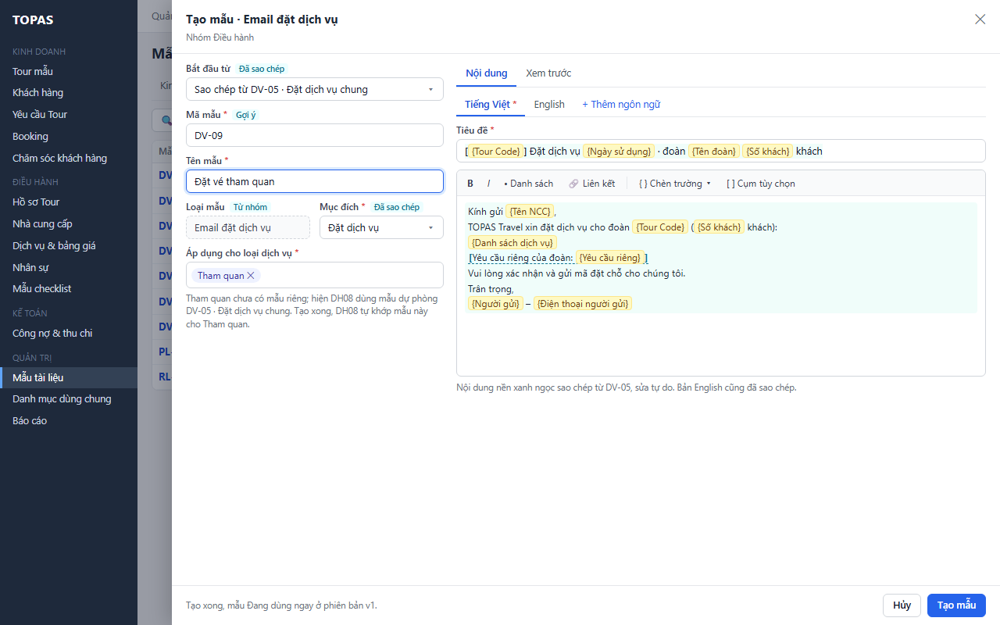

2. **W07 · Nút Chèn trường trên thanh công cụ.** Menu liệt kê các trường của loại mẫu và mục đích đang chọn, nhóm Tour, NCC và dịch vụ, Người gửi; trường có thể trống ghi chú bên phải (R04). Bấm một trường để chèn tại con trỏ, thành nhãn vàng.

   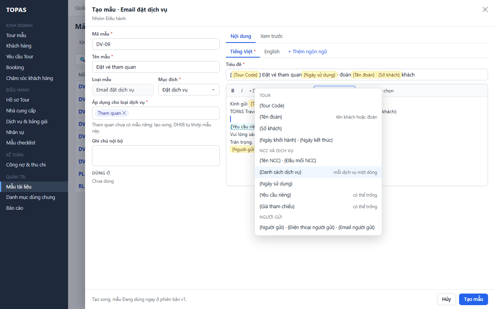

3. **W08 · Thẻ ngôn ngữ English.** Điều hành mở bản English (đã sao chép ở bước 1) hoặc + Thêm ngôn ngữ (chọn từ danh mục ngôn ngữ QT05; bản mới sao chép cấu trúc trường từ bản Tiếng Việt để dịch). Chọn đoạn chứa trường có thể trống rồi bấm Cụm tùy chọn: đoạn được đóng ngoặc vuông; ô chú thích dưới khung giải thích (R05).

   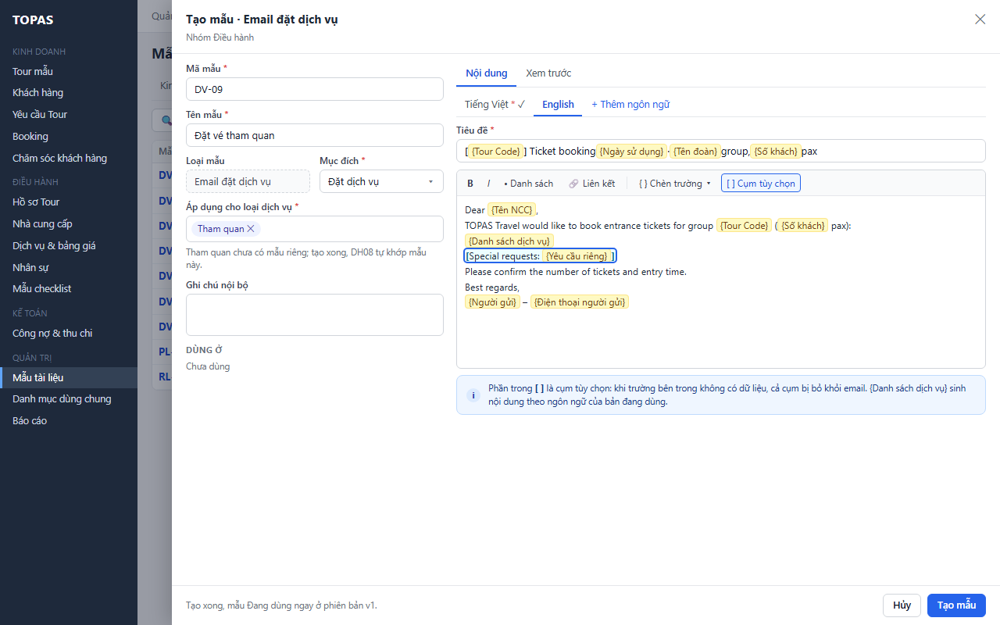

4. **W09 · Thẻ Xem trước.** Hệ thống gợi ý hồ sơ Tour chưa đóng có hạng mục cùng loại dịch vụ, khởi hành gần hôm nay nhất, và hạng mục đầu tiên của loại đó; người dùng đổi được hồ sơ, hạng mục, ngôn ngữ. Email hiện đúng như DH08 sẽ soạn: người gửi là hộp thư chung, người nhận lấy từ DH03, phần trộn tô vàng, cụm tùy chọn trống bị bỏ (R13). Bấm Gửi thử tới email của tôi: hệ thống gửi bản trộn tới email tài khoản, tiêu đề có “[Gửi thử]”, thông báo ngắn “Đã gửi thử tới …”.

   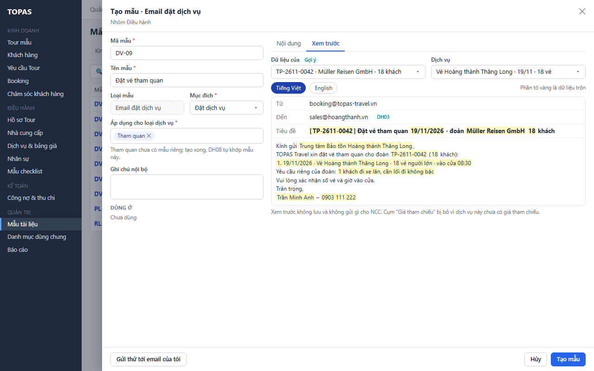

5. **W10 · Nút Tạo mẫu.** Hệ thống kiểm tra theo R06; hợp lệ thì tạo mẫu Đang dùng v1 (loại dịch vụ chưa có mẫu riêng Đang dùng, R07), đóng bảng trượt. Dòng mới nền xanh, số trên tab và chip tăng; thông báo ngắn nêu từ nay DH08 tự khớp mẫu khi đặt loại dịch vụ đó, kèm liên kết Mở mẫu.

   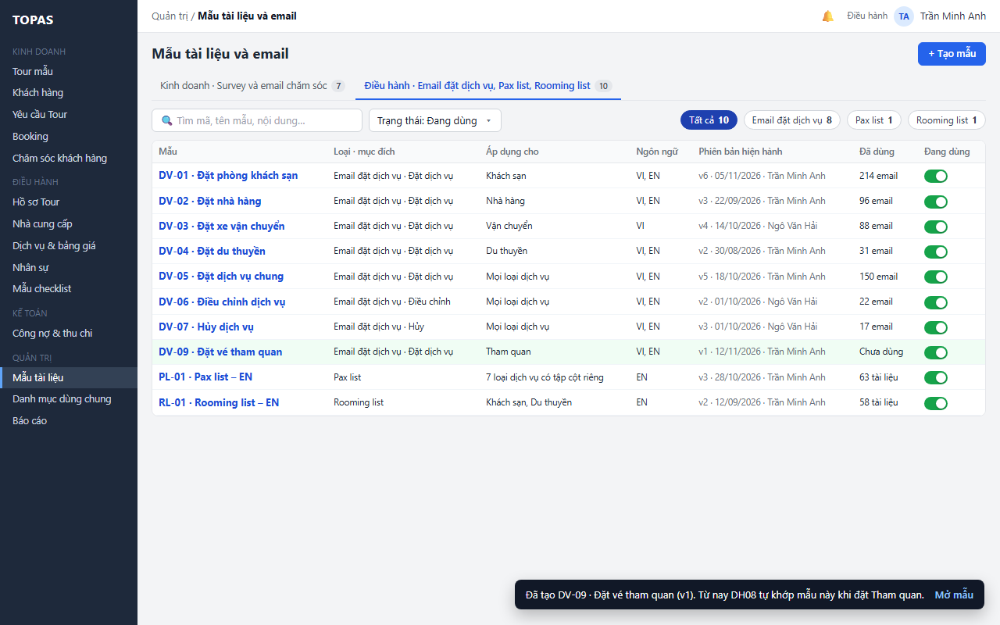

*Kết quả:* mẫu DV-09 Đang dùng v1; DH08 tự khớp cho Tham quan từ lần soạn tiếp theo.

**L2.2 Sửa mẫu và lưu phiên bản mới.** *Điều kiện:* như L2.1; mẫu bất kỳ trạng thái.

1. **W11 · Bấm dòng DV-01 → bảng trượt.** Bảng trượt mở ở thẻ Nội dung, bản Tiếng Việt. Điều hành sửa nội dung (ví dụ thêm cụm Yêu cầu riêng). Đoạn thay đổi nền xanh lá, thẻ ngôn ngữ có dấu •, chân đếm “1 thay đổi chưa lưu”; nút chính ghi số phiên bản sắp tạo. Xóa mẫu khóa kèm lý do vì mẫu đã dùng.

   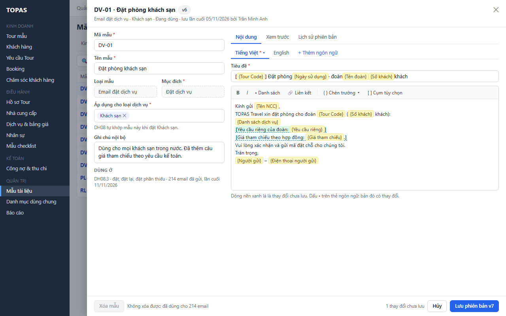

2. **W11a · Nút Lưu phiên bản v7.** Hệ thống kiểm tra R06, R14, ghi v7 cùng danh sách thay đổi (R11). Bảng trượt ở lại đúng thẻ; tiêu đề lên v7, dòng dưới ghi lần lưu mới; Lưu khóa đến khi có sửa mới; dòng danh sách cập nhật cột Phiên bản. Thông báo ngắn: email soạn từ nay dùng v7, email đã gửi giữ nguyên, kèm liên kết Xem lịch sử.

   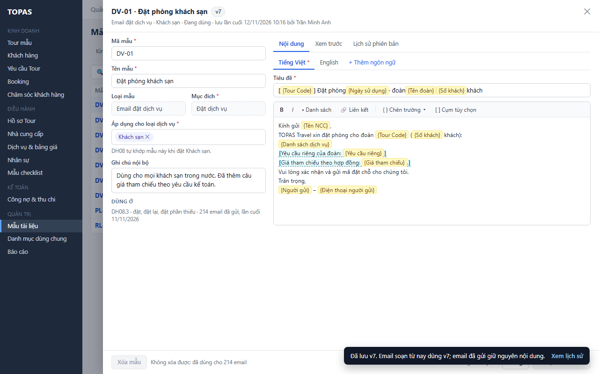

*Kết quả:* DV-01 v7 là phiên bản hiện hành. Email DH08 đang soạn dở (đã mở bảng trượt) giữ nội dung đã soạn; lần soạn sau dùng v7.

**L2.3 Soạn trước mẫu thay thế cho loại dịch vụ đã có mẫu.** *Điều kiện:* cùng mục đích, loại dịch vụ đã có mẫu Đang dùng.

1. **W12 · Ô Áp dụng cho loại dịch vụ trong bảng trượt tạo mẫu.** Khi Điều hành chọn loại dịch vụ đã có mẫu Đang dùng cùng mục đích, dưới ô hiện thông báo xanh nêu mẫu đang dùng và cho biết mẫu mới sẽ được tạo ở Ngừng dùng; câu ở chân bảng trượt đổi theo. Bấm Tạo mẫu: mẫu được tạo ở Ngừng dùng · v1, DH08 vẫn khớp mẫu cũ. Điều hành sửa, xem trước thoải mái, rồi bật khi muốn thay (L6.3, W28a).

   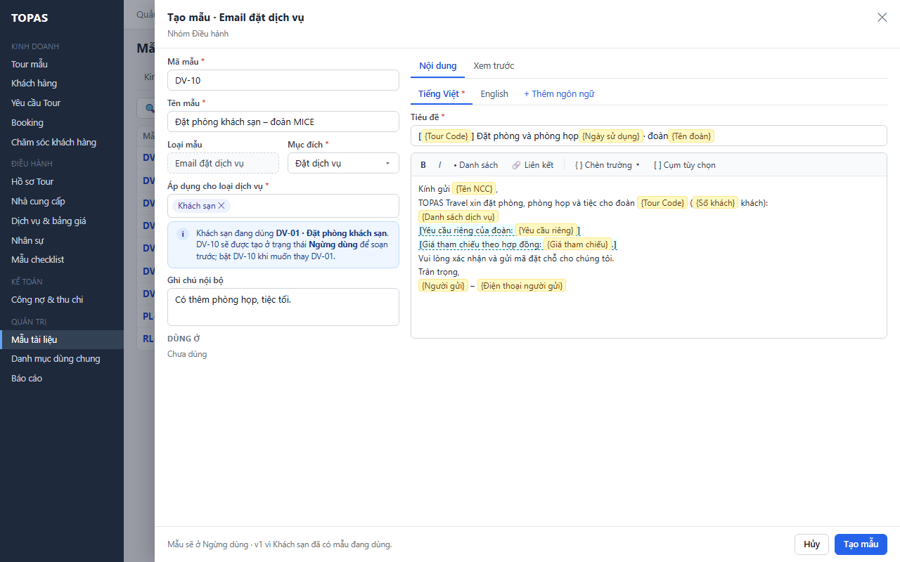

*Kết quả:* mỗi cặp (mục đích, loại dịch vụ) luôn có tối đa một mẫu Đang dùng; DH08 không bao giờ phải chọn giữa hai mẫu.

**Ngoại lệ**

- **E2.1 · W13.** Lưu khi vi phạm kiểm tra chặn (R06): banner đỏ đếm số lỗi, lỗi ghi cạnh trường; thẻ ngôn ngữ có lỗi có số đỏ; nội dung giữ nguyên. Ví dụ: mã trùng, tiêu đề thiếu {Tour Code}, `{…}` không có trong danh sách trường của loại mẫu, thiếu bản Tiếng Việt, không chọn loại dịch vụ.

  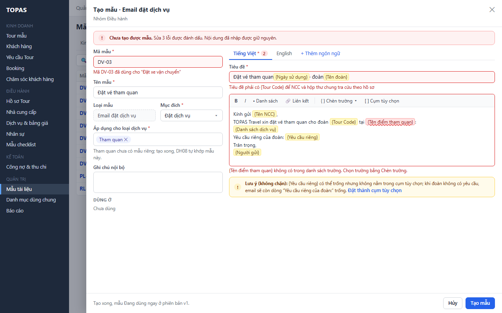

- **E2.2 · W13.** Trường có thể trống nằm ngoài cụm tùy chọn: cảnh báo vàng, không chặn; liên kết Đặt thành cụm tùy chọn bao câu chứa trường đó. Không có lỗi chặn thì mẫu vẫn được lưu.
- **E2.3 · W14.** Người khác đã lưu phiên bản mới sau khi người dùng mở mẫu: không ghi đè. Banner nêu người, giờ lưu; bảng so sánh phần nào mỗi bên đã đổi; Tải v7 (bỏ thay đổi của tôi) hoặc giữ bảng so sánh để sao chép lại rồi lưu thành v8 (R14).

  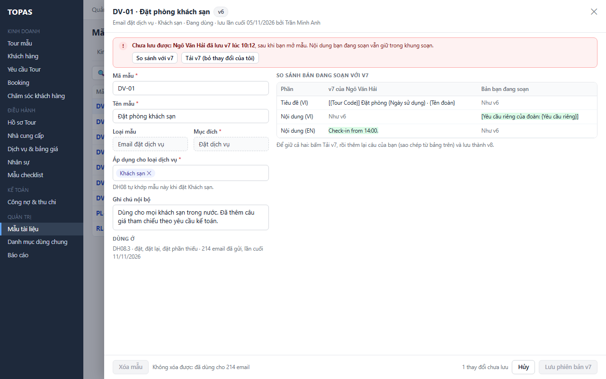

- **E2.4 · W15.** Đóng bảng trượt, đổi tab hoặc rời trang khi còn thay đổi chưa lưu: hộp thoại nêu số thay đổi và bản ngôn ngữ bị ảnh hưởng; Tiếp tục sửa hoặc Bỏ thay đổi và đóng.

  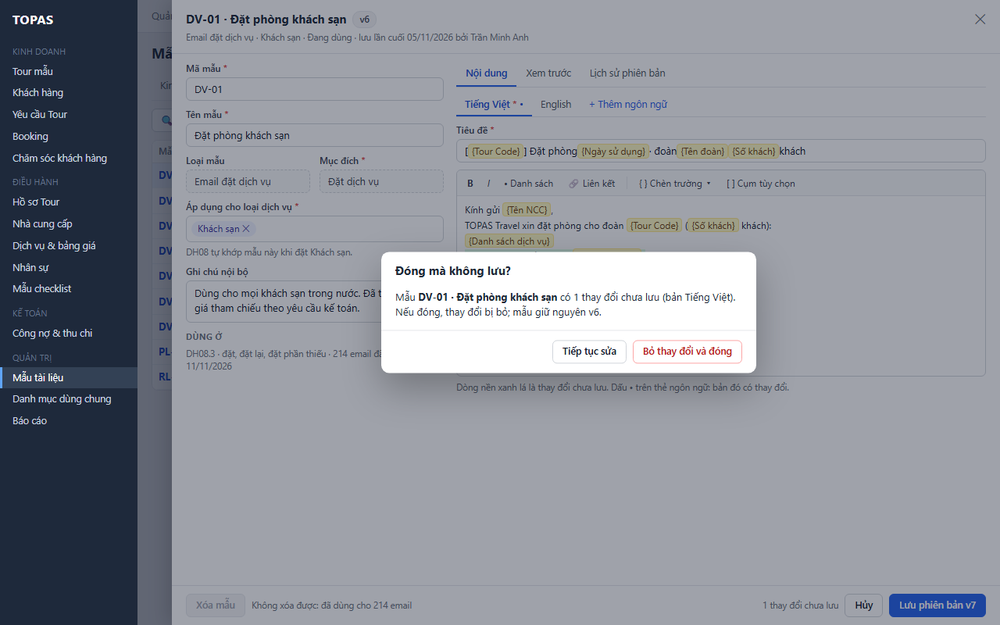

- **E2.5.** Loại dịch vụ áp dụng bị tắt ở QT05: thẻ loại dịch vụ hiện gạch ngang kèm “Đã tắt ở QT05”; mẫu vẫn dùng cho hạng mục cũ của loại đó; khi tạo mẫu mới không chọn được loại đã tắt.
- **E2.6.** Không có hồ sơ chưa đóng có hạng mục cùng loại dịch vụ để xem trước: Xem trước dùng dữ liệu minh họa của hệ thống, nhãn “Dữ liệu minh họa”; người dùng vẫn chọn được hồ sơ khác.
- **E2.7.** Gửi thử lỗi (dịch vụ email không sẵn sàng, chưa cấu hình hộp thư chung) hoặc vượt giới hạn gửi thử (R13): thông báo đỏ nêu lý do; không thử lại tự động.
- **E2.8.** Bấm Lưu hoặc Tạo mẫu lặp: nút chuyển trạng thái đang lưu và khóa; máy chủ chỉ tạo một phiên bản cho cùng số phiên bản gốc (R14).
- **E2.9.** Sao chép từ mẫu có ngôn ngữ đã tắt ở QT05: bản ngôn ngữ đó không được sao chép; ghi chú dưới ô Bắt đầu từ nêu ngôn ngữ bị bỏ.
- **E2.10.** Nội dung vượt giới hạn (tiêu đề 150 ký tự, thân 20.000 ký tự): bộ đếm dưới khung chuyển đỏ, lỗi chặn lưu (R06).
- **E2.11.** Thêm loại dịch vụ vào mẫu Đang dùng mà loại đó đã có mẫu Đang dùng khác cùng mục đích: lỗi dưới ô Áp dụng cho loại dịch vụ “Khách sạn đang dùng DV-01; bỏ Khách sạn hoặc tạo mẫu mới rồi bật để thay”; chặn lưu (R07).

### 3.3. Mẫu Pax list và Rooming list (CNHT05.03 · HT05.04)

**L3.1 Cấu hình Pax list.** *Điều kiện:* Điều hành có quyền quản lý mẫu Điều hành. Tạo mẫu Pax list mới theo L2.1 bước 1 với Loại mẫu Pax list (Bắt đầu từ sao chép tập cột và email gửi kèm của mẫu nguồn).

1. **W16 · Bấm dòng PL-01 → thẻ Cột theo loại dịch vụ.** Cột trái: ngôn ngữ tài liệu (tiêu đề cột theo ngôn ngữ này), tiêu đề tài liệu có trường tự điền, sắp xếp khách, định dạng ngày, dòng cho biết DH08.4 đang dùng mẫu này. Cột phải: ma trận trường × loại dịch vụ đang dùng ở QT05; tích ô để NCC của loại dịch vụ đó nhận cột; kéo ⋮⋮ để đổi thứ tự cột; cột # luôn có; cột Loại khác chỉ đọc, là tập mặc định (R08). Ô thông tin nhắc số hộ chiếu là dữ liệu cá nhân.

   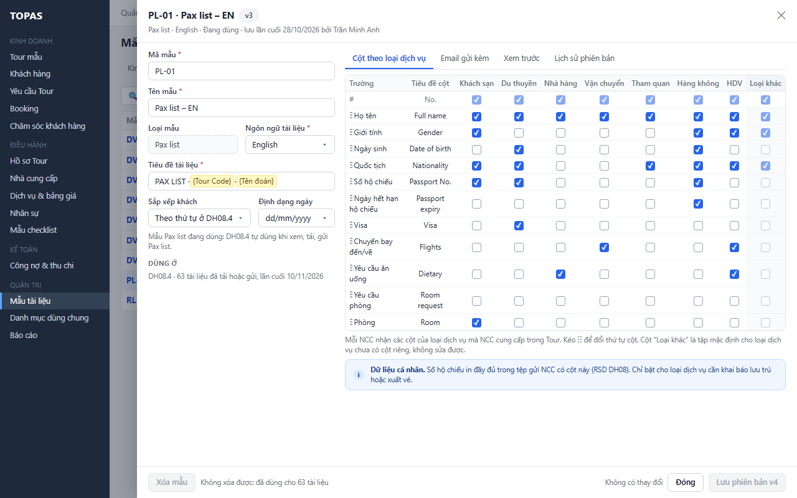

2. **W17 · Thẻ Xem trước.** Hệ thống gợi ý hồ sơ chưa đóng có khởi hành gần nhất; người dùng chọn “Xem như NCC loại” để thấy đúng tập cột NCC loại đó nhận. Tài liệu dựng từ khách đã lưu ở DH08.4, che số hộ chiếu (R13). Tải Excel thử, Tải PDF thử tạo tệp cùng nội dung xem trước, không ghi vào hồ sơ.

   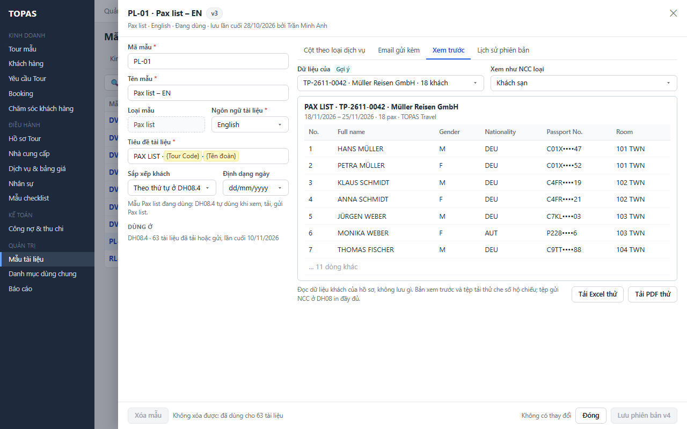

3. **W18 · Thẻ Email gửi kèm.** Tiêu đề và nội dung email DH08 soạn sẵn khi gửi Pax list cho NCC, theo ngôn ngữ (Tiếng Việt bắt buộc); trường tự điền như email đặt dịch vụ, không có trường dịch vụ và giá. Tệp đính kèm do hệ thống sinh theo tập cột của NCC, tên tệp cố định. Lưu như L2.2 bước 2.

   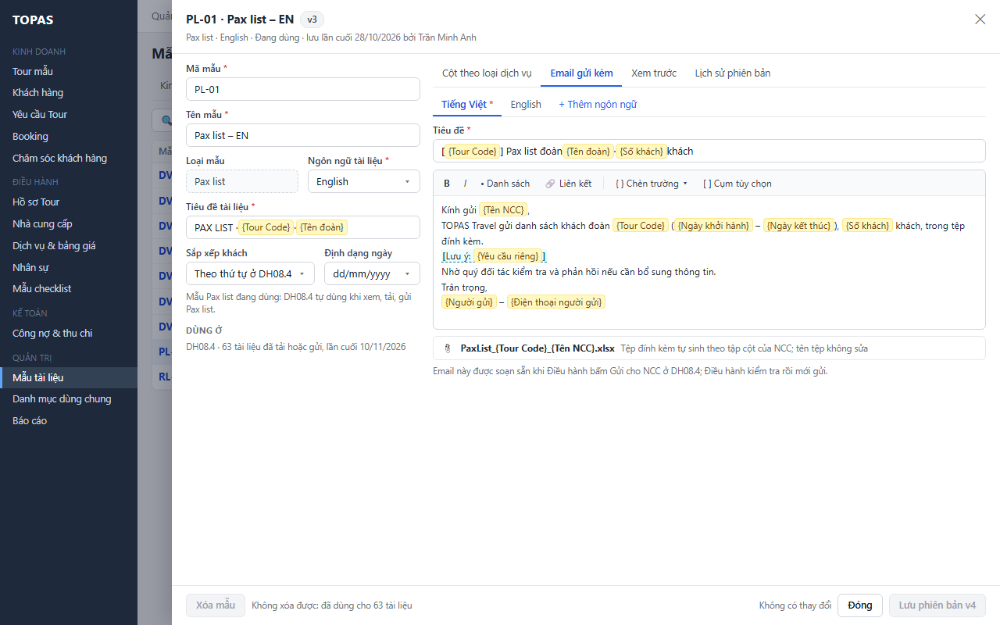

*Kết quả:* DH08.4 gửi mỗi NCC một Pax list chỉ gồm các cột của loại dịch vụ NCC đó cung cấp trong Tour (RSD DH08 L4.6).

**L3.2 Cấu hình Rooming list.**

1. **W19 · Bấm dòng RL-01 → thẻ Xem trước.** Cột trái: ngôn ngữ tài liệu, tiêu đề tài liệu, danh sách cột có tích chọn và kéo đổi thứ tự; ba cột Phòng, Hạng phòng, Họ tên bắt buộc (ô khóa). Xem trước theo một đợt lưu trú thật của DH08.4, mỗi phòng một nhóm dòng. Thẻ Email gửi kèm như W18. Lưu như L2.2 bước 2.

   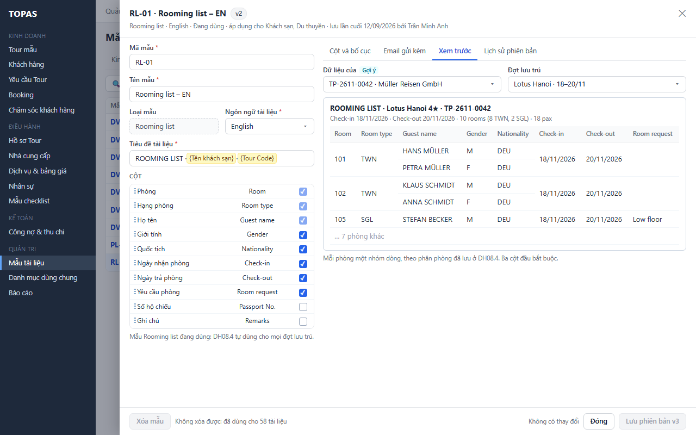

*Kết quả:* DH08.4 dựng Rooming list của từng khách sạn, du thuyền theo mẫu đã chọn.

**Ngoại lệ**

- **E3.1 · W20.** Một loại dịch vụ có cột riêng mà không có Họ tên: banner đỏ, cột của loại đó tô đỏ, lỗi nêu hai cách sửa (tích lại Họ tên, hoặc bỏ hết ô để dùng tập mặc định); chặn lưu, giữ thay đổi.

  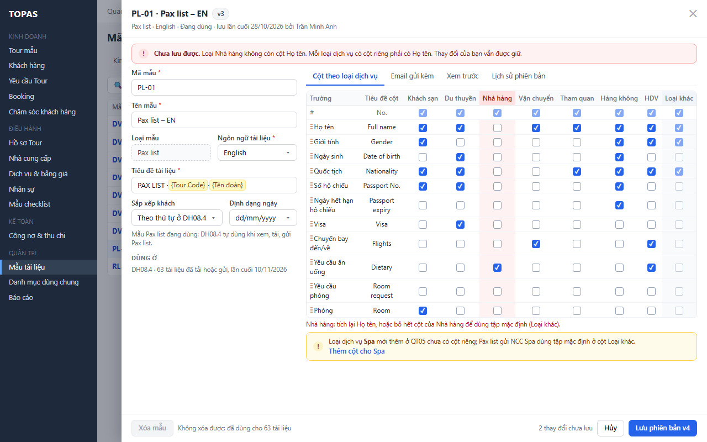

- **E3.2 · W20.** Loại dịch vụ mới thêm ở QT05 chưa có cột riêng: cảnh báo vàng nêu loại đó dùng tập mặc định; liên kết Thêm cột cho … cuộn tới cột của loại đó trong ma trận.
- **E3.3.** Hồ sơ xem trước chưa có khách: tài liệu chỉ có tiêu đề, dòng “Hồ sơ chưa có khách”; Rooming list của đợt còn khách chưa xếp: xem trước vẫn dựng phần đã xếp và liệt kê khách chưa xếp (ở DH08 Rooming list chỉ tạo được khi đã xếp đủ, RSD DH08 E4.5).
- **E3.4.** Tải thử lỗi: thông báo đỏ, nút Thử lại; không ghi gì.
- **E3.5.** Tắt mẫu Pax list hoặc Rooming list đang dùng: không tắt trực tiếp được vì DH08.4 luôn cần một mẫu (công tắc khóa kèm lý do “Mẫu Pax list đang dùng · bật mẫu khác để thay”). Muốn thay thì bật mẫu khác cùng loại: hộp thoại như W28a, mẫu cũ tự ngừng dùng. Mẫu Pax list, Rooming list mới tạo khi đã có mẫu Đang dùng thì ở Ngừng dùng (như L2.3).
- **E3.6.** Bỏ cột Số hộ chiếu của loại dịch vụ đang có Pax list gửi dở ở DH08: tài liệu đã gửi giữ nguyên; lần tạo sau dùng tập cột mới.

### 3.4. Mẫu Survey (CNHT05.02 · HT05.03)

**L4.1 Câu hỏi Survey.** *Điều kiện:* Kinh doanh có quyền quản lý mẫu Kinh doanh. Tạo Survey mới theo L2.1 bước 1 với Loại mẫu Survey (Bắt đầu từ sao chép câu hỏi, email mời mọi ngôn ngữ; mã gợi ý theo tiền tố mẫu nguồn hoặc SV).

1. **W21 · Bấm dòng GR-01 → thẻ Câu hỏi.** Mỗi câu một thẻ: nội dung theo ngôn ngữ đang chọn, ô chọn loại (Điểm 0–10, Sao 1–5, Văn bản), ô tích Bắt buộc, nút lên, xuống, bỏ. Câu Điểm 0–10 có nhãn Điểm tổng thể (R09). Cột trái liệt kê chiến dịch đang dùng mẫu kèm trạng thái và ô thông tin về bản chụp nội dung (R11). Bấm + Thêm câu hỏi thêm thẻ trống ở cuối, con trỏ ở ô nội dung.

   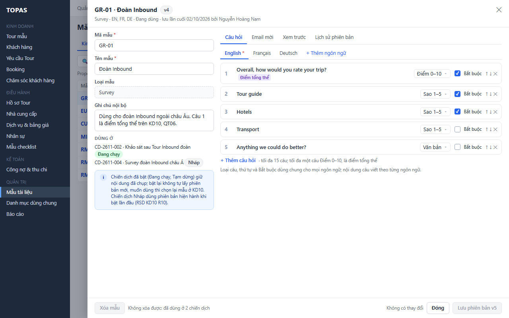

*Kết quả:* câu hỏi, loại, thứ tự, bắt buộc dùng chung cho mọi ngôn ngữ của mẫu.

**L4.2 Email mời theo ngôn ngữ.**

1. **W22 · Thẻ Email mời, thẻ ngôn ngữ Français.** Kinh doanh sửa tiêu đề, nội dung; chèn trường của Survey (R04); đặt cụm tùy chọn cho danh xưng, thời gian Tour. Nút mở Survey là khối cố định, nằm đúng một lần, kéo được lên xuống trong nội dung; phần lý do nhận email và hủy nhận do hệ thống thêm cuối email (R10). Lưu như L2.2 bước 2.

   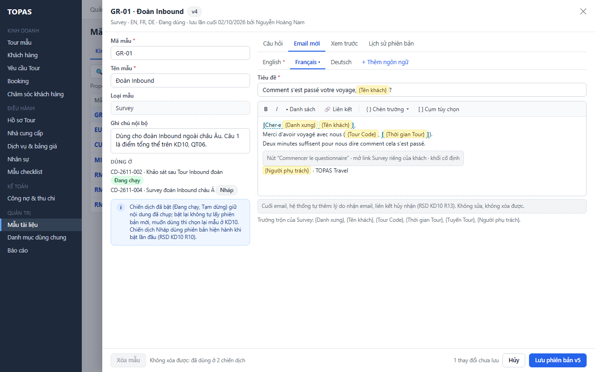

*Kết quả:* mỗi ngôn ngữ có email mời và câu hỏi đầy đủ.

**L4.3 Xem trước và gửi thử Survey.**

1. **W23 · Thẻ Xem trước.** Hệ thống gợi ý Tour đã đóng gần nhất và khách của Tour đó; người dùng đổi Tour, ngôn ngữ. Bên trái email mời đã trộn dữ liệu, bên phải trang Survey như khách thấy. Gửi thử như L2.1 bước 4; link Survey trong bản thử mở trang ở chế độ xem trước, không ghi phản hồi (RSD KD10 L1.1).

   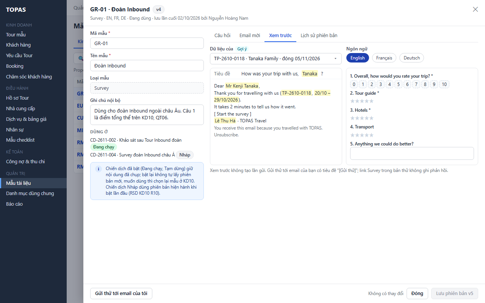

*Kết quả:* không tạo lần gửi, không ghi gì vào chiến dịch hay khách.

**Ngoại lệ**

- **E4.1 · W24.** Ngôn ngữ đã thêm thiếu nội dung câu hỏi (ví dụ câu mới thêm chưa dịch), tiêu đề hoặc nội dung email mời: banner đỏ, thẻ ngôn ngữ có số đỏ, câu thiếu hiện nội dung English để dịch; liên kết Bỏ ngôn ngữ …; chặn lưu.

  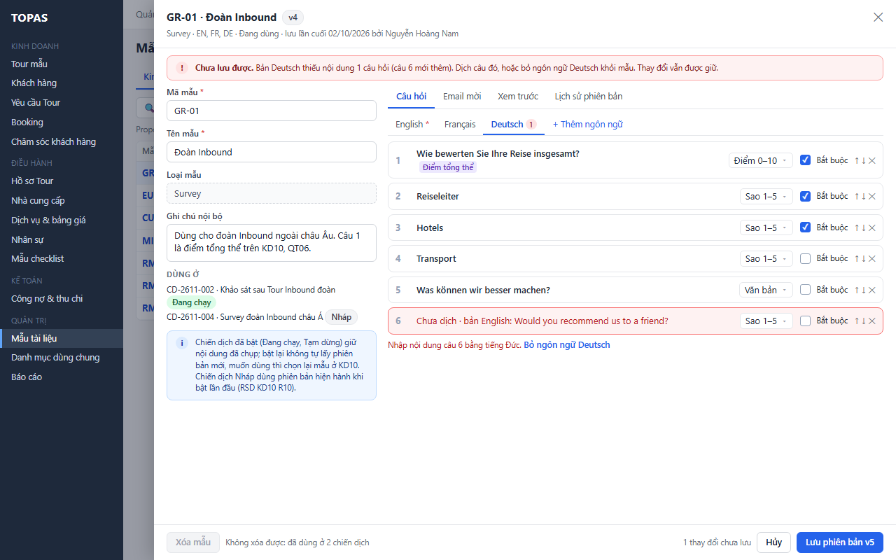

- **E4.2.** Bỏ bản English: không có nút bỏ trên thẻ English (bắt buộc, R03); các ngôn ngữ khác bỏ được kèm xác nhận ngắn.
- **E4.3.** Chọn loại Điểm 0–10 cho câu thứ hai: ô chọn không cho chọn, ghi chú “Mẫu đã có câu điểm tổng thể (câu n)”.
- **E4.4.** Thêm câu thứ 16 hoặc bỏ câu cuối cùng: + Thêm câu hỏi khóa kèm “Tối đa 15 câu”; nút bỏ của câu duy nhất khóa kèm “Survey cần ít nhất một câu”.
- **E4.5 · W21.** Sửa mẫu đang dùng ở chiến dịch Đang chạy: không chặn; ô thông tin ở cột trái nhắc chiến dịch đã bật (Đang chạy, Tạm dừng) giữ bản đã chụp, bật lại không tự lấy bản mới, muốn dùng thì chọn lại mẫu ở KD10; chiến dịch Nháp dùng bản hiện hành khi bật lần đầu (R11; RSD KD10 R10).
- **E4.6.** Không có Tour đã đóng để xem trước: dùng dữ liệu minh họa, nhãn “Dữ liệu minh họa”.

### 3.5. Mẫu email chăm sóc (CNHT05.02 · HT05.03)

**L5.1 Tạo hoặc sửa email chăm sóc.** *Điều kiện:* như L4.1. Tạo mới theo L2.1 bước 1 với Loại mẫu Email chăm sóc (mã gợi ý RM-nn).

1. **W25 · Bấm dòng RM-03 → thẻ Nội dung, thẻ ngôn ngữ Deutsch.** Tiêu đề, nội dung theo ngôn ngữ (English bắt buộc); trường của email chăm sóc (R04); cụm tùy chọn cho trường có thể trống như {Tour gần nhất}. Khối hủy nhận cố định (R10). Cột trái liệt kê chiến dịch dùng mẫu. Xem trước dùng một khách có Tour đã đóng gần nhất, gửi thử như L2.1 bước 4. Lưu như L2.2 bước 2.

   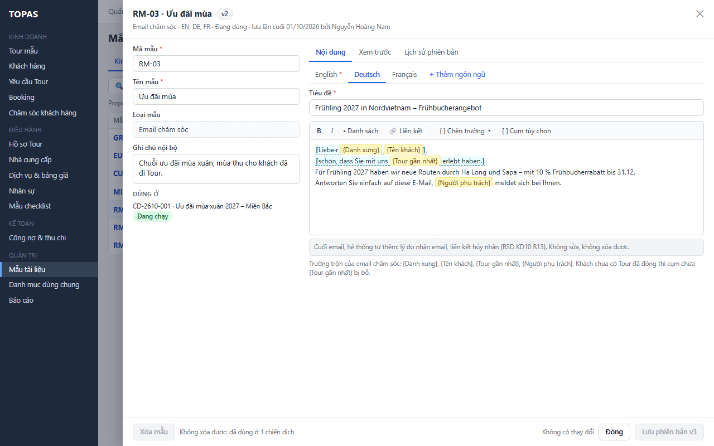

*Kết quả:* KD10 điền tiêu đề, nội dung của mẫu vào bước Remarketing khi người dùng chọn mẫu; nội dung lưu cùng bước, sửa mẫu sau đó không đổi bước đã soạn (RSD KD10 L2.2 bước 2, R10).

**Ngoại lệ**

- **E5.1.** Thiếu bản English, tiêu đề quá 150 ký tự, trường không thuộc email chăm sóc (ví dụ {Tour Code}): lỗi cạnh trường, chặn lưu như E2.1.
- **E5.2.** Liên kết trong nội dung không phải địa chỉ https hợp lệ: lỗi cạnh liên kết, chặn lưu.
- **E5.3.** Trường có thể trống ngoài cụm tùy chọn: cảnh báo, không chặn (E2.2).
- **E5.4.** Không có khách có Tour đã đóng để xem trước: dùng dữ liệu minh họa (E4.6).

### 3.6. Ngừng dùng, dùng lại và xóa mẫu

**L6.1 Ngừng dùng mẫu QT04.1.** *Điều kiện:* người có quyền quản lý nhóm Kinh doanh. Mẫu QT04.2 theo L6.2.

1. **W26 · Tắt công tắc Đang dùng → hộp thoại.** Hộp thoại nêu mẫu không còn hiện khi chọn mẫu, và liệt kê nơi đang dùng kèm hệ quả: QT04.1 liệt kê chiến dịch theo trạng thái. Mẫu Survey: Đang chạy vẫn gửi bản đã chụp; Nháp, Tạm dừng phải chọn mẫu khác trước khi bật (RSD KD10 R04). Mẫu email chăm sóc: các bước Remarketing đã soạn giữ nội dung đã lưu, chiến dịch vẫn bật hoặc bật lại được; chỉ không chọn được mẫu này cho bước mới (RSD KD10 R10). Bấm Ngừng dùng hoặc Giữ Đang dùng.

   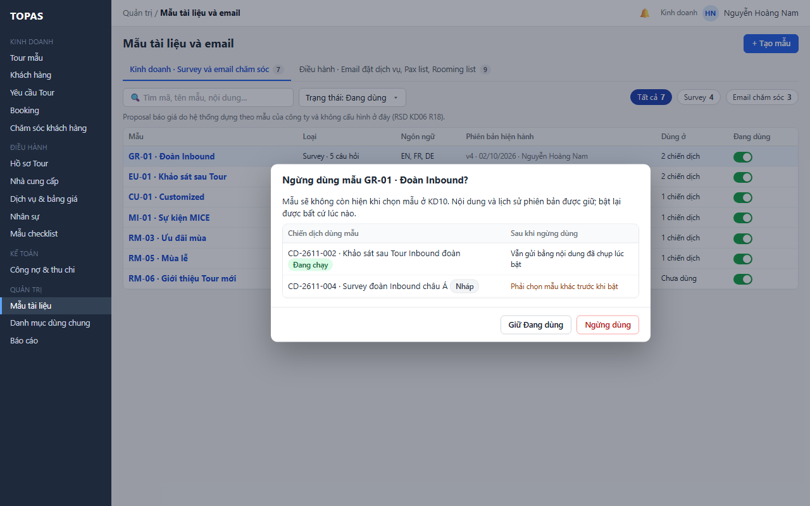

2. **W27 · Nút Ngừng dùng.** Hệ thống lưu (R12), dòng mờ tại chỗ kèm chú thích “không còn khớp bộ lọc Đang dùng”, số trên tab và chip giảm. Thông báo ngắn có Hoàn tác 10 giây. Với mẫu Survey, người phụ trách các chiến dịch Nháp, Tạm dừng dùng mẫu nhận thông báo trong hệ thống, liên kết mở KD10 tab Thiết lập.

   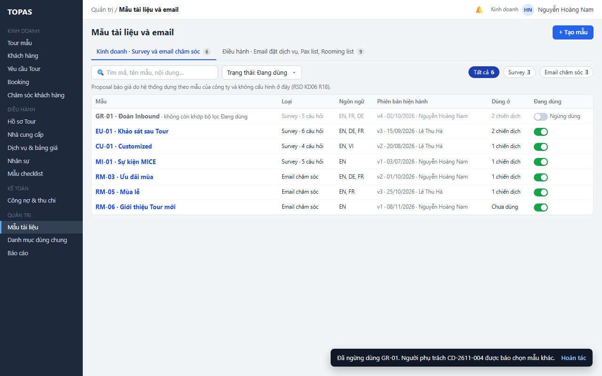

*Kết quả:* mẫu Ngừng dùng; nội dung, phiên bản, số Đã dùng giữ nguyên.

**L6.2 Ngừng dùng mẫu email đặt dịch vụ.** *Điều kiện:* người có quyền quản lý nhóm Điều hành. Mẫu Pax list, Rooming list đang dùng không tắt trực tiếp (E3.5).

1. **W28 · Tắt công tắc → hộp thoại.** Hộp thoại nêu từng loại dịch vụ mẫu đang được khớp và mẫu DH08 sẽ khớp thay theo R07 (mẫu dự phòng Mọi loại dịch vụ cùng mục đích, hoặc “Không có mẫu”: DH08 báo thiếu mẫu, RSD DH08 E3.1). Người dùng không phải chọn gì. Bấm Ngừng dùng: lưu như W27.

   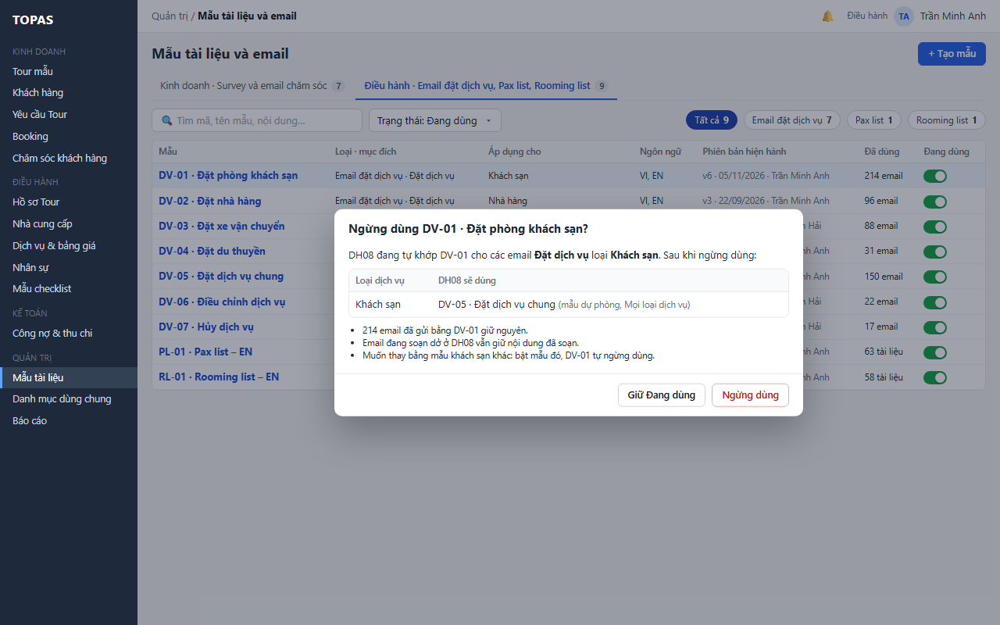

*Kết quả:* mẫu Ngừng dùng; loại dịch vụ chuyển sang mẫu dự phòng.

**L6.3 Bật mẫu.** *Điều kiện:* mẫu đang Ngừng dùng.

1. **W03 · Bật công tắc khi phạm vi khớp của mẫu chưa có mẫu Đang dùng.** Lưu ngay, không hộp thoại; dòng hết mờ, số chip tăng; thông báo ngắn có Hoàn tác.
2. **W28a · Bật công tắc khi phạm vi khớp đã có mẫu Đang dùng → hộp thoại.** Bảng nêu từng phạm vi (mục đích · loại dịch vụ, hoặc Pax list, Rooming list), mẫu đang dùng và mẫu sau khi bật; câu dưới nêu mẫu cũ sẽ chuyển Ngừng dùng. Bấm Bật …, ngừng dùng …: một giao dịch (R07, R14); danh sách cập nhật cả hai dòng, thông báo ngắn nêu hai mẫu.

   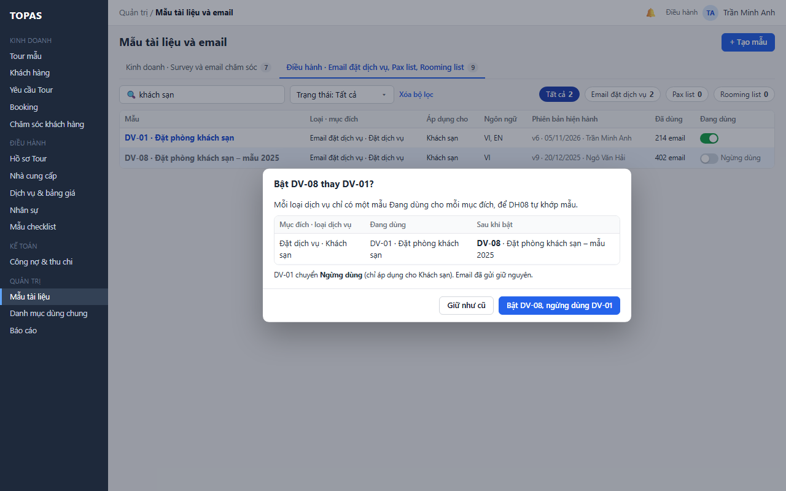

*Kết quả:* DH08 khớp mẫu vừa bật từ lần soạn sau; mẫu cũ Ngừng dùng, bật lại được để quay về.

**L6.4 Xóa mẫu chưa dùng.** *Điều kiện:* Đã dùng bằng 0 (R12).

1. **W29 · Nút Xóa mẫu ở chân bảng trượt → hộp thoại.** Hộp thoại nêu mẫu chưa dùng, xóa hẳn mọi phiên bản, không hoàn tác. Bấm Xóa mẫu: hệ thống kiểm tra lại điều kiện, xóa, đóng bảng trượt; dòng biến mất; thông báo ngắn “Đã xóa …”; nhật ký QT03 giữ mã, tên, người xóa.

   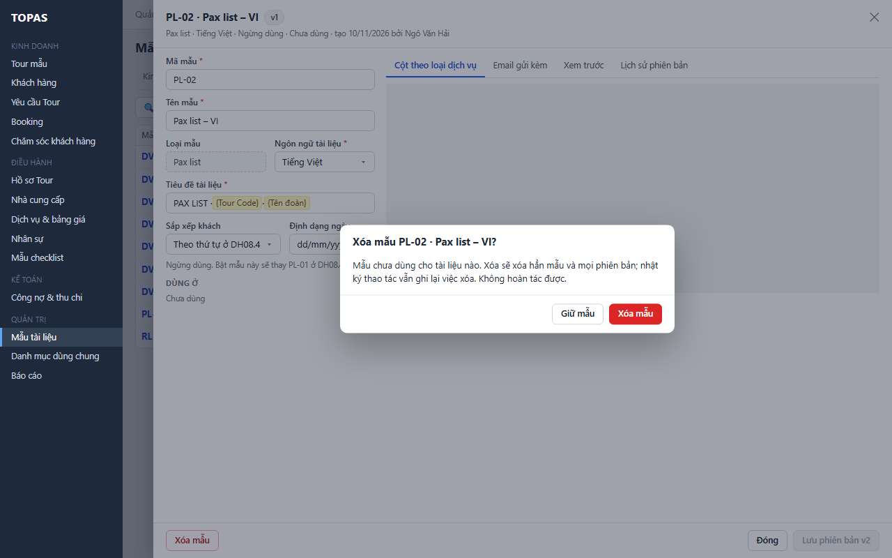

*Kết quả:* mẫu không còn ở danh sách và các ô chọn mẫu.

**Ngoại lệ**

- **E6.1.** Tắt mẫu dự phòng Mọi loại dịch vụ của một mục đích: hộp thoại W28 có cảnh báo đỏ liệt kê các loại dịch vụ chưa có mẫu riêng (DH08 sẽ báo thiếu mẫu khi đặt các loại đó, và khi soạn email gộp nhiều loại dịch vụ của cùng NCC, R07); vẫn cho ngừng dùng.
- **E6.2.** Lưu công tắc lỗi: công tắc trở về giá trị cũ, thông báo đỏ kèm Thử lại.
- **E6.3.** Bấm Hoàn tác sau khi đã có mẫu khác được bật cùng phạm vi: Hoàn tác bị từ chối, thông báo nêu mẫu đang dùng phạm vi đó.
- **E6.4.** Mẫu vừa được dùng ở phiên khác (email gửi, chiến dịch chọn mẫu) khi bấm Xóa: máy chủ từ chối, hộp thoại đóng, thông báo “Mẫu vừa được dùng, không xóa được; hãy ngừng dùng”; nút Xóa chuyển khóa kèm lý do.
- **E6.5.** Xóa mẫu Pax list, Rooming list đang dùng: nút Xóa khóa kèm lý do như E3.5 (thực tế mẫu đang dùng đã có tài liệu nên Đã dùng lớn hơn 0).
- **E6.6a.** Bật mẫu mà mẫu đang dùng cùng phạm vi đã bị người khác tắt hoặc thay: máy chủ kiểm tra lại lúc lưu; hộp thoại W28a không còn đúng thì đóng, thông báo, danh sách tải lại.
- **E6.7.** Bật mẫu trùng **một phần** phạm vi với mẫu đang dùng (ví dụ mẫu đang dùng áp dụng Khách sạn, Du thuyền; mẫu được bật chỉ Khách sạn): không bật được; công tắc trở về, thông báo nêu loại dịch vụ trùng và hai cách sửa: thêm Du thuyền vào mẫu được bật, hoặc bỏ Khách sạn khỏi mẫu đang dùng.
- **E6.6.** Hai người cùng tắt một mẫu: lần thứ hai không đổi gì, thông báo “Mẫu đã Ngừng dùng”.

### 3.7. Lịch sử phiên bản và khôi phục

**L7.1 Xem lịch sử và khôi phục nội dung cũ.** *Điều kiện:* người xem được nhóm mẫu; khôi phục cần quyền quản lý.

1. **W30 · Thẻ Lịch sử phiên bản.** Danh sách phiên bản mới nhất ở trên: số, tóm tắt thay đổi (R11), thời điểm, người lưu; phiên bản hiện hành có nhãn. Bấm một phiên bản: bên phải hiện thay đổi so với phiên bản trước (tô xanh thêm, đỏ bỏ), nội dung đầy đủ của phiên bản đó và số lần đã dùng của từng phiên bản. Nút Khôi phục nội dung vN chỉ hiện với người có quyền quản lý và phiên bản khác hiện hành.

   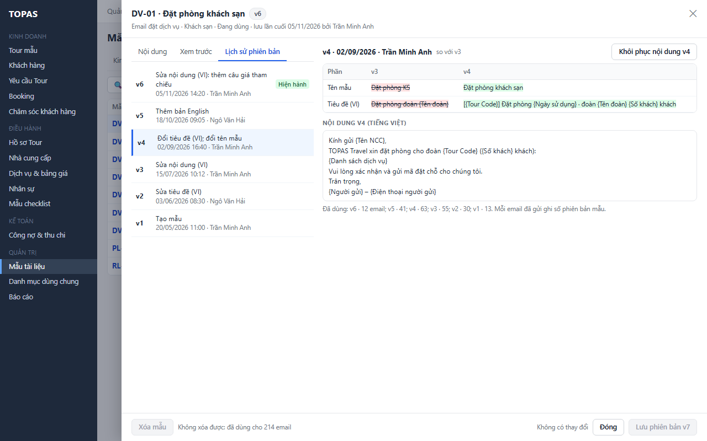

2. **W31 · Nút Khôi phục nội dung v4.** Hệ thống nạp nội dung v4 (mọi thẻ, mọi ngôn ngữ, trừ Đang dùng) vào khung soạn như thay đổi chưa lưu; banner xanh nêu cách áp dụng; ghi chú nếu khôi phục làm bỏ một ngôn ngữ. Bấm Lưu phiên bản v7 như L2.2 bước 2; bấm Hủy giữ nguyên v6.

   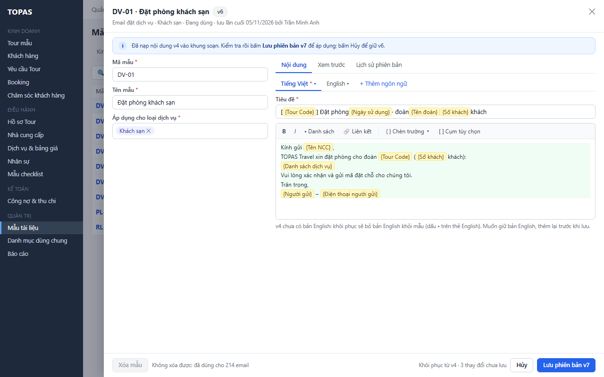

*Kết quả:* phiên bản mới v7 có nội dung của v4; v5, v6 vẫn trong lịch sử.

**Ngoại lệ**

- **E7.1.** Nội dung phiên bản cũ dùng trường đã bị bỏ khỏi danh sách trường, hoặc loại dịch vụ, ngôn ngữ đã tắt ở QT05: khi lưu, lỗi E2.1 hoặc ghi chú E2.5, E2.9 áp dụng như với nội dung mới.
- **E7.2.** Phiên bản hiện hành đổi trong lúc đang xem lịch sử rồi khôi phục: lưu bị từ chối như E2.3.
- **E7.3.** Lịch sử lỗi tải: dòng lỗi trong thẻ kèm Thử lại; thẻ Nội dung vẫn dùng được.

### 3.8. Hệ thống dùng mẫu ở màn khác (HT05.05)

Phần này không có giao diện ở QT04; giao diện thuộc RSD của màn dùng mẫu.

- **DH08.3 soạn email đặt, đặt lại, đặt phần thiếu, điều chỉnh, hủy** (RSD DH08 tab Đặt dịch vụ): hệ thống gộp dịch vụ thành một email cho mỗi (NCC, loại việc) (RSD DH08 R04), rồi tự khớp mẫu và bản ngôn ngữ theo R07 cho từng email: email chỉ có một loại dịch vụ dùng mẫu khớp của loại đó, email có nhiều loại dịch vụ dùng mẫu dự phòng Mọi loại dịch vụ; trộn trường theo R04, R05; người dùng không chọn mẫu, chỉ sửa nội dung đã soạn trước khi gửi. Không tách email theo mẫu hay loại dịch vụ. Email đã gửi ghi ID mẫu và số phiên bản (R11).
- **DH08.4 xem, tải, gửi Pax list và Rooming list** (RSD DH08 L4.6): hệ thống dùng mẫu Đang dùng duy nhất của loại tài liệu (R07), không có ô chọn mẫu; tập cột theo R08; email gửi kèm theo thẻ Email gửi kèm của mẫu. Tài liệu đã tải, đã gửi ghi ID mẫu và số phiên bản.
- **KD10 chọn mẫu Survey, email chăm sóc** (RSD KD10 L1.1, L2.2): ô Mẫu liệt kê mẫu Đang dùng của loại tương ứng. Survey: KD10 chụp nội dung phiên bản hiện hành khi bật lần đầu, chặn bật khi mẫu đã ngừng dùng; bật lại sau Tạm dừng không tự lấy bản mới, muốn dùng mẫu mới thì tạm dừng và chọn lại (RSD KD10 R04, R10). Remarketing: KD10 điền nội dung mẫu email chăm sóc vào bước lúc soạn và lưu cùng bước, người dùng sửa được; mẫu của bước ngừng dùng sau đó không chặn bật (RSD KD10 L2.2 bước 2, R10). Xem R11.

**Ngoại lệ**

- **E8.1.** Không có mẫu cho loại dịch vụ và mục đích (không có mẫu riêng, không có mẫu Mọi loại dịch vụ): DH08 E3.1, có nút Soạn không theo mẫu.
- **E8.2.** Mẫu bị ngừng dùng hoặc bị thay sau khi người dùng DH08 đã mở bảng trượt soạn: nội dung đã soạn giữ nguyên, gửi được; lần soạn sau dùng mẫu được khớp mới.
- **E8.3.** Dữ liệu của trường bắt buộc không có (ví dụ NCC chưa có tên đầu mối khi {Đầu mối NCC} ngoài cụm tùy chọn): DH08 hiện chỗ trống tô đỏ trong email soạn sẵn để Điều hành sửa trước khi gửi; KD10 (tự gửi) thay bằng chuỗi rỗng (R05).
- **E8.4.** NCC có ngôn ngữ giao dịch (RSD DH03 v1.4) mà mẫu khớp không có bản ngôn ngữ đó: dùng bản Tiếng Việt (R03).
- **E8.5.** Email gộp có nhiều loại dịch vụ mà mục đích đó không có mẫu dự phòng Mọi loại dịch vụ Đang dùng: vẫn một email, DH08 báo thiếu mẫu và cho Soạn không theo mẫu (RSD DH08 E3.1), không lấy mẫu riêng của một loại dịch vụ trong email (suy ra, chờ xác nhận).

---

## 4. Quy tắc triển khai chi tiết

### R01. Quyền (quyết định 12/11/2026)

- Hai quyền: **Quản lý mẫu Kinh doanh** (QT04.1) và **Quản lý mẫu Điều hành** (QT04.2), cấp theo vai trò ở QT02. Mặc định Kinh doanh có quyền thứ nhất, Điều hành có quyền thứ hai.
- Kinh doanh, Điều hành, Quản trị hệ thống xem được cả hai tab; Kế toán không có menu. Quản trị hệ thống chỉ sửa khi được cấp một trong hai quyền.
- Mọi người có quyền quản lý nhóm sửa được mọi mẫu của nhóm; không có người phụ trách mẫu, không có bước duyệt.

### R02. Loại mẫu, nhóm và mã mẫu

| Nhóm (tab) | Loại mẫu | Thuộc tính riêng | Dùng ở |
|---|---|---|---|
| QT04.1 Kinh doanh | Survey | Câu hỏi, email mời | KD10 Survey |
| QT04.1 Kinh doanh | Email chăm sóc | Tiêu đề, nội dung | KD10 bước Remarketing |
| QT04.2 Điều hành | Email đặt dịch vụ | Mục đích: Đặt dịch vụ (đặt, đặt lại, đặt phần thiếu), Điều chỉnh (Cần điều chỉnh), Hủy (Cần hủy, hủy theo Booking); loại dịch vụ áp dụng hoặc Mọi loại dịch vụ | DH08.3 |
| QT04.2 Điều hành | Pax list | Ngôn ngữ tài liệu, tiêu đề, sắp xếp, định dạng ngày, tập cột theo loại dịch vụ, email gửi kèm | DH08.4 |
| QT04.2 Điều hành | Rooming list | Ngôn ngữ tài liệu, tiêu đề, cột, email gửi kèm | DH08.4 |

- **Loại mẫu, mục đích** chọn khi tạo, không đổi sau khi tạo (muốn đổi thì tạo mẫu mới bằng Bắt đầu từ).
- **Mã mẫu:** bắt buộc; 2–10 ký tự gồm chữ in hoa, số, gạch ngang; duy nhất trong toàn QT04; sửa được. Gợi ý khi tạo: tiền tố của mẫu nguồn (phần trước số cuối) và số tiếp theo chưa dùng; không có mẫu nguồn thì tiền tố theo loại: SV (Survey), RM (Email chăm sóc), DV (Email đặt dịch vụ), PL (Pax list), RL (Rooming list). Nơi dùng tham chiếu ID mẫu, không tham chiếu mã.
- **Tên mẫu:** bắt buộc, 3–100 ký tự, duy nhất trong cùng loại mẫu.

### R03. Ngôn ngữ của mẫu

- Danh sách ngôn ngữ lấy từ danh mục Ngôn ngữ ở QT05.
- **Bắt buộc:** English cho mẫu QT04.1 (khách nước ngoài; RSD KD10 5.2); Tiếng Việt cho email đặt dịch vụ và email gửi kèm Pax list, Rooming list. Bản bắt buộc không bỏ được.
- Mỗi ngôn ngữ một bản đầy đủ: tiêu đề, nội dung; với Survey thêm nội dung từng câu hỏi. Cấu trúc (loại câu, thứ tự, bắt buộc; tập cột) dùng chung.
- Pax list, Rooming list: **ngôn ngữ tài liệu** là một ngôn ngữ (English hoặc Tiếng Việt) quyết định tiêu đề cột và định dạng tiêu đề; muốn hai ngôn ngữ thì hai mẫu.
- Chọn bản ngôn ngữ khi dùng: KD10 theo ngôn ngữ giao tiếp của khách, không có thì English (RSD KD10 R10); DH08 tự khớp theo trường Ngôn ngữ giao dịch của NCC (RSD DH03 v1.4; mặc định Tiếng Việt), mẫu không có bản đó hoặc NCC chưa khai thì Tiếng Việt (R07).

### R04. Trường tự điền

Chỉ chèn được trường thuộc loại mẫu và mục đích đang sửa. Cột “Có thể trống” quyết định cảnh báo ở R05.

| Trường | Mã | Loại mẫu, mục đích | Nội dung khi trộn | Có thể trống |
|---|---|---|---|---|
| {Tour Code} | `tour_code` | Email đặt dịch vụ, email gửi kèm, tài liệu, Survey | Tour Code của hồ sơ | Không |
| {Tên đoàn} | `ten_doan` | Email đặt dịch vụ, email gửi kèm, tài liệu | Tên khách của Booking (doanh nghiệp: tên doanh nghiệp) | Không |
| {Số khách} | `so_khach` | Email đặt dịch vụ, email gửi kèm, tài liệu | Số khách của hồ sơ | Không |
| {Ngày khởi hành}, {Ngày kết thúc} | `ngay_khoi_hanh`, `ngay_ket_thuc` | Email đặt dịch vụ, email gửi kèm, tài liệu | dd/mm/yyyy | Không |
| {Ngôn ngữ phục vụ} | `ngon_ngu_phuc_vu` | Email đặt dịch vụ | Ngôn ngữ phục vụ của đoàn | Không |
| {Tên NCC} | `ten_ncc` | Email đặt dịch vụ, email gửi kèm | Tên NCC (DH03) | Không |
| {Đầu mối NCC} | `dau_moi_ncc` | Email đặt dịch vụ, email gửi kèm | Tên đầu mối nhận đặt dịch vụ (DH03) | Có |
| {Danh sách dịch vụ} | `ds_dich_vu` | Email đặt dịch vụ | Mỗi hạng mục trong email một dòng: số thứ tự, ngày sử dụng, tên dịch vụ, số lượng và đơn vị, yêu cầu dịch vụ; nhãn theo ngôn ngữ của bản | Không |
| {Ngày sử dụng} | `ngay_su_dung` | Email đặt dịch vụ | Ngày, hoặc ngày đầu – ngày cuối của các hạng mục trong email | Không |
| {Yêu cầu riêng} | `yeu_cau_rieng` | Email đặt dịch vụ, email gửi kèm Pax list | Câu tổng hợp yêu cầu riêng của khách: ô Ăn uống cho email nhà hàng, ô Phòng cho email lưu trú (nhập tự do, RSD DH08 R06) | Có |
| {Giá tham chiếu} | `gia_tham_chieu` | Email đặt dịch vụ · Đặt dịch vụ | Giá tham chiếu theo hợp đồng áp dụng, loại tiền gốc | Có |
| {Mã xác nhận} | `ma_xac_nhan` | Email đặt dịch vụ · Điều chỉnh, Hủy | Mã xác nhận của lần đặt được điều chỉnh, hủy | Có |
| {Bảng thay đổi} | `bang_thay_doi` | Email đặt dịch vụ · Điều chỉnh | Bảng: mục, bản cũ, bản mới (RSD DH08) | Không |
| {Lý do hủy} | `ly_do_huy` | Email đặt dịch vụ · Hủy | Lý do từ nguồn thay đổi hoặc người dùng nhập | Có |
| {Tên khách sạn}, {Đợt lưu trú} | `ten_khach_san`, `dot_luu_tru` | Rooming list (tiêu đề tài liệu, email gửi kèm) | Tên NCC lưu trú; ngày nhận – ngày trả | Không |
| {Người gửi}, {Email người gửi} | `nguoi_gui`, `email_nguoi_gui` | Email đặt dịch vụ, email gửi kèm | Người bấm Gửi ở DH08 | Không |
| {Điện thoại người gửi} | `dien_thoai_nguoi_gui` | Email đặt dịch vụ, email gửi kèm | Điện thoại công việc của người gửi (DH06) | Có |
| {Danh xưng} | `danh_xung` | Survey, Email chăm sóc | Danh xưng của khách cá nhân hoặc liên hệ chính | Có |
| {Tên khách} | `ten_khach` | Survey, Email chăm sóc | Tên khách cá nhân hoặc tên liên hệ chính (RSD KD10 R10) | Không |
| {Thời gian Tour} | `thoi_gian_tour` | Survey | Ngày khởi hành – ngày kết thúc của Tour đã đóng | Không |
| {Tuyến Tour} | `tuyen_tour` | Survey | Tên hành trình của Booking | Có |
| {Tour gần nhất} | `tour_gan_nhat` | Email chăm sóc | Tên hành trình và tháng năm của Tour đã đóng gần nhất của khách | Có |
| {Người phụ trách} | `nguoi_phu_trach` | Survey, Email chăm sóc | Tên người phụ trách chiến dịch tại lúc gửi | Không |

- Trường thêm mới chỉ do RSD của màn dùng mẫu đề xuất và bổ sung vào bảng này.
- Trong khung soạn, trường là một khối không tách được; xóa bằng một lần Backspace. Gõ tay `{…}` không thành trường và bị kiểm tra ở R06.

### R05. Cụm tùy chọn và trường trống

- Cụm tùy chọn là một đoạn văn bản (trong một đoạn văn) chứa ít nhất một trường. Khi trộn, nếu **bất kỳ** trường nào trong cụm không có dữ liệu thì bỏ cả cụm, kể cả dấu cách và xuống dòng thừa ngay sau cụm.
- Trường có thể trống nằm ngoài cụm và không có dữ liệu:
  - DH08 (người dùng gửi): để chỗ trống tô đỏ trong email soạn sẵn, Điều hành sửa trước khi gửi (E8.3);
  - KD10 (hệ thống tự gửi): thay bằng chuỗi rỗng. Không bao giờ gửi chuỗi `{…}` (RSD KD10 R10).
- {Yêu cầu riêng}: khi mẫu email đặt dịch vụ không có trường này, DH08 chèn câu tổng hợp trước lời kết (RSD DH08 R06).

### R06. Kiểm tra khi lưu

| Kiểm tra | Mức |
|---|---|
| Mã, tên mẫu thiếu, sai định dạng, trùng (R02) | Chặn |
| Email đặt dịch vụ không có loại dịch vụ áp dụng | Chặn |
| Thiếu bản ngôn ngữ bắt buộc (R03); bản đã thêm thiếu tiêu đề, nội dung, nội dung câu hỏi | Chặn |
| `{…}` không có trong danh sách trường của loại mẫu, mục đích | Chặn |
| Tiêu đề email đặt dịch vụ, email gửi kèm không có {Tour Code} (RSD DH08 5.2) | Chặn |
| Email đặt dịch vụ không có {Danh sách dịch vụ}; mục đích Điều chỉnh không có {Bảng thay đổi} | Chặn |
| Email mời Survey không có đúng một khối nút Survey | Chặn |
| Survey: 0 câu hoặc quá 15 câu; hơn một câu Điểm 0–10; nội dung câu ngoài 3–300 ký tự | Chặn |
| Pax list: loại dịch vụ có cột riêng mà thiếu Họ tên; Rooming list thiếu ba cột bắt buộc | Chặn |
| Tiêu đề quá 150 ký tự; nội dung quá 20.000 ký tự; liên kết không phải https hợp lệ | Chặn |
| Trường có thể trống nằm ngoài cụm tùy chọn | Cảnh báo, cho lưu |
| Email chăm sóc, email mời không có {Tên khách} | Cảnh báo, cho lưu |

Kiểm tra chạy ở trình duyệt khi rời ô và ở máy chủ khi lưu. Lỗi chặn đếm trên banner và thẻ.

### R07. Hệ thống tự khớp mẫu (quyết định 12/11/2026)

DH08 không cho người dùng chọn mẫu; hệ thống tự khớp. Vì vậy QT04 bảo đảm mỗi phạm vi khớp chỉ có một mẫu Đang dùng.

- **Phạm vi khớp:**
  - email đặt dịch vụ: cặp (mục đích, loại dịch vụ) cho mỗi loại dịch vụ mẫu áp dụng; mẫu áp dụng Mọi loại dịch vụ có phạm vi (mục đích, Mọi loại) và là **mẫu dự phòng** của mục đích đó;
  - Pax list: cả loại tài liệu; Rooming list: cả loại tài liệu.
- **Không trùng:** hai mẫu Đang dùng không có chung phạm vi khớp. Máy chủ kiểm tra khi tạo, khi lưu đổi loại dịch vụ áp dụng, khi bật.
  - Tạo mẫu trùng phạm vi: mẫu được tạo ở Ngừng dùng (L2.3, W12).
  - Sửa loại dịch vụ áp dụng của mẫu Đang dùng làm trùng với mẫu Đang dùng khác: chặn lưu, lỗi nêu mẫu và loại trùng.
  - Bật mẫu trùng phạm vi: nếu mọi phạm vi của mẫu đang dùng bị trùng đều nằm trong phạm vi của mẫu được bật thì xác nhận một lần (W28a), mẫu cũ chuyển Ngừng dùng trong cùng giao dịch; nếu mẫu cũ còn phạm vi ngoài mẫu được bật thì chặn (E6.7).
- **Một email cho mỗi (NCC, loại việc) (người dùng chốt 12/11/2026, rà soát lần hai).** DH08 gộp dịch vụ thành email trước, rồi mới khớp mẫu cho từng email; mẫu không bao giờ làm tách email (RSD DH08 R04). Mục đích M của email là loại việc: Đặt dịch vụ (đặt, đặt lại, đặt phần thiếu), Điều chỉnh, Hủy.
- **Thứ tự DH08 khớp** cho một email mục đích M:
  1. mọi dịch vụ trong email cùng một loại dịch vụ L: mẫu Đang dùng có phạm vi (M, L); không có thì mẫu dự phòng Đang dùng của M;
  2. email có dịch vụ của từ hai loại dịch vụ trở lên (gộp nhiều loại của cùng NCC): mẫu dự phòng Mọi loại dịch vụ Đang dùng của M, kể cả khi từng loại có mẫu riêng;
  3. không có mẫu theo bước 1 hoặc 2: RSD DH08 E3.1, vẫn một email (E8.5).
- **Ngôn ngữ khớp:** theo trường Ngôn ngữ giao dịch của NCC (RSD DH03 v1.4) nếu mẫu có bản đó; không có, hoặc NCC chưa khai, thì Tiếng Việt (R03). Mỗi email gửi một NCC nên dùng một bản ngôn ngữ.
- **Pax list, Rooming list:** DH08 không cho chọn mẫu; DH08.4 dùng mẫu Đang dùng duy nhất của loại tài liệu (mỗi loại một mẫu Đang dùng). Mẫu đó không tắt trực tiếp được; muốn thay thì bật mẫu khác (W28a, E3.5).
- **KD10 không tự khớp:** người phụ trách chiến dịch chọn mẫu Survey, email chăm sóc trong các mẫu Đang dùng (RSD KD10); QT04.1 cho nhiều mẫu Đang dùng cùng loại.
- Bật, tắt không tạo phiên bản (R11), chỉ ghi lịch sử sự kiện và nhật ký.

### R08. Tập cột Pax list và Rooming list

- **Pax list:** ma trận trường × loại dịch vụ đang dùng ở QT05. Trường: Họ tên, Giới tính, Ngày sinh, Quốc tịch, Số hộ chiếu, Ngày hết hạn hộ chiếu, Visa, Chuyến bay đến/về, Yêu cầu ăn uống, Yêu cầu phòng, Phòng. Cột # luôn có.
- Loại dịch vụ có ít nhất một ô tích là **có tập cột riêng** và phải có Họ tên. Loại không tích ô nào dùng **tập mặc định**: Họ tên, Giới tính, Quốc tịch (RSD DH08 mục 4), hiện ở cột Loại khác, không sửa.
- NCC nhận hợp các cột của các loại dịch vụ mà NCC có hạng mục chưa hủy trong Tour; thứ tự cột theo thứ tự trường trong mẫu.
- Tiêu đề cột theo ngôn ngữ tài liệu, do hệ thống đặt. Số hộ chiếu in đầy đủ trong tệp gửi NCC (RSD DH08 1.4).
- Sắp xếp khách: Theo thứ tự ở DH08.4 (mặc định), Theo họ tên, Theo phòng. Định dạng ngày: dd/mm/yyyy (mặc định), yyyy-mm-dd, dd MMM yyyy.
- **Rooming list:** cột chọn từ Phòng, Hạng phòng, Họ tên, Giới tính, Quốc tịch, Ngày nhận phòng, Ngày trả phòng, Yêu cầu phòng, Số hộ chiếu, Ghi chú; ba cột đầu bắt buộc; mỗi phòng một nhóm dòng; dựng cho từng đợt lưu trú khách sạn hoặc du thuyền.
- Tài liệu xuất Excel và PDF; đầu tài liệu có logo, tên công ty (cấu hình chung), tiêu đề tài liệu, khoảng ngày, số khách.

### R09. Câu hỏi Survey

- 1–15 câu. Loại: **Điểm 0–10** (tối đa một câu; là điểm tổng thể ở KD10, QT06, RSD KD10 R12), **Sao 1–5**, **Văn bản** (trả lời tối đa 1.000 ký tự).
- Mỗi câu có Bắt buộc hoặc không; loại, thứ tự, Bắt buộc dùng chung cho mọi ngôn ngữ.
- Đổi loại một câu, bỏ câu, đổi thứ tự chỉ ảnh hưởng chiến dịch bật lần đầu, hoặc chọn lại mẫu, sau khi lưu (R11); phản hồi đã ghi giữ câu hỏi và câu trả lời của bản đã gửi.

### R10. Khối cố định

- Email mời Survey: khối nút mở Survey, đúng một lần, nhãn theo ngôn ngữ; liên kết là link riêng của lần gửi (RSD KD10 R12).
- Email Survey và email chăm sóc: cuối email hệ thống thêm dòng lý do nhận email và liên kết hủy nhận (RSD KD10 R13); không hiện trong khung soạn như nội dung sửa được, chỉ như khối xám; không xóa được.
- Email đặt dịch vụ, email gửi kèm: không có khối cố định; chữ ký là nội dung của mẫu.

### R11. Phiên bản và bản chụp ở nơi dùng (quyết định 12/11/2026)

- Mỗi lần lưu có thay đổi nội dung tạo phiên bản mới, đánh số tăng từ v1. Phiên bản cũ không sửa, không xóa (trừ khi xóa cả mẫu chưa dùng).
- Nội dung phiên bản gồm: mã, tên, loại dịch vụ áp dụng, mọi bản ngôn ngữ, câu hỏi, tập cột, thiết lập tài liệu, ghi chú. Đang dùng **không** thuộc phiên bản; đổi chúng ghi sự kiện trong lịch sử (không đánh số) và nhật ký QT03.
- Hệ thống so với bản trước để ghi danh sách thay đổi: đổi mã, tên, loại dịch vụ áp dụng; thêm, bỏ ngôn ngữ; sửa tiêu đề, nội dung theo ngôn ngữ; thêm, bỏ, sửa, đổi thứ tự câu hỏi; đổi tập cột; đổi thiết lập tài liệu.
- **Lưu là áp dụng ngay**: không nháp, không duyệt. Lần soạn email, xuất tài liệu, soạn bước Remarketing, bật lần đầu (hoặc chọn lại mẫu) chiến dịch Survey sau thời điểm lưu dùng phiên bản mới.
- **Nơi dùng giữ bản chụp**: email đã gửi lưu nội dung đã gửi cùng ID mẫu và số phiên bản (RSD DH08 5.1); tài liệu đã tải, gửi ghi ID mẫu và số phiên bản; chiến dịch Survey chụp nội dung phiên bản hiện hành khi bật lần đầu, bật lại sau Tạm dừng không tự lấy bản mới (muốn dùng thì tạm dừng và chọn lại mẫu); bước Remarketing chụp nội dung mẫu email chăm sóc lúc soạn hoặc lưu bước, sửa được ở KD10 (RSD KD10 R10). Sửa mẫu không đổi các bản này. Email đang soạn dở ở DH08 giữ nội dung đã soạn.
- Khôi phục (L7.1) là nạp nội dung cũ vào khung soạn; chỉ thành phiên bản khi bấm Lưu.

### R12. Đang dùng, ngừng dùng và xóa

- Ngừng dùng: DH08 không khớp mẫu, KD10 không liệt kê mẫu ở ô chọn; vẫn hiện trong danh sách với Trạng thái Ngừng dùng hoặc Tất cả; bảng trượt sửa được.
- Tắt cần xác nhận (W26, W28); bật lưu ngay. Hoàn tác 10 giây chỉ đảo đúng thao tác vừa làm (E6.3).
- **Đã dùng** = email đã gửi (kết quả Đã gửi hoặc Đang gửi) có ID mẫu, cộng tài liệu đã tải hoặc gửi có ID mẫu, cộng chiến dịch (mọi trạng thái) đang tham chiếu mẫu hoặc đã chụp từ mẫu.
- **Xóa** chỉ khi Đã dùng bằng 0; máy chủ kiểm tra lại lúc xóa (E6.4). Xóa là xóa hẳn mẫu và mọi phiên bản; nhật ký QT03 giữ mã, tên, người xóa. Mẫu đã dùng chỉ ngừng dùng (nguyên tắc dự án).
- Ngừng dùng mẫu Survey được chiến dịch Nháp hoặc Tạm dừng tham chiếu: báo người phụ trách chiến dịch trong hệ thống (L6.1 bước 2); KD10 chặn bật khi mẫu Survey đã ngừng dùng (RSD KD10 R04, E1.3). Ngừng dùng mẫu email chăm sóc không chặn bật chiến dịch Remarketing: bước đã soạn giữ nội dung đã lưu, chỉ không chọn được mẫu cho bước mới (RSD KD10 R10).

### R13. Xem trước, gửi thử, tải thử

- Xem trước dùng nội dung đang soạn (kể cả chưa lưu) và dữ liệu thật, không ghi gì. Dữ liệu gợi ý:
  - email đặt dịch vụ: hồ sơ chưa đóng có hạng mục cùng loại dịch vụ, khởi hành gần hôm nay nhất; mục đích Điều chỉnh, Hủy: hạng mục đã có lần đặt;
  - Pax list, Rooming list: hồ sơ chưa đóng có khởi hành gần nhất có khách (Rooming list: có đợt lưu trú đã phân phòng);
  - Survey: Tour đã đóng gần nhất; email chăm sóc: khách có Tour đã đóng gần nhất và đang bật Nhận email chăm sóc.
  - Không có dữ liệu phù hợp: dữ liệu minh họa của hệ thống, nhãn “Dữ liệu minh họa”.
- Xem trước và tải thử che số hộ chiếu (4 ký tự đầu, 2 ký tự cuối).
- Gửi thử: chỉ tới email tài khoản của người bấm; tiêu đề có tiền tố “[Gửi thử]”; người gửi là hộp thư chung (QT04.2) hoặc địa chỉ gửi email chăm sóc (QT04.1); link Survey trong bản thử ở chế độ xem trước; không tạo lần gửi, không ghi vào hồ sơ hay chiến dịch; tối đa 10 lần mỗi giờ mỗi người.
- Người chỉ xem không có thẻ Xem trước.

### R14. Đồng thời và chống lặp

- Lưu gửi kèm số phiên bản đang sửa; máy chủ từ chối nếu phiên bản hiện hành đã khác (E2.3). Không ghi đè.
- Bấm lặp Lưu, Tạo mẫu, Xóa, công tắc chỉ thực hiện một lần (khóa nút khi đang gửi; máy chủ kiểm tra khóa theo ID mẫu và số phiên bản).
- Bật một mẫu và tự ngừng dùng mẫu trùng phạm vi là một giao dịch; máy chủ kiểm tra lại phạm vi lúc lưu (E6.6a).
- Máy chủ kiểm tra quyền ở mọi thao tác ghi (E1.5).

### R15. Cấu hình phụ thuộc

| Cấu hình | Chủ sở hữu | Dùng ở | Hành vi khi thiếu |
|---|---|---|---|
| Danh mục Loại dịch vụ | QT05 | Áp dụng cho, ma trận Pax list | Loại đã tắt: E2.5; loại mới: E3.2 |
| Danh mục Ngôn ngữ | QT05 | Thẻ ngôn ngữ | Ngôn ngữ đã tắt: không thêm mới được, bản đã có giữ nguyên |
| Hộp thư chung đặt dịch vụ | Quản trị hệ thống | Xem trước, gửi thử QT04.2 | Gửi thử báo lỗi (E2.7) |
| Địa chỉ gửi email chăm sóc | Quản trị hệ thống (RSD KD10 R16) | Xem trước, gửi thử QT04.1 | Gửi thử báo lỗi |
| Logo, tên công ty | Quản trị hệ thống (cấu hình chung) | Tài liệu Pax list, Rooming list | Chỉ in tên công ty |
| Hồ sơ Tour, khách đoàn, hạng mục, phân phòng | DH08 | Xem trước QT04.2 | Dữ liệu minh họa (E2.6) |
| Khách, Tour đã đóng | KD04, DH08 | Xem trước QT04.1 | Dữ liệu minh họa (E4.6) |
| Email đã gửi, tài liệu đã tạo | DH08 | Đã dùng | — |
| Chiến dịch | KD10 | Dùng ở, Đã dùng | — |
| Quyền Quản lý mẫu | QT02 | R01 | Chỉ xem |
| Dịch vụ gửi email | Quản trị hệ thống | Gửi thử | E2.7 |

### R16. Lịch sử và nhật ký

- Lịch sử của mẫu: các phiên bản (R11) và sự kiện không đánh số: bật, tắt (kèm mẫu thay thế hoặc bị thay, nếu có), gửi thử.
- Nhật ký QT03: mọi thao tác ghi ở QT04 (tạo, lưu, bật tắt kèm mẫu bị thay, khôi phục, xóa, gửi thử với email nhận, tải thử) kèm giá trị trước và sau.

---

## 5. Dữ liệu

### 5.1. Đối tượng dữ liệu

| Đối tượng | Khóa và dữ liệu chính | Nguồn hoặc tác động |
|---|---|---|
| Mẫu | ID; mã; tên; nhóm; loại mẫu; mục đích; loại dịch vụ áp dụng (danh sách ID loại hoặc Mọi loại); Đang dùng; số phiên bản hiện hành; người tạo; thời điểm tạo | QT04 tạo, sửa |
| Phiên bản mẫu | ID mẫu; số phiên bản; nội dung theo ngôn ngữ (mã ngôn ngữ, tiêu đề, nội dung có trường và cụm tùy chọn); câu hỏi (thứ tự, loại, bắt buộc, nội dung theo ngôn ngữ); tập cột; thiết lập tài liệu (ngôn ngữ, tiêu đề, sắp xếp, định dạng ngày); email gửi kèm; ghi chú; danh sách thay đổi; người lưu; thời điểm | Mỗi lần lưu (R11); không sửa |
| Sự kiện mẫu | ID mẫu; loại sự kiện; giá trị trước, sau; mẫu liên quan; người; thời điểm | R16 |
| Tham chiếu dùng mẫu | ID mẫu; số phiên bản; nơi dùng (email đã gửi, tài liệu, chiến dịch) | Ghi ở DH08, KD10; QT04 đọc để đếm Đã dùng |
| Thiết lập lọc | Người dùng; tab dùng lần cuối; bộ lọc của từng tab trong phiên | 1.2, 2.3 |

### 5.2. Trường nhập

| Form | Trường | Bắt buộc | Mặc định hoặc điền sẵn | Kiểm tra |
|---|---|---|---|---|
| Tạo mẫu | Bắt đầu từ | Không | Mẫu dự phòng Mọi loại dịch vụ (email đặt dịch vụ); mẫu đầu tiên cùng loại (loại khác) | Mẫu cùng loại mẫu |
| Mọi mẫu | Mã mẫu | Có | Gợi ý theo R02 | R02 |
| Mọi mẫu | Tên mẫu | Có | Sao chép từ mẫu nguồn kèm “(bản sao)” | R02 |
| Email đặt dịch vụ | Mục đích | Có, khi tạo | Theo mẫu nguồn | Không đổi sau khi tạo |
| Email đặt dịch vụ | Áp dụng cho loại dịch vụ | Có | Theo mẫu nguồn | Loại đang dùng ở QT05, hoặc Mọi loại dịch vụ (không kèm loại khác) |
| Email | Tiêu đề theo ngôn ngữ | Có | Sao chép | ≤ 150 ký tự; R06 |
| Email | Nội dung theo ngôn ngữ | Có | Sao chép | ≤ 20.000 ký tự; R04, R06 |
| Survey | Câu hỏi: nội dung, loại, bắt buộc | Có | Loại Sao 1–5, không bắt buộc | R09 |
| Pax list, Rooming list | Ngôn ngữ tài liệu | Có | English | R03 |
| Pax list, Rooming list | Tiêu đề tài liệu | Có | “PAX LIST · {Tour Code} · {Tên đoàn}” / “ROOMING LIST · {Tên khách sạn} · {Tour Code}” | ≤ 150 ký tự |
| Pax list | Tập cột | Có | Sao chép | R08 |
| Mọi mẫu | Ghi chú nội bộ | Không | Trống | ≤ 1.000 ký tự |
| Xem trước | Hồ sơ, hạng mục, khách, ngôn ngữ | Có | Gợi ý theo R13 | Trong phạm vi người dùng được xem |

### 5.3. Dữ liệu gửi ra ngoài

| Tài liệu | Người nhận | Nội dung | Lúc gửi thật | Dữ liệu lưu lại |
|---|---|---|---|---|
| Email gửi thử | Chỉ email tài khoản của người bấm | Nội dung đang soạn trộn dữ liệu xem trước, tiêu đề “[Gửi thử] …”; Pax list, Rooming list kèm tệp che số hộ chiếu | Khi bấm Gửi thử tới email của tôi | Nhật ký QT03: người, thời điểm, email nhận, mẫu, phiên bản hoặc “chưa lưu” |

QT04 không gửi email hay tài liệu cho khách hoặc NCC. Email và tài liệu gửi thật thuộc DH08 (RSD DH08 5.3) và KD10 (RSD KD10 5.3).

---

## 6. Tiêu chí nghiệm thu

| Mã | Điều kiện và thao tác | Kết quả kiểm chứng được |
|---|---|---|
| AC01 | Điều hành mở Quản trị → Mẫu tài liệu | Mở tab Điều hành, chip Tất cả 9, Trạng thái Đang dùng; mỗi cặp mục đích, loại dịch vụ chỉ có một mẫu (W01) |
| AC02 | Kinh doanh mở màn | Mở tab Kinh doanh, có dòng chỉ dẫn proposal; không có mẫu proposal (W02) |
| AC03 | Tìm “khách sạn”, Trạng thái Tất cả | Còn DV-01 và DV-08 (mờ); chip Email đặt dịch vụ 2, Tất cả 2; có Xóa bộ lọc (W03) |
| AC04 | Tìm “visa” | Bảng rỗng ghi chuỗi tìm và trạng thái, nút Xóa bộ lọc (W05) |
| AC05 | Kinh doanh mở tab Điều hành, bấm DV-01 | Không có + Tạo mẫu; công tắc mờ; bảng trượt chỉ đọc, không có Xem trước, Lưu, Xóa (W04, W32) |
| AC06 | Kế toán mở đường dẫn QT04 | Trang không có quyền; không lộ tên mẫu (E1.3) |
| AC07 | Điều hành gọi API lưu mẫu QT04.1 | Máy chủ từ chối; không tạo phiên bản (R01, R14) |
| AC08 | Tạo mẫu, Bắt đầu từ DV-05 | Nội dung VI, EN và mục đích được sao chép, nền xanh ngọc; mã gợi ý DV-09 (W06) |
| AC09 | Chèn trường ở mẫu mục đích Đặt dịch vụ | Menu có {Giá tham chiếu}, không có {Bảng thay đổi}; trường chèn thành nhãn vàng (W07, R04) |
| AC10 | Mẫu mục đích Điều chỉnh không có {Bảng thay đổi}, bấm Lưu | Chặn lưu, lỗi cạnh nội dung (R06) |
| AC11 | Tiêu đề thiếu {Tour Code}; nội dung có `{Tên điểm tham quan}`; mã DV-03 | Ba lỗi, banner đếm 3, mẫu không được tạo, nội dung giữ nguyên (W13) |
| AC12 | {Yêu cầu riêng} ngoài cụm tùy chọn, không có lỗi chặn | Cảnh báo vàng; Lưu vẫn tạo phiên bản (E2.2) |
| AC13 | Xem trước DV-09 với TP-2611-0042, dịch vụ không có giá tham chiếu | Email trộn đúng dữ liệu; cụm Giá tham chiếu bị bỏ; không ghi lần đặt (W09, R05, R13) |
| AC14 | Gửi thử lần thứ 11 trong một giờ | Bị chặn, thông báo nêu giới hạn (R13, E2.7) |
| AC15 | Gửi thử | Email tới đúng email tài khoản, tiêu đề “[Gửi thử]”; nhật ký QT03 ghi email nhận; không có lần gửi ở DH08 |
| AC16 | Tạo DV-09 cho Tham quan (chưa có mẫu riêng) | DV-09 Đang dùng, nền xanh, Email đặt dịch vụ 8, Tất cả 10; DH08 đặt dịch vụ Tham quan tự khớp DV-09 (W10, R07) |
| AC17 | Sửa DV-01 v6, Lưu | Phiên bản v7, Lưu khóa, thông báo; email gửi trước đó vẫn hiện nội dung v6 ở DH08 (W11, W11a, R11) |
| AC18 | DH08 đang mở bảng trượt soạn email từ DV-01 v6; Điều hành khác lưu v7 | Email đang soạn giữ nội dung v6; email ghi số phiên bản v6 khi gửi; lần soạn sau dùng v7 (R11) |
| AC19 | Tạo DV-10 cho Khách sạn khi DV-01 đang dùng | Thông báo tại chỗ; DV-10 được tạo ở Ngừng dùng; DH08 vẫn khớp DV-01 (W12, R07) |
| AC20 | Hạng mục Spa không có mẫu riêng | DH08 tự khớp DV-05 (dự phòng Mọi loại dịch vụ) (R07) |
| AC21 | Hai người cùng mở DV-01 v6; A lưu v7, B lưu sau | B nhận W14; không có v8 nào bị tạo tự động; B tải v7 thì mất thay đổi của B |
| AC22 | Đóng bảng trượt khi có 1 thay đổi chưa lưu | Hộp thoại W15; Tiếp tục sửa giữ nội dung |
| AC23 | Bấm Lưu hai lần liên tiếp | Chỉ một phiên bản mới (E2.8) |
| AC24 | Pax list PL-01, xem như NCC Khách sạn | Cột #, Full name, Gender, Nationality, Passport No. (che), Room theo đúng thứ tự mẫu (W16, W17) |
| AC25 | NCC có cả hạng mục Khách sạn và Nhà hàng trong Tour | Pax list gửi NCC đó có hợp các cột của hai loại (R08) |
| AC26 | Bỏ Họ tên của Nhà hàng, Lưu | Chặn lưu, cột Nhà hàng tô đỏ (W20) |
| AC27 | Loại Spa mới ở QT05 | Cảnh báo dùng tập mặc định; Pax list gửi NCC Spa có Họ tên, Giới tính, Quốc tịch (E3.2) |
| AC28 | Tải thử Pax list | Tệp che số hộ chiếu; nhật ký QT03 ghi tải thử (R13, R16) |
| AC29 | Rooming list RL-01, bỏ cột Hạng phòng | Ô khóa, không bỏ được (W19) |
| AC30 | Tắt RL-01 (mẫu Rooming list đang dùng) | Công tắc khóa kèm lý do (E3.5) |
| AC31 | Survey GR-01 thêm câu Điểm 0–10 thứ hai | Không chọn được loại đó, ghi chú câu điểm tổng thể (E4.3) |
| AC32 | Thêm câu 6 chỉ có English, mẫu có FR, DE; Lưu | Chặn; thẻ Deutsch, Français có số đỏ; câu thiếu hiện nội dung English (W24) |
| AC33 | Bỏ bản English của Survey | Không có nút bỏ (E4.2) |
| AC34 | Xóa khối nút Survey trong email mời | Không xóa được; chỉ kéo đổi vị trí (R10) |
| AC35 | Sửa GR-01 khi CD-2611-002 Đang chạy | CD-2611-002 vẫn gửi nội dung đã chụp; CD-2611-004 Nháp khi bật dùng bản mới (E4.5, R11) |
| AC36 | Email chăm sóc có {Tour gần nhất} trong cụm tùy chọn, khách chưa có Tour đã đóng | Email gửi không có câu đó, không còn `{…}` (R05) |
| AC37 | Email chăm sóc có liên kết http:// không hợp lệ | Chặn lưu (E5.2) |
| AC38 | Tắt GR-01 | Hộp thoại liệt kê CD-2611-002 và CD-2611-004 với hệ quả; sau xác nhận dòng mờ, Survey 3, Tất cả 6, có Hoàn tác; người phụ trách CD-2611-004 nhận thông báo (W26, W27) |
| AC39 | Bấm Hoàn tác trong 10 giây | GR-01 Đang dùng lại; số chip trở về |
| AC40 | Tắt DV-01 | Hộp thoại W28 nêu Khách sạn sẽ dùng DV-05; sau xác nhận DH08 khớp DV-05 cho Khách sạn |
| AC41 | Tắt DV-05 (dự phòng Đặt dịch vụ) | Hộp thoại cảnh báo đỏ liệt kê loại dịch vụ sẽ không còn mẫu (E6.1) |
| AC42 | Bật DV-08 khi DV-01 đang dùng cho Khách sạn | Hộp thoại W28a; sau xác nhận DV-08 Đang dùng, DV-01 Ngừng dùng trong cùng giao dịch; DH08 khớp DV-08 |
| AC42a | Bật mẫu chỉ Khách sạn khi mẫu đang dùng áp dụng Khách sạn, Du thuyền | Không bật được, thông báo nêu loại trùng (E6.7) |
| AC42b | Tắt PL-01 (mẫu Pax list duy nhất đang dùng) | Công tắc khóa kèm lý do (E3.5) |
| AC43 | Xóa PL-02 (Ngừng dùng, Chưa dùng) | Hộp thoại W29; sau xác nhận dòng biến mất; QT03 ghi xóa |
| AC44 | DV-01 đã dùng 214 email | Nút Xóa khóa kèm lý do (W11) |
| AC45 | Xóa mẫu vừa được dùng ở phiên khác | Máy chủ từ chối, thông báo E6.4 |
| AC46 | Lịch sử DV-01, chọn v4 | Thấy so với v3, nội dung v4, số lần dùng từng phiên bản (W30) |
| AC47 | Khôi phục v4 rồi Lưu | Tạo v7 có nội dung v4; bản English bị bỏ như ghi chú; v5, v6 còn trong lịch sử (W31) |
| AC48 | Khôi phục rồi Hủy | Mẫu giữ v6 |
| AC49 | Bật, tắt mẫu | Không tạo phiên bản; lịch sử có dòng sự kiện, QT03 ghi trước, sau (R11, R16) |
| AC50 | Loại dịch vụ Du thuyền bị tắt ở QT05 | DV-04 hiện thẻ Du thuyền gạch ngang “Đã tắt ở QT05”; mẫu vẫn dùng cho hạng mục cũ (E2.5) |
| AC51 | DH08 soạn email cho NCC chưa có đầu mối, mẫu có {Đầu mối NCC} ngoài cụm | Email soạn sẵn có chỗ trống tô đỏ; không gửi chuỗi `{…}` (E8.3) |
| AC52 | Quyền Quản lý mẫu Điều hành bị thu hồi khi Điều hành đang sửa | Lưu bị từ chối; màn chuyển chỉ xem; nội dung đang soạn còn để sao chép (E1.5) |
| AC53 | Thêm Khách sạn vào DV-02 (Đang dùng, Nhà hàng) khi DV-01 đang dùng cho Khách sạn | Chặn lưu, lỗi nêu DV-01 (E2.11) |
| AC54 | DH08 soạn email cho NCC có ngôn ngữ giao dịch English, mẫu khớp có bản EN; NCC khác chưa khai ngôn ngữ | Email thứ nhất dùng bản English, email thứ hai dùng bản Tiếng Việt; không có ô chọn mẫu ở DH08 (R07) |
| AC55 | DH08 soạn đặt dịch vụ cho một NCC có hạng mục Khách sạn và Nhà hàng chờ đặt; DV-01 đang dùng cho Khách sạn | Một email duy nhất cho NCC đó, dùng DV-05 (dự phòng Mọi loại dịch vụ của Đặt dịch vụ), không dùng DV-01, không tách hai email (R07) |
| AC56 | DH08 soạn đặt dịch vụ cho NCC chỉ có hạng mục Khách sạn chờ đặt | Một email dùng DV-01; NCC có Ngôn ngữ giao dịch English thì dùng bản EN của DV-01 (R07, RSD DH03 v1.4) |
