# RSD QT05 · Danh mục dùng chung

**TOPAS · Module Quản trị · Phiên bản 1.3 · 12/11/2026**
Phần mềm cho doanh nghiệp lữ hành chuyên Tour Inbound và Tour Customized.

- **Nguồn nghiệp vụ.** `docs/flows/danh-sach-man-hinh-level1.md` (QT05; các màn dùng danh mục DH01–DH08, KD01–KD08, KT01), `docs/flows/danh-sach-tinh-nang-ho-tro-level1.md` (CNHT01.02, CNHT01.04, CNHT01.05, CNHT03.02), `docs/flows/danh-sach-tinh-nang-level1.md` (TN03.06), yêu cầu QT05 ghi trong các RSD đã có: DH01 v1.4, DH02 v1.3, DH03 v1.4, DH04 v1.3, DH06 v1.3, DH07 v1.7, DH08 v2.8, KD01-KD02 v1.2, KD03-KD04 v1.4, KD05 v1.4, KD06 v1.5, KD07 v1.3, KD08 v1.5, KT01 v1.5, QT04 v1.3, QT06-QT12 v1.2, `docs/rsd/BOI-CANH-DU-AN.md` và `docs/QUYET-DINH-PHASE-CODING.md`.
- **Thay đổi ở v1.3 (12/11/2026).** Cập nhật theo quyết định phase coding (`docs/QUYET-DINH-PHASE-CODING.md`): mục 1.5 viết lại thành quyền mặc định theo vai trò; mỗi nhóm có một thao tác Sửa riêng ở QT02, Markup mặc định và bội số làm tròn là hai thao tác theo trường; Quản trị xem mọi nhóm; không có quyền thì ẩn nút, trường chỉ đọc hiện dạng chữ (Q1, Q25, U5; 1.3, 1.5, 2.4, R01, R21). Bỏ nhóm Kết quả chăm sóc và giá trị hệ thống Có nhu cầu Tour mới, tham số Cần chăm sóc sau Tour, Hạn link Survey, Giờ gửi mặc định của chiến dịch, mọi nơi dùng ở KD10 (C3; 1.2, 1.4, 1.6, L2.2, L4.4, R03, R06, R08, R17, R20, AC51). Thêm nhóm **Ngày nghỉ lễ** do Quản trị sửa, dùng tính ngày làm việc: thứ 2 đến thứ 6 trừ ngày nghỉ lễ (Q23; 1.2, 1.5, 3.8 mới với L8.1, E8.1–E8.4, R22 mới, 5.1, 5.2, AC53–AC56 mới); số nhóm vẫn là 21 (bỏ một, thêm một). Tham số chung còn 11. Tiền tố Tour Code mặc định `TP` (Q7; R17). Bội số làm tròn chỉ áp cho giá bán mỗi khách, làm tròn half-up (Q9; R10). Tỷ giá khi báo giá lấy theo ngày bấm Tính giá (Q10; R13). Xung đột khi lưu chỉ có nút Tải lại (Q8; E2.2, E5.2, AC14). Cấu hình kỹ thuật ở tệp cấu hình hoặc dữ liệu khởi tạo (C2; 1.2). Bỏ nhãn “suy ra, chờ xác nhận” (Q3; 1.2, R17). Bảng trượt chính sách theo cỡ 880 px (K5). Nhớ nhóm và chip theo người dùng (U3; 1.3, 2.4). Không dựng lại wireframe; hình chưa cập nhật có ghi chú ở mục Wireframe và dưới hình.
- **Thay đổi ở v1.3 (bổ sung 12/11/2026).** Sửa sau rà chéo: tham số Giờ chạy nhắc hằng ngày là một giờ chung cho mọi loại nhắc định kỳ của RSD CH02 (hợp đồng NCC của DH02, hồ sơ chưa giao của DH07, yêu cầu đổi lịch trình quá hạn phản hồi và thay đổi chương trình không áp dụng được của DH08); cột Dùng ở thêm DH07, DH08, CH02; bỏ câu “nhắc hồ sơ chưa giao của DH07 chưa gắn vào tham số này”. Sửa R17. Số tham số vẫn 11; không đổi hình.
- **Thay đổi ở v1.3 (bổ sung 12/11/2026 · sau rà soát HD01).** Các câu “mọi vai trò xem” thêm “trừ vai trò thuộc phòng HDV (RSD QT02 R04)”: Quyết định của người dùng (2), 1.5 (thêm ý vai trò thuộc phòng HDV), L6.1. Không đổi luồng, AC, hình.
- **Thay đổi ở v1.2 (12/11/2026).** Đồng bộ sau rà soát mâu thuẫn lần ba. R17: tham số Ngưỡng Đến hạn thêm nơi dùng QT10 (nhóm tuổi nợ, RSD QT07-QT12 E5.3); dựng lại W34. Mục 1.3 (Màn dùng → QT05) trích câu báo mới của RSD KD01-KD02 E2.5 “Chưa có loại Tour. Thêm loại Tour ở QT05.”. Dẫn phiên bản các RSD nguồn theo bảng phiên bản mới. Danh mục nhãn yêu cầu riêng và sức chứa theo hạng phòng không thêm vào QT05 vì RSD DH08 đã bỏ (người dùng chốt 12/11/2026, rà soát lần ba).
- **Thay đổi ở v1.1 (12/11/2026).** Theo rà soát lần hai: R17 chỉ có 7 tham số trong khi các RSD khác đã ghi thêm ngưỡng, giá trị mặc định do Quản trị cấu hình. Gom vào R17 thêm 7 tham số: Ngưỡng nhắc hồ sơ chưa giao (RSD DH07 R09, R12), Ngưỡng cảnh báo hộ chiếu, Ngưỡng chờ phản hồi NCC, Hạn phản hồi của Kinh doanh (RSD DH08 R04, R11, R17, R18), Khoảng cập nhật mặc định cột Kanban (RSD KD05 R11, R13), Giờ chạy nhắc hằng ngày (RSD DH02 R08, R10), Giờ gửi mặc định của chiến dịch (RSD KD10 W01); khoảng hợp lệ của 7 tham số mới là suy ra, chờ xác nhận. Cấu hình kỹ thuật (giới hạn xuất Excel, giới hạn vẽ Lịch, thử lại gửi email, thời gian chờ AI) ghi rõ không thuộc tham số chung (1.2). Danh mục Ngôn ngữ thêm nơi dùng DH03 (Ngôn ngữ giao dịch của NCC, RSD DH03 v1.3 R22) và QT04. Sửa 1.2, 1.6, L7.1, E7.1, R17, R20; thêm AC51, AC52. Dựng lại W34 (14 tham số); W01–W33 dựng lại chỉ vì số đếm nhóm Tham số chung ở cột trái đổi 7 → 14. Tỷ giá (R13) giữ nguyên.
- **Quyết định của người dùng ngày 12/11/2026.** (1) QT05 có thêm nhóm **Tỷ giá**: Kế toán nhập tay theo ngày, dán được từ Excel; ngày chưa nhập thì dùng tỷ giá của ngày gần nhất trước đó, màn dùng ghi rõ ngày lấy tỷ giá. QT05 có thêm nhóm **Tham số chung** do Quản trị hệ thống sửa. (2) **Quyền sửa chia theo phòng:** Điều hành sửa nhóm dịch vụ và nhân sự; Kinh doanh sửa nhóm khách và bán hàng; Kế toán sửa loại tiền, tỷ giá, phương thức thanh toán, ngân hàng; chỉ Quản trị hệ thống sửa Markup mặc định, bội số làm tròn giá bán, chính sách hoàn hủy Booking và tham số chung. Quản trị hệ thống sửa được mọi nhóm; mọi vai trò khác xem được mọi nhóm, trừ vai trò thuộc phòng HDV (RSD QT02 R04). (3) **Bỏ nhóm tuổi trẻ em khỏi QT05**, giữ theo RSD DH03: nhóm tuổi khai riêng cho từng hợp đồng NCC.
- **Cách đọc.** Mục 3 mô tả luồng. Mỗi bước ghi mã W, chỗ bấm, thao tác của người dùng và phản hồi của hệ thống; hình wireframe nằm ngay dưới bước. Mục 4 ghi quy tắc (mã R) mà các bước dẫn tới.
- **Wireframe.** Ảnh chụp từ khung HTML desktop, 1280 × 800 px. Chụp lại bằng `node build.js` trong `wireframes-src`; xem tất cả ở `wireframes/index.html`. Tên, số liệu, tỷ giá trên hình chỉ dùng để minh họa. Ngày hiện tại trên hình là 12/11/2026. Loại Tour, Markup, chính sách hoàn hủy, tỷ giá trên hình khớp dữ liệu minh họa của RSD DH01, KD06, KD08, KT01, DH08.
- **Hình chưa cập nhật (mọi hình):** cột trái còn nhóm Kết quả chăm sóc (bỏ theo C3), chưa có nhóm Ngày nghỉ lễ (Q23), Tham số chung còn đếm 14 (nay 11); trường chỉ đọc vẽ viền nét đứt (nay hiện dạng chữ, U5); bảng trượt chính sách vẽ rộng 760 px (nay 880 px, K5). Khác biệt riêng của từng hình ghi ngay dưới hình. Nhóm Ngày nghỉ lễ chưa có hình riêng.

## Mục lục

1. Phạm vi và quyền
2. Khung màn, trạng thái và quy ước giao diện
3. Luồng thao tác kèm wireframe
4. Quy tắc triển khai chi tiết
5. Dữ liệu
6. Tiêu chí nghiệm thu

---

## 1. Phạm vi và quyền

### 1.1. Mục tiêu

QT05 là nơi nhập liệu duy nhất cho các giá trị mà nhiều màn cùng chọn: loại dịch vụ, đơn vị tính, loại Tour, quốc gia, lý do hủy, loại tiền, tỷ giá, chính sách hoàn hủy Booking, ngày nghỉ lễ và các tham số chung. Các màn khác chỉ đọc. Mục tiêu thiết kế:

- **Một màn cho mọi nhóm, tìm được ngay.** Cột trái liệt kê 21 nhóm theo phòng quản lý, có số giá trị đang dùng. Ô tìm kiếm tìm trong mọi nhóm, kể cả khi người dùng không biết giá trị thuộc nhóm nào.
- **Thêm, sửa tại chỗ.** Thêm hoặc sửa ngay trên dòng của bảng, Enter là lưu và mở sẵn dòng mới. Có Thêm nhiều bằng cách dán danh sách. Không có form riêng, trừ chính sách hoàn hủy (nhiều bậc).
- **Không làm hỏng dữ liệu đã có.** Giá trị đã dùng thì chỉ tắt, không xóa. Trước khi tắt, hệ thống liệt kê nơi đang dùng. Sửa tên hoặc thuộc tính không đổi bản chụp đã lưu (phiên bản báo giá, Booking, lần đặt đã gửi, quyết toán). Mỗi giá trị cho biết đang dùng ở đâu.
- **Tiền có nguồn rõ ràng.** Tỷ giá theo ngày có người nhập, ghi chú nguồn và nơi đã dùng. Chính sách hoàn hủy có phiên bản, Booking chụp phiên bản lúc tạo. Markup và bội số làm tròn mặc định chỉ Quản trị hệ thống sửa.
- **Inbound, Customized.** Quốc gia có nhóm quốc gia và ngôn ngữ mặc định để gợi ý ngôn ngữ giao tiếp của khách nước ngoài. Thẻ bao gồm, không bao gồm có tên tiếng Anh để proposal English tự điền. Đa tiền tệ theo hợp đồng NCC và báo giá.

### 1.2. Các nhóm danh mục

Mọi giá trị có các thuộc tính chung: tên, thứ tự, Đang dùng (R02). Bảng dưới chỉ ghi thuộc tính riêng.

| Mục | Nhóm | Thuộc tính riêng | Vai trò sửa mặc định (ngoài Quản trị hệ thống) | Giá trị hệ thống (R06) | Màn dùng |
|---|---|---|---|---|---|
| Dịch vụ & NCC | Loại dịch vụ | Hạng mục Markup; đơn vị tính mặc định; Có hạng phòng | Điều hành | — | DH01, DH02, DH03, DH04, DH05, DH07, KD02, KD06 |
| | Đơn vị tính | Căn cứ tính mặc định (Khách, Phòng, Đoàn, Đơn vị dịch vụ); Tính theo đêm | Điều hành | — | DH04, DH05, KD02.2, KD06.3 |
| | Hạng phòng | Mô tả | Điều hành | — | DH05.2, KD06.1, KD06.3 |
| | Thẻ bao gồm, không bao gồm | Loại dịch vụ; Kiểu (Bao gồm, Không bao gồm); Tên tiếng Anh | Điều hành | — | DH05.1 (gợi ý), KD06 (proposal English) |
| | Địa điểm | — | Điều hành | Toàn quốc | DH02, DH03, DH04, DH06, KD01, KD02 |
| Nhân sự | Nhóm công việc | Vai trò phục vụ Tour được nhận | Điều hành | Điều hành | DH06, DH07, DH08 |
| | Ngôn ngữ | Mã ngôn ngữ (ISO 639-1) | Điều hành | — | DH03 (Ngôn ngữ giao dịch của NCC), DH06, DH07, DH08, KD04, KD06, KD08, QT04 |
| Khách & bán hàng | Loại Tour | Markup mặc định (chỉ Quản trị sửa) | Kinh doanh | — | DH01, DH07, KD01, KD02, KD06, KD08 |
| | Quốc gia | Mã ISO 3166; Nhóm quốc gia; Ngôn ngữ mặc định | Kinh doanh | — | KD03, KD04 |
| | Nhóm quốc gia | — | Kinh doanh | — | QT05 (Quốc gia) |
| | Nguồn khách | — | Kinh doanh | — | KD03, KD04 |
| | Lý do hủy yêu cầu Tour | — | Kinh doanh | Khác; Booking đã hủy | KD06, KD08 |
| | Lý do hủy Booking | — | Kinh doanh | Khác | KD08 |
| Tài chính | Loại tiền | Mã ISO 4217; ký hiệu; số lẻ thập phân; bội số làm tròn giá bán (chỉ Quản trị sửa) | Kế toán | VND | DH03, DH05, DH08, KD06, KD08, KT01 |
| | Tỷ giá | Theo ngày: tỷ giá từng loại tiền, ghi chú nguồn | Kế toán | — | KD06.3, DH08.8, KT01 |
| | Phương thức thanh toán | — | Kế toán | — | DH03.2, KT01 |
| | Ngân hàng | Tên viết tắt; mã SWIFT | Kế toán | — | DH03.1 |
| Giá & chính sách | Hạng mục dịch vụ & Markup | Markup mặc định | Chỉ Quản trị | Khác | KD06.3; Loại dịch vụ |
| | Chính sách hoàn hủy Booking | Loại Tour áp dụng; các bậc; phiên bản | Chỉ Quản trị | Chính sách mặc định | KD08, KT01 |
| | Ngày nghỉ lễ | Ngày (dd/mm/yyyy); tên ngày lễ (R22) | Chỉ Quản trị | — | Mọi hạn tính theo ngày làm việc (ví dụ tham số Hạn phản hồi của Kinh doanh, RSD DH08 R17, R18) |
| | Tham số chung | Giá trị theo từng tham số (R17) | Chỉ Quản trị | Mọi tham số | Xem R17 |

- **Không thuộc QT05:** nhóm tuổi trẻ em (theo từng hợp đồng NCC, RSD DH03 R09); vai trò phục vụ Tour (danh sách cố định của DH08.5: HDV chính, HDV điểm, Trưởng đoàn); mẫu tài liệu và email (QT04); mẫu lịch thanh toán mặc định của Booking, dịch vụ AI (A1), hộp thư chung gửi NCC (G2), logo và tên công ty, giới hạn số dòng xuất Excel (RSD KD05 R11), giới hạn hàng và số mục vẽ trên Lịch (RSD KD05, KD07, DH07), số lần và khoảng gửi lại của hàng đợi email, thời gian chờ dịch vụ AI (RSD KD06): nằm ở tệp cấu hình hoặc dữ liệu khởi tạo, không có màn và không là tham số chung (C2; rà soát lần hai, chấp nhận mặc định theo Q3).

### 1.3. Lối vào và lối ra

| Từ / đến | Hành vi |
|---|---|
| Menu Quản trị → Danh mục dùng chung | Mở QT05 ở nhóm xem lần trước (nhớ theo người dùng, cả sau khi đăng xuất, U3). Lần đầu mở nhóm đầu tiên mà người dùng được sửa; vai trò không được sửa nhóm nào thì mở Loại dịch vụ (W01, W03). |
| Màn dùng → QT05 | Các câu báo thiếu danh mục ở màn dùng (ví dụ RSD KD01-KD02 E2.5 “Chưa có loại Tour. Thêm loại Tour ở QT05.”, RSD DH01 E2.3 “Thêm loại Tour ở QT05”) có liên kết mở QT05 đúng nhóm, kể cả với người chỉ xem. |
| QT05 → màn dùng | QT05 không mở bản ghi ở màn khác. Cột Đang dùng ở chỉ đưa số đếm theo màn (R03). |
| QT05 → QT03 | Với người có quyền xem QT03 (mặc định chỉ Quản trị hệ thống): menu ⋯ của giá trị → Lịch sử thay đổi mở QT03 lọc sẵn theo giá trị đó. Người không có quyền này không thấy mục (U5; quy ước dự án: màn không có lịch sử riêng thì xem lịch sử qua QT03). |
| QT02 → QT05 | Quản trị hệ thống cấp thao tác Sửa của từng nhóm (và hai thao tác theo trường) cho vai trò ở QT02; mặc định theo mục 1.5 (Q1). |

### 1.4. Ranh giới

- QT05 **sở hữu** các giá trị của 21 nhóm ở mục 1.2, thứ tự, trạng thái Đang dùng, tỷ giá theo ngày, các phiên bản chính sách hoàn hủy, ngày nghỉ lễ và giá trị tham số chung.
- QT05 **không sở hữu** và chỉ đọc để đếm Đang dùng ở: NCC, hợp đồng, dịch vụ, dòng giá (DH03, DH05); mẫu checklist (DH01); nhân sự (DH06); Tour mẫu (KD02); khách hàng (KD04); yêu cầu Tour, phiên bản báo giá (KD06); Booking và bản chụp chính sách (KD08); hồ sơ Tour, quyết toán (DH08); công nợ, giao dịch (KT01).
- **Bản chụp không đổi theo QT05.** Màn dùng giữ bản chụp ở thời điểm lưu: phiên bản báo giá (tên, Markup, tỷ giá, quy tắc làm tròn, RSD KD06 R14), Booking (chính sách hoàn hủy, RSD KD08 R03), lần đặt đã gửi (RSD DH08), quyết toán (tỷ giá, RSD DH08 R15). Sửa, tắt hay xóa ở QT05 không đổi các bản chụp này (R04).
- **Thay đổi đi ra màn khác:** màn dùng đọc giá trị mới ở lần tải sau. QT05 không gửi thông báo và không có banner “có thay đổi” ở màn dùng.
- QT05 không gửi email hay tài liệu ra ngoài hệ thống (mục 5.3).

### 1.5. Quyền mặc định theo vai trò

Quyền là cặp (màn hoặc phần của màn, thao tác), gán cho vai trò ở QT02; bảng dưới là giá trị mặc định, Quản trị đổi được ở QT02 (Q1). Mỗi nhóm ở mục 1.2 có một thao tác **Sửa** riêng (thêm, sửa, bật tắt, xóa, đổi thứ tự, Thêm nhiều, nhập tỷ giá, lưu chính sách); thêm hai thao tác theo trường: **Sửa Markup mặc định** (của loại Tour và của hạng mục) và **Sửa bội số làm tròn giá bán**. Các chữ “Điều hành”, “Kinh doanh”, “Kế toán”, “Quản trị hệ thống” ở điều kiện luồng, ngoại lệ và AC của tài liệu này là vai trò có quyền theo mặc định.

| Phần × thao tác | Quản trị hệ thống | Điều hành | Kinh doanh | Kế toán |
|---|---|---|---|---|
| Xem, tìm mọi nhóm | Có | Có | Có | Có |
| Sửa từng nhóm Dịch vụ & NCC, Nhân sự | Có | Có | Không | Không |
| Sửa từng nhóm Khách & bán hàng | Có | Không | Có | Không |
| Sửa Loại tiền, Tỷ giá, Phương thức thanh toán, Ngân hàng | Có | Không | Không | Có |
| Sửa Hạng mục dịch vụ & Markup, Chính sách hoàn hủy Booking, Ngày nghỉ lễ, Tham số chung | Có | Không | Không | Không |
| Sửa Markup mặc định (trường của Loại Tour và Hạng mục) | Có | Không | Không | Không |
| Sửa bội số làm tròn giá bán (trường của Loại tiền) | Có | Không | Không | Không |

- **Nguồn quyền.** Quyết định của người dùng ngày 12/11/2026 (mục đầu tài liệu), BOI-CANH mục Quản trị; Ngày nghỉ lễ theo Q23. Quản trị hệ thống xem được mọi màn (Q25).
- **Vai trò thuộc phòng HDV** (vai trò hệ thống HDV hoặc vai trò tự tạo thuộc phòng HDV) không có quyền nào ở QT05, kể cả Xem; QT02 khóa ở Không mọi mã ngoài HD01 và màn chung (RSD QT02 R04; ADR 0007).
- **Không có phạm vi bản ghi.** Người có thao tác Sửa của một nhóm thì sửa được mọi giá trị của nhóm đó (Q1).
- **Ẩn và chỉ đọc (U5).** Không có thao tác Sửa của nhóm thì không có nút thêm, ⋮⋮, công tắc, menu ⋯ và không vào chế độ sửa; giá trị, thuộc tính, Đang dùng ở hiện dạng chữ (W03). Có Sửa của nhóm mà không có thao tác theo trường thì ô Markup hoặc bội số hiện dạng chữ, tiêu đề cột có biểu tượng 🔒 (W21, W23).
- **Kiểm tra lúc ghi.** Máy chủ kiểm tra thao tác Sửa của nhóm, thao tác theo trường và phiên bản của giá trị mỗi lần lưu, bật, tắt, xóa, đổi thứ tự.
- **Dữ liệu cá nhân.** QT05 không chứa dữ liệu cá nhân. Cột Đang dùng ở chỉ là số đếm, không hiện tên khách hay số Booking (trừ mã phiên bản báo giá trong cảnh báo sửa tỷ giá, W28, chỉ hiện với người được sửa tỷ giá).

### 1.6. Truy vết nguồn

| Mã nguồn | Nội dung | Luồng |
|---|---|---|
| QT05 (danh sách màn) | Chọn nhóm danh mục; thêm, sửa hoặc tắt tại chỗ; không xóa giá trị đã dùng | L1.1, L2.1–L2.4, L3.1–L3.4 |
| QT05 · Điều hành quản lý nhóm dịch vụ và nhân sự, Kế toán quản lý loại tiền (đề xuất) | Quyền theo phòng (quyết định 12/11/2026) | 1.5, L1.3, R01 |
| QT05 · Nguồn tỷ giá chờ đặc tả | Tỷ giá Kế toán nhập theo ngày (quyết định 12/11/2026) | L5.1–L5.3, R13, R14 |
| CNHT01.02 | Loại dịch vụ của NCC | L4.1, R09 |
| CNHT01.04 | Loại tiền của hợp đồng NCC; nhóm tuổi trẻ em theo hợp đồng (không ở QT05) | L4.6, 1.2 |
| CNHT01.05 · DH05.1 | Đơn vị tính, hạng phòng, thẻ bao gồm và không bao gồm gợi ý theo loại dịch vụ | L4.1, L4.2, R09 |
| CNHT03.02 · RSD DH06 R02 | Nhóm công việc, vai trò phục vụ Tour, ngôn ngữ, địa điểm | L4.3, L2.2, R07 |
| TN03.06 · RSD KD06 R14 | Loại tiền, tỷ giá, Markup theo loại Tour và theo hạng mục, bội số làm tròn | L4.5, L4.6, L5.1, R10, R11, R13 |
| RSD KD06 R18, R21, R25 | Tên tiếng Anh của thẻ; lý do hủy yêu cầu Tour, giá trị hệ thống Booking đã hủy; hạng phòng | L4.2, L3.3, R06 |
| RSD DH01, KD01-KD02 | Danh mục Loại Tour; địa điểm; căn cứ mặc định của đơn vị tính | L4.5, L4.1, L2.2 |
| RSD KD03-KD04 | Quốc gia kèm ngôn ngữ mặc định, nhóm quốc gia, nguồn khách | L4.4, R08 |
| RSD KD08, KT01 | Lý do hủy Booking; chính sách hoàn hủy Booking có phiên bản; phương thức thanh toán | L6.1–L6.3, R15, R16 |
| RSD DH02 R08, R10, KD07 R11, KT01 R03, KD06 R18, R25, DH07 R02, R09, R12, DH08 R04, R11, R17, R18, KD05 R11, R13 | Ngưỡng và giá trị mặc định do Quản trị cấu hình (11 tham số) | L7.1, R17 |
| RSD DH03 R21 | Ngân hàng; loại lưu trú (Có hạng phòng); cờ theo đêm | L4.1, 1.2 |
| Quyết định phase coding Q7, Q9, Q10, Q23 | Tiền tố Tour Code mặc định TP; bội số chỉ áp cho giá bán mỗi khách; tỷ giá theo ngày bấm Tính giá; nhóm Ngày nghỉ lễ cho ngày làm việc | R17, R10, R13, L8.1, R22 |

---

## 2. Khung màn, trạng thái và quy ước giao diện

### 2.1. Trạng thái và chỉ báo của giá trị

| Loại | Giá trị | Cách có giá trị |
|---|---|---|
| Đang dùng | Đang dùng, Ngừng dùng | Người được sửa bật, tắt (R05). Đây là trạng thái duy nhất của giá trị; không có bước duyệt |
| Giá trị hệ thống | Nhãn Hệ thống | Hệ thống tạo khi khởi tạo; không đổi tên, không tắt, không xóa (R06) |
| Đang dùng ở | “n NCC · m dịch vụ”, “k yêu cầu”…; “Chưa dùng” | Tính lúc tải nhóm từ các màn dùng (R03) |
| Chỉ báo thiếu | “Chưa có tên tiếng Anh”, “Thiếu ngôn ngữ mặc định” | Thuộc tính không bắt buộc nhưng màn dùng cần (R08, R09) |
| Tỷ giá hôm nay | Dấu ! ở cột nhóm, banner vàng | Hôm nay chưa có dòng tỷ giá (R13) |
| Phiên bản (chính sách) | vN · ngày | Tăng mỗi lần lưu chính sách (R15) |

Dòng Ngừng dùng có chữ xám, công tắc tắt. Giá trị hệ thống có công tắc mờ, không có menu ⋯.

### 2.2. Vòng đời giá trị

| Từ | Đến | Sự kiện và tác nhân | Điều kiện | Tác động | Ngoại lệ |
|---|---|---|---|---|---|
| (chưa có) | Đang dùng | Người được sửa lưu dòng mới (W05) hoặc Thêm nhiều (W07) | Đủ trường bắt buộc, không trùng (R02) | Có ngay trong ô chọn ở màn dùng, ở cuối thứ tự | Lỗi nhập: W10 |
| Đang dùng | Ngừng dùng | Tắt công tắc trên dòng | Không phải giá trị hệ thống; không phải giá trị đang dùng cuối cùng của nhóm bắt buộc (R05). Đang được dùng: xác nhận ở W12 | Ẩn khi chọn mới; bản ghi đã có giữ nguyên, hiện kèm “(ngừng dùng)” (R05, R18) | E3.1–E3.4 |
| Ngừng dùng | Đang dùng | Bật công tắc | Chính sách hoàn hủy: loại Tour chưa thuộc chính sách khác đang dùng (R16) | Chọn được lại ở màn dùng | E6.5 |
| Bất kỳ | Giá trị trước | Bấm Hoàn tác trong thông báo ngắn | Trong 10 giây và chưa ai đổi tiếp | Ghi một dòng lịch sử mới | E3.5 |
| Giá trị chưa dùng | (đã xóa) | Menu ⋯ → Xóa → xác nhận (W15) | Chưa dùng ở đâu, không phải giá trị hệ thống (R12) | Xóa khỏi nhóm; không hoàn tác | Đã dùng: Xóa khóa (W14) |

Chính sách hoàn hủy còn có vòng đời phiên bản (R15). Tỷ giá, ngày nghỉ lễ và tham số chung không có trạng thái Đang dùng.

### 2.3. Dạng xem

QT05 là màn danh mục và cấu hình, chỉ có dạng **Bảng** (`quy-tac-trien-khai.md` mục 12: không thêm Kanban vì giá trị chỉ có cờ bật tắt; không thêm Lịch vì giá trị không có ngày nghiệp vụ). Bảng tỷ giá và bảng ngày nghỉ lễ là bảng theo ngày, không phải dạng Lịch.

### 2.4. Quy ước giao diện và xử lý dùng chung

- **Khung màn.** Tiêu đề “Danh mục dùng chung” kèm ô tìm trong mọi nhóm ở góc phải. Cột trái (232 px) liệt kê nhóm theo năm mục Dịch vụ & NCC, Nhân sự, Khách & bán hàng, Tài chính, Giá & chính sách; mỗi mục ghi phòng quản lý; mỗi nhóm ghi số giá trị đang dùng, 🔒 khi người dùng chỉ xem. Vùng phải là nhóm đang chọn: tên nhóm, “Quản lý: … · Dùng ở: …”, nút thêm, chip Đang dùng, Ngừng dùng, Tất cả có số đếm (Đang dùng + Ngừng dùng = Tất cả), rồi bảng.
- **Kiểu thao tác.**
  - *Trên bảng, tại chỗ:* thêm, sửa giá trị và thuộc tính ngay trên dòng; công tắc Đang dùng lưu ngay; kéo ⋮⋮ để đổi thứ tự, thả là lưu.
  - *Hộp thoại:* chỉ cho Thêm nhiều, Dán tỷ giá từ Excel, tắt giá trị đang được dùng, xóa, rời dòng còn sửa chưa lưu.
  - *Bảng trượt* (880 px, cỡ vừa theo K5, bên phải): chỉ cho chính sách hoàn hủy Booking, vì một chính sách có nhiều bậc.
- **Sửa tại chỗ.** Bấm vào ô của một dòng thì cả dòng chuyển sang chế độ sửa, ô được bấm có con trỏ. Dưới dòng có Lưu, Hủy và gợi ý phím: Enter lưu, Esc hủy. Mỗi lúc chỉ một dòng ở chế độ sửa; bấm sang dòng khác khi dòng đang sửa có thay đổi thì hệ thống lưu dòng đó trước, lỗi thì giữ lại dòng lỗi. Dòng mới thêm: Enter lưu và mở sẵn dòng trống tiếp theo (W06).
- **Một thao tác, một chỗ bấm.** Thêm chỉ ở nút trên tiêu đề nhóm; bật tắt chỉ ở công tắc trên dòng; xóa (và Lịch sử thay đổi, với người có quyền xem QT03) chỉ ở menu ⋯; xem nơi đang dùng chỉ ở ô Đang dùng ở (bấm mở bảng đếm theo màn, cùng dạng bảng trong W12). Không có nút sửa riêng vì bấm ô là sửa. Banner không nhắc lại số trên chip.
- **Điền sẵn và chỉ đọc.** Ô có giá trị mặc định có nhãn nhỏ Mặc định (W10) hoặc chữ xám là gợi ý (W25). Trường chỉ đọc hiện dạng chữ (U5). Ô lỗi viền đỏ, lý do ngay dưới ô.
- **Nút bị khóa có lý do.** Xóa khi đã dùng (W14); Nhập tỷ giá hôm nay khi đã có dòng hôm nay (W26); công tắc của giá trị hệ thống (W16) và của chính sách mặc định (W29).
- **Tải.** Mỗi nhóm tải riêng khi chọn; cột Đang dùng ở tính cùng lượt. Nhóm trên 200 giá trị (Quốc gia) tải theo trang 50 dòng, cuộn tải thêm. Khi đang tải, vùng bảng hiện khung xám; cột nhóm và ô tìm vẫn dùng được. Lỗi tải: E1.1 (W04).
- **Rỗng.** Nhóm chưa có giá trị: “Chưa có giá trị. Chọn Thêm giá trị để bắt đầu.” Chip không có dòng khớp: “Không có giá trị ở trạng thái này”.
- **Lưu.** Mọi lần ghi gửi kèm phiên bản của giá trị; nút Lưu khóa từ lần bấm đầu tới khi có kết quả; máy chủ dùng mã yêu cầu để không tạo trùng. Lỗi lưu do mất kết nối: dòng giữ dữ liệu, dưới dòng hiện lỗi kèm Thử lại.
- **Thông báo ngắn** ở góc phải dưới 5 giây; có Hoàn tác thì 10 giây.
- **Giữ ngữ cảnh.** Sau khi lưu, dòng ở lại tại chỗ, tô xanh nhạt 5 giây. Dòng vừa đổi trạng thái giữ tại chỗ đến khi đổi chip, đổi nhóm hoặc tải lại; thông báo ngắn có liên kết Xem dòng khi dòng không còn khớp chip. Nhóm và chip nhớ theo người dùng, cả sau khi đăng xuất (U3); vị trí cuộn giữ trong phiên.
- **Rời khi còn sửa chưa lưu** (đổi nhóm, rời màn, đóng bảng trượt): hộp thoại “Bỏ thay đổi chưa lưu?” với Lưu, Bỏ thay đổi, Ở lại.
- **Số và ngày.** Tỷ lệ % tối đa 2 chữ số thập phân; tỷ giá dấu chấm ngăn nghìn, dấu phẩy thập phân. Ngày dd/mm/yyyy, múi giờ Asia/Ho_Chi_Minh; “hôm nay” tính theo múi giờ này.
- **Lịch sử.** Không có lịch sử riêng trong QT05; người có quyền xem QT03 (mặc định Quản trị hệ thống) xem qua QT03. Mọi lần thêm, sửa, bật, tắt, Hoàn tác, xóa, đổi thứ tự, nhập tỷ giá, lưu chính sách, sửa ngày nghỉ lễ, sửa tham số ghi vào QT03 với giá trị trước và sau (R19).

---

## 3. Luồng thao tác kèm wireframe

Mỗi luồng có mã L, ngoại lệ có mã E. Mỗi bước ghi theo dạng **mã W · chỗ bấm**, sau đó là thao tác của người dùng và phản hồi của hệ thống. Hình wireframe nằm ngay dưới bước. Luồng chung (mục 3.1–3.3) minh họa trên một số nhóm và áp dụng cho mọi nhóm danh sách; mục 3.4–3.7 chỉ ghi phần riêng.

### 3.1. Mở, tìm và xem nhóm

**L1.1 Mở màn và chọn nhóm.** *Điều kiện:* người dùng đã đăng nhập.

1. **W01 · Menu Quản trị → Danh mục dùng chung.** Hệ thống mở nhóm theo mục 1.3, ví dụ Quản trị hệ thống mở Loại dịch vụ. Cột trái liệt kê 21 nhóm (mục 2.4). Vùng phải: tiêu đề Loại dịch vụ, dòng “Quản lý: Điều hành, Quản trị hệ thống · Dùng ở: DH02, DH03, DH05, DH01, DH04, KD06”, nút + Thêm giá trị, chip Đang dùng 13, Ngừng dùng 1, Tất cả 14 (đang chọn). Bảng có cột Loại dịch vụ, Hạng mục Markup, Đơn vị tính mặc định, Hạng phòng, Thẻ gợi ý (số thẻ của loại ở nhóm Thẻ), Đang dùng ở (R03), công tắc Đang dùng và menu ⋯. Xe điện Ngừng dùng hiện mờ ở cuối.

   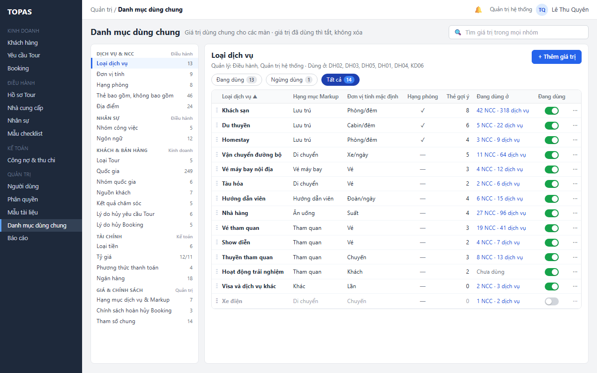

2. **W01 · Bấm tên nhóm ở cột trái.** Hệ thống tải nhóm đó vào vùng phải với chip mặc định Đang dùng (lần đầu trong phiên) và tô sáng nhóm ở cột trái. Đang sửa dở một dòng thì hỏi theo mục 2.4 trước khi đổi nhóm.

*Kết quả:* người dùng thấy giá trị của nhóm, trạng thái và nơi đang dùng.

**L1.2 Tìm trong mọi nhóm.** *Điều kiện:* như L1.1.

1. **W02 · Ô tìm ở góc phải tiêu đề.** Người dùng gõ từ 2 ký tự, ví dụ “phòng”. Sau 300 ms ngừng gõ, vùng phải thay bằng danh sách kết quả: tên giá trị (đoạn khớp tô vàng) kèm thuộc tính phân biệt (ví dụ loại dịch vụ và kiểu của thẻ), tên nhóm, tình trạng. Tên nhóm khớp cũng là một kết quả (dòng “Nhóm Hạng phòng”). Tìm theo chuỗi con, không phân biệt hoa thường và dấu, trong tên tiếng Việt, tên tiếng Anh và mã (ISO, mã tiền); tối đa 50 kết quả, nhiều hơn thì ghi “Hiện 50 kết quả đầu, gõ thêm để thu hẹp”.

   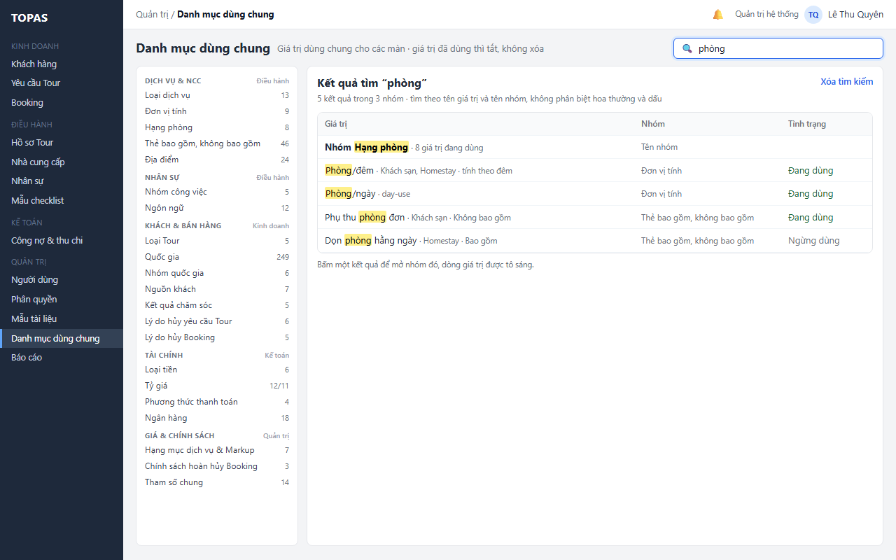

2. **W01 · Bấm một kết quả.** Hệ thống mở nhóm của kết quả với chip Tất cả, cuộn tới dòng đó và tô sáng 5 giây; ô tìm được xóa. Bấm Xóa tìm kiếm thì về nhóm đang chọn trước đó.

*Kết quả:* người dùng tới đúng giá trị mà không cần biết nó thuộc nhóm nào.

**L1.3 Xem nhóm mình không quản lý.** *Điều kiện:* vai trò không được sửa nhóm đó (mục 1.5).

1. **W03 · Bấm nhóm có 🔒 ở cột trái.** Ví dụ Kế toán mở Loại dịch vụ. Dưới tiêu đề có banner xanh “Chỉ xem · nhóm này do Điều hành và Quản trị hệ thống quản lý.” Không có nút thêm, không có ⋮⋮, không có menu ⋯; cột Đang dùng ghi chữ “Đang dùng” hoặc “Ngừng dùng” thay cho công tắc. Bấm ô không vào chế độ sửa.

   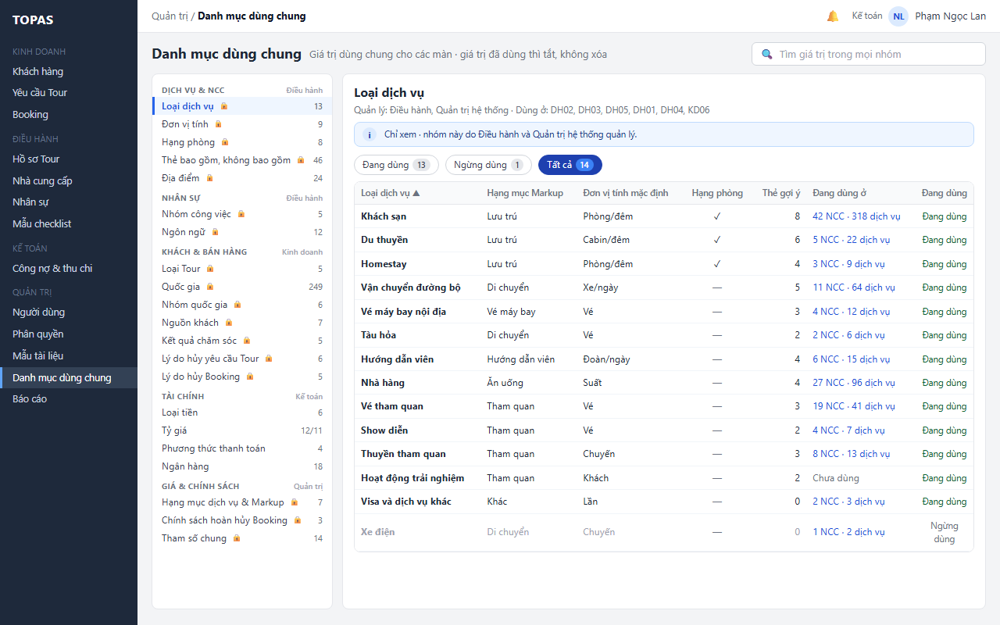

*Kết quả:* người dùng tra cứu được giá trị và biết hỏi ai khi cần thêm.

**Ngoại lệ**

- **E1.1 · W04.** Không tải được nhóm: vùng bảng hiện lỗi kèm Thử lại; chip hiện “–”; cột nhóm, ô tìm vẫn dùng được. Bấm Thử lại tải lại đúng nhóm và chip.

  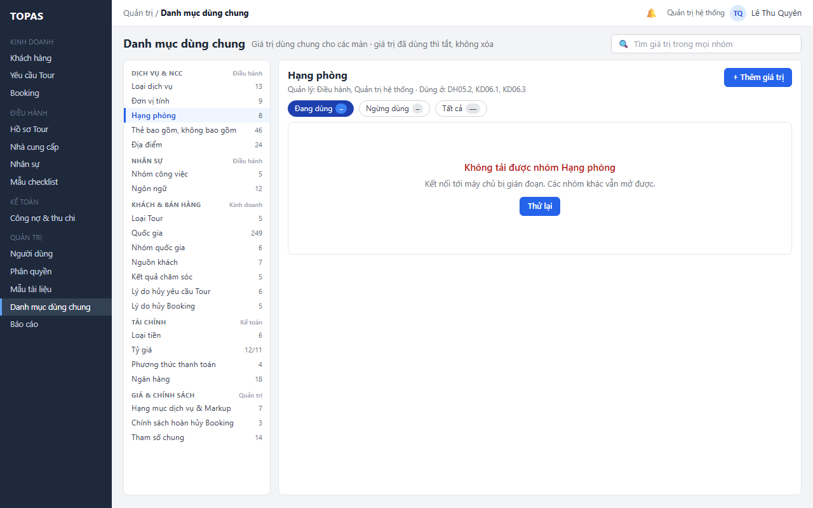

- **E1.2.** Không tính được Đang dùng ở (màn nguồn không trả lời trong 5 giây): bảng vẫn hiện, ô ghi “Chưa tính được” kèm biểu tượng thử lại trong ô. Khi chưa tính được, tắt và xóa theo hướng an toàn: tắt luôn mở hộp thoại W12 với dòng “Chưa đếm được nơi dùng”; Xóa khóa với lý do “Chưa kiểm tra được nơi dùng” (R12).
- **E1.3.** Tìm dưới 2 ký tự: chưa chạy tìm, ô tìm gợi ý “Nhập ít nhất 2 ký tự”. Không có kết quả: “Không có giá trị hay nhóm nào khớp “…””.
- **E1.4.** Người dùng bị thu hồi quyền sửa nhóm khi đang mở: lần ghi tiếp theo bị từ chối, thông báo “Bạn không còn quyền sửa nhóm này”, nhóm tải lại ở chế độ chỉ xem; dữ liệu đang nhập hiện trong thông báo để chép lại.
- **E1.5.** Mở QT05 bằng liên kết tới một nhóm không tồn tại: mở nhóm mặc định theo mục 1.3, thông báo ngắn “Không tìm thấy nhóm”.

### 3.2. Thêm, sửa và sắp xếp giá trị

**L2.1 Thêm một giá trị.** *Điều kiện:* người dùng được sửa nhóm. Minh họa: Điều hành thêm hạng phòng.

1. **W05 · Nút + Thêm giá trị ở góc phải tiêu đề nhóm.** Dòng mới ở chế độ sửa xuất hiện ở đầu bảng, con trỏ ở ô tên; thuộc tính có mặc định được điền sẵn (ví dụ Hạng mục Markup là Khác, W10); công tắc Đang dùng bật. Người dùng nhập tên Premier Deluxe và mô tả.

   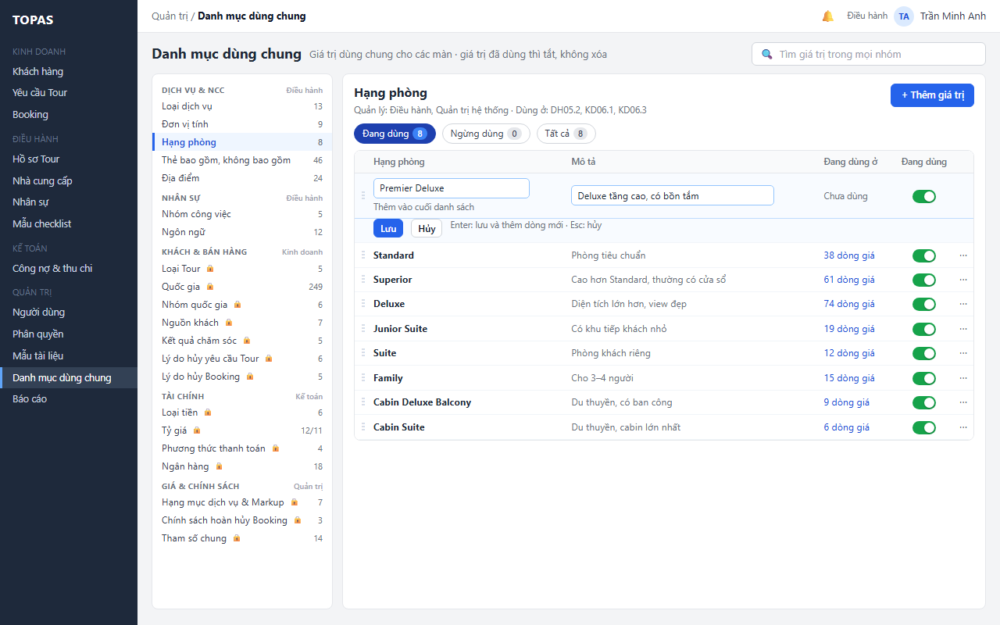

2. **W06 · Phím Enter hoặc nút Lưu dưới dòng.** Hệ thống kiểm tra R02 và mục 5.2, lưu giá trị ở cuối thứ tự. Giá trị mới hiện ở cuối bảng, tô xanh; số trên chip và ở cột trái tăng (Hạng phòng 8 → 9); thông báo ngắn “Đã thêm Premier Deluxe vào Hạng phòng”. Một dòng trống mới mở sẵn ở đầu bảng để nhập tiếp; Esc hoặc Hủy đóng dòng trống đó.

   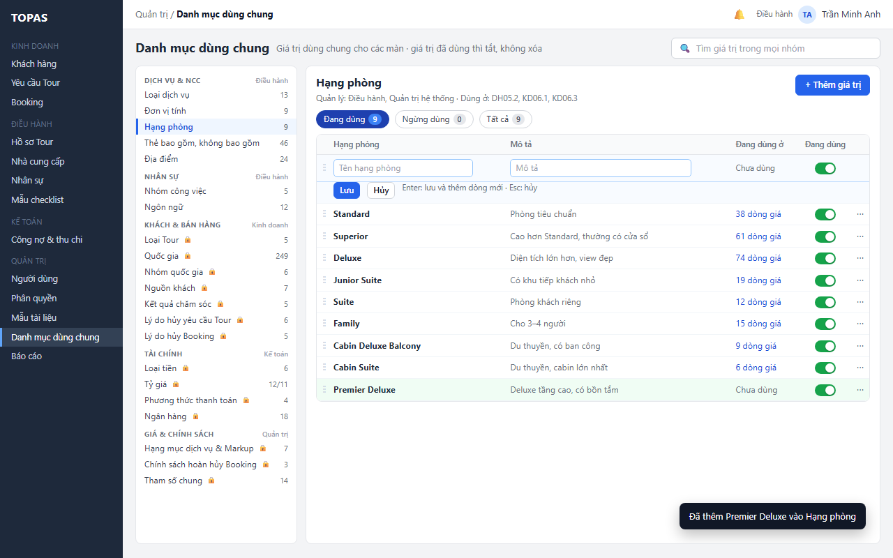

*Kết quả:* giá trị Đang dùng, chọn được ngay ở màn dùng (lần tải sau của ô chọn).

**L2.2 Thêm nhiều giá trị một lần.** *Điều kiện:* người dùng được sửa nhóm; nhóm chỉ có tên là bắt buộc (Hạng phòng, Địa điểm, Nhóm quốc gia, Nguồn khách, các nhóm lý do hủy, Phương thức thanh toán, Ngân hàng, Ngôn ngữ, Thẻ). Minh họa: Điều hành thêm địa điểm.

1. **W07 · Nút Thêm nhiều cạnh + Thêm giá trị → hộp thoại.** Người dùng dán hoặc gõ mỗi giá trị một dòng (tối đa 200). Ngay khi nội dung đổi, hệ thống đọc từng dòng (bỏ dòng trống, cắt dấu cách thừa) và hiện bảng xem trước với chip Sẽ thêm, Bỏ qua. Dòng trùng giá trị đã có trong nhóm hoặc trùng dòng phía trên bị bỏ qua kèm lý do (R02). Nhóm Thẻ: hộp thoại có thêm ô Loại dịch vụ và Kiểu ở đầu, áp cho mọi dòng; dòng dạng “Tên tiếng Việt | Tên tiếng Anh” được tách hai cột.

   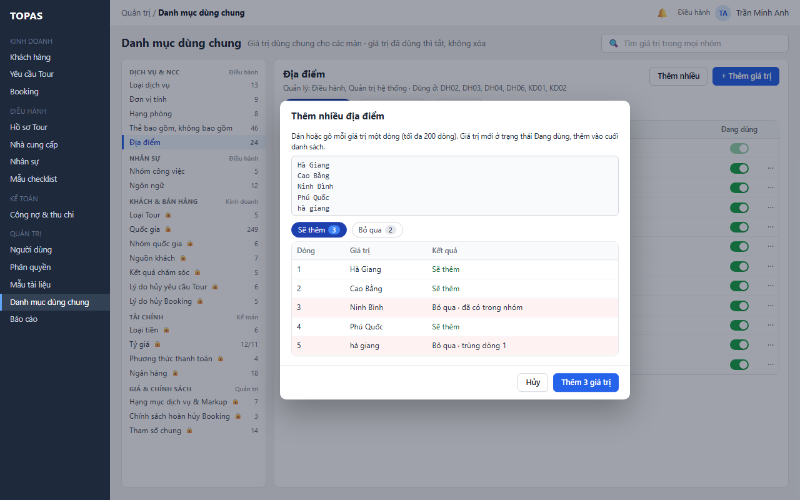

2. **W07 → W06 · Nút Thêm 3 giá trị.** Hệ thống thêm các dòng Sẽ thêm trong một giao dịch, theo thứ tự đã dán, ở cuối nhóm; hộp thoại đóng; các dòng mới tô xanh; thông báo ngắn “Đã thêm 3 giá trị · bỏ qua 2”. Nút khóa khi Sẽ thêm là 0.

*Kết quả:* nhiều giá trị được thêm trong một lần, không có giá trị trùng.

**L2.3 Sửa giá trị.** *Điều kiện:* người dùng được sửa nhóm; giá trị không phải giá trị hệ thống (giá trị hệ thống chỉ sửa được thuộc tính riêng, R06). Minh họa: Điều hành sửa loại dịch vụ đang dùng.

1. **W08 · Bấm ô trên dòng.** Dòng Vé máy bay nội địa chuyển sang chế độ sửa: tên, Hạng mục Markup, Đơn vị tính mặc định là ô nhập; Có hạng phòng là ô đánh dấu; Thẻ gợi ý, Đang dùng ở chỉ đọc. Với giá trị đang được dùng, dưới dòng ghi nơi đang dùng và tác động: tên mới hiện ở mọi màn, bản chụp giữ tên lúc lưu, thuộc tính chỉ áp cho lần tính sau (R04).

   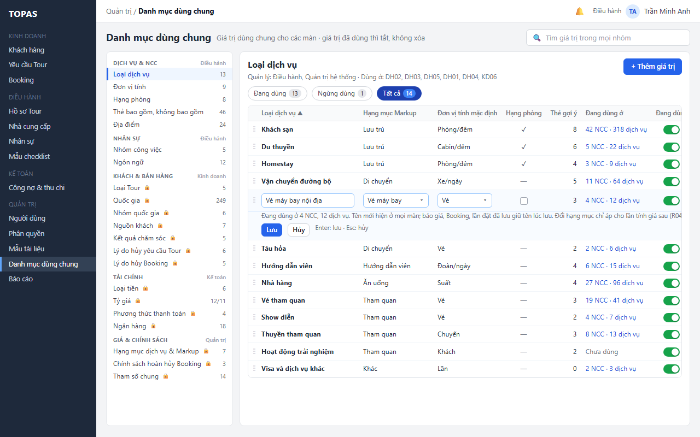

2. **W08 → W01 · Enter hoặc Lưu.** Hệ thống kiểm tra R02, R04, R09 rồi lưu; dòng về chế độ xem, tô xanh 5 giây; thông báo ngắn “Đã lưu”. Không có thay đổi thì Lưu chỉ đóng chế độ sửa.

*Kết quả:* màn dùng đọc tên và thuộc tính mới ở lần tải sau; bản chụp đã lưu không đổi.

**L2.4 Đổi thứ tự.** *Điều kiện:* người dùng được sửa nhóm; nhóm đang ở chip Tất cả hoặc Đang dùng, không có tìm kiếm. Minh họa: Kinh doanh sắp lý do hủy Booking.

1. **W09 · Kéo ⋮⋮ ở đầu dòng.** Dòng đang kéo nổi lên, chỗ thả là vạch xanh. Thả là lưu ngay; thông báo ngắn “Đã đổi thứ tự” kèm Hoàn tác. Thứ tự này là thứ tự trong ô chọn ở màn dùng (R18). Ở nhóm Tỷ giá, Tham số chung không có ⋮⋮.

   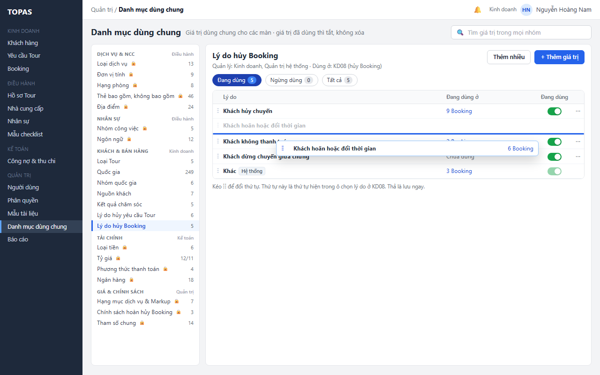

*Kết quả:* ô chọn ở màn dùng hiện theo thứ tự mới.

**Ngoại lệ**

- **E2.1 · W10.** Thiếu trường bắt buộc, sai định dạng, trùng tên trong nhóm (sau khi bỏ dấu cách thừa, không phân biệt hoa thường): không lưu; lỗi dưới từng ô; dưới dòng ghi số lỗi. Dữ liệu đang nhập được giữ; sửa rồi lưu lại.

  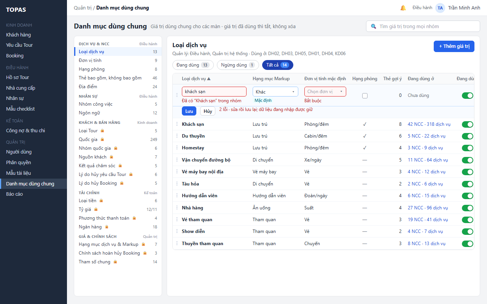

- **E2.2 · W11.** Giá trị vừa được sửa ở phiên khác (phiên bản khác): không ghi đè, không có nút ghi đè (Q8). Dưới dòng có banner đỏ nêu người sửa, thời điểm, giá trị mới. Nút Tải lại thay dòng bằng bản mới, giá trị người dùng đã nhập hiện dưới từng ô để nhập lại nếu vẫn cần. Giá trị đã bị xóa ở phiên khác: dòng biến mất, thông báo “Giá trị đã bị xóa”.

  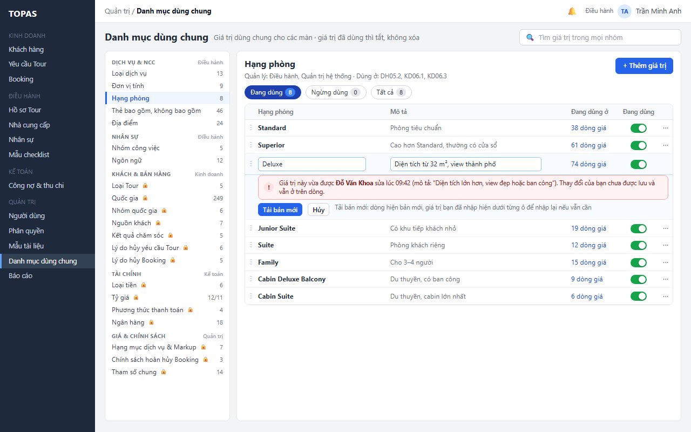

  > Hình chưa cập nhật: nút còn ghi “Tải bản mới”; nay là “Tải lại” (Q8).

- **E2.3.** Sửa thuộc tính bị chặn vì dữ liệu đã có: bỏ Có hạng phòng của loại dịch vụ đang có dòng giá có hạng phòng; đổi số lẻ thập phân của loại tiền đã có số tiền lưu; đổi mã ISO của quốc gia hoặc loại tiền đã dùng (R09, R11, R08). Ô báo lỗi theo kiểu W10 kèm số bản ghi đang chặn.
- **E2.4.** Thêm nhiều: nội dung trên 200 dòng thì chỉ đọc 200 dòng đầu, ghi “Bỏ qua từ dòng 201”; mọi dòng bị bỏ qua thì nút Thêm khóa với lý do “Không có giá trị mới”. Lỗi giữa chừng: không thêm dòng nào, hộp thoại giữ nội dung và có Thử lại.
- **E2.5.** Thả dòng khi kéo thất bại (mất kết nối, thứ tự đã đổi ở phiên khác): dòng về vị trí cũ, thông báo “Chưa đổi được thứ tự” kèm Thử lại; xung đột thì tải lại thứ tự mới.
- **E2.6.** Kéo khi đang lọc chip Ngừng dùng hoặc đang tìm kiếm: ⋮⋮ mờ, rê chuột ghi “Bỏ lọc để đổi thứ tự”.
- **E2.7.** Thuộc tính tham chiếu tới giá trị đã tắt ở nhóm khác (ví dụ hạng mục, đơn vị tính, nhóm quốc gia, ngôn ngữ mặc định ngừng dùng): giá trị cũ giữ và hiện kèm “(ngừng dùng)”; ô chọn không có giá trị đã tắt; lưu dòng không bị chặn nếu không đổi ô đó.

### 3.3. Tắt, bật và xóa giá trị

**L3.1 Tắt giá trị đang được dùng.** *Điều kiện:* người dùng được sửa nhóm; giá trị Đang dùng, không phải giá trị hệ thống; Đang dùng ở khác “Chưa dùng”. Minh họa: Kinh doanh tắt loại Tour Tour học sinh.

1. **W21 · Nhóm Loại Tour.** Bảng có cột Markup mặc định (🔒, chỉ Quản trị sửa, R10), Chính sách hoàn hủy đang áp dụng (liên kết mở nhóm Chính sách hoàn hủy Booking), Mẫu checklist (đọc từ DH01), Đang dùng ở. Đây cũng là màn của L4.5.

   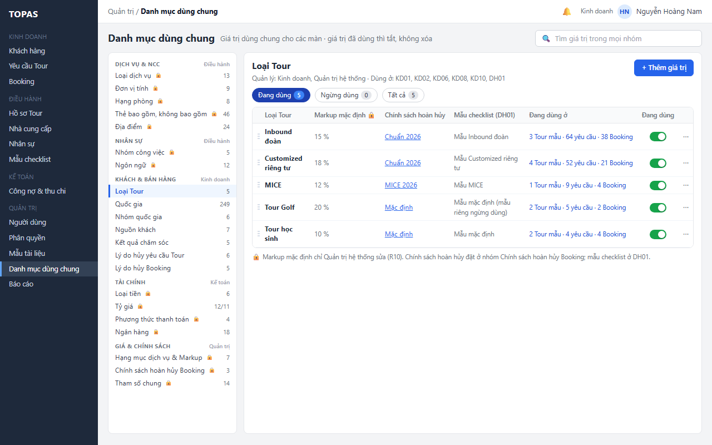

   > Hình chưa cập nhật: dòng “Dùng ở” còn KD10 (bỏ theo C3).

2. **W12 · Công tắc trên dòng Tour học sinh → hộp thoại.** Hộp thoại liệt kê số bản ghi theo nơi dùng (Tour mẫu 2, yêu cầu Tour đang xử lý 1, Booking hiệu lực 3, bản ghi đã kết thúc 4) và điều xảy ra sau khi tắt (R05). Hai nút Không tắt và Tắt sử dụng.

   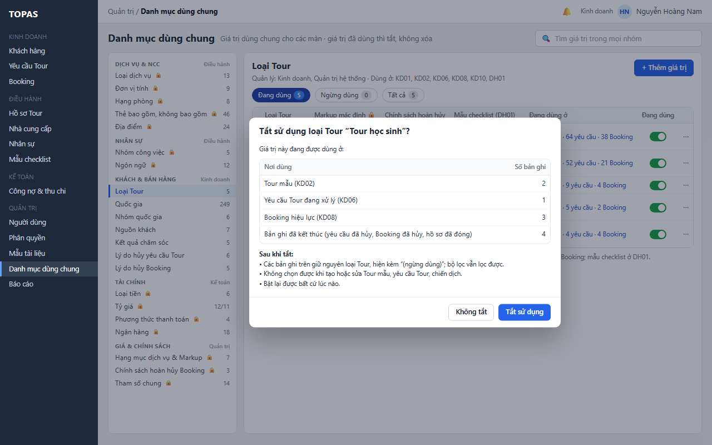

   > Hình chưa cập nhật: hộp thoại còn ghi “chiến dịch” trong danh sách không chọn được sau khi tắt; dòng “Dùng ở” còn KD10 (bỏ theo C3).

3. **W13 · Nút Tắt sử dụng.** Hệ thống lưu; hộp thoại đóng; dòng mờ, giữ tại chỗ; chip Đang dùng 4, Ngừng dùng 1; cột trái Loại Tour 4; thông báo ngắn “Đã tắt Tour học sinh” kèm Hoàn tác.

   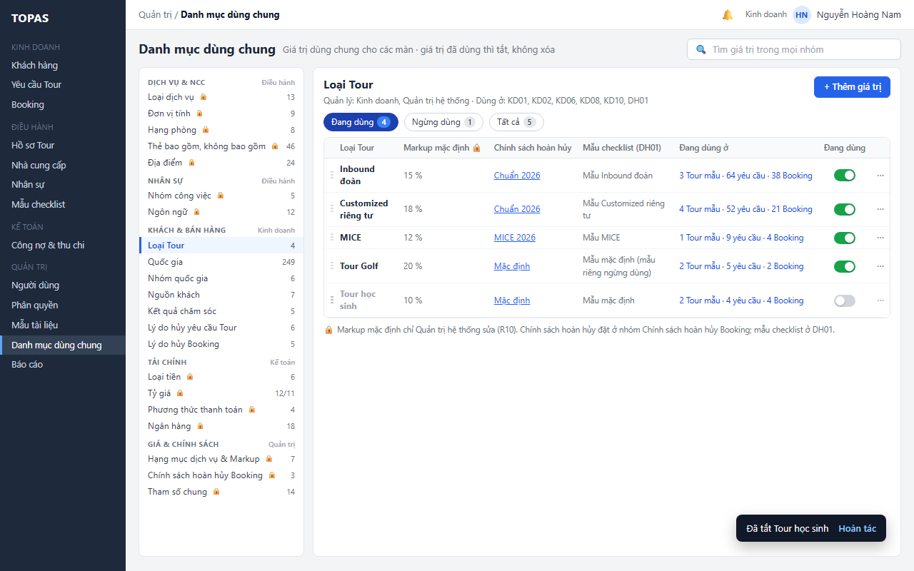

   > Hình chưa cập nhật: dòng “Dùng ở” còn KD10 (bỏ theo C3).

*Kết quả:* màn dùng không cho chọn mới Tour học sinh; bản ghi cũ giữ giá trị (R05, R18).

**L3.2 Tắt giá trị chưa dùng và bật lại.** *Điều kiện:* như L3.1, giá trị Chưa dùng; hoặc giá trị đang Ngừng dùng.

1. **W13 · Công tắc trên dòng.** Không có hộp thoại: hệ thống lưu ngay, dòng đổi màu tại chỗ, thông báo ngắn “Đã tắt …” hoặc “Đã bật …” kèm Hoàn tác. Bật lại không cần xác nhận. Lỗi lưu: công tắc về giá trị cũ, thông báo kèm Thử lại.

*Kết quả:* giá trị đổi trạng thái; có thể Hoàn tác trong 10 giây.

**L3.3 Giá trị hệ thống.** *Điều kiện:* nhóm có giá trị hệ thống (mục 1.2).

1. **W16 · Rê chuột hoặc bấm công tắc mờ của giá trị có nhãn Hệ thống.** Ví dụ Lý do hủy yêu cầu Tour có Khác và Booking đã hủy. Hệ thống hiện giải thích: không đổi tên, không tắt, không xóa; chỉ đổi thứ tự; với Booking đã hủy, chỉ hệ thống ghi khi Booking bị hủy (R06). Cột Ai chọn cho biết giá trị nào người dùng chọn ở KD06, giá trị nào hệ thống tự ghi. Bấm ô tên không vào chế độ sửa; thuộc tính riêng (nếu có, ví dụ vai trò phục vụ của nhóm Điều hành) vẫn sửa được.

   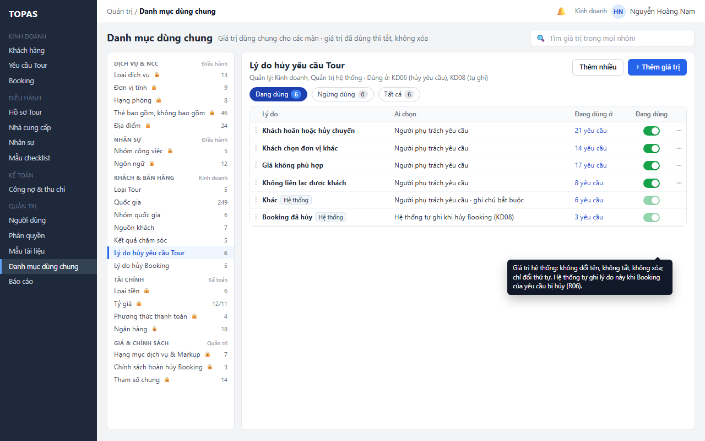

*Kết quả:* giá trị mà logic của màn khác dựa vào luôn có.

**L3.4 Xóa giá trị tạo nhầm.** *Điều kiện:* người dùng được sửa nhóm.

1. **W14 · Menu ⋯ trên dòng.** Menu có Xóa; với người có quyền xem QT03 có thêm Lịch sử thay đổi (mục 1.3). Giá trị đã dùng: Xóa khóa, dưới ghi “Không xóa được: MICE đang dùng ở 14 bản ghi. Tắt sử dụng nếu không dùng nữa.” (R12).

   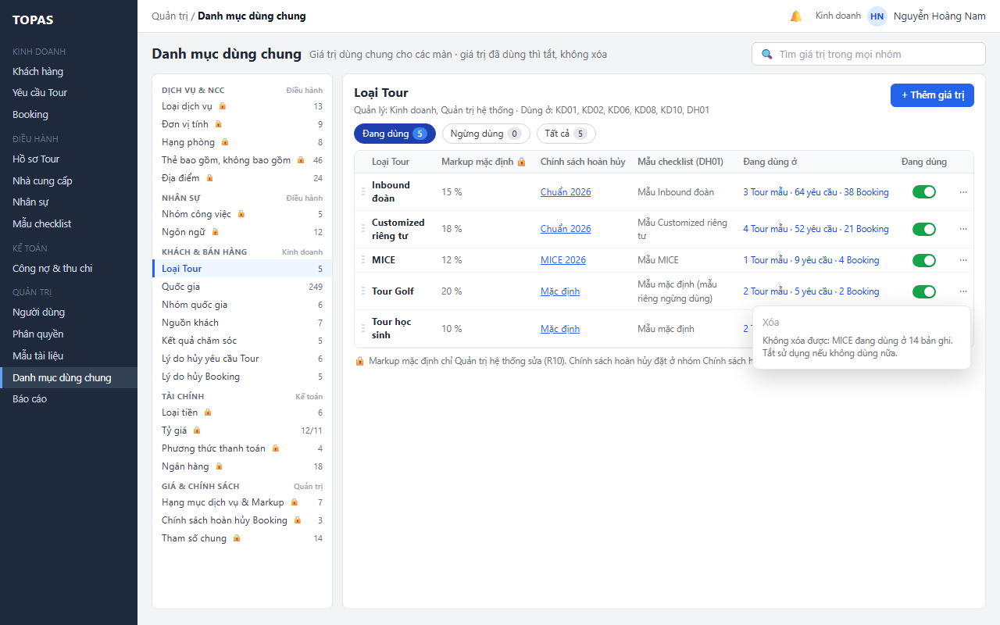

   > Hình chưa cập nhật: dòng “Dùng ở” còn KD10 (bỏ theo C3).

2. **W15 · Mục Xóa của giá trị chưa dùng → hộp thoại.** Ví dụ Quản trị hệ thống xóa loại dịch vụ Hoạt động trải nghiệm. Hộp thoại nêu giá trị chưa được dùng, dữ liệu đi kèm bị xóa (2 thẻ gợi ý của loại), không hoàn tác được, gợi ý tắt nếu chỉ tạm ngừng.

   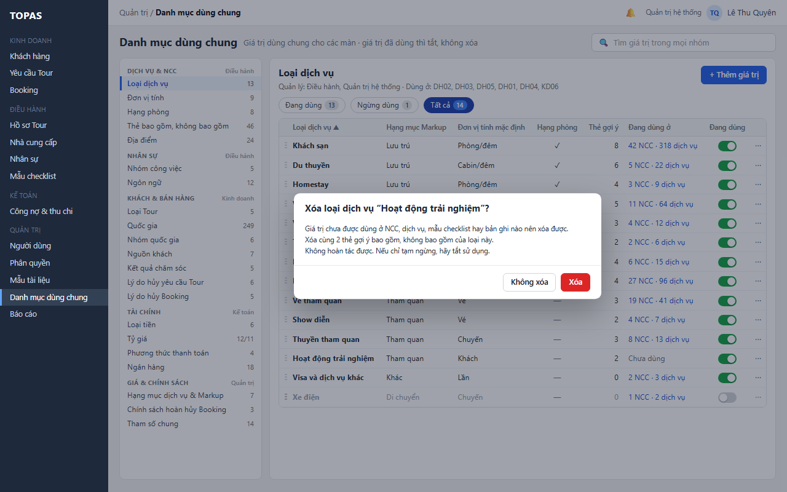

3. **W15 → W01 · Nút Xóa.** Hệ thống kiểm tra lại Đang dùng ở tại máy chủ rồi xóa; dòng biến mất; số đếm giảm; thông báo ngắn “Đã xóa …” (không có Hoàn tác).

*Kết quả:* giá trị không còn trong nhóm; mã nội bộ không dùng lại.

**Ngoại lệ**

- **E3.1.** Tắt giá trị đang dùng cuối cùng của nhóm bắt buộc (Loại dịch vụ, Đơn vị tính, Loại Tour, Nhóm công việc, Ngôn ngữ, Loại tiền): công tắc khóa như W16, rê chuột ghi “Không tắt được: đây là giá trị đang dùng cuối cùng; màn … cần ít nhất một giá trị” (R05).
- **E3.2.** Tắt loại tiền đang là Loại tiền báo giá mặc định (Tham số chung), hoặc tắt hạng mục đang có loại dịch vụ đang dùng: chặn với lý do và liên kết tới nơi cần đổi trước (R05).
- **E3.3.** Giá trị được dùng thêm ở màn khác sau khi hộp thoại W12 đã mở: hệ thống vẫn tắt theo xác nhận; số liệu trong hộp thoại là số lúc mở. Giá trị bị dùng sau khi menu ⋯ đã mở và người dùng bấm Xóa: máy chủ từ chối, hộp thoại đổi thành lỗi “Giá trị vừa được dùng ở … · tắt sử dụng thay cho xóa”.
- **E3.4.** Lỗi lưu khi tắt, bật hoặc xóa: trạng thái về như cũ; thông báo kèm Thử lại. Bấm công tắc nhiều lần liên tiếp chỉ gửi lần cuối sau khi lần trước có kết quả.
- **E3.5.** Hoàn tác sau khi người khác đã đổi tiếp giá trị đó: thông báo “Không hoàn tác được vì giá trị vừa được … đổi”.

### 3.4. Nhóm có thuộc tính riêng

**L4.1 Loại dịch vụ và đơn vị tính.** *Điều kiện:* Điều hành hoặc Quản trị hệ thống.

1. **W08 · Nhóm Loại dịch vụ, sửa dòng.** Mỗi loại dịch vụ thuộc đúng một hạng mục Markup (mặc định Khác), có một đơn vị tính mặc định (điền sẵn khi thêm dịch vụ ở DH05.1) và cờ Có hạng phòng (DH05.2 hiện cột Hạng phòng; RSD DH03 R14). Sửa theo L2.3; quy tắc ở R09.
2. **W17 · Nhóm Đơn vị tính, sửa dòng.** Mỗi đơn vị có Căn cứ tính mặc định (Khách, Phòng, Đoàn, Đơn vị dịch vụ; điền sẵn căn cứ tính ở dòng giá DH05.2 và cách tính số lượng ở KD02.2) và cờ Tính theo đêm. Bật hoặc tắt Tính theo đêm của đơn vị đang dùng thì dưới dòng có cảnh báo vàng nêu số dịch vụ và việc lần tính giá sau ở KD06.3, KD02.2, DH04 sẽ tính theo đêm hay theo ngày; báo giá, Booking đã lưu không đổi. Lưu không bị chặn.

   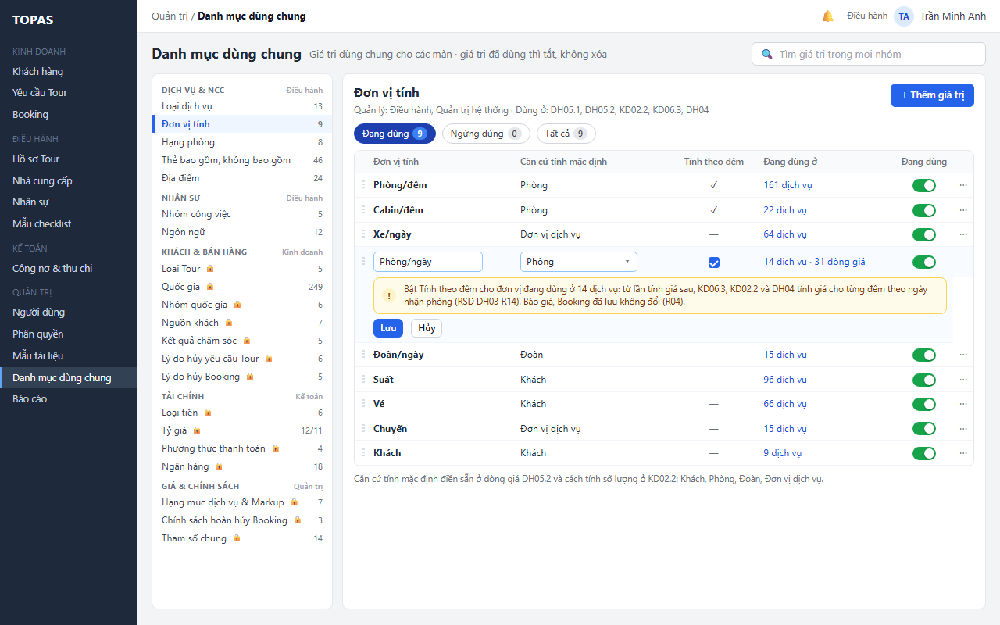

*Kết quả:* DH03, DH05, KD02, KD06 dùng thuộc tính mới ở lần tính hoặc lần thêm sau.

**L4.2 Thẻ bao gồm, không bao gồm và tên tiếng Anh.** *Điều kiện:* Điều hành hoặc Quản trị hệ thống.

1. **W18 · Nhóm Thẻ bao gồm, không bao gồm.** Nhóm có ô Loại dịch vụ ở đầu (mặc định loại đầu tiên theo thứ tự) và chip Tất cả, Thiếu tên tiếng Anh, Ngừng dùng của loại đang chọn. Mỗi dòng: Kiểu, Tên tiếng Việt, Tên tiếng Anh (dùng cho proposal English), Đang dùng ở (số dịch vụ có thẻ cùng tên). Thẻ thiếu tên tiếng Anh có dòng đỏ nhạt và chữ “Chưa có tên tiếng Anh”. Người dùng bấm ô Tên tiếng Anh, nhập “Airport transfer”, Enter: hệ thống lưu và chuyển con trỏ sang dòng thiếu tên tiếng Anh tiếp theo của loại đang chọn.

   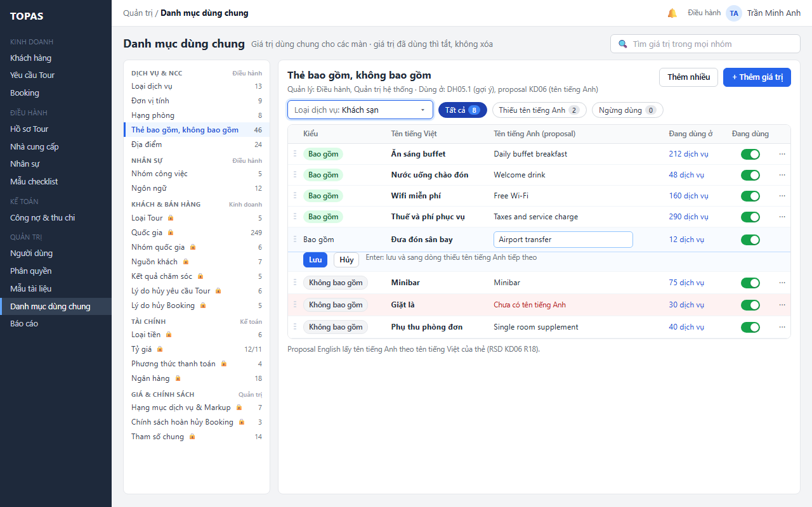

*Kết quả:* DH05.1 gợi ý thẻ theo loại dịch vụ; proposal English lấy tên tiếng Anh theo tên tiếng Việt của thẻ (RSD KD06 R18, E5.2).

**L4.3 Nhóm công việc và vai trò phục vụ Tour.** *Điều kiện:* Điều hành hoặc Quản trị hệ thống.

1. **W19 · Nhóm Nhóm công việc, bấm ô Vai trò phục vụ Tour.** Ô chọn nhiều mở danh sách vai trò của DH08.5 (HDV chính, HDV điểm, Trưởng đoàn). Người dùng đánh dấu rồi Lưu. Nhóm Điều hành là giá trị hệ thống: không đổi tên, không tắt (RSD DH06 R03 dùng để chọn người phụ trách và gửi thông báo), vẫn khai được vai trò phục vụ.

   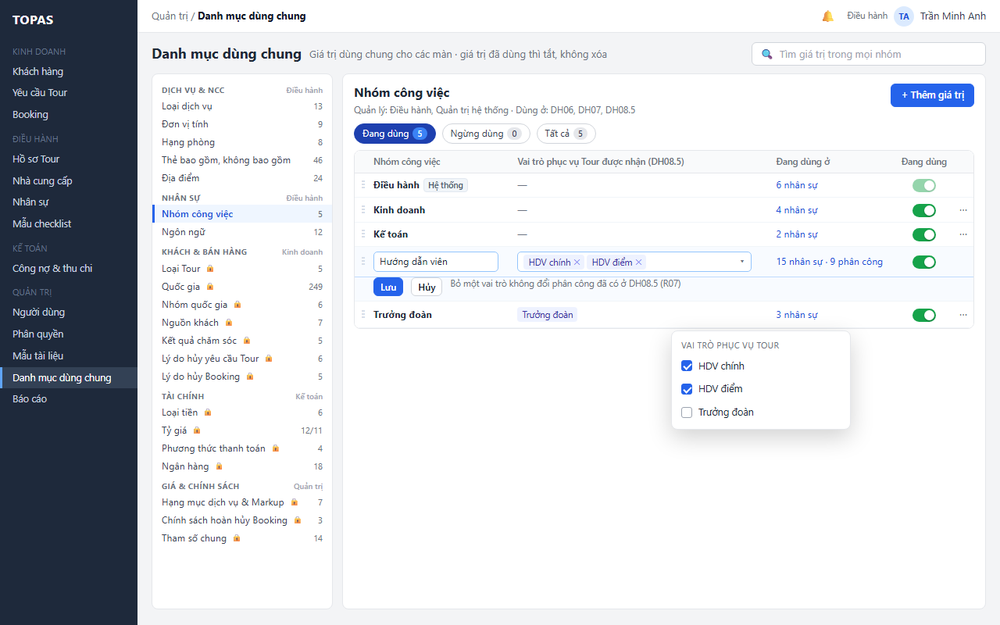

*Kết quả:* DH08.5 chỉ gợi ý nhân sự thuộc nhóm nhận vai trò đã chọn (R07).

**L4.4 Quốc gia, nhóm quốc gia và ngôn ngữ mặc định.** *Điều kiện:* Kinh doanh hoặc Quản trị hệ thống.

1. **W20 · Nhóm Quốc gia, chip Thiếu ngôn ngữ mặc định.** Nhóm có ô lọc Nhóm quốc gia và chip Đang dùng, Ngừng dùng, Thiếu ngôn ngữ mặc định. Người dùng bấm dòng Thụy Sĩ, chọn Nhóm quốc gia Châu Âu, Ngôn ngữ mặc định Tiếng Đức, Enter: hệ thống lưu; dòng ra khỏi chip Thiếu ngôn ngữ mặc định nhưng giữ tại chỗ (mục 2.4); con trỏ chuyển sang dòng kế tiếp. Danh sách quốc gia khởi tạo theo ISO 3166 (R20).

   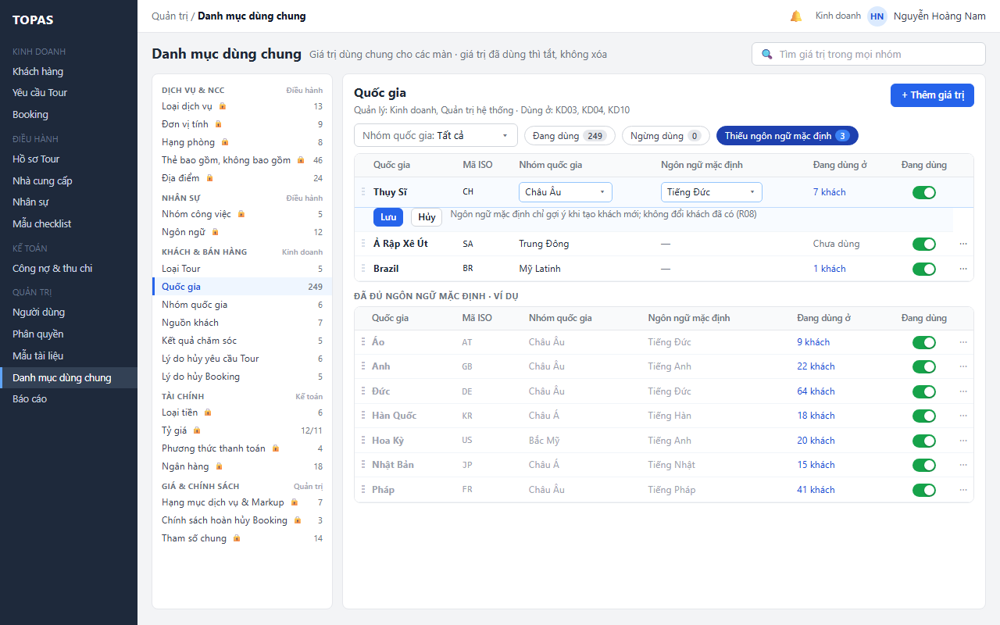

   > Hình chưa cập nhật: dòng “Dùng ở” còn KD10 (bỏ theo C3).

*Kết quả:* KD04 gợi ý ngôn ngữ giao tiếp theo quốc gia (RSD KD03-KD04 R01).

**L4.5 Loại Tour và Markup mặc định.** *Điều kiện:* Kinh doanh hoặc Quản trị hệ thống sửa loại Tour; chỉ Quản trị hệ thống sửa Markup.

1. **W21 · Nhóm Loại Tour.** Kinh doanh thêm, sửa tên, tắt loại Tour theo L2.1, L2.3, L3.1. Cột Markup mặc định có 🔒 và không vào chế độ sửa với Kinh doanh. Quản trị hệ thống bấm ô Markup để nhập (0–300 %, để trống được; KD06.3 khi đó bắt buộc nhập, RSD KD06 E4.3). Cột Chính sách hoàn hủy và Mẫu checklist chỉ đọc.
2. **W22 · Nhóm Hạng mục dịch vụ & Markup (Quản trị hệ thống).** Banner xanh nhắc: Markup theo hạng mục điền sẵn khi tính giá; để trống thì dùng Markup chung của loại Tour; gán loại dịch vụ vào hạng mục ở nhóm Loại dịch vụ. Mỗi dòng: hạng mục, Markup mặc định, các loại dịch vụ thuộc hạng mục (chỉ đọc). Người dùng bấm ô Markup của Lưu trú, nhập 12, Enter.

   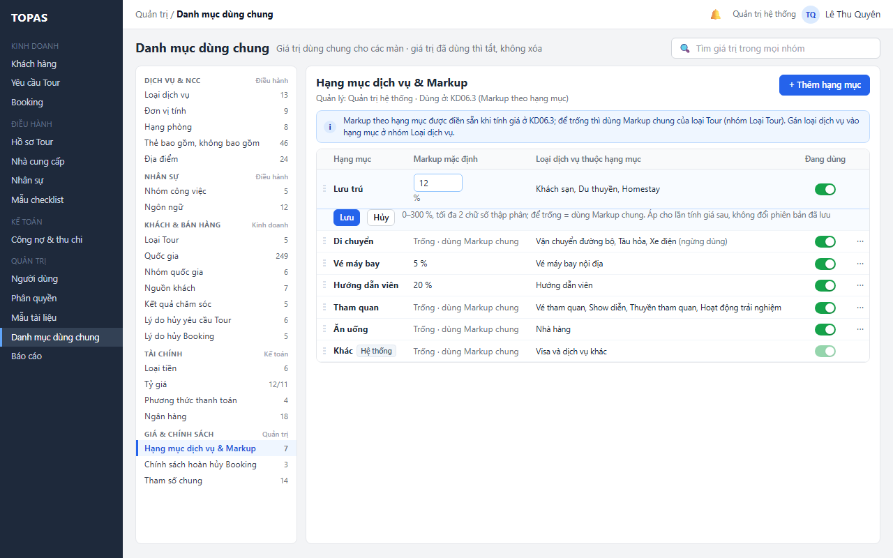

*Kết quả:* lần tính giá sau ở KD06.3 điền sẵn Markup mới; phiên bản báo giá đã lưu không đổi (R10).

**L4.6 Loại tiền.** *Điều kiện:* Kế toán hoặc Quản trị hệ thống; bội số làm tròn chỉ Quản trị hệ thống.

1. **W23 · Nhóm Loại tiền.** Mỗi dòng: mã ISO 4217, tên, ký hiệu, số lẻ thập phân (0 hoặc 2), bội số làm tròn giá bán (🔒 với Kế toán), tỷ giá gần nhất và ngày (đọc từ nhóm Tỷ giá), Đang dùng ở. VND là giá trị hệ thống, tỷ giá luôn là 1. Kế toán thêm loại tiền bằng + Thêm loại tiền: mã 3 chữ in hoa, tên, ký hiệu, số lẻ thập phân mặc định 2; bội số làm tròn để trống cho tới khi Quản trị hệ thống nhập (R11).

   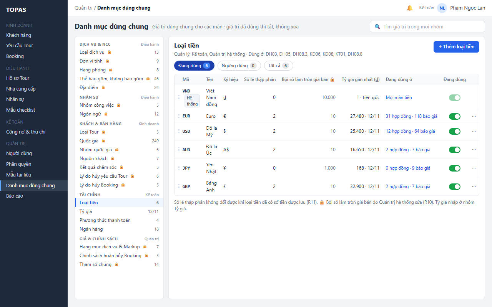

*Kết quả:* loại tiền mới chọn được cho hợp đồng, dòng giá, báo giá; nhóm Tỷ giá có thêm cột cho loại tiền đó.

**Ngoại lệ**

- **E4.1.** Thêm loại dịch vụ khi chưa có đơn vị tính đang dùng: ô Đơn vị tính ghi “Chưa có đơn vị tính · thêm ở nhóm Đơn vị tính”, không lưu được.
- **E4.2.** Thẻ trùng tên tiếng Việt trong cùng loại dịch vụ và cùng kiểu: chặn như E2.1. Cùng tên tiếng Việt ở loại khác mà tên tiếng Anh khác nhau: cảnh báo vàng “Thẻ cùng tên ở Khách sạn có tên tiếng Anh khác: …”, vẫn lưu, vì proposal lấy theo tên tiếng Việt và loại dịch vụ của dịch vụ (R09).
- **E4.3.** Bỏ một vai trò phục vụ của nhóm công việc đang có phân công ở DH08.5 với vai trò đó: dưới dòng ghi số phân công đang có và câu “Phân công đã có giữ nguyên; người thuộc nhóm không còn được gợi ý cho vai trò này”; vẫn lưu (R07).
- **E4.4.** Mã ISO quốc gia hoặc mã loại tiền sai định dạng hoặc trùng: chặn như E2.1.
- **E4.5.** Markup ngoài 0–300 % hoặc quá 2 chữ số thập phân: chặn như E2.1. Bội số làm tròn không phải số dương hoặc nhỏ hơn đơn vị nhỏ nhất của loại tiền (theo số lẻ thập phân): chặn.
- **E4.6.** Thêm loại tiền khi chưa có tỷ giá: lưu được; cột Tỷ giá gần nhất ghi “Chưa có tỷ giá”; KD06.3 báo thiếu tỷ giá theo RSD KD06 E4.2 cho tới khi Kế toán nhập (L5.1).

### 3.5. Tỷ giá

**L5.1 Nhập tỷ giá hôm nay.** *Điều kiện:* Kế toán hoặc Quản trị hệ thống.

1. **W24 · Nhóm Tỷ giá.** Cột trái có dấu ! cạnh Tỷ giá khi hôm nay chưa có dòng. Tiêu đề nhóm có bộ chọn tháng ‹ Tháng 11/2026 ›, nút Dán từ Excel và + Nhập tỷ giá hôm nay. Banner vàng: “Chưa nhập tỷ giá hôm nay 12/11/2026. Các màn đang dùng tỷ giá có hiệu lực gần nhất là ngày 11/11/2026 và ghi rõ ngày đó.” Bảng: mỗi dòng một ngày đã nhập (mới nhất trên), mỗi cột một loại tiền đang dùng trừ VND (đơn vị: VND cho 1 đơn vị ngoại tệ), ghi chú nguồn, Đã dùng ở (số phiên bản báo giá, quyết toán đã lưu tỷ giá của ngày đó), menu ⋯. Ngày không có dòng dùng tỷ giá của ngày gần nhất trước đó (R13).

   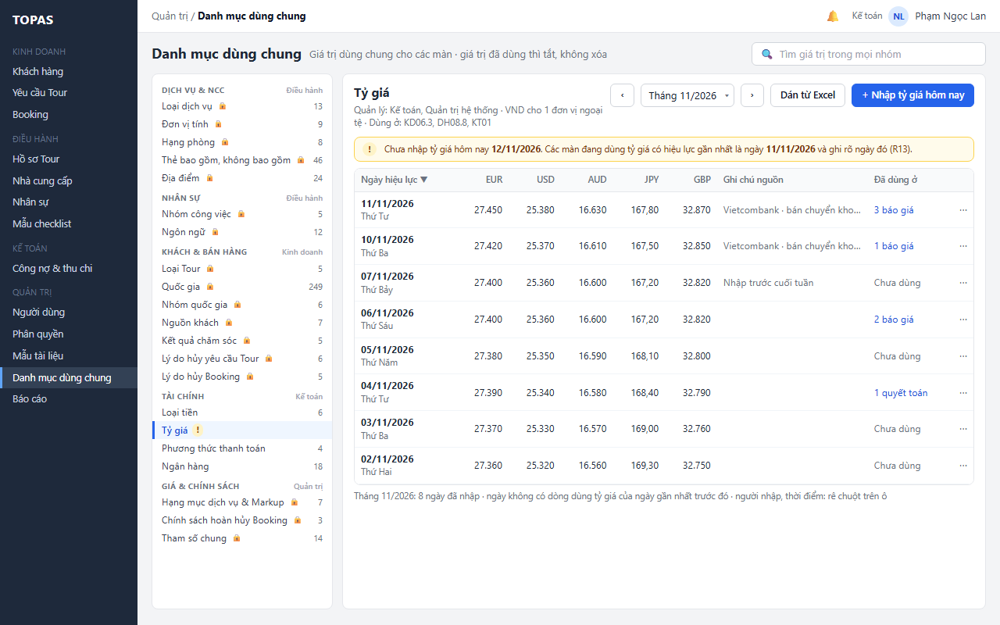

2. **W25 · Nút + Nhập tỷ giá hôm nay.** Dòng 12/11/2026 ở chế độ sửa xuất hiện ở đầu bảng; mỗi ô và ghi chú nguồn có chữ xám là gợi ý từ dòng gần nhất (11/11). Kế toán gõ đè từng ô; Tab sang ô kế. Ô chênh quá 5 % so với tỷ giá có hiệu lực trước đó có viền vàng và ghi “+10,8 % so với 11/11” để phát hiện gõ nhầm; vẫn lưu được (R14). Ô để trống (giữ gợi ý xám) thì loại tiền đó không có tỷ giá ngày 12/11 và tiếp tục dùng ngày gần nhất.

   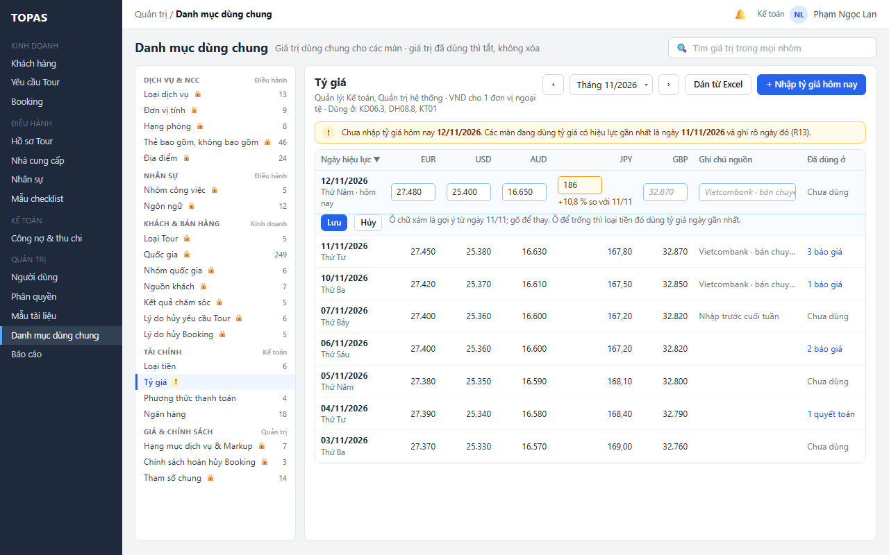

3. **W26 · Kế toán sửa JPY thành 168, bấm Lưu.** Hệ thống lưu dòng (ngày, tỷ giá các ô đã nhập, ghi chú, người nhập, thời điểm); dòng tô xanh; banner vàng và dấu ! ở cột trái mất; nút + Nhập tỷ giá hôm nay khóa (đã có dòng hôm nay, sửa bằng cách bấm ô); thông báo ngắn “Đã lưu tỷ giá 12/11/2026 · 5 loại tiền”.

   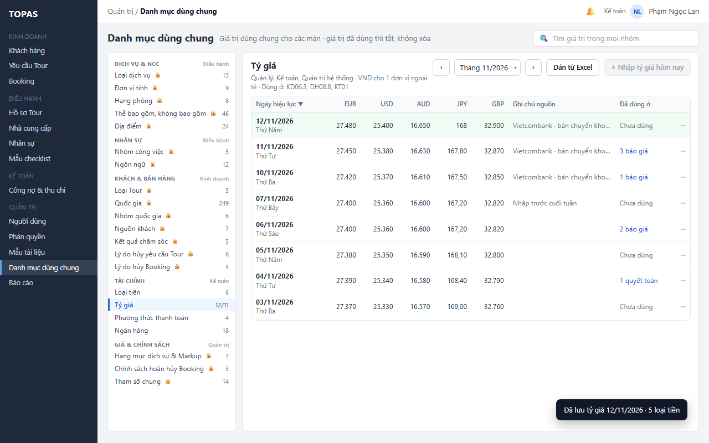

*Kết quả:* KD06.3 tính giá ngày 12/11, KT01 tính ≈ VND hôm nay, DH08.8 quyết toán ngày 12/11 dùng tỷ giá mới.

**L5.2 Dán tỷ giá từ Excel.** *Điều kiện:* như L5.1.

1. **W27 · Nút Dán từ Excel → hộp thoại.** Kế toán dán vùng ô từ Excel: dòng đầu là mã loại tiền, cột đầu là ngày dd/mm/yyyy. Hệ thống đọc ngay và hiện xem trước theo ngày, mới nhất trên, chip Tất cả, Sẽ thêm, Sẽ cập nhật, Bỏ qua. Dòng Sẽ cập nhật ghi ô nào đổi từ số nào sang số nào; dòng bỏ qua ghi lý do (ngày sau hôm nay, ngày sai định dạng, mã tiền không có hoặc ngừng dùng, số không hợp lệ). Ô trống bị bỏ qua, không xóa tỷ giá đã có.

   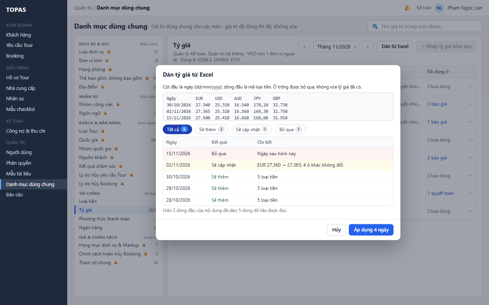

2. **W27 → W26 · Nút Áp dụng 4 ngày.** Nếu có dòng cập nhật một ngày Đã dùng, hộp thoại hiện thêm ô Lý do sửa bắt buộc (R14). Hệ thống ghi mọi dòng trong một giao dịch; hộp thoại đóng; bảng chuyển tới tháng của ngày mới nhất đã áp dụng, các dòng thêm hoặc cập nhật tô xanh; thông báo ngắn “Đã thêm 3 ngày, cập nhật 1 ngày”.

*Kết quả:* bổ sung nhiều ngày một lần; ngày lỗi không được ghi.

**L5.3 Sửa hoặc xóa tỷ giá của một ngày.** *Điều kiện:* như L5.1; ngày ≤ hôm nay.

1. **W28 · Bấm ô của dòng ngày cần sửa.** Dòng vào chế độ sửa. Nếu ngày đó Đã dùng, dưới dòng có banner vàng nêu số và mã phiên bản báo giá, quyết toán đã lưu tỷ giá này; bản đã lưu giữ tỷ giá cũ, chỉ lần tính sau dùng số mới; KT01 tính lại ≈ VND. Ô Lý do sửa bắt buộc. Kế toán sửa USD 25.380 → 25.385, nhập lý do, Lưu. Hệ thống lưu và ghi lịch sử kèm lý do (R14, R19).

   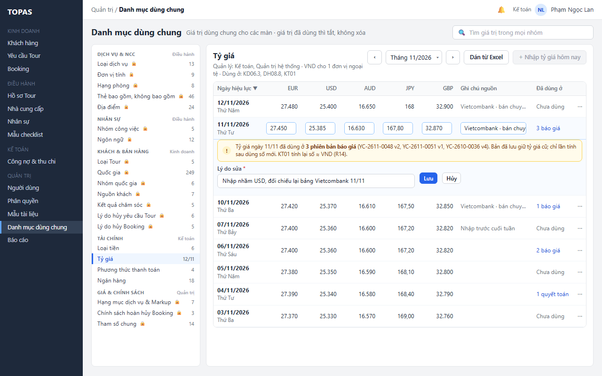

2. **W15 · Menu ⋯ → Xóa dòng tỷ giá.** Chỉ dòng Chưa dùng mới xóa được; hộp thoại cùng mẫu W15 nêu ngày bị xóa và ngày sẽ được dùng thay (ngày gần nhất trước đó). Dòng Đã dùng: Xóa khóa như W14.

*Kết quả:* tỷ giá đúng cho các lần tính sau; lịch sử giữ giá trị cũ, người sửa và lý do.

**Ngoại lệ**

- **E5.1.** Nhập ngày sau hôm nay (khi dán) hoặc tỷ giá ≤ 0, không phải số, quá 4 chữ số thập phân: ô đỏ hoặc dòng bỏ qua, không lưu (R14).
- **E5.2.** Hai người cùng nhập dòng hôm nay: người lưu sau nhận lỗi xung đột kiểu W11; Tải lại hiện dòng đã có, số của người sau hiện dưới từng ô (Q8).
- **E5.3.** Xóa trắng một ô của ngày Đã dùng: chặn, lỗi “Tỷ giá này đã dùng; sửa số thay cho xóa”. Ô của ngày Chưa dùng xóa trắng được.
- **E5.4.** Thêm hoặc sửa một ngày trong quá khứ làm đổi tỷ giá có hiệu lực của các ngày sau nó (tới ngày có dòng kế tiếp): dưới dòng ghi “Các ngày dd/mm – dd/mm sẽ dùng tỷ giá này ở lần tính sau”; nếu khoảng đó có bản chụp đã lưu thì áp dụng như W28 (lý do bắt buộc).
- **E5.5.** Loại tiền ngừng dùng: cột vẫn hiện ở các tháng có dữ liệu, tiêu đề kèm “(ngừng dùng)”; dòng hôm nay không gợi ý cho cột đó nhưng vẫn nhập được (KT01 còn cần cho khoản cũ).
- **E5.6.** Tháng chưa có dòng nào: bảng ghi “Chưa có tỷ giá trong tháng 10/2026. Các ngày của tháng dùng tỷ giá ngày dd/mm/yyyy” (hoặc “Chưa có tỷ giá nào trước tháng này”).
- **E5.7.** Hôm nay là ngày nghỉ và Kế toán không nhập: không có lỗi; banner W24 vẫn hiện để nhắc. Hệ thống không gửi thông báo nhắc nhập tỷ giá.
- **E5.8.** Lỗi khi áp dụng dán Excel: không ngày nào được ghi; hộp thoại giữ nội dung và có Thử lại.

### 3.6. Chính sách hoàn hủy Booking

**L6.1 Xem chính sách.** *Điều kiện:* mọi vai trò xem, trừ vai trò thuộc phòng HDV (RSD QT02 R04); chỉ Quản trị hệ thống sửa.

1. **W29 · Nhóm Chính sách hoàn hủy Booking.** Mỗi dòng: tên (Chính sách mặc định có nhãn Mặc định), loại Tour áp dụng (với Mặc định: các loại Tour đang dùng chưa có chính sách riêng, tính tự động), tóm tắt bậc, phiên bản hiện hành và ngày, số Booking đã chụp, công tắc. Công tắc của Chính sách mặc định khóa, rê chuột ghi “Chính sách mặc định luôn đang dùng”. Bấm dòng mở bảng trượt.

   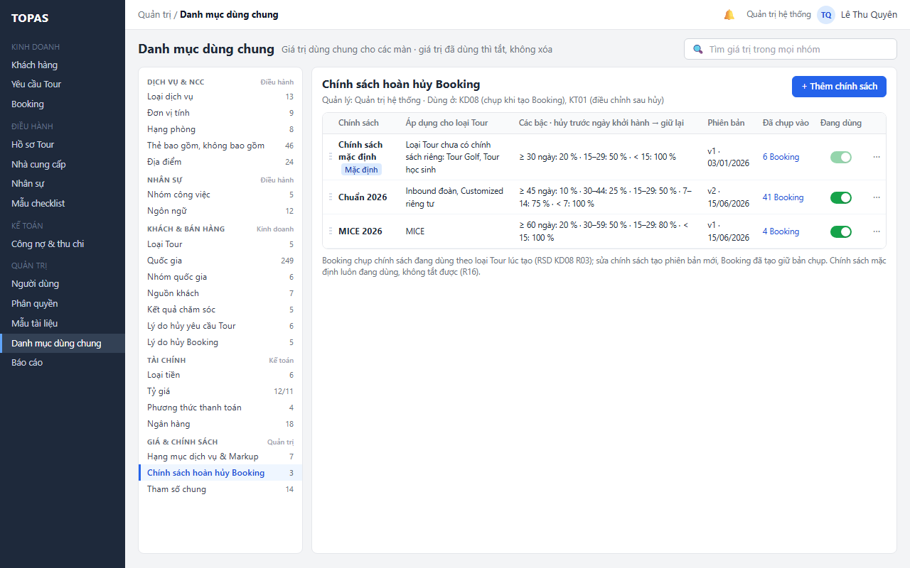

*Kết quả:* thấy ngay Booking của loại Tour nào chụp chính sách nào.

**L6.2 Sửa chính sách thành phiên bản mới.** *Điều kiện:* Quản trị hệ thống.

1. **W30 · Bấm dòng Chuẩn 2026 → bảng trượt.** Phần đầu: tên, “Phiên bản hiện hành v2 · 15/06/2026 · đã chụp vào 41 Booking”. Banner xanh: lưu sẽ tạo phiên bản 3; Booking đã tạo giữ bản chụp. Form: Tên chính sách, Áp dụng cho loại Tour (chọn nhiều), bảng Các bậc (Hủy trước ngày khởi hành từ N ngày → Giữ lại %, cột Khoảng áp dụng tự tính), bậc 0 ngày cố định ở cuối (gồm không đến), + Thêm bậc, ô Ví dụ tự tính, Ghi chú thay đổi. Quản trị hệ thống sửa bậc 30 ngày từ 25 % thành 30 %; dòng đổi tô vàng nhạt; ví dụ cập nhật “hủy trước 35 ngày → giữ lại 30 % (v2 là 25 %)”.

   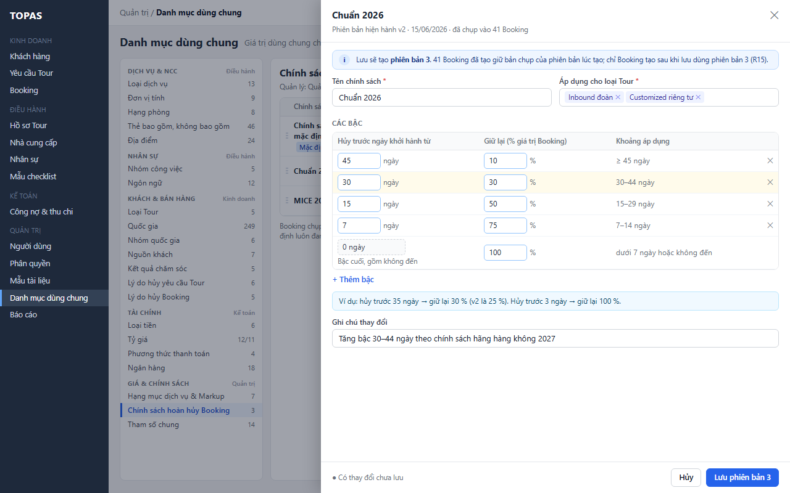

2. **W31 · Nút Lưu phiên bản 3.** Hệ thống kiểm tra R16, lưu phiên bản 3 (bậc, loại Tour áp dụng, ghi chú, người, thời điểm); bảng trượt đóng; dòng Chuẩn 2026 hiện v3 · 12/11/2026, tô xanh; thông báo ngắn “Đã lưu Chuẩn 2026 phiên bản 3 · Booking tạo từ bây giờ dùng v3”.

   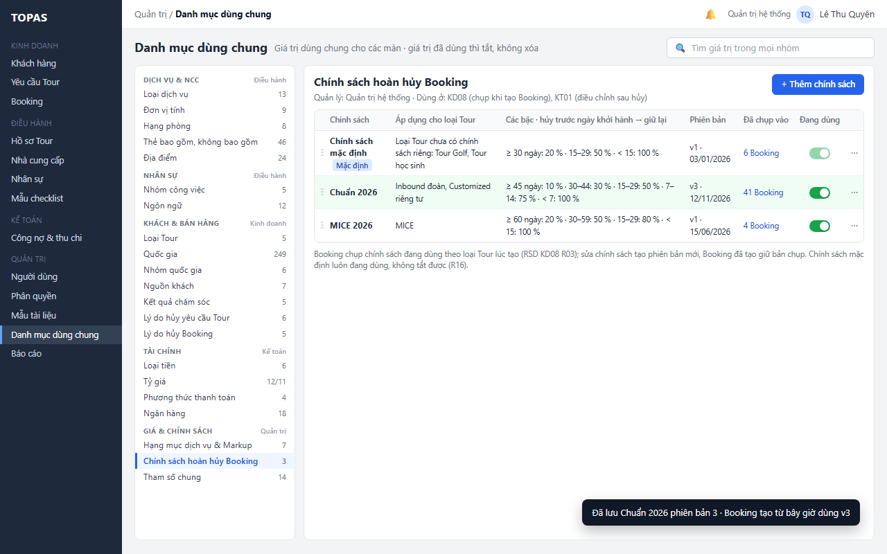

*Kết quả:* KD08 chụp v3 cho Booking tạo sau thời điểm lưu; 41 Booking cũ giữ bản chụp (RSD KD08 R03; KT01 đọc bản chụp, RSD KT01 R07).

**L6.3 Thêm chính sách cho một loại Tour.** *Điều kiện:* Quản trị hệ thống; còn loại Tour đang dùng chưa có chính sách riêng.

1. **W32 · Nút + Thêm chính sách → bảng trượt trống.** Bậc điền sẵn từ Chính sách mặc định (nhãn Từ chính sách mặc định). Ô Áp dụng cho loại Tour chỉ liệt kê loại Tour đang dùng chưa thuộc chính sách đang dùng nào (Tour Golf, Tour học sinh). Quản trị hệ thống nhập tên, chọn loại Tour, sửa bậc, bấm Lưu chính sách: chính sách mới Đang dùng, phiên bản 1; loại Tour đã chọn rời khỏi danh sách áp dụng của Chính sách mặc định.

   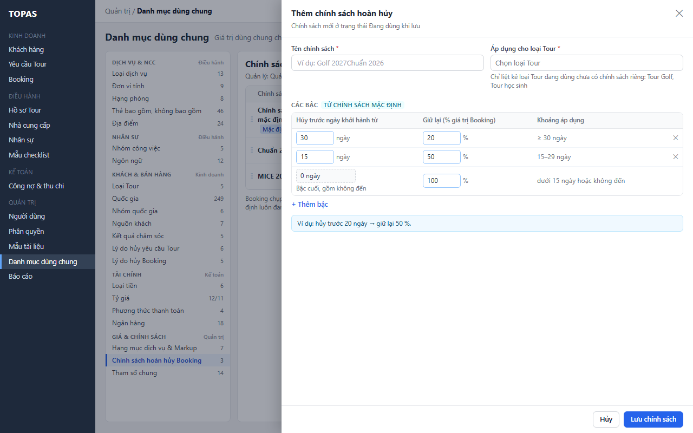

*Kết quả:* Booking mới của loại Tour đó chụp chính sách vừa tạo.

**Ngoại lệ**

- **E6.1 · W33.** Bậc trùng số ngày, % ngoài 0–100, số ngày không phải số nguyên ≥ 1 (trừ bậc cuối), tên trống hoặc trùng, chưa chọn loại Tour, quá 10 bậc: chặn lưu; banner đỏ đầu bảng trượt nêu số lỗi; lỗi dưới từng ô; Khoảng áp dụng và Ví dụ hiện “—” tới khi hết lỗi. Bậc gần ngày khởi hành hơn mà giữ lại ít hơn bậc xa hơn: cảnh báo vàng, vẫn lưu (R16).

  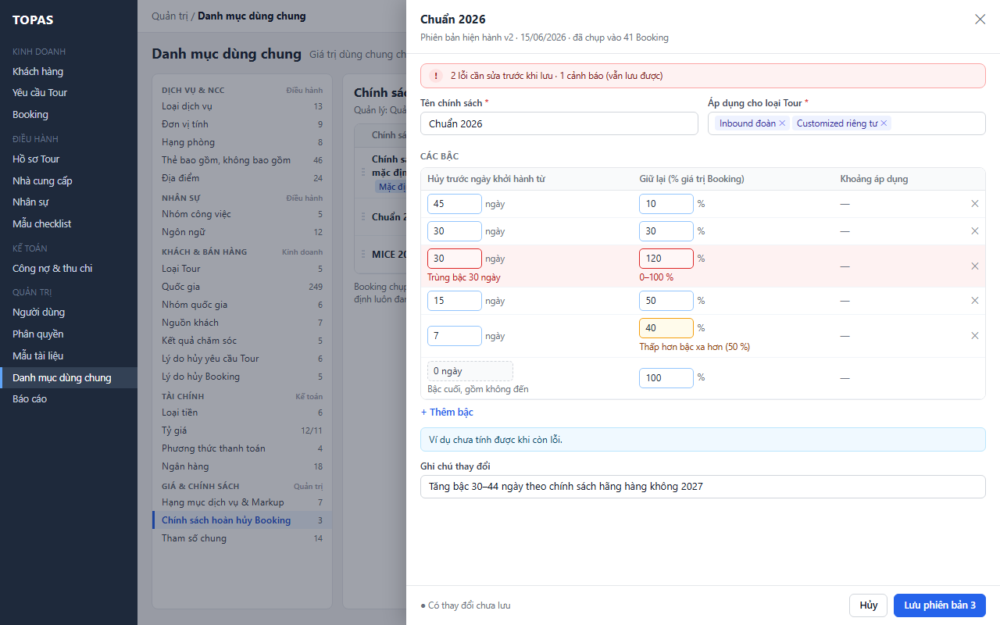

- **E6.2.** Lưu mà không có thay đổi nào: nút Lưu khóa, cạnh nút ghi “Chưa có thay đổi”; không tạo phiên bản.
- **E6.3.** Loại Tour vừa được chọn ở chính sách khác (phiên khác) trước khi lưu: chặn, lỗi cạnh ô Áp dụng cho loại Tour nêu tên chính sách kia.
- **E6.4.** Tắt chính sách (không phải mặc định): hộp thoại kiểu W12 nêu loại Tour bị ảnh hưởng và “Booking mới của các loại Tour này sẽ chụp Chính sách mặc định; Booking đã tạo giữ bản chụp”. Xóa chỉ được khi chưa chụp vào Booking nào (R12).
- **E6.5.** Bật lại chính sách mà một loại Tour của nó đã thuộc chính sách khác đang dùng: chặn, nêu loại Tour và chính sách đang giữ; bỏ loại Tour đó khỏi chính sách này rồi bật.
- **E6.6.** Loại Tour trong chính sách bị tắt ở nhóm Loại Tour: vẫn giữ, hiện kèm “(ngừng dùng)” ở ô Áp dụng cho loại Tour; không chặn lưu.
- **E6.7.** Đóng bảng trượt khi còn thay đổi chưa lưu: hộp thoại theo mục 2.4. Hai Quản trị cùng sửa: người lưu sau nhận lỗi xung đột kiểu W11 trong bảng trượt; không tạo phiên bản.

### 3.7. Tham số chung

**L7.1 Sửa tham số.** *Điều kiện:* Quản trị hệ thống; vai trò khác chỉ xem.

1. **W34 · Nhóm Tham số chung, bấm ô Giá trị.** Bảng có 11 tham số do hệ thống định nghĩa (R17): tên, giá trị, đơn vị, Dùng ở, cập nhật lần cuối. Không có thêm, xóa, công tắc, ⋮⋮. Ô giá trị vào chế độ sửa, dưới có khoảng hợp lệ và tác động. Quản trị hệ thống đổi Ngưỡng Đến hạn 7 → 10, Enter. Hệ thống lưu; dòng tô xanh; thông báo ngắn “Đã lưu Ngưỡng Đến hạn: 10 ngày”.

   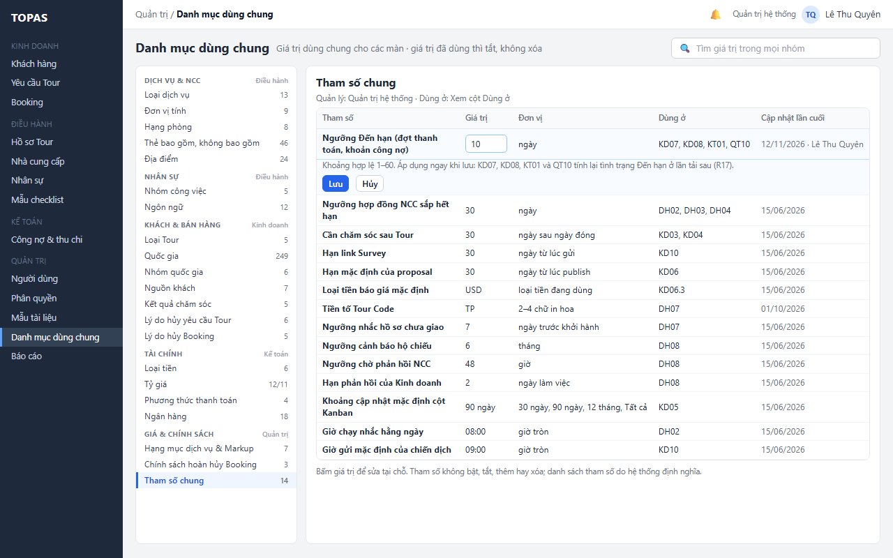

   > Hình chưa cập nhật: bảng còn 14 tham số, gồm Cần chăm sóc sau Tour, Hạn link Survey, Giờ gửi mặc định của chiến dịch (bỏ theo C3); nay còn 11.

*Kết quả:* các màn ở cột Dùng ở dùng giá trị mới ở lần tải hoặc lần tính sau.

**Ngoại lệ**

- **E7.1.** Giá trị ngoài khoảng hợp lệ, không phải số nguyên, tiền tố Tour Code không phải 2–4 chữ in hoa A–Z, loại tiền báo giá mặc định không ở trạng thái Đang dùng, giờ không đúng dạng HH:00, khoảng Kanban không thuộc danh sách lựa chọn: chặn như E2.1.
- **E7.2.** Đổi tiền tố Tour Code: dưới ô ghi “Tour Code cấp từ bây giờ dùng tiền tố mới; Tour Code đã cấp không đổi” và một ví dụ mã kế tiếp; vẫn lưu.

### 3.8. Ngày nghỉ lễ (Q23)

**L8.1 Nhập ngày nghỉ lễ của năm.** *Điều kiện:* Quản trị hệ thống; vai trò khác chỉ xem (mục 1.5).

1. **Chưa có hình riêng, bố cục như W24 · Nhóm Ngày nghỉ lễ ở cột trái.** Cột trái ghi số ngày nghỉ của năm nay. Tiêu đề nhóm có bộ chọn năm ‹ 2026 ›, nút Thêm nhiều và + Thêm ngày nghỉ. Dòng chú thích: “Ngày làm việc là thứ 2 đến thứ 6, trừ các ngày trong bảng này.” Bảng: Ngày (dd/mm/yyyy), Thứ, Tên ngày lễ, cập nhật lần cuối, menu ⋯; sắp theo ngày tăng dần. Không có chip Đang dùng, công tắc, ⋮⋮, cột Đang dùng ở (R22).
2. **Chưa có hình riêng, kiểu W05 · Nút + Thêm ngày nghỉ.** Dòng mới ở chế độ sửa, con trỏ ở ô Ngày. Quản trị nhập 01/01/2027, Tết Dương lịch, Enter: hệ thống kiểm tra R22, lưu, dòng vào đúng vị trí theo ngày, tô xanh; dòng trống tiếp theo mở sẵn như W06.
3. **Chưa có hình riêng, kiểu W07 · Nút Thêm nhiều → hộp thoại.** Mỗi dòng một ngày dạng “dd/mm/yyyy | Tên ngày lễ” (ví dụ chép từ thông báo nghỉ lễ cả năm). Xem trước có chip Sẽ thêm, Bỏ qua; dòng bỏ qua ghi lý do (ngày sai định dạng, trùng ngày đã có hoặc trùng dòng phía trên). Nút Thêm n ngày ghi mọi dòng Sẽ thêm trong một giao dịch.
4. **Chưa có hình riêng, kiểu W14 · Sửa hoặc xóa.** Bấm ô để sửa như L2.3. Menu ⋯ → Xóa: xóa ngay, không hộp thoại; thông báo ngắn “Đã xóa 01/01/2027” kèm Hoàn tác 10 giây (U2).

*Kết quả:* lần tính hạn theo ngày làm việc sau đó bỏ qua các ngày đã nhập; hạn đã tính và lưu ở màn dùng không đổi (R22).

**Ngoại lệ**

- **E8.1.** Ngày trùng ngày đã có, ngày sai định dạng, tên trống hoặc quá 100 ký tự: chặn như E2.1; lỗi trùng nêu tên ngày đã có.
- **E8.2.** Ngày rơi vào thứ 7 hoặc chủ nhật: vẫn lưu, dưới dòng ghi “Ngày này đã là ngày nghỉ cuối tuần”. Ngày nghỉ bù nhập thành một dòng riêng.
- **E8.3.** Năm đang xem chưa có ngày nào: bảng ghi “Chưa có ngày nghỉ lễ năm 2027. Hạn theo ngày làm việc trong năm này chỉ bỏ thứ 7, chủ nhật.” Hệ thống không gửi thông báo nhắc nhập.
- **E8.4.** Hai Quản trị cùng sửa một ngày: người lưu sau nhận lỗi xung đột kiểu W11, chỉ có Tải lại (Q8). Hoàn tác xóa khi ngày đó vừa được thêm lại ở phiên khác: như E3.5.

---

## 4. Quy tắc triển khai chi tiết

### R01. Nhóm và quyền sửa (quyết định 12/11/2026)

- 21 nhóm theo mục 1.2; quyền mặc định theo mục 1.5. Danh sách nhóm do hệ thống định nghĩa; người dùng không thêm hoặc xóa nhóm.
- Mỗi nhóm có một thao tác Sửa riêng ở QT02. Hai thao tác theo trường: Sửa Markup mặc định (loại Tour, hạng mục), Sửa bội số làm tròn giá bán; mặc định chỉ Quản trị hệ thống có, kể cả trong nhóm do phòng khác quản lý (Q1).
- Quản trị hệ thống đổi vai trò được cấp từng thao tác ở QT02; QT05 đọc quyền lúc tải và lúc ghi. Không có phạm vi bản ghi.

### R02. Thuộc tính chung và chống trùng

- Mỗi giá trị có: ID nội bộ (không hiện, không dùng lại), tên (1–100 ký tự, thẻ ≤ 80 ký tự theo RSD DH03 mục 5.2), thứ tự, Đang dùng, giá trị hệ thống (có, không), phiên bản, người và thời điểm tạo, sửa.
- **Trùng tên** trong nhóm: so sau khi cắt dấu cách đầu cuối, gộp dấu cách liên tiếp, không phân biệt hoa thường; dấu tiếng Việt được phân biệt (“Huế” khác “Hue”). Trùng thì chặn lưu, kể cả trùng với giá trị Ngừng dùng (lỗi kèm gợi ý bật lại giá trị đó). Phạm vi so riêng: Thẻ so trong cùng loại dịch vụ và cùng kiểu; Quốc gia và Loại tiền so thêm mã.
- Màn dùng lưu ID giá trị, không lưu tên, trừ các bản chụp ở mục 1.4.

### R03. Đang dùng ở

- Đếm số bản ghi đang tham chiếu ID giá trị, theo từng màn, tính lúc tải nhóm. Bản ghi đã kết thúc (yêu cầu đã hủy, Booking đã hủy, hồ sơ đã đóng) vẫn tính là đã dùng.

| Nhóm | Đếm ở |
|---|---|
| Loại dịch vụ | NCC (DH03), dịch vụ (DH05), việc theo dịch vụ của mẫu checklist (DH01) |
| Đơn vị tính, Hạng phòng | Dịch vụ, dòng giá (DH05); yêu cầu Tour (KD06.1, hạng phòng) |
| Thẻ | Dịch vụ có thẻ cùng tên tiếng Việt trong cùng loại (DH05.1) |
| Địa điểm | NCC, nhân sự, Tour mẫu |
| Nhóm công việc, Ngôn ngữ | Nhân sự; khách hàng, yêu cầu Tour, Booking (ngôn ngữ) |
| Loại Tour | Tour mẫu, yêu cầu Tour, Booking, mẫu checklist, chính sách hoàn hủy |
| Quốc gia, Nhóm quốc gia, Nguồn khách | Khách hàng; quốc gia (nhóm quốc gia) |
| Các nhóm lý do hủy | Yêu cầu Tour đã hủy; Booking đã hủy |
| Loại tiền | Hợp đồng, dòng giá, phiên bản báo giá, Booking, khoản công nợ, tham số Loại tiền báo giá mặc định |
| Phương thức thanh toán, Ngân hàng | Giao dịch, điều khoản thanh toán hợp đồng; thông tin nhận thanh toán NCC |
| Hạng mục | Loại dịch vụ |
| Chính sách hoàn hủy | Bản chụp trong Booking |

- Bấm ô Đang dùng ở mở bảng đếm theo màn (dạng bảng trong W12). Không tính được: E1.2.

### R04. Sửa giá trị đang dùng

- **Tên:** màn dùng hiện tên mới ở mọi bản ghi đọc theo ID. Bản chụp (mục 1.4) giữ tên lúc chụp.
- **Thuộc tính:** áp cho thao tác sau thời điểm lưu (thêm dịch vụ, tính giá, tạo Booking, gợi ý ngôn ngữ…). Không tính lại bản ghi đã lưu: dịch vụ đã có giữ đơn vị tính của nó; báo giá đã lưu giữ Markup, cách tính theo đêm và tỷ giá đã dùng (RSD KD06 R14).
- Một số thay đổi bị chặn vì làm sai dữ liệu đã có: R09 (Có hạng phòng), R11 (số lẻ thập phân), R08 và R11 (mã ISO đã dùng).

### R05. Tắt, bật và Hoàn tác

- Tắt: bản ghi đã có giữ ID và hiện tên kèm “(ngừng dùng)”; ô chọn khi tạo hoặc sửa không có giá trị đã tắt; bộ lọc ở màn dùng vẫn có giá trị đã tắt, kèm “(ngừng dùng)”. Việc lưu bản ghi đang mang giá trị đã tắt theo RSD của màn đó (ví dụ RSD KD01-KD02 E3.5, DH06 E2.4, KD03-KD04 E2.6).
- Tác động riêng đã chốt ở màn dùng: loại dịch vụ tắt thì việc theo dịch vụ không sinh (RSD DH01 R07, DH07); loại Tour tắt thì mẫu checklist có chỉ báo (RSD DH01 E1.4); chính sách hoàn hủy tắt thì Booking mới của loại Tour đó chụp Chính sách mặc định (R16).
- Có hộp thoại xác nhận khi Đang dùng ở khác “Chưa dùng” hoặc chưa tính được (W12, E1.2); không thì lưu ngay kèm Hoàn tác.
- **Nhóm bắt buộc** (màn dùng không lưu được khi nhóm rỗng): Loại dịch vụ, Đơn vị tính, Loại Tour, Nhóm công việc, Ngôn ngữ, Loại tiền. Không tắt được giá trị đang dùng cuối cùng (E3.1).
- Không tắt được: loại tiền đang là Loại tiền báo giá mặc định; hạng mục còn loại dịch vụ đang dùng (E3.2).
- Hoàn tác trong 10 giây đưa về trạng thái trước, ghi một dòng lịch sử mới; không được nếu đã có thay đổi tiếp (E3.5).

### R06. Giá trị hệ thống

| Nhóm | Giá trị | Vì sao |
|---|---|---|
| Địa điểm | Toàn quốc | NCC phục vụ mọi nơi, khu vực phục vụ mặc định của nhân sự (RSD DH06) |
| Nhóm công việc | Điều hành | Chọn người phụ trách hồ sơ, nhận thông báo (RSD DH06 R03) |
| Lý do hủy yêu cầu Tour | Khác; Booking đã hủy | Khác bắt buộc ghi chú; Booking đã hủy chỉ hệ thống ghi khi hủy Booking, không hiện trong ô chọn ở KD06 (RSD KD06 R21) |
| Lý do hủy Booking | Khác | Bắt buộc ghi chú (RSD KD08 R10) |
| Loại tiền | VND | Tiền gốc của tỷ giá và quyết toán (RSD DH08 R15) |
| Hạng mục dịch vụ | Khác | Hạng mục mặc định của loại dịch vụ |
| Chính sách hoàn hủy | Chính sách mặc định | Dùng khi loại Tour không có chính sách riêng (RSD KD08 R03, KT01 E1.7) |

- Giá trị hệ thống: không đổi tên, không tắt, không xóa; đổi được thứ tự và thuộc tính riêng (ví dụ vai trò phục vụ của Điều hành, bội số làm tròn của VND, bậc của Chính sách mặc định).

### R07. Nhóm công việc và vai trò phục vụ

- Vai trò phục vụ Tour là danh sách cố định của DH08.5: HDV chính, HDV điểm, Trưởng đoàn. Mỗi nhóm công việc nhận không, một hoặc nhiều vai trò.
- DH08.5 chỉ gợi ý nhân sự thuộc nhóm nhận vai trò đang phân công (RSD DH06 R03). Bỏ vai trò không đổi phân công đã có (E4.3). Nhóm chưa khai vai trò thì người thuộc nhóm không hiện ở DH08.5 (RSD DH06 R10).

### R08. Quốc gia, nhóm quốc gia, ngôn ngữ mặc định

- Quốc gia khởi tạo theo ISO 3166-1 (R20); mã 2 chữ in hoa, duy nhất, không sửa khi đã dùng. Mỗi quốc gia thuộc tối đa một nhóm quốc gia.
- Ngôn ngữ mặc định chỉ dùng để gợi ý ngôn ngữ giao tiếp khi tạo hoặc đổi quốc gia của khách (RSD KD03-KD04 R01); sửa không đổi khách đã có.
- Nhóm quốc gia hiện chỉ dùng làm thuộc tính của Quốc gia ở QT05; màn dùng cũ đã bỏ theo C3. Tắt nhóm quốc gia: quốc gia giữ nhóm, hiện kèm “(ngừng dùng)”.

### R09. Loại dịch vụ, đơn vị tính, hạng phòng, thẻ

- Loại dịch vụ: hạng mục Markup bắt buộc (mặc định Khác), đơn vị tính mặc định bắt buộc, Có hạng phòng (mặc định không). Bỏ Có hạng phòng bị chặn khi có dòng giá của loại đó có hạng phòng (E2.3); bật thì DH05.2 hiện cột Hạng phòng cho dịch vụ thuộc loại.
- Đơn vị tính: căn cứ tính mặc định bắt buộc; Tính theo đêm mặc định không. Cách tính theo đêm theo RSD DH03 R14; đổi cờ chỉ áp cho lần tính sau (W17).
- Thẻ: thuộc một loại dịch vụ và một kiểu. DH05.1 gợi ý thẻ Đang dùng của loại dịch vụ của dịch vụ đang sửa; dịch vụ lưu nội dung thẻ (bản sao). Proposal English tra tên tiếng Anh theo loại dịch vụ của dịch vụ và tên tiếng Việt; không có thì E5.2 của RSD KD06. Thẻ đã dùng chỉ tắt (tắt: không gợi ý ở DH05.1, proposal vẫn tra tên tiếng Anh).
- Xóa loại dịch vụ chưa dùng thì xóa cùng các thẻ của loại đó (W15).

### R10. Markup và làm tròn (mặc định chỉ Quản trị hệ thống)

- Markup mặc định của loại Tour (Markup chung) và của hạng mục: 0–300 %, tối đa 2 chữ số thập phân, để trống được. KD06.3 điền sẵn theo RSD KD06 R14: hạng mục có Markup thì dùng, để trống thì dùng Markup chung; loại Tour không có Markup thì KD06.3 bắt buộc nhập (RSD KD06 E4.3).
- Bội số làm tròn giá bán theo loại tiền (minh họa: EUR, USD 10; JPY 1.000; VND 10.000; RSD KD06 R14). Bội số chỉ áp cho giá bán mỗi khách; không áp cho đợt thanh toán và phí giữ lại (Q9). Trống thì làm tròn tới đơn vị nhỏ nhất của loại tiền. Làm tròn half-up (Q9).
- Sửa Markup hoặc bội số không đổi phiên bản báo giá đã lưu.

### R11. Loại tiền

- Mã ISO 4217, 3 chữ in hoa, duy nhất. Số lẻ thập phân 0 hoặc 2 (VND, JPY 0; ngoại tệ khác 2 theo RSD DH03 mục 2.5, KT01). Không đổi mã và số lẻ thập phân khi loại tiền đã có số tiền được lưu ở bất kỳ màn nào (E2.3).
- VND là tiền gốc của tỷ giá, tỷ giá luôn là 1, không có cột ở bảng tỷ giá.

### R12. Xóa

- Chỉ xóa được giá trị Chưa dùng (R03 bằng 0 ở mọi nơi, tính lại tại máy chủ lúc xóa) và không phải giá trị hệ thống. Chưa tính được nơi dùng thì không cho xóa (E1.2).
- Chính sách hoàn hủy chỉ xóa được khi chưa chụp vào Booking nào. Dòng tỷ giá chỉ xóa được khi Chưa dùng. Tham số chung không xóa. Ngày nghỉ lễ xóa được bất kỳ lúc nào (R22).
- Xóa không hoàn tác, trừ ngày nghỉ lễ (Hoàn tác 10 giây, L8.1); ghi lịch sử với toàn bộ giá trị trước khi xóa.

### R13. Tỷ giá có hiệu lực (quyết định 12/11/2026)

- Tỷ giá là số VND cho 1 đơn vị ngoại tệ, mỗi loại tiền tối đa một số mỗi ngày. Nguồn là Kế toán nhập tay hoặc dán từ Excel; hệ thống không tự lấy tỷ giá từ bên ngoài. Ghi chú nguồn (ví dụ “Vietcombank · bán chuyển khoản”) không bắt buộc.
- **Tỷ giá có hiệu lực của loại tiền X tại ngày D** = số của X ở ngày lớn nhất ≤ D có ô X không trống. Không có ngày nào như vậy thì **chưa có tỷ giá** (RSD KD06 E4.2, KT01 E0.13, DH08 E8.3 áp cho trường hợp này).
- Màn dùng ghi ngày lấy tỷ giá khi khác ngày D (ví dụ “tỷ giá ngày 11/11/2026”). Ngày D theo màn dùng: ngày bấm Tính giá, tỷ giá chụp vào phiên bản (KD06.3, Q10), ngày giao dịch hoặc ngày lưu quyết toán (DH08.8), hôm nay hoặc ngày giao dịch (KT01).
- Không giới hạn tuổi của tỷ giá; banner W24 nhắc khi hôm nay chưa có dòng.
- Quy đổi giữa hai ngoại tệ đi qua VND theo RSD KD06 R14.

### R14. Nhập và sửa tỷ giá

- Số > 0, tối đa 4 chữ số thập phân. Ngày ≤ hôm nay.
- Cảnh báo (không chặn) khi chênh quá 5 % so với tỷ giá có hiệu lực của ngày liền trước.
- **Đã dùng** của một ngày = số phiên bản báo giá (KD06) và quyết toán (DH08.8) đã lưu tỷ giá lấy từ ngày đó. KT01 tính ≈ VND lúc hiển thị nên không tính là đã dùng.
- Sửa ô hoặc thêm ngày làm đổi tỷ giá có hiệu lực của khoảng ngày đã dùng: bắt buộc lý do (W28, E5.4). Ô của ngày đã dùng không xóa trắng được (E5.3). Bản chụp đã lưu không đổi; KT01 tính lại ≈ VND ở lần tải sau.

### R15. Phiên bản chính sách hoàn hủy

- Mỗi lần lưu chính sách (đổi tên, loại Tour áp dụng, bậc hoặc ghi chú) tạo phiên bản mới, số tăng 1, kèm người, thời điểm, ghi chú. Phiên bản cũ chỉ đọc; người có quyền xem QT03 (mặc định Quản trị hệ thống) xem ở menu ⋯ → Lịch sử thay đổi.
- KD08 chụp phiên bản hiện hành của chính sách Đang dùng theo loại Tour của Booking lúc tạo; không có chính sách riêng thì Chính sách mặc định (RSD KD08 R03). Chuyển sang Điều hành không chụp lại.
- Cột Đã chụp vào đếm Booking có bản chụp thuộc chính sách đó, mọi phiên bản.

### R16. Bậc và phạm vi chính sách

- Bậc: “hủy trước ngày khởi hành từ N ngày → giữ lại X % giá trị Booking”. N nguyên ≥ 1, không trùng; bậc cuối N = 0 cố định, áp cho hủy dưới bậc nhỏ nhất, hủy từ ngày khởi hành trở đi và không đến. X 0–100 %, tối đa 2 chữ số thập phân. Tối đa 10 bậc.
- Số ngày hủy trước = ngày khởi hành − ngày hủy (theo ngày, múi giờ Asia/Ho_Chi_Minh). Áp bậc có N lớn nhất ≤ số ngày đó; số âm áp bậc 0. KT01 điền sẵn Phí giữ lại theo bậc này (RSD KT01 R07).
- Cảnh báo khi bậc có N nhỏ hơn mà X nhỏ hơn bậc có N lớn hơn (W33).
- Mỗi loại Tour thuộc tối đa một chính sách Đang dùng (không tính Chính sách mặc định). Chính sách mặc định áp cho mọi loại Tour còn lại; luôn Đang dùng, không xóa, sửa được bậc.

### R17. Tham số chung

| Tham số | Mặc định | Khoảng | Dùng ở | Khi đổi |
|---|---|---|---|---|
| Ngưỡng Đến hạn | 7 ngày | 1–60 | KD07 R04, KD08, KT01 R03, QT10 (RSD QT07-QT12 E5.3) | Tình trạng Đến hạn tính lại ở lần tải sau |
| Ngưỡng hợp đồng NCC sắp hết hạn | 30 ngày | 1–180 | DH02 R01, R10; DH03; DH04 | Tình trạng Sắp hết hạn tính lại ở lần tải sau |
| Hạn mặc định của proposal | 30 ngày | 1–180 | KD06 R18 | Áp cho lần publish sau |
| Loại tiền báo giá mặc định | USD | Loại tiền Đang dùng | KD06 mục 5.2 | Áp cho lần tính giá mới |
| Tiền tố Tour Code | TP | 2–4 chữ in hoa A–Z | DH07 R02 (Q7) | Áp cho Tour Code cấp sau (E7.2) |
| Ngưỡng nhắc hồ sơ chưa giao | 7 ngày trước khởi hành | 1–60 | DH07 R09, R12 | Viền đỏ ô Chọn người tính lại ở lần tải sau; nhắc theo ngưỡng mới từ lần nhắc kế tiếp |
| Ngưỡng cảnh báo hộ chiếu | 6 tháng | 1–24 | DH08 R11, R17 | Cảnh báo hộ chiếu tính lại ở lần tải sau |
| Ngưỡng chờ phản hồi NCC | 48 giờ (giờ lịch, Q23) | 1–240 | DH08 R04, R17 | Chỉ báo “n ngày chưa phản hồi” tính lại ở lần tải sau |
| Hạn phản hồi của Kinh doanh | 2 ngày làm việc (R22) | 1–10 | DH08 R17, R18 | Áp cho yêu cầu đổi lịch trình gửi sau; yêu cầu đã gửi giữ hạn đã ghi |
| Khoảng cập nhật mặc định cột Kanban Đã có Booking, Đã hủy | 90 ngày | 30 ngày, 90 ngày, 12 tháng, Tất cả | KD05 R11, R13 | Áp cho người dùng chưa chọn khoảng; khoảng người dùng đã chọn được giữ (KD05 R13) |
| Giờ chạy nhắc hằng ngày | 08:00 | 00:00–23:00, theo giờ tròn | CH02 R09, R12 (mọi loại nhắc định kỳ); DH02 R08, R10; DH07 R09, R12; DH08 E1.9, E3.11, R17 | Áp từ lần chạy kế tiếp |

- Danh sách tham số do hệ thống định nghĩa; thêm tham số mới cần bổ sung RSD này. Sáu tham số cuối được gom từ các RSD nêu ở cột Dùng ở (rà soát lần hai); giá trị mặc định lấy đúng theo RSD đó, khoảng hợp lệ do người viết đặt và được chấp nhận mặc định (Q3). Ba tham số của phần chăm sóc và khảo sát đã bỏ (C3).
- Giờ chạy nhắc hằng ngày là một giờ chung: tác vụ nhắc hằng ngày của RSD CH02 chạy một lần mỗi ngày vào giờ này cho mọi loại nhắc định kỳ (hợp đồng NCC sắp hết hạn, hết hạn; hồ sơ chưa giao; yêu cầu đổi lịch trình quá hạn phản hồi; thay đổi chương trình không áp dụng được). Không loại nhắc nào có giờ riêng (RSD CH02 R09).

### R18. Thứ tự và hiển thị ở màn dùng

- Ô chọn ở màn dùng hiện giá trị Đang dùng theo thứ tự của QT05. Giá trị mới ở cuối. Quốc gia mặc định sắp theo tên A–Z (khởi tạo), đổi được bằng kéo.
- Giá trị đã tắt đang gắn với bản ghi hiện kèm “(ngừng dùng)” ở mọi màn dùng (R05).

### R19. Đồng thời và lịch sử

- Mỗi giá trị, dòng tỷ giá, ngày nghỉ lễ, chính sách và tham số có phiên bản; lần ghi mang phiên bản cũ bị từ chối, chỉ có nút Tải lại, không ghi đè (E2.2, Q8).
- Lịch sử ghi QT03: nhóm, giá trị, trường, trước, sau, người, thời điểm, lý do (tỷ giá đã dùng, ghi chú chính sách). Thêm nhiều và dán Excel ghi một sự kiện kèm danh sách giá trị.

### R20. Khởi tạo dữ liệu

- Khi triển khai, hệ thống tạo sẵn: các giá trị hệ thống (R06); quốc gia theo ISO 3166-1 (Đang dùng, chưa có nhóm và ngôn ngữ mặc định); loại tiền VND; 11 tham số chung với giá trị mặc định (R17); hạng mục Lưu trú, Di chuyển, Vé máy bay, Hướng dẫn viên, Tham quan, Ăn uống, Khác (RSD KD06 R14).
- Giá trị khác (loại dịch vụ, loại Tour, ngôn ngữ, lý do, ngày nghỉ lễ…) nhập lúc triển khai bằng Thêm nhiều; giá trị minh họa trong các RSD là gợi ý, không tự tạo.

### R21. Cấu hình phụ thuộc

| Cấu hình | Chủ sở hữu | Dùng ở | Hành vi khi thiếu |
|---|---|---|---|
| Thao tác Sửa theo nhóm và theo trường | QT02 | R01, mục 1.5 | Theo mặc định ở mục 1.5 |
| Nhật ký thao tác | QT03 | R19 | Không ghi được nhật ký thì không lưu thay đổi, báo lỗi lưu |
| Danh sách vai trò phục vụ Tour | DH08.5 (cố định) | R07 | — |

### R22. Ngày nghỉ lễ và ngày làm việc (Q23)

- **Ngày làm việc** là thứ 2 đến thứ 6, trừ các ngày trong nhóm Ngày nghỉ lễ. Mọi hạn RSD ghi “ngày làm việc” tính theo định nghĩa này (ví dụ tham số Hạn phản hồi của Kinh doanh, RSD DH08 R17, R18). 48 giờ chờ NCC tính theo giờ lịch, không dùng nhóm này (Q23).
- Mỗi dòng: ngày (bắt buộc, duy nhất trong nhóm), tên ngày lễ (bắt buộc, 1–100 ký tự), phiên bản, người và thời điểm tạo, sửa. Không có thứ tự kéo thả (sắp theo ngày), không có Đang dùng, không có giá trị hệ thống, không có cột Đang dùng ở; khác các nhóm danh sách ở R02, R03, R05.
- Ngày thứ 7, chủ nhật nhập được (E8.2); ngày quá khứ, tương lai đều nhập được, không giới hạn năm.
- Thêm, sửa, xóa áp cho lần tính hạn sau; hạn đã tính và lưu ở màn dùng không đổi (như tham số Hạn phản hồi của Kinh doanh ở R17). Xóa làm ngay kèm Hoàn tác 10 giây (U2).
- Không khởi tạo sẵn ngày nào (R20); hệ thống không nhắc nhập (E8.3).

---

## 5. Dữ liệu

### 5.1. Đối tượng dữ liệu

| Đối tượng | Khóa và dữ liệu chính | Nguồn hoặc tác động |
|---|---|---|
| Nhóm danh mục | Mã nhóm, tên, mục, vai trò sửa mặc định, nhóm bắt buộc (có, không) | Hệ thống định nghĩa; QT02 đổi quyền |
| Giá trị danh mục | ID, mã nhóm, tên, thứ tự, Đang dùng, hệ thống, thuộc tính riêng theo nhóm (mục 5.2), phiên bản, tạo, sửa | QT05; màn dùng đọc theo ID |
| Thẻ bao gồm, không bao gồm | ID, ID loại dịch vụ, kiểu, tên tiếng Việt, tên tiếng Anh, thứ tự, Đang dùng | QT05; DH05.1 gợi ý; KD06 proposal tra tên tiếng Anh |
| Nhóm công việc · vai trò | ID nhóm công việc, vai trò phục vụ Tour | QT05; DH06, DH08.5 đọc |
| Dòng tỷ giá | Ngày (duy nhất), ghi chú nguồn, phiên bản, người nhập, thời điểm | QT05 |
| Ô tỷ giá | Ngày, mã loại tiền, tỷ giá | QT05; KD06.3, DH08.8 lưu bản chụp kèm ngày lấy; KT01 đọc lúc hiển thị |
| Chính sách hoàn hủy | ID, tên, mặc định (có, không), Đang dùng, phiên bản hiện hành | QT05 |
| Phiên bản chính sách | ID chính sách, số phiên bản, loại Tour áp dụng, các bậc (N ngày, % giữ lại), ghi chú, người, thời điểm | QT05 ghi; KD08 chụp (RSD KD08 mục 5.1); KT01 đọc bản chụp |
| Ngày nghỉ lễ | Ngày (duy nhất), tên ngày lễ, phiên bản, người, thời điểm | QT05; màn tính hạn theo ngày làm việc đọc (R22) |
| Tham số chung | Mã tham số, giá trị, phiên bản, người, thời điểm | QT05; màn ở R17 đọc |
| Đang dùng ở (đọc) | ID giá trị, số bản ghi theo màn | Tính từ các màn dùng (R03) |
| Lịch sử thay đổi | Đối tượng, trường, trước, sau, người, thời điểm, lý do | R19; QT03 |

### 5.2. Trường nhập

| Nhóm | Trường | Bắt buộc | Mặc định hoặc điền sẵn | Kiểm tra |
|---|---|---|---|---|
| Mọi nhóm danh sách | Tên | Có | — | 1–100 ký tự; không trùng (R02) |
| Mọi nhóm danh sách | Đang dùng | Có | Bật | R05 |
| Loại dịch vụ | Hạng mục Markup | Có | Khác (Mặc định) | Hạng mục Đang dùng |
| Loại dịch vụ | Đơn vị tính mặc định | Có | — | Đơn vị Đang dùng |
| Loại dịch vụ | Có hạng phòng | Không | Không | R09 |
| Đơn vị tính | Căn cứ tính mặc định | Có | Khách | Khách, Phòng, Đoàn, Đơn vị dịch vụ |
| Đơn vị tính | Tính theo đêm | Không | Không | — |
| Hạng phòng | Mô tả | Không | — | ≤ 200 ký tự |
| Thẻ | Loại dịch vụ, Kiểu | Có | Loại đang lọc; Bao gồm | Loại dịch vụ Đang dùng |
| Thẻ | Tên tiếng Việt | Có | — | ≤ 80 ký tự; không trùng trong loại và kiểu |
| Thẻ | Tên tiếng Anh | Không (thiếu thì có chỉ báo) | — | ≤ 80 ký tự |
| Nhóm công việc | Vai trò phục vụ Tour | Không | Trống | Trong danh sách của DH08.5 |
| Ngôn ngữ | Mã ngôn ngữ | Không | — | 2 chữ thường ISO 639-1; không trùng |
| Loại Tour | Markup mặc định | Không | Trống | 0–300 %, 2 chữ số thập phân; chỉ Quản trị (R10) |
| Quốc gia | Mã ISO | Có | — | 2 chữ in hoa; không trùng; không sửa khi đã dùng |
| Quốc gia | Nhóm quốc gia, Ngôn ngữ mặc định | Không | Trống | Giá trị Đang dùng |
| Loại tiền | Mã | Có | — | 3 chữ in hoa ISO 4217; không trùng; không sửa khi đã dùng |
| Loại tiền | Ký hiệu | Không | — | ≤ 5 ký tự |
| Loại tiền | Số lẻ thập phân | Có | 2 | 0 hoặc 2; không sửa khi đã dùng (R11) |
| Loại tiền | Bội số làm tròn giá bán | Không | Trống | Số > 0, ≥ đơn vị nhỏ nhất; chỉ Quản trị |
| Ngân hàng | Tên viết tắt, mã SWIFT | Không | — | SWIFT 8 hoặc 11 ký tự chữ, số |
| Hạng mục | Markup mặc định | Không | Trống | 0–300 %; chỉ Quản trị |
| Tỷ giá | Ngày | Có | Hôm nay | ≤ hôm nay; không trùng ngày |
| Tỷ giá | Tỷ giá từng loại tiền | Không (ít nhất một ô) | Gợi ý xám từ ngày gần nhất | > 0; ≤ 4 chữ số thập phân; cảnh báo chênh > 5 % (R14) |
| Tỷ giá | Ghi chú nguồn | Không | Gợi ý từ ngày gần nhất | ≤ 100 ký tự |
| Tỷ giá | Lý do sửa | Có khi ngày đã dùng | — | ≤ 300 ký tự |
| Chính sách | Tên | Có | — | ≤ 100 ký tự; không trùng |
| Chính sách | Áp dụng cho loại Tour | Có, trừ Mặc định | — | Loại Tour Đang dùng chưa thuộc chính sách khác (R16) |
| Chính sách | Bậc: N ngày, % giữ lại | Có, ít nhất bậc 0 | Thêm mới: theo Chính sách mặc định | R16 |
| Chính sách | Ghi chú thay đổi | Không | — | ≤ 300 ký tự |
| Ngày nghỉ lễ | Ngày | Có | — | dd/mm/yyyy; không trùng ngày đã có (R22) |
| Ngày nghỉ lễ | Tên ngày lễ | Có | — | 1–100 ký tự |
| Tham số chung | Giá trị | Có | R17 | Khoảng ở R17 |

### 5.3. Dữ liệu gửi ra ngoài

QT05 không gửi email, tài liệu hay dữ liệu ra ngoài hệ thống và không gọi dịch vụ bên ngoài. Tên tiếng Anh của thẻ được dùng trong proposal ở KD06, nơi Kinh doanh xem trước rồi mới publish (RSD KD06 R18).

---

## 6. Tiêu chí nghiệm thu

| Mã | Điều kiện và thao tác | Kết quả mong đợi |
|---|---|---|
| AC01 | Quản trị hệ thống mở QT05 lần đầu trong phiên | Mở nhóm Loại dịch vụ; cột trái có 21 nhóm trong 5 mục; chip Đang dùng 13, Ngừng dùng 1, Tất cả 14 (W01) |
| AC02 | Kế toán mở nhóm Loại dịch vụ | Banner Chỉ xem; không có nút thêm, công tắc, ⋮⋮, menu ⋯; gọi thẳng API sửa bị từ chối (W03) |
| AC03 | Kế toán mở QT05 lần đầu | Mở nhóm Loại tiền (nhóm đầu tiên Kế toán được sửa) |
| AC04 | Gõ “phòng” vào ô tìm | 5 kết quả trong 3 nhóm, gồm tên nhóm Hạng phòng; bấm Phụ thu phòng đơn mở nhóm Thẻ, loại Khách sạn, dòng đó tô sáng (W02) |
| AC05 | Điều hành thêm Premier Deluxe vào Hạng phòng bằng Enter | Giá trị ở cuối danh sách, tô xanh; Hạng phòng 9 ở cột trái; dòng trống mới mở sẵn (W06); ô Hạng phòng ở DH05.2 có Premier Deluxe ở lần tải sau |
| AC06 | Thêm “khách  sạn” vào Loại dịch vụ, chưa chọn đơn vị tính | Không lưu; lỗi trùng “Khách sạn” và lỗi bắt buộc dưới ô; dữ liệu giữ nguyên (W10) |
| AC07 | Thêm “Huế” khi đã có “Hue” Ngừng dùng | Lưu được (dấu khác nhau). Thêm “hue” thì chặn và gợi ý bật lại “Hue” |
| AC08 | Dán 5 dòng Địa điểm: Hà Giang, Cao Bằng, Ninh Bình (đã có), Phú Quốc, hà giang | Xem trước Sẽ thêm 3, Bỏ qua 2 với lý do; Thêm 3 giá trị thêm đúng 3 (W07) |
| AC09 | Đổi tên Vé máy bay nội địa thành Vé máy bay nội địa (VN) | Màn DH03, DH05 hiện tên mới; phiên bản báo giá và lần đặt đã lưu hiện tên cũ trong bản chụp (R04) |
| AC10 | Đổi hạng mục Markup của Vé máy bay nội địa sang Di chuyển | Lần tính giá sau ở KD06.3 dùng Markup của Di chuyển; phiên bản đã lưu giữ “5 % · Vé máy bay” |
| AC11 | Bật Tính theo đêm cho Phòng/ngày | Cảnh báo nêu 14 dịch vụ; lưu được; lần tính giá sau tính theo đêm; báo giá đã lưu không đổi (W17) |
| AC12 | Bỏ Có hạng phòng của Khách sạn | Chặn; lỗi nêu số dòng giá có hạng phòng (E2.3) |
| AC13 | Kéo Khách hoãn hoặc đổi thời gian lên đầu Lý do hủy Booking | Lưu ngay, có Hoàn tác; ô chọn lý do ở KD08 hiện theo thứ tự mới (W09) |
| AC14 | Hai Điều hành cùng sửa Deluxe; người sau lưu | Người sau bị chặn, thấy người sửa và giá trị mới; không có nút ghi đè; Tải lại hiện bản mới và giá trị đã nhập dưới ô (W11, Q8) |
| AC15 | Kinh doanh tắt Tour học sinh đang dùng ở 10 bản ghi | Hộp thoại nêu 2 Tour mẫu, 1 yêu cầu đang xử lý, 3 Booking hiệu lực, 4 bản ghi đã kết thúc (W12); sau khi tắt, Loại Tour 4, chip Ngừng dùng 1, Hoàn tác 10 giây (W13) |
| AC16 | Sau AC15, tạo yêu cầu Tour mới ở KD06.1; mở Booking cũ loại Tour học sinh | Ô Loại Tour không có Tour học sinh; Booking cũ hiện “Tour học sinh (ngừng dùng)” |
| AC17 | Tắt nguồn khách chưa dùng | Lưu ngay, không hộp thoại; thông báo có Hoàn tác; Hoàn tác đưa về Đang dùng, lịch sử có hai dòng |
| AC18 | Tắt loại tiền USD khi USD là Loại tiền báo giá mặc định | Chặn, lý do nêu tham số cần đổi trước (E3.2) |
| AC19 | Còn một loại Tour đang dùng, tắt loại đó | Công tắc khóa, lý do “giá trị đang dùng cuối cùng” (E3.1) |
| AC20 | Mở menu ⋯ của MICE | Xóa khóa, ghi “đang dùng ở 14 bản ghi”, gợi ý tắt (W14) |
| AC21 | Quản trị xóa Hoạt động trải nghiệm (chưa dùng, có 2 thẻ) | Hộp thoại nêu xóa cùng 2 thẻ (W15); sau khi xóa, Loại dịch vụ giảm 1, Thẻ giảm 2 |
| AC22 | Một NCC chọn Hoạt động trải nghiệm ngay trước khi bấm Xóa | Máy chủ từ chối; lỗi “vừa được dùng · tắt sử dụng thay cho xóa” (E3.3) |
| AC23 | Kinh doanh bấm công tắc Booking đã hủy ở Lý do hủy yêu cầu Tour | Không đổi; giải thích giá trị hệ thống (W16); KD06 không có Booking đã hủy trong ô chọn lý do |
| AC24 | Lọc Thẻ theo Khách sạn, chip Thiếu tên tiếng Anh, nhập Airport transfer, Enter | Lưu; con trỏ sang Giặt là; chip còn 1; proposal English của dịch vụ có thẻ Đưa đón sân bay hiện Airport transfer (W18) |
| AC25 | Bỏ HDV điểm khỏi nhóm Hướng dẫn viên đang có 2 phân công HDV điểm | Cảnh báo nêu 2 phân công; lưu được; phân công giữ nguyên; DH08.5 không gợi ý người nhóm này cho HDV điểm (E4.3) |
| AC26 | Đặt Thụy Sĩ: Châu Âu, Tiếng Đức | Lưu; chip Thiếu ngôn ngữ mặc định 3 → 2; tạo khách Thụy Sĩ ở KD04 gợi ý Tiếng Đức (W20) |
| AC27 | Kinh doanh bấm ô Markup của Inbound đoàn | Không vào chế độ sửa; tiêu đề cột có 🔒 (W21) |
| AC28 | Quản trị đặt Markup Lưu trú 12 % | Lần tính giá sau ở KD06.3 điền sẵn 12 % cho hạng mục Lưu trú; phiên bản đã lưu không đổi (W22) |
| AC29 | Kế toán thêm loại tiền THB, chưa nhập tỷ giá | Lưu; Tỷ giá gần nhất “Chưa có tỷ giá”; bảng tỷ giá có cột THB; bội số làm tròn trống, hiện dạng chữ với Kế toán (U5) |
| AC30 | Đổi số lẻ thập phân của EUR | Chặn vì EUR đã có số tiền lưu (E2.3) |
| AC31 | 12/11 chưa có dòng tỷ giá; mở Tỷ giá | Dấu ! ở cột trái; banner nêu đang dùng ngày 11/11 (W24); KD06.3 tính giá ngày 12/11 ghi “tỷ giá ngày 11/11/2026” |
| AC32 | Bấm + Nhập tỷ giá hôm nay, gõ JPY 186 | Ô gợi ý xám từ 11/11; JPY viền vàng “+10,8 % so với 11/11”; vẫn lưu được (W25) |
| AC33 | Lưu dòng 12/11 với 5 loại tiền | Dòng tô xanh, banner và dấu ! mất, nút + Nhập tỷ giá hôm nay khóa (W26); KT01 ≈ VND dùng EUR 27.480 |
| AC34 | Lưu dòng 12/11 chỉ có EUR, USD | AUD, JPY, GBP ngày 12/11 dùng tỷ giá 11/11 (R13) |
| AC35 | Dán 5 dòng: 15/11 (tương lai), 02/11 (đã có, đổi EUR), 28–30/10 (mới) | Xem trước: Bỏ qua 1, Sẽ cập nhật 1, Sẽ thêm 3; Áp dụng ghi 4 ngày trong một giao dịch (W27) |
| AC36 | Sửa USD ngày 11/11 (đã dùng ở 3 báo giá) | Banner nêu 3 phiên bản; Lý do sửa bắt buộc; 3 phiên bản giữ 25.380; lần tính sau dùng 25.385 (W28) |
| AC37 | Xóa trắng ô EUR ngày 11/11 | Chặn (E5.3) |
| AC38 | Xóa dòng 05/11 (Chưa dùng) | Xóa sau xác nhận; ngày 05/11 dùng tỷ giá 04/11 |
| AC39 | Không có dòng tỷ giá nào trước 01/10/2026; KD06.3 tính giá ngày 15/09/2026 bằng EUR | KD06.3 báo chưa có tỷ giá theo RSD KD06 E4.2 |
| AC40 | Mở Chính sách hoàn hủy Booking | 3 chính sách; Mặc định áp cho Tour Golf, Tour học sinh; công tắc Mặc định khóa (W29) |
| AC41 | Sửa bậc 30 ngày của Chuẩn 2026 từ 25 % thành 30 %, lưu | Phiên bản 3; 41 Booking cũ giữ bản chụp v1, v2; Booking Inbound đoàn tạo sau đó chụp v3 (W30, W31) |
| AC42 | Thêm chính sách cho Tour Golf | Bậc điền sẵn từ Mặc định; ô loại Tour chỉ có Tour Golf, Tour học sinh; sau khi lưu, Mặc định chỉ còn áp cho Tour học sinh (W32) |
| AC43 | Bậc trùng 30 ngày, 120 %, bậc 7 ngày 40 % sau bậc 15 ngày 50 % | Hai lỗi chặn lưu, một cảnh báo không chặn (W33) |
| AC44 | Hủy Booking trước 8 ngày, bản chụp Chuẩn 2026 v2 | KT01 điền sẵn 75 % theo bậc 7 ngày (R16) |
| AC45 | Tắt MICE 2026 | Hộp thoại nêu loại Tour MICE; sau khi tắt, Booking MICE mới chụp Chính sách mặc định |
| AC46 | Quản trị đổi Ngưỡng Đến hạn 7 → 10 | Lưu; KD07 và KT01 tính Đến hạn theo 10 ngày ở lần tải sau (W34) |
| AC47 | Nhập Ngưỡng Đến hạn 0 hoặc tiền tố Tour Code “tp1” | Chặn, lỗi nêu khoảng hợp lệ (E7.1) |
| AC48 | Đổi tiền tố Tour Code TP → TV | Tour Code cấp sau có dạng TV-YYMM-NNNN; Tour Code đã cấp không đổi (E7.2) |
| AC49 | Mất kết nối khi mở nhóm Hạng phòng | W04; Thử lại tải lại đúng nhóm; cột trái vẫn dùng được |
| AC50 | Mỗi lần thêm, sửa, tắt, xóa, đổi thứ tự, nhập tỷ giá, lưu chính sách, sửa ngày nghỉ lễ, sửa tham số | Có dòng nhật ký ở QT03 với trước, sau, người, thời điểm, lý do (nếu có) |
| AC51 | Quản trị hệ thống mở nhóm Tham số chung | Bảng có đúng 11 tham số của R17 với giá trị mặc định (Tiền tố Tour Code TP, Ngưỡng nhắc hồ sơ chưa giao 7 ngày, Ngưỡng cảnh báo hộ chiếu 6 tháng, Ngưỡng chờ phản hồi NCC 48 giờ, Hạn phản hồi của Kinh doanh 2 ngày làm việc, Khoảng Kanban 90 ngày, …); không có Cần chăm sóc sau Tour, Hạn link Survey, Giờ gửi mặc định của chiến dịch (W34) |
| AC52 | Đổi Ngưỡng chờ phản hồi NCC 48 → 24 giờ; một lần đặt Đã gửi 30 giờ trước, chưa có phản hồi | Lần tải sau ở DH08.3, lần đặt có chỉ báo chờ phản hồi; nhập 0 hoặc 300 thì chặn (R17, E7.1) |
| AC53 | Quản trị thêm 01/01/2027 · Tết Dương lịch; tính ngày làm việc thứ 2 sau thứ Năm 31/12/2026 | Kết quả là thứ Ba 05/01/2027: bỏ 01/01 (ngày nghỉ lễ), 02/01 và 03/01 (cuối tuần) (R22) |
| AC54 | Kinh doanh, Điều hành, Kế toán mở nhóm Ngày nghỉ lễ | Chỉ xem: không có + Thêm ngày nghỉ, Thêm nhiều, menu ⋯; bấm ô không vào chế độ sửa; gọi thẳng API ghi bị từ chối (1.5) |
| AC55 | Thêm 01/01/2027 khi đã có ngày này; dán 3 dòng trong đó 1 dòng sai định dạng | Lần thêm đầu bị chặn, lỗi nêu tên ngày đã có (E8.1); xem trước Thêm nhiều: Sẽ thêm 2, Bỏ qua 1 kèm lý do |
| AC56 | Một hạn theo ngày làm việc đã tính và lưu ở màn dùng; Quản trị xóa 01/01/2027 rồi bấm Hoàn tác trong 10 giây | Xóa không có hộp thoại; Hoàn tác đưa ngày về; QT03 có dòng xóa và dòng hoàn tác; hạn đã lưu không đổi (R22, U2) |
