# RSD QT06–QT12 · Báo cáo

**TOPAS · Nhóm Báo cáo · Phiên bản 1.2 · 12/11/2026**
Phần mềm cho doanh nghiệp lữ hành chuyên Tour Inbound và Tour Customized.

- **Nguồn nghiệp vụ.** `luồng/danh-sach-man-hinh-level1.md` (QT06 Thống kê Survey và chiến dịch email · TN10.05, SYS10.08; QT07 Báo cáo doanh thu; QT08 Báo cáo chuyển đổi yêu cầu và báo giá; QT09 Báo cáo P&L theo Tour; QT10 Báo cáo công nợ phải thu và phải trả; QT11 Báo cáo hiệu suất nhà cung cấp; QT12 Báo cáo sự cố và chi phí phát sinh; QT07–QT12 nguồn ghi “Đề xuất báo cáo, ngoài Level 1”). Các RSD nguồn số liệu: KD09 v1.3, KD10 v1.2 (lần gửi, phản hồi Survey), KD05 v1.4, KD06 v1.5 (yêu cầu, phiên bản báo giá, lý do hủy), KD08 v1.5 (Booking), DH03 v1.4 (NCC), DH08 v2.8 (lần đặt, sự cố, chi phí phát sinh, quyết toán), KT01 v1.5 (sổ công nợ, giao dịch, tình trạng), QT03 v1.1 (nhật ký xuất tệp). `rsd/BOI-CANH-DU-AN.md`.
- **Quyết định 12/11/2026.** (1) Bảy báo cáo viết chung một RSD; quy ước báo cáo dùng chung viết một lần. (2) QT07 lọc kỳ theo **ngày kết thúc Tour** (ngày về của Booking); mỗi dòng một Booking với giá trị Booking, tiền đã thu và doanh thu theo quyết toán; Tour chưa quyết toán ghi “Chưa quyết toán”, không coi là 0. (3) Mọi báo cáo xuất Excel theo bộ lọc, lần xuất ghi nhật ký QT03. (4) **Mọi vai trò xem được cả bảy báo cáo với đủ dữ liệu** (thay cách phân quyền theo vai trò của v1.0). (5) KD09 không có nút Xem thống kê; QT06 chỉ mở từ menu Báo cáo. (6) QT08 dùng trường nguồn tạo đã có của hành trình ở KD06, không thêm trường. (7) DH08.8 lưu P&L dự tính VND trong phiên bản quyết toán (RSD DH08 v2.6).
- **Thay đổi ở v1.2 (12/11/2026).** Đồng bộ sau rà soát mâu thuẫn lần ba. (1) Tình trạng bước Remarketing theo RSD KD10 2.4: bước kế tiếp Sắp gửi, các bước sau Chờ; sửa 2.3 (thêm Chờ), L1.3; tên bước trên W03 lấy theo tiêu đề email ở RSD KD10 W11; dựng lại W03. (2) Ví dụ ở E8.8 và AC50 đổi sang Điều hành, Kế toán khoan sâu tới KD06 (RSD KD06 R01), vì Quản trị xem được mọi khoản ở KT01 (RSD KT01 1.4, R01). (3) E1.6: chỉ Kinh doanh và Quản trị hệ thống mở được KD06 chỉ xem. L3.3: Mở lại yêu cầu do người phụ trách hoặc Quản trị hệ thống (RSD KD06 R22). (4) Bỏ E5.5 (đợt không có hạn): KT01 bắt buộc nhập hạn mọi đợt (RSD KT01 5.2); mã không dùng lại. (5) AC07 sửa tổng: 15 lần gửi = 14 Đã gửi + 1 Gửi lỗi, cùng cách đếm với RSD KD10 AC30. AC17 dẫn E2.4 thay E2.5. (6) Dẫn phiên bản: KD09 v1.3, KD10 v1.2, KD05 v1.4, KD06 v1.5, KD08 v1.5, DH03 v1.4, DH08 v2.8, KT01 v1.5, QT03 v1.1; sửa mục đầu, R08, 5.1.
- **Thay đổi ở v1.1 (12/11/2026).** Quyết định (4)–(7): bảng quyền 1.4 và R01 viết lại, bỏ phạm vi “chỉ Booking mình phụ trách” (bỏ luồng Kinh doanh chỉ xem của mình ở QT07, QT09, E2.4 và hai ảnh tương ứng; L2.4 cũ thành L2.3) và trang không có quyền (E8.3 đổi thành tài khoản bị khóa); bỏ lối vào từ KD09 (luồng, ảnh, ngoại lệ và ghi nhớ tham số ở R14); R07 và 5.1 dẫn trường nguồn tạo của KD06; R08 và 5.1 dẫn RSD DH08 v2.6. Menu Báo cáo của mọi vai trò có đủ bảy báo cáo; dựng lại mọi ảnh. AC01–AC05, AC11 viết lại.
- **Thay đổi ở v1.0.** Bản đầu tiên.
- **Cách đọc.** Mục 3 mô tả luồng theo từng báo cáo; mục 3.8 là thao tác và ngoại lệ dùng chung. Mỗi bước ghi mã W, chỗ bấm, thao tác của người dùng và phản hồi của hệ thống; hình wireframe nằm ngay dưới bước. Mục 4 ghi quy tắc (mã R): R01–R04 và R12–R16 dùng chung, R05–R11 là định nghĩa số liệu của từng báo cáo.
- **Dữ liệu trên hình.** Tên, mã và số liệu chỉ dùng để minh họa. Hôm nay trên hình là 11/11/2026, 10:15. Tỷ giá hôm nay minh họa: 1 EUR = 28.150 ₫, 1 USD = 25.980 ₫, 1 AUD = 17.050 ₫. Người dùng minh họa: Nguyễn Hoàng Nam, Lê Thu Hà, Vũ Đức Minh, Phạm Thanh Tùng (Kinh doanh), Trần Quốc Bảo (Kinh doanh, ngừng hoạt động), Trần Minh Anh, Lê Quang Huy, Phạm Thu Hà (Điều hành), Phạm Ngọc Lan (Kế toán), Đỗ Quang Huy (Quản trị hệ thống). Các Tour tháng 10/2026 dùng chung giữa QT07, QT09, QT10, QT12; chiến dịch khớp RSD KD09; Booking BK-2610-0137 và hồ sơ Tour TP-2611-0042 khớp RSD KD08, DH08, QT03.
- **Ảnh.** 1280 × 800, dựng bằng HTML trong `wireframes-src/` và chụp lại bằng `node build.js` (hoặc `node build.js W05` cho từng ảnh). Xem nhanh mọi ảnh ở `wireframes/index.html`.

## Mục lục

1. Phạm vi và quyền
2. Khung màn, trạng thái và quy ước giao diện
3. Luồng thao tác kèm wireframe
4. Quy tắc triển khai chi tiết
5. Dữ liệu
6. Tiêu chí nghiệm thu

---

## 1. Phạm vi và quyền

### 1.1. Mục tiêu

Bảy báo cáo trả lời bảy câu hỏi quản lý của doanh nghiệp lữ hành, mỗi câu một màn, số liệu đọc thẳng từ màn sở hữu nên khớp với hồ sơ:

| Báo cáo | Câu hỏi | Người dùng chính |
|---|---|---|
| QT06 · Thống kê Survey và chiến dịch email | Chiến dịch chăm sóc trong kỳ gửi được bao nhiêu, khách phản hồi và đánh giá ra sao, Remarketing có kéo được yêu cầu Tour mới không? | Kinh doanh |
| QT07 · Báo cáo doanh thu | Các Tour kết thúc trong kỳ bán được bao nhiêu, đã thu được bao nhiêu, doanh thu chính thức theo quyết toán là bao nhiêu? | Kế toán, Kinh doanh |
| QT08 · Báo cáo chuyển đổi yêu cầu và báo giá | Trong số yêu cầu nhận được, bao nhiêu có báo giá, bao nhiêu chốt Booking, bao nhiêu hủy và vì sao; ai, cách tạo hành trình nào chốt tốt hơn? | Kinh doanh |
| QT09 · Báo cáo P&L theo Tour | Mỗi Tour đóng trong kỳ lãi lỗ bao nhiêu, lệch bao nhiêu so với lúc báo giá? | Kế toán, Điều hành, Kinh doanh |
| QT10 · Báo cáo công nợ phải thu và phải trả | Hôm nay còn phải thu ai, phải trả ai bao nhiêu, nợ đã quá hạn bao lâu? | Kế toán |
| QT11 · Báo cáo hiệu suất nhà cung cấp | NCC nào xác nhận tốt, NCC nào hay không đáp ứng, hủy có phí hay xác nhận giá cao hơn tham chiếu? | Điều hành |
| QT12 · Báo cáo sự cố và chi phí phát sinh | Tour nào gặp sự cố, phát sinh bao nhiêu chi phí, khoản nào còn chưa ghi công nợ? | Điều hành, Kế toán |

Mục tiêu thiết kế:

- **Một khung cho mọi báo cáo.** Tiêu đề, thanh lọc, thẻ chỉ số, bảng, khoan sâu, xuất Excel ở cùng vị trí; học một báo cáo là dùng được cả bảy (2.1).
- **Thấy kết luận trước, chi tiết sau.** Thẻ chỉ số trả lời câu hỏi chính; bảng cho thấy từng dòng đóng góp; bấm dòng hoặc bấm số mới tới chi tiết.
- **Mốc kỳ nói rõ.** Mỗi báo cáo lọc theo đúng một mốc ngày, ghi ngay trên nhãn ô Kỳ (R02).
- **Không đoán số.** Thiếu số liệu thì ghi lý do (Chưa quyết toán, Chưa có dữ liệu công nợ, Hồ sơ chưa kết thúc), không thay bằng 0, không tự tính thay màn sở hữu.
- **Không cộng lẫn loại tiền.** Tổng tách theo loại tiền gốc; số ≈ VND chỉ để tham khảo; số VND chính thức chỉ lấy từ quyết toán (R04).
- **Đi thẳng tới nơi xử lý.** Khoan sâu mở đúng màn, đúng tab, đúng bộ lọc (R12).

### 1.2. Lối vào và lối ra

| Từ / đến | Hành vi |
|---|---|
| Menu → nhóm Báo cáo | Nhóm Báo cáo có đủ bảy báo cáo cho mọi vai trò (1.4). Mở báo cáo với bộ lọc lần trước trong phiên; lần đầu trong phiên dùng bộ lọc mặc định ở R02 (L1.1, L2.1 … L7.1). |
| QT06 → KD10 | Bảng trượt kết quả chiến dịch → Mở chiến dịch: KD10 tab Lịch sử gửi (RSD KD10 lối vào QT06) (L1.2, L1.3). |
| QT06 → KD06 | Mã yêu cầu trong bảng trượt Remarketing mở KD06 ở tab đích (RSD KD06 R06) (L1.3). |
| QT07 → KD08 | Bấm dòng mở Booking ở KD08 (Kế toán mở KD08.2, RSD KD08 1.2) (L2.3). |
| QT07, QT09 → DH08.8 | Ô Doanh thu quyết toán ở QT07, hoặc bấm dòng ở QT09, mở tab Quyết toán của hồ sơ Tour (RSD DH08 1.2) (L2.3, L4.1). |
| QT08 → KD06 | Bấm dòng ở Danh sách yêu cầu mở KD06 ở tab đích (RSD KD06 R06) (L3.3). |
| QT10 → KT01 | Bấm dòng mở KT01.1 (khách) hoặc KT01.2 (NCC), lọc theo đối tượng và nhóm tuổi nợ (RSD KT01 1.2) (L5.4). |
| QT10 → KT01.2 · Chờ ghi phải trả | Liên kết trong dải thông tin ở tab Phải trả (L5.2). |
| QT11 → DH03, DH08.3 | Bảng trượt các lần đặt → Mở hồ sơ NCC (DH03.1); Tour Code trong bảng trượt mở DH08.3 đúng dịch vụ (RSD DH03, DH08 1.2) (L6.2). |
| QT12 → DH08.6, DH08.7 | Số sự cố mở DH08.6; số chi phí phát sinh mở DH08.7 (RSD DH08 1.2) (L7.1). |
| Màn đích → báo cáo | Quay lại bằng nút quay lại của trình duyệt: báo cáo giữ bộ lọc, chip, nhóm, bảng trượt đang mở, vị trí cuộn (R14). |

### 1.3. Ranh giới

- Báo cáo **chỉ đọc**. Không báo cáo nào có thao tác ghi dữ liệu nghiệp vụ; mọi sửa đổi làm ở màn sở hữu qua khoan sâu.
- Báo cáo **sở hữu**: định nghĩa số liệu (R05–R11), bộ lọc, cách khoan sâu và tệp Excel. Báo cáo **không sở hữu** và chỉ đọc:
  - lần gửi, phản hồi Survey, hủy nhận, chiến dịch (KD10; KD09 là danh sách);
  - yêu cầu Tour, phiên bản báo giá, kết quả, lý do hủy (KD06), trạng thái yêu cầu (RSD KD05 R02);
  - Booking, giá trị, người phụ trách (KD08);
  - hồ sơ Tour, lần đặt, sự cố, chi phí phát sinh, phiên bản quyết toán (DH08);
  - khoản công nợ, đợt, giao dịch, tình trạng, Cần hoàn, Tiền thừa, Chờ ghi phải trả (KT01);
  - NCC, loại dịch vụ (DH03, DH05, QT05); bảng tỷ giá và tham số chung như ngưỡng Đến hạn (QT05).
- **Không tính lại số đã chốt ở màn khác.** Doanh thu, chi phí, P&L lấy từ phiên bản quyết toán Hiện hành (RSD DH08 R15, R16); tình trạng công nợ lấy từ KT01 (RSD KT01 R03). Báo cáo chỉ cộng, đếm, chia nhóm.
- **Không gửi ra ngoài.** Báo cáo không gửi email, không chia sẻ link; Excel tải về máy người xem (R13).
- **Không có dạng xem** ngoài bảng kèm thẻ chỉ số (2.2).
- **Ngoài phạm vi:** báo cáo tự gửi định kỳ, bảng điều khiển tùy biến, phân loại sự cố (nguồn chưa có, R11), báo cáo theo hạng khách (đã tạm bỏ khỏi phạm vi), hạch toán kế toán.

### 1.4. Quyền (quyết định 12/11/2026)

- **Mọi vai trò** (Kinh doanh, Điều hành, Kế toán, Quản trị hệ thống) xem được cả bảy báo cáo với **đủ dữ liệu**, không giới hạn theo người phụ trách; xuất Excel được ở mọi báo cáo. Không có cấu hình quyền riêng cho báo cáo ở QT02.
- Báo cáo chỉ đọc nên quyền xem không cho thêm thao tác ghi nào.
- **Khoan sâu** mở màn đích theo quyền của người xem ở màn đó; báo cáo không cấp thêm quyền (R12, E8.8). Ví dụ Kinh doanh bấm dòng QT10 mở KT01 nhưng KT01 chỉ cho Kinh doanh xem Booking mình phụ trách (RSD KT01 1.4).
- **Dữ liệu cá nhân.** Báo cáo không hiện email, điện thoại, hộ chiếu của khách. QT06 hiện tên khách và ý kiến Survey. Tệp Excel theo cùng nguyên tắc (R13).
- Máy chủ kiểm tra tài khoản đang hoạt động ở mỗi lần tải, khoan sâu và xuất tệp (E8.3).

### 1.5. Truy vết nguồn

| Mã nguồn | Nội dung | Luồng |
|---|---|---|
| QT06 · TN10.05 · SYS10.08 | Lọc theo kỳ, chiến dịch, loại; số đã gửi, phản hồi, tỷ lệ, kết quả Survey và chiến dịch email; chọn chiến dịch mở KD10 | L1.1–L1.3, R05 |
| QT07 | Lọc theo kỳ, khách, người phụ trách; tách giá trị Booking, tiền thực thu, doanh thu theo quyết toán; chọn dòng mở KD08 hoặc DH08.8; mốc ghi nhận doanh thu (quyết định 12/11/2026) | L2.1–L2.3, R06 |
| QT08 | Lọc theo kỳ tạo yêu cầu, người phụ trách, cách tạo hành trình; số yêu cầu, có báo giá, chốt Booking, hủy kèm lý do; đếm theo yêu cầu; chọn dòng mở KD06 | L3.1–L3.3, R07 |
| QT09 | Lọc theo kỳ đóng Tour, khách, người phụ trách; doanh thu, chi phí thực tế, điều chỉnh, lãi lỗ từng Tour và tổng; so với báo giá đã chốt; mở DH08.8; chỉ đọc quyết toán đã lưu | L4.1, R08 |
| QT10 | Lọc theo kỳ, khách, NCC, Tour Code, nhóm tuổi nợ; phải thu, phải trả, cần hoàn, đến hạn, quá hạn; mở KT01 đúng tab và bộ lọc | L5.1–L5.4, R09 |
| QT11 | Lọc theo kỳ, NCC, loại dịch vụ; số lần đặt, tỷ lệ xác nhận, không đáp ứng, hủy, phí hủy, chênh giá xác nhận so với tham chiếu; mở DH03 hoặc DH08.3 | L6.1–L6.2, R10 |
| QT12 | Lọc theo kỳ, Tour, người phụ trách; số sự cố, tổng chi phí phát sinh theo Tour; mở DH08.6 hoặc DH08.7; không thống kê theo loại sự cố | L7.1–L7.2, R11 |
| Quyết định 12/11/2026 · quyền, xuất | Mọi vai trò xem mọi báo cáo, đủ dữ liệu; xuất Excel theo bộ lọc, ghi QT03 | 1.4, R01, R13, L8.2 |

---

## 2. Khung màn, trạng thái và quy ước giao diện

### 2.1. Bố cục chung (W05)

| Vùng | Nội dung | Nguồn |
|---|---|---|
| Tiêu đề | Tên báo cáo; bên phải: “Số liệu lúc dd/mm/yyyy HH:mm · Tải lại” và nút Xuất Excel | R03, R13 |
| Thanh lọc | Ô Kỳ ghi rõ mốc (ví dụ “Kỳ kết thúc Tour”), các bộ lọc riêng của báo cáo, ô Nhóm theo nếu có; liên kết Xóa bộ lọc khi có bộ lọc khác mặc định. Ô có giá trị khác mặc định viền xanh | R02 |
| Chip hoặc công tắc | Chip chia tập dòng thành các nhóm không chồng nhau (tổng các chip bằng Tất cả); công tắc “Chỉ …” cho lọc chồng lên chip | Từng báo cáo |
| Thẻ chỉ số | 3–6 thẻ trả lời câu hỏi chính, tính theo đúng bộ lọc và chip; thẻ vàng là cần chú ý, thẻ đỏ là có vấn đề | R05–R11 |
| Dòng chú thích | Một dòng chữ xám nói đơn vị, nguồn số và chỗ bấm | — |
| Bảng | Dòng chi tiết, dòng nhóm (khi Nhóm theo), dòng tổng | R05–R11 |
| Bảng trượt | Chi tiết một dòng (QT06, QT11), có nút mở màn nguồn ở chân | R12 |

### 2.2. Dạng xem

| Dạng | Dùng khi | Cách trình bày | Khác với Bảng |
|---|---|---|---|
| Bảng kèm thẻ chỉ số (mặc định, duy nhất) | Mọi báo cáo | 2.1 | — |

- **Không có Kanban.** Dòng báo cáo là số tổng hợp, không phải đối tượng có trạng thái để theo dõi hằng ngày; trạng thái công việc đã có Kanban ở danh sách nguồn (KD05, DH07).
- **Không có Lịch, Dòng thời gian.** Kỳ đã là trục thời gian của báo cáo; xem theo ngày, theo người đã có ở Lịch của KD05, KD07, DH07.
- Vì chỉ có một dạng, báo cáo không có bộ chuyển dạng xem. QT08 có hai mục Tổng hợp và Danh sách yêu cầu: đây là hai mức chi tiết của cùng bộ lọc, không phải dạng xem (L3.3).

### 2.3. Trạng thái

Báo cáo không có vòng đời và không đổi trạng thái của đối tượng nào. Nhãn trạng thái trên báo cáo đọc từ màn sở hữu, dùng đúng thuật ngữ và màu của màn đó:

| Báo cáo | Nhãn trên dòng | Nguồn |
|---|---|---|
| QT06 | Chiến dịch: Đang chạy, Tạm dừng; bước: Đã gửi, Sắp gửi (bước kế tiếp), Chờ (các bước sau) | RSD KD09 R02, KD10 2.4 |
| QT07 | Đã quyết toán, Chưa quyết toán, Hồ sơ chưa kết thúc; Booking Đã hủy | R06; RSD DH08 R16, KD08 |
| QT08 | Yêu cầu: Đang xử lý, Đã có Booking (hiện trên báo cáo là “Đang có Booking”), Đã hủy; kết quả báo giá mới nhất | RSD KD05 R02, KD06 R17 |
| QT09 | Chưa quyết toán; chỉ báo Booking đã hủy, Đã mở lại, KT01 có giao dịch mới | RSD DH08 R14, R16, E8.8 |
| QT10 | Nhóm tuổi nợ (R09); chỉ báo Chờ điều chỉnh | RSD KT01 R03, R07 |
| QT11 | Lần đặt: Đã gửi, Đã xác nhận, Không đáp ứng, Đã hủy | RSD DH08 2.3 |
| QT12 | Sự cố đang xử lý; khoản Chưa ghi công nợ | RSD DH08 2.3 |

### 2.4. Quy ước giao diện và xử lý dùng chung

- **Chỉ đọc.** Không có nút sửa, xóa, ghi trên báo cáo. Thao tác duy nhất là lọc, nhóm, khoan sâu, xuất Excel, tải lại.
- **Một thao tác, một chỗ bấm.**
  - Mỗi đích khoan sâu có đúng một chỗ bấm (R12): bấm dòng, hoặc bấm số trong ô có gạch chân, hoặc nút ở chân bảng trượt. Ô có liên kết riêng thì bấm ô đó không mở đích của dòng.
  - Xuất Excel chỉ ở tiêu đề; Xóa bộ lọc chỉ ở cuối thanh lọc; trạng thái rỗng chỉ nhắc tới liên kết này.
  - Thẻ chỉ số không bấm được; số trên thẻ đã có trong bảng.
- **Nút bị khóa có lý do** ngay cạnh: Xuất Excel khi không có dòng (W22) hoặc khi tải lỗi (W23); Áp dụng ở khoảng tùy chọn khi ngày sai (E8.5).
- **Số liệu tính lúc tải** (R03). Dòng “Số liệu lúc … · Tải lại” ở tiêu đề; báo cáo không tự làm mới.
- **Đang tải.** Lần tải đầu và mỗi lần đổi bộ lọc: thẻ chỉ số và bảng hiện khung xám, thanh lọc vẫn dùng được; yêu cầu mới thay yêu cầu cũ nếu người dùng đổi bộ lọc trước khi tải xong.
- **Rỗng.** Phân biệt “không khớp bộ lọc” (W22, E8.1) với “chưa có dữ liệu” (E8.4).
- **Giữ ngữ cảnh** khi quay lại từ màn đích, đóng bảng trượt (R14). Dòng đang mở bảng trượt tô xanh nhạt.
- **Tiền.** Theo loại tiền gốc, không cộng lẫn; dòng tổng xếp mỗi loại tiền một dòng theo thứ tự EUR, USD, AUD, GBP, JPY, các loại khác theo mã, VND cuối (như RSD KT01 R04). Thẻ chỉ số có số ≈ VND để so nhanh, kèm số theo từng loại tiền ở dòng dưới (R04). Số quyết toán luôn là VND.
- **Số và ngày.** Số dùng dấu chấm phân cách nghìn, dấu phẩy thập phân; tỷ lệ làm tròn đến số nguyên phần trăm, biên và chênh giá một chữ số thập phân; mẫu số bằng 0 thì ghi “—”. Ngày dd/mm/yyyy, múi giờ Asia/Ho_Chi_Minh.
- **Thiếu số liệu** ghi chữ nghiêng màu xám, nêu lý do (“Chưa quyết toán”, “Hồ sơ chưa kết thúc”, “Chưa có dữ liệu công nợ”), không ghi 0; dòng đó không cộng vào tổng của cột và thẻ ghi rõ mẫu số (ví dụ “5/8 Booking đã quyết toán”).
- **Người phụ trách ngừng hoạt động** hiện tên kèm “(ngừng hoạt động)” (BOI-CANH: Ngừng hoạt động), vẫn có trong bộ lọc Người phụ trách.
- **Lịch sử.** Mở báo cáo, đổi bộ lọc không ghi QT03; lần xuất Excel ghi QT03 (R13).

---

## 3. Luồng thao tác kèm wireframe

Mỗi luồng có mã L, ngoại lệ có mã E. Mỗi bước ghi theo dạng **mã W · chỗ bấm**, sau đó là thao tác của người dùng và phản hồi của hệ thống. Hình wireframe nằm ngay dưới bước. Chọn kỳ, xuất Excel và các ngoại lệ chung (rỗng, lỗi tải, không có quyền) ở mục 3.8.

### 3.1. QT06 · Thống kê Survey và chiến dịch email (TN10.05 · SYS10.08)

**L1.1 Xem thống kê chiến dịch trong kỳ.** *Điều kiện:* người dùng đang hoạt động (1.4).

1. **W01 · Menu Báo cáo → Survey & chiến dịch email.** Báo cáo mở với Kỳ gửi 90 ngày qua (14/08 – 11/11/2026), Loại Tất cả, Chiến dịch Tất cả (R02). Sáu thẻ: Đã gửi 393 (Survey 28 · Remarketing 365), Gửi lỗi 7 (vàng), Phản hồi Survey 13 · 46%, Điểm tổng thể TB 8,6/10, Khách có yêu cầu Tour mới 13 · 3 có Booking, Hủy nhận 6. Bảng chia hai nhóm Survey và Remarketing, mỗi nhóm có dòng tóm tắt; mỗi chiến dịch một dòng với mã, loại, tên, trạng thái, người phụ trách, Đã gửi, Gửi lỗi, Hủy nhận và Kết quả trong kỳ (Survey: phản hồi, tỷ lệ, điểm TB; Remarketing: khách có yêu cầu Tour mới, số có Booking) (R05). Chiến dịch Nháp không hiện. Người dùng thấy ngay CD-2609-001 gửi 182 email, kéo được 7 khách có yêu cầu mới, còn 4 lần gửi lỗi.

   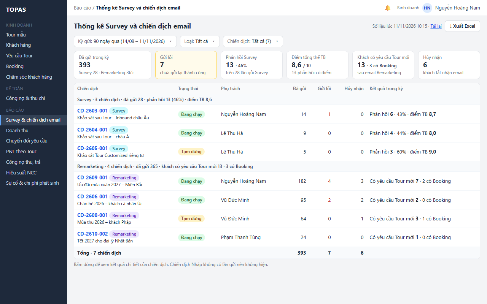

2. **W01 · Ô Loại, ô Chiến dịch ở thanh lọc.** Chọn Loại Survey thì bảng chỉ còn nhóm Survey, thẻ Khách có yêu cầu Tour mới ghi “—”; chọn một hoặc nhiều chiến dịch thì thẻ và bảng tính lại theo các chiến dịch đó (cùng khung W01). Danh sách Chiến dịch gồm mọi chiến dịch không phải Nháp, nhóm theo loại.

*Kết quả:* người dùng biết trong kỳ đã gửi bao nhiêu, kết quả từng chiến dịch, chiến dịch nào có lỗi gửi.

**L1.2 Xem kết quả một chiến dịch Survey.** *Điều kiện:* như L1.1.

1. **W02 · Bấm dòng CD-2603-001 → bảng trượt.** Bảng trượt ghi tên chiến dịch, kỳ gửi và số phiên bản nội dung Survey trong kỳ. Năm thẻ: Đã gửi 14, Phản hồi 6 · 43%, Chờ phản hồi 5 (link còn hạn), Hết hạn 3, Gửi lỗi 1 (Đã gửi = Phản hồi + Chờ phản hồi + Hết hạn). Biểu đồ phân bố điểm tổng thể 0–10 (TB 8,7 trên 6 phản hồi); bảng điểm trung bình từng câu chọn mức và câu chọn đáp án của mẫu; danh sách ý kiến, mới nhất trước, kèm khách, Tour Code, điểm (R05). Dòng CD-2603-001 tô xanh nhạt.

   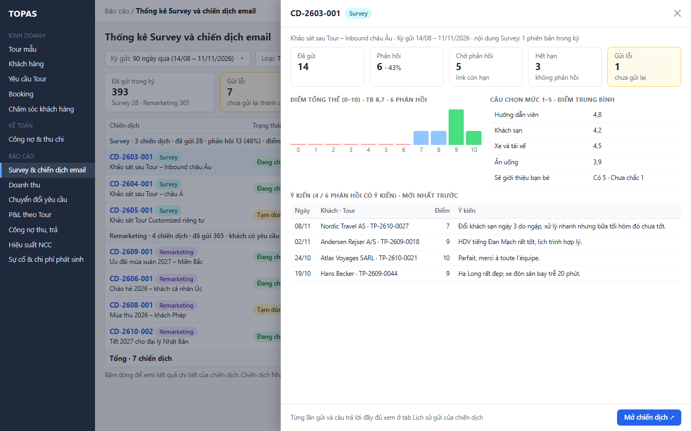

2. **W02 → KD10 · Nút Mở chiến dịch ↗ ở chân bảng trượt.** Mở KD10 của CD-2603-001 ở tab Lịch sử gửi, nơi xem từng lần gửi và câu trả lời đầy đủ (RSD KD10). Quay lại thì QT06 mở lại bảng trượt (R14).

*Kết quả:* người phụ trách biết khách đánh giá gì, câu nào điểm thấp (Ăn uống 3,9), để điều chỉnh dịch vụ hoặc mẫu Survey.

**L1.3 Xem kết quả một chiến dịch Remarketing.** *Điều kiện:* như L1.1.

1. **W03 · Bấm dòng CD-2609-001 → bảng trượt.** Bốn thẻ: Đã gửi 182, Gửi lỗi 4, Hủy nhận 3, Khách có yêu cầu Tour mới 7 · 2 có Booking (4% số khách đã nhận). Bảng Theo bước: bước 1 ngày 15/10 Đã gửi 182; bước 2 ngày 19/11 Sắp gửi, dự kiến 179 khách; bước 3 ngày 10/12 Chờ (RSD KD10 2.4, R09). Bảng Khách có yêu cầu Tour mới sau lần gửi đầu tiên: khách, mã yêu cầu, ngày tạo, trạng thái yêu cầu (kèm mã Booking nếu có), người phụ trách yêu cầu. Câu chú thích nói rõ cách đếm và rằng số này không khẳng định khách đặt vì email (R05).

   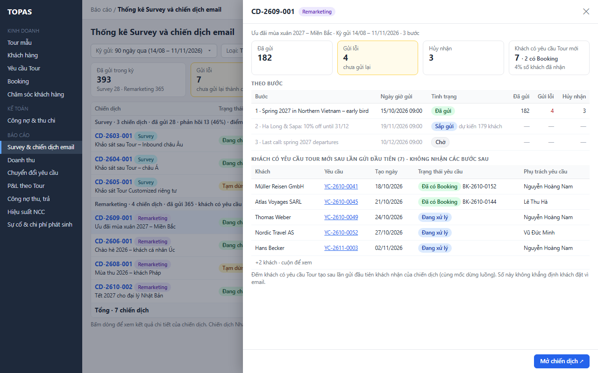

2. **W03 → KD06 · Mã yêu cầu trong bảng.** Bấm YC-2610-0049 mở KD06 ở tab đích theo quyền của người xem (RSD KD06 R06; yêu cầu do người khác phụ trách thì chỉ xem). Nút Mở chiến dịch ↗ ở chân mở KD10 như L1.2 bước 2.

*Kết quả:* người dùng thấy Remarketing kéo được khách nào quay lại, để Kinh doanh phụ trách theo dõi tiếp yêu cầu.

**Ngoại lệ**

- **E1.1 Chiến dịch có nhiều phiên bản nội dung trong kỳ.** Người phụ trách tạm dừng, đổi mẫu Survey rồi bật lại (RSD KD10 R10, R14): bảng trượt W02 tách phần điểm từng câu theo phiên bản nội dung (“Phiên bản 1 · 14/08 – 20/09”, “Phiên bản 2 · từ 21/09”); điểm tổng thể vẫn gộp vì cùng thang 0–10. Mẫu không có câu điểm tổng thể thì thẻ Điểm tổng thể TB ghi “—” và bảng trượt bỏ biểu đồ.
- **E1.2 Không có phản hồi.** Chiến dịch Survey có lần gửi nhưng chưa ai trả lời: Kết quả ghi “Phản hồi 0 · 0%”, bảng trượt chỉ có thẻ số, phần điểm và ý kiến ghi “Chưa có phản hồi trong kỳ”.
- **E1.3 Lần gửi lỗi được gửi lại thành công** sau lúc tải: số Gửi lỗi chỉ giảm ở lần tải kế tiếp (Tải lại, R03); lần gửi tính vào Đã gửi theo kỳ của lần gửi gốc (R05).
- **E1.4 Chiến dịch bị xóa.** Chỉ chiến dịch Nháp xóa được và Nháp không có lần gửi (RSD KD10 R15), nên không ảnh hưởng số liệu. Chiến dịch vừa xóa ở phiên khác mà còn trong ô Chiến dịch: lần tải kế tiếp bỏ khỏi danh sách và bộ lọc.
- **E1.5 Khách đã bị xóa.** Khách chưa có lần gửi mới xóa được (RSD KD03-KD04 R05), nên mọi khách trong QT06 còn tồn tại.
- **E1.6 Yêu cầu do người khác phụ trách.** Với Kinh doanh và Quản trị hệ thống, mã yêu cầu ở W03 vẫn mở được KD06 ở chế độ chỉ xem (RSD KD06 R01). Điều hành, Kế toán không truy cập KD06 nên mã yêu cầu hiện chữ thường, không mở (E8.8).

### 3.2. QT07 · Báo cáo doanh thu

**L2.1 Xem doanh thu các Tour kết thúc trong kỳ.** *Điều kiện:* người dùng đang hoạt động (1.4).

1. **W05 · Menu Báo cáo → Doanh thu.** Báo cáo mở với Kỳ kết thúc Tour Tháng trước (10/2026), Khách hàng Tất cả, Người phụ trách Tất cả, Nhóm theo Không nhóm (R02). Chip: Tất cả 8, Đã quyết toán 5, Chưa quyết toán 2, Hồ sơ chưa kết thúc 1. Ba thẻ:
   - Giá trị Booking hiệu lực ≈ 4.401 triệu ₫ (65.600 EUR · 41.300 USD · 58.400 AUD · 486.000.000 ₫);
   - Đã thu ≈ 4.325 triệu ₫ (65.600 EUR · 38.360 USD · 58.400 AUD · 486.000.000 ₫);
   - Doanh thu quyết toán 3.147 triệu ₫, 5/8 Booking đã quyết toán.

   Mỗi Booking một dòng, xếp theo ngày về: mã Booking và khách, Tour Code và thời gian, người phụ trách, Giá trị Booking và Đã thu theo loại tiền gốc (còn thiếu thì ghi “còn …” màu cam), Doanh thu quyết toán VND, Tình trạng (R06). BK-2609-0119 đã hủy: giá trị gạch ngang, ghi “không cộng vào tổng”; đã thu 3.780 USD là phần khách chịu; doanh thu quyết toán 98.180.000 ₫ là phí giữ lại đã quy đổi (RSD DH08 R15). Dòng tổng tách theo loại tiền.

   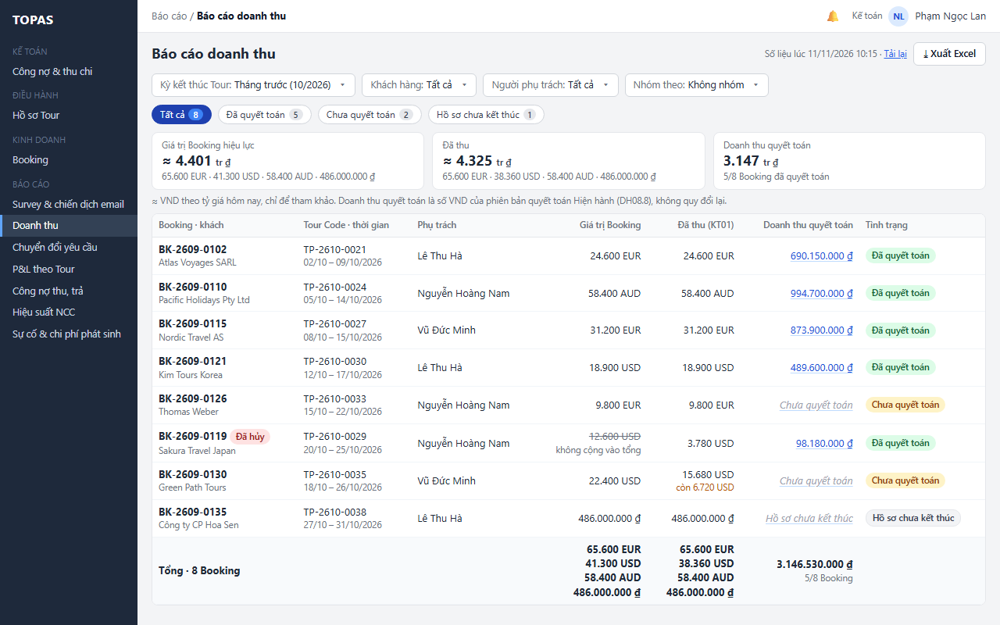

2. **W05 · Chip Chưa quyết toán.** Bảng còn BK-2609-0126 và BK-2609-0130; thẻ tính lại theo chip (cùng khung W05). Kế toán biết hai Tour cần quyết toán.

*Kết quả:* Kế toán thấy giá trị đã bán, tiền đã thu và doanh thu chính thức của các Tour kết thúc trong tháng, cùng Tour nào chưa quyết toán.

**L2.2 Nhóm theo người phụ trách hoặc khách hàng.** *Điều kiện:* như L2.1.

1. **W06 · Ô Nhóm theo → Người phụ trách.** Bảng thêm dòng nhóm cho mỗi người phụ trách: tên, số Booking, giá trị và đã thu theo loại tiền, doanh thu quyết toán, “n/m đã quyết toán”; các Booking của người đó nằm dưới. Ô Nhóm theo viền xanh; Xóa bộ lọc xuất hiện. Nhóm theo Khách hàng làm tương tự. Chip và thẻ không đổi.

   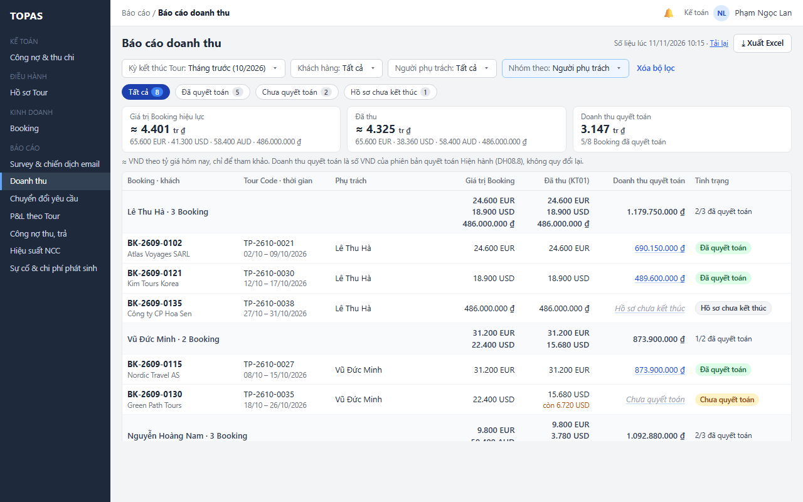

*Kết quả:* người xem so được doanh số từng người mà không phải lọc từng người.

**L2.3 Khoan sâu tới Booking và quyết toán.** *Điều kiện:* như L2.1.

1. **W05 → KD08 · Bấm dòng.** Mở Booking ở KD08 theo tab mặc định và quyền của người xem ở KD08 (RSD KD08 1.2, 1.4); không có quyền thì theo E8.8.
2. **W05 → DH08.8 · Bấm số hoặc chữ trong ô Doanh thu quyết toán.** Mở tab Quyết toán của hồ sơ Tour theo quyền ở DH08 (Kinh doanh chỉ xem). Ô ghi “Chưa quyết toán” hoặc “Hồ sơ chưa kết thúc” cũng mở DH08.8, nơi hiện lý do (RSD DH08 E8.1). Quay lại giữ ngữ cảnh (R14).

*Kết quả:* người dùng đi thẳng tới nơi sửa lịch thanh toán, ghi thu hoặc lưu quyết toán.

**Ngoại lệ**

- **E2.1 Chưa có dữ liệu công nợ.** KT01 không trả số cho một Booking: ô Đã thu ghi “Chưa có dữ liệu công nợ” (BOI-CANH), không coi là 0; thẻ Đã thu ghi “n/m Booking có dữ liệu”.
- **E2.2 Chưa có tỷ giá** cho một loại tiền (QT05 không có ngày nào ≤ hôm nay có tỷ giá của loại tiền đó, BOI-CANH: Tỷ giá có hiệu lực): số ≈ VND của thẻ bỏ phần loại tiền đó, ghi “chưa gồm AUD · chưa có tỷ giá” (R04). Hôm nay chưa nhập nhưng có ngày trước đó thì dùng tỷ giá ngày đó, thẻ ghi “tỷ giá ngày dd/mm”. Số theo loại tiền gốc vẫn đủ.
- **E2.3 Booking đổi giá trị sau Chuyển sang Điều hành** (RSD KD08 R09): báo cáo luôn hiện giá trị hiện hành ở lần tải; ngày về đổi thì Booking có thể chuyển kỳ.
- **E2.4 Quyết toán lưu phiên bản mới.** Doanh thu quyết toán đổi theo phiên bản Hiện hành ở lần tải kế tiếp; báo cáo không giữ số của phiên bản cũ.
- **E2.5 Booking đã hủy chưa điều chỉnh ở KT01** (Chờ điều chỉnh, RSD KT01 R07): Đã thu vẫn hiện số thực thu; ô Doanh thu quyết toán ghi “Chưa quyết toán”, vì DH08.8 chưa lưu được (RSD DH08 E8.9).

### 3.3. QT08 · Báo cáo chuyển đổi yêu cầu và báo giá

**L3.1 Xem chuyển đổi theo người phụ trách.** *Điều kiện:* người dùng đang hoạt động (1.4).

1. **W08 · Menu Báo cáo → Chuyển đổi yêu cầu.** Báo cáo mở ở mục Tổng hợp, Kỳ tạo yêu cầu 90 ngày qua, Nhóm theo Người phụ trách (R02). Bốn ô của phễu: Yêu cầu tạo trong kỳ 64 (Đang xử lý 30), Có báo giá 50 · 78%, Chốt Booking 19 · 30% số yêu cầu · 38% số có báo giá (đang có Booking 17, Booking đã hủy 2), Đã hủy 17 · 27%. Bảng theo người phụ trách: Yêu cầu, Có báo giá, Chốt Booking, Tỷ lệ chốt kèm thanh, Đang có Booking, Đã hủy, Đang xử lý; mỗi số có gạch chân là bấm được. Trần Quốc Bảo hiện kèm “(ngừng hoạt động)” với 3 yêu cầu đã chốt hoặc đã hủy (R07). Khối Lý do hủy bên phải: 6 lý do, tổng 17. Đếm theo yêu cầu, không theo phiên bản báo giá.

   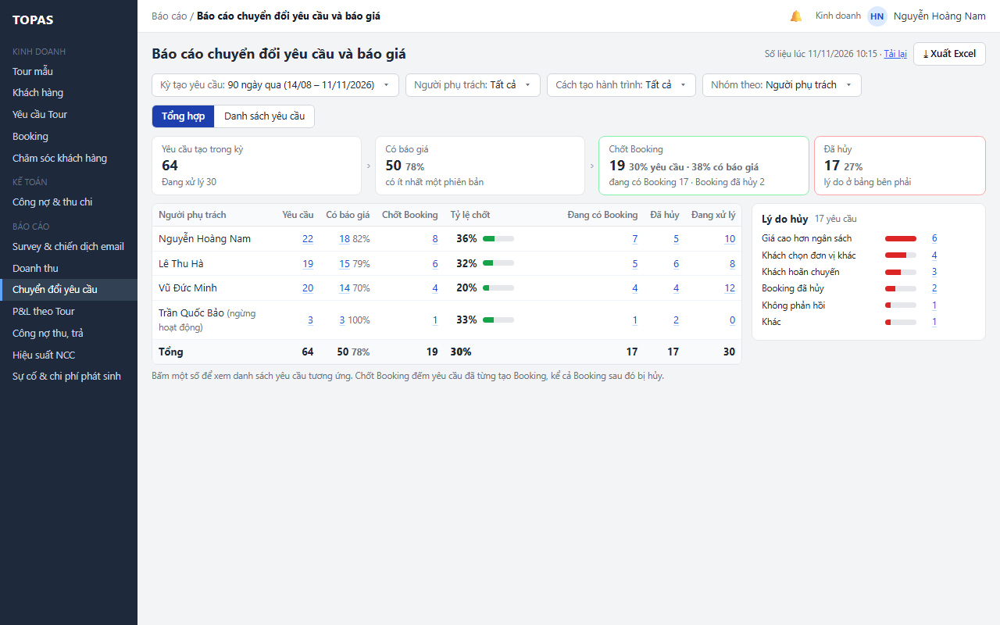

*Kết quả:* Kinh doanh biết tỷ lệ chốt chung và của từng người, lý do mất khách lớn nhất (giá cao hơn ngân sách).

**L3.2 So sánh theo cách tạo hành trình.** *Điều kiện:* như L3.1.

1. **W09 · Ô Nhóm theo → Cách tạo hành trình.** Bảng đổi sang các nhóm Bằng AI 26, Từ Tour mẫu 21, Thủ công 11, Chưa có hành trình 6; phễu và Lý do hủy giữ nguyên vì cùng tập yêu cầu. Từ Tour mẫu có tỷ lệ chốt 38%, Bằng AI 31%. Ô Cách tạo hành trình ở thanh lọc dùng khi chỉ muốn xem một cách (R07).

   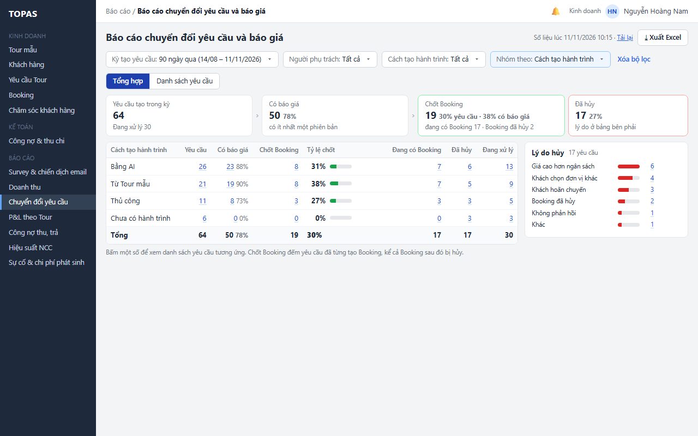

*Kết quả:* doanh nghiệp đánh giá được hiệu quả của tạo hành trình bằng AI và Tour mẫu.

**L3.3 Xem danh sách yêu cầu sau một con số.** *Điều kiện:* như L3.1.

1. **W10 · Bấm số 5 ở cột Đã hủy, dòng Nguyễn Hoàng Nam (W08).** Báo cáo chuyển sang mục Danh sách yêu cầu (5) với thẻ lọc “Phụ trách: Nguyễn Hoàng Nam”, “Trạng thái: Đã hủy”, ghi “trong 22 yêu cầu của kỳ”. Mỗi yêu cầu một dòng: mã và khách, ngày tạo, cách tạo hành trình, báo giá mới nhất (số phiên bản và kết quả), trạng thái, lý do hủy (Booking đã hủy kèm mã Booking và ngày hủy). Bấm ✕ trên thẻ để bỏ từng điều kiện; bấm mục Tổng hợp để về bảng tổng hợp với bộ lọc chung giữ nguyên. Bấm một lý do ở khối Lý do hủy cho danh sách lọc theo lý do đó.

   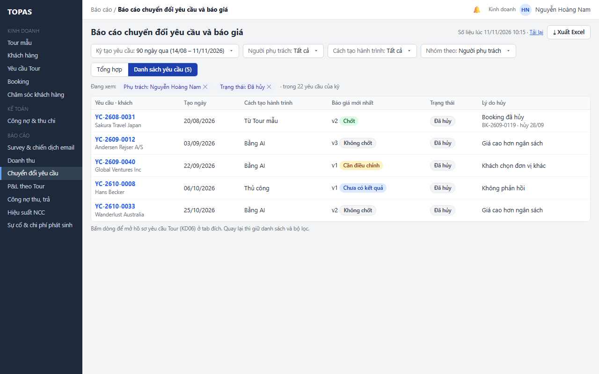

2. **W10 → KD06 · Bấm dòng.** Mở KD06 ở tab đích (RSD KD06 R06): yêu cầu đã hủy mở chỉ xem, có nút Mở lại yêu cầu nếu người xem là người phụ trách hoặc Quản trị hệ thống (Quản trị chọn người phụ trách mới; RSD KD06 R22). Quay lại giữ mục Danh sách và thẻ lọc (R14).

*Kết quả:* từ một con số, người dùng tới ngay từng yêu cầu để xem vì sao hủy hoặc mở lại khi khách quay lại.

**Ngoại lệ**

- **E3.1 Yêu cầu được mở lại.** Yêu cầu Đã hủy được mở lại (RSD KD06 R22) về Đang xử lý ở lần tải kế tiếp; vẫn là một yêu cầu, không đếm hai lần; lý do hủy cũ không còn trong khối Lý do hủy.
- **E3.2 Yêu cầu đổi người phụ trách.** Đếm theo người phụ trách hiện tại (RSD KD05 R08, KD08 R11); chuyển phụ trách làm số của hai người đổi ở lần tải kế tiếp. Yêu cầu Đã hủy giữ người phụ trách cũ trừ khi Quản trị mở lại kèm người mới.
- **E3.3 Booking của yêu cầu bị hủy.** Yêu cầu tự Đã hủy với lý do “Booking đã hủy” (RSD KD06 R21) nhưng vẫn tính vào Chốt Booking vì đã từng tạo Booking (R07); phễu tách “Booking đã hủy n”.
- **E3.4 Lý do hủy chuyển Ngừng dùng ở QT05.** Yêu cầu đã hủy với lý do đó vẫn đếm theo tên lý do lúc hủy, kèm “(ngừng dùng)”. “Booking đã hủy” và “Khác” là giá trị hệ thống, không tắt được (RSD QT05 R06).
- **E3.5 Yêu cầu chưa có hành trình** nằm ở nhóm Chưa có hành trình; Có báo giá luôn bằng 0 ở nhóm này.
- **E3.6 Danh sách dài.** Mục Danh sách yêu cầu phân trang 50 dòng, sắp theo ngày tạo giảm dần.

### 3.4. QT09 · Báo cáo P&L theo Tour

**L4.1 Xem P&L các Tour đóng trong kỳ.** *Điều kiện:* người dùng đang hoạt động (1.4).

1. **W11 · Menu Báo cáo → P&L theo Tour.** Báo cáo mở với Kỳ đóng Tour Tháng trước (10/2026) theo ngày đóng lần đầu (R02, R08). Chip Tất cả 7, Đã quyết toán 6, Chưa quyết toán 1; công tắc Chỉ Tour lỗ. Năm thẻ: Doanh thu thực tế 3.658,9 triệu ₫ (6/7 Tour đã quyết toán), Chi phí thực tế 3.131,3 triệu ₫ (điều chỉnh ròng +3,5), P&L thực tế 531,1 triệu ₫ · biên 14,5%, So với dự tính −195,2 triệu ₫ (vàng), Tour lỗ 1 (đỏ). Bảng đơn vị nghìn ₫, mỗi Tour một dòng: Tour Code và khách, ngày đóng, Kinh doanh phụ trách Booking và Điều hành phụ trách hồ sơ, Doanh thu, Chi phí, Điều chỉnh, P&L thực tế, Biên, P&L dự tính, Chênh lệch (R08).
   - TP-2610-0027 lỗ 25,3 triệu, tô đỏ, chỉ báo Đã mở lại; lệch −193,3 triệu so với dự tính.
   - TP-2610-0030 có chỉ báo “KT01 có giao dịch mới” (RSD DH08 E8.8): số trên dòng là của phiên bản đã lưu.
   - TP-2610-0033 ghi “Chưa quyết toán · không tính vào tổng”.
   - TP-2610-0029 có nhãn Booking đã hủy; P&L dự tính và chênh lệch ghi “—”.

   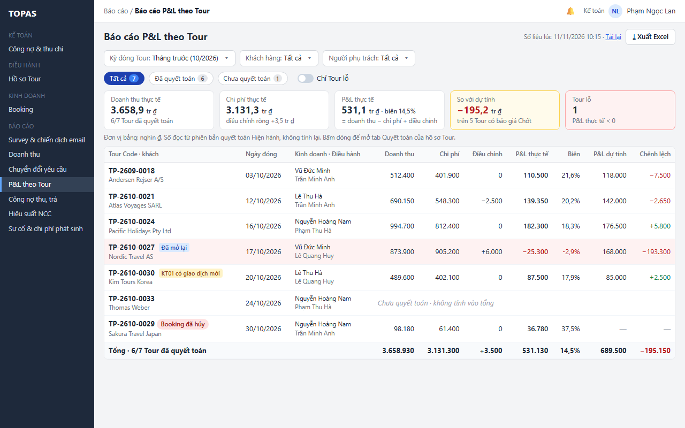

2. **W11 → DH08.8 · Bấm dòng.** Mở tab Quyết toán của hồ sơ Tour, nơi xem phiên bản và lưu quyết toán mới (RSD DH08 L8.2). Kế toán bấm TP-2610-0030 để lưu lại quyết toán theo giao dịch mới.
3. **W11 · Công tắc Chỉ Tour lỗ.** Bảng còn TP-2610-0027; chip giữ nguyên, thẻ tính theo bộ lọc (cùng khung W11).

*Kết quả:* Kế toán biết lãi lỗ của tháng, Tour nào lỗ, Tour nào lệch dự tính, Tour nào cần quyết toán hoặc quyết toán lại.

**Ngoại lệ**

- **E4.1 Tour đóng nhưng chưa quyết toán.** Hiện dòng “Chưa quyết toán · không tính vào tổng”; thẻ ghi mẫu số “n/m Tour đã quyết toán” (RSD DH08 R16: đóng Tour không cần quyết toán).
- **E4.2 Tour mở lại sau khi đóng.** Ngày đóng lần đầu giữ nguyên nên Tour vẫn thuộc kỳ cũ, kèm chỉ báo Đã mở lại; số liệu theo phiên bản quyết toán Hiện hành, kể cả khi đã mở lại (RSD DH08 R16).
- **E4.3 KT01 có giao dịch mới sau quyết toán.** Chỉ báo “KT01 có giao dịch mới” như ở DH08.8 (RSD DH08 E8.8); báo cáo không tự tính lại; Kế toán lưu phiên bản mới ở DH08.8 thì chỉ báo mất ở lần tải kế tiếp.
- **E4.4 Booking đã hủy.** Doanh thu là phí giữ lại, chi phí là phí hủy NCC và chi phí đã phát sinh (RSD DH08 R15); không có P&L dự tính, cột Dự tính và Chênh lệch ghi “—” và dòng không tính vào thẻ So với dự tính.
- **E4.5 Phiên bản quyết toán chưa có P&L dự tính** (lưu trước khi DH08 bổ sung trường này, mục 5.1): ô ghi “—”, dòng không tính vào thẻ So với dự tính.
- **E4.6 Doanh thu bằng 0** (ví dụ Tour tặng): Biên ghi “—”.

### 3.5. QT10 · Báo cáo công nợ phải thu và phải trả

**L5.1 Xem tuổi nợ phải thu.** *Điều kiện:* người dùng đang hoạt động (1.4).

1. **W13 · Menu Báo cáo → Công nợ thu, trả.** Báo cáo mở ở mục Phải thu khách hàng, tính tại hôm nay theo loại tiền gốc (R09). Bốn thẻ: Còn phải thu ≈ 1.283 triệu ₫, Quá hạn ≈ 560 triệu ₫ (đỏ), Đến hạn trong 7 ngày ≈ 351 triệu ₫ (vàng), Cần hoàn cho khách ≈ 72 triệu ₫; dòng dưới mỗi thẻ ghi số theo từng loại tiền. Mỗi dòng là một khách và một loại tiền: Còn hạn, Đến hạn, Quá hạn 1–30, 31–60, 61–90, Trên 90, Tổng còn, Cần hoàn; dòng phụ ghi số Booking hoặc khoản và hạn sớm nhất. Thứ tự: khách có nhóm quá hạn lâu nhất trước (Công ty CP Hoa Sen 145.800.000 ₫ quá hạn trên 90 ngày).

   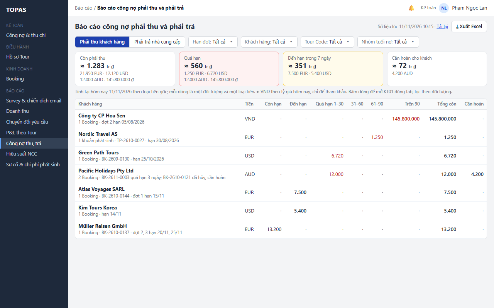

*Kết quả:* Kế toán biết khách nào cần đòi trước và khoản nào cần hoàn.

**L5.2 Xem tuổi nợ phải trả.** *Điều kiện:* như L5.1.

1. **W14 · Mục Phải trả nhà cung cấp.** Cùng cấu trúc, mỗi dòng một NCC và một loại tiền; cột cuối là Phải nhận hoàn (RSD KT01 R09). Dải thông tin xanh: “7 dịch vụ đã xác nhận ở hồ sơ Tour đang Chờ ghi phải trả nên chưa có trong báo cáo này”, kèm liên kết Mở KT01.2 · Chờ ghi phải trả (R09).

   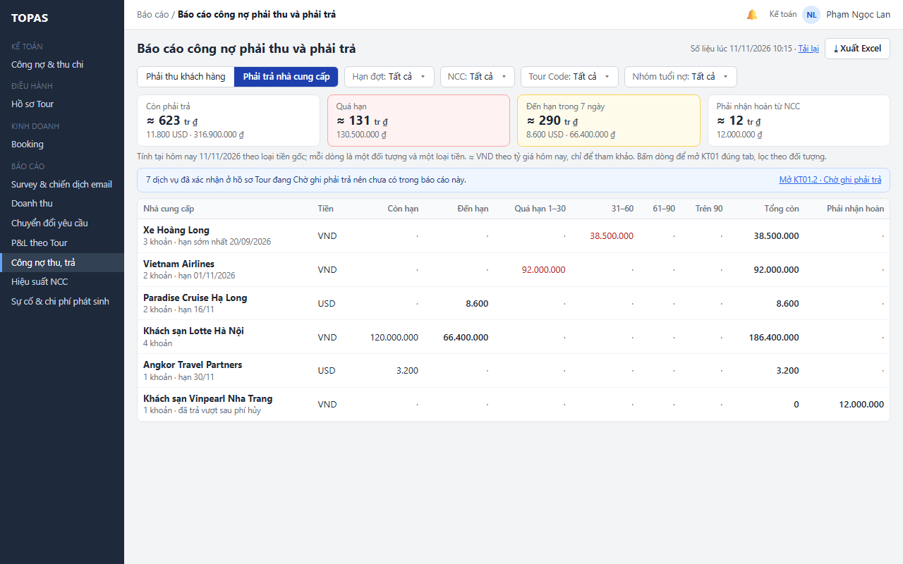

*Kết quả:* Kế toán lên kế hoạch trả NCC theo hạn và biết còn dịch vụ chưa ghi phải trả.

**L5.3 Lọc theo nhóm tuổi nợ.** *Điều kiện:* như L5.1.

1. **W15 · Ô Nhóm tuổi nợ → Quá hạn trên 60 ngày.** Bảng còn hai khách có đợt quá hạn trên 60 ngày (Công ty CP Hoa Sen, Nordic Travel AS); dòng vẫn hiện đủ các cột để thấy toàn bộ nợ của khách; thẻ tính theo các dòng còn lại. Các lựa chọn khác: Có quá hạn, Quá hạn trên 30 ngày, Quá hạn trên 90 ngày, Đến hạn trong 7 ngày, Có cần hoàn. Ô Hạn đợt lọc đợt theo khoảng hạn; ô Tour Code lọc khoản liên kết Tour (R09).

   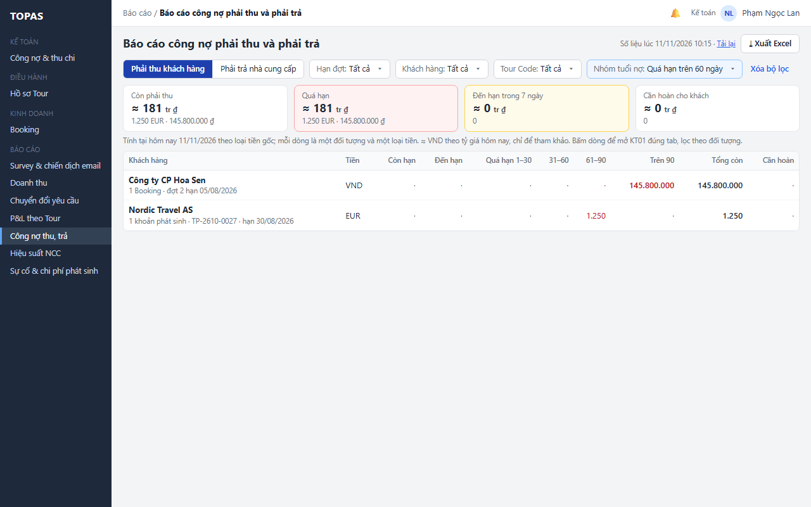

*Kết quả:* Kế toán tập trung vào nợ khó đòi.

**L5.4 Khoan sâu tới sổ công nợ.** *Điều kiện:* như L5.1.

1. **W13 → KT01.1 · Bấm dòng Green Path Tours · USD.** Mở KT01.1 lọc theo khách Green Path Tours, chip Quá hạn (nhóm xấu nhất của dòng); dòng NCC mở KT01.2 lọc theo NCC (RSD KT01 1.2). Kế toán ghi thu hoặc ghi giao dịch ở KT01; quay lại thì Tải lại để thấy số mới (R03, R14).

*Kết quả:* từ báo cáo, Kế toán tới thẳng nơi ghi thu, ghi chi.

**Ngoại lệ**

- **E5.1 Booking Đã hủy chưa điều chỉnh** (Chờ điều chỉnh, RSD KT01 R07): các đợt của Booking đó không xếp tuổi nợ vì số phải thu chưa xác định; dòng khách có chỉ báo “Chờ điều chỉnh n Booking”, bấm dòng mở KT01.1 chip Chờ điều chỉnh.
- **E5.2 Tiền thừa.** Phần thu vượt của Booking (RSD KT01 R06) cộng vào cột Cần hoàn, không trừ vào Tổng còn của khách.
- **E5.3 Ngưỡng Đến hạn đổi** ở cấu hình: cột Đến hạn, Còn hạn tính lại ở lần tải kế tiếp; tên cột ghi đúng số ngày của ngưỡng (“Đến hạn trong 7 ngày”).
- **E5.4 Một đối tượng nhiều loại tiền** có nhiều dòng liền nhau, mỗi loại tiền một dòng.
- **E5.6 Giao dịch ghi trong lúc xem.** Báo cáo không tự làm mới; số mới có ở lần Tải lại (R03).

### 3.6. QT11 · Báo cáo hiệu suất nhà cung cấp

**L6.1 Xem hiệu suất NCC trong kỳ.** *Điều kiện:* người dùng đang hoạt động (1.4).

1. **W16 · Menu Báo cáo → Hiệu suất NCC.** Báo cáo mở với Kỳ gửi lần đặt 90 ngày qua, NCC Tất cả, Loại dịch vụ Tất cả (R02). Năm thẻ: Lần đặt đã gửi 126 (6 NCC, chờ kết quả 4), Tỷ lệ xác nhận 90% (110/122), Không đáp ứng 12 · 10% (2 NCC từ 20% trở lên), Đã hủy 12 kèm phí hủy theo loại tiền, Giá xác nhận cao hơn tham chiếu 10 lần. Mỗi NCC một dòng: số lần đặt, tỷ lệ xác nhận kèm thanh và “x/y có kết quả · n một phần”, Không đáp ứng (từ 20% trở lên tô đỏ), Chờ kết quả, Đã hủy, Phí hủy, Giá xác nhận so tham chiếu (trung bình % và số lần cao hơn) (R10). Sắp theo số lần đặt giảm dần.

   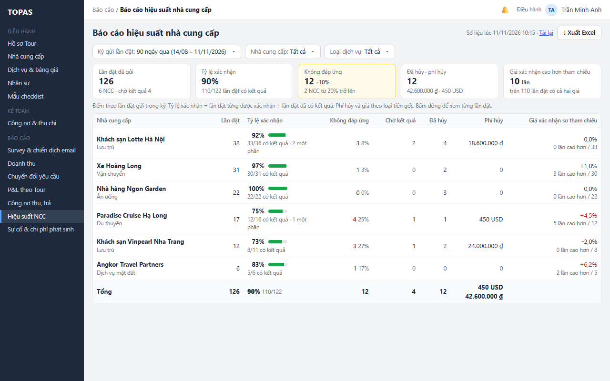

*Kết quả:* Điều hành thấy Paradise Cruise Hạ Long không đáp ứng 25% và xác nhận giá cao hơn tham chiếu trung bình 4,5%, để cân nhắc NCC dự phòng.

**L6.2 Xem từng lần đặt của một NCC.** *Điều kiện:* như L6.1.

1. **W17 · Bấm dòng Paradise Cruise Hạ Long → bảng trượt.** Bảng trượt ghi kỳ và đơn vị giá; chip Tất cả 17, Đã xác nhận 11, Không đáp ứng 4, Đã gửi 1, Đã hủy 1 (kết quả hiện tại của lần đặt, RSD DH08 2.3). Mỗi lần đặt một dòng: Tour Code, dịch vụ, ngày sử dụng, ngày gửi, kết quả kèm lý do hoặc phí hủy, số lượng xác nhận trên yêu cầu, giá tham chiếu, giá xác nhận, chênh lệch (dương tô đỏ).

   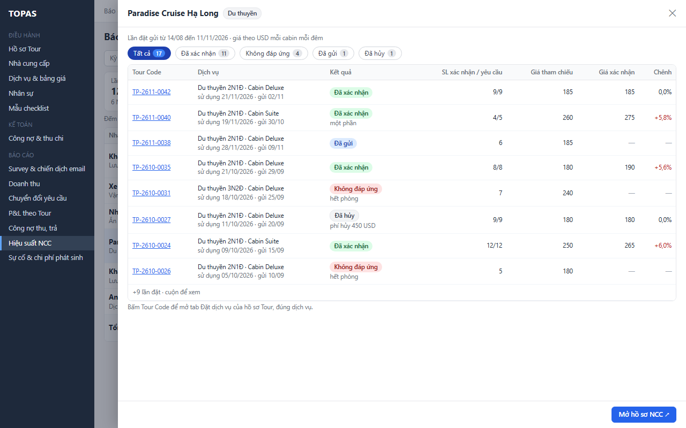

2. **W17 → DH08.3 · Bấm Tour Code.** Mở tab Đặt dịch vụ của hồ sơ Tour, bảng trượt của đúng hạng mục, nơi xem lịch sử các lần đặt (RSD DH08 mục 3.3).
3. **W17 → DH03 · Nút Mở hồ sơ NCC ↗ ở chân.** Mở DH03.1 của NCC (RSD DH03 1.2), nơi xem hợp đồng, bảng giá, đổi cho phép sử dụng.

*Kết quả:* Điều hành kiểm được từng lần NCC không đáp ứng hoặc báo giá khác, rồi xử lý ở hồ sơ NCC.

**Ngoại lệ**

- **E6.1 Giá xác nhận khác loại tiền với giá tham chiếu** (Điều hành sửa loại tiền khi ghi kết quả, RSD DH08 R10): lần đặt không tính vào chênh giá; ô ghi “—” và dòng NCC ghi “n lần khác loại tiền, không so”.
- **E6.2 Lần đặt không có giá tham chiếu** (hạng mục thêm tay, NCC không có bảng giá): không tính vào chênh giá; ô Giá tham chiếu ghi “—”.
- **E6.3 Email đặt gộp nhiều dịch vụ** (RSD DH08 R04): mỗi dịch vụ là một lần đặt riêng, đếm riêng.
- **E6.4 NCC ngừng sử dụng** vẫn hiện nếu có lần đặt trong kỳ, tên kèm “(ngừng sử dụng)”.
- **E6.5 Hồ sơ Tour đã đóng.** Tour Code vẫn mở DH08.3 ở chế độ chỉ đọc (RSD DH08 R16).
- **E6.6 Lọc Loại dịch vụ.** NCC cung cấp nhiều loại chỉ đếm lần đặt của loại đang lọc; dòng phụ dưới tên NCC ghi loại có nhiều lần đặt nhất khi không lọc.

### 3.7. QT12 · Báo cáo sự cố và chi phí phát sinh

**L7.1 Xem sự cố và chi phí phát sinh theo Tour.** *Điều kiện:* người dùng đang hoạt động (1.4).

1. **W18 · Menu Báo cáo → Sự cố & chi phí phát sinh.** Báo cáo mở với Kỳ phát sinh Tháng trước (10/2026), Tour Code Tất cả, Điều hành phụ trách Tất cả (R02); hai công tắc Có sự cố đang xử lý, Có khoản chưa ghi công nợ. Năm thẻ: Tour có sự cố hoặc chi phí 6, Sự cố 8 · 2 đang xử lý (vàng), Chi phí phát sinh ≈ 102 triệu ₫ (8 khoản), Gợi ý thu lại khách 1.250 EUR, Chưa ghi công nợ 2 khoản (vàng). Mỗi Tour một dòng: Tour Code và khách, thời gian Tour, Điều hành phụ trách, Sự cố (số, số đang xử lý), Chi phí phát sinh (tổng theo loại tiền, số khoản, số khoản từ sự cố), Gợi ý thu lại khách, Chưa ghi công nợ (R11). Không có cột loại sự cố vì nguồn chưa phân loại.

   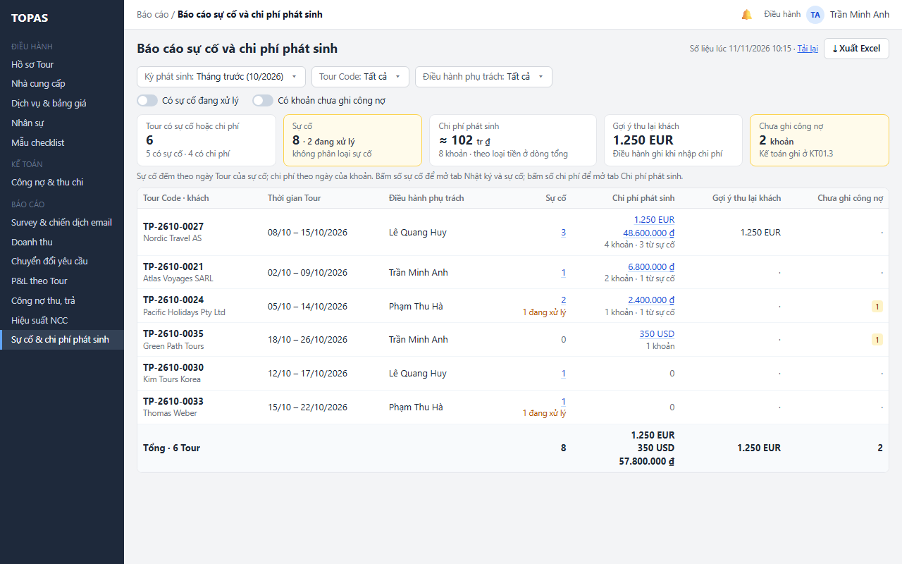

2. **W18 → DH08.6 · Bấm số sự cố (3, dòng TP-2610-0027).** Mở tab Nhật ký và sự cố của hồ sơ Tour, lọc Sự cố trong kỳ của báo cáo (RSD DH08 L6.1).
3. **W18 → DH08.7 · Bấm số chi phí phát sinh.** Mở tab Chi phí phát sinh của hồ sơ Tour (RSD DH08 L7.1); dòng có khoản chưa ghi công nợ mở với chip Chưa ghi công nợ.

*Kết quả:* Điều hành biết Tour nào gặp nhiều sự cố, chi phí phát sinh bao nhiêu, phần nào gợi ý thu lại khách.

**L7.2 Kế toán tìm khoản chưa ghi công nợ.** *Điều kiện:* như L7.1; thường là Kế toán.

1. **W19 · Công tắc Có khoản chưa ghi công nợ.** Bảng còn 2 / 6 Tour (TP-2610-0024, TP-2610-0035); thẻ tính theo hai Tour này. Kế toán bấm số chi phí để mở DH08.7 chip Chưa ghi công nợ, chọn khoản và Ghi công nợ tại KT01.3 (RSD DH08 L7.2).

   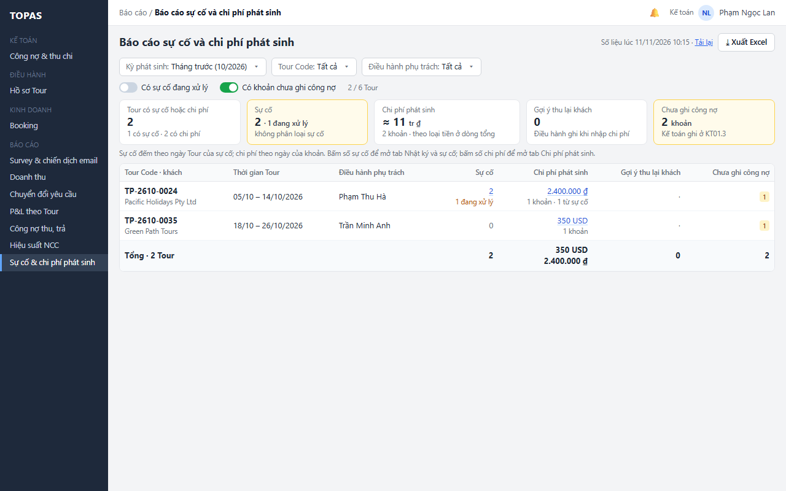

*Kết quả:* Kế toán không bỏ sót chi phí phát sinh chưa vào sổ công nợ.

**Ngoại lệ**

- **E7.1 Tour không có sự cố hay chi phí trong kỳ** không hiện; tìm Tour Code như vậy ra trạng thái rỗng (W22).
- **E7.2 Sự cố có chi phí** (RSD DH08 L6.2): đếm một sự cố và một khoản chi phí; khoản ghi vào “từ sự cố”, không đếm hai lần trong tổng tiền.
- **E7.3 Khoản đã ghi công nợ rồi được KT01 điều chỉnh số tiền** (RSD DH08 E7.2): báo cáo hiện số tiền của khoản ở DH08.7 (số Điều hành ghi), không đọc số đã điều chỉnh ở KT01; ghi rõ trong chú thích R11.
- **E7.4 Booking đã hủy** khi Tour đang diễn ra: sự cố và chi phí đã ghi vẫn tính.
- **E7.5 Điều hành phụ trách trống** (hồ sơ chưa giao, RSD DH07): ghi “Chưa giao”; bộ lọc Điều hành phụ trách có lựa chọn Chưa giao.

### 3.8. Thao tác và ngoại lệ dùng chung

**L8.1 Chọn kỳ.** *Điều kiện:* người dùng đang hoạt động.

1. **W20 · Ô Kỳ ở thanh lọc → bảng chọn.** Tiêu đề bảng chọn ghi mốc lọc của báo cáo (ví dụ “Mốc lọc: ngày kết thúc Tour”). Chọn nhanh, áp dụng ngay: Tháng này, Tháng trước, Quý này, Quý trước, 90 ngày qua, Năm nay, Năm trước; mỗi lựa chọn ghi khoảng ngày cụ thể bên phải. Khoảng tùy chọn: nhập Từ, Đến rồi bấm Áp dụng (kiểm tra theo E8.5). Thẻ, chip và bảng tính lại; ô Kỳ viền xanh khi khác mặc định (R02).

   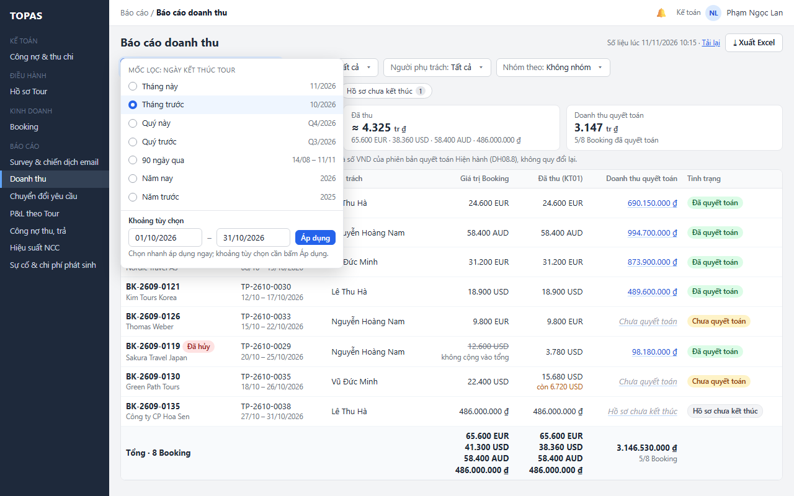

*Kết quả:* báo cáo tính theo kỳ mới; bộ lọc được nhớ trong phiên (R14).

**L8.2 Xuất Excel theo bộ lọc.** *Điều kiện:* có ít nhất một dòng.

1. **W05 · Nút Xuất Excel ở tiêu đề.** Nút đổi thành “Đang xuất…” và khóa tới khi xong; báo cáo vẫn dùng được.
2. **W21 · Tệp tải về, thông báo ngắn.** Hệ thống tạo tệp gồm mọi dòng khớp bộ lọc, chip, công tắc và phạm vi quyền (mọi trang), không theo phần đang cuộn tới; tệp có trang Tổng hợp như trên màn và trang Chi tiết khi báo cáo có (R13). Thông báo ngắn ghi tên tệp, số dòng, số trang tính. Lần xuất ghi QT03 (thao tác Xuất tệp, nhạy cảm).

   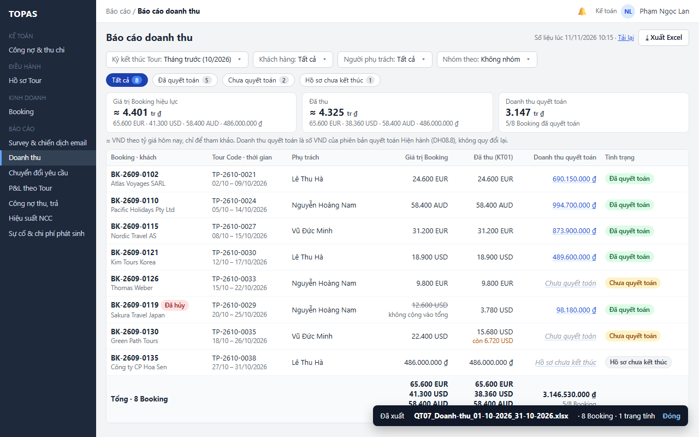

*Kết quả:* người dùng có tệp để lưu hoặc gửi nội bộ; lần xuất có dấu vết.

**Ngoại lệ**

- **E8.1 Không có dòng khớp bộ lọc (W22).** Thẻ về 0, bảng ghi “Không có … khớp bộ lọc” kèm lý do cụ thể khi suy được (ví dụ Tour TP-2611-0042 đi 18/11 – 25/11 nên không có chi phí trong 10/2026) và gợi ý đổi Kỳ hoặc bấm Xóa bộ lọc ở cuối thanh lọc. Xuất Excel khóa, cạnh nút ghi “Không có dòng để xuất”.

  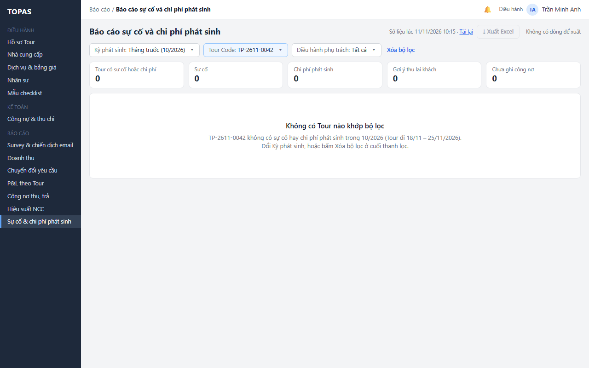

- **E8.2 Lỗi tải số liệu (W23).** Máy chủ lỗi hoặc quá 30 giây: thẻ ghi “–”, bảng ghi “Không tải được số liệu báo cáo”, nút Thử lại; bộ lọc giữ nguyên; Xuất Excel khóa; dòng “Số liệu lúc …” ẩn. Không hiện số của lần tải trước để tránh đọc nhầm.

  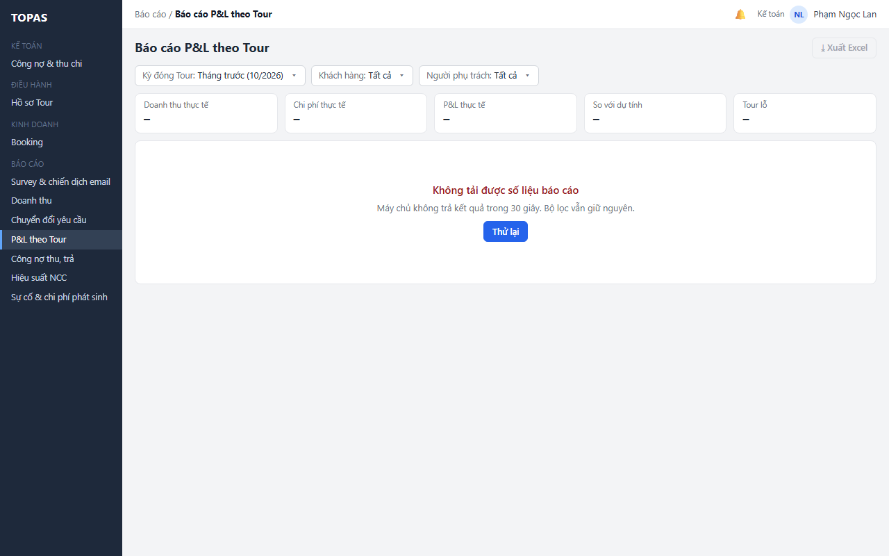

- **E8.3 Tài khoản bị khóa giữa phiên** (RSD QT01): lần tải, khoan sâu hoặc xuất kế tiếp bị từ chối và đưa về trang đăng nhập; báo cáo không hiện số.
- **E8.4 Chưa có dữ liệu.** Hệ thống mới dùng, nguồn chưa có bản ghi nào (ví dụ chưa có quyết toán nào): khung W22 với câu “Chưa có … nào được ghi”, không có gợi ý Xóa bộ lọc.
- **E8.5 Khoảng tùy chọn không hợp lệ.** Từ sau Đến, ngày sai định dạng: lỗi dưới ô “Từ ngày phải trước hoặc bằng Đến ngày”, Áp dụng khóa (khung W20). Khoảng dài hơn 24 tháng: lỗi “Chọn khoảng tối đa 24 tháng” (R02). Bỏ trống một đầu: khoảng mở về phía đó trong giới hạn 24 tháng.
- **E8.6 Lỗi tạo tệp hoặc mất kết nối khi xuất.** Thông báo ngắn “Không xuất được tệp · Thử lại”; không ghi QT03 vì chưa có tệp. Bấm Xuất Excel lặp khi đang xuất không tạo tệp thứ hai (R13).
- **E8.7 Vượt giới hạn xuất.** Trang Chi tiết quá 50.000 dòng: Xuất Excel khóa, cạnh nút ghi số dòng và gợi ý thu hẹp Kỳ (cùng cách hiển thị W22) (R13).
- **E8.8 Không có quyền ở màn đích.** Khoan sâu tới màn người xem không có quyền (ví dụ Điều hành, Kế toán bấm mã yêu cầu ở QT06 hoặc dòng yêu cầu ở QT08, mà hai vai trò này không truy cập KD06, RSD KD06 R01): chỗ bấm hiện chữ thường, không gạch chân, di chuột ghi “Bạn không có quyền xem …”. Bản ghi đích đã bị xóa (chiến dịch Nháp): thông báo ngắn “Bản ghi không còn tồn tại”, báo cáo tải lại.
- **E8.9 Dữ liệu đổi trong lúc xem hoặc xuất.** Báo cáo và tệp là ảnh chụp lúc tải hoặc lúc bắt đầu xuất; thay đổi sau đó chỉ có ở lần Tải lại (R03).

---

## 4. Quy tắc triển khai chi tiết

### R01. Quyền (quyết định 12/11/2026)

- Mọi tài khoản đang hoạt động, mọi vai trò, xem được cả bảy báo cáo với đủ dữ liệu; menu Báo cáo luôn có đủ bảy mục. Không lọc theo người phụ trách hay vai trò; ô Người phụ trách là bộ lọc tự chọn.
- Xuất Excel đi kèm quyền xem: ai xem được thì xuất được, cùng phạm vi dữ liệu (R13).
- Báo cáo không cấp quyền ở màn đích; khoan sâu theo quyền của người xem ở màn đó (R12, E8.8).

### R02. Kỳ, mốc ngày và mặc định

| Báo cáo | Mốc lọc của ô Kỳ | Mặc định | Bộ lọc khác (mặc định Tất cả) |
|---|---|---|---|
| QT06 | Thời điểm gửi gốc của lần gửi; chiến dịch có lịch gửi trong kỳ vẫn hiện (R05) | 90 ngày qua | Loại; Chiến dịch (nhiều) |
| QT07 | Ngày kết thúc Tour = ngày về của Booking (quyết định 12/11/2026) | Tháng trước | Khách hàng; Người phụ trách (Booking); Nhóm theo: Không nhóm, Người phụ trách, Khách hàng |
| QT08 | Thời điểm tạo yêu cầu Tour | 90 ngày qua | Người phụ trách (yêu cầu); Cách tạo hành trình; Nhóm theo: Người phụ trách, Cách tạo hành trình |
| QT09 | Ngày đóng lần đầu của hồ sơ Tour (RSD DH08 R16) | Tháng trước | Khách hàng; Người phụ trách (danh sách nhóm Kinh doanh phụ trách Booking và Điều hành phụ trách hồ sơ) |
| QT10 | Không có kỳ: tính tại hôm nay. Ô Hạn đợt lọc đợt theo khoảng hạn | Hạn đợt Tất cả | Mục Phải thu hoặc Phải trả; Khách hàng hoặc NCC; Tour Code; Nhóm tuổi nợ |
| QT11 | Thời điểm gửi lần đặt | 90 ngày qua | NCC (nhiều); Loại dịch vụ |
| QT12 | Ngày Tour của sự cố; ngày của khoản chi phí phát sinh | Tháng trước | Tour Code (tìm); Điều hành phụ trách; công tắc |

- Kỳ chọn nhanh tính theo lịch Asia/Ho_Chi_Minh; “90 ngày qua” gồm hôm nay và 89 ngày trước; Quý theo quý dương lịch.
- Khoảng tùy chọn tối đa 24 tháng (giới hạn tải); kiểm tra theo E8.5.
- Ô Kỳ luôn ghi tên mốc (“Kỳ gửi”, “Kỳ kết thúc Tour”, “Kỳ tạo yêu cầu”, “Kỳ đóng Tour”, “Kỳ gửi lần đặt”, “Kỳ phát sinh”).

### R03. Thời điểm tính số liệu

- Số liệu tính ở máy chủ, đọc trực tiếp dữ liệu hiện hành của màn sở hữu, tại lúc tải. Không có bảng số liệu chụp sẵn theo ngày.
- Lần tải ghi thời điểm ở tiêu đề (“Số liệu lúc …”). Báo cáo không tự làm mới; Tải lại tính lại với cùng bộ lọc.
- Thời gian tải tối đa 30 giây; quá thì lỗi tải (E8.2).
- Định nghĩa trạng thái dùng chung đọc từ màn sở hữu, không tính lại: trạng thái yêu cầu (RSD KD05 R02), tình trạng đợt và khoản (RSD KT01 R03), trạng thái hạng mục và lần đặt (RSD DH08 R02, 2.3), chỉ báo quyết toán (RSD DH08 R16).

### R04. Tiền và quy đổi

- Số theo loại tiền gốc của nguồn: giá trị Booking và đã thu theo loại tiền Booking; công nợ theo loại tiền của khoản (RSD KT01 R04); phí hủy, giá NCC theo loại tiền của lần đặt; chi phí phát sinh theo loại tiền của khoản.
- Không cộng lẫn loại tiền ở dòng, nhóm, tổng; mỗi loại tiền một dòng theo thứ tự ở 2.4.
- **≈ VND (tham khảo)** chỉ ở thẻ chỉ số của QT07, QT10, QT12: Σ (số theo loại tiền × tỷ giá có hiệu lực của hôm nay ở QT05) + số VND; làm tròn đến triệu đồng trên thẻ. Tỷ giá có hiệu lực lấy từ ngày gần nhất ≤ hôm nay có tỷ giá của loại tiền đó (RSD QT05 R13); ngày lấy khác hôm nay thì thẻ ghi ngày. Không lưu, không xuất Excel, không dùng ở cột của bảng. Cùng nguồn tỷ giá với RSD KT01 R04.
- **VND chính thức** chỉ là số của phiên bản quyết toán (QT07 cột Doanh thu quyết toán, mọi số của QT09), không quy đổi lại.
- Chưa có tỷ giá cho một loại tiền: E2.2.

### R05. QT06 · Định nghĩa số liệu

- **Nguồn:** lần gửi và phản hồi Survey do KD10 ghi (RSD KD10 R11, R12, R13), cùng nguồn với KD09 (RSD KD09 R03). Không có số mở email (RSD KD10 R12).
- **Lần gửi trong kỳ:** lần gửi có thời điểm gửi gốc trong kỳ. Gửi lại thủ công ghi trên cùng lần gửi (RSD KD10 R11) nên vẫn thuộc kỳ của lần gửi gốc.
- **Chiến dịch trên bảng:** chiến dịch không phải Nháp có lần gửi trong kỳ, hoặc có ngày gửi theo lịch trong kỳ (đợt Survey, bước Remarketing); chiến dịch chỉ có lịch thì hiện số 0 kèm “Chưa có lần gửi trong kỳ · …”.
- **Đã gửi, Gửi lỗi, Hủy nhận:** như RSD KD09 R03 nhưng chỉ trên lần gửi trong kỳ. Hủy nhận đếm khách hủy từ lần gửi trong kỳ của chiến dịch.
- **Survey:**
  - Phản hồi = lần gửi trong kỳ có phản hồi (bất kể ngày phản hồi). Tỷ lệ phản hồi = Phản hồi ÷ Đã gửi.
  - Chờ phản hồi = Đã gửi, link còn hạn, chưa phản hồi. Hết hạn = Hết hạn chưa phản hồi (RSD KD10 R12). Đã gửi = Phản hồi + Chờ phản hồi + Hết hạn.
  - Điểm tổng thể TB = trung bình cộng điểm 0–10 của các phản hồi có điểm, một chữ số thập phân. Dòng nhóm và thẻ tính trên toàn bộ phản hồi (không lấy trung bình của trung bình).
  - Bảng trượt: điểm trung bình của câu chọn mức; số phiếu từng đáp án của câu chọn đáp án; ý kiến của câu trả lời tự do, mới nhất trước, 20 ý kiến mỗi lần tải thêm. Tách theo phiên bản nội dung khi chiến dịch có nhiều phiên bản trong kỳ (E1.1).
- **Remarketing:**
  - **Khách có yêu cầu Tour mới** = số khách có ít nhất một lần gửi Đã gửi trong kỳ của chiến dịch và có yêu cầu Tour với thời điểm tạo sau lần gửi Đã gửi đầu tiên khách nhận của chiến dịch (cùng mốc dừng luồng, RSD KD10 R09), tính đến lúc tải, bất kể trạng thái yêu cầu.
  - **Có Booking** = trong số khách đó, khách có yêu cầu nêu trên đã từng tạo Booking.
  - Đếm theo khách, mỗi khách một lần mỗi chiến dịch. Dòng nhóm, dòng tổng và thẻ đếm khách không trùng giữa các chiến dịch.
  - Tỷ lệ trong bảng trượt = Khách có yêu cầu Tour mới ÷ số khách đã nhận ít nhất một email trong kỳ.
  - Số này là tương quan theo thời gian, không phải quy kết nguồn yêu cầu; câu chú thích ở W03 nói rõ.
- **Theo bước** (bảng trượt Remarketing): số Đã gửi, Gửi lỗi, Hủy nhận của từng bước trong kỳ; bước Sắp gửi hiện số khách dự kiến theo RSD KD10 R09.

### R06. QT07 · Định nghĩa số liệu (quyết định 12/11/2026)

- **Dòng:** mỗi Booking (Hiệu lực hoặc Đã hủy) có ngày kết thúc Tour trong kỳ. Ngày kết thúc Tour là ngày về theo phiên bản hiện hành của Booking; Booking Đã hủy dùng ngày về lúc hủy.
- **Giá trị Booking:** giá trị hiện hành của Booking ở KD08, loại tiền của Booking. Booking Đã hủy hiện gạch ngang, không cộng vào tổng và thẻ “Giá trị Booking hiệu lực”.
- **Đã thu:** Σ giao dịch Thu từ khách Hiệu lực − Σ giao dịch Hoàn cho khách Hiệu lực của Booking ở KT01, tính đến lúc tải (không giới hạn theo kỳ). Dòng phụ “còn …” = giá trị Booking − đã thu khi dương và Booking Hiệu lực. Thiếu số KT01: E2.1.
- **Doanh thu quyết toán:** doanh thu thực tế VND của phiên bản quyết toán Hiện hành (RSD DH08 R15). Không có phiên bản thì không có số:
  - **Chưa quyết toán** khi hồ sơ Đã kết thúc hoặc Đã đóng;
  - **Hồ sơ chưa kết thúc** khi hồ sơ Mới tạo hoặc Đang diễn ra.
- **Tình trạng** (chip, mỗi Booking đúng một chip): Đã quyết toán → Chưa quyết toán → Hồ sơ chưa kết thúc như trên.
- **Người phụ trách:** người phụ trách Booking hiện tại (RSD KD08 R11). Nhóm theo Khách hàng dùng khách của Booking.
- **Tổng:** giá trị và đã thu theo loại tiền; doanh thu quyết toán là tổng VND của các dòng có số, kèm “n/m Booking”.

### R07. QT08 · Định nghĩa số liệu

- **Tập yêu cầu:** yêu cầu Tour có thời điểm tạo trong kỳ (RSD KD06 R03). Mở lại không tạo yêu cầu mới.
- **Có báo giá:** có ít nhất một phiên bản báo giá đã lưu, kể cả phiên bản lưu ở chế độ điều chỉnh (RSD KD06 R16, R27).
- **Chốt Booking:** đã từng tạo ít nhất một Booking, kể cả Booking sau đó bị hủy; tính đến lúc tải.
- **Đang có Booking, Đã hủy, Đang xử lý:** trạng thái hiện tại của yêu cầu (RSD KD05 R02); ba số cộng lại bằng Yêu cầu.
- **Tỷ lệ chốt** = Chốt Booking ÷ Yêu cầu. Phễu ghi thêm Chốt Booking ÷ Có báo giá.
- **Lý do hủy:** lý do của lần hủy gần nhất của yêu cầu đang Đã hủy (danh mục QT05; “Booking đã hủy” là lý do hệ thống, RSD KD06 R21).
- **Người phụ trách:** người phụ trách hiện tại của yêu cầu (RSD KD05 R08, KD08 R11).
- **Cách tạo hành trình:** đọc trường nguồn tạo của hành trình hiện hành ở KD06 (Tour mẫu mã nào, Thủ công, Bằng AI; RSD KD06 5.1): Tour mẫu mã nào thì nhóm Từ Tour mẫu. Yêu cầu chưa có hành trình thì “Chưa có hành trình”. Báo cáo không suy lại từ lịch sử hành trình.
- **Bấm số** chuyển sang mục Danh sách yêu cầu với điều kiện của ô (nhóm của dòng, cột) cộng bộ lọc chung; dòng Tổng bấm được với điều kiện của cột. Danh sách hiện mỗi yêu cầu một dòng, không theo phiên bản; cột Báo giá mới nhất theo RSD KD05 R03.

### R08. QT09 · Định nghĩa số liệu

- **Dòng:** hồ sơ Tour có ngày đóng lần đầu trong kỳ (RSD DH08 R16), gồm hồ sơ kết thúc vì Booking đã hủy. Mở lại không làm Tour rời kỳ (E4.2).
- **Số trên dòng** đọc từ phiên bản quyết toán Hiện hành, không tính lại: doanh thu thực tế, chi phí thực tế, điều chỉnh ròng, P&L thực tế = doanh thu − chi phí + điều chỉnh ròng, Biên = P&L ÷ doanh thu (RSD DH08 R15).
- **P&L dự tính** = giá bán − giá vốn của phiên bản báo giá Chốt mà Booking dùng tại lúc lưu quyết toán, quy VND theo tỷ giá đã lưu trong phiên bản quyết toán; DH08.8 lưu số này cùng phiên bản (RSD DH08 v2.8 R15). Booking đã hủy: không có (E4.4).
- **Chênh lệch** = P&L thực tế − P&L dự tính; âm tô đỏ, dương tô xanh.
- **Tổng và thẻ** chỉ cộng Tour đã quyết toán; Biên tổng = Σ P&L ÷ Σ doanh thu; So với dự tính chỉ cộng Tour có cả hai số. Tour lỗ = Tour đã quyết toán có P&L thực tế < 0.
- **Chip** Tất cả, Đã quyết toán, Chưa quyết toán (chia hết tập dòng); công tắc Chỉ Tour lỗ lọc thêm.
- **Chỉ báo:** Đã mở lại (hồ sơ đang ở trạng thái mở lại hoặc đã từng mở lại sau ngày đóng lần đầu); KT01 có giao dịch mới (RSD DH08 E8.8); Booking đã hủy.

### R09. QT10 · Định nghĩa số liệu

- **Nguồn:** khoản, đợt, giao dịch Hiệu lực ở KT01, tính tại hôm nay (RSD KT01 R02, R03). Phải thu: khoản Phải thu; phải trả: khoản Phải trả.
- **Nhóm tuổi nợ của đợt chưa tất toán:** Còn hạn (hạn sau hôm nay + N); Đến hạn (hôm nay ≤ hạn ≤ hôm nay + N, N là ngưỡng Đến hạn); Quá hạn 1–30, 31–60, 61–90, Trên 90 theo số ngày hôm nay − hạn. Số tiền của đợt là số còn của đợt.
- **Dòng:** một đối tượng (khách hoặc NCC) và một loại tiền. Tổng còn = Σ các nhóm. Thứ tự: dòng có nhóm quá hạn lâu nhất trước; cùng nhóm thì số ≈ VND của nhóm đó lớn hơn trước.
- **Cần hoàn (phải thu)** = Cần hoàn sau điều chỉnh + Tiền thừa của các Booking của khách (RSD KT01 R06, R07). **Phải nhận hoàn (phải trả)** theo RSD KT01 R09. Hiện ở cột riêng, không trừ vào Tổng còn.
- **Không tính:** Booking Chờ điều chỉnh (E5.1); dịch vụ Chờ ghi phải trả (chưa thành khoản, dải thông tin ở W14 ghi số dịch vụ và liên kết).
- **Bộ lọc Nhóm tuổi nợ** giữ dòng có ít nhất một đợt thuộc nhóm; dòng vẫn hiện đủ các cột. Hạn đợt chỉ tính đợt có hạn trong khoảng. Tour Code chỉ tính khoản liên kết Tour đó.
- **Khoan sâu:** dòng khách mở KT01.1 lọc khách và chip theo nhóm xấu nhất của dòng (Quá hạn, Đến hạn, Cần hoàn, Còn hạn); dòng NCC mở KT01.2 lọc NCC tương tự.

### R10. QT11 · Định nghĩa số liệu

- **Tập lần đặt:** lần đặt ở DH08.3 có thời điểm gửi trong kỳ, gồm đặt, đặt phần thiếu, đặt lại; không gồm email điều chỉnh, email hủy (RSD DH08 5.1). Mỗi dịch vụ trong email gộp là một lần đặt (E6.3).
- **Kết quả hiện tại:** Đã gửi (chờ kết quả), Đã xác nhận, Không đáp ứng, Đã hủy (RSD DH08 2.3).
- **Từng xác nhận** = lần đặt Đã xác nhận + lần đặt Đã hủy có xác nhận trước đó (theo lịch sử lần đặt). **Một phần** = lần đặt từng xác nhận có số lượng xác nhận nhỏ hơn số yêu cầu.
- **Tỷ lệ xác nhận** = Từng xác nhận ÷ (Từng xác nhận + Không đáp ứng). Lần đặt hủy khi chưa có kết quả không vào mẫu số.
- **Tỷ lệ không đáp ứng** = Không đáp ứng ÷ cùng mẫu số; từ 20% trở lên tô đỏ (ngưỡng hiển thị, R15).
- **Đã hủy, phí hủy:** lần đặt có hủy được NCC chấp nhận; phí hủy cộng theo loại tiền (RSD DH08 R10).
- **Chênh giá** của một lần đặt = (giá NCC xác nhận − giá tham chiếu) ÷ giá tham chiếu, chỉ với lần đặt từng xác nhận có cả hai giá cùng loại tiền (E6.1, E6.2). Cột hiện trung bình cộng % và “n lần cao hơn / m lần có cả hai giá”.
- **Loại dịch vụ:** theo loại dịch vụ của hạng mục (DH05, QT05).

### R11. QT12 · Định nghĩa số liệu

- **Tập:** sự cố (DH08.6) có ngày Tour trong kỳ; khoản chi phí phát sinh (DH08.7) có ngày trong kỳ. Dòng là Tour có ít nhất một sự cố hoặc một khoản.
- **Sự cố:** số sự cố; đang xử lý = sự cố chưa có kết quả (RSD DH08 2.3). Không phân loại sự cố vì nguồn chưa có trường loại.
- **Chi phí phát sinh:** Σ số tiền khoản theo loại tiền, số Điều hành ghi ở DH08.7 (E7.3); “từ sự cố” = khoản có liên kết sự cố. Gợi ý thu lại khách = Σ khoản có đánh dấu gợi ý thu từ khách.
- **Chưa ghi công nợ** = số khoản chưa liên kết khoản công nợ KT01 (RSD DH08 2.3).
- **Điều hành phụ trách:** người phụ trách hồ sơ Tour hiện tại; trống thì “Chưa giao”.
- **Công tắc** Có sự cố đang xử lý, Có khoản chưa ghi công nợ lọc dòng và chồng lên nhau theo “và”.

### R12. Khoan sâu

| Báo cáo | Chỗ bấm | Đích |
|---|---|---|
| QT06 | Bấm dòng | Bảng trượt kết quả chiến dịch (W02, W03) |
| QT06 | Nút Mở chiến dịch ↗ ở chân bảng trượt | KD10 tab Lịch sử gửi |
| QT06 | Mã yêu cầu trong bảng trượt Remarketing | KD06 tab đích |
| QT07 | Bấm dòng | KD08, tab mặc định theo vai trò của người xem (RSD KD08 1.2) |
| QT07 | Ô Doanh thu quyết toán | DH08.8 |
| QT08 | Số có gạch chân ở Tổng hợp, lý do ở khối Lý do hủy | Mục Danh sách yêu cầu với điều kiện của ô |
| QT08 | Bấm dòng ở Danh sách yêu cầu | KD06 tab đích |
| QT09 | Bấm dòng | DH08.8 |
| QT10 | Bấm dòng | KT01.1 hoặc KT01.2 lọc đối tượng, chip theo R09 |
| QT10 | Liên kết trong dải thông tin W14 | KT01.2 chip Chờ ghi phải trả |
| QT11 | Bấm dòng | Bảng trượt các lần đặt (W17) |
| QT11 | Tour Code trong bảng trượt | DH08.3 bảng trượt của hạng mục |
| QT11 | Nút Mở hồ sơ NCC ↗ | DH03.1 |
| QT12 | Số sự cố | DH08.6 lọc Sự cố |
| QT12 | Số chi phí phát sinh | DH08.7 (chip Chưa ghi công nợ khi dòng có khoản chưa ghi) |

- Mở trong cùng tab trình duyệt; đích mở theo quyền của người xem ở màn đích (E8.8). Báo cáo không cấp thêm quyền.
- Đích luôn tải bản hiện tại của bản ghi.

### R13. Xuất Excel (quyết định 12/11/2026)

- Ai xem được báo cáo thì xuất được, đủ dữ liệu như trên màn (R01).
- Phạm vi tệp: mọi dòng khớp Kỳ, bộ lọc, chip, công tắc, Nhóm theo (có dòng nhóm), mọi trang.
- Trang tính:

| Báo cáo | Trang Tổng hợp | Trang Chi tiết |
|---|---|---|
| QT06 | Mỗi chiến dịch một dòng như bảng | Mỗi phản hồi Survey một dòng: chiến dịch, khách, Tour Code, ngày, điểm, câu trả lời; không có email |
| QT07 | Mỗi Booking một dòng | — |
| QT08 | Bảng theo Nhóm theo đang chọn và Lý do hủy | Mỗi yêu cầu một dòng như Danh sách yêu cầu |
| QT09 | Mỗi Tour một dòng (đơn vị ₫, không phải nghìn ₫) | — |
| QT10 | Mục đang chọn, mỗi đối tượng × loại tiền một dòng | Mỗi đợt chưa tất toán một dòng: đối tượng, Booking hoặc khoản, Tour Code, hạn, số còn, nhóm tuổi nợ |
| QT11 | Mỗi NCC một dòng | Mỗi lần đặt một dòng như W17 |
| QT12 | Mỗi Tour một dòng | Mỗi sự cố và mỗi khoản một dòng |

- Mỗi trang có dòng đầu ghi tên báo cáo, bộ lọc, phạm vi, thời điểm tính. Số tiền xuất dạng số kèm cột loại tiền; không xuất số ≈ VND (R04).
- Tên tệp `<mã báo cáo>_<tên ngắn>_<từ ngày>_<đến ngày>.xlsx` (QT10: `QT10_Cong-no_<hôm nay>.xlsx`). Hệ thống không lưu tệp sau khi tải.
- Trang Chi tiết tối đa 50.000 dòng; vượt thì khóa kèm lý do (E8.7).
- Mỗi lần xuất thành công ghi một mục QT03: thao tác Xuất tệp (nhạy cảm), đối tượng “Báo cáo QTxx”, bộ lọc, số dòng, tên tệp (RSD QT03 R01, R14).
- Mỗi lần bấm có mã yêu cầu; bấm lặp khi đang xuất không tạo tệp thứ hai.

### R14. Ghi nhớ bộ lọc và ngữ cảnh

- Bộ lọc, chip, công tắc, Nhóm theo, mục (QT08, QT10) được nhớ theo người dùng và báo cáo trong phiên; phiên mới dùng mặc định ở R02.
- Xóa bộ lọc đưa mọi bộ lọc về mặc định của báo cáo.
- Quay lại từ màn đích: giữ bộ lọc, mục, bảng trượt đang mở, vị trí cuộn, dòng tô xanh; không tự tải lại (R03).
- Đổi bộ lọc không ghi QT03.

### R15. Cấu hình phụ thuộc

| Cấu hình | Chủ sở hữu | Dùng ở | Khi thiếu |
|---|---|---|---|
| Quyền xem báo cáo | Cố định: mọi vai trò (R01) | 1.4, R01 | — |
| Bảng tỷ giá theo ngày | QT05 nhóm Tỷ giá (Kế toán nhập) | Thẻ ≈ VND (R04) | Dùng ngày gần nhất trước đó; không có ngày nào thì E2.2 |
| Ngưỡng Đến hạn | QT05 tham số chung, Quản trị sửa (mặc định 7 ngày) | QT10 cột Đến hạn | Mặc định 7 ngày |
| Danh mục lý do hủy, loại dịch vụ, loại Tour | QT05 (lý do hủy, loại Tour do Kinh doanh sửa; loại dịch vụ do Điều hành sửa) | QT08, QT11 | Giá trị Ngừng dùng giữ tên lúc ghi (E3.4) |
| Ngưỡng tô đỏ Không đáp ứng (20%) | Cố định trong RSD | QT11 | — |
| Giới hạn kỳ 24 tháng, xuất 50.000 dòng, tải 30 giây | Cố định trong RSD | R02, R13, R03 | — |

### R16. Hiệu năng và tải

- Bảng phân trang 50 dòng (QT08 Danh sách yêu cầu, QT11 bảng trượt cuộn tải thêm); thẻ và dòng tổng luôn tính trên toàn bộ tập, không theo trang.
- Bảng trượt (QT06, QT11) tải khi mở; lỗi tải trong bảng trượt hiện “Không tải được chi tiết · Thử lại”, bảng phía sau giữ nguyên.

---

## 5. Dữ liệu

### 5.1. Nguồn số liệu

| Báo cáo | Đối tượng đọc | Màn sở hữu | Khóa liên kết | Ghi chú |
|---|---|---|---|---|
| QT06 | Chiến dịch, lần gửi, phản hồi Survey, hủy nhận; yêu cầu Tour (thời điểm tạo, khách), Booking của yêu cầu | KD10, KD06, KD08 | Mã chiến dịch, mã lần gửi, mã khách | — (RSD KD10 5.1 đã có) |
| QT07 | Booking (giá trị, loại tiền, ngày về, người phụ trách, trạng thái); giao dịch thu, hoàn; hồ sơ Tour (trạng thái); phiên bản quyết toán Hiện hành (doanh thu) | KD08, KT01, DH08 | Mã Booking, Tour Code | — |
| QT08 | Yêu cầu Tour (thời điểm tạo, người phụ trách, trạng thái, lý do hủy), hành trình (nguồn tạo), phiên bản báo giá, Booking của yêu cầu | KD06, KD05, KD08 | Mã yêu cầu | Nguồn tạo đã có ở RSD KD06 5.1 |
| QT09 | Hồ sơ Tour (ngày đóng lần đầu, mở lại, người phụ trách), phiên bản quyết toán Hiện hành (gồm giá bán, giá vốn, P&L dự tính VND) | DH08, KD08 | Tour Code | P&L dự tính VND bổ sung ở RSD DH08 v2.8 |
| QT10 | Khoản, đợt, giao dịch, tình trạng, Cần hoàn, Tiền thừa, Phải nhận hoàn, Chờ ghi phải trả | KT01 | ID khoản, đối tượng, loại tiền | — |
| QT11 | Lần đặt (thời điểm gửi, kết quả, lịch sử kết quả, số lượng, giá tham chiếu, giá xác nhận, loại tiền, phí hủy), hạng mục, NCC | DH08, DH03 | ID lần đặt, mã NCC | — |
| QT12 | Sự cố (ngày Tour, kết quả, chi phí liên kết), chi phí phát sinh (ngày, số tiền, loại tiền, gợi ý thu khách, ID khoản công nợ), hồ sơ Tour | DH08 | Tour Code | — |
| Mọi báo cáo | Tỷ giá có hiệu lực, ngưỡng Đến hạn; tài khoản, vai trò | QT05, QT01, QT02 | — | — |

### 5.2. Trường nhập

Báo cáo chỉ có trường lọc; giá trị mặc định ở R02.

| Form | Trường | Bắt buộc | Mặc định | Kiểm tra |
|---|---|---|---|---|
| Thanh lọc | Kỳ · chọn nhanh | Có (trừ QT10) | Theo R02 | Một giá trị |
| Thanh lọc | Kỳ · khoảng tùy chọn | Không | Trống | dd/mm/yyyy; Từ ≤ Đến; tối đa 24 tháng (E8.5) |
| Thanh lọc | Khách hàng, NCC, Chiến dịch | Không | Tất cả | Chọn từ danh sách, gõ để tìm; NCC, Chiến dịch chọn nhiều |
| Thanh lọc | Người phụ trách | Không | Tất cả | Tài khoản QT01, kể cả ngừng hoạt động |
| Thanh lọc | Tour Code | Không | Tất cả | Từ 3 ký tự, gợi ý theo mã |
| Thanh lọc | Loại, Loại dịch vụ, Cách tạo hành trình, Nhóm tuổi nợ, Hạn đợt | Không | Tất cả | Giá trị trong R05–R11 |
| Thanh lọc | Nhóm theo | Có (QT07, QT08) | QT07: Không nhóm; QT08: Người phụ trách | Giá trị trong R02 |

### 5.3. Dữ liệu gửi ra ngoài

Báo cáo không gửi email hay tài liệu ra ngoài hệ thống.

| Tài liệu | Người nhận | Nội dung | Lúc gửi thật | Dữ liệu lưu lại |
|---|---|---|---|---|
| Tệp Excel báo cáo | Chính người xem (tải về máy) | Trang Tổng hợp và Chi tiết theo R13, trong phạm vi quyền; không có email, điện thoại, hộ chiếu | Khi bấm Xuất Excel | Mục QT03 Xuất tệp: người, thời điểm, báo cáo, bộ lọc, số dòng, tên tệp; không lưu tệp |

---

## 6. Tiêu chí nghiệm thu

| Mã | Điều kiện và thao tác | Kết quả kiểm chứng được |
|---|---|---|
| AC01 | Mỗi vai trò (Kinh doanh, Điều hành, Kế toán, Quản trị) mở nhóm Báo cáo trên menu | Có đủ bảy báo cáo QT06–QT12 (1.4, R01) |
| AC02 | Điều hành mở QT07; Kinh doanh mở QT10, QT11 | Xem đủ dữ liệu, không có trang không có quyền (R01) |
| AC03 | Kinh doanh Nguyễn Hoàng Nam mở QT07 kỳ 10/2026 | Thấy đủ 8 Booking của mọi người phụ trách, tổng giống Kế toán thấy (W05, R01) |
| AC04 | Kinh doanh bấm dòng khách ở QT10 | KT01 mở theo quyền của Kinh doanh ở KT01; báo cáo không cấp thêm quyền (E8.8, R12) |
| AC05 | Điều hành xuất Excel QT09 | Tệp đủ mọi Tour khớp bộ lọc (R13) |
| AC06 | Mở QT06 lần đầu trong phiên | Kỳ gửi 90 ngày qua, Loại và Chiến dịch Tất cả; không có chiến dịch Nháp (W01, R02, R05) |
| AC07 | Survey CD-2603-001 có 15 lần gửi trong kỳ: 14 Đã gửi (6 phản hồi, 5 chờ, 3 hết hạn) và 1 gửi lỗi | Dòng: Đã gửi 14, Gửi lỗi 1, Phản hồi 6 · 43%; bảng trượt đủ năm thẻ, Đã gửi = 6 + 5 + 3 (W02, R05) |
| AC08 | Lần gửi ngày 10/08 có phản hồi ngày 20/08, kỳ 14/08 – 11/11 | Lần gửi và phản hồi không thuộc kỳ (R05) |
| AC09 | Khách nhận bước 1 của CD-2609-001 ngày 15/10, tạo yêu cầu ngày 24/10 | Khách được đếm ở Khách có yêu cầu Tour mới của CD-2609-001 và có trong bảng ở W03 (R05) |
| AC10 | Khách thuộc hai chiến dịch Remarketing, cùng có yêu cầu mới | Mỗi dòng chiến dịch đếm khách; dòng nhóm và thẻ chỉ đếm một lần (R05) |
| AC11 | QT06 chọn Loại Survey | Bảng chỉ còn nhóm Survey; thẻ Khách có yêu cầu Tour mới ghi “—” (L1.1) |
| AC12 | Bấm Mở chiến dịch ↗ trong W02 rồi quay lại | KD10 mở tab Lịch sử gửi; quay lại QT06 vẫn mở bảng trượt CD-2603-001 (R12, R14) |
| AC13 | Số Đã gửi của một chiến dịch ở KD09 và QT06 khi kỳ QT06 bao trọn đời chiến dịch | Hai số bằng nhau (R05; RSD KD09 AC40) |
| AC14 | QT07 kỳ 10/2026 với 8 Booking có ngày về trong tháng | Chip 8 / 5 / 2 / 1; tổng giá trị không gồm Booking Đã hủy; doanh thu quyết toán ghi “5/8 Booking” (W05, R06) |
| AC15 | Booking có hồ sơ Đã đóng nhưng chưa quyết toán | Ô Doanh thu quyết toán ghi “Chưa quyết toán”, không có số 0, không cộng vào tổng (R06) |
| AC16 | Booking có hồ sơ Đang diễn ra, ngày về đã qua | Ô ghi “Hồ sơ chưa kết thúc”, chip Hồ sơ chưa kết thúc (R06) |
| AC17 | Kế toán lưu phiên bản quyết toán mới cho TP-2610-0021, bấm Tải lại QT07, QT09 | Hai báo cáo hiện số của phiên bản mới (E2.4, R08) |
| AC18 | QT07 Nhóm theo Người phụ trách | Dòng nhóm của mỗi người với tổng theo loại tiền; tổng các nhóm bằng dòng Tổng (W06) |
| AC19 | Bấm dòng QT07 với vai trò Kế toán; bấm ô Doanh thu quyết toán | Mở KD08.2; mở DH08.8 đúng Tour Code (R12) |
| AC20 | QT05 chưa nhập tỷ giá AUD ngày 11/11 nhưng có ngày 10/11; và trường hợp AUD chưa từng có tỷ giá | Trường hợp đầu: thẻ dùng tỷ giá 10/11, ghi ngày; trường hợp sau: thẻ ghi chưa gồm AUD, cột AUD vẫn đủ (E2.2, R04) |
| AC21 | QT08 kỳ 90 ngày qua có 64 yêu cầu | Đang có Booking + Đã hủy + Đang xử lý = 64; phễu 64 → 50 → 19; tỷ lệ chốt 30% (W08, R07) |
| AC22 | Yêu cầu có 3 phiên bản báo giá | Đếm một lần ở Có báo giá (R07) |
| AC23 | Yêu cầu có Booking bị hủy | Đếm ở Chốt Booking và Đã hủy với lý do Booking đã hủy (E3.3, R07) |
| AC24 | Bấm số Đã hủy 5 của Nguyễn Hoàng Nam | Mục Danh sách yêu cầu (5) với hai thẻ lọc; bấm dòng mở KD06 (W10, R12) |
| AC25 | QT08 Nhóm theo Cách tạo hành trình | Bốn nhóm Bằng AI, Từ Tour mẫu, Thủ công, Chưa có hành trình; tổng bằng 64 (W09) |
| AC26 | QT09 kỳ 10/2026 có 7 Tour đóng, 1 chưa quyết toán | Chip 7 / 6 / 1; tổng chỉ 6 Tour; P&L = doanh thu − chi phí + điều chỉnh từng dòng khớp DH08.8 (W11, R08) |
| AC27 | Tour đóng 17/10, mở lại 05/11 | Vẫn thuộc kỳ 10/2026, chỉ báo Đã mở lại (E4.2) |
| AC28 | Tour có giao dịch KT01 sau lần lưu quyết toán | Chỉ báo KT01 có giao dịch mới; số không đổi tới khi lưu phiên bản mới (E4.3) |
| AC29 | Tour của Booking đã hủy | P&L dự tính, Chênh lệch “—”; không tính vào thẻ So với dự tính (E4.4) |
| AC30 | Bật Chỉ Tour lỗ | Chỉ còn Tour có P&L thực tế < 0; chip giữ số (L4.1) |
| AC31 | QT10 Phải thu hôm nay 11/11, đợt hạn 25/10 còn 6.720 USD | Số nằm ở cột Quá hạn 1–30 của dòng khách · USD (W13, R09) |
| AC32 | Đợt hạn 15/11, ngưỡng Đến hạn 7 ngày | Cột Đến hạn; đổi ngưỡng thành 3 ngày rồi Tải lại thì sang Còn hạn (E5.3) |
| AC33 | Khách có hai loại tiền | Hai dòng liền nhau; không cộng lẫn (E5.4, R04) |
| AC34 | Booking Đã hủy chưa điều chỉnh ở KT01 | Đợt của Booking không xếp tuổi nợ; dòng có chỉ báo Chờ điều chỉnh (E5.1) |
| AC35 | Lọc Nhóm tuổi nợ Quá hạn trên 60 ngày | Chỉ còn dòng có đợt quá hạn trên 60 ngày; dòng hiện đủ cột (W15, R09) |
| AC36 | Bấm dòng NCC ở QT10 Phải trả | KT01.2 mở lọc theo NCC, chip theo nhóm xấu nhất (R12) |
| AC37 | QT11 NCC có 38 lần đặt: 29 Đã xác nhận, 4 Đã hủy sau xác nhận, 3 Không đáp ứng, 2 Đã gửi | Tỷ lệ xác nhận 33/36 = 92% (W16, R10) |
| AC38 | Lần đặt có giá xác nhận khác loại tiền với giá tham chiếu | Không tính vào chênh giá; dòng ghi số lần không so (E6.1) |
| AC39 | Bấm Tour Code trong bảng trượt W17 | DH08.3 mở bảng trượt của đúng hạng mục (R12) |
| AC40 | QT12 sự cố có chi phí phát sinh | Đếm 1 sự cố, 1 khoản “từ sự cố”; tiền không tính hai lần (E7.2, R11) |
| AC41 | Kế toán bật Có khoản chưa ghi công nợ | Chỉ Tour có khoản chưa ghi; bấm số chi phí mở DH08.7 chip Chưa ghi công nợ (W19, R12) |
| AC42 | Đổi Kỳ sang Quý trước | Báo cáo tính lại; ô Kỳ viền xanh; Xóa bộ lọc xuất hiện (W20, R02) |
| AC43 | Khoảng tùy chọn Từ 01/12/2026 Đến 01/11/2026, hoặc dài 30 tháng | Lỗi dưới ô, Áp dụng khóa (E8.5) |
| AC44 | Xuất Excel QT07 kỳ 10/2026 | Tệp `QT07_Doanh-thu_01-10-2026_31-10-2026.xlsx`, 8 dòng; QT03 có mục Xuất tệp, cờ nhạy cảm (W21, R13) |
| AC45 | Bấm Xuất Excel hai lần liên tiếp | Một tệp, một mục QT03 (E8.6, R13) |
| AC46 | Bộ lọc không có dòng | Thẻ 0, bảng ghi lý do, Xuất Excel khóa kèm lý do (W22, E8.1) |
| AC47 | Máy chủ không trả số trong 30 giây | Thẻ “–”, Thử lại, Xuất Excel khóa, bộ lọc giữ nguyên (W23, E8.2) |
| AC48 | Mở KD08 từ QT07 rồi quay lại | Bộ lọc, chip, nhóm, vị trí cuộn giữ nguyên (R14) |
| AC49 | Đổi bộ lọc, mở báo cáo | Không có mục nào trong QT03 (R14; RSD QT03 R01) |
| AC50 | Kế toán mở QT08, mục Danh sách yêu cầu | Báo cáo xem được; bấm dòng không mở KD06 (RSD KD06 R01), di chuột ghi lý do (E8.8) |
